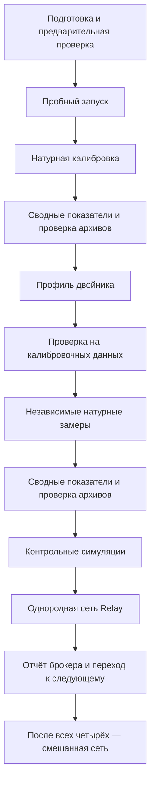

# Этапы эксперимента: кто запускает и что получаем

Сотрудник подготавливает стенд и запускает серию. Дальше программы автоматически выполняют измерения, строят двойников и проверяют их. Цель — получить **повторяемую модель MqttY, которая соответствует новым измерениям настоящего брокера в пределах заданных допусков**.

## Кто за что отвечает

| Участник | Ответственность |
| --- | --- |
| Сотрудник | Устанавливает программы, выбирает условия опыта, запускает серию и разбирает результаты |
| Сценарий запуска | Проверяет пути и ресурсы, создаёт процесс контроллера через systemd |
| Контроллер серии — Python | Выбирает следующий этап, вызывает программы, следит за состоянием и сохраняет историю |
| MqttBenchmark | Запускает натурные проверки и нагрузку, собирает данные, рассчитывает показатели |
| Скрипты управления брокерами | Запускают и останавливают выделенный экземпляр настоящего брокера |
| MqttY | Рассчитывает профиль двойника и выполняет одиночные и сетевые симуляции |
| Генератор отчётов | Собирает сохранённые результаты в таблицы, графики, Markdown и HTML |

Контроллер — управляющая программа, а не обязательно отдельная машина. В переносимом односерверном варианте он работает на том же Linux-хосте, что и брокер. Программы запускаются от имени сотрудника, а не от отдельного «пользователя симулятора».

## Порядок работы

Схема показывает путь одного брокера. В сокращённой программе пробные запуски всех брокеров выполняются заранее. Рабочие отчёты обновляются по мере завершения этапов. Опубликованные документы в корневой папке `reports` имеют дату среза: их нужно отличать от текущего состояния процесса. Натурные измерения идут последовательно и не пересекаются с симуляциями.

## 1. Подготовка серии

**Кто выполняет:** сотрудник, команда `portable-linux.py prepare` для полного переносимого варианта.

**Что происходит:** фиксируются версии, файлы настройки брокеров, наборы нагрузок, используемые CPU, каталоги и ограничения ресурсов. Для сокращённой программы создаётся отдельная серия.

**Результат:** `series.json`, `environment.json`, каталог `inputs/`. Это описание того, что и в каких условиях предстоит выполнить; измерений на этом этапе ещё нет.

## 2. Предварительная проверка — preflight

**Кто выполняет:** сотрудник через `--mode preflight`; контроллер также вызывает проверку перед натурными этапами.

**Что происходит:** MqttBenchmark проверяет доступность MQTT, версию и процесс брокера, конфигурацию и условия измерения. Скрипты управления запускают выделенный экземпляр брокера по описанию стенда.

**Результат:** журналы предварительной проверки и статус её завершения. Успех означает готовность к опыту, а не доказанную производительность или точность будущего двойника.

## 3. Пробный запуск — Pilot

**Кто выполняет:** контроллер автоматически; сотрудник может вызвать его отдельно через `--mode pilot`.

**Что происходит:** MqttBenchmark проверяет всю цепочку — нагрузку, получение сообщений, сбор CPU/RSS и сохранение данных. Проверяются три QoS.

**Результат:** три пробных запуска на брокер. Их данные сохраняются отдельно и не используются для настройки профиля. По ним также оценивают расход места и пригодность выбранных ресурсов.

## 4. Натурная калибровка

**Кто выполняет:** контроллер вызывает MqttBenchmark `matrix` с калибровочной конфигурацией.

**Что происходит:** настоящий брокер получает разные нагрузки. Для каждого сочетания размера сообщения, QoS и числа отправителей выполняются три повтора. Записываются попытки, завершения, получения, задержки и состояние машины.

**Результат:** 72 успешных измерения на брокер в полной программе или 36 в сокращённой. Неудачные технические попытки сохраняются отдельно. Именно эти данные разрешено использовать для настройки двойника.

## 5. Расчёт показателей и проверка архивов

**Кто выполняет:** контроллер вызывает MqttBenchmark `aggregate` и процедуры архивирования.

**Что происходит:** проверяются исходные файлы и полнота набора, рассчитываются средние и доверительные интервалы по повторам. Подробные данные архивируются; затем восстанавливаются во временный каталог и рассчитываются повторно.

**Результат:** `broker-observations.v3.json`, архивы с контрольными суммами, `archive-verification.json` и обновлённый отчёт. При повторном расчёте должны совпасть показатели и описание исходной серии. Этот этап выполняется и после независимых натурных замеров.

Архивирование отдельных попыток идёт по ходу измерений. Очистка распакованных файлов допускается только после предусмотренных проверок; единственная архивная копия сохраняется.

## 6. Построение профиля двойника

**Кто выполняет:** контроллер вызывает MqttY `calibrate --broker <имя>`; для сокращённого набора дополнительно используется `--coverage-protocol compact-v1`.

**Что происходит:** калибратор читает только калибровочные показатели. В варианте с эмпирическим распределением задержек используются также гистограммы исходных измерений. Рассчитываются параметры модели для каждой точки нагрузки.

**Результат:** файл профиля `broker-calibration.v3.json` и его SHA-256. Фактическая версия формата определяется полем внутри файла; историческое имя файла не всегда совпадает с ней. Профиль фиксируется и дальше проверяется на неизменность.

Параметры модельного транспорта также задаются до независимой проверки. Измеренные значения и допущения указываются отдельно.

## 7. Проверка на калибровочных данных — Fidelity

**Кто выполняет:** контроллер создаёт конфигурации точек и вызывает MqttY `experiment`.

**Что происходит:** запускается один двойник. Заданная нагрузка берётся из соответствующей калибровочной точки. Результаты модели сравниваются с данными, использованными для её настройки.

**Результат:** 72 симуляции на брокер в полной программе или 36 в сокращённой. Для каждой сохраняются `summary.json`, критерии сравнения, счётчики и сведения о запуске. Это проверка воспроизведения исходных данных; она не заменяет независимый контроль.

## 8. Независимые натурные замеры

**Кто выполняет:** контроллер снова вызывает MqttBenchmark `matrix`, теперь с конфигурацией `validation`.

**Что происходит:** настоящий брокер измеряется заново на той же сетке нагрузок. Порядок запусков задаётся другим seed. После измерений выполняются расчёт показателей и проверка архивов.

**Результат:** ещё 72 натурных измерения на брокер или 36 в сокращённой программе. Эти результаты хранятся отдельно от калибровки. Профиль по ним не изменяется.

«Независимые» здесь означает «не использованные для настройки». Другой порядок запусков сам по себе не гарантирует статистическую независимость: условия, паузы и фоновые нагрузки тоже нужно учитывать.

## 9. Контрольные симуляции — holdout

**Кто выполняет:** контроллер вызывает MqttY `experiment` с прежним профилем и `referenceObservationsPath`, указывающим на независимые замеры.

**Что происходит:** двойник получает нагрузку соответствующей контрольной точки. Новые измеренные показатели служат эталоном сравнения; параметры профиля и транспорта по ним не подбираются.

В текущей программе `offeredRps` берётся из attempted RPS контрольной точки. Это проверка при уже известной интенсивности попыток, а не прогноз этой интенсивности на новой машине. Факт использования контрольного показателя как входа нужно сохранять в описании проверки.

**Результат:** 72 контрольные симуляции на брокер или 36 в сокращённой программе. Это основная проверка точности двойника на новых данных. Если модель исправляют по найденным расхождениям, для следующего независимого контроля нужны новые измерения.

## 10. Однородная и смешанная сети Relay

**Кто выполняет:** контроллер вызывает MqttY `experiment` в режиме `mqttRelay`.

**Что происходит:** сначала соединяются четыре двойника одного брокера. После завершения необходимых этапов всех брокеров строится сеть с одним двойником каждого типа. Настройку маршрутов и соединения выполняет MqttY.

**Результат:** 72 сетевых запуска на каждый тип брокера и 72 смешанных, либо по 36 в сокращённой программе. Сохраняются схема сети, показатели брокеров и получения в конечных модельных узлах.

У этих запусков нет натурного эталона всей сети. Критерии одиночного Fidelity имеют статус `notApplicable`. Подробности: [как работает MqttRelay](mqtt-relay-explained.md).

## 11. Отчёт и оценка результата

**Кто выполняет:** контроллер вызывает генератор отчётов; итоговые выводы проверяет сотрудник.

**Что получаем:** отдельный отчёт Markdown и HTML для каждого брокера и смешанной сети, графики, таблицы CSV/JSON, ссылки на исходные данные и контрольные суммы. В мета-репозитории они публикуются в [reports](../reports/README.md). Если этапы не закончены, документ называется частичным и перечисляет невыполненную работу.

Сотрудник проверяет три вещи:

1. **Полнота:** все запланированные точки выполнены, ошибки и повторные попытки учтены.
2. **Повторяемость MqttY:** повторение одинаковых входов даёт одинаковые научные результаты. Проверочные повторы выполняются отдельно; обычная серия с разными seed эту проверку не заменяет.
3. **Точность:** на независимых данных выполнены применимые допуски RPS ≤15%, p99 ≤20%, абсолютной разности долей ошибок и недоставки ≤0,05.

Техническая ошибка запуска и нарушение критерия точности — разные результаты. Контроллер сохраняет оба; поведение после технической ошибки зависит от программы серии. Нарушение Fidelity не следует устранять исключением неудобной точки или ослаблением допуска.

Для продолжения контроллер читает `state.json` и индексы завершённых запусков. Перечень файлов не заменяет проверку целостности: изменённый профиль или несовместимые входы нельзя выдавать за продолжение прежнего опыта.

Связанные документы: [состав программ и ключевые классы](architecture.md), [число запусков и команды](full-campaign-runbook.md), [показатели и формулы](campaign-metrics.md), [устройство Relay](mqtt-relay-explained.md).

Описание сверено со сценариями: [основной контроллер](../MqttBenchmark/scripts/campaign/run.py), [управление симуляциями](../tools/campaign/accelerated-resume.py), [серии с ограничением времени](../tools/campaign/compact-campaign.py).
