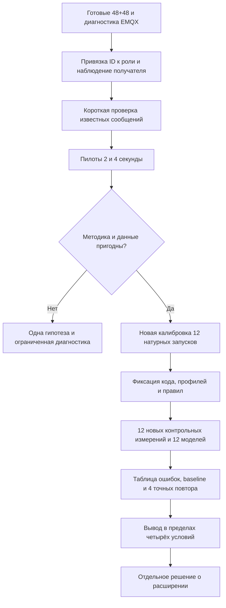

# Brainstorm методики первой статьи: как перейти от расхождений к проверяемому результату

Это предложения агента по прямому запросу автора. Они развивают уже выбранный вопрос о точности моделей MQTT-брокеров; выбор новой программы, численные условия пилотов и область научных утверждений здесь не объявляются утверждёнными автором. Применены ARS-Codex для методического разбора и systematic-debugging для разделения фактов и гипотез. Анализ выполнен одним агентом, без имитации независимой экспертной комиссии.

**Рекомендация:** сохранить нынешнюю серию как проверенный результат о границах старых профилей; подготовить согласованную методику на четырёх режимах и только после её проверки расширять матрицу. Не пытаться получить 100% прохождений увеличением допусков, очередей или числа попыток.

## 1. От чего отталкиваемся

| Уже известно | Что из этого следует |
| --- | --- |
| Финальная серия содержит 48 натурных и 48 модельных запусков | Есть материал для анализа; всю серию заново повторять не требуется |
| Пересчитаны 96 комплектов raw, показатели и SHA совпали | Арифметика и сохранность данных проверены; достоверность измерителя другим инструментом этим не доказана |
| Все три модели проходят все критерии в 2 из 16 режимов | Общая точность на всей сетке не подтверждена |
| Четыре выбранных модельных повтора совпали по проверенным файлам | Повторяемость отдельных расчётов подтверждена отдельно от точности |
| В 45 натурных запусках связь подписчика непрерывна на измерительном окне; в трёх EMQX он отключён до окна | Нужно различать обычную работу и работу после разрыва связи |
| В логах EMQX зафиксирован mailbox_overflow; короткие варианты 1000/5000 дали разрыв и 100% недоставки | Слепое увеличение очереди не устраняет проблему; причина накопления ещё требует проверки |
| Исторические профили получены при других временных окнах | Новые наблюдения проверяют перенос старых профилей, а не точность профиля, построенного в полностью совпадающих условиях |
| Во всех модельных журналах аудит не установил непрерывность соединения подписчика | Нужна проверка схемы регистрации состояний; unobserved не означает отключение |

Первичные результаты: `reports/audits/dissertation/article-1-fresh-validation-v1/`. Пересчёт и диагностика: `reports/audits/dissertation/article-1-skills-validation-v1/`. Подробное объяснение EMQX — в [разборе отключения](../../reports/analysis/EMQX-subscriber-shutdown.md).

## 2. Три возможных направления статьи

| Вариант | Главный результат | Что потребуется | Основной риск |
| --- | --- | --- | --- |
| А. Границы применимости существующих профилей | Показать совпадения, расхождения и случаи изменения состояния соединения по готовым данным | Уточнить область вывода, вклад и проверку измерителя | Работа получится преимущественно диагностической; научный вклад нужно обосновать |
| Б. Новая согласованная калибровка и отдельная проверка — рекомендуется как развитие | Проверить модель, профиль которой построен при той же методике, что и новый эталон | Наблюдаемость, пилоты, новая калибровочная серия и заранее отделённый контроль | Требуется новая серия; результат может снова не уложиться в допуски |
| В. Модель перегрузки и разрыва соединений | Воспроизводить рост очереди, защитное закрытие и последствия для доставки | Дополнительные измерения состояния брокера и проверка нового алгоритма | Легко уйти в большую доработку, не завершив первую статью |

Предлагаемая последовательность — **А → минимальный Б**. Вариант В оставить отдельной задачей, пока не выяснено, какую очередь и какой механизм действительно требуется моделировать. Предмет статьи остаётся прежним: сопоставление наблюдаемых метрик настоящего брокера и модели.

## 3. Сначала решить, что именно должна предсказывать модель

### Скорость при работе «отправить и дождаться»

У каждого отправителя следующая публикация начинается после исхода предыдущей. Сначала модель и настоящий брокер получают одинаковую политику, число клиентов и длительность; затем каждый самостоятельно показывает свою скорость. Натурный RPS нового контроля не подставляется модели как вход. Это основной предлагаемый режим для проверки воспроизведения производительности.

Разные фактические моменты попыток здесь естественны: они зависят от времени ответов. Требовать одновременно одинакового расписания каждой попытки и независимой скорости такого цикла нельзя.

### Работа при заранее заданной интенсивности

Нагрузку, например 1000 сообщений/с, задаёт внешний график, не зависящий от подтверждений. Тогда сравниваются задержки, ошибки, доставка и отставание от графика. Совпадение completed RPS при лёгкой нагрузке в основном показывает обслуживание заданного потока; оно не доказывает совпадения предельной производительности.

Такой режим полезен как дополнительная контролируемая проверка. Его реализация должна одинаково учитывать запланированные попытки, фактическую подачу и backpressure. Существующий token budget модели сам по себе не подтверждает эквивалентность двух генераторов.

### Повтор готовой последовательности попыток

Можно воспроизвести известные времена попыток как диагностический вход, чтобы отделить генератор от обработки брокером. Если последовательность взята из контрольного опыта, результат относится к **известной нагрузке**, а не к независимому прогнозу её скорости. Такой повтор нельзя смешивать с основным результатом без этого пояснения.

## 4. Предлагаемые изменения методики

### 4.1. Наблюдаемость и условия опыта

Записывать client ID, роль, тему, endpoint и фактический результат SUBACK. Состояния получателя регистрировать при начале и конце прогрева, перед измерением, при разрыве и в конце наблюдения. В модели должны быть отдельные наблюдения именно получателя, а не только отправителей или общие снимки графа.

Перед нагрузкой проверять, что нужный получатель подключён и подписка подтверждена. При разрыве сохранять данные и факт нарушения условия; не переподключать его незаметно. Для MQTT подтверждение публикации и доставка подписчику относятся к разным обменам, что следует из [стандарта MQTT 3.1.1](https://docs.oasis-open.org/mqtt/mqtt/v3.1.1/os/mqtt-v3.1.1-os.html).

**Важно:** отключение может быть настоящим результатом перегрузки. Оно не превращается автоматически в «невалидное измерение». Для оценки непрерывно подключённого режима точка выходит за заявленную область, но остаётся в отчёте обо всех плановых опытах. Отдельно показываются технический отказ инструмента, наблюдаемый отказ системы и расхождение модели. Фильтрация удачных запусков после просмотра результатов создаёт смещение отбора.

### 4.2. Один порядок измерения и одинаковый срок наблюдения

Кандидат для короткой новой серии: прогрев 1 с, основная нагрузка 4 с, наблюдение ещё 5 с после границы подачи. Длительность 4 с **не считается уже достаточной**: её выбирают только после пилотов 2/4 с. Если сравнение длительностей неустойчиво, основная серия блокируется для разбора; произвольная цепочка всё более длинных запусков не начинается.

При tick 10 мкс кандидат соответствует 100 000 тиков прогрева, 400 000 нагрузки и горизонту ещё 500 000 тиков наблюдения. Подключение и подписка учитываются дополнительно. Это параметры будущей программы, а не замена фаз уже выполненной серии.

Сравнивать сообщения с попытками в одном объявленном окне `[start, end)`. Завершения после end учитывать отдельно. Обеим сторонам дать одинаковый объявленный срок наблюдения `end + drain`. Настоящая тишина в течение 10 мс не равна доказанному отсутствию будущих сообщений. Ускоренное завершение модели допустимо только при проверенном отсутствии всех будущих событий, влияющих на эту группу сообщений.

### 4.3. Измеритель как отдельный объект проверки

На малой нагрузке отправить известное число ID и проверить фактический размер payload, исходы, получения и отделение прогрева. Дополнительный независимый клиент, например mosquitto_sub или MQTTX, применять в отдельной проверке. Второй подписчик меняет fanout, поэтому его нельзя незаметно добавлять в основную серию с одним получателем.

Для спорного отключения нужны привязка client ID к роли и признаки накопления очереди. Сначала проверить доступные счётчики и существующие журналы; затем один микротест под одну гипотезу. Буферизованное журналирование уже есть — нельзя заранее объявлять дисковую запись причиной. Влияние наблюдения на скорость также проверяется отдельным сравнением, а не вычитается из результата предполагаемой поправкой.

### 4.4. Новая калибровка и контроль

Разработку и исправления выполнять на нынешней серии и пилотах. После них зафиксировать код, профиль, настройки брокеров, сроки, допуски и правила обработки разрывов. Новые контрольные наблюдения получать после этой фиксации и не использовать для дальнейшего выбора параметров в той же проверке.

Если после просмотра контроля алгоритм или профиль меняется, прежний контроль становится данными разработки. Его результаты остаются в истории; для нового утверждения точности нужен новый заранее выделенный контроль. Совпадение хэша профиля не доказывает, что при разработке не использовались контрольные результаты.

Профиль, настроенный по закрытому циклу на одном компьютере, не объявляется автоматически точным при другом темпе, конфигурации защит, оборудовании или числе получателей. Такой перенос — отдельный исследовательский вопрос. Связь назначения модели и области её точности соответствует подходу [Sargent](https://www.informs-sim.org/wsc11papers/016.pdf); общую необходимость проверки и оценки неопределённости обсуждает [NIST](https://www.nist.gov/publications/credibility-consideration-digital-twins-manufacturing). Конкретные длительности и допуски здесь — предложения проекта, а не требования этих источников.

### 4.5. Простой baseline без симулятора

Дополнительно сравнить MqttY с простой таблицей: она для каждого точного режима всегда выдаёт средние калибровочные RPS, p99 и доли. Таблица использует только калибровку, без значений нового контроля. Обе модели сравниваются с одним контрольным набором.

Это проверяет, что даёт исполнение MQTT-модели сверх хранения профиля. Если таблица столь же точна, не утверждать превосходство MqttY по точности одиночной точки. Возможная ценность MqttY тогда связана с исполнением взаимодействий и составных сетей; натурную точность этих сетей нужно доказывать отдельно.

## 5. Минимальная программа вместо очередной большой матрицы

Начать с **четырёх условий**: Aedes, Mosquitto, ActiveMQ и EMQX; 16 байт, QoS 1, 16 отправителей, один подписчик. Выбор включает все четыре реализации и сделан до новых результатов, а не только по наиболее удачному брокеру. Эта программа не охватывает QoS 0/2, 128 отправителей или перегрузку.

| Этап | Минимальный шаг | Расширение QoS 1/2, N16 | Полная сетка QoS 1/2, N16/128 |
| --- | ---: | ---: | ---: |
| Условия | 4 | 8 | 16 |
| Новая натурная калибровка, три повтора | 12 | 24 | 48 |
| Новый натурный контроль, три повтора | 12 | 24 | 48 |
| Модели, три заранее выбранных seed | 12 | 24 | 48 |
| Всего основных запусков | **36** | **72** | **144** |
| Выбранные точные повторы моделей | 4 | 4 | 4 |
| Всего с повторами | **40** | **76** | **148** |

Пилоты и технические пробы считаются отдельно. Числа 40/76/148 — будущие программы с новой калибровкой; они не переименовывают уже выполненные 48+48. К каждому расширению переходить после проверки полноты и причин технических проблем, сохраняя все научные расхождения. Прохождение всех допусков не является обязательным условием расширения.

Три натурных повтора дают лишь ограниченную оценку разброса. Если они сильно расходятся, это результат о нестабильности; нельзя повторять их до появления трёх удобных значений. Дополнительное число повторов и его максимальный предел определяются отдельно до расширения.

## 6. Последовательность с условиями остановки

Разрывы и противоречия в журналах останавливают масштабирование для выяснения смысла результатов. Чистые технически расхождения модели с эталоном сохраняются как научный результат. Изначальный общий предел новой кампании вычисляется по пилотам; если прогноз превышает разрешённый бюджет, сетку уменьшают до запуска, а не сокращают сроки наблюдения во время опыта.

Натурные опыты выполнять последовательно. Модельные процессы можно распараллеливать при отдельном лимите памяти и отсутствии конкуренции с натурными измерениями. Для каждого задания сохранять результат и попытку, чтобы продолжение не пересчитывало готовые точки. Нового таймера или циклического опроса агентом не требуется.

## 7. Какие показатели и выводы нужны

Для каждого режима показать реальные и модельные RPS, p99 успешных операций, доли ошибок и недоставки, абсолютные/относительные ошибки, разброс трёх натурных повторов и каждого модельного seed. Отдельно — число попыток, pending, связи подписчика, завершения и доставки после окна. QoS 0 ACK latency неприменима; из текущей минимальной программы QoS 0 вообще исключён явно.

Основной результат — карта применимости по всем запланированным условиям. Допуски 15% / 20% / 0,05 / 0,05 сохраняются; их прохождение не объявляется статистическим доказательством эквивалентности. Среднее трёх p99 не равно p99 объединённого потока. Три seed не являются тремя дополнительными независимыми натурными измерениями.

Воспроизводимость модели проверяется точными повторениями при прежних входах, runtime и seed. Перенос на другой компьютер — отдельная проверка модельного расчёта; перенос профиля на другой настоящий сервер — другая проверка точности. Время вычисления симуляции также отделяется от модельного времени и числа тиков.

## 8. Приоритет на ближайшие два человеко-дня

Это ориентир работ при отсутствии новых блокирующих причин; единица планирования — 0,5 человеко-дня. Время Linux-прогонов оценивается отдельно по пилотам, выполнения всей сетки за два дня не обещается.

| Блок | Подготовка | Оценка |
| --- | --- | ---: |
| 1 | Наблюдаемость подписчика, client ID, правила разрывов и короткие проверки | 0,5 |
| 2 | Пилоты одинаковых фаз, оценка влияния измерителя и фиксация минимальной программы | 0,5 |
| 3 | Калибровка, фиксация профилей, контроль и модели четырёх условий при допуске | 0,5 |
| 4 | Пересчёт, простой baseline, точные повторы, таблицы и правка выводов | 0,5 |

Если блок 1 или 2 не закрыт, оставшееся время направить на объяснение проблемы и пакет варианта А, а не запускать 144 опыта. Для читателя статьи достаточно честного результата с ясной областью действия; обещание полной точности всех брокеров данными не обеспечивается.

## 9. Связь с прежними публикациями автора

В статье сохраняются ссылки на три работы Солопия и Классена: нагрузочное тестирование, распределённые IoT-сети и ускорение MqttY. Новая работа должна явно описать добавленный результат — проверяемое сопоставление настоящего брокера и профилированной модели с разделением метрик и состояний. Предшествующие статьи не используются вместо новых доказательств. Реквизиты сохранены в [реестре публикаций автора](../../reports/analysis/Author-publications-for-articles.md).

## Что подготовлено этим brainstorm

- [x] Сопоставлены три направления статьи и выделен рекомендуемый порядок А → минимальный Б.
- [x] Разделены независимая скорость закрытого цикла, заданный поток и повтор известного расписания.
- [x] Предложены единые сроки наблюдения, проверка получателя, baseline и новая граница калибровки/контроля.
- [x] Подсчитаны минимальная и расширенные сетки, обозначены ограничения и условия остановки.
- [ ] Авторский выбор новой программы и окончательных численных условий не подменён этим документом. Новые серии в рамках brainstorm не запускались.
