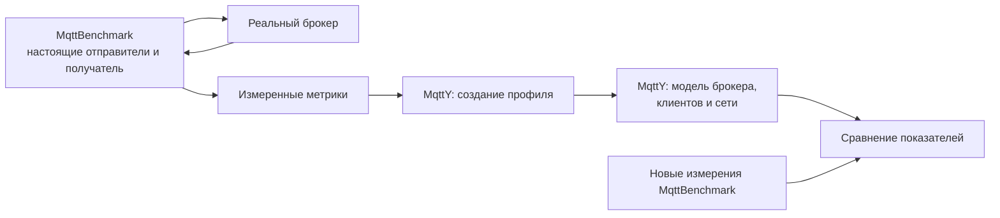
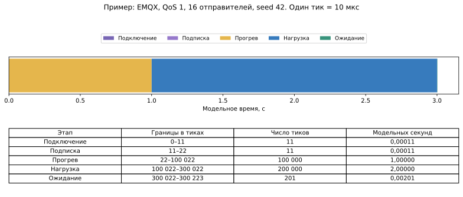
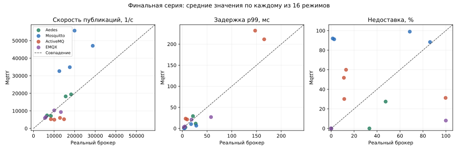

# Воспроизведение характеристик реальных MQTT-брокеров в MqttY

## Аннотация

В работе проверяется, насколько симулятор MqttY воспроизводит характеристики настоящего брокера сообщений. Программа MqttBenchmark измеряет скорость публикации — RPS, успешные и неуспешные публикации, задержки и доставку подписчику. По измерениям создаётся профиль брокера, который используется для запуска его модели — двойника. Итоговая проверка включает 48 новых измерений Aedes, Mosquitto, ActiveMQ Classic и EMQX и 48 запусков моделей. Проверены 16 режимов: четыре брокера, два уровня QoS и два числа отправителей. Все показатели во всех трёх модельных запусках уложились в заданные допуски в 2 из 16 режимов — для EMQX с 16 отправителями. В остальных режимах обнаружены расхождения. Четыре выбранных точных повтора моделей дали одинаковые показатели и побайтно совпадающие проверяемые файлы. Расчёт воспроизводится, но точность имеющихся профилей подтверждена только для части выбранных условий.

**Ключевые слова:** MQTT, брокер сообщений, MqttY, двойник брокера, профиль, скорость публикации, задержка, доставка, воспроизводимость.

## 1. Задача и участники эксперимента

Цель работы — измерить настоящий брокер и получить в симуляторе близкие значения тех же показателей. Под двойником здесь понимается модель внешнего поведения брокера. Его внутреннее устройство не копируется, постоянной синхронизации с работающим сервером нет. Правильность реализации, соответствие измерениям и повторяемость расчёта проверяются отдельно [2].

**MqttBenchmark** подключается к настоящему брокеру, передаёт сообщения и записывает события. **MqttY** строит профиль по измерениям и выполняет модельные обмены. Отдельный проверяющий скрипт пересчитывает сохранённые события и сопоставляет результаты. Натурные сравнения MQTT-брокеров рассматриваются также в [3], а программное моделирование MQTT — в [4].



Основные результаты статьи получены по **финальной новой серии 48+48**, включая повторно выполненные измерения EMQX. Старые измерения использованы для настройки профилей. Прежние контрольные результаты не добавляются к итогам новой проверки.

## 2. Как запускался настоящий брокер и что измерялось

Брокеры запускались по одному, обычными процессами Linux. Для каждого опыта контроллер создавал отдельный каталог и запускал отдельный экземпляр брокера. MqttBenchmark подключал 16 или 128 отправителей и одного получателя. Генератор и брокер работали на одном компьютере, обмен шёл через локальный сетевой интерфейс.

Каждый отправитель начинал следующую публикацию после завершения предыдущего вызова. Скорость настоящего брокера заранее не задавалась: измерялось фактическое число публикаций за секунду. Сообщение размером 16 байт содержало идентификатор, связывающий попытку публикации, её завершение и получение подписчиком.

Перед измерением проверялась готовность брокера. Затем выполнялись прогрев, основная подача и ожидание завершения обмена. Сообщения прогрева отделялись от измерительных по идентификаторам. Сохранялись границы этапов и события подключения клиентов.

| Метрика | Что означает | Зачем нужна |
| --- | --- | --- |
| RPS попыток | Число вызовов публикации в секунду | Показывает фактическую нагрузку от отправителей |
| RPS завершений | Число успешных завершений внутри окна измерения в секунду | Показывает скорость завершения публикаций |
| Успешные публикации | Число успешных исходов, включая завершённые во время ожидания | Позволяет проверить окончание начатых операций |
| Ошибки публикации | Число и доля неуспешных вызовов | Выявляет проблемы клиента, соединения или брокера |
| Задержка p99 | Время, за которое завершились 99% успешных публикаций | Показывает задержку медленных операций |
| Уникальные доставки | Число разных сообщений у подписчика | Проверяет фактическое получение сообщений |
| Недоставка | Доля успешных публикаций, не обнаруженных у подписчика к концу наблюдения | Выявляет разницу между подтверждением отправителю и доставкой |
| Дубликаты | Повторные получения того же идентификатора | Отличает новые сообщения от повторов |
| Незавершённые операции | Попытки без известного исхода к концу наблюдения | Показывает неполноту завершения обмена |

**Подтверждение публикации и получение сообщения подписчиком — разные события.** При QoS 1 публикация завершается после PUBACK, при QoS 2 — после завершающего ответа PUBCOMP [1]. Поэтому p99 публикации не является задержкой доставки подписчику. Ошибка вызова также не означает падение процесса брокера. CPU и память настоящего брокера в этой статье с моделью не сравниваются.

Первые 12 натурных попыток EMQX завершились до измерения: TCP-порт уже был открыт, но MQTT ещё не принимал подключения. Короткая проверка выявила около 4,4 секунды сбросов соединений до успешного ответа MQTT. Контроллер исправлен: он дожидается этого ответа. Все 12 точек повторены; первоначальные отказы сохранены отдельно и не выданы за измеренные значения.

## 3. Как получается профиль двойника

Профиль — файл характеристик определённого брокера для заданных размера сообщения, QoS и числа отправителей. Для настройки использованы прежние натурные данные с тремя повторами каждой точки. Перед новой проверкой профили и сборка модели зафиксированы контрольными суммами.

| Измеренное свойство | Использование в модели |
| --- | --- |
| Скорость завершения публикаций | Ограничение скорости обработки |
| Распределение длительностей публикаций | Разные времена обработки модельных сообщений |
| Доли ошибок и недоставки | Параметры неуспешных операций и доставки |
| Размер сообщения, QoS, число отправителей | Выбор точного режима профиля |

Скорости и доли усредняются по трём повторам. Задержки объединяются с учётом числа наблюдений каждого интервала. Среднее трёх p99 и p99 всех объединённых событий — разные величины.

MqttY исполняет собственную модель сети и MQTT-обмена. Измеренная задержка уже включает настоящий транспорт и очереди, поэтому её нельзя целиком прибавить к модельной сетевой задержке. Реализация использует оценочное дополнительное время обработки и ограничение скорости. Это приближение внешнего поведения, точность которого проверяется экспериментом.

Отсутствующая точка профиля не заменяется соседней. Новые измерения не используются для исправления профиля этой же проверки. Таким образом, расхождения остаются видны.

## 4. Стенд и программа проверки

| Параметр | Значение |
| --- | --- |
| ОС | Simply Linux 11.1, Linux 6.12 |
| Процессор | Intel Xeon E5-2680 v3, 12 физических ядер, 24 логических CPU |
| Доступная системе память | Около 15,5 ГиБ |
| Размещение | Один хост, TCP через loopback |
| Назначение CPU | Брокер — CPU 0, измеритель — CPU 1–2, модель — CPU 1 |
| Ограничения службы серии | Общая память до 2 ГиБ; лимит CPU — 300% |
| Измеритель и модель | .NET 6.0.36; клиент MQTTnet 4.3.3.952 |
| Протокол | MQTT 3.1.1, без TLS и клиентских учётных данных |
| Нагрузка | 16 байт; QoS 1 и 2; 16 и 128 отправителей; один получатель |
| Повторы | Три натурных измерения и три модельных запуска с seed 42, 43, 44 |

Ограничение памяти относится ко всей службе опыта. Закрепление за логическим CPU не означает выделение эксклюзивного физического ядра.

| Брокер | Версия | Среда выполнения |
| --- | --- | --- |
| Aedes | 1.1.2 | Node.js 22.13.1 |
| Mosquitto | 2.0.15 | Скомпилированная программа |
| ActiveMQ Classic | 6.3.2 | OpenJDK 17.0.19+10 |
| EMQX | 6.3.0 | Erlang/ERTS 16.3 |

Основная программа: `4 брокера × 2 QoS × 2 числа отправителей × 3 повтора = 48 натурных измерений`, затем 48 модельных запусков. Пилоты и неудачные технические попытки в эти 48 успешных натурных результатов не включены.

Модельный отправитель также ждёт завершения предыдущей публикации. Верхний предел подачи выбран высоким и вычислен из числа отправителей и шага времени. Он **не берётся из нового измеренного RPS**. Совпадение новой скорости не задаётся модели заранее. При этом профиль остаётся описанием ранее измеренного стенда, а не универсального сервера.

## 5. Стадии симуляции: время и тики

**Тик — один шаг модельного времени.** В этой серии один тик равен **10 микросекундам**, или 0,00001 секунды. В одной модельной секунде — 100 000 тиков. Время вычисления на компьютере учитывается отдельно.

Короткие пилоты перед основной серией проверяют соединения, появление сообщений и сохранение результатов. В основной модели сначала создаётся сеть, затем клиенты подключаются и получатель подписывается на сообщения. После этого выполняются прогрев, измерение и ожидание завершения.

| Стадия | Тиков в выполненных моделях | Модельное время |
| --- | ---: | ---: |
| Создание объектов | 0 | Модельное время ещё не продвигается |
| Подключение | 7–31 | 0,00007–0,00031 с |
| Подписка | 7–31 | 0,00007–0,00031 с |
| Прогрев | 100 000 | 1 с |
| Начало нового учёта | 0 | Прогрев отделён от измерения |
| Основная нагрузка | 200 000 | 2 с |
| Фактическое ожидание завершения | 53–61 926 | 0,00053–0,61926 с |
| Максимальное разрешённое ожидание | 500 000 | До 5 с после нагрузки |

Полная фактическая длительность моделей составила **300 067–361 984 тика**, или **3,00067–3,61984 модельной секунды**. Вычисление такого опыта на компьютере может занимать десятки обычных секунд; эти два времени нельзя смешивать.



На рисунке показан выполненный запуск EMQX, QoS 1, 16 отправителей, seed 42. Подключение и подписка заняли по 11 тиков, прогрев — 100 000, нагрузка — 200 000, ожидание — 201 тик. Итого — **300 223 тика, или 3,00223 модельной секунды**. Короткие стадии почти не видны на общей шкале, поэтому указаны и точные числа.

У настоящего брокера также заданы 1 секунда прогрева и 2 секунды подачи. Измеритель сначала дожидается исходов начатых вызовов, затем ожидает доставки по своему правилу, не более 5 секунд этого ожидания. MqttY заканчивает ожидание, когда в модели прекращается незаконченный обмен. Правила завершения ожидания различаются; события после границы подачи учитываются явно.

## 6. Результаты и точность воспроизведения

Для обоих вариантов выбираются сообщения, публикация которых началась внутри двухсекундного окна. Прогрев в эту группу не входит. По идентификаторам определяются исходы публикаций и доставки, в том числе после прекращения подачи.

- RPS завершений — число успешных завершений **внутри окна**, делённое на 2 секунды.
- Доля ошибок — число неуспешных исходов относительно числа попыток выбранной группы сообщений.
- Недоставка — `1 − полученные ID успешных публикаций / число успешных публикаций` к концу наблюдения.
- p99 — 99-й процентиль длительностей успешных публикаций выбранной группы, включая завершённые во время ожидания.

В итоговых опытах нет попыток с неизвестным исходом, ошибок публикации или зарегистрированных дубликатов — ни в натурных данных, ни в моделях. Это не означает отсутствия недоставки. Совпадение нулевых долей ошибок не проверяет поведение при отказах.

В каждом режиме натурный эталон — среднее трёх измерений. С ним сравнивается каждый из трёх модельных запусков.

| Показатель | Допуск, заданный до анализа |
| --- | --- |
| RPS завершений | Различие не более 15% от натурного значения |
| p99 публикации | Различие не более 20% от натурного значения |
| Доля ошибок | Абсолютное различие не более 0,05 |
| Недоставка | Абсолютное различие не более 0,05 |

Для долей 0,05 означает пять процентных пунктов. Эти допуски являются условиями данного исследования, а не универсальными требованиями любого приложения.

В следующей таблице для компактности показаны средние трёх натурных и трёх модельных запусков. Для p99 это среднее трёх отдельных p99. Значения и ошибки каждого seed сохранены отдельно.

| Брокер / QoS / отправители | RPS: реальный → MqttY | p99, мс: реальный → MqttY | Недоставка, %: реальный → MqttY |
| --- | ---: | ---: | ---: |
| ActiveMQ / 1 / 128 | 14 848,7 → 5 233,8 | 147,288 → 231,907 | 12,96 → 59,99 |
| ActiveMQ / 1 / 16 | 12 877,3 → 5 988,5 | 6,659 → 23,183 | 11,10 → 51,81 |
| ActiveMQ / 2 / 128 | 10 118,7 → 4 976,5 | 165,579 → 211,347 | 99,79 → 31,23 |
| ActiveMQ / 2 / 16 | 8 453,2 → 5 271,2 | 9,653 → 21,297 | 11,40 → 30,10 |
| Aedes / 1 / 128 | 18 265,3 → 19 402,5 | 26,984 → 11,403 | 47,49 → 27,46 |
| Aedes / 1 / 16 | 15 631,8 → 18 245,8 | 3,411 → 1,317 | 0,00 → 0,00 |
| Aedes / 2 / 128 | 8 455,2 → 7 114,2 | 21,492 → 29,240 | 33,33 → 0,00 |
| Aedes / 2 / 16 | 6 590,0 → 7 408,8 | 6,259 → 2,733 | 0,00 → 0,00 |
| EMQX / 1 / 128 | 13 300,2 → 9 334,3 | 18,580 → 20,720 | 100,00 → 8,05 |
| EMQX / 1 / 16 | 10 067,0 → 10 269,2 | 3,139 → 2,953 | 0,00 → 0,00 |
| EMQX / 2 / 128 | 5 579,5 → 5 927,0 | 58,020 → 26,900 | 0,00 → 0,00 |
| EMQX / 2 / 16 | 6 044,7 → 6 541,2 | 5,076 → 4,630 | 0,00 → 0,00 |
| Mosquitto / 1 / 128 | 28 780,8 → 47 056,5 | 17,728 → 10,280 | 86,22 → 88,35 |
| Mosquitto / 1 / 16 | 19 952,0 → 55 680,8 | 3,716 → 0,420 | 2,61 → 91,19 |
| Mosquitto / 2 / 128 | 17 636,0 → 34 869,0 | 28,195 → 6,563 | 68,54 → 98,99 |
| Mosquitto / 2 / 16 | 12 552,7 → 32 636,0 | 4,815 → 0,750 | 1,35 → 92,00 |




Каждая точка графика — один из 16 режимов. Чем ближе точка к пунктирной линии, тем ближе модель к измерению. Скорость, задержка и доставка проверяются раздельно.

**Все показатели одновременно прошли проверку в 2 из 16 режимов — 12,5% проверенной сетки.** Это EMQX с 16 отправителями при QoS 1 и QoS 2. В обоих режимах прошли все три seed: всего 6 из 48 модельных запусков. В остальных 14 режимах каждый модельный запуск нарушил хотя бы один допуск.

| Двойник | RPS в допуске /12 | p99 в допуске /12 | Ошибки в допуске /12 | Недоставка в допуске /12 | Все показатели во всех повторах /4 режима |
| --- | ---: | ---: | ---: | ---: | ---: |
| Aedes | 8 | 0 | 12 | 6 | 0 |
| Mosquitto | 0 | 0 | 12 | 3 | 0 |
| ActiveMQ | 0 | 0 | 12 | 0 | 0 |
| EMQX | 9 | 9 | 12 | 9 | 2 |

Из 192 проверок показателей **92 находятся в допуске, 100 — вне допуска**. Число 92/192 нельзя назвать «процентом точности симулятора»: показатели связаны, а 48 успешных проверок ошибок публикации относятся к совпадению нулей. Основной итог — два полностью прошедших режима и ошибки остальных.

Например, у EMQX при QoS 1 и 16 отправителях получены около 10 067 завершений/с на стенде и 10 269 в модели; p99 — 3,139 и 2,953 мс. Доставка полная в обоих случаях. У Mosquitto в таком же режиме скорость равна примерно 19 952 и 55 681 завершению/с, а недоставка — 2,61% и 91,19%. Поэтому хорошее воспроизведение всех четырёх брокеров эта серия не подтверждает. Результат модели EMQX также не означает, что настоящий EMQX — самый быстрый брокер.

Профили строились при другом прогреве и более длинной нагрузке. В новой серии добавлена подробная запись событий, которая может нагружать генератор. Вклад каждого изменения отдельно ещё не измерен. Это направления дальнейшей проверки, а не установленная причина каждого расхождения. Профили и допуски по полученным результатам не подгонялись.

## 7. Повторяемость и другая машина

После основной серии повторены четыре выбранные модели: по одной на брокер, QoS 1, 16 отправителей, seed 42. Взяты те же сохранённые конфигурации, профили и сборка.

| Повтор модели | Показатели совпали | Проверяемые файлы совпали побайтно |
| --- | --- | --- |
| Aedes | Да | Да |
| Mosquitto | Да | Да |
| ActiveMQ | Да | Да |
| EMQX | Да | Да |

Сравнивались итоговая сводка, гистограмма задержек, журналы публикаций и получений, файл границ этапов. Совпали также независимо пересчитанные показатели выбранной группы сообщений. Служебные даты, пути и идентификатор запуска в условие совпадения не входят. Подтверждена повторяемость этих четырёх расчётов; все 48 моделей повторно не запускались. Воспроизведение всего исследования другим исследователем пока не проверено.

**Если перенести только MqttY на другую машину**, прежде всего изменится время вычисления на компьютере. При одинаковых входах, seed, шаге времени и последовательном исполнении модель должна описывать тот же обмен. В работе совпадение проверено на исходном хосте. Отдельной проверки побайтового совпадения на другом оборудовании и в другой среде выполнения нет.

**Если на другой машине измерить настоящий брокер**, могут измениться RPS, задержки и доставка. Влияют процессор, память, ОС, сеть и соседняя нагрузка. Старый профиль не обязан точно описывать новый стенд: его нужно проверить и при необходимости построить заново. Размещение измерителя и брокера на разных компьютерах также меняет сетевые условия.

Следовательно, повторяемость расчёта и точность относительно реального брокера — разные свойства. Модель может повторять как близкий результат, так и расхождение.

## 8. Выводы

Проверена последовательность от запуска настоящего брокера и записи событий MqttBenchmark до запуска двойника в MqttY и сравнения одинаковых показателей. Итоговая серия содержит 48 успешных натурных измерений и 48 модельных запусков. Проблема готовности EMQX исправлена, недостающие измерения повторены.

Точность в пределах выбранных допусков подтверждена для **EMQX с 16 отправителями при QoS 1 и QoS 2** — двух из 16 режимов. Для остальных режимов обнаружены существенные расхождения. Имеющиеся профили пока нельзя считать универсально точными двойниками всех четырёх брокеров. Нужно согласовать условия настройки и проверки, оценить влияние записи событий и проверить доработанную модель на новых данных.

Четыре точных повтора подтвердили воспроизводимость проверенных модельных файлов и показателей. При переносе настоящего брокера на другое оборудование точность прежнего профиля требуется проверять заново. Результат работы — проверенные случаи совпадения и открыто показанные ограничения.

## Данные и воспроизведение

Основной пакет — `reports/audits/dissertation/article-1-fresh-validation-v1/`. Итоговые данные находятся в `final-summary.json` и `final-native-vs-model.csv`; проверка повторов — в `replay-summary.json`; реальные стадии и тики — в `phase-evidence.json`. Таблицы и рисунки статьи сохранены в `reports/audits/dissertation/article-1-final-v1/`.

Контрольные суммы связывают профиль, сборку и результаты. Первичные журналы хранятся отдельно на Linux. Для полного повторения нужны эти входы и сохранённая сборка; текущий исходный код не выдаётся за тождественную историческую сборку. Публичный постоянный архив данных пока не создан.

```text
python tools/dissertation/analyse_fresh_twin_results.py --summary reports/audits/dissertation/article-1-fresh-validation-v1/final-summary.json --comparison reports/audits/dissertation/article-1-fresh-validation-v1/final-native-vs-model.csv --output <новый-каталог>
```

Команда проверяет арифметику таблицы по сохранённым сводкам. Она не запускает новые натурные измерения и не заменяет пересчёт первичных событий.

## Литература

1. OASIS. MQTT Version 3.1.1. [Стандарт протокола](https://docs.oasis-open.org/mqtt/mqtt/v3.1.1/os/mqtt-v3.1.1-os.html).
2. Sargent R. G. Verification and Validation of Simulation Models. Proceedings of the Winter Simulation Conference. P. 183–198. [DOI: 10.1109/WSC.2011.6147750](https://doi.org/10.1109/WSC.2011.6147750).
3. Mishra B., Mishra B., Kertesz A. Stress-Testing MQTT Brokers: A Comparative Analysis of Performance Measurements. Energies. Vol. 14, no. 18, article 5817. [DOI: 10.3390/en14185817](https://doi.org/10.3390/en14185817).
4. Mohammad El-Basioni B. M. A conceptual modeling approach of MQTT for IoT-based systems. Journal of Electrical Systems and Information Technology. Vol. 11, article 62. [DOI: 10.1186/s43067-024-00181-x](https://doi.org/10.1186/s43067-024-00181-x).
