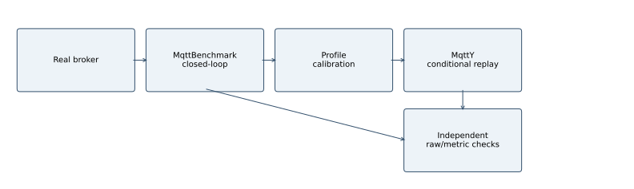
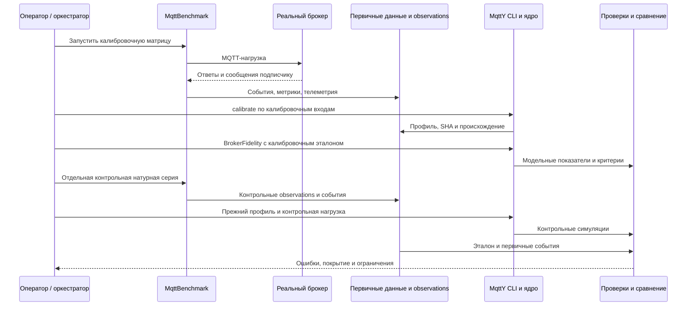

# Ретроспективное условное соответствие эмпирических моделей MQTT-брокеров в MqttY

## Аннотация

Исследуется ретроспективное соответствие эмпирических моделей MQTT-брокеров историческим измерениям. Для четырёх реализаций использованы 576 натурных запусков. Измеренная интенсивность API-попыток задаётся модели как известное условие; поэтому сравнение не является независимым прогнозом производительности. Единица анализа — сочетание payload, QoS и числа publishers, а три seed рассматриваются внутри одного условия. Все применимые критерии прошли все три seed в 64 из 96 исторических условий, часть seed — в восьми, ни один — в 24. На калибровочных данных все seed прошли в 88 из 96 условий. Раздельно проверены арифметика первичных данных и повторяемость выбранных вычислений. Анализ чувствительности охватывает 216 модельных запусков: удвоение короткого окна изменяет p99 до 26,923%. Различия нагрузки, временных окон и наблюдаемости клиентских ошибок ограничивают интерпретацию. Результат представляет описательную карту ретроспективного соответствия и её ограничений; независимая валидация нового зафиксированного алгоритма требует отдельной натурной серии.

**Ключевые слова:** MQTT, имитационное моделирование, эмпирическая модель, калибровка, верификация, задержка, воспроизводимость.

## 1. Постановка задачи

При выборе MQTT-брокера и проектировании распределённой системы требуется оценивать не только число обработанных сообщений, но и доставку подписчикам, задержки и поведение при изменении нагрузки. Натурный эксперимент даёт наблюдения конкретной реализации на конкретной установке. Имитационная модель позволяет многократно исследовать заданные условия, однако её результат полезен лишь при известной области применимости и проверяемой связи с измерениями.

Объект исследования — эмпирическая модель наблюдаемых показателей брокера, то есть суррогат производительности измеренного тракта «клиент — брокер — подписчик». Историческое название «двойник» в приложениях и каталогах не означает, что реализованы синхронизация с работающим объектом, реконструкция его внутреннего состояния или двустороннее управление. Статья не обосновывает статус полноценного цифрового двойника.

Исследовательский вопрос состоит в следующем: в каких измеренных режимах такой профиль воспроизводит скорость, задержки и недоставку и насколько результат зависит от шага модельного времени и длительности нагрузки? Дополнительная задача — отличить повторяемость вычисления от точности относительно реальной системы.

Предоставляемый результат состоит в проверяемой цепочке «события → метрики → профиль → модель → критерии», полной карте исторических расхождений для четырёх эмпирических моделей и парном анализе чувствительности. Утверждение о первенстве такого подхода не делается: обзор ниже сопоставляет ближайшие методы, но не является исчерпывающим поиском научной новизны.

## 2. Связанные исследования

Sargent разделяет корректность реализации модели, качество исходных данных и соответствие модели назначению в определённых экспериментальных условиях. Вопрос доверия к цифровым двойникам также рассматривается через V&V и неопределённость в работе NIST [5]. Такая постановка объясняет, почему успешное выполнение программы или совпадение контрольных сумм не заменяет проверки точности [1]. В настоящем исследовании эти проверки оформлены раздельно; численные допуски являются условиями программы проекта, а не следуют из работы [1].

Mishra, Mishra и Kertesz рассматривают натурное сравнение MQTT-брокеров по CPU, задержке и скорости сообщений [2]. С этим исследованием сопоставим выбор наблюдаемых свойств, но не непосредственные численные результаты: аппаратные условия, состав реализаций и определение задержки отличаются. Рейтинг производительности реальных брокеров также не является оценкой точности их двойников.

Mohammad El-Basioni описывает концептуальное моделирование MQTT и его реализацию на OMNeT++/INET для прикладного сценария парковки [3]. В отличие от проверки прикладного сценария, настоящая работа сопоставляет профиль конкретного брокера с измеренными скоростями, долями и публикационными квантилями. Само наличие модели MQTT не рассматривается как новый результат.

| Направление | Что проверяется | Отличие настоящего эксперимента |
| --- | --- | --- |
| Методология верификации и валидации [1] | Корректность модели и её соответствие назначению | Применение к цепочке первичных MQTT-событий и эмпирическому профилю |
| Натурное сравнение брокеров [2] | Производительность реальных реализаций | Ошибка модели относительно отдельного эталонного наблюдения |
| Концептуальная MQTT-модель [3] | Представление протокола и прикладного сценария | Измерительно заданные характеристики четырёх брокеров и карта применимости |

## 3. Метод

### 3.1. Ответственность приложений

Натурные измерения выполняет MqttBenchmark: создаёт настоящие MQTT-соединения, задаёт нагрузку, регистрирует попытки публикации и их исходы, получения подписчиком, состояние генератора и телеметрию. Реальный брокер исполняется отдельным native-процессом. Эти обмены не проходят через MqttY.

MqttY строит профиль по агрегированным observations и гистограммам, затем исполняет модельных клиентов, сеть и брокер. Калибровка и BrokerFidelity вызываются CLI проекта `EntityFX.MqttY.MqttRelay.App`; название приложения не означает, что в опыте с одним двойником работает сеть ретрансляторов. Python-проверки независимо пересчитывают сохранённые события и опубликованную арифметику. Web является оболочкой запуска модельных заданий и не заменяет натурный измеритель.



Исходная последовательность взаимодействий для электронной версии:



### 3.1.1. Политика нагрузки и семантика завершения

Натурный генератор **closed-loop**: у каждого publisher следующая попытка начинается после исхода предыдущего `await PublishAsync`; фиксированного независимого target RPS нет. Attempted RPS — измеренный результат работы генератора и тракта. Для QoS 0 ожидание API не означает ожидания ACK.

В сохранённых модельных options указан `closedLoopPerPublisher`. Это не чистый open-loop: при QoS 1/2 publisher с pending-публикацией пропускается. Одновременно действует токеновый бюджет `offeredRps×tick`, причём offeredRps равен среднему натурному attempted RPS соответствующей серии. Для QoS 0 применяется ветвь без ожидания ACK. Следовательно, модельная нагрузка также не является точной копией неограниченного натурного цикла: она дополнительно обусловлена измеренной скоростью. Target rate как независимое экспериментальное воздействие в старой серии отсутствует. Модельные scheduled/attempted/completed необходимо различать.

Измеряется длительность API-вызова MQTTnet: для QoS 1 это операция публикации с протокольным PUBACK, для QoS 2 — завершение публикационной операции, чей завершающий ответ по MQTT 3.1.1 — PUBCOMP [4]. Отдельные времена PUBREC, PUBREL и PUBCOMP в исторических событиях не записаны. Они не восстановлены из API-p99 и не объявляются измеренными; независимой проверки реализации MQTTnet через packet capture нет.

Таксономия доступных событий: API-attempt → успешный API-исход либо клиентское исключение → получение уникального ID subscriber. Приём PUBLISH сервером и отказ самого сервера отдельно не наблюдаются. Поэтому F/A в этой статье — **доля неуспешных API-операций тракта**, а не частота отказов только брокера. Нельзя приписать все исключения серверу или считать все API-attempt принятым MQTT-трафиком.

### 3.2. Получение профиля

Профиль выбирается по точному сочетанию payload, QoS и числа publishers. Для одной точки используются три натурных повтора. Средние attempted RPS, completed RPS и доли ошибок рассчитываются по повторам с равными весами. Отсутствующая точка не заменяется соседней и не интерполируется.

Эмпирическое распределение публикационной задержки строится из бинов с числом событий. Поэтому объединённая CDF имеет веса по числу завершений и не равна среднему трёх CDF с равными весами. Аналогично среднее трёх p99 не является p99 объединённой выборки. Происхождение распределений связывается с исходными архивами.

В используемой модели из наблюдаемой задержки выделяется оценочный транспортный бюджет с учётом минимально представимого протокольного обмена. Это модельное допущение, а не измеренная декомпозиция времени настоящего брокера. Ожидание модельной ёмкости и эмпирическая обработка объединяются через максимум, чтобы не складывать дважды очередь, уже присутствующую в наблюдаемой задержке. Ограничение эмпирических значений протокольным минимумом учитывается явно.

### 3.2.1. Уравнения используемого приближения

Пусть h=H⁻¹(u) — выборка наблюдаемой публикационной задержки из эмпирической CDF; δ — длительность tick, P — вычисленный модельный минимум протокольного обмена в ticks. Остаточный бюджет обработки: `s=max(0, ceil(h/δ)−P)`. Калибратор дополнительно сохраняет распределение `max(0,h−q×RTT)`, где q=0/1/2 для QoS 0/1/2; в режиме empiricalServiceBudget используется наблюдаемая CDF и протокольный минимум, а не выдаётся измеренная декомпозиция настоящего сервера.

Для резервирования ёмкости с целевой скоростью μ и моментом входа tᵢ в ticks: `eᵢ=max(tᵢ,vᵢ₋₁)`, `wᵢ=ceil(max(0,eᵢ−tᵢ)−10⁻⁹)`, `vᵢ=eᵢ+1/(μδ)`. Задержка постановки обработки равна `max(s,wᵢ)`. Сетевые очереди и дальнейшие MQTT-обмены исполняются отдельно. Это правило вводит два нижних ограничения, но не является выведенной из измерений моделью реальной очереди. Альтернативы sum/min не проверены, поэтому преимущество max не утверждается.

Исходные бины задержек имеют разрешение 1 мкс; квантиль восстанавливается верхним рангом. Представление времени в симуляторе дополнительно округляется до tick. При фиксированной выборке одно округление имеет ошибку меньше δ, но это не граница ошибки итогового p99 после очередей и отсечения протокольным минимумом. Анализ альтернативного бининга отсутствует и остаётся ограничением.

### 3.3. Метрики и временные окна

Обозначим через A число зарегистрированных API-попыток, C — успешных исходов Publish, F — неуспешных исходов, D — уникальных полученных ID, а Dс — полученные ID из числа успешных исходов. Для натурного запуска проверяется A=C+F. T — фактическая длительность измерения по монотонным часам.

| Метрика | Натурная формула | Смысл и ограничение |
| --- | --- | --- |
| Attempted RPS | A/T | Скорость вызовов API; не обязательно скорость PUBLISH, принятых брокером |
| Completed RPS | C/T | Скорость успешных исходов публикации |
| Publish failure | F/A | Неуспешные исходы относительно попыток |
| Delivery loss | 1−Dс/C | Недоставка среди успешно завершённых публикаций; при нулевом знаменателе требуется явное правило |
| Полнота относительно попыток | D/A | Отдельная доля; не подставляется вместо 1−loss |
| p99 публикации | Верхний ранг по длительностям успешных Publish | QoS 1/2; не сквозная задержка до subscriber |

Для QoS 0 публикационный ACK не определён, поэтому соответствующий критерий имеет статус `notApplicable`. Нулевая задержка вместо отсутствующего ACK не подставляется. RTT preflight и задержка до получателя также являются отдельными показателями.

Натурный генератор ожидает завершения задач publishers, поэтому фактическая длительность может выходить за номинальное окно подачи. Последующий drain позволяет получить сообщения этой когорты, ещё не доставленные subscriber. В модели окно подачи фиксировано; завершения во время drain могут оставаться в числителе completed RPS. Совпадение названия поля не устраняет различие временных знаменателей.

Точная общая граница measurement/drain в workload-времени старых журналов не сохранена. Поздние получения восстанавливаются консервативным интервалом; события внутри неопределённой границы не получают выдуманной точной фазы. В контрольных крайних случаях Aedes, Mosquitto и ActiveMQ значительная часть полученных ID приходится после измерительного окна. Это наблюдение конкретных запусков, а не средняя доля каждого брокера.

### 3.4. Критерии точности

Для ненулевого применимого эталона относительная ошибка скорости или задержки вычисляется как |model−reference|/|reference|. Требуется ошибка RPS не более 0,15 и p99 не более 0,20. Для failure и loss требуется абсолютная разность не более 0,05. Нулевой или отсутствующий эталон обрабатывается по правилам реализации и не превращается автоматически в passed.

Проверка считается пройденной в данном запуске, если пройдены все применимые критерии. Эти допуски — заданные инженерные критерии, а не статистический тест эквивалентности. Суммировать количества нарушений разных критериев нельзя: один запуск может нарушить несколько.

Fidelity использует калибровочные данные и характеризует воспроизведение настройки. Историческая контрольная серия использует отдельные observations при неизменном профиле. Offered RPS контрольной модели берётся из attempted RPS соответствующей контрольной точки. Следовательно, это условная проверка при известной интенсивности, а не слепой прогноз нагрузки.

### 3.4.1. Нулевые значения и неприменимость

| Случай | Сохранённое правило реализации | Интерпретация |
| --- | --- | --- |
| Относительный эталон=0, модель=0 | notApplicable | Не является подтверждённым passed |
| Относительный эталон=0, модель>0 | notApplicable | Недостаток критерия: положительное расхождение этим правилом не отвергается |
| Отсутствует эталон либо модельный показатель | notApplicable | Отсутствие результата не подменяется нулём |
| A=0 в натурной сводке | failure=0 по соглашению кода | Не доказывает успешное обслуживание нагрузки |
| C=0 в натурной сводке | loss=0 по соглашению кода | Недоставка не имеет физического знаменателя; отдельно требуется отсутствие завершений |
| C>0, Dс=0 | loss=1 | Ни одна завершённая публикация не получена |
| QoS 0, публикационный p99 | notApplicable | ACK не существует |

Исторические статусы не пересчитываются задним числом по более удобным правилам. Таблица фиксирует ограничение самой процедуры оценки. Натурный loss и модельный loss имеют разные знаменатели, описанные выше; их совпадение не доказывает эквивалентности исходных событий.

### 3.5. Повторы и неопределённость

Натурная точка содержит три самостоятельных повтора. Для среднего показателя применим Student-t CI95 с двумя степенями свободы: среднее ±4,30265×s/√3. Малое n и возможная нестабильность режима ограничивают интерпретацию интервала. Интервал среднего трёх p99 не является интервалом истинного квантиля объединённого потока.

Единица анализа — одно из 96 заданных условий. Три seed внутри него описывают вариацию фиксированной модели; они не увеличивают число независимых натурных повторов. Интервалы по seed нельзя выдавать за неопределённость физических характеристик брокера. Доля прошедших сценариев не является вероятностью точности в произвольной будущей точке.

## 4. Программа и проверка данных

Для каждого брокера натурная стадия содержит 2 payload ×3 QoS ×4 уровня publishers ×3 повтора =72 измерения. Калибровочная и контрольная стадии четырёх брокеров дают 576 выбранных натурных запусков. В основной программе также предусмотрены 288 калибровочных и 288 контрольных одиночных симуляций; предмет настоящей карты точности — последние 288. Pilots и отклонённые попытки учитываются отдельно.

Независимый пересчёт ранее проверил 592 первичных архива, в том числе все 576 выбранных измерений. Расхождений проверенных счётчиков и арифметики не обнаружено. Это подтверждает согласованность сохранённых данных и результатов, но не исключает систематическую ошибку самого измерителя.

В дополнительном анализе для всех 288 контрольных симуляций восстановлены четыре решения критериев. Проверены 1152 решения, включая 96 неприменимых публикационных p99 для QoS 0. Объединение failed-критериев точно воспроизводит список из 85 не прошедших запусков. Каждая строка сопоставлена со своей натурной точкой; замены соседними режимами нет.

Чувствительность исследована по четырём брокерам, payload 16 байт, QoS 0/1/2, 1 и 128 publishers, трём seeds и трём вариантам: 216 основных симуляций. Baseline использует tick 10 мкс, прогрев 1 с, нагрузку 2 с и drain до 5 с. HalfTick уменьшает шаг до 5 мкс; doubleWindow увеличивает нагрузку до 4 с. Между парными вариантами меняется один фактор. Отдельно выполнены 8 pilots и 6 выбранных точных повторов.

Точные версии, идентичности кампаний, профили и SHA входят в сопровождающий пакет. Текущий checkout не выдаётся за бинарную идентичность исторического запуска. В 864 исторических manifests отсутствует SHA runtime-бинаря; это ограничение прослеживаемости сохранено, а не задним числом заполнено хэшем новой сборки.

### 4.1. Дизайн и поток отбора

| Набор | Условия | Повторы внутри условия | Число запусков | Назначение |
| --- | ---: | ---: | ---: | --- |
| Натурная калибровка | 96 | 3 натурных | 288 | Получение параметров |
| Исторические отдельные натурные наблюдения | 96 | 3 натурных | 288 | Ретроспективное сравнение |
| Модельное воспроизведение калибровки | 96 | 3 seed | 288 | Fit на данных настройки |
| Модельное историческое сравнение | 96 | 3 seed | 288 | Условное соответствие отдельным агрегатам |
| Чувствительность | 72 сочетания условия/варианта | 3 seed | 216 | Один payload, два publishers, три варианта |
| Pilots чувствительности | — | — | 8 | Проверка запуска |
| Точные повторы чувствительности | 6 выбранных запусков | 1 повтор | 6 | Проверка совпадений |

Из 592 проверенных натурных архивов 576 относятся к выбранным успешным измерениям, 12 — успешные вне опубликованного отбора (в том числе pilots), четыре — отклонённые попытки. Они не добавлены в знаменатель 576; журналы отказов сохранены. Сетевые симуляции исключены из предмета статьи. Исчерпывающая история всех когда-либо выполненных и несохранённых проб этим реестром не подтверждается.

### 4.2. Идентификация установки и конфигурации

| Брокер | Версия в сохранённых versions.json | Runtime из сохранённых сведений |
| --- | --- | --- |
| Aedes | 1.1.2 | Node.js 22.13.1 |
| Mosquitto | 2.0.15 | Native executable с SHA-256 |
| ActiveMQ Classic | 6.3.2 | OpenJDK 17.0.19+10 |
| EMQX | 6.3.0 | Путь содержит erts-16.3; отдельный executableVersion=null |

Это записанные исторические идентичности, а не утверждение о текущих последних версиях. Четыре реализации выбраны как имеющийся проектный набор разных технологических платформ; репрезентативность всего рынка MQTT и оптимальность выбранных версий не установлены.

ОС запусков — Simply Linux 11.1. Связанный снимок CPU: Xeon E5-2680 v3, 12 физических ядер/24 логических CPU, SMT=2. Брокер закреплён за логическим CPU 0 и ограничен 4 ГиБ; это не эксклюзивное физическое ядро. Генератор и брокер работают на одном Linux-хосте, соединение через loopback. Используется один subscriber, подписанный на измерительную тему, и N publishers; fanout не менялся и не входит как переменный фактор в профиль. MQTT 3.1.1, clean session, случайные client ID; QoS подписки равен QoS публикации, granted QoS проверяется. TLS и authentication в клиентских options не задаются; транспорт plain TCP. Измерительная тема имеет отдельную тему прогрева с суффиксом `/warmup`, а payload содержит идентификатор.

Сохранённые кампании задают прогрев 5 с, измерение 20 с, cooldown 1 с, drain до 10 с. Одиночные модели используют прогрев 1 с, нагрузку 2 с и drain до 5 с, последовательный refresh. Поэтому даже фазы натурного и модельного опытов не тождественны. Проект измерителя ориентирован на .NET 6 и MQTTnet.Extensions.ManagedClient 4.3.3.952; сохранённая metadata называет PowerShell 7.4.6. Версии runtime Python/.NET каждой исторической попытки, физический объём RAM, настройки governor/boost и полное lock-окружение не восстановлены в компактном наборе и не подставляются текущими значениями. Примеры commits в снимке environment: MqttY `115885e`, MqttBenchmark `3a689466`; фактические идентичности различающихся серий остаются в их manifests.

## 5. Описательные результаты ретроспективного сравнения

### 5.0. Основная единица анализа: условие, а не seed

| Брокер | Калибровка: все / часть / ни одного seed, из 24 условий | Историческое сравнение: все / часть / ни одного, из 24 |
| --- | --- | --- |
| Aedes | 20 / 3 / 1 | 18 / 3 / 3 |
| Mosquitto | 22 / 2 / 0 | 18 / 2 / 4 |
| ActiveMQ | 22 / 2 / 0 | 9 / 2 / 13 |
| EMQX | 24 / 0 / 0 | 19 / 1 / 4 |

На калибровочных данных все seed проходят в **88/96** условиях (276/288 seed-запусков). В историческом сравнении — **64/96** условий; в восьми проходит часть seed, в 24 — ни один. Число 203/288 ниже — вспомогательный счётчик модельных повторов, а не 288 независимых натурных испытаний. Условия заданы целевым факторным планом, а не случайно выбраны из генеральной совокупности, поэтому 64/96 не получает интерпретацию вероятности успеха вне этой сетки.

Полная [таблица всех 96 условий](../../../reports/audits/dissertation/article-1-revision-v2/Conditions.md) и [CSV](../../../reports/audits/dissertation/article-1-revision-v2/conditions.csv) содержат точные payload/QoS/publishers, число прошедших seed, диапазоны модельных значений и ошибок. Калибровочный fit существенно лучше для ActiveMQ и EMQX, но это не позволяет отделить переобучение от сдвига условий и клиентского поведения без нового независимого эксперимента.

### 5.1. Соответствие контрольным наблюдениям

| Брокер | Все критерии пройдены /72 | Есть нарушения /72 | Нарушения RPS /72 | Нарушения p99 /48 | Нарушения failure /72 | Нарушения loss /72 |
| --- | ---: | ---: | ---: | ---: | ---: | ---: |
| Aedes | 58 | 14 | 3 | 2 | 0 | 9 |
| Mosquitto | 58 | 14 | 2 | 0 | 0 | 12 |
| ActiveMQ | 29 | 43 | 10 | 4 | 6 | 33 |
| EMQX | 58 | 14 | 3 | 10 | 0 | 6 |

Последние четыре столбца содержат количества нарушений. Всего 203 запуска прошли все применимые критерии, 85 не прошли хотя бы один. Ни одна модель не прошла всю сетку. Модель ActiveMQ имеет наиболее низкую долю прошедших исторических сценариев, однако это не означает, что настоящий ActiveMQ хуже остальных по производительности.


У Aedes отсутствуют зарегистрированные API-ошибки натурного контроля, но есть расхождения модели. Следовательно, отсутствие исключений вызова недостаточно для воспроизведения доставки. У Mosquitto p99 проходит во всех применимых запусках, тогда как 12 запусков нарушают loss. Для EMQX важна публикационная задержка: p99 нарушен в десяти запусках. Единственный показатель не даёт полной оценки двойника.

### 5.1.1. Что измерено на реальном брокере и что воспроизводит MqttY

Цель моделирования — получить при сопоставимых условиях **близкие значения тех же наблюдаемых метрик**, которые измерены на настоящем брокере. На реальном стенде измеритель регистрирует успешные завершения Publish, длительности вызовов, исключения и получения ID подписчиком. В MqttY исполняются модельные клиенты, сеть и брокер, после чего рассчитываются соответствующие модельные показатели. Сопоставление имеет вид «натурное значение → модельное значение → ошибка → допуск», а не только итог passed/failed.

В таблице показано одно заранее описанное иллюстративное условие для всех четырёх реализаций: **16 байт, QoS 1, 16 publishers, один subscriber**. Оно выбрано как общий промежуточный режим, а не по успешности результата. Натурный эталон — среднее трёх отдельных контрольных измерений; MqttY — среднее трёх seed при исторически заданной интенсивности. Это разные виды повторов. Полная [таблица всех 96 условий и четырёх метрик](../../../reports/audits/dissertation/article-1-revision-v2/native-vs-model.csv) содержит 384 строки, включая неприменимые показатели.

| Брокер | Метрика | Реальное измерение | MqttY | Ошибка среднего | Допуск | Все 3 seed в допуске |
| --- | --- | ---: | ---: | ---: | ---: | --- |
| Aedes | Completed RPS, 1/с | 18715.332 | 18254.000 | 2.46% | 15% | да |
| Aedes | p99 Publish, мс | 1.291 | 1.317 | 1.99% | 20% | да |
| Aedes | Неуспешные API-операции, доля | 0.000000 | 0.000000 | 0.000000 | 0,05 | да |
| Aedes | Недоставка, доля | 0.000000 | 0.000000 | 0.000000 | 0,05 | да |
| Mosquitto | Completed RPS, 1/с | 53228.383 | 53185.000 | 0.08% | 15% | да |
| Mosquitto | p99 Publish, мс | 0.397 | 0.420 | 5.78% | 20% | да |
| Mosquitto | Неуспешные API-операции, доля | 0.000000 | 0.000000 | 0.000000 | 0,05 | да |
| Mosquitto | Недоставка, доля | 0.853675 | 0.911959 | 0.058284 | 0,05 | нет |
| ActiveMQ | Completed RPS, 1/с | 5534.740 | 5495.167 | 0.72% | 15% | да |
| ActiveMQ | p99 Publish, мс | 23.225 | 23.080 | 0.63% | 20% | да |
| ActiveMQ | Неуспешные API-операции, доля | 0.000000 | 0.000000 | 0.000000 | 0,05 | да |
| ActiveMQ | Недоставка, доля | 0.643272 | 0.518034 | 0.125238 | 0,05 | нет |
| EMQX | Completed RPS, 1/с | 10144.393 | 10128.833 | 0.15% | 15% | да |
| EMQX | p99 Publish, мс | 3.044 | 2.953 | 2.97% | 20% | да |
| EMQX | Неуспешные API-операции, доля | 0.000000 | 0.000000 | 0.000000 | 0,05 | да |
| EMQX | Недоставка, доля | 0.000000 | 0.000000 | 0.000000 | 0,05 | да |

Для RPS и p99 ошибка относительная; для двух долей — абсолютная, поэтому 0,05 означает пять процентных пунктов. Например, loss 0,10 и 0,14 различаются на 0,04 и проходят этот критерий, а 0,10 и 0,16 — на 0,06 и не проходят. «Все 3 seed» проверяет каждую модельную реализацию, а не только усреднённый результат: среднее может скрывать отдельный провал.

Близость ожидается, но не предполагается выполненной заранее. Совпадение подтверждается только для конкретной метрики и условия. Успех по скорости не заменяет успеха по доставке или задержке. При нынешнем различии окон и обусловливании на измеренной интенсивности таблица показывает **ретроспективную близость наблюдаемых агрегатов**, а не независимую точность прогноза.

### 5.2. Разброс натурных повторов и причины расхождений

| Брокер | Натурные контрольные точки с диапазоном loss >0,05 /24 | Точки со сдвигом среднего RPS между сериями >15% /24 | Модельные провалы в точках с повышенным разбросом loss |
| --- | ---: | ---: | ---: |
| Aedes | 4 | 0 | 6/14 |
| Mosquitto | 8 | 0 | 12/14 |
| ActiveMQ | 10 | 2 | 30/43 |
| EMQX | 1 | 1 | 3/14 |

Порог 0,05 для диапазона повторов здесь диагностический. Он не является новым критерием модели или тестом статистической значимости. Совпадение провала с нестабильной натурной точкой — связь контекста, а не доказанная причина.

Для ActiveMQ в контрольных первичных журналах зарегистрированы 497472 сообщения `The client is not connected`, 1093 отмены операций и 85 сообщений `Broken pipe`. Генератор регистрирует попытку до Publish и после перехваченного исключения продолжает цикл без восстановления отключённого publisher. Поэтому часть attempted RPS характеризует неуспешные API-вызовы, а не MQTT-публикации, принятые брокером. Этот механизм подтверждает необходимость разделять события нагрузки. Причина первоначального отключения и его вклад в каждый провал не установлены.

Для всех 85 не прошедших запусков причинный статус отдельной точки оставлен неопределённым. Подтверждены расхождения критериев, зарегистрированные ошибки и контекст повторов. Накопление очередей, состояние соединений и границы фаз являются направлениями проверяемых гипотез. Они не используются для исключения неудобных результатов или расширения допусков.

### 5.2.1. Интервальные границы поздних получений

| Пример исторического запуска | Уникальных ID | Заведомо после окна | Неопределённых у границы | Доля поздних, нижняя–верхняя |
| --- | ---: | ---: | ---: | ---: |
| Aedes, 256 Б, QoS 1, N=128, повтор 1 | 5155 | 1509 | 0 | 29,273–29,273% |
| Mosquitto, 16 Б, QoS 0, N=128, повтор 2 | 68817 | 55779 | 72 | 81,054–81,159% |
| ActiveMQ, 256 Б, QoS 0, N=128, повтор 3 | 41705 | 34320 | 0 | 82,292–82,292% |
| EMQX, 16 Б, QoS 1, N=128, повтор 1 | 173480 | 318 | 0 | 0,183–0,183% |

Это целевой выбор крайних случаев, не средние брокеров. Во всех 72 контрольных запусках каждого брокера неопределёнными у границы являются соответственно 1462, 1825, 71 и 103 получения. Полные знаменатели и покадровые ограничения приведены в boundaries.csv. Малое число неопределённых событий не исправляет различия длительностей, политик нагрузки или пропущенных событий приёма сервером. Единой когортной проверки native/model после нового выравнивания здесь нет; исходные сравнения RPS/loss/p99 остаются диагностическими.

### 5.2.2. Ошибки, допуски и совместная интерпретация

В 46 исторических seed-запусках p99 проходит при нарушении loss. Этот факт не доказывает селективную потерю медленных сообщений, но исключает интерпретацию passed p99 как подтверждения всей доставки. Распределения ошибок строятся на уровне условий: берётся максимум по трём seed каждого условия; для p99 применимы 64 условия, для RPS — 96.


| Общий множитель исходных допусков | Условия, где проходят все seed, /96 |
| --- | ---: |
| 0,50 | 49 |
| 0,75 | 52 |
| 1,00 | 64 |
| 1,25 | 72 |
| 1,50 | 75 |
| 2,00 | 84 |
| 3,00 | 88 |

Здесь одновременно масштабируются пороги 0,15/0,20/0,05/0,05; это анализ зависимости описательного итога, не выбор новых допусков. Он показывает, что одно pass count без распределений недостаточно. Официальные критерии и исторические статусы не изменены. Условия не являются случайной выборкой, поэтому bootstrap по условиям не объявляется доверительным интервалом точности произвольного брокера.

Для натурного loss дополнительно перебраны все 27 эмпирических повторных выборок размера три из трёх запусков каждой точки. В native-loss-resampling.csv сохранены среднее, диапазон и квантили 0,025/0,975 таких средних. Это дискретная диагностика bootstrap [6], а не подтверждённый CI95 при n=3. Замена t-интервала bootstrap не создаёт недостающих независимых повторов. Биномиальный интервал по всем сообщениям также не применяется автоматически: сообщения одного запуска могут зависеть друг от друга.

Исторический контроль содержит 24 повторных получения у Mosquitto, у остальных брокеров — ноль зарегистрированных дубликатов. Потери считаются по уникальным ID; эти дубликаты не исчезают из отдельного счётчика. Упорядоченность по publisher и независимая проверка измерителя эталонным инструментом в этой работе не установлены.

### 5.3. Чувствительность к шагу и окну нагрузки

| Брокер | Baseline: прошли /18 | HalfTick: прошли /18 | DoubleWindow: прошли /18 |
| --- | ---: | ---: | ---: |
| Aedes | 13 | 13 | 15 |
| Mosquitto | 14 | 14 | 15 |
| ActiveMQ | 13 | 13 | 12 |
| EMQX | 12 | 15 | 12 |

Всего в основной матрице чувствительности 161 из 216 запусков прошёл критерии, 55 не прошли; технических ошибок нет. Уменьшение tick изменило RPS максимум на 0,088%, p99 — на 3,846%. Удвоение окна изменило RPS максимум на 10,562%, p99 — на 26,923%; наибольшее изменение p99 относится к ActiveMQ.


Это изменения между парными симуляциями, а не ошибки относительно натурного эталона: максимум 26,923% нельзя механически приравнять к ошибке модели относительно брокера или объявить все прежние p99 неверными. Он указывает на чувствительность выбранного режима. Число нарушений loss для baseline, halfTick и doubleWindow одинаково — по 12. Следовательно, уменьшение tick в проверенной области не является достаточным исправлением недоставки. Изменение окна влияет на хвостовую задержку; универсальная достаточность двухсекундного окна не подтверждается.

### 5.4. Повторяемость

План чувствительности заранее задаёт по одному baseline-повтору на брокер и ещё две точки Aedes/halfTick и ActiveMQ/doubleWindow. Точные ключи: Aedes/m16.q0.p1.s42/baseline; Mosquitto/m16.q1.p1.s42/baseline; ActiveMQ/m16.q2.p1.s42/baseline; EMQX/m16.q1.p128.s42/baseline; Aedes/m16.q1.p128.s42/halfTick; ActiveMQ/m16.q0.p128.s42/doubleWindow. Это целевой, не случайный отбор и не повтор всех 288 исторических моделей. Шесть выбранных повторов совпали по байтам summary и histogram и по канонической части counters с полями `brokers`, `receivers`, `receiverScope`. Два повтора воспроизводят нарушения критериев. Таким образом, детерминированное воспроизведение возможно и для неточного относительно эталона результата.

Проверка не требует совпадения всего manifest с runId и техническим временем или полного counters с графом. Область побайтового сравнения объявлена явно. Эти шесть повторов также не заменяют независимую проверку другим сотрудником и не доказывают совпадение натурных чисел на другой аппаратуре.

## 6. Обсуждение и ограничения

Основной результат — описательная карта условного соответствия историческим агрегатам. Из-за обусловливания на измеренной нагрузке и несогласованных окон она не является установленной областью независимой предсказательной точности. Скорость, публикационный ACK и получение subscriber должны проверяться раздельно. В частности, прохождение p99 при нарушении loss не подтверждает корректность модели доставки. Низкая задержка среди полученных сообщений не описывает задержку потерянных.

Проверяемая сторона подхода — возможность проследить параметры профиля до событий, проверить арифметику и сохранить полную карту расхождений. Его ограничение — эмпирический профиль не идентифицирует внутренний механизм брокера. Изменение оборудования, размещения генератора, версии брокера или условий соединения может изменить измеренные параметры и потребовать новой калибровки.

Раздельные campaign identities и неизменный SHA профиля подтверждают происхождение наблюдений, но не доказывают, что исторический контроль ранее не использовался для разработки алгоритма. Проверка истории не установила слепую независимость всей серии. Если модель дорабатывается по этим данным, следующее утверждение точности требует нового заранее зафиксированного контрольного набора.

Три натурных повтора дают ограниченное основание для статистической оценки. Допуски не являются доказательством эквивалентности распределений. Исследование чувствительности охватывает один payload и два уровня publishers, поэтому не переносится на всю область условий. При выборе полезной нагрузки и длительности нового опыта следует учитывать число завершений, полноту доставки и устойчивость хвостовых показателей.

CPU/RSS настоящего брокера не предсказываются данной моделью. Интегральные рейтинги производительности и сети нескольких брокеров в предмет настоящей статьи не входят.

## 7. Выводы

Выполнен проверяемый ретроспективный анализ эмпирических моделей по сохранённым натурным наблюдениям. Он выявляет несоответствия, но не заменяет независимую проверку предсказательной способности. Верификация первичной арифметики, соответствие модели эталону и повторяемость вычисления рассмотрены как отдельные результаты.

Из 288 исторических контрольных симуляций 203 прошли все применимые критерии, 85 имеют расхождения. Для каждого расхождения сохранены критерии и натурный контекст; неустановленные причины не заменены утверждениями об ошибке брокера или измерителя. Разбор наблюдаемого тракта ActiveMQ показал необходимость различать API-попытки отключённого клиента и фактически принятую MQTT-нагрузку.

Парная проверка чувствительности показывает малое влияние выбранного уменьшения tick, но заметную зависимость p99 от окна в отдельных режимах. Шесть точных повторов подтвердили воспроизводимость проверенной научной части выбранных запусков. Дальнейшая работа должна быть направлена на наблюдаемость состояния соединений, согласование временных когорт и новую независимую проверку после изменения модели, а не на подгонку порогов существующей серии.

## Данные и воспроизведение

Сопровождающие данные не опубликованы в постоянном архиве с DOI; это незакрытое требование доступности для подачи. Локальные пути и SHA не заменяют публичный архив.

Числа связаны с пакетами `accuracy-analysis-v1`, `sensitivity-final-v1` и `broker-twins-package-v1` в `reports/audits/dissertation/`. В них сохранены CSV/JSON, карты ошибок, идентичности входов, результаты проверок и SHA-256. Архивы первичных событий хранятся вне Git; другой сотрудник должен иметь к ним доступ для повторного пересчёта raw, а не только чтения компактного отчёта.

```text
python tools/dissertation/prepare_twin_package.py --output <новый-каталог>
python tools/dissertation/analyse_sensitivity.py --observation reports/audits/dissertation/sensitivity-final-v1/observation.json --output <новый-каталог> --final
```

Первая команда проверяет и пересобирает компактный пакет по готовым анализам. Она не выполняет заново натурный эксперимент. Полный пересчёт первичных событий является отдельной командой из сопровождающего воспроизводимого пакета и требует внешних архивов. Отсутствующие первичные данные не заменяются синтетическими.

Полная повторная натурная программа должна дополнительно фиксировать независимый target rate либо строго воспроизводимую closed-loop политику, состояния соединений, события передачи/приёма, границы фаз по общим монотонным часам, итоговый drain и неизменяемый runtime. Перепрогон ActiveMQ с reconnect — другой вариант измерителя, не исправление старых записей. После фиксации такой версии требуется новый независимый набор; он не выполнен в этой статье.

## Литература

1. Sargent R. G. Verification and Validation of Simulation Models. Proceedings of the Winter Simulation Conference. P. 183–198. [DOI: 10.1109/WSC.2011.6147750](https://doi.org/10.1109/WSC.2011.6147750). [Текст](https://www.informs-sim.org/wsc11papers/016.pdf).
2. Mishra B., Mishra B., Kertesz A. Stress-Testing MQTT Brokers: A Comparative Analysis of Performance Measurements. Energies. Vol. 14, no. 18, article 5817. [DOI: 10.3390/en14185817](https://doi.org/10.3390/en14185817). [Авторская версия](https://publicatio.bibl.u-szeged.hu/22708/1/MQTT_Perf_Mishra_MDPI_202109_revised_v2.pdf).
3. Mohammad El-Basioni B. M. A conceptual modeling approach of MQTT for IoT-based systems. Journal of Electrical Systems and Information Technology. Vol. 11, article 62. [DOI: 10.1186/s43067-024-00181-x](https://doi.org/10.1186/s43067-024-00181-x).

4. OASIS. MQTT Version 3.1.1. Разделы QoS 1/2. [Стандарт](https://docs.oasis-open.org/mqtt/mqtt/v3.1.1/os/mqtt-v3.1.1-os.html).
5. NIST. Credibility Consideration for Digital Twins in Manufacturing. [Описание и публикация](https://www.nist.gov/publications/credibility-consideration-digital-twins-manufacturing). Связь V&V и неопределённости обсуждается применительно к собственной цели модели, не как сертификат настоящей реализации.
6. Efron B. Bootstrap Methods: Another Look at the Jackknife. Annals of Statistics. Vol. 7, p. 1–26. [DOI: 10.1214/aos/1176344552](https://doi.org/10.1214/aos/1176344552).
