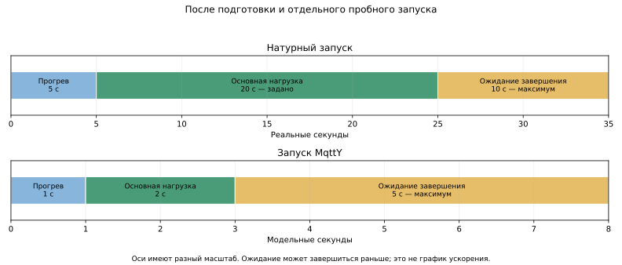

# Воспроизведение характеристик реальных MQTT-брокеров в MqttY

## Аннотация

В работе исследуется, насколько симулятор MqttY может воспроизвести работу реального брокера сообщений по измеренным характеристикам. Сначала с помощью MqttBenchmark измеряются скорость публикации сообщений — RPS, число успешных и неуспешных публикаций, задержки и доставка сообщений получателю. Затем из этих данных создаётся профиль брокера, по которому MqttY запускает его модель — двойник. Для Aedes, Mosquitto, ActiveMQ Classic и EMQX использованы 576 натурных измерений. Результаты реальных брокеров и их моделей сравниваются при одинаковых размерах сообщений, уровнях QoS и числе отправителей. Все проверяемые показатели оказались в заданных допусках в 64 из 96 режимов во всех трёх модельных запусках. В остальных режимах обнаружены расхождения, прежде всего по доставке. Результат показывает, какие характеристики уже воспроизводятся и что необходимо доработать. Проверка относится к имеющемуся стенду и использует измеренную интенсивность нагрузки; способность предсказывать работу брокера в новых условиях отдельно не подтверждена.

**Ключевые слова:** MQTT, брокер сообщений, MqttY, моделирование, профиль брокера, скорость публикации, задержка, доставка.

## 1. Измерение реального брокера

Задача состоит в том, чтобы сначала измерить настоящий брокер, а затем получить в MqttY близкие значения тех же показателей. Под двойником далее понимается модель наблюдаемых характеристик брокера. Его внутреннее устройство не копируется, постоянной синхронизации с работающим сервером нет. Программное моделирование MQTT рассматривается в [4], а необходимость отдельно проверять правильность модели и её соответствие измерениям — в [2, 5].

Измерения выполняет MqttBenchmark. Программа запускает отправителей и одного получателя, подключает их к настоящему брокеру и сохраняет события каждой публикации. Брокер работает обычным процессом, вне симулятора. Натурные сравнения брокеров по скорости и задержке рассматриваются также в [3]. Для каждого сообщения записываются попытка отправки, результат вызова публикации и получение сообщения подписчиком.

Один отправитель начинает следующую публикацию после завершения предыдущей. Поэтому скорость заранее не задаётся: измеряется, сколько публикаций способен выполнить данный стенд. Если клиент отключился, неудачные вызовы также попадают в журнал. Такие ошибки нельзя автоматически считать отказами самого брокера.

Измеряемые показатели приведены в таблице.

| Показатель | Что он означает |
| --- | --- |
| Скорость попыток, RPS | Сколько вызовов публикации выполнено за секунду |
| Скорость завершённых публикаций, RPS | Сколько публикаций успешно завершено за секунду |
| Ошибки публикации | Число и доля вызовов, завершившихся ошибкой |
| Задержка публикации | Время от вызова публикации до её успешного завершения |
| Доставка | Какие сообщения фактически получил подписчик |
| Недоставка | Какая доля успешно завершённых публикаций не обнаружена у получателя |

**Успешное завершение публикации и получение сообщения — разные события.** Подтверждение отправителю ещё не означает, что подписчик уже получил сообщение. Ошибка вызова также не означает падение процесса брокера: это могут быть разрыв соединения или отмена операции.

Для различения сообщений в полезную нагрузку включается идентификатор. Он позволяет проверить доставку, обнаружить повторы и не смешать сообщения прогрева с измерением. Уровень QoS задаёт способ подтверждения MQTT: для QoS 0 подтверждение отсутствует, для QoS 1 и 2 используется соответствующий обмен протокола [1]. В статье измеряется завершение вызова публикации, а не отдельное время каждого служебного пакета.

Каждое сочетание размера сообщения, QoS и числа отправителей измеряется три раза. Отдельная натурная серия используется для настройки профиля, другая — для последующего сравнения.

## 2. Преобразование измерений в профиль двойника

Профиль — это файл с характеристиками брокера для определённых условий. Его строит MqttY по результатам MqttBenchmark. Профиль содержит не название «быстрого» или «медленного» брокера, а измеренные значения и сведения об их происхождении.

Для каждого сочетания размера сообщения, QoS и числа отправителей рассчитываются средние скорости и доли ошибок по трём натурным повторам. Из записанных задержек формируется распределение: оно показывает, какая часть публикаций завершается быстро и какая требует большего времени. При объединении задержек сохраняется число наблюдений каждого интервала.

| Из реального измерения | В профиле и модели |
| --- | --- |
| Скорость завершения публикаций | Ограничение скорости обработки |
| Ошибки вызовов публикации | Параметр частоты неуспешных операций |
| Полученные и недоставленные сообщения | Параметр доставки |
| Распределение задержек | Разные времена обработки модельных публикаций |
| Размер сообщения, QoS, число отправителей | Выбор точного режима профиля |

Модель также учитывает собственный MQTT-обмен и передачу по модельной сети. Наблюдаемая задержка уже содержит влияние настоящих очередей и транспорта, поэтому её нельзя просто целиком прибавить к модельному сетевому времени. Используемая реализация выделяет дополнительное время обработки и ограничение пропускной способности. Это приближение; внутренние очереди реального брокера по одним внешним измерениям не восстанавливаются.

Профиль выбирается по точному режиму. Например, результаты для 16 отправителей не подставляются вместо отсутствующих данных для 64. Отсутствие нужной точки должно приводить к отказу запуска, а не к незаметной замене.

Профиль сохраняется вместе с контрольной суммой и ссылками на исходные данные. При последующем сравнении его не перестраивают по результату проверки. Контрольная сумма позволяет обнаружить изменение файла, но сама по себе не доказывает правильность модели.

## 3. Подготовка и выполнение запуска по профилю

Сначала выполняется отдельный короткий пробный запуск — пилот. Он нужен, чтобы проверить настройки, соединения, наличие получений и сохранение результатов. Пилот не включается в итоговые измерения. Успешный пилот подтверждает работоспособность запуска, а не точность всех показателей.

Основной опыт состоит из трёх этапов:

1. **Прогрев.** Клиенты подключаются и начинают обмен. Эти сообщения отделены от измеряемых.
2. **Основная нагрузка.** Подаются сообщения, по которым рассчитываются показатели.
3. **Ожидание завершения.** Новая измерительная нагрузка прекращается; уже начатым публикациям и сообщениям дают закончить обмен и дойти до получателя.

Временная схема показывает параметры фактически использованных одиночных опытов.



| Этап | Реальный брокер | Модель MqttY |
| --- | ---: | ---: |
| Прогрев | 5 с | 1 модельная с |
| Основная нагрузка | 20 с | 2 модельные с |
| Ожидание завершения | До 10 с | До 5 модельных с |

Реальные и модельные секунды нельзя использовать для расчёта ускорения по этому рисунку. Время вычисления симуляции на компьютере — отдельная величина. Для настоящего брокера показано заданное время нагрузки. Последний начатый вызов может завершиться позднее; при расчёте RPS используется фактическая длительность. Предельное ожидание не означает, что каждый запуск обязательно длится до этой границы.

В MqttY отправитель QoS 1/2 также ждёт завершения предыдущей публикации, но дополнительно ограничивается интенсивностью, взятой из натурного измерения. Таким образом, проверяется воспроизведение при **уже известной измеренной нагрузке**. Это ещё не прогноз скорости нового сервера только по его аппаратным параметрам.

## 4. Результаты запуска и правила сравнения

На выходе MqttY сохраняет число попыток и завершений публикации, ошибки, доставки, задержки и показатели завершения после основной нагрузки. Для сравнения используются те же названия измеряемых величин, но проверяется и способ их расчёта.

Пусть A — число попыток, C — число успешных завершений, F — число ошибок, Dс — число полученных сообщений из успешных публикаций, T — фактическое время измерения. Тогда:

- скорость завершения — `C/T`;
- доля ошибок вызова — `F/A`;
- недоставка — `1−Dс/C`.

При отсутствии попыток или завершений деление не имеет содержательного смысла. Нулевые значения, сохранённые программой по соглашению, не следует принимать за доказательство хорошей работы. Для QoS 0 публикационная задержка подтверждения неприменима.

Для задержки используется **p99**: время, в которое укладываются 99% успешно завершённых публикаций. Это позволяет увидеть медленные публикации, которые почти не влияют на среднее. p99 публикации не равен времени доставки подписчику. Если потеряно много сообщений, небольшую задержку полученных сообщений нельзя считать хорошим результатом всей системы.

| Сравниваемый показатель | Условие близости реального брокера и модели |
| --- | --- |
| Скорость завершения, RPS | Относительное различие не более 15% |
| Задержка p99, QoS 1/2 | Относительное различие не более 20% |
| Доля ошибок вызова | Абсолютное различие не более 0,05 |
| Недоставка | Абсолютное различие не более 0,05 |

Различие 0,05 для доли означает пять процентных пунктов. Например, недоставка 0,10 и 0,14 укладывается в допуск, а 0,10 и 0,16 — нет. Эти границы заданы программой исследования. Они не означают, что любая ошибка внутри допуска несущественна для любого приложения.

Каждый режим MqttY повторяется три раза с разными значениями начального состояния генератора случайных чисел. Режим признаётся прошедшим проверку, только если **все три запуска** укладываются во все применимые допуски. Усреднение не должно скрывать отдельный неудачный результат.

## 5. Экспериментальный стенд

Генератор и настоящий брокер работали на одном Linux-компьютере; обмен шёл через локальный сетевой интерфейс. Брокеры запускались последовательно. Поэтому результаты относятся к этой установке, а не к произвольному серверу.

| Параметр | Значение из сохранённых сведений |
| --- | --- |
| ОС | Simply Linux 11.1 |
| Процессор | Intel Xeon E5-2680 v3, 12 физических ядер, 24 логических CPU |
| Ограничение брокера | Логический CPU 0; память процесса в группе — до 4 ГиБ |
| MQTT | Версия 3.1.1, без TLS; клиентские учётные данные не задавались |
| Клиенты | 1, 16, 64 или 128 отправителей; один получатель |
| Размер сообщения | 16 и 256 байт |
| QoS | 0, 1, 2; уровень подписки равен уровню публикации |
| Измеритель | MqttBenchmark, проект .NET 6, библиотека MQTTnet 4.3.3.952 |

Закрепление за одним логическим CPU не означает выделение эксклюзивного физического ядра. Ограничение 4 ГиБ не является указанием полного объёма установленной RAM.

| Брокер | Сохранённая версия | Среда выполнения |
| --- | --- | --- |
| Aedes | 1.1.2 | Node.js 22.13.1 |
| Mosquitto | 2.0.15 | Скомпилированная программа |
| ActiveMQ Classic | 6.3.2 | OpenJDK 17.0.19+10 |
| EMQX | 6.3.0 | В пути программы указан erts-16.3; отдельная строка версии не сохранена |

Выбраны четыре реализации, поддерживаемые стендом и использующие разные программные платформы. Сравнение не охватывает все существующие MQTT-брокеры. Точные конфигурации, версии кода и контрольные суммы относятся к сохранённым сериям; текущая сборка не выдаётся за историческую.

## 6. Ход эксперимента и сравнение реального брокера с двойником

Для одного брокера натурная серия содержит `2 размера × 3 QoS × 4 числа отправителей × 3 повтора = 72 запуска`. Одна серия нужна для профиля, вторая — для проверки. Для четырёх брокеров получается **576 натурных измерений**.

Затем для каждого брокера выполняются модельные запуски по профилю: сначала сравнение с данными настройки, затем с отдельной натурной серией. В последнем сравнении есть 96 режимов: четыре брокера по 24 сочетания условий, в каждом три запуска модели. Всего — 288 модельных запусков.

Ниже показан один общий режим для всех четырёх брокеров: **16 байт, QoS 1, 16 отправителей и один получатель**. Это промежуточное число отправителей; режим не выбирался по успешности результата. Натурное значение — среднее трёх измерений, модельное — среднее трёх запусков MqttY. Для p99 это средние трёх отдельных квантилей, а не квантиль объединённого потока.

| Брокер | Метрика | Реальное измерение | MqttY | Ошибка среднего | Допуск | Все 3 запуска в допуске |
| --- | --- | ---: | ---: | ---: | ---: | --- |
| Aedes | Скорость завершённых публикаций, 1/с | 18715.332 | 18254.000 | 2.46% | 15% | да |
| Aedes | Задержка p99, мс | 1.291 | 1.317 | 1.99% | 20% | да |
| Aedes | Ошибки вызова публикации, доля | 0.000000 | 0.000000 | 0.000000 | 0,05 | да |
| Aedes | Недоставка, доля | 0.000000 | 0.000000 | 0.000000 | 0,05 | да |
| Mosquitto | Скорость завершённых публикаций, 1/с | 53228.383 | 53185.000 | 0.08% | 15% | да |
| Mosquitto | Задержка p99, мс | 0.397 | 0.420 | 5.78% | 20% | да |
| Mosquitto | Ошибки вызова публикации, доля | 0.000000 | 0.000000 | 0.000000 | 0,05 | да |
| Mosquitto | Недоставка, доля | 0.853675 | 0.911959 | 0.058284 | 0,05 | нет |
| ActiveMQ | Скорость завершённых публикаций, 1/с | 5534.740 | 5495.167 | 0.72% | 15% | да |
| ActiveMQ | Задержка p99, мс | 23.225 | 23.080 | 0.63% | 20% | да |
| ActiveMQ | Ошибки вызова публикации, доля | 0.000000 | 0.000000 | 0.000000 | 0,05 | да |
| ActiveMQ | Недоставка, доля | 0.643272 | 0.518034 | 0.125238 | 0,05 | нет |
| EMQX | Скорость завершённых публикаций, 1/с | 10144.393 | 10128.833 | 0.15% | 15% | да |
| EMQX | Задержка p99, мс | 3.044 | 2.953 | 2.97% | 20% | да |
| EMQX | Ошибки вызова публикации, доля | 0.000000 | 0.000000 | 0.000000 | 0,05 | да |
| EMQX | Недоставка, доля | 0.000000 | 0.000000 | 0.000000 | 0,05 | да |

В этом примере скорость и задержка всех четырёх моделей близки к натурным значениям. Например, Mosquitto даёт 53 228,383 завершения/с на стенде и 53 185,000 в MqttY: различие около 0,08%. При этом недоставка Mosquitto и ActiveMQ выходит за допуск. Следовательно, близкая скорость ещё не доказывает, что модель верно воспроизводит доставку.

Полное [сравнение всех 96 режимов](../../../reports/audits/dissertation/article-1-revision-v2/native-vs-model.csv) содержит 384 строки: четыре показателя на режим. В нём сохранены значения реального брокера, среднее и диапазон результатов MqttY, ошибки и применимость показателя.

## 7. Насколько точно воспроизводится оригинал

Приведённые ниже результаты — предварительная оценка по уже собранным данным. Для основного вывода статьи этот раздел необходимо дополнить новой сокращённой проверкой: измерить реальные брокеры, запустить заранее зафиксированные модели в согласованных условиях и непосредственно сравнить полученные показатели. До такой проверки утверждение о подтверждённой точности во всех заявленных режимах не делается.

Точность оценивается по измеренным показателям и объявленным допускам. Имеющиеся данные подтверждают близость **в части проверенных режимов**, а не точное совпадение всех свойств брокера.

| Брокер | Все три запуска в допуске | Часть запусков в допуске | Ни один запуск не прошёл |
| --- | ---: | ---: | ---: |
| Aedes | 18 | 3 | 3 |
| Mosquitto | 18 | 2 | 4 |
| ActiveMQ | 9 | 2 | 13 |
| EMQX | 19 | 1 | 4 |

В каждой строке 24 режима. Всего полностью прошли **64/96** режимов, ещё в восьми прошла часть запусков, в 24 — ни один. В пересчёте на отдельные модельные запуски получаются 203 успешных и 85 с расхождениями. Три модельных повтора одного режима не являются тремя независимыми натурными испытаниями.

При сравнении с данными, по которым строился профиль, все три запуска прошли в **88/96** режимах. Более высокий результат на данных настройки ожидаем, но он не заменяет проверку на других наблюдениях.

Наиболее заметная проблема — воспроизведение доставки. Например, в натурных журналах ActiveMQ есть многочисленные вызовы уже отключённого клиента. Это влияет на смысл измеренной нагрузки и ошибок. По имеющимся журналам нельзя установить причину каждого расхождения; исправлять все случаи одним увеличением допуска нельзя.

Проверена и зависимость результата от настроек симуляции. В 216 дополнительных опытах шаг времени уменьшали вдвое, а длительность нагрузки увеличивали вдвое.

| Изменение | Наибольшее изменение RPS | Наибольшее изменение p99 |
| --- | ---: | ---: |
| Шаг 10 → 5 мкс | 0,088% | 3,846% |
| Нагрузка 2 → 4 с | 10,562% | 26,923% |

Это различия между двумя модельными запусками, а не ошибки относительно настоящего брокера. Они показывают, что короткой нагрузки не всегда достаточно для устойчивой оценки медленных публикаций. Шесть выбранных точных повторов дали одинаковую проверенную часть результатов. Повторяемый расчёт, однако, может повторять и расхождение с настоящим брокером.

Остаются три существенных ограничения. Во-первых, натурные и модельные окна нагрузки различаются — 20 и 2 секунды; сообщения, пришедшие после основной нагрузки, должны учитываться отдельно. Точные границы части старых событий не восстановлены. Во-вторых, интенсивность модели взята из уже измеренной скорости: это воспроизведение при известных условиях. В-третьих, **независимость контрольной серии от разработки модели не подтверждена**. Чтобы заявить независимую проверку прогноза, потребуется новая натурная серия после фиксации алгоритма и профилей.

Проверка сохранённых первичных событий подтвердила расчёт показателей для 576 выбранных измерений. Всего просмотрены 592 архива: ещё 12 успешных запусков находились вне выбранного набора, четыре попытки были отклонены. Это проверка согласованности журналов и расчётов, а не замена проверки измерителя другим инструментом.

## 8. Выводы

Представлена последовательность воспроизведения характеристик брокера: измерение настоящего процесса в MqttBenchmark, построение профиля, запуск модели в MqttY и прямое сравнение показателей. Главный результат — значения **«реальный брокер — двойник — различие»**, а не только отметка об успешном выполнении программы.

В 64 из 96 проверенных режимов все три запуска модели укладываются в заданные допуски. Пример прямого сравнения показывает близкое воспроизведение скорости и задержки, но одновременно обнаруживает ошибки доставки у части моделей. Поэтому утверждение о точном воспроизведении брокеров во всех условиях пока не подтверждено.

Следующая доработка должна улучшить учёт отключённых клиентов, согласовать время и состав сравниваемых сообщений и проверить зафиксированную модель на новой натурной серии. При этом прежние данные, расхождения и допуски необходимо сохранить. Результаты относятся к измеренной установке; для другого оборудования может понадобиться новый профиль. Потребление CPU и RAM настоящего брокера данная модель не воспроизводит.

## Данные и воспроизведение

Таблицы, подробный разбор ошибок и исходные сведения перечислены в [пакете проверки](../../../reports/analysis/Broker-twins-package.md). [Ответ на замечания внешнего критика](../../../reports/analysis/Article-1-review-response.md) содержит подробности, вынесенные из основного текста. Формулы реализации, нулевые случаи и подробный статистический анализ вынесены в [техническое приложение](../../../reports/analysis/Article-1-technical-notes.md). Временная схема построена из сохранённых конфигураций.

```text
python tools/dissertation/revise_article1_analysis.py --output <новый-каталог>
python tools/dissertation/render_article1_timeline.py
python tools/dissertation/review_twin_article.py
```

Для этих команд нужен Python, для построения графиков — Matplotlib. Эти команды пересчитывают сохранённые результаты и проверяют статью; они не запускают заново настоящий брокер. Для полного пересчёта первичных событий нужны внешние архивы. Постоянный публичный архив данных с DOI пока не создан. Хэши подтверждают целостность файлов, но не истинность измерения.

## Литература

1. OASIS. MQTT Version 3.1.1. [Стандарт протокола](https://docs.oasis-open.org/mqtt/mqtt/v3.1.1/os/mqtt-v3.1.1-os.html).
2. Sargent R. G. Verification and Validation of Simulation Models. Proceedings of the Winter Simulation Conference. P. 183–198. [DOI: 10.1109/WSC.2011.6147750](https://doi.org/10.1109/WSC.2011.6147750).
3. Mishra B., Mishra B., Kertesz A. Stress-Testing MQTT Brokers: A Comparative Analysis of Performance Measurements. Energies. Vol. 14, no. 18, article 5817. [DOI: 10.3390/en14185817](https://doi.org/10.3390/en14185817).
4. Mohammad El-Basioni B. M. A conceptual modeling approach of MQTT for IoT-based systems. Journal of Electrical Systems and Information Technology. Vol. 11, article 62. [DOI: 10.1186/s43067-024-00181-x](https://doi.org/10.1186/s43067-024-00181-x).
5. Shao G., Hightower J., Schindel W. Credibility Consideration for Digital Twins in Manufacturing. [Публикация NIST](https://www.nist.gov/publications/credibility-consideration-digital-twins-manufacturing).
