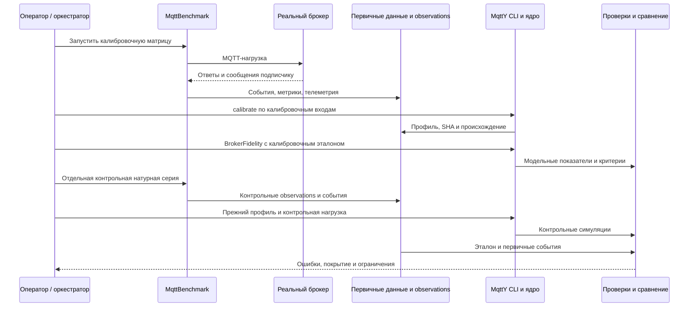
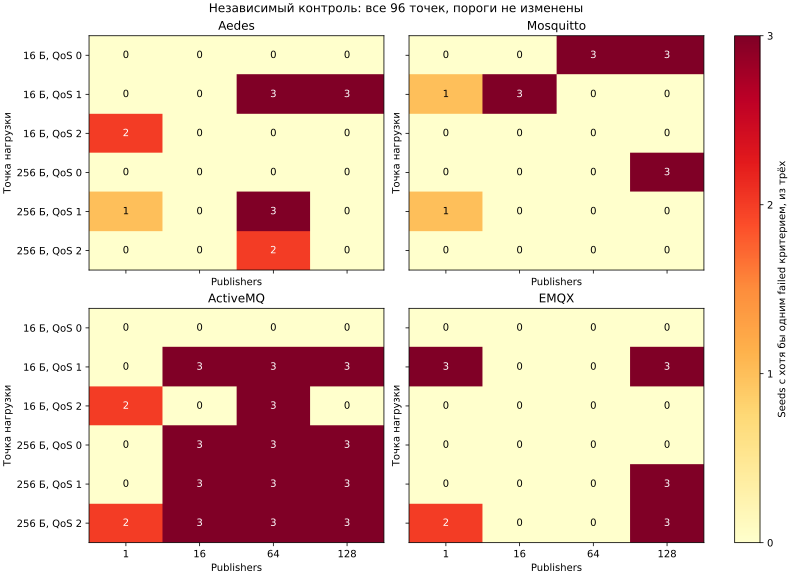

# Верификация и границы точности эмпирических двойников MQTT-брокеров в MqttY

Рабочая рукопись для редактирования автором. Результаты описывают проверенные серии проекта; статья не подана и не утверждена соавторами. Авторские сведения, финансирование и требования конкретного издания здесь не заполняются предположениями.

## Аннотация

Рассматривается воспроизведение характеристик MQTT-брокеров с помощью эмпирических профилей в симуляторе MqttY. Предложена процедура проверки, которая раздельно оценивает согласованность первичных событий и метрик, соответствие модели натурным наблюдениям и повторяемость модельного расчёта. Использованы 576 натурных измерений четырёх брокеров — Aedes, Mosquitto, ActiveMQ Classic и EMQX. Для исторической контрольной серии проверены 288 симуляций по скорости завершённых публикаций, публикационной задержке и долям неуспешных публикаций и недоставки. Все применимые критерии одновременно выполнены в 203 из 288 запусков; в 85 запусках имеются расхождения. Дополнительно проведены 216 симуляций чувствительности к шагу времени и длительности нагрузки. Уменьшение шага в выбранной матрице изменило RPS не более чем на 0,088%, а p99 — на 3,846%. Удвоение окна нагрузки изменило p99 до 26,923%, что ограничивает использование коротких опытов для оценки хвостовых задержек. Шесть выбранных точных повторов воспроизвели проверенную научную часть результатов. Полученные данные подтверждают частичное соответствие двойников выбранным режимам и повторяемость отдельных вычислений, но не универсальную точность и не независимость всей исторической контрольной серии от разработки модели.

**Ключевые слова:** MQTT, имитационное моделирование, цифровой двойник, калибровка, верификация, задержка, воспроизводимость.

## 1. Постановка задачи

При выборе MQTT-брокера и проектировании распределённой системы требуется оценивать не только число обработанных сообщений, но и доставку подписчикам, задержки и поведение при изменении нагрузки. Натурный эксперимент даёт наблюдения конкретной реализации на конкретной установке. Имитационная модель позволяет многократно исследовать заданные условия, однако её результат полезен лишь при известной области применимости и проверяемой связи с измерениями.

В работе под эмпирическим двойником понимается модельный брокер MqttY, параметры которого получены из измерений определённой реализации и версии брокера. Это определение не предполагает восстановления внутренних алгоритмов, состояния процесса или аппаратной архитектуры. Предмет проверки — воспроизведение заданных выходных показателей в измеренной нагрузочной области.

Исследовательский вопрос состоит в следующем: в каких измеренных режимах такой профиль воспроизводит скорость, задержки и недоставку и насколько результат зависит от шага модельного времени и длительности нагрузки? Дополнительная задача — отличить повторяемость вычисления от точности относительно реальной системы.

Вклад настоящей работы состоит в проверяемой цепочке «события → метрики → профиль → модель → критерии», полной карте контрольных расхождений для четырёх двойников и парном анализе чувствительности. Утверждение о первенстве такого подхода не делается: обзор ниже сопоставляет ближайшие методы, но не является исчерпывающим поиском научной новизны.

## 2. Связанные исследования

Sargent разделяет корректность реализации модели, качество исходных данных и соответствие модели назначению в определённых экспериментальных условиях. Такая постановка объясняет, почему успешное выполнение программы или совпадение контрольных сумм не заменяет проверки точности [1]. В настоящем исследовании эти проверки оформлены раздельно; численные допуски являются условиями программы проекта, а не следуют из работы [1].

Mishra, Mishra и Kertesz рассматривают натурное сравнение MQTT-брокеров по CPU, задержке и скорости сообщений [2]. С этим исследованием сопоставим выбор наблюдаемых свойств, но не непосредственные численные результаты: аппаратные условия, состав реализаций и определение задержки отличаются. Рейтинг производительности реальных брокеров также не является оценкой точности их двойников.

Mohammad El-Basioni описывает концептуальное моделирование MQTT и его реализацию на OMNeT++/INET для прикладного сценария парковки [3]. В отличие от проверки прикладного сценария, настоящая работа сопоставляет профиль конкретного брокера с измеренными скоростями, долями и публикационными квантилями. Само наличие модели MQTT не рассматривается как новый результат.

| Направление | Что проверяется | Отличие настоящего эксперимента |
| --- | --- | --- |
| Методология верификации и валидации [1] | Корректность модели и её соответствие назначению | Применение к цепочке первичных MQTT-событий и эмпирическому профилю |
| Натурное сравнение брокеров [2] | Производительность реальных реализаций | Ошибка модели относительно отдельного эталонного наблюдения |
| Концептуальная MQTT-модель [3] | Представление протокола и прикладного сценария | Измерительно заданные характеристики четырёх брокеров и карта применимости |

## 3. Метод

### 3.1. Ответственность приложений

Натурные измерения выполняет MqttBenchmark: создаёт настоящие MQTT-соединения, задаёт нагрузку, регистрирует попытки публикации и их исходы, получения подписчиком, состояние генератора и телеметрию. Реальный брокер исполняется отдельным native-процессом. Эти обмены не проходят через MqttY.

MqttY строит профиль по агрегированным observations и гистограммам, затем исполняет модельных клиентов, сеть и брокер. Калибровка и BrokerFidelity вызываются CLI проекта `EntityFX.MqttY.MqttRelay.App`; название приложения не означает, что в опыте с одним двойником работает сеть ретрансляторов. Python-проверки независимо пересчитывают сохранённые события и опубликованную арифметику. Web является оболочкой запуска модельных заданий и не заменяет натурный измеритель.



### 3.2. Получение профиля

Профиль выбирается по точному сочетанию payload, QoS и числа publishers. Для одной точки используются три натурных повтора. Средние attempted RPS, completed RPS и доли ошибок рассчитываются по повторам с равными весами. Отсутствующая точка не заменяется соседней и не интерполируется.

Эмпирическое распределение публикационной задержки строится из бинов с числом событий. Поэтому объединённая CDF имеет веса по числу завершений и не равна среднему трёх CDF с равными весами. Аналогично среднее трёх p99 не является p99 объединённой выборки. Происхождение распределений связывается с исходными архивами.

В используемой модели из наблюдаемой задержки выделяется оценочный транспортный бюджет с учётом минимально представимого протокольного обмена. Это модельное допущение, а не измеренная декомпозиция времени настоящего брокера. Ожидание модельной ёмкости и эмпирическая обработка объединяются через максимум, чтобы не складывать дважды очередь, уже присутствующую в наблюдаемой задержке. Ограничение эмпирических значений протокольным минимумом учитывается явно.

### 3.3. Метрики и временные окна

Обозначим через A число зарегистрированных API-попыток, C — успешных исходов Publish, F — неуспешных исходов, D — уникальных полученных ID, а Dс — полученные ID из числа успешных исходов. Для натурного запуска проверяется A=C+F. T — фактическая длительность измерения по монотонным часам.

| Метрика | Натурная формула | Смысл и ограничение |
| --- | --- | --- |
| Attempted RPS | A/T | Скорость вызовов API; не обязательно скорость PUBLISH, принятых брокером |
| Completed RPS | C/T | Скорость успешных исходов публикации |
| Publish failure | F/A | Неуспешные исходы относительно попыток |
| Delivery loss | 1−Dс/C | Недоставка среди успешно завершённых публикаций; при нулевом знаменателе требуется явное правило |
| Полнота относительно попыток | D/A | Отдельная доля; не подставляется вместо 1−loss |
| p99 публикации | Верхний ранг по длительностям успешных Publish | QoS 1/2; не сквозная задержка до subscriber |

Для QoS 0 публикационный ACK не определён, поэтому соответствующий критерий имеет статус `notApplicable`. Нулевая задержка вместо отсутствующего ACK не подставляется. RTT preflight и задержка до получателя также являются отдельными показателями.

Натурный генератор ожидает завершения задач publishers, поэтому фактическая длительность может выходить за номинальное окно подачи. Последующий drain позволяет получить сообщения этой когорты, ещё не доставленные subscriber. В модели окно подачи фиксировано; завершения во время drain могут оставаться в числителе completed RPS. Совпадение названия поля не устраняет различие временных знаменателей.

Точная общая граница measurement/drain в workload-времени старых журналов не сохранена. Поздние получения восстанавливаются консервативным интервалом; события внутри неопределённой границы не получают выдуманной точной фазы. В контрольных крайних случаях Aedes, Mosquitto и ActiveMQ значительная часть полученных ID приходится после измерительного окна. Это наблюдение конкретных запусков, а не средняя доля каждого брокера.

### 3.4. Критерии точности

Для ненулевого применимого эталона относительная ошибка скорости или задержки вычисляется как |model−reference|/|reference|. Требуется ошибка RPS не более 0,15 и p99 не более 0,20. Для failure и loss требуется абсолютная разность не более 0,05. Нулевой или отсутствующий эталон обрабатывается по правилам реализации и не превращается автоматически в passed.

Проверка считается пройденной в данном запуске, если пройдены все применимые критерии. Эти допуски — заданные инженерные критерии, а не статистический тест эквивалентности. Суммировать количества нарушений разных критериев нельзя: один запуск может нарушить несколько.

Fidelity использует калибровочные данные и характеризует воспроизведение настройки. Историческая контрольная серия использует отдельные observations при неизменном профиле. Offered RPS контрольной модели берётся из attempted RPS соответствующей контрольной точки. Следовательно, это условная проверка при известной интенсивности, а не слепой прогноз нагрузки.

### 3.5. Повторы и неопределённость

Натурная точка содержит три самостоятельных повтора. Для среднего показателя применим Student-t CI95 с двумя степенями свободы: среднее ±4,30265×s/√3. Малое n и возможная нестабильность режима ограничивают интерпретацию интервала. Интервал среднего трёх p99 не является интервалом истинного квантиля объединённого потока.

Три seed модели описывают вариацию фиксированной модели; они не увеличивают число независимых натурных повторов. Интервалы по seed нельзя выдавать за неопределённость физических характеристик брокера. Доля прошедших сценариев не является вероятностью точности в произвольной будущей точке.

## 4. Программа и проверка данных

Для каждого брокера натурная стадия содержит 2 payload ×3 QoS ×4 уровня publishers ×3 повтора =72 измерения. Калибровочная и контрольная стадии четырёх брокеров дают 576 выбранных натурных запусков. В основной программе также предусмотрены 288 калибровочных и 288 контрольных одиночных симуляций; предмет настоящей карты точности — последние 288. Pilots и отклонённые попытки учитываются отдельно.

Независимый пересчёт ранее проверил 592 первичных архива, в том числе все 576 выбранных измерений. Расхождений проверенных счётчиков и арифметики не обнаружено. Это подтверждает согласованность сохранённых данных и результатов, но не исключает систематическую ошибку самого измерителя.

В дополнительном анализе для всех 288 контрольных симуляций восстановлены четыре решения критериев. Проверены 1152 решения, включая 96 неприменимых публикационных p99 для QoS 0. Объединение failed-критериев точно воспроизводит список из 85 не прошедших запусков. Каждая строка сопоставлена со своей натурной точкой; замены соседними режимами нет.

Чувствительность исследована по четырём брокерам, payload 16 байт, QoS 0/1/2, 1 и 128 publishers, трём seeds и трём вариантам: 216 основных симуляций. Baseline использует tick 10 мкс, прогрев 1 с, нагрузку 2 с и drain до 5 с. HalfTick уменьшает шаг до 5 мкс; doubleWindow увеличивает нагрузку до 4 с. Между парными вариантами меняется один фактор. Отдельно выполнены 8 pilots и 6 выбранных точных повторов.

Точные версии, идентичности кампаний, профили и SHA входят в сопровождающий пакет. Текущий checkout не выдаётся за бинарную идентичность исторического запуска. В 864 исторических manifests отсутствует SHA runtime-бинаря; это ограничение прослеживаемости сохранено, а не задним числом заполнено хэшем новой сборки.

## 5. Результаты

### 5.1. Соответствие контрольным наблюдениям

| Брокер | Все критерии пройдены /72 | Есть нарушения /72 | RPS /72 | p99 /48 | Failure /72 | Loss /72 |
| --- | ---: | ---: | ---: | ---: | ---: | ---: |
| Aedes | 58 | 14 | 3 | 2 | 0 | 9 |
| Mosquitto | 58 | 14 | 2 | 0 | 0 | 12 |
| ActiveMQ | 29 | 43 | 10 | 4 | 6 | 33 |
| EMQX | 58 | 14 | 3 | 10 | 0 | 6 |

Последние четыре столбца содержат количества нарушений. Всего 203 запуска прошли все применимые критерии, 85 не прошли хотя бы один. Ни один двойник не прошёл всю сетку. ActiveMQ имеет наиболее низкую долю прошедших контрольных сценариев, однако это не означает, что настоящий ActiveMQ хуже остальных по производительности.



У Aedes отсутствуют зарегистрированные API-ошибки натурного контроля, но есть расхождения модели. Следовательно, отсутствие исключений вызова недостаточно для воспроизведения доставки. У Mosquitto p99 проходит во всех применимых запусках, тогда как 12 запусков нарушают loss. Для EMQX важна публикационная задержка: p99 нарушен в десяти запусках. Единственный показатель не даёт полной оценки двойника.

### 5.2. Разброс натурных повторов и причины расхождений

| Брокер | Натурные контрольные точки с диапазоном loss >0,05 /24 | Точки со сдвигом среднего RPS между сериями >15% /24 | Модельные провалы в точках с повышенным разбросом loss |
| --- | ---: | ---: | ---: |
| Aedes | 4 | 0 | 6/14 |
| Mosquitto | 8 | 0 | 12/14 |
| ActiveMQ | 10 | 2 | 30/43 |
| EMQX | 1 | 1 | 3/14 |

Порог 0,05 для диапазона повторов здесь диагностический. Он не является новым критерием модели или тестом статистической значимости. Совпадение провала с нестабильной натурной точкой — связь контекста, а не доказанная причина.

Для ActiveMQ в контрольных первичных журналах зарегистрированы 497472 сообщения `The client is not connected`, 1093 отмены операций и 85 сообщений `Broken pipe`. Генератор регистрирует попытку до Publish и после перехваченного исключения продолжает цикл без восстановления отключённого publisher. Поэтому часть attempted RPS характеризует неуспешные API-вызовы, а не MQTT-публикации, принятые брокером. Этот механизм подтверждает необходимость разделять события нагрузки. Причина первоначального отключения и его вклад в каждый провал не установлены.

Для всех 85 не прошедших запусков причинный статус отдельной точки оставлен неопределённым. Подтверждены расхождения критериев, зарегистрированные ошибки и контекст повторов. Накопление очередей, состояние соединений и границы фаз являются направлениями проверяемых гипотез. Они не используются для исключения неудобных результатов или расширения допусков.

### 5.3. Чувствительность к шагу и окну нагрузки

| Брокер | Baseline: прошли /18 | HalfTick: прошли /18 | DoubleWindow: прошли /18 |
| --- | ---: | ---: | ---: |
| Aedes | 13 | 13 | 15 |
| Mosquitto | 14 | 14 | 15 |
| ActiveMQ | 13 | 13 | 12 |
| EMQX | 12 | 15 | 12 |

Всего в основной матрице чувствительности 161 из 216 запусков прошёл критерии, 55 не прошли; технических ошибок нет. Уменьшение tick изменило RPS максимум на 0,088%, p99 — на 3,846%. Удвоение окна изменило RPS максимум на 10,562%, p99 — на 26,923%; наибольшее изменение p99 относится к ActiveMQ.


Это изменения между парными симуляциями, а не ошибки относительно натурного эталона. Число нарушений loss для baseline, halfTick и doubleWindow одинаково — по 12. Следовательно, уменьшение tick в проверенной области не является достаточным исправлением недоставки. Изменение окна влияет на хвостовую задержку; универсальная достаточность двухсекундного окна не подтверждается.

### 5.4. Повторяемость

Шесть выбранных повторов совпали по байтам summary и histogram и по канонической научной части counters. Два повтора воспроизводят нарушения критериев. Таким образом, детерминированное воспроизведение возможно и для неточного относительно эталона результата.

Проверка не требует совпадения всего manifest с runId и техническим временем или полного counters с графом. Область побайтового сравнения объявлена явно. Эти шесть повторов также не заменяют независимую проверку другим сотрудником и не доказывают совпадение натурных чисел на другой аппаратуре.

## 6. Обсуждение и ограничения

Основной результат — проверенная, но частичная область соответствия эмпирических двойников. Скорость, публикационный ACK и получение subscriber должны проверяться раздельно. В частности, прохождение p99 при нарушении loss не подтверждает корректность модели доставки. Низкая задержка среди полученных сообщений не описывает задержку потерянных.

Сильная сторона подхода — возможность проследить параметры профиля до событий, проверить арифметику и сохранить полную карту расхождений. Его ограничение — эмпирический профиль не идентифицирует внутренний механизм брокера. Изменение оборудования, размещения генератора, версии брокера или условий соединения может изменить измеренные параметры и потребовать новой калибровки.

Раздельные campaign identities и неизменный SHA профиля подтверждают происхождение наблюдений, но не доказывают, что исторический контроль ранее не использовался для разработки алгоритма. Проверка истории не установила слепую независимость всей серии. Если модель дорабатывается по этим данным, следующее утверждение точности требует нового заранее зафиксированного контрольного набора.

Три натурных повтора дают ограниченное основание для статистической оценки. Допуски не являются доказательством эквивалентности распределений. Исследование чувствительности охватывает один payload и два уровня publishers, поэтому не переносится на всю область условий. При выборе полезной нагрузки и длительности нового опыта следует учитывать число завершений, полноту доставки и устойчивость хвостовых показателей.

CPU/RSS настоящего брокера не предсказываются данным двойником. Интегральная оценка EST может использоваться для отдельного сценарного сравнения брокеров при объявленных весах и нормировке, но не является вероятностью достоверности модели. Результаты одиночного брокера не доказывают натурную точность сети MqttRelay, федерации или балансировщика.

## 7. Выводы

Построена проверяемая процедура сопоставления эмпирических двойников MQTT-брокеров с сохранёнными натурными наблюдениями. Верификация первичной арифметики, соответствие модели эталону и повторяемость вычисления рассмотрены как отдельные результаты.

Из 288 исторических контрольных симуляций 203 прошли все применимые критерии, 85 имеют расхождения. Для каждого расхождения сохранены критерии и натурный контекст; неустановленные причины не заменены утверждениями об ошибке брокера или измерителя. Разбор ActiveMQ показал необходимость различать API-попытки отключённого клиента и фактически принятую MQTT-нагрузку.

Парная проверка чувствительности показывает малое влияние выбранного уменьшения tick, но заметную зависимость p99 от окна в отдельных режимах. Шесть точных повторов подтвердили воспроизводимость проверенной научной части выбранных запусков. Дальнейшая работа должна быть направлена на наблюдаемость состояния соединений, согласование временных когорт и новую независимую проверку после изменения модели, а не на подгонку порогов существующей серии.

## Данные и воспроизведение

Числа связаны с пакетами `accuracy-analysis-v1`, `sensitivity-final-v1` и `broker-twins-package-v1` в `reports/audits/dissertation/`. В них сохранены CSV/JSON, карты ошибок, идентичности входов, результаты проверок и SHA-256. Архивы первичных событий хранятся вне Git; другой сотрудник должен иметь к ним доступ для повторного пересчёта raw, а не только чтения компактного отчёта.

```text
python tools/dissertation/prepare_twin_package.py --output <новый-каталог>
python tools/dissertation/analyse_sensitivity.py --observation reports/audits/dissertation/sensitivity-final-v1/observation.json --output <новый-каталог> --final
```

Первая команда проверяет и пересобирает компактный пакет по готовым анализам. Она не выполняет заново натурный эксперимент. Полный пересчёт первичных событий является отдельной командой из сопровождающего воспроизводимого пакета и требует внешних архивов. Отсутствующие первичные данные не заменяются синтетическими.

## Литература

1. Sargent R. G. Verification and Validation of Simulation Models. Proceedings of the Winter Simulation Conference. P. 183–198. [DOI: 10.1109/WSC.2011.6147750](https://doi.org/10.1109/WSC.2011.6147750). [Текст](https://www.informs-sim.org/wsc11papers/016.pdf).
2. Mishra B., Mishra B., Kertesz A. Stress-Testing MQTT Brokers: A Comparative Analysis of Performance Measurements. Energies. Vol. 14, no. 18, article 5817. [DOI: 10.3390/en14185817](https://doi.org/10.3390/en14185817). [Авторская версия](https://publicatio.bibl.u-szeged.hu/22708/1/MQTT_Perf_Mishra_MDPI_202109_revised_v2.pdf).
3. Mohammad El-Basioni B. M. A conceptual modeling approach of MQTT for IoT-based systems. Journal of Electrical Systems and Information Technology. Vol. 11, article 62. [DOI: 10.1186/s43067-024-00181-x](https://doi.org/10.1186/s43067-024-00181-x).

## Что остаётся автору перед подачей

Проверить формулировку вклада и соответствие фактическим работам автора; внести авторские сведения и финансирование; согласовать текст с соавторами; выбрать издание и привести оформление к его требованиям. Окончательную интерпретацию причин и достаточность программы утверждает автор. Рабочая рукопись не объявляется поданной или принятой публикацией.
