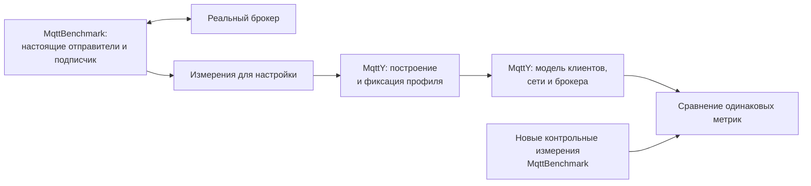

# Воспроизведение характеристик реальных MQTT-брокеров в MqttY

## Аннотация

В работе проверяется, насколько симулятор MqttY воспроизводит измеренные характеристики настоящего брокера сообщений в заданном режиме. Сначала MqttBenchmark измеряет скорость публикации — RPS, число успешных и неуспешных публикаций, задержки и доставку подписчику. Затем по этим данным создаётся профиль брокера, который используется для запуска его модели — поведенческой профильной модели (далее «двойник» в рабочем смысле). Настройка и проверка разделены: профили четырёх брокеров построены по 12 натурным измерениям и зафиксированы до 12 новых контрольных измерений. В проверенном режиме с 16 отправителями, одним подписчиком, сообщениями 16 байт и QoS 1 все три модельных запуска на брокер уложились в заданные инженерные допуски по скорости (ошибка ≤ 2,833 %), p99 (≤ 17,272 %) и недоставке (≤ 1,162 процентного пункта). Четыре выбранных повтора воспроизвели проверяемые модельные файлы побайтно. Результаты подтверждают близкое воспроизведение выбранного режима на данном стенде, но не доказывают преимущества модели над простой таблицей средних и не обобщаются на другие нагрузки, оборудование и поведение при отказах без отдельной проверки.

**Ключевые слова:** MQTT, брокер сообщений, MqttY, поведенческая профильная модель, профиль, скорость публикации, задержка, доставка, воспроизводимость.

## 1. Что измеряется у настоящего брокера

Цель работы — измерить настоящий брокер сообщений и получить в MqttY близкие значения тех же показателей. Под «двойником» здесь понимается поведенческая профильная модель наблюдаемых характеристик брокера, а не цифровой двойник в строгом смысле: внутреннее устройство брокера не копируется, постоянной синхронизации с работающим сервером нет. Правильность реализации, соответствие измерениям и повторяемость расчёта проверяются отдельно [2].

**MqttBenchmark** создаёт настоящие MQTT-соединения с брокером и записывает события публикаций и получений. **MqttY** строит профиль по измерениям, затем исполняет модельные клиенты, сеть и брокер. Отдельная программа проверяет сохранённые события и расчёты. Натурные сравнения MQTT-брокеров рассматриваются также в [3], а программное моделирование MQTT — в [4].

Работа продолжает исследования авторов по выбору MQTT-брокеров на основе нагрузочного тестирования [5], моделированию распределённых сетей Интернета вещей [6] и ускорению симулятора MqttY [7]. Здесь исследуется связь между измерением настоящего брокера и результатом его модели. Сравнение разделено на скорость, задержку, ошибки и доставку: совпадение одного показателя не подменяет проверку остальных.

Вклад работы — проверяемый перенос измерений в профиль исполняемой модели и отдельная проверка этого профиля на новых измерениях того же режима. Согласованы сроки подачи и наблюдения, сообщения сопоставляются по идентификаторам. Для четырёх брокеров показаны численные различия и повторяемость расчёта; преимущество перед простой таблицей средних не установлено.

Близкая работа Aichernig и Schumi [8] уже связывает журналы MQTT-задержек с моделью и проверкой на настоящей системе. В ней используются полученные из журналов распределения и статистическая проверка свойств. Поэтому сама последовательность «измерить — построить модель — сравнить» не заявляется здесь как новая. Наша проверка сосредоточена на профиле точного нагрузочного режима, согласованных временных группах и раздельном учёте скорости, ошибок и доставки; преимущество этого варианта перед методом [8] не измерялось.

Каждый отправитель начинает следующую публикацию после завершения предыдущего вызова. Поэтому измеряется скорость работающего тракта «отправители — брокер — подписчик», а не обслуживание заранее заданного числа запросов в секунду. Сообщение содержит идентификатор, по которому связываются попытка, её исход и получение подписчиком.

| Метрика | Что означает и зачем нужна |
| --- | --- |
| RPS попыток | Число вызовов публикации за секунду; показывает фактическую подачу |
| RPS завершённых публикаций | Число успешных публикаций выбранной группы, делённое на срок её подачи; позволяет сравнить выполненную нагрузку |
| Успешные публикации | Все успешные исходы выбранных попыток, включая поздние; показывает, закончились ли начатые операции |
| Ошибки публикации | Число и доля неуспешных вызовов; выявляет проблемы клиента, соединения или брокера |
| Задержка p99 | Время, за которое завершились 99% успешных публикаций; показывает задержку медленных операций |
| Уникальные доставки | Число разных сообщений у подписчика; проверяет фактическое получение |
| Недоставка | Доля успешных публикаций, не полученных подписчиком к концу наблюдения |
| Дубликаты | Повторные получения того же идентификатора; отделяет повторы от новых сообщений |
| Незавершённые операции | Попытки без известного исхода к концу наблюдения; показывает неполноту окончания опыта |

При QoS 1 успешная публикация заканчивается после подтверждения PUBACK [1]. Это ещё не означает, что подписчик уже получил сообщение. Поэтому p99 публикации и доставка рассматриваются отдельно. Ошибка вызова также не обязательно означает падение брокера. Потребление CPU и памяти настоящего процесса эта модель не воспроизводит.

## 2. Как измерения превращаются в профиль

Профиль хранит измеренные характеристики брокера для определённых условий. В новой серии каждый брокер сначала измерен три раза при сообщениях 16 байт, QoS 1 и 16 отправителях. Только эти измерения использованы для настройки; последующий контроль в профиль не включён.

| Данные MqttBenchmark | Использование в MqttY |
| --- | --- |
| Скорость попыток и завершённых публикаций | Резервирование обслуживания по скорости попыток; завершённая скорость сохраняется как целевой показатель |
| Доли ошибок и недоставки | Параметры неуспешных операций и доставки |
| Распределение длительностей публикаций | Разные времена обработки отдельных модельных сообщений |
| Размер сообщения, QoS, число отправителей | Проверка точного режима профиля |
| Измеренное время обмена туда и обратно | Оценка транспортной составляющей при построении профиля |

Скорости и доли усредняются по трём измерениям. Для задержек объединяются интервалы гистограмм с учётом числа событий. Такое распределение сохраняет частоту быстрых и медленных публикаций. Среднее трёх p99 и p99 объединённого потока — разные величины.

MqttY исполняет собственный MQTT-обмен по модельной сети. Наблюдаемая задержка уже включает настоящий транспорт и очереди, поэтому её нельзя целиком прибавить к модельному сетевому времени. Используемая реализация выделяет дополнительное время обработки и ограничение скорости. Это приближение внешнего поведения, а не восстановление внутренних очередей настоящего брокера.

Время обработки задаётся следующим правилом. Пусть L — выбранная длительность из измеренного распределения, Δ — шаг модели, P — минимальное число тиков модельного MQTT-обмена, W — ожидание свободного обслуживания в тиках. Тогда:

`Q(L)=ceil(L/Δ); S=max(0,Q(L)−P); D=max(S,W)`.

Округление ceil означает переход к ближайшему большему целому числу тиков. Из наблюдаемой длительности вычитается уже учитываемый моделью протокольный минимум; отрицательный остаток заменяется нулём. Затем берётся большее из дополнительного времени и ожидания обслуживания. Сложение этих двух величин могло бы повторно учитывать ожидание, уже попавшее в измеренную задержку. Выбор max — допущение реализации, а не доказанное устройство очереди настоящего брокера; альтернативные правила здесь не сравнивались. P получается из разрешения модельного транспорта, а не объявляется непосредственно измеренной внутренней задержкой сервера. Скорость обслуживания задаётся профилем; выборка задержек использует сохранённое начальное состояние генератора. Актуальная процедура и её отличие от исторических правил пояснены в [технических пояснениях](../../../reports/analysis/Article-1-technical-notes.md). Доля калибровочных наблюдений ниже этого минимума пересчитана отдельно. Она показывает, какую часть исходного распределения нижняя граница модели не позволяет воспроизвести непосредственно.

Полный порядок текущих операций приведён в [описании актуального алгоритма](../article-1-current-model-method.md) с псевдокодом и привязкой к зафиксированным исходникам. Обслуживание резервируется до проверки ошибки публикации; отказ не возвращает резерв. Недоставка выбирается при рассылке подписчику, отдельно от подтверждения отправителю. RTT задаёт настройку модельного транспорта, после чего P определяется идеальной модельной пробой. Для ошибки, задержки и недоставки используются разные ключи выборки; статистическая независимость и зависимость реальных потерь от задержки не установлены.

| Брокер | Наблюдений в калибровке | Минимум модели, мкс | Ниже минимума | Доля ниже, % | На границе | Нулевой остаток S, % |
| --- | ---: | ---: | ---: | ---: | ---: | ---: |
| Aedes | 207314 | 60 | 0 | 0,0000 | 0 | 0,0000 |
| Mosquitto | 257092 | 60 | 2002 | 0,7787 | 295 | 0,8935 |
| ActiveMQ | 158284 | 60 | 0 | 0,0000 | 0 | 0,0000 |
| EMQX | 119857 | 80 | 0 | 0,0000 | 0 | 0,0000 |

Знаменатель — число успешных публикаций в трёх калибровочных гистограммах, с весами по числу событий. Расчёт относится к дискретным значениям бинов с разрешением 1 мкс, которые использует модель, а не к неокруглённым временам отдельных операций. У Mosquitto 2002 наблюдения лежат строго ниже 60 мкс, ещё 295 — ровно на границе. Поэтому доля ниже минимума равна 0,7787%, а доля с нулевым остатком `S=max(0,ceil(L/Δ)−P)` — 0,8935%. Это разные показатели. Веса гистограммы не являются счётчиком фактически выбранных моделью задержек или потерянных сообщений. Данные не удалялись из профиля; здесь также не оценивается влияние ограничения на итоговый p99 после сетей и очередей. Проверены все 12 сохранённых файлов настройки транспорта, их счётчики согласуются с пересчётом. [Источник и расчёт](../../../reports/audits/dissertation/manuscript-offline-review-v1/floor-analysis.json).

Новый профиль содержит ровно одну измеренную точку. Другие размеры сообщений, QoS или числа отправителей не подставляются незаметно: такой запуск должен быть отклонён. До начала контрольных измерений все четыре профиля зафиксированы контрольными суммами. Это отделяет настройку от проверки внутри данной программы; независимость всех прежних исторических опытов этим не утверждается.

## 3. Подготовка, нагрузка и ожидание завершения

Перед основной серией выполнены короткие пилоты всех четырёх брокеров с нагрузкой 2 и 4 секунды. Они проверяли готовность MQTT, работу подписчика, границы этапов и сохранение данных. Все восемь пар «натурный запуск — модель» проверены отдельно; их результаты не добавлены к основной серии. Четырёхсекундное окно выбрано заранее для большего числа наблюдений, а не по лучшему совпадению со старым профилем.

Перед каждым натурным измерением проверяется готовность MQTT и выполняются 20 настоящих проб времени обмена туда и обратно. Затем создаются рабочие соединения и подписки. После подключения идут прогрев, измерительная нагрузка и полное пятиисекундное наблюдение за завершениями и доставкой. Сообщения прогрева отделены по идентификаторам.

**Тик — один шаг модельного времени.** В новой серии он равен 10 микросекундам: в одной модельной секунде 100 000 тиков. Эти секунды описывают моделируемый процесс; время вычисления на компьютере учитывается отдельно.

| Стадия | Натурный опыт | Модель MqttY |
| --- | --- | --- |
| Подготовка, соединения, подписки | Ожидание готовности и ответы MQTT | Подключение 7–9 тиков, подписка 7–9 тиков |
| Прогрев | 1 с | 100 000 тиков = 1 с |
| Основная подача | 4 с | 400 000 тиков = 4 с |
| Наблюдение после прекращения подачи | Полные 5 с | 500 000 тиков = 5 с |
| Итого в модели с подключением и подпиской | — | 1 000 014–1 000 018 тиков = 10,00014–10,00018 с |

На рисунке сопоставлены одинаковые сроки прогрева, подачи и наблюдения. Для модели дополнительно показаны тики; краткие стадии подключения и подписки учтены в таблице.

В конце подачи новые измерительные сообщения больше не создаются. Начатые операции и доставки наблюдаются ещё пять секунд; опыт не заканчивается раньше из-за временно пустой очереди. По общим часам записываются точные границы этапов. Отключения и восстановления клиентов сохраняются отдельно; в модели состояние проверяется каждый тик.

В модели также постоянно работают 16 отправителей, каждый ждёт исхода своей предыдущей публикации. Технический предел подачи установлен достаточно высоким и вычислен из числа отправителей и тика. Он не взят из RPS нового контроля: контрольная скорость не задаётся модели заранее.

## 4. Что получается на выходе и как сравниваются результаты

Для сравнения выбираются сообщения, попытка публикации которых началась внутри четырёхсекундного окна нагрузки. Прогрев исключён. Исходы этих попыток и получения подписчиком учитываются до конца дополнительного наблюдения. Идентификаторы позволяют использовать одну и ту же группу сообщений в числителях и знаменателях.

Основной RPS равен числу успешных публикаций выбранной группы, делённому на четыре секунды подачи. В числитель входят и операции, завершившиеся во время последующего наблюдения. Поэтому это число успешно выполненных публикаций на секунду подачи, а не скорость завершений строго внутри окна. Последняя сохраняется отдельно и не подставляется в эту таблицу. Доля ошибок равна числу неуспешных исходов, делённому на число попыток выбранной группы. Недоставка равна единице минус отношение полученных ID успешных публикаций к числу успешных публикаций. p99 считается по длительностям успешных операций этой группы, в том числе закончившихся после прекращения подачи. При нулевом числе попыток или успешных публикаций содержательного деления нет: такой случай нельзя выдать за хорошее обслуживание нагрузки.

| Сравниваемый показатель | Заранее заданное условие близости |
| --- | --- |
| RPS завершённых публикаций выбранной группы | Относительное различие не более 15% |
| p99 публикации | Относительное различие не более 20% |
| Доля ошибок | Абсолютное различие не более 0,05 |
| Недоставка | Абсолютное различие не более 0,05 |

Для доли 0,05 означает пять процентных пунктов: например, 10% и 14% укладываются в допуск, а 10% и 16% — нет. Эти границы заданы программой исследования; это не универсальное определение достаточной точности для любого приложения.

Натурный эталон — среднее трёх новых контрольных измерений брокера. С ним сравнивается каждый из трёх запусков модели с начальными состояниями генератора случайных чисел 42, 43 и 44. Полное прохождение режима требует выполнения всех применимых допусков во всех трёх запусках. Среднее не должно скрывать отдельный провал.

Эти допуски — соглашение данной проверки, а не требования конкретной прикладной системы. Выполнение допусков само по себе не подтверждает пригодность модели для задачи с другими требованиями к задержке и доставке.

## 5. Стенд и порядок запуска

Настоящий брокер запускался отдельным обычным процессом Linux. Для каждого опыта создавался отдельный каталог с конфигурацией, журналом брокера и результатами измерителя. Брокеры измерялись последовательно. Измеритель и брокер находились на одном компьютере и обменивались через локальный сетевой интерфейс.

| Параметр | Значение |
| --- | --- |
| ОС | Simply Linux 11.1, ядро Linux 6.12 |
| Процессор | Intel Xeon E5-2680 v3, 12 физических ядер, 24 логических CPU |
| Размещение CPU | Брокер — логический CPU 0, измеритель — CPU 2–3 |
| Ограничения службы серии | До 4 ГиБ памяти на всю группу процессов; предел CPU — 300% |
| Среда исполнения измерителя и модели | .NET 6.0.36; MQTTnet 4.3.3.952 |
| MQTT | Версия 3.1.1, без TLS и клиентских учётных данных |
| Нагрузка | 16 отправителей, один подписчик, 16 байт, QoS 1 |
| Фазы обоих опытов | Прогрев 1 с, подача 4 с, наблюдение ещё 5 с |

Предел памяти относится к брокеру, измерителю и контроллеру вместе. Он не означает, что в компьютере установлено только 4 ГиБ RAM. Закрепление за логическим CPU также не равнозначно выделению эксклюзивного физического ядра.

| Брокер | Зафиксированная версия | Среда выполнения |
| --- | --- | --- |
| Aedes | 1.1.2 | Node.js 22.13.1 |
| Mosquitto | 2.0.15 | Скомпилированная программа |
| ActiveMQ Classic | 6.3.2 | OpenJDK 17.0.19+10 |
| EMQX | 6.3.0 | Erlang/ERTS 16.3 |

Сначала выполнены 12 натурных измерений для настройки — по три на брокер. Затем построены и зафиксированы четыре профиля. Только после этого выполнены 12 новых натурных контрольных измерений, 12 модельных запусков и четыре точных повтора моделей. Всего основная программа содержит **40 запусков**; она завершилась без технических отказов за 828,23 секунды обычного времени, около 13 минут 48 секунд. Пилоты и предварительная диагностика в эти 40 не включены.

Основная серия запускалась отдельным сохранённым исполнителем: MqttBenchmark выполнял натурные измерения, MqttY — модельные расчёты. Через сайт эта серия не исполнялась. Позднее отдельно проверен полный веб-путь: выбор сохранённого профиля и трёх контрольных измерений, проверка условий, запуск одной модели Aedes и просмотр сравнения. При несовпадении профиля или временных окон запуск с этим контролем отклоняется. Такая проверка подтверждает работу веб-оболочки; она не добавляется к 40 основным запускам и не расширяет выводы о точности.

Все основные натурные измерения выполнялись с включённой записью событий. Предварительная проверка ActiveMQ в порядке «запись включена — выключена — выключена — включена» дала средний RPS 13 046,95 с записью и 11 581,96 без неё. Причина неожиданного направления различия не установлена; четыре опыта не подтверждают ни ускорение от записи, ни пренебрежимо малое воздействие измерителя. Поэтому профиль описывает наблюдаемый тракт с данным измерителем и настройками, а не изолированные внутренние свойства брокера.

## 6. Сравнение настоящего брокера и двойника

Ниже сопоставлены новые контрольные измерения и модели по новым профилям. Независимая от исполнителя программа повторно рассчитала показатели всех 40 запусков из первичных событий; проверены происхождение профилей, контрольные суммы и фиксация профилей до контроля. Это независимый программный пересчёт, а не проверка другим исследователем. Для компактности приведены средние трёх натурных и трёх модельных запусков. Для p99 это средние трёх отдельных квантилей; проверка допусков выполняется для каждого модельного запуска отдельно.

| Брокер | Показатель | Новый контроль | Среднее калибровки | MqttY | Ошибка среднего калибровки | Ошибка среднего MqttY |
| --- | --- | ---: | ---: | ---: | ---: | ---: |
| Aedes | Завершений/с | 17112,6667 | 17276,1667 | 17119,0000 | 0,955% | 0,037% |
| Aedes | p99, мс | 2,1782 | 2,1899 | 2,2100 | 0,537% | 1,460% |
| Aedes | Ошибки, % | 0,0000 | 0,0000 | 0,0000 | 0,000 п.п. | 0,000 п.п. |
| Aedes | Недоставка, % | 0,0000 | 0,0000 | 0,0000 | 0,000 п.п. | 0,000 п.п. |
| Mosquitto | Завершений/с | 20961,9167 | 21424,3333 | 21093,6667 | 2,206% | 0,629% |
| Mosquitto | p99, мс | 3,2374 | 3,1070 | 3,1133 | 4,027% | 3,832% |
| Mosquitto | Ошибки, % | 0,0000 | 0,0000 | 0,0000 | 0,000 п.п. | 0,000 п.п. |
| Mosquitto | Недоставка, % | 3,3863 | 4,5137 | 4,5048 | 1,127 п.п. | 1,119 п.п. |
| ActiveMQ | Завершений/с | 12325,8333 | 13190,3333 | 12597,5000 | 7,014% | 2,204% |
| ActiveMQ | p99, мс | 11,2174 | 10,6853 | 9,7900 | 4,744% | 12,725% |
| ActiveMQ | Ошибки, % | 0,0000 | 0,0000 | 0,0000 | 0,000 п.п. | 0,000 п.п. |
| ActiveMQ | Недоставка, % | 0,6538 | 0,4407 | 0,4252 | 0,213 п.п. | 0,229 п.п. |
| EMQX | Завершений/с | 10123,8333 | 9988,0833 | 9902,5000 | 1,341% | 2,186% |
| EMQX | p99, мс | 3,0707 | 3,1244 | 3,1167 | 1,749% | 1,498% |
| EMQX | Ошибки, % | 0,0000 | 0,0000 | 0,0000 | 0,000 п.п. | 0,000 п.п. |
| EMQX | Недоставка, % | 0,0000 | 0,0000 | 0,0000 | 0,000 п.п. | 0,000 п.п. |

Простое среднее — исходный способ сравнения: взять показатели трёх измерений настройки, не исполняя модель. В таблице ошибки рассчитаны относительно среднего нового контроля. Для скорости и p99 они относительные; для долей — в процентных пунктах. Это ошибки усреднённых показателей; допуски ниже проверяются отдельно для каждого модельного запуска.

На графике показаны средние и диапазоны трёх натурных измерений и трёх модельных запусков. RPS включает поздние успешные исходы выбранной группы и делится на четыре секунды подачи. Отрезки обозначают минимум и максимум, а не доверительный интервал. Три натурных повтора дают ограниченное представление об устойчивости стенда; три начальных состояния модели не увеличивают число натурных наблюдений.

Во всех 40 запусках не зарегистрированы ошибки публикации, незавершённые операции и дубликаты выбранной группы. Подписчик оставался подключённым по сохранённым наблюдениям; обе подписки подтверждены. Нулевые ошибки не подтверждают поведение при искусственных отказах.

Скорости и задержки близки, но не совпадают точно. Например, для Mosquitto реальный стенд даёт около 20 962 завершений в секунду, модель — 21 094. При этом недоставка равна 3,386% и 4,505%. Разность примерно 1,12 процентного пункта находится внутри допуска пять пунктов, однако она не равна нулю и может иметь значение для конкретного приложения.

| Брокер | Наибольшая ошибка RPS среди трёх моделей | Наибольшая ошибка p99 | Наибольшая разность недоставки, процентных пунктов | Все показатели в допуске |
| --- | ---: | ---: | ---: | --- |
| Aedes | 0,249% | 2,378% | 0,000 | 3 из 3 |
| Mosquitto | 0,928% | 5,480% | 1,162 | 3 из 3 |
| ActiveMQ Classic | 2,833% | 17,272% | 0,256 | 3 из 3 |
| EMQX | 2,320% | 1,607% | 0,000 | 3 из 3 |

**Все 12 моделей прошли заданные допуски во всех четырёх проверенных точках.** Наибольшая ошибка скорости — 2,833%, p99 — 17,272%, недоставки — 1,162 процентного пункта. Три начальных состояния одной модели не являются тремя независимыми натурными испытаниями. Поэтому 12 из 12 нельзя называть «100% точностью симулятора» или вероятностью успеха при другой нагрузке.

Для проверки дополнительной пользы симуляции рассчитано и простое сравнение: вместо модели взять средние показатели трёх калибровочных измерений. Такая таблица также укладывается в прежние допуски во всех четырёх точках. Модель не всегда ближе: например, для ActiveMQ различие p99 у калибровочного среднего составляет 4,744%, а у моделей — 8,000–17,272%. Следовательно, эта серия показывает воспроизведение выбранного режима моделью, но не доказывает преимущество симуляции над сохранением средних для прогноза именно этих четырёх агрегатов. Польза исполняемой модели состоит также в наличии хода MQTT-обмена и отдельных событий; точность новых сетевых сценариев в данной статье не проверяется.

Разброс контрольных измерений также важен. Для среднего трёх отдельных p99 Aedes условный t-интервал 95% составляет [1,4617; 2,8947] мс при среднем 2,1782 мс. Он рассчитан как среднее ±4,30265×s/√3 при предположении независимых повторов и применимости t-модели. Это интервал среднего трёх p99, а не интервал истинного p99 общего потока. При n=3 предпосылки слабо проверяемы; инженерное прохождение допуска по среднему не заменяет статистического доказательства эквивалентности.

Предыдущая более широкая проверка со старыми профилями включала 48 натурных и 48 модельных запусков и дала полное прохождение только 2 из 16 режимов. Её результаты сохранены в [отдельном отчёте](../../../reports/analysis/Article-1-micro-experiments.md). Новая серия имеет свежую настройку, согласованные этапы и существенно более узкое покрытие. Поэтому результаты двух серий не объединяются; улучшение нельзя приписать только одному изменению. Старые расхождения не отменены новой удачной проверкой.

## 7. Воспроизводимость и влияние другой машины

После основных моделей повторён один выбранный запуск каждого брокера с начальным состоянием 42. Использованы те же сохранённые конфигурации, профиль и сборка. У каждого из четырёх повторов шесть проверяемых файлов совпали побайтно; выбранные поля счётчиков совпали после одинакового упорядочивания полей и записи значений.

| Модель | Точный повтор |
| --- | --- |
| Aedes | Совпадение |
| Mosquitto | Совпадение |
| ActiveMQ Classic | Совпадение |
| EMQX | Совпадение |

Побайтно сопоставлялись сводка, гистограмма задержек, журналы публикаций, доставок и подписок и границы этапов — шесть файлов. Отдельно сравнивались показатели брокеров, получателей и области учёта доставок: для них учитывались значения выбранных полей счётчиков, а не весь исходный файл. Журнал соединений в это требование побайтового совпадения не входит. Служебные даты, пути и идентификатор запуска не входят в требование совпадения. Подтверждена повторяемость этих четырёх расчётов на данном окружении; выполнение всего исследования другим исследователем ещё не проверено.

Перенос настоящего брокера на другой компьютер может изменить скорость, задержки и доставку. На них влияют процессор, ОС, сеть, соседняя нагрузка и размещение измерителя. Поэтому профиль данного стенда нельзя без новой проверки выдавать за точное описание другого оборудования. При заметном изменении условий потребуются новые измерения и новый профиль.

Перенос только симулятора MqttY при неизменном профиле — другая задача. В прежней короткой проверке на Windows и Linux совпали итоговые показатели, число тиков и шагов; различия переводов строк и порядка одновременных записей журнала разобраны отдельно в [отчёте проверки Web](../../../reports/analysis/Article-1-web-validation.md). Это ограниченное подтверждение для одного короткого режима, а не проверка всех новых профилей в разных средах. Время вычисления на другом компьютере может отличаться даже при одинаковом модельном результате.

Покрытие основной серии ограничено четырьмя брокерами и одним сочетанием нагрузки. Короткое окно, три натурных повтора, влияние подробной записи событий и отсутствие искусственных отказов ограничивают обобщение. Совпадение нулевой доли ошибок не проверяет поведение отключённых клиентов. Повторяемость расчёта и точность по отношению к настоящему брокеру остаются разными свойствами.

## 8. Угрозы валидности

| Угроза | Что это значит для статьи |
| --- | --- |
| Внутренняя валидность | Профиль описывает тракт «брокер + измеритель с записью событий», а не изолированный брокер. Влияние записи событий на результат не исключено и не признано пренебрежимо малым (раздел 5). |
| Внешняя валидность | Покрытие ограничено четырьмя брокерами, одним размером сообщения (16 байт), одним QoS (1), 16 отправителями и одним стендом Simply Linux. Перенос на другое оборудование, нагрузку или сеть требует новых измерений. |
| Конструктивная валидность | «Двойник» — это профильная модель измеряемых характеристик, а не цифровой двойник в строгом смысле: внутреннее устройство брокера не копируется, нет постоянной синхронизации с сервером. |
| Заключение о статистической значимости | При трёх натурных повторах можно вычислить доверительный интервал при заданных предпосылках, но он может быть широким; надёжно проверить предпосылки и получить мощную проверку гипотез трудно. «Все 12 моделей прошли» означает 4 условия × 3 начальных состояния генератора модели, а не 12 независимых натурных испытаний. |

## 9. Выводы

Проверена последовательность «измерение настоящего брокера в MqttBenchmark — построение профиля — модельный запуск в MqttY — сравнение одинаковых метрик». Новые профили получены до контрольных измерений; режимы и сроки подачи и наблюдения согласованы. Это позволяет отдельно увидеть настройку и последующую проверку.

В режиме 16 отправителей, один подписчик, 16 байт и QoS 1 все три модельных запуска на брокер прошли заранее заданные инженерные допуски. Скорость воспроизведена с ошибкой не более 2,833 %, p99 — 17,272 %, недоставка — с различием не более 1,162 процентного пункта. Эти величины подтверждают близость выбранного режима, а не точное копирование всех свойств брокера.

Простые калибровочные средние также проходят эту проверку, поэтому статья не доказывает преимущества модели над таблицей средних для прогноза этих четырёх агрегатов. Преимущество модели заключается в наличии хода MQTT-обмена и отдельных событий, что может быть полезно для новых сетевых сценариев, но точность таких сценариев здесь не проверяется.

Четыре точных повтора подтвердили воспроизводимость расчётов на данном окружении. Перенос настоящего брокера на другое оборудование требует новой проверки профиля. Прежние расхождения сохранены; успешную узкую проверку нельзя распространять на другие QoS, числа клиентов, размеры сообщений, отказы и сети нескольких брокеров без отдельной программы.

Подробности предварительных проверок содержатся в [отчёте пилотов](../../../reports/analysis/Article-1-remaining-pilots.md) и [оценке влияния записи](../../../reports/analysis/Article-1-logging-overhead.md). Эти короткие проверки не входят в основную программу 40 запусков. Контрольные суммы подтверждают неизменность файлов; сами по себе они не доказывают истинность измерения.

Перед подачей автору остаётся проверить научную интерпретацию и формулировку вклада, согласовать текст с соавторами, внести авторские сведения и привести оформление к требованиям выбранного издания. Публикация постоянного архива данных и независимое повторение другим исследователем пока не выполнены. Рабочая рукопись не объявляется поданной или принятой статьёй.

Материалы отдельной проверки веб-пути доступны в [отчёте браузерной приёмки](../../../reports/analysis/Article-1-native-control-web.md). Проверенные примеры первичных событий, рисунки и таблицы обеих статей собраны в [пакете для другого исследователя](../reproduction-handoff.md).

Сопоставление с ближайшими методами и границы вклада подготовлены в [отдельной записке](../article-1-contribution-and-related-work.md); [порядок следующих действий](../../../reports/analysis/Article-1-next-steps.md) отделяет готовый технический пакет от научного чтения и подачи.

## Литература

1. OASIS. MQTT Version 3.1.1. [Стандарт протокола](https://docs.oasis-open.org/mqtt/mqtt/v3.1.1/os/mqtt-v3.1.1-os.html).
2. Sargent R. G. Verification and Validation of Simulation Models. Proceedings of the Winter Simulation Conference. P. 183–198. [DOI: 10.1109/WSC.2011.6147750](https://doi.org/10.1109/WSC.2011.6147750).
3. Mishra B., Mishra B., Kertesz A. Stress-Testing MQTT Brokers: A Comparative Analysis of Performance Measurements. Energies. Vol. 14, no. 18, article 5817. [DOI: 10.3390/en14185817](https://doi.org/10.3390/en14185817).
4. Mohammad El-Basioni B. M. A conceptual modeling approach of MQTT for IoT-based systems. Journal of Electrical Systems and Information Technology. Vol. 11, article 62. [DOI: 10.1186/s43067-024-00181-x](https://doi.org/10.1186/s43067-024-00181-x).
5. Солопий А. В., Классен Р. К. Выбор брокера сообщений для Интернета вещей на основе нагрузочного тестирования. Динамика сложных систем — XXI век. 2025. Т. 19, № 3. С. 44–51. [DOI: 10.18127/j19997493-202503-04](https://doi.org/10.18127/j19997493-202503-04).
6. Solopiy A., Klassen R. Simulation of Distributed Networks of Internet of Things. 2025 International Russian Automation Conference (RusAutoCon). IEEE, 2025. P. 467–472. [DOI: 10.1109/RusAutoCon65989.2025.11177411](https://doi.org/10.1109/RusAutoCon65989.2025.11177411).
7. Солопий А. В., Классен Р. К. Симулятор промышленных сетей мониторинга Интернета вещей MqttY: ускорение симуляции больших сетей. Computational Nanotechnology. 2026. Т. 13, № 1. С. 212–221. [DOI: 10.33693/2313-223X-2026-13-1-212-221](https://doi.org/10.33693/2313-223X-2026-13-1-212-221).

8. Aichernig B. K., Schumi R. How Fast Is MQTT? Statistical Model Checking and Testing of IoT Protocols. Quantitative Evaluation of Systems (QEST), 2018. [DOI: 10.1007/978-3-319-99154-2_3](https://doi.org/10.1007/978-3-319-99154-2_3). [Авторский полный текст](https://truconf.sai.tugraz.at/wp-content/uploads/sites/11/2018/06/qest2018.pdf).
