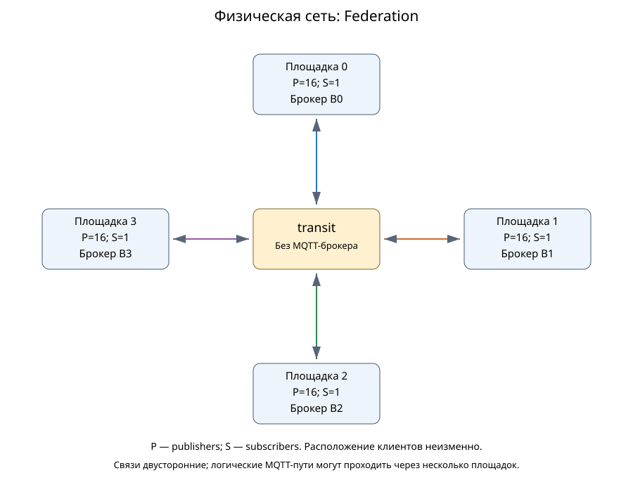
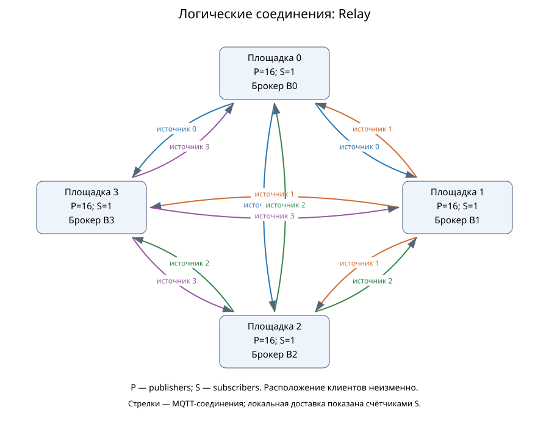
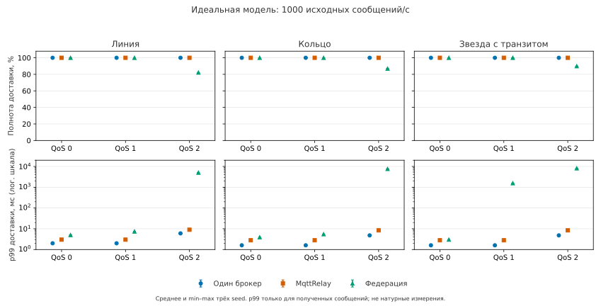
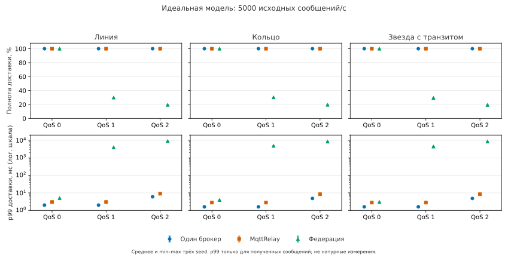
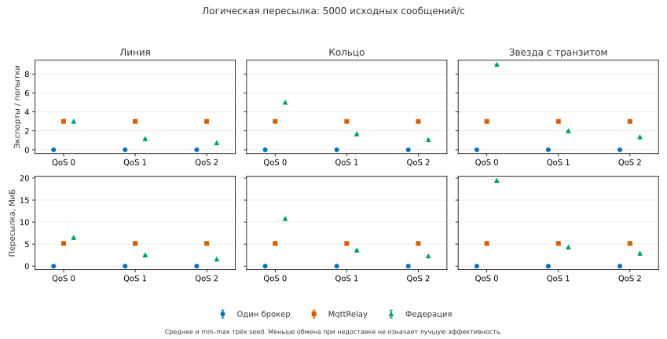
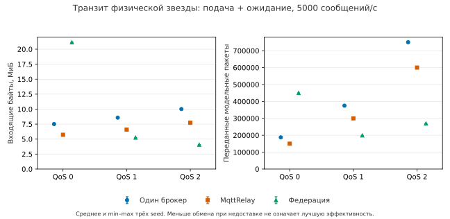
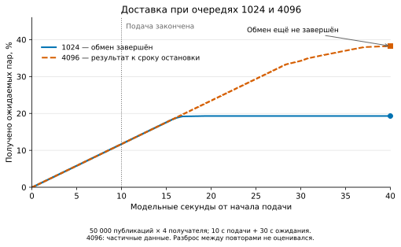
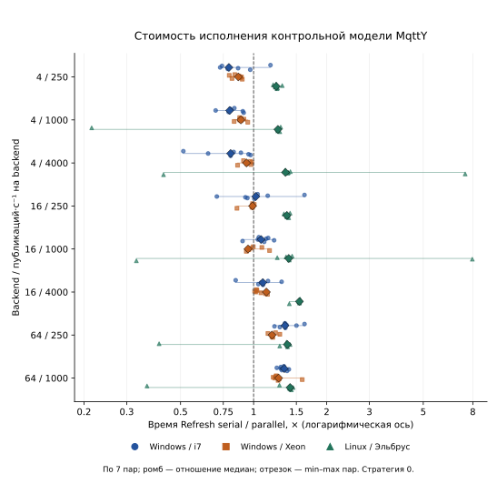

# Доставка и стоимость пересылки в моделях MqttRelay и статической федерации MQTT-брокеров

## Аннотация

В работе сравниваются три способа доставки MQTT-сообщений в MqttY: один центральный брокер, MqttRelay с прямыми связями между брокерами и статическая федерация с пересылкой соседям и подавлением повторов. При одинаковой полезной нагрузке измеряются полнота доставки, задержка, число пересылок и обмен через промежуточный сетевой узел. Выполнены 162 симуляции и шесть точных повторов для четырёх площадок, трёх физических сетей, трёх QoS и двух интенсивностей. Центральный брокер и Relay доставили все ожидаемые сообщения во всех 18 условиях. У федерации при 5000 исходных сообщениях/с полнота составила 29,290–30,144% для QoS 1 и 19,305–19,505% для QoS 2; одновременно зарегистрированы переполнения очередей. В отдельном опыте увеличение очереди с 1024 до 4096 повысило доставку к заданному сроку с 19,3045% до 38,2565%, но обмен не успел завершиться. Поэтому подавление повторов само по себе не обеспечивает полноту, а стоимость пересылки нужно рассматривать вместе с доставкой и временем наблюдения. Результаты относятся к конкретным модельным реализациям с разной организацией очередей; натурная точность сети и преимущество одного алгоритма маршрутизации отдельно не установлены. В отдельной вычислительной серии контрольной модели балансировки при 64 брокерах отношение медиан времени исполнения serial/parallel составило 1,190–1,413× для фазы Refresh на трёх платформах. Выигрыш сопровождается ростом CPU-времени и не гарантирован во всех повторах.

**Ключевые слова:** MQTT, MqttRelay, федерация брокеров, имитационное моделирование, полнота доставки, топология, пересылка, вычислительная стоимость, параллельное исполнение.

## 1. Задача и границы сравнения

Распределение клиентов между брокерами меняет путь доставки, число MQTT-обменов и состояние очередей. При сравнении необходимо сохранить полезную задачу: одинаковые источники, правило планирования публикаций, получатели, подписки и физическую сеть. Иначе увеличение числа доставок может объясняться увеличением числа получателей, а преимущество задержки — исключением потерянных сообщений.

Исследовательский вопрос: как различаются полнота, задержка и стоимость пересылки у single, relay и federation при одинаковой полезной нагрузке и явно объявленных модельных ресурсах? Вопрос об их натурном аппаратном превосходстве в данную программу не входит.

Ribas и Spohn рассматривают самоорганизующуюся федерацию с управляющими механизмами построения сети [1]. Наша федерация статическая: список соседей задаётся до запуска, выбора ядра, служебных маяков, объявления состава сети и перестроения маршрутов нет. Поэтому данная модель не воспроизводит их протокол. Mosquitto также предоставляет нативный механизм bridges с направлениями тем и их преобразованием [2]. MqttRelay исполняет модельную клиентскую пересылку; его нельзя обозначать как натурно проверенный мост брокера.

Авторы ранее рассматривали нагрузочное тестирование MQTT-брокеров [3], моделирование распределённых сетей Интернета вещей [4] и ускорение MqttY [5]. В этой работе сравниваются доставка и объём пересылки при одинаковой полезной нагрузке. Режимы далее обозначены так: `single` — центральный брокер, `relay` — MqttRelay, `federation` — статическая федерация.

### 1.1. Близкие механизмы и вклад сравнения

Отсутствие изменений брокера само по себе не является новым результатом: Ribas–Spohn также используют внешний федератор. Их вариант опирается на MQTT 5 No Local и уведомления подписчиков, а повторы фильтрует вытесняющий кэш LRU [1]. У нашей статической модели нет управляющего обмена; вход, маршрутизация и доставка разделены темами, а ID сохраняются до конца ограниченного опыта.

| Механизм | Кто задаёт пересылку | Как ограничиваются циклы | Что сравнивается в этой работе |
| --- | --- | --- | --- |
| Mosquitto bridge [2] | Конфигурация брокера: соединения, направления и преобразование тем | Требуется корректная настройка; документация отдельно предупреждает о циклах | Только устройство механизма; нативный bridge не измерялся |
| Федерация Ribas–Spohn [1] | Управляющий протокол внешних федераторов | ID и кэш, No Local | Только отличие постановки; протокол статьи не реализован здесь |
| MqttRelay | Заданные таблицы модельных MQTT-клиентов | Импорт не экспортируется снова | Доставка и стоимость конкретной модели |
| Статическая федерация MqttY | Фиксированные соседи | Кэш ID, лимит переходов, раздельные темы | Доставка и стоимость конкретной модели |

Lima и соавторы [7] сравнивают варианты клиентских MQTT-мостов по задержке и потерям, учитывая размер темы и полезной нагрузки. Для сравнения они сохраняют одинаковый суммарный бюджет CPU и памяти. Это близкая постановка, но её натурные результаты не переносятся на MqttY: в нашей работе сравниваются модельные пути сообщений и организация пересылки, а аппаратный ресурс брокера не воспроизводится. Именно различие ресурсов требует ограничивать вывод целыми реализациями, пока очереди и число одновременных отправок не выровнены отдельным опытом.

Вклад работы — проверяемая постановка сравнения трёх модельных вариантов при одной полезной задаче: раздельные графы, журнал каждой пары «сообщение — получатель», учёт служебных пересылок, очередей и поздних доставок. Она позволяет показать границы конкретных реализаций, но не устанавливает первенство клиентской ретрансляции или превосходство над встроенными мостами брокеров. Различия организации очередей входят в условия опыта; причинный эффект одного алгоритма отдельно не выделен.

## 2. Как выполняется модельный опыт

Основная серия использует идеальные брокеры: задержки настоящего Aedes, Mosquitto, ActiveMQ или EMQX в неё не подставляются. MqttY создаёт клиентов, брокеров и сеть, исполняет их обмен по тикам и сохраняет события. Идеальный брокер здесь означает отсутствие эмпирического профиля; сетевые очереди и обмен подтверждениями MQTT остаются.

MqttBenchmark нужен для другой задачи — измерить настоящий брокер и подготовить данные для профиля. Такой профиль использовался в прежней короткой серии, рассматриваемой отдельно в разделе 6. Успешная проверка одиночного профиля не доказывает точность сети из этих профилей.

В распределённых режимах сообщение сначала поступает локальному брокеру. MqttRelay или федератор получает его по подписке и публикует удалённому брокеру через модельную MQTT-сеть. Затем сообщение получает удалённый подписчик. Журнал сохраняет идентификатор, время и адресата каждого события. Проверяющая программа восстанавливает доставку и сравнивает полезную нагрузку с исходной; пересылка не заменяется непосредственным добавлением записи о получении.

Основную серию выполнял сохранённый консольный исполнитель. Веб-приложение служит оболочкой запуска и просмотра; результаты этой серии не являются проверкой полного веб-пути.

## 3. Физическая сеть и логические соединения

Пусть Gp=(Vp,Ep) — физический граф площадок, каналов и промежуточных узлов. Gl=(B,El) задаёт логические MQTT-соединения брокеров. Одно логическое соединение может проходить несколько физических каналов. Промежуточный узел без брокера пересылает сетевые пакеты, но не выполняет функцию федератора.

В single центральный брокер находится на площадке 0. Клиенты остаются на своих площадках и используют физические пути до него. В relay на каждой площадке находится брокер; логический граф полный ориентированный и содержит N(N−1) направлений. Импортированные сообщения не экспортируются повторно. В выполненной основной программе соседство федерации задано явно: для линии — цепь 0–1–2–3, для кольца — цикл 0–1–2–3–0, для звезды — полный граф четырёх брокеров через промежуточный сетевой узел. Каждая связь соседства двусторонняя. Таким образом, физическая звезда в этом опыте не является звездой брокеров.

В основной программе четыре площадки. На каждой находятся 16 отправителей и один подписчик. Используются линия, кольцо и звезда; у звезды есть отдельный транзитный узел без брокера. Ниже показаны физическая звезда и логические направления Relay из выполненной основной серии.

Схемы [соседей федерации](../../../reports/audits/dissertation/network-main-final-v1/topologies/star-federation-logical.svg) и [линии с полным графом Relay](../../../reports/audits/dissertation/network-main-final-v1/topologies/line-relay-logical.svg) дополняют рисунки. Все исходные схемы связаны с результатами в [реестре топологий](../../../reports/audits/dissertation/network-main-final-v1/topologies/manifest.json). Они позволяют отдельно проверить расположение клиентов и путь пересылки между брокерами.

## 4. Пересылка и условия конечности

Федератор различает сообщения по идентичности источника и последовательному номеру. При первом получении сохраняет ID, ставит локальную доставку в очередь и направляет сообщение соседям, кроме отправителя. При повторном ID не выполняет новую локальную доставку и дальнейшую пересылку. Полезная нагрузка сообщения сохраняется, служебные данные находятся в теме и учитываются в её сетевом размере.

Для конечного опыта кэш хранит ID до завершения; конфигурация заранее проверяет вместимость. При превышении вместимости возникает явный отказ, а защита от повторов не отключается молча. Очереди ограничены, переполнения и исчерпания числа переходов учитываются. Отправки каждого выхода выполняются последовательно с ожиданием MQTT-завершения.

Для фиксированного ID каждый из N федераторов обрабатывает первое получение не более одного раза. Пусть E — множество неориентированных связей соседства. Число постановок на межброкерную пересылку ограничено суммой степеней, равной 2|E|; локальная постановка выполняется не более одного раза на площадке. Это обосновывает конечность порождённых прикладных пересылок при конечном графе и сохранении кэша. Оно не является оценкой числа TCP-пакетов или нижележащих протокольных повторов.

Получение всеми достижимыми подписчиками требует дополнительных предпосылок: достаточного числа переходов, отсутствия отказов и переполнений, успешного MQTT-обмена и достаточного времени ожидания завершений (drain). При реальном ограничении очереди полнота является измеряемым результатом, а не следствием одного только подавления повторов.

Уточним лимит переходов H. Для связного неориентированного графа из N брокеров при этих идеальных условиях достаточно H≥N−1, чтобы ID дошёл до всех брокеров. Первые получения образуют дерево: родитель обрабатывает ID раньше потомка, поэтому путь первого получения не содержит повторных узлов. Если ещё не получивший брокер существует, у граничащего с ним уже получившего узла глубина не больше N−2, а значит, остаётся хотя бы один переход для отправки. Это противоречит окончанию обмена без полной доставки. Локальная доставка подписчикам дополнительно требует успешного завершения их MQTT-обмена.

Для точного числа всех экспортов используем более сильное условие H≥N. Источник отправляет всем соседям, каждый другой брокер исключает ровно одного родителя. Если m — число неориентированных рёбер соседства, на один успешно поступивший исходный ID получаем **2m−(N−1)** экспортов. В дереве это N−1, в кольце N+1, в полном графе (N−1)². Это прикладные пересылки, не число пакетов или физических сетевых переходов. При исходной недоставке и переполнении равенство к числу всех API-попыток неприменимо.

Для текущего правила первого получения нельзя выбирать H только по диаметру графа. Копия, пришедшая раньше по длинному пути, может исчерпать переходы; поздняя короткая копия подавляется. [Формальное приложение](../network-forwarding-proofs.md) содержит доказательства и конкретный контрпример. Независимый малый перебор всех порядков обработки для 44 связных графов до четырёх узлов подтвердил проверяемые случаи; он не заменяет общего доказательства и не является новым опытом MqttY. Используемый по умолчанию H=N удовлетворяет указанному достаточному условию.

Для Relay верхняя граница экспортов одного исходного сообщения — N−1, если сообщение дошло до экспортёра и каждый удалённый брокер является адресатом. При потерях число фактических экспортов может быть меньше. Импорт не переэкспортируется, поэтому полный логический граф сам по себе не создаёт прикладной цикл.

## 5. Метрики

Пусть A — фактические исходные попытки публикации измеряемой группы, C — завершённые исходные публикации, M — число ожидаемых получателей, D — уникальные пары (ID, получатель), T — измерительное окно. Тогда E=A×M — ожидаемое число доставок, полнота равна D/E, недоставка — 1−D/E. При E=0 полнота неприменима. Запланированные, но не начатые из-за занятости отправителей публикации учитываются отдельно.

Скорость успешных исходных публикаций равна C/T. Число доставок на секунду подачи D/T может превышать C/T: у одного сообщения несколько получателей. Сумма завершений брокеров включает служебные перепубликации и не равна скорости исходных публикаций. Дополнительно считается число ID, полученных всеми ожидаемыми подписчиками.

Задержка доставки измеряется от исходного вызова Publish до уникального получения, отдельно от подтверждения публикации. Квантили характеризуют полученные пары; при недоставке рядом обязательно показывается полнота. При QoS 0 подтверждения публикации нет. Завершения и получения после окончания подачи входят в итоговые показатели выбранной группы, но выделяются отдельно; итоговый D/T не является скоростью событий только внутри измерительного окна.

Такое разделение согласуется с MQTT 3.1.1: QoS описывает отдельный обмен, а PUBACK не требует предварительного завершения дальнейшей доставки [6]. Поэтому подтверждение исходной публикации не заменяет проверку удалённого подписчика.

Стоимость пересылки — число попыток переслать сообщение, принятые и отклонённые пересылки, байты темы и полезной нагрузки, а также переполнения. Байты темы и полезной нагрузки не включают весь обмен с заголовками MQTT/TCP/IP и подтверждениями. CPU/RSS симулятора не являются ресурсами моделируемого брокера.

## 6. Что проверено перед основной программой

Ранее выполнена короткая серия из 54 симуляций: два семейства моделей, три режима, три QoS и три начальных состояния генератора. В идеальном семействе были три площадки, в семействе с профилем Mosquitto — четыре. При подаче 1000 исходных сообщений/с нагрузка длилась 0,2 модельной секунды, прогрев — 0,01 с, ожидание — до 1 с. Эта серия проверяла работу пересылки, а не предел производительности.

Идеальное семейство доставило все сообщения. В профилированном при QoS 1/2 доставка оказалась неполной во всех режимах; у центрального брокера неполнота наблюдалась также при QoS 0. Низкая задержка среди немногих полученных сообщений не означала хорошей работы сети. Без натурного сетевого контроля эти результаты не позволяют определить точность переноса одиночного профиля на служебные перепубликации. Полные числа и шесть повторов сохранены в [отчёте короткой серии](../../../reports/audits/dissertation/article-2-evidence-package-v2/Comparison.md). Их нельзя объединять с основной программой: различаются состав сети, профили и длительности.

## 7. Основная программа: полное сравнение трёх сетей

### 7.1. Условия и проверка данных

Основная программа выполнена полностью: **162 симуляции и шесть точных повторов**. Это три режима × три физические сети × три QoS × две интенсивности × три начальных состояния генератора. Сети — линия, кольцо и звезда с отдельным транзитным узлом без брокера и клиентов. На четырёх площадках находятся 64 отправителя и четыре получателя; сообщение содержит 16 байт. У single один центральный брокер; у Relay и федерации — по брокеру на площадку.

| Параметр | Значение основной серии |
| --- | --- |
| Интенсивность исходных публикаций | 1000 или 5000 сообщений/с суммарно |
| Прогрев | 1 модельная с, 10 000 тиков |
| Подача измеряемой нагрузки | 10 модельных с, 100 000 тиков |
| Ожидание завершения | До 30 модельных с, до 300 000 тиков; возможно раннее окончание |
| Шаг модели | 0,1 мс |
| Очередь федератора | 1024 сообщения на выход |
| Кэш ID и лимит переходов | 100 000 ID; четыре перехода |
| Модель брокера | Идеальная, без эмпирического профиля |
| Сетевая ёмкость | 125 000 000 байт/с на сетевой объект |
| Окно допуска сети | 100 тиков, то есть 10 мс |
| Сетевая очередь | 100 000 пакетов на сетевой объект |
| Параметр передачи | 2 тика = 0,2 мс; это не полное время обмена туда и обратно |
| Обслуживание выхода федератора | Один незавершённый Publish на выход; очередь 1024 относится и к локальной доставке |
| Путь Relay | Прямой вызов Publish без такой внешней очереди федератора |

Сетевой бюджет задаётся ёмкостью и скользящим окном; он учитывает модельные заголовки пакетов, тему и полезную нагрузку. В идеальном брокере не подключены эмпирическая задержка, профильная частота ошибок и ограничитель RPS. Сетевые очереди и MQTT-обмен при этом остаются. У Relay в опыте нет внешней очереди федератора и такого же ограничения на одну незавершённую отправку. Одинаковы физические настройки и полезная задача, но организация обслуживания различается. Значения сверены по всем 162 исполненным конфигурациям: [проверка ресурсов](../../../reports/audits/dissertation/manuscript-offline-review-v1/resources.json).

Общая подача распределяется между 64 отправителями по очереди. При 1000 сообщений/с разрешение на новую публикацию появляется каждые 10 тиков, при 5000 — каждые два. Отправитель ждёт исхода предыдущей операции и может накопить не более двух разрешений. Поэтому правило планирования одинаково, но фактический вызов может задержаться из-за занятости клиента. В основной серии число начатых публикаций совпало с планом; недоподача проверялась отдельно.

Подключение, подписка и завершение обмена прогрева учитываются до начала измерения. Поэтому заданные длительности нагрузки и ожидания не равны общему числу тиков опыта. Параметры и точный порядок планирования сохранены в [описании сетевой модели](../network-model-contract.md).

Все 162 набора первичных событий пересчитаны по ID: проверена полезная нагрузка, уникальные пары доставки, пересылки, гистограммы, фазы и фактические графы. Расхождений проверяемой арифметики нет. Получено **54 полных тройки режимов** при одинаковых условиях и начальном состоянии генератора. Для всех 18 условий присутствуют состояния 42, 43 и 44; итоговая таблица содержит 54 строки «условие — режим».

Эта программная проверка подтверждает согласованность сохранённых модельных данных, а не соответствие настоящей распределённой сети. [Полная приёмка](../../../reports/audits/dissertation/network-main-final-v1/acceptance.json) связывает результаты с manifest, runtime и проверенным архивом; [CSV](../../../reports/audits/dissertation/network-main-final-v1/raw-recount/comparison.csv) содержит все показатели, в том числе поздние завершения, доставки всем получателям и очереди.

### 7.2. Доставка и задержка

В таблице полнота — доля полученных уникальных пар «сообщение — получатель». У single и Relay полнота **100% во всех строках**. Для задержки показано среднее трёх отдельных p99 среди полученных пар, а не квантиль объединённого потока. При 1000 сообщ./с ожидаются 40 000 пар за опыт, при 5000 — 200 000: у каждой исходной публикации четыре получателя.

| Сеть | QoS | Сообщ./с | Начальных состояний | Полнота федерации, % | p99 single, мс | p99 Relay, мс | p99 федерации, мс |
| --- | ---: | ---: | ---: | ---: | ---: | ---: | ---: |
| Линия | 0 | 1000 | 3 | 100,000 | 2,000 | 3,000 | 5,000 |
| Линия | 0 | 5000 | 3 | 100,000 | 2,000 | 3,000 | 5,000 |
| Линия | 1 | 1000 | 3 | 100,000 | 2,000 | 3,000 | 7,400 |
| Линия | 1 | 5000 | 3 | 29,845 | 2,000 | 3,000 | 3996,700 |
| Линия | 2 | 1000 | 3 | 82,157 | 6,000 | 9,000 | 5056,000 |
| Линия | 2 | 5000 | 3 | 19,419 | 6,000 | 9,000 | 8993,400 |
| Кольцо | 0 | 1000 | 3 | 100,000 | 1,600 | 2,800 | 3,900 |
| Кольцо | 0 | 5000 | 3 | 100,000 | 1,600 | 2,800 | 3,900 |
| Кольцо | 1 | 1000 | 3 | 100,000 | 1,600 | 2,800 | 5,500 |
| Кольцо | 1 | 5000 | 3 | 30,144 | 1,600 | 2,800 | 4846,000 |
| Кольцо | 2 | 1000 | 3 | 86,933 | 4,800 | 8,400 | 7619,600 |
| Кольцо | 2 | 5000 | 3 | 19,505 | 4,800 | 8,400 | 8487,700 |
| Звезда с транзитом | 0 | 1000 | 3 | 100,000 | 1,600 | 2,800 | 3,000 |
| Звезда с транзитом | 0 | 5000 | 3 | 100,000 | 1,600 | 2,800 | 3,000 |
| Звезда с транзитом | 1 | 1000 | 3 | 100,000 | 1,600 | 2,800 | 1568,700 |
| Звезда с транзитом | 1 | 5000 | 3 | 29,290 | 1,600 | 2,800 | 4406,100 |
| Звезда с транзитом | 2 | 1000 | 3 | 89,850 | 4,800 | 8,400 | 8164,900 |
| Звезда с транзитом | 2 | 5000 | 3 | 19,305 | 4,800 | 8,400 | 8510,100 |

При QoS 0 все три режима доставили нагрузку полностью. Федерация также доставила всё при QoS 1 и 1000 сообщ./с, однако у звезды p99 уже достигает 1568,7 мс. Следовательно, отсутствие потерь не гарантирует малой задержки. При увеличении нагрузки QoS 1 до 5000 сообщ./с полнота федерации снижается примерно до 30%; при QoS 2 недоставка возникает при обеих интенсивностях.

Точки — средние, отрезки — min–max трёх начальных состояний; нижняя ось логарифмическая. Для всех применимых сохранённых метрик в 54 группах совпали min и max. В 18 группах QoS 0 публикационный p99 неприменим (n=0, null); отсутствие этого показателя не считается нулевым разбросом. Это свойство данной идеальной программы, а не статистическая уверенность относительно реальных брокеров. Смена seed сама по себе не создаёт независимые стохастические повторения: нагрузка и идеальная обработка здесь не дают наблюдаемого разброса. Точное повторение одного выбранного расчёта проверяет другой вопрос — воспроизводимость реализации и среды.

В **27 основных запусках** федерации зарегистрированы одновременно переполнения очередей и недоставка: три сети × три сочетания QoS/нагрузки × три начальных состояния. Ещё два точных повтора воспроизводят такие состояния. Предупреждение о потерях не является падением процесса. Число отказов постановки в очередь относится к операциям и не равно числу разных потерянных ID. У подписчиков в этой серии не зарегистрированы повторные доставки.

Доставки после подачи входят в итоговую полноту своей группы и отражаются отдельно. Например, в линии при QoS 1 и 5000 сообщ./с федерация получила 59 690 пар, из них 15 253 после подачи; при QoS 2 — 38 838 и 15 318. Деление общего числа получений на десять секунд подачи не является скоростью событий только внутри этого окна.

### 7.3. Логические экспорты и физический транзит

При полной доставке Relay выполняет три экспорта на исходную публикацию. При 1000 сообщ./с это 30 000 пересылок и 1 080 000 байт тем и полезной нагрузки. Федерация линии при QoS 0 выполняет те же 30 000 экспортов, но передаёт 1 341 012 байт; кольца — 50 000 и 2 235 020 байт. Различие объясняет необходимость считать служебные темы наряду с полезной нагрузкой.

При потерях меньшее число выполненных пересылок не означает меньшую стоимость успешного решения задачи. Ноль межброкерных экспортов у single также не означает нулевого сетевого трафика: удалённым клиентам нужно добраться до центрального брокера.

Для физических затрат рассмотрена звезда из раздела 3. Через её промежуточный узел проходят соединения площадок; сам узел не исполняет брокер или федератор.

Для звезды проверены 54 набора счётчиков физического транзита. Из конечного счётчика вычитается снимок до начала измерения; учитываются подача и ожидание завершения, прогрев исключён. Пример для QoS 2, 5000 сообщ./с — средние трёх запусков:

| Режим | Вход в транзит, байт | Передано модельных пакетов | Отказов транзита |
| --- | ---: | ---: | ---: |
| single | 10 500 000 | 750 000 | 0 |
| relay | 8 100 000 | 600 000 | 0 |
| federation | 4 265 132 | 269 404 | 0 |

У федерации в этом примере полнота лишь 19,305%, поэтому меньший обмен нельзя считать преимуществом. Входящие и исходящие байты — наблюдения одной передачи через узел; они не суммируются как объём уникальных данных. Модельные транспортные счётчики включают доступный служебный обмен и отличаются от суммы размеров тем и полезной нагрузки. Они не являются измерением настоящего Ethernet-трафика. Стоимость всех физических рёбер линии и кольца здесь не восстановлена. [Таблица транзита](../../../reports/audits/dissertation/network-main-final-v1/transit.csv) позволяет проверить пример отдельно от графиков.

**Повторяемость и история попыток.**

Шесть заданных повторов заново пересчитаны. Для каждого сошлись байты шести файлов: summary, histograms, publications, delivery-receipts, transmissions и network-evidence. Всего выполнено 36 сравнений научных файлов. Технические поля с PID и временем запуска в это утверждение не включены. Совпадение повторов подтверждает воспроизведение как полной доставки, так и сохранённых потерь.

В истории основной матрицы сохранились **165 попыток**, из них три технически неудачные. Первый отказ Relay по памяти и две остановки федерации кольца по пределу времени не удалены; соответствующие точки впоследствии выполнены успешно. Шесть повторов завершились без технических отказов. Первоначальный срез 106/162 и 0/6 остаётся историческим снимком, а не текущим объёмом исследования; новые результаты не подставлены в старые квитанции. [Итоговый разбор](../../../reports/analysis/Network-main-final.md) и [индекс пакета](../../../reports/audits/dissertation/network-main-final-v1/README.md) содержат происхождение данных и границы проверок.

### 7.4. Отдельная проверка размера очереди

Для одной точки основной сети отдельно изменили ёмкость выходной очереди федератора с 1024 до 4096. Остались прежними четыре площадки со звездой и промежуточным сетевым узлом, QoS 2, 64 отправителя, четыре получателя, 5000 сообщений/с, начальное состояние 42, десять секунд подачи и до 30 секунд ожидания. Вариант 1024 взят из ранее принятой серии и заново проверен по исходным событиям; вариант 4096 вычислен отдельно той же сохранённой сборкой MqttY. Эталон повторно не рассчитывался. Время вычисления между этими сессиями не используется для оценки ускорения.

В обоих вариантах завершены 50 000 исходных публикаций, которым соответствуют 200 000 ожидаемых пар доставки. К общей границе 40 секунд от начала подачи получены 38 609 пар при очереди 1024 и 76 513 при очереди 4096: 19,3045% и 38,2565%. Число событий отказа постановки в очередь снизилось с 203 360 до 173 286. ID и расписание подачи относительно начала измерения совпали. Ожидание завершения прогрева имело разную длительность, поэтому различаются абсолютное начало измерения и поле времени внутри сообщения; влияние относится ко всему эпизоду.

Вариант 4096 **не завершил обмен за установленное время ожидания** и сохранил статус failed. В последнюю модельную секунду зарегистрированы ещё 177 уникальных доставок и 2431 событие пересылки. Следовательно, 61,7435% неполученных к остановке пар нельзя объявлять окончательными потерями: часть могла ещё оставаться в пути. Увеличение очереди улучшило наблюдённую доставку к сроку, но не обеспечило завершения и не устранило переполнения. Эта одна точка не объясняет все различия между Relay и федерацией. [Пересчёт, график доставки и границы вывода](../../../reports/analysis/Queue-main-window-20261030.md) сохранены отдельно от основной матрицы; срок ожидания задним числом не увеличивался.

На рисунке время отсчитывается от начала измерительной подачи. Кривая 1024 перестала расти после завершения её обмена; кривая 4096 ещё росла у границы наблюдения. Увеличенная очередь позволила доставить больше сообщений, но само по себе увеличение буфера не доказало способности обслужить всю нагрузку за отведённое время.

### 7.5. Отдельная серия: вычислительная стоимость исполнения контрольной модели

Доставка в модельном времени и время вычисления этой модели — разные показатели.
Дополнительная серия исследует второй вопрос на контрольной модели распределения
MQTT-подключений round-robin между backend. Эта модель не заменяет single, relay
или federation из основной программы и не измеряет производительность настоящего
балансировщика. Она позволяет проверить, когда параллельный обход графа MqttY
выгоден при росте графа и предложенной нагрузки. Под backend здесь понимается
отдельный модельный MQTT-брокер; распределение подключений задаётся до подачи.

Использована одна Release-сборка `24e15dc` и явная стратегия `Refresh(false/true, 0)`.
Сетка включает 4, 16 и 64 backend, по 16 publishers на backend и 250, 1000 или 4000
публикаций/с на backend. Брокеры идеальные, QoS публикации и подписки 1, сообщение
256 байт, seed 42. Клиенты находятся в общем LAN, до каждого backend — два сетевых
сегмента с пропускной способностью 100 000 000 байт/с и очередью 100 000 пакетов.
Tick равен 0,1 мс, прогрев — 0,01 модельной секунды, измерение — 0,2 с (2000 тиков),
дополнительное ожидание — до 1 с. Модельная интенсивность не является скоростью
вычисления симулятора. Число клиентов меняется вместе с графом; три точки с
4×4000, 16×1000 и 64×250 имеют одинаковую суммарную интенсивность 16 000 публикаций/с.

Локальный пилот допустил восемь из девяти конфигураций. При 64 backend и 4000
публикаций/с на backend оба режима не завершили обмен за предел drain; в parallel
из 51 200 запланированных публикаций 38 100 осталось неотправленными из-за
backpressure. Эта точка сохранена как диагностическая и до удалённой отправки
исключена из сравнения ускорения. Восемь принятых точек выполнены на трёх средах:
Windows/i7-2600 (4 ядра, 8 потоков, .NET 6.0.36), Windows Server/Xeon E3-1230 v6
(4/8, .NET 6.0.2) и ALT Linux/e2k/Эльбрус E8C (8 ядер, .NET 6.0.10).
Различаются ОС и runtime, поэтому эффект одного процессора отдельно не выделен.

Для каждой точки сохранены семь пар serial/parallel, каждый раз в новом процессе.
Порядок конфигураций перемешан воспроизводимо, режимы чередуются. Основной показатель
— wall time строго внутри вызовов `Refresh` измерительной фазы; построение графа
и экспорт в него не входят. Отдельно измерено полное время процесса с JIT,
построением и экспортом. JIT/GC могут происходить и внутри Refresh, поэтому
выделенный показатель не объявляется установившейся скоростью чистого ядра.
Стратегия 1, используемая API по умолчанию, этой серией не оценивалась.
Таймеры пишутся вне научных файлов. Три пары timer on/off в каждом режиме на каждой
машине подтвердили одинаковый научный результат, но не устанавливают нулевую
стоимость наблюдения. Все выбросы сохранены; интервалы уверенности не заявляются.

Таблица показывает **отношение медиан времени Refresh serial / parallel**;
значение больше 1 означает уменьшение времени параллельного исполнения.

| Backend | Публикаций/с на backend | Windows / i7 | Windows / Xeon | Linux / Эльбрус |
| ---: | ---: | ---: | ---: | ---: |
| 4 | 250 | 0,791× | 0,865× | 1,239× |
| 4 | 1000 | 0,797× | 0,886× | 1,259× |
| 4 | 4000 | 0,804× | 0,935× | 1,353× |
| 16 | 250 | 1,021× | 0,990× | 1,371× |
| 16 | 1000 | 1,073× | 0,948× | 1,395× |
| 16 | 4000 | 1,091× | 1,128× | 1,545× |
| 64 | 250 | 1,346× | 1,190× | 1,377× |
| 64 | 1000 | 1,338× | 1,268× | 1,413× |

Ромбы показывают отношение медиан, остальные знаки — все семь пар; отрезки —
наблюдаемый min–max парных коэффициентов, не доверительные интервалы. Ось X
логарифмическая для отображения всех выбросов. Полные времена в секундах,
CPU, память и условия сохранены в [реестре вычислительной серии](../../../reports/audits/mqtty-load-comparison-20261103/comparison.csv).

На обеих Windows-машинах при 4 backend отношение медиан ниже 1. При 16 backend
результат зависит от нагрузки. При 64 backend обе машины выигрывают во всех семи
парах двух принятых интенсивностей: i7 — 1,338–1,346×, Xeon — 1,190–1,268× для
Refresh; полный процесс — 1,284–1,305× и 1,172–1,236× соответственно.
На Эльбрусе отношение медиан Refresh выше 1 во всех восьми точках (1,239–1,545×).
Для 64 backend оно равно 1,377× и 1,413×, а полного процесса — 1,399× и 1,428×.
Но parallel быстрее только в шести из семи пар каждой из этих точек.
Например, один повтор при 64×1000 дал 168,505 с serial против 463,270 с parallel
внутри Refresh; медианы той же точки — 175,572 и 124,233 с. Причина вариации
без профилирования не установлена; гарантированное ускорение из этих данных не следует.

Уменьшение wall time сопровождается ростом суммарного CPU-времени процесса.
На 64 backend отношение медиан CPU parallel / serial составляет 1,46–1,54
на i7, 1,93–1,96 на Xeon и 1,22–1,24 на Эльбрусе. Это CPU всего процесса,
не только Refresh, и не измерение энергии. Peak working set Windows и maximum
RSS Linux учитываются по-разному. Разные способы доставки и работы очередей
не ранжируются этой контрольной нагрузкой по стоимости исполнения.

В дополнительной серии сохранены 336 учётных, 36 контрольных и 48 успешных пилотных
процессов, а также два локальных диагностических пилота: всего 422 попытки.
Научные JSON/CSV для 420 успешных процессов совпали с эталоном своей конфигурации,
в том числе между платформами. Независимо проверены входы, фактические DLL,
4620 sealed-файлов, 402 файла таймеров, backend CSV, гистограммы и p99.
У этой контрольной модели нет экспортированного per-message ledger, поэтому
сверка её агрегатов не выдаётся за пересчёт каждого ID, выполненный для основной
сетевой программы. Новая вычислительная серия имеет отдельные входы и версию,
не изменяет результаты 162 основных расчётов и не доказывает натурную точность сети.

## 8. Что позволяют заключить эти опыты

Основная программа сравнивает целые реализации. У федератора есть ограниченная очередь и одна незавершённая MQTT-публикация на выход, включая локальную доставку. У Relay такой внешней очереди нет. Поэтому разницу доставки нельзя приписать только выбору маршрутов. Опыт с размером очереди показывает чувствительность одной реализации к этому параметру; он не выравнивает механизмы обслуживания трёх режимов.

Все основные расчёты выполнены для идеальных брокеров, четырёх площадок, двух интенсивностей и сообщений 16 байт. Три значения начального состояния не дали разброса сохранённых показателей и не заменяют натурные повторы. Короткая профилированная серия не подтверждает точность настоящей многоброкерной сети. Самоорганизация, отказы и изменение состава сети не исследовались.

Повторяемость проверялась на сохранённой сборке и выбранных конфигурациях. Отдельная короткая проверка последовательного и параллельного исполнения ядра дала одинаковые события доставки, но другой порядок одновременных записей журнала. Первоначальное требование побайтового совпадения в этой пробе не прошло. Этот исторический результат не доказывает общее ускорение или корректность всех параллельных режимов; [разбор пробы движка](../../../reports/analysis/Linux-selected-20261030.md) сохранён отдельно от основной сетевой серии.

В отдельной проверке federation на 16 брокерах три из пяти parallel-повторов
изменили тики 70–72 из 3200 доставок относительно serial, без потерь и при том же
общем p99. Это расхождение относится к самим временам событий, а не только к порядку
строк; [диагностика сохранена](../../../reports/audits/mqtty-scaling-20261103/analysis.json).
Поэтому совпадение контрольной модели балансировки в разделе 7.5 нельзя переносить
на все графы федерации. Производительность общего параллельного Engine и его
универсальная корректность остаются разными проверяемыми свойствами.

## 9. Выводы

Проверяемое сравнение MQTT-сетей требует учитывать каждую ожидаемую пару «сообщение — получатель», время её получения и затраты на пересылку. В основной серии центральный брокер и MqttRelay доставили все ожидаемые сообщения в каждом из своих 54 запусков. Статическая федерация предотвращала повторную доставку, но в части режимов QoS 1/2 имела переполнения и неполную доставку. Шесть выбранных повторов воспроизвели проверяемые результаты.

В отдельном опыте увеличение очереди с 1024 до 4096 повысило полноту к общему сроку с 19,3045% до 38,2565%, однако обмен к остановке ещё продолжался. Практический вывод — размер буфера, число одновременных отправок и срок ожидания нужно рассматривать вместе. Подавление повторов решает задачу циклов, но само по себе не гарантирует доставку при ограниченных ресурсах. Эти выводы описывают проверенные реализации MqttY; ранжировать по ним реальные брокеры или алгоритмы маршрутизации в целом нельзя.

Дополнительная вычислительная серия показывает ограниченный выигрыш параллельного
исполнения крупных контрольных графов на трёх средах при увеличении CPU-затрат.
Порог выгодности зависит от конфигурации и среды, а выбросы на Эльбрусе исключают
вывод о гарантированном ускорении каждого запуска. Эти измерения характеризуют
стоимость реализации симулятора и не являются преимуществом одного MQTT-механизма
или доказательством точности моделирования настоящих брокеров.

## Источники и данные

1. Ribas N. K., Spohn M. A. A New Approach to a Self-Organizing Federation of MQTT Brokers. Journal of Computer Science. Vol. 18, no. 7, p. 687–694. [DOI: 10.3844/jcssp.2022.687.694](https://doi.org/10.3844/jcssp.2022.687.694). [Полный текст](https://thescipub.com/pdf/jcssp.2022.687.694.pdf).
2. Eclipse Mosquitto. mosquitto.conf, Configuring Bridges. [Официальная документация](https://mosquitto.org/man/mosquitto-conf-5.html). Это описание механизма, а не фиксация версии установленного брокера.
3. Солопий А. В., Классен Р. К. Выбор брокера сообщений для Интернета вещей на основе нагрузочного тестирования. Динамика сложных систем — XXI век. 2025. Т. 19, № 3. С. 44–51. [DOI: 10.18127/j19997493-202503-04](https://doi.org/10.18127/j19997493-202503-04).
4. Solopiy A., Klassen R. Simulation of Distributed Networks of Internet of Things. 2025 International Russian Automation Conference (RusAutoCon). IEEE, 2025. P. 467–472. [DOI: 10.1109/RusAutoCon65989.2025.11177411](https://doi.org/10.1109/RusAutoCon65989.2025.11177411).
5. Солопий А. В., Классен Р. К. Симулятор промышленных сетей мониторинга Интернета вещей MqttY: ускорение симуляции больших сетей. Computational Nanotechnology. 2026. Т. 13, № 1. С. 212–221. [DOI: 10.33693/2313-223X-2026-13-1-212-221](https://doi.org/10.33693/2313-223X-2026-13-1-212-221).
6. OASIS. MQTT Version 3.1.1. Edited by Andrew Banks and Rahul Gupta. OASIS Standard, 2014. Раздел 4.3. [Стандарт](https://docs.oasis-open.org/mqtt/mqtt/v3.1.1/os/mqtt-v3.1.1-os.html).
7. Lima K., Oyetoyan T. D., Heldal R., Hasselbring W. Evaluation of MQTT Bridge Architectures in a Cross-Organizational Context. Авторская версия, 2025. [arXiv:2501.14890v1](https://arxiv.org/abs/2501.14890v1). [Полный текст](https://arxiv.org/html/2501.14890v1).

Данные [короткой серии](../../../reports/data/federation-full-mesh-v1/aggregates.json), [основной программы](../../../reports/audits/dissertation/network-main-final-v1/README.md) и [дополнительного опыта с очередями](../../../reports/analysis/Queue-main-window-20261030.md) имеют отдельные реестры. Определения показателей приведены в [описании сетевой модели](../network-model-contract.md). Исторические результаты и неудачные попытки сохранены.

Компактный пакет обеих статей с рисунками, основными таблицами и примерами первичных событий описан в [инструкции для другого исследователя](../reproduction-handoff.md). Сохранённый ZIP v5 содержит прежнюю редакцию основной серии; новые тексты и опыт очереди 4096 доступны отдельно по ссылкам этой рукописи. Пакет позволяет проверить выбранные примеры; полного пересчёта всей сети без внешнего архива не заменяет.

Полный архив первичных событий основной программы хранится вне Git; для нового пересчёта он требуется отдельно. Постоянного публичного адреса полного набора пока нет. Пакет примеров позволяет проверить отдельные результаты, но не заменяет независимого повторения всего исследования другим человеком.

Вычислительная серия от 03.11.2026: [общий отчёт и методика](../../../reproducibility/README.md),
[данные всех повторов и расчёты](../../../reports/audits/mqtty-load-comparison-20261103/comparison.json),
[проверка i7](../../../reports/audits/mqtty-load-comparison-20261103/local-i7-verification.json),
[проверка Xeon](../../../reports/audits/mqtty-load-comparison-20261103/windows-xeon-verification.json),
[проверка Эльбруса](../../../reports/audits/mqtty-load-comparison-20261103/linux-e2k-verification.json).
Полные архивы этой серии хранятся вне Git, SHA и локаторы приведены в квитанциях
`*-retrieval.json` рядом с расчётами. Научные файлы не содержат wall-clock таймеров;
их наблюдения сохранены отдельно и включены во внешний реестр хэшей.
