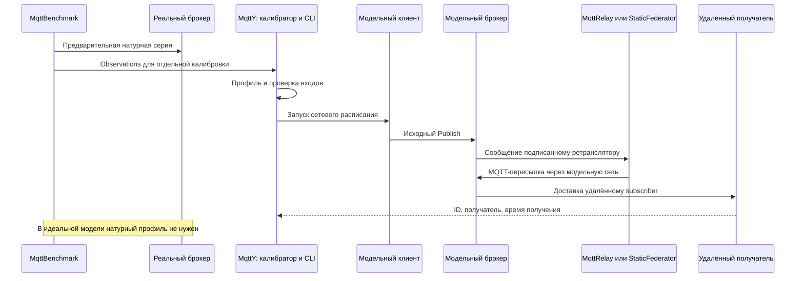
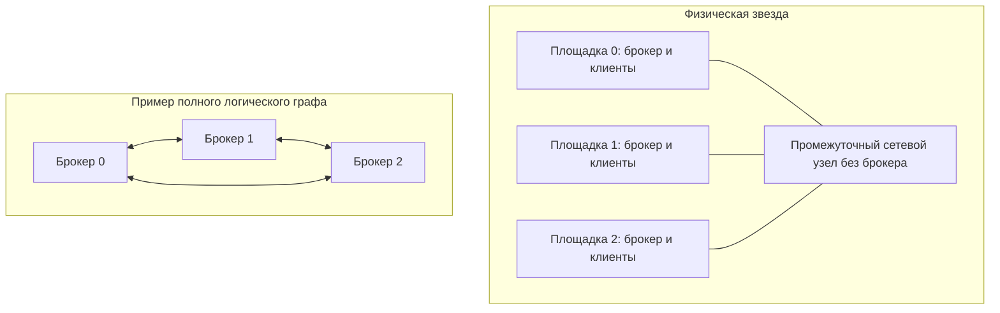

# Доставка и стоимость пересылки в моделях MqttRelay и статической федерации MQTT-брокеров

Рабочий текст для последующей редакции автором. Метод и результаты короткой механизмной серии приведены полностью. Раздел основной длинной серии остаётся открытым до проверки её фактического завершения; отсутствующие результаты не подставляются. Текст не подан и не утверждён соавторами.

## Аннотация

Рассматриваются три способа обслуживания одного набора MQTT-публикаций в MqttY: центральный брокер, сеть клиентских ретрансляторов MqttRelay и статическая федерация с подавлением повторов. Разделены физический граф каналов и логический граф MQTT-соединений; полезный результат измеряется уникальными парами «публикация, получатель». Выполненная короткая серия включает 54 симуляции идеальной и профилированной моделей и шесть точных повторов. В идеальной модели все режимы обеспечили полную доставку, однако федерация затратила больше пересылок и имела большую задержку в рассмотренной конфигурации. Профилированные опыты демонстрируют ограничения переноса одиночного эмпирического профиля на дополнительный трафик ретрансляторов. Для изучения поведения при более длительной нагрузке зафиксирована отдельная программа 162 симуляций и шести повторов. Её результаты должны анализироваться отдельно от короткой серии. Работа проверяет модельные механизмы; натурная точность сети, самоорганизация и отказоустойчивость не заявляются.

**Ключевые слова:** MQTT, MqttRelay, федерация брокеров, имитационное моделирование, полнота доставки, топология, пересылка.

## 1. Задача и границы сравнения

Распределение клиентов между брокерами меняет путь доставки, число MQTT-обменов и состояние очередей. При сравнении необходимо сохранить полезную задачу: одинаковые источники, расписание публикаций, получатели, подписки и физическую сеть. Иначе увеличение числа доставок может объясняться увеличением числа получателей, а преимущество задержки — исключением потерянных сообщений.

Исследовательский вопрос: как различаются полнота, задержка и стоимость пересылки у single, relay и federation при одинаковой полезной нагрузке и явно объявленных модельных ресурсах? Вопрос об их натурном аппаратном превосходстве в данную программу не входит.

Ribas и Spohn рассматривают самоорганизующуюся федерацию с управляющими механизмами построения сети [1]. Наша федерация статическая: список соседей задаётся до запуска, выбора ядра, beacons, членства и перестроения маршрутов нет. Поэтому настоящее приложение не является воспроизведением их протокола. Mosquitto также предоставляет нативный механизм bridges с направлениями тем и их преобразованием [2]. MqttRelay исполняет модельную клиентскую пересылку; его нельзя обозначать как измеренный native bridge.

## 2. Ответственность приложений

| Приложение или компонент | Действие |
| --- | --- |
| MqttBenchmark | До сетевого опыта измеряет реальный брокер и сохраняет observations; в модельном сетевом опыте не запускается |
| Калибратор MqttY | Заранее строит профиль с происхождением и SHA; сетевой опыт профиль не перестраивает |
| Federation.App | Проверяет конфигурацию, строит графы, размещает клиентов, запускает фазы и сохраняет результат |
| Ядро MqttY и MQTT-плагин | Исполняют модельное время, сетевые очереди, брокеров и MQTT-обмен |
| MqttRelay | Экспортирует локальный источник другим брокерам; импорт доставляет локально, не экспортируя повторно |
| StaticFederator | Различает ID, доставляет первое получение локально, пересылает соседям и подавляет повторы |
| Проверяющий скрипт | Пересчитывает сохранённые публикации, передачи и получения, проверяет payload, графы и знаменатели |

## 3. Физическая сеть и логические соединения

Пусть Gp=(Vp,Ep) — физический граф площадок, каналов и промежуточных узлов. Gl=(B,El) задаёт логические MQTT-соединения брокеров. Одно логическое соединение может проходить несколько физических каналов. Промежуточный узел без брокера пересылает сетевые пакеты, но не выполняет функцию федератора.

В single центральный брокер находится на площадке 0. Клиенты остаются на своих площадках и используют физические пути до него. В relay на каждой площадке находится брокер; логический граф полный ориентированный и содержит N(N−1) направлений. Импортированные сообщения не экспортируются повторно. В federation используются заданные соседи; в физической звезде с пустым транзитным сегментом логические соседи брокеров могут образовывать полный граф. Следовательно, физическая звезда не обязана означать брокер-звезду.

Диаграмма поясняет различие графов, а не подменяет топологию конкретного запуска. Сохраняемые SVG/Mermaid/GraphML сверяются с фактическим графом приложения. Для короткой серии ниже физическая сеть — кольцо.

## 4. Пересылка и условия конечности

Федератор различает сообщения по идентичности источника и последовательному номеру. При первом получении сохраняет ID, ставит локальную доставку в очередь и направляет сообщение соседям, кроме отправителя. При повторном ID не выполняет новую локальную доставку и дальнейшую пересылку. Payload сохраняется, служебные данные находятся в теме и учитываются в её сетевом размере.

Для конечного опыта кэш хранит ID до завершения; конфигурация заранее проверяет вместимость. При превышении вместимости возникает явный отказ, а защита от повторов не отключается молча. Очереди ограничены, переполнения и исчерпания числа переходов учитываются. Отправки каждого выхода выполняются последовательно с ожиданием MQTT-завершения.

Для фиксированного ID каждый из N федераторов обрабатывает первое получение не более одного раза. Пусть E — множество неориентированных связей соседства. Число постановок на межброкерную пересылку ограничено суммой степеней, равной 2|E|; локальная постановка выполняется не более одного раза на площадке. Это обосновывает конечность порождённых прикладных пересылок при конечном графе и сохранении кэша. Оно не является оценкой числа TCP-пакетов или нижележащих протокольных повторов.

Получение всеми достижимыми подписчиками требует дополнительных предпосылок: достаточного числа переходов, отсутствия отказов и переполнений, успешного MQTT-обмена и достаточного drain. При реальном ограничении очереди полнота является измеряемым результатом, а не следствием одного только подавления повторов.

Для Relay верхняя граница экспортов одного исходного сообщения — N−1, если сообщение дошло до экспортёра и каждый удалённый брокер является адресатом. При потерях число фактических экспортов может быть меньше. Импорт не переэкспортируется, поэтому полный логический граф сам по себе не создаёт прикладной цикл.

## 5. Метрики

Пусть A — фактические исходные API-попытки измерительной когорты, C — завершённые исходные публикации, M — число ожидаемых получателей, D — уникальные пары (ID, получатель), T — измерительное окно. Тогда E=A×M — ожидаемое число доставок, полнота равна D/E, недоставка — 1−D/E. При E=0 полнота неприменима. Запланированные, но не вызванные из-за backpressure публикации учитываются отдельно.

Исходный completed RPS равен C/T. Goodput D/T может превышать C/T из-за нескольких получателей. Сумма завершений брокеров включает служебные перепубликации и не равна скорости исходных публикаций. Дополнительно считается число ID, полученных всеми ожидаемыми подписчиками.

Задержка доставки измеряется от исходного вызова Publish до уникального получения, отдельно от публикационного ACK. Квантили характеризуют полученные пары; при недоставке рядом обязательно показывается полнота. QoS 0 ACK неприменим. Завершения и получения в drain входят в итоговые показатели когорты, но выделяются отдельно; итоговый D/T не является скоростью событий только внутри измерительного окна.

Стоимость пересылки описывается числом forward-попыток, принятыми/отклонёнными пересылками, размером topic+payload и переполнениями. Размер topic+payload нельзя выдавать за полный wire traffic с заголовками MQTT/TCP/IP и ACK. CPU/RSS симулятора не являются ресурсами моделируемого брокера; EST сети не вычисляется.

## 6. Завершённая короткая серия

Короткая программа содержит два семейства ×три режима ×три QoS ×три seed =54 симуляции. Выполнены все 54, технических отказов нет; шесть выбранных scientific summaries повторились побайтно. Идеальное семейство содержит три площадки, 12 publishers и три получателя; Mosquitto — четыре площадки, 64 publishers и четыре получателя. Внутри семейства расположение клиентов сохраняется, но сравнивать абсолютный goodput между семействами без учёта fanout нельзя.

Общая нагрузка — 1000 исходных сообщений/с, payload 16 байт; прогрев 0,01 с, нагрузка 0,2 с, drain до 1 с, tick 0,1 мс. Это механизмная проверка, а не установившийся предел производительности.

| Идеальная модель | Полнота | p99 получения QoS 0, мс | QoS 1, мс | QoS 2, мс | Межброкерные пересылки за опыт |
| --- | ---: | ---: | ---: | ---: | ---: |
| single | 100% | 1,2 | 1,2 | 3,6 | 0 |
| relay | 100% | 2,6 | 2,6 | 7,8 | 400 |
| federation | 100% | 2,8 | 5,5 | 145,8 | 800 |

В данном идеальном кольце все сообщения доставлены, а федерация выполняет вдвое больше пересылок, чем Relay. Это согласуется с различием механизмов, но не доказывает универсального превосходства Relay: режимы имеют разную организацию выходных очередей и последовательность обменов. Центральный брокер в этой короткой нагрузке также не испытывает доказанного предельного насыщения.

В профилированном семействе Mosquitto результаты сильно зависят от QoS и точек профиля. Например, средняя недоставка single для QoS 1 составляет около 0,7821, relay — 0,9967, federation — 0,9975. Эти значения относятся к модели, а не к натурно измеренной федерации Mosquitto. Для распределённых брокеров и центрального брокера применяются разные точные точки N=16 и N=64; дополнительный трафик федераторов выходит за условия одиночной калибровки. Отсутствующие точки не заменяются соседними.

Таким образом, короткая профилированная серия демонстрирует ограничение такого переноса, а не доказанный проигрыш настоящих сетевых брокеров. При малом числе получений p99 не рассматривается отдельно от полноты. При отсутствии получений он неприменим.

## 7. Основная программа и незавершённые выводы

Отдельно зафиксирована программа: три режима ×три физических топологии ×три QoS ×две интенсивности ×три seed =162 симуляции и шесть точных повторов. Четыре площадки, 64 publishers и четыре получателя; payload 16 байт, 1000/5000 исходных публикаций/с, прогрев 1 с, нагрузка 10 с, drain до 30 с с завершением при idle, tick 0,1 мс.

Основная программа проверяет более длительные конечные опыты. Четыре модельных брокера не трактуются как равные одному брокеру по физическому CPU/RAM. Перенос одиночного профиля и необязательные диагностические серии отделяются от основной идеальной матрицы.

**Итоговая сравнительная таблица основной программы пока не заполнена:** необходимо проверить все фактически полученные результаты, повторы и технические отказы. Ограничение реального времени не разрешает считать невыполненные точки успешными. Пилоты, результаты короткой серии и завершённые точки основной матрицы не складываются в один однородный знаменатель.

После завершения для каждой комбинации topology/QoS/rps сравниваются три режима с одинаковыми seed: полнота, доставка всем получателям, задержки при объявленном числе получений, пересылки, байты topic+payload, очереди и доля drain. Если покрытие неполное, указываются фактическое n и отсутствующие точки. Доверительные интервалы по seed не включают ошибку натурного профиля.

## 8. Ограничения и выводы

Короткая серия подтверждает исполнимость трёх механизмов, проверяемую удалённую доставку и повторяемость выбранных результатов. Для идеального кольца пересылка Relay дешевле статического flooding по числу экспортов и задержке. Обобщать этот вывод на другие графы, нагрузки и реальные реализации нельзя.

Два графа и ожидаемые пары ID–получатель необходимы для корректного сравнения. Подавление повторов ограничивает размножение сообщений, но не гарантирует доставку при переполнении. Разные очереди и число брокеров входят в экспериментальные условия и не скрываются за названием алгоритма.

Существующая работа не подтверждает самоорганизацию, отказоустойчивость, натурную точность сети или аппаратную эффективность. Такие утверждения потребовали бы управляющего протокола, программы отказов и сопоставимого натурного стенда. До проверки основной матрицы выводы о поведении при более длительной нагрузке остаются открытыми.

## Источники и данные

1. Ribas N. K., Spohn M. A. A New Approach to a Self-Organizing Federation of MQTT Brokers. Journal of Computer Science. Vol. 18, no. 7, p. 687–694. [DOI: 10.3844/jcssp.2022.687.694](https://doi.org/10.3844/jcssp.2022.687.694). [Полный текст](https://thescipub.com/pdf/jcssp.2022.687.694.pdf).
2. Eclipse Mosquitto. mosquitto.conf, Configuring Bridges. [Официальная документация](https://mosquitto.org/man/mosquitto-conf-5.html). Это описание механизма, а не фиксация версии установленного брокера.

Данные короткой серии: `reports/data/federation-full-mesh-v1/aggregates.json`, исходные summary, графы и реестр проверки в той же группе артефактов. Методические определения сверяются с `docs/dissertation/network-model-contract.md`. Основная программа и её runtime имеют отдельные manifests; их идентичности не объединяются с короткой серией.

Перед подачей автору необходимо завершить интерпретацию основной программы, согласовать вклад, внести авторские сведения и адаптировать оформление. Факт подготовки данного рабочего текста не означает завершения шагов 23–25 или согласования статьи с соавторами.
