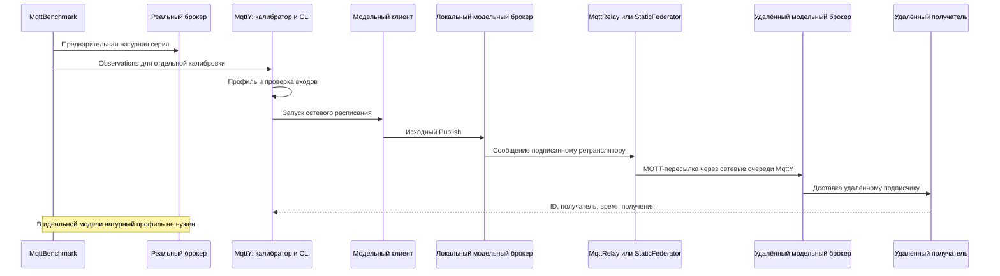
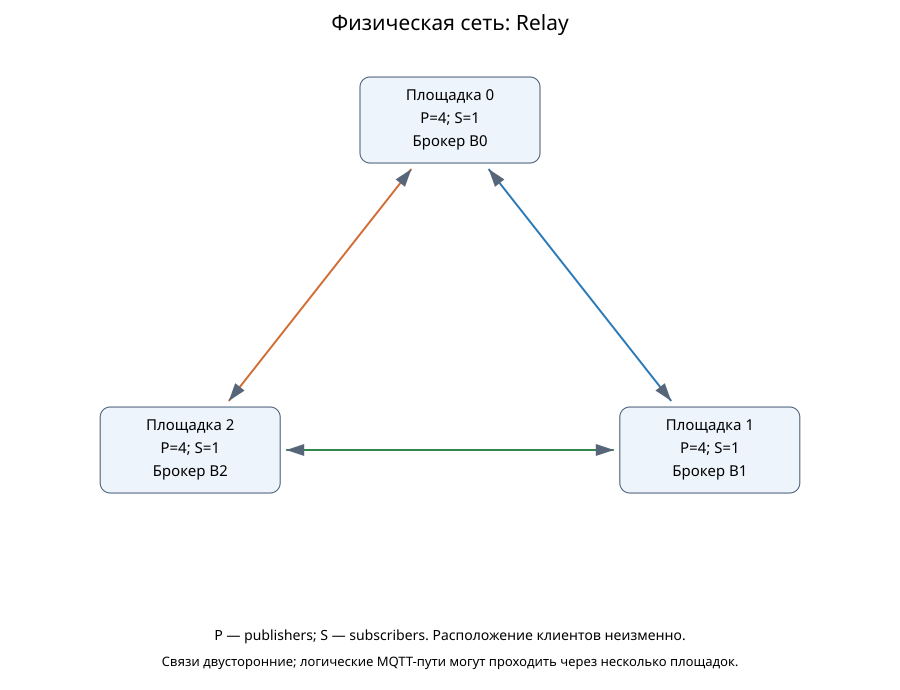
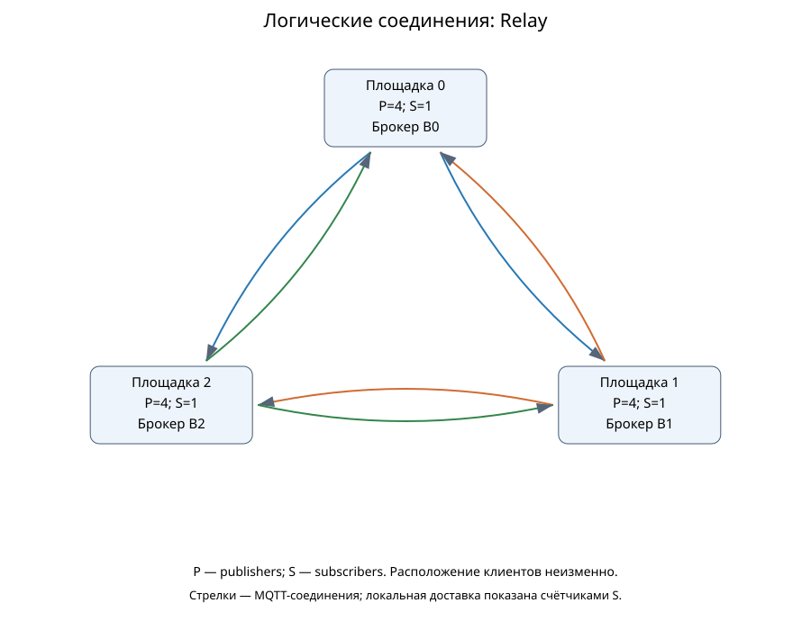
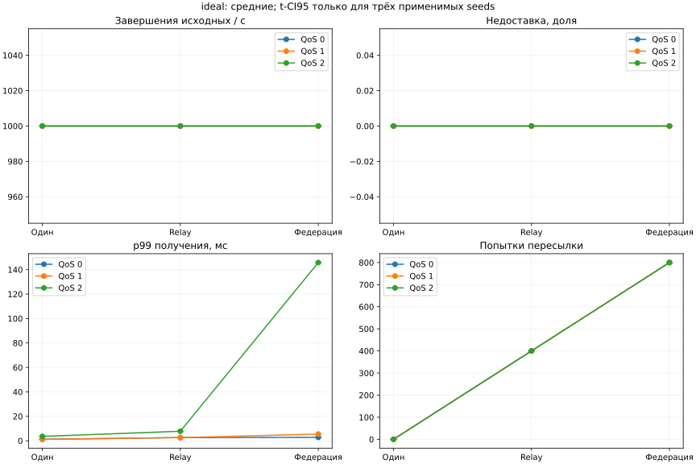
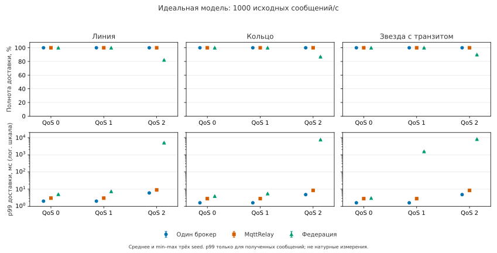
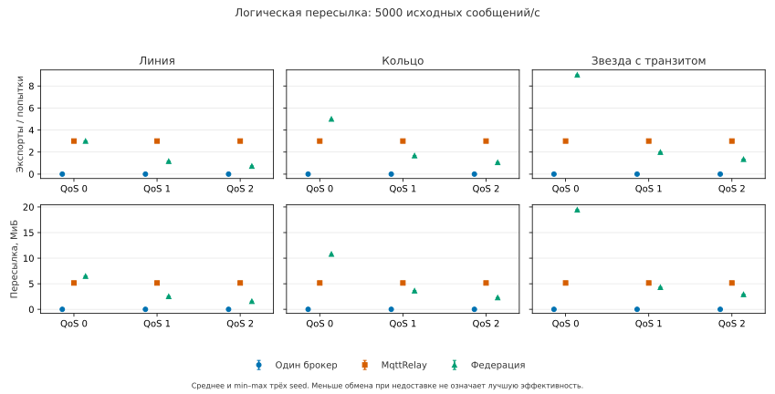
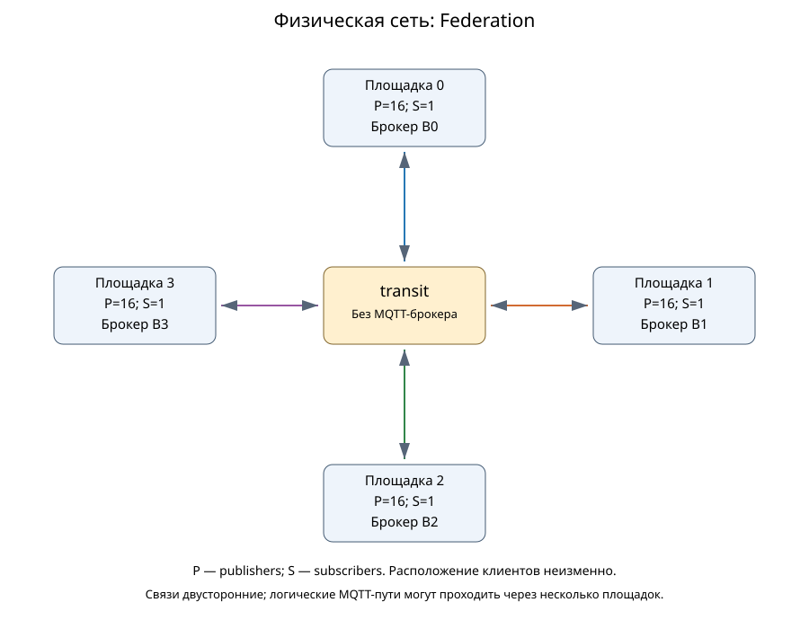
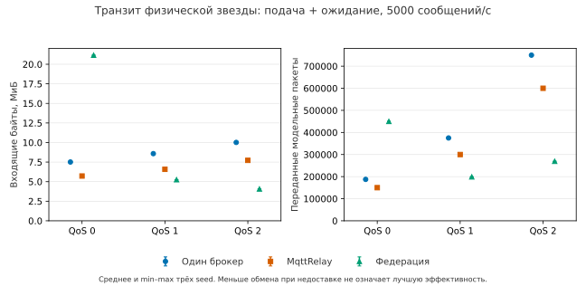

# Доставка и стоимость пересылки в моделях MqttRelay и статической федерации MQTT-брокеров

Рабочий текст для последующей редакции автором. Основная программа завершена: 162 симуляции и шесть точных повторов; первичные данные проверены отдельно от исторической короткой серии. Текст не подан и не утверждён соавторами.

## Аннотация

В MqttY сравниваются три способа доставки MQTT-сообщений: один центральный брокер, MqttRelay и статическая федерация с подавлением повторов. При одной полезной нагрузке измеряются получение сообщений подписчиками, задержка, число пересылок и нагрузка промежуточного сетевого узла. Основная идеальная серия содержит 162 симуляции: три физические сети, три QoS, две интенсивности, три режима и три начальных состояния генератора. Отдельно проверены шесть точных повторов. Во всех 18 условиях центральный брокер и Relay доставили все ожидаемые пары «сообщение — получатель». У федерации при 5000 исходных сообщениях/с полнота составляет 29,290–30,144% для QoS 1 и 19,305–19,505% для QoS 2; при QoS 2 и 1000 сообщ./с — 82,157–89,850%. В этих режимах зарегистрированы переполнения очередей. Счётчики физического транзита проверены отдельно от логических экспортов. Шесть повторов совпали по шести научным файлам каждый. Историческая короткая серия рассматривается отдельно. Результаты характеризуют конкретные реализации с различной организацией очередей; они не выделяют собственный эффект маршрутизации и не устанавливают натурную точность сети, самоорганизацию или отказоустойчивость.

**Ключевые слова:** MQTT, MqttRelay, федерация брокеров, имитационное моделирование, полнота доставки, топология, пересылка.

## 1. Задача и границы сравнения

Распределение клиентов между брокерами меняет путь доставки, число MQTT-обменов и состояние очередей. При сравнении необходимо сохранить полезную задачу: одинаковые источники, правило планирования публикаций, получатели, подписки и физическую сеть. Иначе увеличение числа доставок может объясняться увеличением числа получателей, а преимущество задержки — исключением потерянных сообщений.

Исследовательский вопрос: как различаются полнота, задержка и стоимость пересылки у single, relay и federation при одинаковой полезной нагрузке и явно объявленных модельных ресурсах? Вопрос об их натурном аппаратном превосходстве в данную программу не входит.

Ribas и Spohn рассматривают самоорганизующуюся федерацию с управляющими механизмами построения сети [1]. Наша федерация статическая: список соседей задаётся до запуска, выбора ядра, beacons, членства и перестроения маршрутов нет. Поэтому данная модель не воспроизводит их протокол. Mosquitto также предоставляет нативный механизм bridges с направлениями тем и их преобразованием [2]. MqttRelay исполняет модельную клиентскую пересылку; его нельзя обозначать как измеренный native bridge.

Авторы ранее рассматривали нагрузочное тестирование MQTT-брокеров [3], моделирование распределённых сетей Интернета вещей [4] и ускорение MqttY [5]. В этой работе сравниваются доставка и объём пересылки при одинаковой полезной нагрузке. Режимы далее обозначены так: `single` — центральный брокер, `relay` — MqttRelay, `federation` — статическая федерация.

### 1.1. Близкие механизмы и вклад сравнения

Отсутствие изменений брокера само по себе не является новым результатом: Ribas–Spohn также используют внешний федератор. Их вариант опирается на MQTT 5 No Local и уведомления подписчиков, а повторы фильтрует вытесняющий кэш LRU [1]. У нашей статической модели нет управляющего обмена; вход, маршрутизация и доставка разделены темами, а ID сохраняются до конца ограниченного опыта.

| Механизм | Кто задаёт пересылку | Как ограничиваются циклы | Что сравнивается в этой работе |
| --- | --- | --- | --- |
| Mosquitto bridge [2] | Конфигурация брокера: соединения, направления и преобразование тем | Требуется корректная настройка; документация отдельно предупреждает о циклах | Только устройство механизма; нативный bridge не измерялся |
| Федерация Ribas–Spohn [1] | Управляющий протокол внешних федераторов | ID и кэш, No Local | Только отличие постановки; протокол статьи не реализован здесь |
| MqttRelay | Заданные таблицы модельных MQTT-клиентов | Импорт не экспортируется снова | Доставка и стоимость конкретной модели |
| Статическая федерация MqttY | Фиксированные соседи | Кэш ID, лимит переходов, раздельные темы | Доставка и стоимость конкретной модели |

Вклад работы — проверяемая постановка сравнения трёх модельных вариантов при одной полезной задаче: раздельные графы, журнал каждой пары «сообщение — получатель», учёт служебных экспортов, очередей и поздних доставок. Она позволяет показать границы конкретных реализаций, но не устанавливает первенство клиентской ретрансляции или превосходство над нативными bridges. Различия организации очередей входят в условия опыта; причинный эффект одного алгоритма отдельно не выделен.

## 2. Ответственность приложений

| Приложение или компонент | Действие |
| --- | --- |
| MqttBenchmark | До сетевого опыта измеряет реальный брокер и сохраняет observations; в модельном сетевом опыте не запускается |
| Калибратор MqttY | Заранее строит профиль с происхождением и SHA; сетевой опыт профиль не перестраивает |
| Federation.App | Проверяет конфигурацию, строит графы, размещает клиентов, запускает фазы и сохраняет результат |
| Ядро MqttY и MQTT-плагин | Исполняют модельное время, сетевые очереди, брокеров и MQTT-обмен |
| MqttRelay | Экспортирует локальный источник другим брокерам; импорт доставляет локально, не экспортируя повторно |
| StaticFederator | Различает ID, доставляет первое получение локально, пересылает соседям и подавляет повторы |
| Проверяющий скрипт | Пересчитывает сохранённые публикации, передачи и получения, проверяет payload, графы и знаменатели |

## 3. Физическая сеть и логические соединения

Пусть Gp=(Vp,Ep) — физический граф площадок, каналов и промежуточных узлов. Gl=(B,El) задаёт логические MQTT-соединения брокеров. Одно логическое соединение может проходить несколько физических каналов. Промежуточный узел без брокера пересылает сетевые пакеты, но не выполняет функцию федератора.

В single центральный брокер находится на площадке 0. Клиенты остаются на своих площадках и используют физические пути до него. В relay на каждой площадке находится брокер; логический граф полный ориентированный и содержит N(N−1) направлений. Импортированные сообщения не экспортируются повторно. В federation используются заданные соседи; в физической звезде с пустым транзитным сегментом логические соседи брокеров могут образовывать полный граф. Следовательно, физическая звезда не обязана означать брокер-звезду.

Ниже показаны фактически сохранённые графы идеальной короткой серии: три площадки, на каждой четыре отправителя и один подписчик. В режиме Relay брокеры соединены каждый с каждым. У кольца из трёх площадок физические соседи также образуют треугольник; это особенность выбранного размера, а не свойство любых колец.

Доступны исходники Mermaid [физического графа](../../../reports/data/federation-full-mesh-v1/ideal-relay-physical.mmd) и [логического графа](../../../reports/data/federation-full-mesh-v1/ideal-relay-logical.mmd). Для профилированной серии физическое кольцо содержит [четыре площадки](../../../reports/data/federation-full-mesh-v1/mosquitto-federation-physical.svg), а полный граф Relay — 12 направлений. Промежуточный узел без брокера относится к другим топологиям основной программы; в эти рисунки он не добавлен. Диаграммы взяты из результатов соответствующей серии.

## 4. Пересылка и условия конечности

Федератор различает сообщения по идентичности источника и последовательному номеру. При первом получении сохраняет ID, ставит локальную доставку в очередь и направляет сообщение соседям, кроме отправителя. При повторном ID не выполняет новую локальную доставку и дальнейшую пересылку. Payload сохраняется, служебные данные находятся в теме и учитываются в её сетевом размере.

Для конечного опыта кэш хранит ID до завершения; конфигурация заранее проверяет вместимость. При превышении вместимости возникает явный отказ, а защита от повторов не отключается молча. Очереди ограничены, переполнения и исчерпания числа переходов учитываются. Отправки каждого выхода выполняются последовательно с ожиданием MQTT-завершения.

Для фиксированного ID каждый из N федераторов обрабатывает первое получение не более одного раза. Пусть E — множество неориентированных связей соседства. Число постановок на межброкерную пересылку ограничено суммой степеней, равной 2|E|; локальная постановка выполняется не более одного раза на площадке. Это обосновывает конечность порождённых прикладных пересылок при конечном графе и сохранении кэша. Оно не является оценкой числа TCP-пакетов или нижележащих протокольных повторов.

Получение всеми достижимыми подписчиками требует дополнительных предпосылок: достаточного числа переходов, отсутствия отказов и переполнений, успешного MQTT-обмена и достаточного времени ожидания завершений (drain). При реальном ограничении очереди полнота является измеряемым результатом, а не следствием одного только подавления повторов.

Уточним лимит переходов H. Для связного неориентированного графа из N брокеров при этих идеальных условиях достаточно H≥N−1, чтобы ID дошёл до всех брокеров. Первые получения образуют дерево: родитель обрабатывает ID раньше потомка, поэтому путь первого получения не содержит повторных узлов. Если ещё не получивший брокер существует, у граничащего с ним уже получившего узла глубина не больше N−2, а значит, остаётся хотя бы один переход для отправки. Это противоречит окончанию обмена без полной доставки. Локальная доставка подписчикам дополнительно требует успешного завершения их MQTT-обмена.

Для точного числа всех экспортов используем более сильное условие H≥N. Источник отправляет всем соседям, каждый другой брокер исключает ровно одного родителя. Если m — число неориентированных рёбер соседства, на один успешно поступивший исходный ID получаем **2m−(N−1)** экспортов. В дереве это N−1, в кольце N+1, в полном графе (N−1)². Это прикладные пересылки, не число пакетов или физических сетевых переходов. При исходной недоставке и переполнении равенство к числу всех API-попыток неприменимо.

Для текущего правила первого получения нельзя выбирать H только по диаметру графа. Копия, пришедшая раньше по длинному пути, может исчерпать переходы; поздняя короткая копия подавляется. [Формальное приложение](../network-forwarding-proofs.md) содержит доказательства и конкретный контрпример. Независимый малый перебор всех порядков обработки для 44 связных графов до четырёх узлов подтвердил проверяемые случаи; он не заменяет общего доказательства и не является новым опытом MqttY. Используемый по умолчанию H=N удовлетворяет указанному достаточному условию.

Для Relay верхняя граница экспортов одного исходного сообщения — N−1, если сообщение дошло до экспортёра и каждый удалённый брокер является адресатом. При потерях число фактических экспортов может быть меньше. Импорт не переэкспортируется, поэтому полный логический граф сам по себе не создаёт прикладной цикл.

## 5. Метрики

Пусть A — фактические исходные API-попытки измерительной когорты, C — завершённые исходные публикации, M — число ожидаемых получателей, D — уникальные пары (ID, получатель), T — измерительное окно. Тогда E=A×M — ожидаемое число доставок, полнота равна D/E, недоставка — 1−D/E. При E=0 полнота неприменима. Запланированные, но не вызванные из-за занятости отправителей (backpressure) публикации учитываются отдельно.

Исходный completed RPS равен C/T. Goodput D/T может превышать C/T из-за нескольких получателей. Сумма завершений брокеров включает служебные перепубликации и не равна скорости исходных публикаций. Дополнительно считается число ID, полученных всеми ожидаемыми подписчиками.

Задержка доставки измеряется от исходного вызова Publish до уникального получения, отдельно от публикационного ACK. Квантили характеризуют полученные пары; при недоставке рядом обязательно показывается полнота. QoS 0 ACK неприменим. Завершения и получения в drain входят в итоговые показатели когорты, но выделяются отдельно; итоговый D/T не является скоростью событий только внутри измерительного окна.

Такое разделение согласуется с MQTT 3.1.1: QoS описывает отдельный обмен, а PUBACK не требует предварительного завершения дальнейшей доставки [6]. Поэтому подтверждение исходной публикации не заменяет проверку удалённого подписчика.

Стоимость пересылки описывается числом forward-попыток, принятыми/отклонёнными пересылками, размером topic+payload и переполнениями. Размер topic+payload нельзя выдавать за полный wire traffic с заголовками MQTT/TCP/IP и ACK. CPU/RSS симулятора не являются ресурсами моделируемого брокера.

## 6. Завершённая короткая серия

Этот раздел описывает историческую короткую проверку механизма. Первые схемы относятся к её трём или четырём площадкам; основная программа с четырьмя площадками и 162 запусками представлена в разделе 7. Короткая серия показывает исходные примеры доставки и стоимость пересылки; её числа не объединяются с основной программой.

Короткая программа содержит два семейства × три режима × три QoS × три seed =54 симуляции. Выполнены все 54, технических отказов нет; шесть выбранных scientific summaries повторились побайтно. Идеальное семейство содержит три площадки, 12 publishers и три получателя; Mosquitto — четыре площадки, 64 publishers и четыре получателя. Внутри семейства расположение клиентов сохраняется, но сравнивать абсолютный goodput между семействами без учёта fanout нельзя.

Общая нагрузка — 1000 исходных сообщений/с, payload 16 байт; прогрев 0,01 с, нагрузка 0,2 с, drain до 1 с, tick 0,1 мс. Это механизмная проверка, а не установившийся предел производительности.

| Идеальная модель | Полнота | p99 получения QoS 0, мс | QoS 1, мс | QoS 2, мс | Межброкерные пересылки за опыт | Байт тем и payload при пересылке |
| --- | ---: | ---: | ---: | ---: | ---: | ---: |
| single | 100% | 1,2 | 1,2 | 3,6 | 0 | 0 |
| relay | 100% | 2,6 | 2,6 | 7,8 | 400 | 14 400 |
| federation | 100% | 2,8 | 5,5 | 145,8 | 800 | 34 332 |

В данном идеальном кольце все сообщения доставлены, а федерация выполняет вдвое больше пересылок, чем Relay. Это согласуется с различием механизмов, но не доказывает универсального превосходства Relay: режимы имеют разную организацию выходных очередей и последовательность обменов. Центральный брокер в этой короткой нагрузке также не испытывает доказанного предельного насыщения.

В каждой идеальной точке ожидаются 200 исходных публикаций × три получателя = 600 пар доставки. Для QoS 2 после прекращения подачи в Relay получены 3,5% ожидаемых пар, в федерации — 43,0%. Эти доставки входят в итоговую полноту 100%, но не произошли внутри окна подачи. Поэтому число тиков подачи и время ожидания нельзя смешивать. Шаг равен 0,1 мс: прогрев занимает 100 тиков, подача — 2 000; одна секунда предельного ожидания — до 10 000 тиков. Перед измерением отдельно завершается обмен прогрева. Длительности подключения, подписки и этого ожидания сохранены в фазах каждого опыта. Указанные 100/2 000/10 000 — заданные длительности отдельных фаз, а не фактическое общее число тиков запуска с подготовкой и возможным ранним окончанием ожидания.

В профилированном семействе Mosquitto результаты сильно зависят от QoS и точек профиля. В следующей таблице полнота — доля уникальных ожидаемых пар доставки. Приведены средние трёх запусков, а для p99 — только запусков с получениями; их число указано отдельно.

| QoS | Режим | Полнота, % | p99 получения, мс | Запусков с p99, из 3 |
| --- | --- | ---: | ---: | ---: |
| 0 | single | 33,750 | 1,600 | 3 |
| 0 | relay | 100,000 | 2,800 | 3 |
| 0 | federation | 100,000 | 3,900 | 3 |
| 1 | single | 21,792 | 6,033 | 3 |
| 1 | relay | 0,333 | 1,833 | 3 |
| 1 | federation | 0,250 | 2,433 | 3 |
| 2 | single | 1,292 | 6,500 | 3 |
| 2 | relay | 0,292 | 5,267 | 3 |
| 2 | federation | 0,167 | 7,700 | 2 |

Небольшая задержка среди немногих полученных сообщений не означает хорошую доставку: например, Relay при QoS 1 имеет p99 около 1,833 мс, но полноту лишь 0,333%. Эти значения относятся к модели, а не к натурно измеренной федерации Mosquitto. Для распределённых брокеров и центрального брокера применяются разные точные точки N=16 и N=64; дополнительный трафик федераторов выходит за условия одиночной калибровки. Отсутствующие точки не заменяются соседними.

Таким образом, короткая профилированная серия демонстрирует ограничение такого переноса, а не доказанный проигрыш настоящих сетевых брокеров. При малом числе получений p99 не рассматривается отдельно от полноты. При отсутствии получений он неприменим.

Повторная независимая проверка сохранённых сводок восстановила все 54 сочетания условий и 378 значений агрегатов: число применимых запусков, среднее и интервал по трём seed. [Полная сравнительная таблица](../../../reports/audits/dissertation/article-2-evidence-package-v2/Comparison.md) показывает также объём пересылки и доставки после окончания подачи. Для Mosquitto/federation/QoS 2 задержка определена лишь в двух из трёх запусков: среднее p99 равно 7,7 мс, средняя недоставка — 0,998333. Третий запуск без получений не превращается в нулевую задержку. Это перепроверка сводок, а не новый запуск и не повторный пересчёт первичных ID.

## 7. Основная программа: полное сравнение трёх сетей

### 7.1. Условия и проверка данных

Основная программа выполнена полностью: **162 симуляции и шесть точных повторов**. Это три режима × три физические сети × три QoS × две интенсивности × три начальных состояния генератора. Сети — линия, кольцо и звезда с отдельным транзитным узлом без брокера и клиентов. На четырёх площадках находятся 64 отправителя и четыре получателя; сообщение содержит 16 байт. У single один центральный брокер; у Relay и федерации — по брокеру на площадку.

| Параметр | Значение основной серии |
| --- | --- |
| Интенсивность исходных публикаций | 1000 или 5000 сообщений/с суммарно |
| Прогрев | 1 модельная с, 10 000 тиков |
| Подача измеряемой нагрузки | 10 модельных с, 100 000 тиков |
| Ожидание завершения | До 30 модельных с, до 300 000 тиков; возможно раннее окончание |
| Шаг модели | 0,1 мс |
| Очередь федератора | 1024 сообщения на выход |
| Кэш ID и лимит переходов | 100 000 ID; четыре перехода |
| Модель брокера | Идеальная, без эмпирического профиля |
| Сетевая ёмкость | 125 000 000 байт/с на сетевой объект |
| Окно допуска сети | 100 тиков, то есть 10 мс |
| Сетевая очередь | 100 000 пакетов на сетевой объект |
| Параметр передачи | transferTicks=2, то есть 0,2 мс; это не полный RTT |
| Обслуживание выхода федератора | Один незавершённый Publish на выход; очередь 1024 относится и к локальной доставке |
| Путь Relay | Прямой вызов Publish без такой внешней очереди федератора |

Сетевой бюджет задаётся ёмкостью и скользящим окном; он учитывает модельные заголовки пакетов, а не только topic+payload. В идеальном брокере не подключены эмпирическая задержка, профильная частота ошибок и ограничитель RPS. Это не бесконечная физическая сеть: сетевые очереди и MQTT-обмен остаются. Relay не получает искусственно такой же лимит внешней очереди или одно незавершённое отправление на выход: такой общий механизм для него в опыте не задан. Поэтому одинаковыми объявлены физические настройки и полезная задача, а не вся организация обслуживания. Значения сверены по всем 162 исполненным конфигам: [проверка ресурсов](../../../reports/audits/dissertation/manuscript-offline-review-v1/resources.json).

Нагрузка распределяется детерминированно по 64 отправителям с циклическим сдвигом. При общей интенсивности R и шаге Δ число планируемых публикаций к тику t равно `floor((t+1)·R·Δ+10⁻⁹)`; на текущем тике добавляется разность с прошлым значением. При 1000 сообщ./с в нормальном ходе это одна новая публикация каждые 10 тиков, при 5000 — каждые два тика. Полученные разрешения распределяются между отправителями по очереди; каждому разрешено накопить не более двух. Занятый publisher не начинает новый Publish, пока HasPendingPublish=true. Поэтому реальное время API-вызовов может отставать от планирования; бесконечного накопления разрешений нет. Недоподанные сообщения учитываются как backpressure. У режимов одно правило и суммарный план подачи, но тождество всех временных рядов API-вызовов этим не утверждается. На основной серии попытки совпали с заданным числом публикаций; это отдельный проверенный счётчик, не определение генератора.

Время подключения и подписки сохранено отдельно; сумма заданных длительностей не выдаётся за фактическое общее число тиков. Название Mosquitto в конфигурации не означает, что здесь измеряется или используется его натурно откалиброванный профиль. Работающий Web этой научной программой не проверяется: контроллер исполнял сохранённую CLI-сборку.

Все 162 набора первичных событий пересчитаны по ID: проверены payload, уникальные пары доставки, пересылки, гистограммы, фазы и фактические графы. Расхождений проверяемой арифметики нет. Получено **54 полных тройки режимов** при одинаковых условиях и начальном состоянии генератора. Для всех 18 условий присутствуют состояния 42, 43 и 44; итоговая таблица содержит 54 строки «условие — режим».

Эта программная проверка подтверждает согласованность сохранённых модельных данных, а не соответствие настоящей распределённой сети. [Полная приёмка](../../../reports/audits/dissertation/network-main-final-v1/acceptance.json) связывает результаты с manifest, runtime и проверенным архивом; [CSV](../../../reports/audits/dissertation/network-main-final-v1/raw-recount/comparison.csv) содержит все показатели, в том числе поздние завершения, доставки всем получателям и очереди.

### 7.2. Доставка и задержка

В таблице полнота — доля полученных уникальных пар «сообщение — получатель». У single и Relay полнота **100% во всех строках**. Для задержки показано среднее трёх отдельных p99 среди полученных пар, а не квантиль объединённого потока. При 1000 сообщ./с ожидаются 40 000 пар за опыт, при 5000 — 200 000: у каждой исходной публикации четыре получателя.

| Сеть | QoS | Сообщ./с | Начальных состояний | Полнота федерации, % | p99 single, мс | p99 Relay, мс | p99 федерации, мс |
| --- | ---: | ---: | ---: | ---: | ---: | ---: | ---: |
| Линия | 0 | 1000 | 3 | 100,000 | 2,000 | 3,000 | 5,000 |
| Линия | 0 | 5000 | 3 | 100,000 | 2,000 | 3,000 | 5,000 |
| Линия | 1 | 1000 | 3 | 100,000 | 2,000 | 3,000 | 7,400 |
| Линия | 1 | 5000 | 3 | 29,845 | 2,000 | 3,000 | 3996,700 |
| Линия | 2 | 1000 | 3 | 82,157 | 6,000 | 9,000 | 5056,000 |
| Линия | 2 | 5000 | 3 | 19,419 | 6,000 | 9,000 | 8993,400 |
| Кольцо | 0 | 1000 | 3 | 100,000 | 1,600 | 2,800 | 3,900 |
| Кольцо | 0 | 5000 | 3 | 100,000 | 1,600 | 2,800 | 3,900 |
| Кольцо | 1 | 1000 | 3 | 100,000 | 1,600 | 2,800 | 5,500 |
| Кольцо | 1 | 5000 | 3 | 30,144 | 1,600 | 2,800 | 4846,000 |
| Кольцо | 2 | 1000 | 3 | 86,933 | 4,800 | 8,400 | 7619,600 |
| Кольцо | 2 | 5000 | 3 | 19,505 | 4,800 | 8,400 | 8487,700 |
| Звезда с транзитом | 0 | 1000 | 3 | 100,000 | 1,600 | 2,800 | 3,000 |
| Звезда с транзитом | 0 | 5000 | 3 | 100,000 | 1,600 | 2,800 | 3,000 |
| Звезда с транзитом | 1 | 1000 | 3 | 100,000 | 1,600 | 2,800 | 1568,700 |
| Звезда с транзитом | 1 | 5000 | 3 | 29,290 | 1,600 | 2,800 | 4406,100 |
| Звезда с транзитом | 2 | 1000 | 3 | 89,850 | 4,800 | 8,400 | 8164,900 |
| Звезда с транзитом | 2 | 5000 | 3 | 19,305 | 4,800 | 8,400 | 8510,100 |

При QoS 0 все три режима доставили нагрузку полностью. Федерация также доставила всё при QoS 1 и 1000 сообщ./с, однако у звезды p99 уже достигает 1568,7 мс. Следовательно, отсутствие потерь не гарантирует малой задержки. При увеличении нагрузки QoS 1 до 5000 сообщ./с полнота федерации снижается примерно до 30%; при QoS 2 недоставка возникает при обеих интенсивностях.

Точки — средние, отрезки — min–max трёх начальных состояний; нижняя ось логарифмическая. Для всех применимых сохранённых метрик в 54 группах совпали min и max. В 18 группах QoS 0 публикационный p99 неприменим (n=0, null); отсутствие этого показателя не считается нулевым разбросом. Это свойство данной идеальной программы, а не статистическая уверенность относительно реальных брокеров. Смена seed сама по себе не создаёт независимые стохастические повторения: нагрузка и идеальная обработка здесь не дают наблюдаемого разброса. Точное повторение одного выбранного расчёта проверяет другой вопрос — воспроизводимость реализации и среды.

В **27 основных запусках** федерации зарегистрированы одновременно переполнения очередей и недоставка: три сети × три сочетания QoS/нагрузки × три начальных состояния. Ещё два точных повтора воспроизводят такие состояния. Предупреждение о потерях не является падением процесса. Число отказов постановки в очередь относится к операциям и не равно числу разных потерянных ID. У подписчиков в этой серии не зарегистрированы повторные доставки.

Доставки после подачи входят в итоговую полноту своей группы и отражаются отдельно. Например, в линии при QoS 1 и 5000 сообщ./с федерация получила 59 690 пар, из них 15 253 после подачи; при QoS 2 — 38 838 и 15 318. Деление общего числа получений на десять секунд подачи не является скоростью событий только внутри этого окна.

### 7.3. Логические экспорты и физический транзит

При полной доставке Relay выполняет три экспорта на исходную публикацию. При 1000 сообщ./с это 30 000 пересылок и 1 080 000 байт тем и payload. Федерация линии при QoS 0 выполняет те же 30 000 экспортов, но передаёт 1 341 012 байт; кольца — 50 000 и 2 235 020 байт. Различие объясняет необходимость считать служебные темы наряду с полезной нагрузкой.

При потерях меньшее число выполненных пересылок не означает меньшую стоимость успешного решения задачи. Ноль межброкерных экспортов у single также не означает нулевого сетевого трафика: удалённым клиентам нужно добраться до центрального брокера.

Физическая звезда и логические соединения показаны отдельно. У четырёх распределённых брокеров Relay имеет 12 направлений «каждый каждому». Федерация звезды также использует полный граф соседей через пустой транзит, а не дерево брокеров.

Схемы [логических соседей федерации](../../../reports/audits/dissertation/network-main-final-v1/topologies/star-federation-logical.svg) и [линии с полным графом Relay](../../../reports/audits/dissertation/network-main-final-v1/topologies/line-relay-logical.svg), а также Mermaid и SHA сохранены в [реестре исходных схем](../../../reports/audits/dissertation/network-main-final-v1/topologies/manifest.json). Графы всех выполненных точек проверены по фактическим результатам.

Для звезды проверены 54 набора счётчиков физического транзита. Из конечного счётчика вычитается снимок до начала измерения; учитываются подача и ожидание завершения, прогрев исключён. Пример для QoS 2, 5000 сообщ./с — средние трёх запусков:

| Режим | Вход в транзит, байт | Передано модельных пакетов | Отказов транзита |
| --- | ---: | ---: | ---: |
| single | 10 500 000 | 750 000 | 0 |
| relay | 8 100 000 | 600 000 | 0 |
| federation | 4 265 132 | 269 404 | 0 |

У федерации в этом примере полнота лишь 19,305%, поэтому меньший обмен нельзя считать преимуществом. Входящие и исходящие байты — наблюдения одной передачи через узел; они не суммируются как объём уникальных данных. Эти модельные транспортные счётчики включают доступный служебный обмен, но не объявляются измеренным Ethernet-трафиком. Они не равны topic+payload. Стоимость всех физических рёбер линии и кольца здесь не восстановлена. [CSV транзита](../../../reports/audits/dissertation/network-main-final-v1/transit.csv) позволяет проверить пример отдельно от графиков.

### 7.4. Повторяемость и история попыток

Шесть заданных повторов заново пересчитаны. Для каждого сошлись байты шести файлов: summary, histograms, publications, delivery-receipts, transmissions и network-evidence. Всего выполнено 36 сравнений научных файлов. Технические поля с PID и временем запуска в это утверждение не включены. Совпадение повторов подтверждает воспроизведение как полной доставки, так и сохранённых потерь.

В истории основной матрицы сохранились **165 попыток**, из них три технически неудачные. Первый отказ Relay по памяти и две остановки федерации кольца по пределу времени не удалены; соответствующие точки впоследствии выполнены успешно. Шесть повторов завершились без технических отказов. Первоначальный срез 106/162 и 0/6 остаётся историческим снимком, а не текущим объёмом исследования; новые результаты не подставлены в старые квитанции. [Итоговый разбор](../../../reports/analysis/Network-main-final.md) и [индекс пакета](../../../reports/audits/dissertation/network-main-final-v1/README.md) содержат происхождение данных и границы проверок.

## 8. Ограничения и выводы

В одной полезной задаче сравнили три конкретные реализации MqttY. В основной идеальной серии single и Relay доставили все ожидаемые сообщения во всех 18 условиях. Федерация подавляет повторные получения, но ограничение очередей и ожидание завершения MQTT-операций сопровождаются задержками и потерями при QoS 1/2. Чтобы оценить результат, необходимы одновременно полнота, задержка полученных сообщений, экспорты и события после подачи.

**Сравнение не выделяет собственный эффект маршрутизации.** У федератора есть ограниченные выходные очереди и последовательная отправка с ожиданием завершения операции. У Relay аналогичная внешняя очередь федератора на пути экспорта не создаётся. Параметры обслуживания различаются, поэтому наблюдения относятся к целым реализациям. Связь потерь с переполнениями подтверждена счётчиками; какую часть различий определяют очередь, число одновременных отправок и маршруты, эта программа не устанавливает. Для причинного вывода нужен отдельный заранее заданный опыт с изменением одного фактора; его результаты нельзя задним числом смешивать с основной серией.

Полнота программы и воспроизводимость расчёта теперь подтверждены для 162 точек и шести выбранных повторов. Смена seed не заменяет натурные повторные измерения; повторяемая симуляция может повторять и неверные относительно реального мира предположения. Историческая короткая профилированная серия демонстрирует ограничения переноса одиночного профиля на служебный трафик и остаётся отдельным набором.

Транзитный разрез дополняет логическую стоимость физическими модельными счётчиками звезды, но не даёт полной аппаратной оценки сети. CPU/RSS настоящих брокеров не предсказываются. Натурная точность сети, аппаратное превосходство, самоорганизация и отказоустойчивость здесь не проверялись. Поэтому вывод работы — проверяемые свойства и ограничения данных модельных реализаций в объявленных условиях, а не универсальное превосходство одного способа построения MQTT-сети.

## Источники и данные

1. Ribas N. K., Spohn M. A. A New Approach to a Self-Organizing Federation of MQTT Brokers. Journal of Computer Science. Vol. 18, no. 7, p. 687–694. [DOI: 10.3844/jcssp.2022.687.694](https://doi.org/10.3844/jcssp.2022.687.694). [Полный текст](https://thescipub.com/pdf/jcssp.2022.687.694.pdf).
2. Eclipse Mosquitto. mosquitto.conf, Configuring Bridges. [Официальная документация](https://mosquitto.org/man/mosquitto-conf-5.html). Это описание механизма, а не фиксация версии установленного брокера.
3. Солопий А. В., Классен Р. К. Выбор брокера сообщений для Интернета вещей на основе нагрузочного тестирования. Динамика сложных систем — XXI век. 2025. Т. 19, № 3. С. 44–51. [DOI: 10.18127/j19997493-202503-04](https://doi.org/10.18127/j19997493-202503-04).
4. Solopiy A., Klassen R. Simulation of Distributed Networks of Internet of Things. 2025 International Russian Automation Conference (RusAutoCon). IEEE, 2025. P. 467–472. [DOI: 10.1109/RusAutoCon65989.2025.11177411](https://doi.org/10.1109/RusAutoCon65989.2025.11177411).
5. Солопий А. В., Классен Р. К. Симулятор промышленных сетей мониторинга Интернета вещей MqttY: ускорение симуляции больших сетей. Computational Nanotechnology. 2026. Т. 13, № 1. С. 212–221. [DOI: 10.33693/2313-223X-2026-13-1-212-221](https://doi.org/10.33693/2313-223X-2026-13-1-212-221).
6. OASIS. MQTT Version 3.1.1. Edited by Andrew Banks and Rahul Gupta. OASIS Standard, 2014. Раздел 4.3. [Стандарт](https://docs.oasis-open.org/mqtt/mqtt/v3.1.1/os/mqtt-v3.1.1-os.html).

Данные короткой серии: `reports/data/federation-full-mesh-v1/aggregates.json`, исходные summary, графы и реестр проверки в той же группе артефактов. Методические определения сверяются с `docs/dissertation/network-model-contract.md`. Основная программа и её runtime имеют отдельные manifests; их идентичности не объединяются с короткой серией.

Компактный пакет обеих статей с рисунками, основными таблицами и примерами первичных событий описан в [инструкции для другого исследователя](../reproduction-handoff.md). Он позволяет проверить выбранные примеры; полного пересчёта всей сети без внешнего архива не заменяет.

Полные данные основной программы и короткой серии имеют отдельные manifests и не объединяются. Полный сырой архив основной программы хранится вне Git; для нового пересчёта его нужно распаковать заново. Перед подачей автору необходимо оценить интерпретацию и вклад, согласовать текст с соавторами и оформить его для выбранной площадки. Наличие рабочего текста и программных проверок не означает принятой публикации или независимого человеческого рецензирования.
