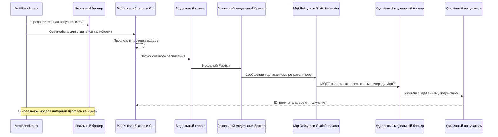
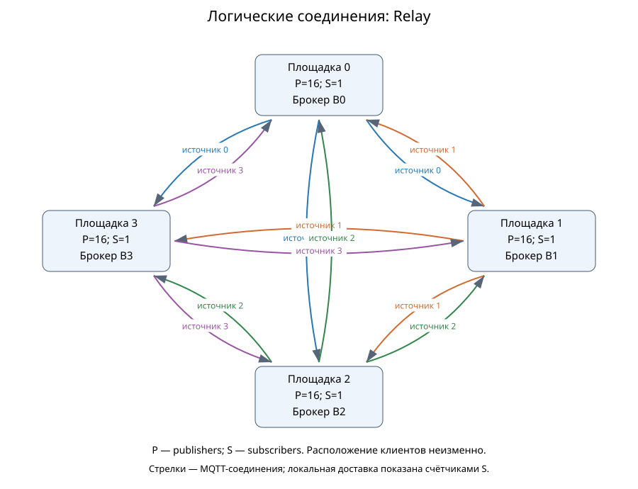

# Доставка и стоимость пересылки в моделях MqttRelay и статической федерации MQTT-брокеров

Рабочий текст для последующей редакции автором. Короткая серия завершена; для основной серии проверены первичные данные 106 доступных результатов из 162. Неполное покрытие и отсутствие её точных повторов указаны отдельно. Текст не подан и не утверждён соавторами.

## Аннотация

Сравниваются три способа доставки MQTT-сообщений в MqttY: центральный брокер, MqttRelay и статическая федерация с подавлением повторов. При одинаковом размещении клиентов, физической сети и расписании нагрузки измеряются полнота доставки, задержки и объём пересылки. Короткая серия содержит 54 симуляции и шесть точных повторов. Дополнительно проверены первичные данные 106 доступных результатов более длительной идеальной серии с четырьмя площадками, 64 отправителями и четырьмя получателями. Сопоставлены 34 полные тройки режимов при одинаковых условиях и начальных состояниях генератора. Центральный брокер и MqttRelay доставили все ожидаемые пары. У федерации при 5000 исходных сообщениях/с полнота составила около 30% для QoS 1 и около 19,5% для QoS 2; зарегистрированы переполнения очередей. Для кольца, QoS 2 и этой нагрузки сравнение доступно только для одного начального состояния. Основная программа не завершена: отсутствуют 56 из 162 результатов и все шесть точных повторов. Выводы относятся к проверенным реализациям модели; натурная точность сети, самоорганизация и отказоустойчивость не установлены.

**Ключевые слова:** MQTT, MqttRelay, федерация брокеров, имитационное моделирование, полнота доставки, топология, пересылка.

## 1. Задача и границы сравнения

Распределение клиентов между брокерами меняет путь доставки, число MQTT-обменов и состояние очередей. При сравнении необходимо сохранить полезную задачу: одинаковые источники, расписание публикаций, получатели, подписки и физическую сеть. Иначе увеличение числа доставок может объясняться увеличением числа получателей, а преимущество задержки — исключением потерянных сообщений.

Исследовательский вопрос: как различаются полнота, задержка и стоимость пересылки у single, relay и federation при одинаковой полезной нагрузке и явно объявленных модельных ресурсах? Вопрос об их натурном аппаратном превосходстве в данную программу не входит.

Ribas и Spohn рассматривают самоорганизующуюся федерацию с управляющими механизмами построения сети [1]. Наша федерация статическая: список соседей задаётся до запуска, выбора ядра, beacons, членства и перестроения маршрутов нет. Поэтому настоящее приложение не является воспроизведением их протокола. Mosquitto также предоставляет нативный механизм bridges с направлениями тем и их преобразованием [2]. MqttRelay исполняет модельную клиентскую пересылку; его нельзя обозначать как измеренный native bridge.

Авторы ранее рассматривали нагрузочное тестирование MQTT-брокеров [3], моделирование распределённых сетей Интернета вещей [4] и ускорение MqttY [5]. В этой работе сравниваются доставка и объём пересылки при одинаковой полезной нагрузке. Режимы далее обозначены так: `single` — центральный брокер, `relay` — MqttRelay, `federation` — статическая федерация.

## 2. Ответственность приложений

| Приложение или компонент | Действие |
| --- | --- |
| MqttBenchmark | До сетевого опыта измеряет реальный брокер и сохраняет observations; в модельном сетевом опыте не запускается |
| Калибратор MqttY | Заранее строит профиль с происхождением и SHA; сетевой опыт профиль не перестраивает |
| Federation.App | Проверяет конфигурацию, строит графы, размещает клиентов, запускает фазы и сохраняет результат |
| Ядро MqttY и MQTT-плагин | Исполняют модельное время, сетевые очереди, брокеров и MQTT-обмен |
| MqttRelay | Экспортирует локальный источник другим брокерам; импорт доставляет локально, не экспортируя повторно |
| StaticFederator | Различает ID, доставляет первое получение локально, пересылает соседям и подавляет повторы |
| Проверяющий скрипт | Пересчитывает сохранённые публикации, передачи и получения, проверяет payload, графы и знаменатели |

## 3. Физическая сеть и логические соединения

Пусть Gp=(Vp,Ep) — физический граф площадок, каналов и промежуточных узлов. Gl=(B,El) задаёт логические MQTT-соединения брокеров. Одно логическое соединение может проходить несколько физических каналов. Промежуточный узел без брокера пересылает сетевые пакеты, но не выполняет функцию федератора.

В single центральный брокер находится на площадке 0. Клиенты остаются на своих площадках и используют физические пути до него. В relay на каждой площадке находится брокер; логический граф полный ориентированный и содержит N(N−1) направлений. Импортированные сообщения не экспортируются повторно. В federation используются заданные соседи; в физической звезде с пустым транзитным сегментом логические соседи брокеров могут образовывать полный граф. Следовательно, физическая звезда не обязана означать брокер-звезду.

Ниже показаны фактически сохранённые графы идеальной короткой серии: три площадки, на каждой четыре отправителя и один подписчик. В режиме Relay брокеры соединены каждый с каждым. У кольца из трёх площадок физические соседи также образуют треугольник; это особенность выбранного размера, а не свойство любых колец.

Доступны исходники Mermaid [физического графа](../../../reports/data/federation-full-mesh-v1/ideal-relay-physical.mmd) и [логического графа](../../../reports/data/federation-full-mesh-v1/ideal-relay-logical.mmd). Для профилированной серии физическое кольцо содержит [четыре площадки](../../../reports/data/federation-full-mesh-v1/mosquitto-federation-physical.svg), а полный граф Relay — 12 направлений. Промежуточный узел без брокера относится к другим топологиям основной программы; в эти рисунки он не добавлен. Диаграммы взяты из результатов соответствующей серии.

## 4. Пересылка и условия конечности

Федератор различает сообщения по идентичности источника и последовательному номеру. При первом получении сохраняет ID, ставит локальную доставку в очередь и направляет сообщение соседям, кроме отправителя. При повторном ID не выполняет новую локальную доставку и дальнейшую пересылку. Payload сохраняется, служебные данные находятся в теме и учитываются в её сетевом размере.

Для конечного опыта кэш хранит ID до завершения; конфигурация заранее проверяет вместимость. При превышении вместимости возникает явный отказ, а защита от повторов не отключается молча. Очереди ограничены, переполнения и исчерпания числа переходов учитываются. Отправки каждого выхода выполняются последовательно с ожиданием MQTT-завершения.

Для фиксированного ID каждый из N федераторов обрабатывает первое получение не более одного раза. Пусть E — множество неориентированных связей соседства. Число постановок на межброкерную пересылку ограничено суммой степеней, равной 2|E|; локальная постановка выполняется не более одного раза на площадке. Это обосновывает конечность порождённых прикладных пересылок при конечном графе и сохранении кэша. Оно не является оценкой числа TCP-пакетов или нижележащих протокольных повторов.

Получение всеми достижимыми подписчиками требует дополнительных предпосылок: достаточного числа переходов, отсутствия отказов и переполнений, успешного MQTT-обмена и достаточного drain. При реальном ограничении очереди полнота является измеряемым результатом, а не следствием одного только подавления повторов.

Уточним лимит переходов H. Для связного неориентированного графа из N брокеров при этих идеальных условиях достаточно H≥N−1, чтобы ID дошёл до всех брокеров. Первые получения образуют дерево: родитель обрабатывает ID раньше потомка, поэтому путь первого получения не содержит повторных узлов. Если ещё не получивший брокер существует, у граничащего с ним уже получившего узла глубина не больше N−2, а значит, остаётся хотя бы один переход для отправки. Это противоречит окончанию обмена без полной доставки. Локальная доставка подписчикам дополнительно требует успешного завершения их MQTT-обмена.

Для точного числа всех экспортов используем более сильное условие H≥N. Источник отправляет всем соседям, каждый другой брокер исключает ровно одного родителя. Если m — число неориентированных рёбер соседства, на один успешно поступивший исходный ID получаем **2m−(N−1)** экспортов. В дереве это N−1, в кольце N+1, в полном графе (N−1)². Это прикладные пересылки, не число пакетов или физических сетевых переходов. При исходной недоставке и переполнении равенство к числу всех API-попыток неприменимо.

Для текущего правила первого получения нельзя выбирать H только по диаметру графа. Копия, пришедшая раньше по длинному пути, может исчерпать переходы; поздняя короткая копия подавляется. [Формальное приложение](../network-forwarding-proofs.md) содержит доказательства и конкретный контрпример. Независимый малый перебор всех порядков обработки для 44 связных графов до четырёх узлов подтвердил проверяемые случаи; он не заменяет общего доказательства и не является новым опытом MqttY. Используемый по умолчанию H=N удовлетворяет указанному достаточному условию.

Для Relay верхняя граница экспортов одного исходного сообщения — N−1, если сообщение дошло до экспортёра и каждый удалённый брокер является адресатом. При потерях число фактических экспортов может быть меньше. Импорт не переэкспортируется, поэтому полный логический граф сам по себе не создаёт прикладной цикл.

## 5. Метрики

Пусть A — фактические исходные API-попытки измерительной когорты, C — завершённые исходные публикации, M — число ожидаемых получателей, D — уникальные пары (ID, получатель), T — измерительное окно. Тогда E=A×M — ожидаемое число доставок, полнота равна D/E, недоставка — 1−D/E. При E=0 полнота неприменима. Запланированные, но не вызванные из-за backpressure публикации учитываются отдельно.

Исходный completed RPS равен C/T. Goodput D/T может превышать C/T из-за нескольких получателей. Сумма завершений брокеров включает служебные перепубликации и не равна скорости исходных публикаций. Дополнительно считается число ID, полученных всеми ожидаемыми подписчиками.

Задержка доставки измеряется от исходного вызова Publish до уникального получения, отдельно от публикационного ACK. Квантили характеризуют полученные пары; при недоставке рядом обязательно показывается полнота. QoS 0 ACK неприменим. Завершения и получения в drain входят в итоговые показатели когорты, но выделяются отдельно; итоговый D/T не является скоростью событий только внутри измерительного окна.

Стоимость пересылки описывается числом forward-попыток, принятыми/отклонёнными пересылками, размером topic+payload и переполнениями. Размер topic+payload нельзя выдавать за полный wire traffic с заголовками MQTT/TCP/IP и ACK. CPU/RSS симулятора не являются ресурсами моделируемого брокера; EST сети не вычисляется.

## 6. Завершённая короткая серия

Короткая программа содержит два семейства ×три режима ×три QoS ×три seed =54 симуляции. Выполнены все 54, технических отказов нет; шесть выбранных scientific summaries повторились побайтно. Идеальное семейство содержит три площадки, 12 publishers и три получателя; Mosquitto — четыре площадки, 64 publishers и четыре получателя. Внутри семейства расположение клиентов сохраняется, но сравнивать абсолютный goodput между семействами без учёта fanout нельзя.

Общая нагрузка — 1000 исходных сообщений/с, payload 16 байт; прогрев 0,01 с, нагрузка 0,2 с, drain до 1 с, tick 0,1 мс. Это механизмная проверка, а не установившийся предел производительности.

| Идеальная модель | Полнота | p99 получения QoS 0, мс | QoS 1, мс | QoS 2, мс | Межброкерные пересылки за опыт | Байт тем и payload при пересылке |
| --- | ---: | ---: | ---: | ---: | ---: | ---: |
| single | 100% | 1,2 | 1,2 | 3,6 | 0 | 0 |
| relay | 100% | 2,6 | 2,6 | 7,8 | 400 | 14 400 |
| federation | 100% | 2,8 | 5,5 | 145,8 | 800 | 34 332 |

В данном идеальном кольце все сообщения доставлены, а федерация выполняет вдвое больше пересылок, чем Relay. Это согласуется с различием механизмов, но не доказывает универсального превосходства Relay: режимы имеют разную организацию выходных очередей и последовательность обменов. Центральный брокер в этой короткой нагрузке также не испытывает доказанного предельного насыщения.

В каждой идеальной точке ожидаются 200 исходных публикаций × три получателя = 600 пар доставки. Для QoS 2 после прекращения подачи в Relay получены 3,5% ожидаемых пар, в федерации — 43,0%. Эти доставки входят в итоговую полноту 100%, но не произошли внутри окна подачи. Поэтому число тиков подачи и время ожидания нельзя смешивать. Шаг равен 0,1 мс: прогрев занимает 100 тиков, подача — 2 000; одна секунда предельного ожидания — до 10 000 тиков. Перед измерением отдельно завершается обмен прогрева. Длительности подключения, подписки и этого ожидания сохранены в фазах каждого опыта. Указанные 100/2 000/10 000 — заданные длительности отдельных фаз, а не фактическое общее число тиков запуска с подготовкой и возможным ранним окончанием ожидания.

В профилированном семействе Mosquitto результаты сильно зависят от QoS и точек профиля. В следующей таблице полнота — доля уникальных ожидаемых пар доставки. Приведены средние трёх запусков, а для p99 — только запусков с получениями; их число указано отдельно.

| QoS | Режим | Полнота, % | p99 получения, мс | Запусков с p99, из 3 |
| --- | --- | ---: | ---: | ---: |
| 0 | single | 33,750 | 1,600 | 3 |
| 0 | relay | 100,000 | 2,800 | 3 |
| 0 | federation | 100,000 | 3,900 | 3 |
| 1 | single | 21,792 | 6,033 | 3 |
| 1 | relay | 0,333 | 1,833 | 3 |
| 1 | federation | 0,250 | 2,433 | 3 |
| 2 | single | 1,292 | 6,500 | 3 |
| 2 | relay | 0,292 | 5,267 | 3 |
| 2 | federation | 0,167 | 7,700 | 2 |

Небольшая задержка среди немногих полученных сообщений не означает хорошую доставку: например, Relay при QoS 1 имеет p99 около 1,833 мс, но полноту лишь 0,333%. Эти значения относятся к модели, а не к натурно измеренной федерации Mosquitto. Для распределённых брокеров и центрального брокера применяются разные точные точки N=16 и N=64; дополнительный трафик федераторов выходит за условия одиночной калибровки. Отсутствующие точки не заменяются соседними.

Таким образом, короткая профилированная серия демонстрирует ограничение такого переноса, а не доказанный проигрыш настоящих сетевых брокеров. При малом числе получений p99 не рассматривается отдельно от полноты. При отсутствии получений он неприменим.

Повторная независимая проверка сохранённых сводок восстановила все 54 сочетания условий и 378 значений агрегатов: число применимых запусков, среднее и интервал по трём seed. [Полная сравнительная таблица](../../../reports/audits/dissertation/article-2-evidence-package-v2/Comparison.md) показывает также объём пересылки и доставки после окончания подачи. Для Mosquitto/federation/QoS 2 задержка определена лишь в двух из трёх запусков: среднее p99 равно 7,7 мс, средняя недоставка — 0,998333. Третий запуск без получений не превращается в нулевую задержку. Это перепроверка сводок, а не новый запуск и не повторный пересчёт первичных ID.

## 7. Более длительные опыты: что показали сохранённые результаты

Основная программа задаёт три режима × три физических топологии × три QoS × две интенсивности × три начальных состояния генератора = 162 симуляции и шесть точных повторов. Здесь четыре площадки, 64 отправителя и четыре получателя; payload 16 байт, 1000 или 5000 исходных публикаций/с. Прогрев занимает 1 модельную секунду, подача — 10 секунд, ожидание завершения — до 30 секунд с ранним окончанием при отсутствии работы. Шаг 0,1 мс: заданные фазы занимают 10 000, 100 000 и до 300 000 тиков. Это не общее фактическое число тиков с подключением и подготовкой. Программа использует идеальные брокеры, без профилей настоящих реализаций.

Полностью сохранены результаты линии — 54/54; для кольца — 52/54; для звезды — 0/54. Для всех 106 доступных результатов отдельно проверены первичные ID, полезная нагрузка, доставки, пересылки, гистограммы и временные фазы. Расхождений проверяемых счётчиков не найдено. Эта проверка подтверждает согласованность результатов модели, а не её точность относительно реальной сети.

Сравнение включает только полные тройки режимов при одинаковых условиях: таких троек 34 из 54. В 11 условиях есть все три общих начальных состояния генератора. В кольце при QoS 2 и 5000 сообщ./с есть только состояние 42; результаты 43 и 44 у федерации отсутствуют. Соответствующие четыре результата центрального брокера и Relay сохранены, но в это парное сравнение не включены.

В таблице полнота — доля уникальных пар «сообщение — получатель», задержка — p99 среди полученных пар. Показаны средние отдельных запусков; это не квантиль объединённого потока. У центрального брокера и Relay полнота **100% во всех строках**, поэтому отдельные столбцы полноты для них не повторяются.

| Топология | QoS | Сообщ./с | Общих seed | Полнота федерации, % | p99 single, мс | p99 Relay, мс | p99 федерации, мс |
| --- | ---: | ---: | ---: | ---: | ---: | ---: | ---: |
| Линия | 0 | 1000 | 3 | 100,000 | 2,000 | 3,000 | 5,000 |
| Линия | 0 | 5000 | 3 | 100,000 | 2,000 | 3,000 | 5,000 |
| Линия | 1 | 1000 | 3 | 100,000 | 2,000 | 3,000 | 7,400 |
| Линия | 1 | 5000 | 3 | 29,845 | 2,000 | 3,000 | 3996,700 |
| Линия | 2 | 1000 | 3 | 82,157 | 6,000 | 9,000 | 5056,000 |
| Линия | 2 | 5000 | 3 | 19,419 | 6,000 | 9,000 | 8993,400 |
| Кольцо | 0 | 1000 | 3 | 100,000 | 1,600 | 2,800 | 3,900 |
| Кольцо | 0 | 5000 | 3 | 100,000 | 1,600 | 2,800 | 3,900 |
| Кольцо | 1 | 1000 | 3 | 100,000 | 1,600 | 2,800 | 5,500 |
| Кольцо | 1 | 5000 | 3 | 30,144 | 1,600 | 2,800 | 4846,000 |
| Кольцо | 2 | 1000 | 3 | 86,933 | 4,800 | 8,400 | 7619,600 |
| Кольцо | 2 | 5000 | 1 | 19,505 | 4,800 | 8,400 | 8487,700 |

При QoS 0 все три режима доставили сообщения полностью. Для федерации при QoS 1 и 1000 сообщ./с полнота также 100%. При увеличении нагрузки до 5000 она снижается примерно до 30%; при QoS 2 потери есть уже на меньшей нагрузке. Все ожидаемые пары при 1000 сообщ./с — 40 000 за опыт, при 5000 — 200 000: каждая исходная публикация должна поступить четырём получателям.

На рисунке показаны средние и диапазоны min–max по общим начальным состояниям, не доверительные интервалы. Для кольца/QoS 2 доступен один запуск каждого режима. Нижние панели используют логарифмическую шкалу. В этих сохранённых группах диапазоны нулевые; это не заменяет отдельной проверки повторяемости.

В 16 доступных опытах федерации одновременно зарегистрированы потери и переполнения очередей. Например, в линии при QoS 1 и 5000 сообщ./с зарегистрировано 102 222 отказа постановки в очередь, при QoS 2 — 108 308. Число отказавших операций не равно числу различных потерянных сообщений. Дубликатов у получателей в проверенных результатах нет: подавление повторов работает, но не обеспечивает доставку при недостаточной пропускной способности пересылки. Без отдельного изменения одного фактора нельзя приписать всю разницу только маршрутам: организация очередей и ожидание MQTT-обмена также различаются.

При полной доставке Relay выполняет три экспорта на публикацию. При 1000 сообщ./с это 30 000 пересылок и 1 080 000 байт тем и полезной нагрузки. Федерация в линии при QoS 0 выполняет те же 30 000 пересылок, но передаёт 1 341 012 байт из-за служебных тем. В кольце она выполняет 50 000 пересылок и передаёт 2 235 020 байт. Следовательно, одинаковая полезная доставка может требовать разного объёма межброкерного обмена. При потерях меньшее число фактических пересылок нельзя называть преимуществом эффективности. Ноль межброкерных экспортов single не означает отсутствие трафика от удалённых клиентов.

Следующие схемы взяты из фактического опыта Relay в линии. На каждой площадке находятся 16 отправителей и один получатель; физически соединены соседние площадки, логически брокеры экспортируют «каждый каждому». Логическое соединение между несоседними площадками проходит через физическую сеть.

Доставки после окончания подачи входят в итоговую полноту, но считаются отдельно. Например, в линии при QoS 1 и 5000 сообщ./с федерация получила 59 690 пар, из них 15 253 после подачи. При QoS 2 — 38 838 и 15 318 соответственно. Итоговый goodput с делением на десятисекундное окно не является скоростью событий только внутри этого окна.

В истории сохранились 109 попыток и три технических отказа. Один прежний отказ Relay по памяти был восстановлен следующей успешной попыткой. Две точки федерации в кольце, QoS 2, 5000 сообщ./с остановлены по исчерпанию бюджета времени. Звезда не запускалась; точных повторов основной программы **0/6**. Отсутствующие результаты не восполнены короткой серией или одиночными опытами первой статьи. Полный разбор, диапазоны и причины попыток приведены в [отчёте проверки](../../../reports/analysis/Network-main-recount.md).

## 8. Ограничения и выводы

Сохранённые опыты позволяют сравнить доставку, задержку и стоимость пересылки при одинаковой полезной задаче. Короткая серия проверяет работоспособность механизмов; более длительные опыты показывают, что успешная короткая доставка ещё не гарантирует полной доставки при увеличении нагрузки и ожидании подтверждений. В проверенных условиях центральный брокер и Relay доставили все ожидаемые сообщения, а у статической федерации обнаружены потери и переполнения очередей при QoS 1/2.

Отсутствие дубликатов подтверждает только одну сторону работы федерации. Для оценки результата необходимо одновременно показывать полноту, задержку полученных сообщений, число пересылок и завершение после подачи. Более короткий список фактических пересылок при потерях не означает более дешёвую успешную доставку.

Выводы относятся к проверенным реализациям MqttY и их очередям. Они не устанавливают аппаратное превосходство одного способа организации настоящих брокеров. Профилированная короткая серия дополнительно показывает ограничения переноса одиночной калибровки на служебный трафик. Самоорганизация, отказоустойчивость и натурная точность сети не проверялись.

Основная программа остаётся неполной: нет 56 результатов, в том числе всей звезды, и шести повторов. Последовательная остановка по бюджету не даёт случайной выборки условий; результаты кольца/QoS 2/5000 относятся лишь к одному начальному состоянию. Поэтому завершённый разбор доступных данных не равен завершению всей экспериментальной программы. Следующий шаг — отдельно зафиксировать решение о недостающих опытах и повторах, сохранив все прежние результаты и причины отказов.

## Источники и данные

1. Ribas N. K., Spohn M. A. A New Approach to a Self-Organizing Federation of MQTT Brokers. Journal of Computer Science. Vol. 18, no. 7, p. 687–694. [DOI: 10.3844/jcssp.2022.687.694](https://doi.org/10.3844/jcssp.2022.687.694). [Полный текст](https://thescipub.com/pdf/jcssp.2022.687.694.pdf).
2. Eclipse Mosquitto. mosquitto.conf, Configuring Bridges. [Официальная документация](https://mosquitto.org/man/mosquitto-conf-5.html). Это описание механизма, а не фиксация версии установленного брокера.
3. Солопий А. В., Классен Р. К. Выбор брокера сообщений для Интернета вещей на основе нагрузочного тестирования. Динамика сложных систем — XXI век. 2025. Т. 19, № 3. С. 44–51. [DOI: 10.18127/j19997493-202503-04](https://doi.org/10.18127/j19997493-202503-04).
4. Solopiy A., Klassen R. Simulation of Distributed Networks of Internet of Things. 2025 International Russian Automation Conference (RusAutoCon). IEEE, 2025. P. 467–472. [DOI: 10.1109/RusAutoCon65989.2025.11177411](https://doi.org/10.1109/RusAutoCon65989.2025.11177411).
5. Солопий А. В., Классен Р. К. Симулятор промышленных сетей мониторинга Интернета вещей MqttY: ускорение симуляции больших сетей. Computational Nanotechnology. 2026. Т. 13, № 1. С. 212–221. [DOI: 10.33693/2313-223X-2026-13-1-212-221](https://doi.org/10.33693/2313-223X-2026-13-1-212-221).

Данные короткой серии: `reports/data/federation-full-mesh-v1/aggregates.json`, исходные summary, графы и реестр проверки в той же группе артефактов. Методические определения сверяются с `docs/dissertation/network-model-contract.md`. Основная программа и её runtime имеют отдельные manifests; их идентичности не объединяются с короткой серией.

Перед подачей необходимо определить объём недостающих опытов; автору — оценить интерпретацию, согласовать вклад, внести авторские сведения и адаптировать оформление. Факт подготовки данного рабочего текста не означает завершения шагов 23–25 или согласования статьи с соавторами.
