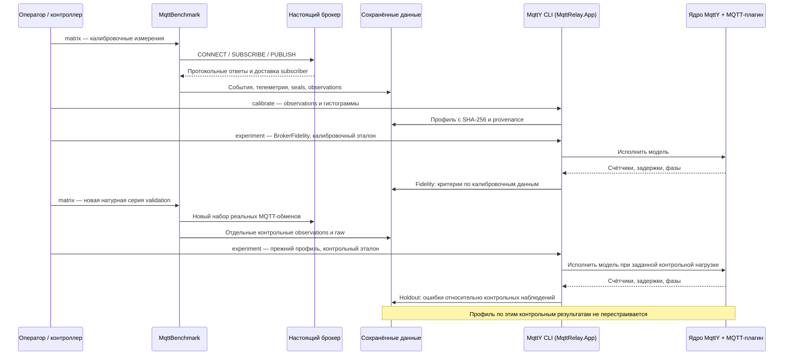

# Построение и проверка двойника: техническая схема для автора

Материал для шага 09: обязанности приложений, происхождение параметров, формулы и границы проверки. Это схема метода и исходные сведения для статьи; окончательный текст пишет человек. Новых измерений или изменений профиля этот документ не вводит.

## Кто выполняет работу

| Участник | Что делает | Как запускается | Что сохраняет |
| --- | --- | --- | --- |
| Оператор и контроллер кампании | Выбирают программу, подготавливают входы, последовательно вызывают приложения | Команды оркестратора из отдельного процесса | План, состояние, версии, причины отказов |
| Настоящий брокер | Обслуживает реальные MQTT-соединения | Native launcher стенда | Состояние процесса и журналы |
| MqttBenchmark | Создаёт настоящих клиентов, подаёт нагрузку, получает сообщения, собирает guard/телеметрию | CLI `matrix`, затем `aggregate` | NDJSON событий, seals, результат, observations |
| Экспортёр гистограмм | Пересчитывает задержки успешных Publish из raw и связывает их с архивами | `tools/campaign/export-latency-histograms.py` | Бины задержек и SHA источников |
| MqttY CLI в `MqttRelay.App` | Проверяет входы и строит профиль либо запускает опыт | `calibrate` или `experiment` | Неизменяемый профиль, manifest, summary, counters, histogram |
| Ядро MqttY и MQTT-плагин | Исполняют клиентов, брокер и сеть в модельном времени | Вызывает CLI, отдельно оператор их не запускает | Модельные события и счётчики |
| Python-проверки | Независимо пересчитывают доступные события и опубликованную арифметику | `native_audit.py`, `run_native_audit.py`, `foundation.py` | Покрытие, расхождения, реестры и контрольные суммы |
| Автор и независимый проверяющий | Принимают определения и научные выводы, выполняют содержательную сверку | Работа человека по инструкции | Решение, замечания и ограничения |

Название исполняемого проекта `MqttRelay.App` не означает, что каждый его опыт является relay-сетью. `BrokerFidelity` проверяет один модельный брокер. Сетевая ретрансляция MqttRelay — другой режим, с другими маршрутами и смыслом суммы брокерных счётчиков. Настоящий MQTT-трафик MqttBenchmark не проходит через MqttY.

## Последовательность одного брокера

Полная программа одной стадии: 2 payload × 3 QoS × 4 publishers × 3 повтора = 72 запуска, 24 точки. На брокер приходятся 72 калибровочных натурных, 72 Fidelity, 72 контрольных натурных и 72 контрольных модельных запуска. На четыре брокера — 576 натурных и 576 одиночных модельных запусков. Pilots и неудачные попытки учитываются отдельно. Прежние 360 relay-симуляций в это число одиночных моделей не входят.

## Откуда берутся параметры профиля

Точка задаётся тройкой payload/QoS/publishers. Внутри неё усредняются показатели трёх самостоятельных натурных повторов; соседняя точка не подставляется вместо отсутствующей.

| Параметр | Источник / правило | Ограничение |
| --- | --- | --- |
| Attempted RPS | Среднее `A/T` трёх повторов | A — вызовы API, не доказанное число PUBLISH на проводе |
| Target completed RPS | Среднее `C/T` | Включает клиентские и транспортные условия установки |
| Target failure | Среднее `F/A` | Может включать локальные ошибки отключённого клиента |
| Conditional delivery loss | Среднее `1−Dс/C` | Это эмпирическая доля, а не идентифицированная причина потери |
| Admission capacity | Attempted RPS × (1−rateRejectionRate) | Rate rejection — явное допущение; успешной скоростью его отдельно не идентифицировать |
| Conditional publish failure | `(targetFailure−rateRejectionRate)/(1−rateRejectionRate)` при допустимых параметрах | Калибровка отклоняется при rate rejection > target failure или rate rejection = 1 |
| ACK-квантили | Успешные Publish QoS 1/2; верхний ранг | QoS 0 ACK отсутствует; среднее квантилей повторов не является квантилем объединения |
| Эмпирическая CDF, schema 4 | Бины задержек объединяются по счётчикам событий трёх повторов | Это смесь с весом по числу завершений; не среднее трёх CDF с равными весами |
| RTT baseline | Отдельный калибровочный preflight | Приближение транспортного бюджета, а не измеренное чистое время сервиса брокера |

`BrokerCalibrationV3` задаёт целевые скорости/доли и проверяет полное покрытие. `BrokerCalibrationEmpirical` добавляет гистограммы с происхождением до исходных архивов, проверяет числа завершений и соответствие средних квантилей observations с точностью бинов. Профиль содержит наблюдаемую CDF и распределение после вычитания оценённого RTT-компонента.

В применённом `empiricalServiceBudget` runtime использует наблюдаемую CDF и отдельно вычисленный нижний протокольный предел идеального модельного обмена. Обработка учитывается сверх этого предела; samples ниже представимого протокольного пола не удаляются из профиля, их ограничение фиксируется. Это модельное допущение, а не измеренная декомпозиция «сеть + сервис настоящего брокера».

Ожидание доступной ёмкости и эмпирическая задержка обработки объединяются через максимум, а не суммируются дважды: наблюдаемая CDF уже содержит очереди натурного тракта. Средние attempted RPS, completed RPS и failure усредняются по повторам отдельно; произведение средних attempted RPS и успешности не обязано равняться среднему completed RPS. Сохранение этих целевых чисел не означает точную идентификацию всех внутренних механизмов брокера.

## Что именно сравнивается

Для натурного запуска A — попытки API, C — успешные исходы, F — неуспешные исходы, D — уникальные полученные ID, Dс — полученные ID из успешных исходов. T — фактическая монотонная длительность. Проверяются `A=C+F` и разбиение D на полученные ID успешных/неуспешных исходов.

| Показатель | Натурная формула | Модельное соответствие |
| --- | --- | --- |
| Completed RPS | `C/T` | Завершения модели / фиксированное окно подачи; исходы при drain могут оставаться в числителе |
| Failure | `F/A` | Rate rejected + publish failed / attempted на модельном брокере |
| Delivery loss | `1−Dс/C` | `1−Delivered/ExpectedDeliveries` по подпискам модели |
| p99 публикации | Длительность успешного вызова Publish API | Модельная публикационная задержка с разрешением tick |
| Полнота для EST | `D/A` | Не подменяется модельным loss; полный EST требует натурного CPU |

Критерии: относительная ошибка RPS ≤0,15; относительная ошибка p99 QoS 1/2 ≤0,20; абсолютные разности failure/loss ≤0,05. При неприменимости или отсутствии эталона показывается `notApplicable`, а не passed. В текущем runtime относительный критерий с нулевым эталоном также неприменим.

Fidelity использует данные настройки: это воспроизведение калибровки. Holdout использует отдельные observations при прежнем профиле. Offered RPS контрольной модели берётся из attempted RPS контрольной точки — проверка условная, при известной интенсивности, а не слепой прогноз нагрузки на новой машине. Отдельные campaign identities и SHA профиля необходимы, но сами по себе не доказывают, что при выборе алгоритма ранее не использовались контрольные результаты. Историю такого подбора требуется оговорить; после подбора по контролю нужен новый независимый набор для нового утверждения точности.

Три натурных повтора дают среднее, SD и t-CI95 с двумя степенями свободы. Они не дают автоматического доверительного интервала p99 всего потока. Три seed модели не увеличивают число независимых натурных повторов. Прогрев отделяется по темам и ID; поздние получения остаются в итоговой доставке, а точная граница receiver measurement/drain не записана и восстанавливается только интервалом.

## Где проверить реализацию

| Механизм | Исходник |
| --- | --- |
| API-события, ожидание исходов, drain | `MqttBenchmark/src/EntityFX.MqttBenchmark.Campaign/Workload/CampaignWorkloadRunner.cs` |
| Счётчики и натурные знаменатели | `MqttBenchmark/src/EntityFX.MqttBenchmark.Campaign/Workload/DeliveryLedger.cs`, `MeasurementSummary.cs` |
| Средние и CI | `MqttBenchmark/src/EntityFX.MqttBenchmark.Campaign/CampaignAggregator.cs`, `EntityFX.MqttBenchmark/Calibration/MetricStatistics.cs` |
| Базовый и эмпирический профиль | `mqtty/src/EntityFX.MqttSimulator/EntityFX.MqttY.Plugin.Mqtt/BrokerProfile/BrokerCalibrationV3.cs`, `BrokerCalibrationEmpirical.cs` |
| Входы, чистые commits, отдельный контрольный эталон | `mqtty/src/EntityFX.MqttSimulator/EntityFX.MqttY.MqttRelay.App/MqttRelayExperimentCommand.cs` |
| Транспортный бюджет, фазы, нормировка и критерии | `mqtty/src/EntityFX.MqttSimulator/EntityFX.MqttY.Plugin.Mqtt/Experiments/MqttRelayExperimentRunner.cs` |
| Исполнение эмпирической обработки и потерь | `mqtty/src/EntityFX.MqttSimulator/EntityFX.MqttY.Plugin.Mqtt/MqttBroker.cs` |

Текущий checkout не выдаётся за версию прежнего измерения. Точные исторические commits, SHA профилей, identity калибровки/контроля и хэши проверенных исходников содержатся в [реестре основы](../../reports/audits/dissertation/foundation-v2/input-registry.json).

## Материалы для автора и открытые решения

- [Контракт метрик](../overview/measurement-contract.md) и [техническое заключение](../../reports/audits/dissertation/Foundation-assessment.md).
- [Полная карта точности](../../reports/audits/dissertation/accuracy-analysis-v1/Accuracy-analysis.md): 203/288 holdout проходят применимые критерии, 85 не проходят хотя бы один.
- [Программа чувствительности](sensitivity-study.md): 216 основных опытов, 6 точных повторов и 8 pilots завершены. В основной матрице 161 опыт прошёл критерии, 55 не прошли; технических ошибок нет. Все 6 точных повторов совпали. Изменение окна влияет на p99 в отдельных режимах; универсальная устойчивость не подтверждена.
- Научно согласовать определения и историю использования контрольных данных; не объявлять seed или совпадение хэшей доказательством новизны.
- В анализе чувствительности показывать размер изменения ошибок, а не только passed/failed; профиль и пороги сохраняются. Итоговый технический разбор: `reports/analysis/Sensitivity-final.md`.
- Выбранные same-input повторы не подменяют независимую проверку другим сотрудником и точность на другой аппаратуре.
