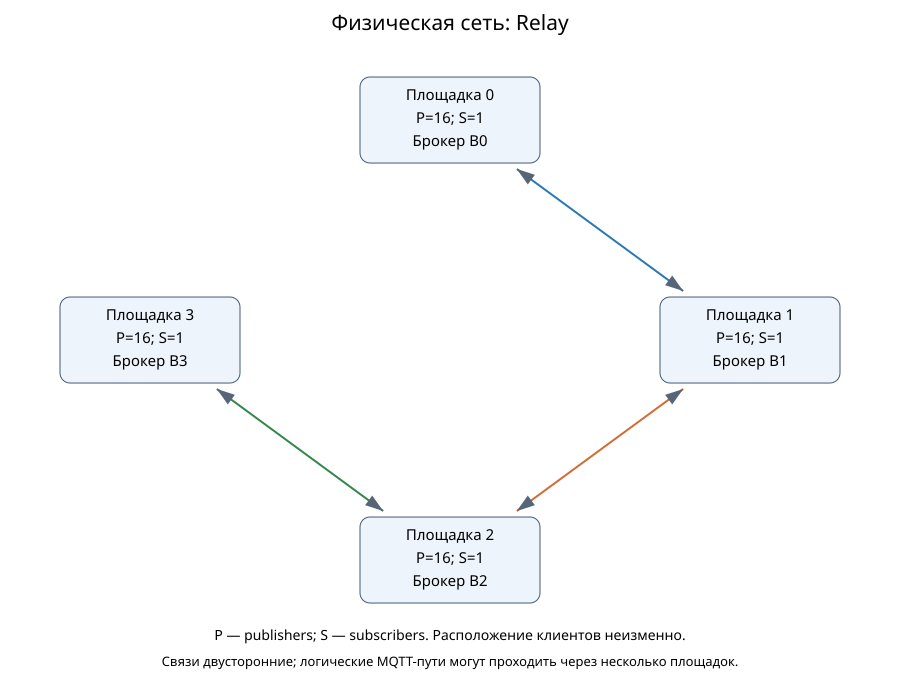

# Глава 3. Межброкерная доставка в MqttRelay и статической федерации

Проект разделов для редакции автором. Он описывает реализованные механизмы и локально принятый поднабор сетевых данных. Основная глава LaTeX не изменена; шаг 32 не закрывается появлением этого файла. Доказательство работоспособности модели и натурная точность распределённой системы рассматриваются отдельно.

## 3.1. Полезная задача и два графа сети

Рассматривается система, в которой отправители публикуют сообщения, а подписчики должны получить сообщения всех источников. Для сравнения вариантов сохраняются расположение клиентов, подписки, полезная нагрузка и расписание публикаций. Иначе, например, рост числа получений может объясняться просто большим количеством подписчиков.

Физический граф Gp описывает сетевые узлы и каналы. На части узлов размещены брокеры и клиенты; другие узлы могут выполнять только сетевой транзит. Логический граф Gl описывает MQTT-соединения, по которым приложения пересылают сообщения между брокерами. Один переход Gl может проходить несколько каналов Gp. Поэтому число прикладных экспортов не равно числу физических переходов, байтам на транзитном узле или времени доставки.

В режиме single все клиенты соединены с брокером на площадке 0, сохраняя своё физическое расположение. В relay и federation на каждой площадке есть локальный брокер. Это разные способы организации системы, а не одинаковый набор ресурсов: N распределённых брокеров нельзя автоматически считать равными одному центральному по пропускной способности или аппаратной стоимости.

Следующие схемы взяты из принятого результата линии с четырьмя площадками. Физически соединены соседи, а Relay имеет логические направления между каждой парой брокеров.

Другой пример — [десять брокеров через транзит](../../topologies/studies/relay-transit10/README.md). В нём одиннадцать физических узлов, но только десять брокеров; логических направлений Relay — 90. Центральный сетевой узел пересылает пакеты, не создавая одиннадцатый брокер или федератор. Этот опыт относится к отдельной короткой программе.

## 3.2. Пересылка MqttRelay

MqttRelay работает как модельное приложение с MQTT-клиентами. Оно подписывается на объявленные темы одного брокера и публикует подходящие сообщения в другие брокеры согласно таблице маршрутов. Основные брокеры продолжают выполнять публикацию/подписку; маршрутная логика размещена в отдельном приложении.

В выбранной программе каждый брокер экспортирует исходные локальные сообщения каждому из N−1 удалённых брокеров. Полный ориентированный граф имеет N(N−1) направлений, но одна исходная публикация использует только направления своего экспортёра. Импортированные сообщения доставляются локальным подписчикам и не попадают в повторный экспорт. Поэтому сам полный граф соединений не создаёт бесконечную прикладную рассылку.

Это свойство конфигурации тем и маршрутов конкретного опыта. Произвольная другая таблица маршрутов требует собственной проверки циклов. Реализация не является измерением штатного Mosquitto bridge. Кроме того, отсутствие изменения брокера не доказывает новизну само по себе: известны и штатные мосты, и внешние федераторы. Проверенный разбор ближайших механизмов приведён в [сопоставлении методов](../article-2-contribution-and-related-work.md).

## 3.3. Статическая федерация

У каждого брокера работает свой модельный федератор. Список соседей известен до запуска. Федератор получает исходные сообщения и маршрутизируемые экземпляры, определяет ID как пару «источник — последовательный номер» и запоминает первое получение. После него выполняются локальная доставка и отправки соседям, кроме непосредственного отправителя. Повторный ID новой доставки и пересылки не порождает.

Входные, межброкерные и доставленные сообщения используют отдельные пространства тем: `federation/input/...`, `federation/routing/...` и `federation/delivered/...`. Исходный payload сохраняется. Служебные поля находятся в маршрутизируемой теме, поэтому её длина входит в учитываемый объём пересылки. Участникам сценария требуются согласованные темы; произвольная прозрачная вставка для любых неизменённых приложений этим опытом не проверяется.

Кэш ID сохраняется до окончания ограниченного опыта. Вместимость проверяется до запуска; переполнение вызывает явный технический отказ, а не удаление защиты. Выходные очереди ограничены. Постановка сверх ёмкости учитывается как отказ очереди. Каждый выход обрабатывается последовательно с ожиданием завершения модельного MQTT-обмена; межброкерная передача проходит сетевые очереди MqttY.

Управляющая самоорганизация здесь не реализована: нет выбора ядра, периодических объявлений членства и перестроения сети. Поэтому результаты не являются воспроизведением протокола Ribas–Spohn. Подавление повторов проверяет конкретный механизм пересылки, а не отказоустойчивость всей системы.

## 3.4. Конечность, доставка и число экспортов

Пусть N брокеров образуют связный простой неориентированный граф соседства с m рёбрами. При сохранении ID каждый федератор обрабатывает первое получение не более одного раза. На каждом инцидентном ребре он может породить не более одной отправки. Поэтому для одного ID число постановок на межброкерную пересылку ограничено сверху 2m. Это граница прикладных операций, а не всех протокольных пакетов или времени ожидания.

Для полной доставки нужны дополнительные условия: исходный ID дошёл до федератора; очереди не отбрасывают сообщения; отправленные экземпляры успешно поступают соседям; локальная доставка завершается; время наблюдения достаточно. При этих условиях для получения всеми брокерами достаточно исходного лимита переходов H≥N−1.

Действительно, первые получения задают дерево: каждый неисточник имеет родителя, обработавшего ID раньше. Если ещё не получивший брокер существует, на границе с ним есть уже получивший узел. Его путь первого получения содержит не более N−2 переходов, иначе в пути уже присутствовали бы все N брокеров. Значит, у него остаётся переход для отправки в неполучившую часть графа. Это противоречит завершению успешного обмена без полного получения.

Для точного числа всех экспортов удобно требовать H≥N. Тогда даже последний узел первого пути не обрезает выходы по лимиту. Источник отправляет всем соседям; каждый другой брокер исключает ровно одно направление к родителю. На один принятый исходный ID получается:

`F_federation = 2m−(N−1)`.

Для A₀ разных исходных ID, поступивших федераторам, число экспортов равно A₀ раз этой величины. В дереве она равна N−1, в кольце N≥3 — N+1, в полном графе — (N−1)². У Relay в принятой конфигурации при успешном экспорте `F_relay=A₀(N−1)`. A₀ совпадает с числом API-попыток только если исходные публикации действительно поступили в обработку.

Лимит H, равный одному диаметру графа, не гарантирует доставку для принятого правила первой копии. На графе с рёбрами 0–1, 0–2, 1–2 и 2–3 диаметр равен двум. При H=2 узел 2 может сначала принять копию по пути 0→1→2, исчерпать переходы и запомнить ID. Поздняя короткая копия 0→2 подавляется, а узел 3 остаётся без сообщения. Это абстрактный контрпример, не установленная история конкретной потери Linux-кампании.

И обратное: отказ по лимиту не всегда означает потерю получателем, поскольку запрещённый экспорт мог вести к уже получившему соседу. Общие доказательства и [малый перебор](../network-forwarding-proofs.md) разделяют эти ситуации. Перебор охватывает 44 связных графа до четырёх узлов и 15 005 состояний; он служит проверкой примеров, а не заменяет доказательства для произвольного N.

## 3.5. Как оценивается полезная доставка

При A фактических исходных попытках и M ожидаемых получателях число ожидаемых пар равно E=A·M. Уникальная доставка D считается по паре «ID — получатель». Полнота равна D/E, недоставка — 1−D/E. Отдельно считается, сколько исходных ID дошло каждому из всех ожидаемых подписчиков. При отсутствии получателей эти доли с нулевым знаменателем неприменимы.

Скорость исходных завершений C/T не включает перепубликации брокеров. Полезная скорость D/T может превышать C/T, потому что у одного ID несколько получателей. Получения после подачи остаются в итогах когорты, но отмечаются отдельно. p99 сквозной задержки вычисляется от исходного Publish до получения; он описывает только полученные пары, поэтому рядом необходима полнота.

Стоимость характеризуют число экспортов, байты topic+payload, отказы очереди и переходов, а также физический транзит, если его события сохранены. Размер topic+payload не является полным объёмом MQTT/TCP/IP. Меньше экспортов при недоставке не означает более дешёвую успешную доставку.

## 3.6. Принятый поднабор результатов и вывод

Здесь используется локально пересчитанный снимок **106 из 162** результатов основной идеальной серии. Его сравнение включает 34 полные тройки режимов: 11 условий по три общих seed и одно по одному. Позднейшие завершения работающей Linux-сессии в эту таблицу заранее не включены. Все 106 проверяемых raw прошли арифметическую проверку, но это не означает выполнения всех запланированных опытов.

Четыре площадки содержат 64 отправителя и четыре получателя. Подача длится десять модельных секунд. В сопоставленных группах single и Relay обеспечили полноту 100%. Для федерации при 5000 исходных сообщениях/с получены следующие результаты:

| Физическая топология | QoS | Общих seed | Полнота федерации, % | p99 доставки, мс |
| --- | ---: | ---: | ---: | ---: |
| Линия | 1 | 3 | 29,845 | 3996,7 |
| Кольцо | 1 | 3 | 30,144 | 4846,0 |
| Линия | 2 | 3 | 19,419 | 8993,4 |
| Кольцо | 2 | 1 | 19,505 | 8487,7 |

В 16 доступных точках федерации зарегистрированы потери и переполнения очередей. Это контекст наблюдений, но без опыта с изменением одного фактора нельзя приписать всю разницу только маршрутам или только очередям. Число неудачных постановок также не равно числу различных потерянных ID. Успешная короткая серия с полной доставкой не отменяет эти результаты более длительной нагрузки.

Архитектура и формулы позволяют проверить конечность прикладного размножения, различие физического/логического графа и стоимость идеальной пересылки. Наблюдения показывают ограничения конкретных реализаций при заданной нагрузке. Натурная точность сети, аппаратное превосходство, самоорганизация и отказоустойчивость остаются отдельными вопросами.

Основания: [контракт сети](../network-model-contract.md), [статья 2](../articles/article-2-relay-federation.md), [пересчёт 106 результатов](../../../reports/analysis/Network-main-recount.md), [все значения и диапазоны](../../../reports/audits/dissertation/network-main-recount-v1/condition-stats.json), [каталог топологий](../../topologies/README.md). Для окончательной редакции нужно заменить частичный сетевой срез результатом приёмки всей программы либо сохранить его явно ограниченную область.
