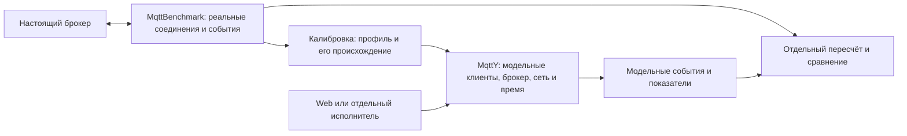

# Глава 4. Исполнение модели MqttY и проверка измерительных профилей

Проект разделов по проверенным материалам статьи 1 и ограниченному сетевому срезу статьи 2. Основной LaTeX не изменялся. Файл подготавливает шаг 34; окончательная редакция главы, научное согласование и сквозная проверка остаются отдельными работами.

## 4.1. Ответственность программ

Натурный измеритель и симулятор решают разные задачи. MqttBenchmark создаёт настоящие MQTT-соединения и сохраняет наблюдения работающего брокера. MqttY использует эти наблюдения для профиля и исполняет модель клиентов, брокера и сети. Модельные данные не добавляются в натурную калибровку как новые физические измерения.

CLI или другой исполнитель читает конфигурацию, проверяет входы и создаёт объекты опыта. Ядро MqttY ведёт модельное время и обновляет объекты. MQTT-плагин исполняет модельные публикации, подписки и подтверждения; сетевые объекты обслуживают передачу и очереди. Профиль задаёт наблюдаемые характеристики определённого брокера, но не восстанавливает его исходный код или внутреннее состояние работающего процесса.

Диаграмма показывает обязанности компонентов, а не утверждает, что любой исполнитель поддерживает каждый профиль. Новая серия статьи 1 запущена отдельным сохранённым TwinValidationProbe, использующим ядро MqttY; установленный Linux Web её не исполнял. Возможность короткого Web-запуска и полное соответствие нового профиля — разные технические проверки.

## 4.2. Профиль измеренного брокера

Профиль строится для точного сочетания размера сообщения, QoS и числа отправителей. В новой серии один профиль каждой реализации относится к 16 байтам, QoS 1 и 16 отправителям. Для его настройки используются три натурных измерения. Отсутствующая точка не заменяется соседней и не интерполируется.

Средние скорости и доли рассчитываются по повторам. Времена успешных публикаций сохраняются в виде распределения: интервалы объединяются с учётом числа наблюдений. Это сохраняет различие быстрых и медленных операций; усреднение трёх p99 не заменяет объединённое распределение. Измеренное время обмена туда и обратно участвует в оценке транспортной части. Разделение времени настоящего брокера на обработку и транспорт остаётся приближением, а не прямым наблюдением внутренних очередей.

Модель использует ограничение скорости обработки, параметры ошибок/доставки и распределение длительностей. Сетевой MQTT-обмен при этом исполняется собственными объектами MqttY. Поэтому профиль нельзя понимать как универсальное число, которое одинаково описывает другую машину, иную полезную нагрузку или дополнительный служебный трафик сети брокеров.

Для контроля сохраняются конфигурация, происхождение параметров, контрольные суммы и идентичность исполнения. Новые контрольные измерения начинаются после фиксации четырёх профилей. Их результаты проверяются относительно уже построенного профиля; профиль по ним не перестраивается. Контрольная сумма показывает неизменность файла, а не истинность измерения.

## 4.3. Программа проверки

Основная новая программа содержит 40 исполнений: 12 калибровочных измерений, 12 новых натурных контрольных измерений, 12 модельных запусков и четыре точных повтора. Для каждого из четырёх брокеров есть три натурных повтора и три запуска модели с начальными состояниями генератора 42, 43 и 44. Пилоты и предварительная диагностика в эти 40 не включены.

Натурный и модельный опыты имеют согласованные фазы: одна секунда прогрева, четыре секунды подачи и ещё пять секунд наблюдения. В обоих случаях показатели относятся к ID, попытки которых начались в окне подачи. Поздние исходы и получения учитываются до общего конца наблюдения, отдельно от событий внутри окна.

Одинаковая длительность окон ещё не означает тождество всех механизмов нагрузки. Натурный отправитель ждёт завершения предыдущего вызова. Модель дополнительно использует измерительно заданные ограничения. Поэтому проверяется воспроизведение при объявленных условиях; способность прогнозировать любую новую нагрузку без натурной информации здесь не установлена.

## 4.4. Сколько модельного времени потребовалось

Шаг модели равен 10 мкс. Для всех 16 модельных исполнений, включая четыре повтора, сохранены следующие фактические фазы:

| Этап | Тиков | Модельное время |
| --- | ---: | ---: |
| Создание объектов | 0 | 0 с |
| Подключение | 7–9 | 70–90 мкс |
| Подписка | 7–9 | 70–90 мкс |
| Прогрев | 100000 | 1 с |
| Сброс измеряемых счётчиков | 0 | 0 с |
| Измеряемая подача | 400000 | 4 с |
| Дополнительное наблюдение | 500000 | 5 с |
| Полное исполнение | **1000014–1000018** | **10,00014–10,00018 с** |

Для Aedes, Mosquitto и ActiveMQ подача начинается на тике 100014, заканчивается на 500014, наблюдение — на 1000014. Для EMQX соответствующие границы равны 100018, 500018 и 1000018. Различие связано с подготовкой; длительности прогрева, подачи и наблюдения одинаковы.

Эти секунды принадлежат модельному времени. Время вычисления на компьютере измеряется отдельно. По отношению модельных секунд к длительности настоящего опыта нельзя вычислять ускорение движка. Вся серия 40/40 закончилась за 828,23 секунды обычного времени, но это также не коэффициент ускорения одного модельного запуска: серия включает натурные измерения, проверки и подготовку.

## 4.5. Сопоставление модели с новым контролем

Каждый модельный запуск сравнивается со средним трёх новых контрольных измерений своего брокера. Заданы относительные допуски 15% для скорости и 20% для p99 публикации, абсолютные допуски 0,05 для долей ошибок и недоставки. Пять процентных пунктов нельзя смешивать с пятью процентами относительного изменения. Эти границы — условия программы, а не статистическое доказательство эквивалентности распределений.

| Брокер | Реальный RPS | RPS модели | Реальный p99, мс | p99 модели, мс | Реальная недоставка, % | Недоставка модели, % |
| --- | ---: | ---: | ---: | ---: | ---: | ---: |
| Aedes | 17112,67 | 17119,00 | 2,1782 | 2,2100 | 0,0000 | 0,0000 |
| Mosquitto | 20961,92 | 21093,67 | 3,2374 | 3,1133 | 3,3863 | 4,5048 |
| ActiveMQ Classic | 12325,83 | 12597,50 | 11,2174 | 9,7900 | 0,6538 | 0,4252 |
| EMQX | 10123,83 | 9902,50 | 3,0707 | 3,1167 | 0,0000 | 0,0000 |

В таблице средние трёх запусков. Проверка выполнялась для каждого модельного запуска отдельно: все 12 прошли все применимые допуски в четырёх выбранных условиях. Максимальная ошибка отдельного запуска по скорости составила 2,833%, по p99 — 17,272%, по недоставке — 1,162 процентного пункта. Неуспешные операции в этой новой серии имеют нулевые доли; это не проверка поведения отключённых клиентов.

У Mosquitto ненулевая недоставка есть и на стенде, и в модели. Прохождение допуска не означает отсутствие потерь. Средние и диапазоны трёх запусков также не описывают неопределённость всех возможных физических установок: модельные seed не увеличивают число натурных повторов.

Проверено простое сравнение без исполнения модели — сохранённые средние трёх калибровочных измерений. Они тоже проходят допуски в четырёх условиях. Следовательно, новая серия подтверждает воспроизведение данного режима исполняемой моделью, но не её преимущество для прогноза этих агрегатов перед таблицей калибровочных средних. Возможная польза модели для других нагрузок, динамики или сети требует отдельного опыта.

## 4.6. Арифметическая проверка и повторяемость

Отдельная программа заново соединила попытки, исходы и получения по ID во всех 40 наборах. Сопоставлены 1680 значений полей с сохранёнными представлениями результатов. Это количество технических сравнений, а не число независимых наблюдений. Проверены происхождение профилей, границы подачи, состояние подписчика и контрольные суммы файлов.

После основных моделей повторён один запуск каждого брокера с начальным состоянием 42. Для каждого из четырёх повторов совпали побайтно шесть файлов: сводка, гистограмма, журналы публикаций, доставок и подписок, а также границы фаз. Седьмой компонент — выбранные научные поля счётчиков — совпал после одинакового представления данных. Всего подтверждены четыре набора по семь компонентов.

Это не совпадение всех служебных дат и файлов и не повторное исследование другим человеком. Журнал соединений не входит в требование побайтового равенства. Программный независимый пересчёт, повтор той же модели и независимое человеческое повторение имеют разные области доказательств. Совпадение повторов может воспроизводить как точный, так и ошибочный относительно физического эталона результат.

## 4.7. Переносимость и границы выводов

Изменение компьютера, ОС, сети, размещения измерителя или версии настоящего брокера может изменить наблюдаемую скорость и задержки. Профиль относится к своему измеренному тракту. Для другого оборудования его применимость нужно проверять; при существенном изменении условий потребуется новая калибровка и контроль.

Перенос только MqttY с тем же профилем — другой вопрос. На другом компьютере время вычисления может измениться, даже если модельный результат повторился. Ранее проверенный короткий Windows/Linux-пример не является проверкой всех новых профилей на всех платформах.

Новая узкая серия не отменяет исторические расхождения. В историческом сравнении со старыми профилями все критерии прошли 203 из 288 запусков, 85 имели нарушения; независимость всей той серии от разработки не установлена. Дополнительные 216 опытов чувствительности также относятся к прежней модели: уменьшение шага 10→5 мкс меняло RPS до 0,088%, p99 до 3,846%, а удвоение окна — до 10,562% и 26,923%. Эти наборы нельзя складывать с новой серией или переносить их точность на другой алгоритм без проверки.

CPU и RSS настоящего брокера профиль не воспроизводит. Историческое утверждение об ускорении движка в 12,5 раза требует сопоставимых первичных измерений с одинаковой полезной работой и повторами; одна таблица отношений его заново не подтверждает. Отдельный аудит не нашёл полного такого комплекта, поэтому здесь не вводится новый коэффициент ускорения.

Для сетевых приложений результаты одиночного брокера также недостаточны: пересылка добавляет соединения, публикации и очередь, которых не было в точке настройки. Проект главы 3 поэтому использует собственные журналы и явно ограниченный локальный срез 106 результатов. Полная приёмка продолжающейся сети и проверка пути через установленный Web остаются отдельными задачами.

## 4.8. Вывод

Воспроизведена проверяемая последовательность: натурные события → профиль, зафиксированный до контроля → исполняемая модель → сравнение одинаковой группы сообщений → повтор выбранного расчёта. В одном режиме четырёх брокеров все 12 моделей укладываются в заранее заданные допуски; это ограниченная область подтверждённой близости, а не точное копирование каждого свойства брокера.

Первичные журналы позволяют проверить числа, а фазы и тики — временной ход расчёта. Для дальнейшего расширения области применения нужны новые заранее зафиксированные условия, раздельный учёт измерителя и технической оболочки запуска, сохранение неудачных результатов и независимая проверка другим исследователем.

Основания: [статья 1](../articles/article-1-twin-validation.md), [пересчёт и таблицы](../../../reports/analysis/Article-1-matched-main-final.md), [CSV показателей](../../../reports/audits/dissertation/article-1-matched-main-final-v1/native-model.csv), [фактические тики](../../../reports/audits/dissertation/article-1-matched-main-final-v1/phase-ticks.csv), [историческая точность](../../../reports/audits/dissertation/accuracy-analysis-v1/Accuracy-analysis.md), [чувствительность](../../../reports/audits/dissertation/sensitivity-final-v1/analysis/analysis.json), [аудит ускорения](../../../reports/audits/dissertation/acceleration-evidence-v1/Review.md). Полные raw и сохранённый runtime хранятся вне Git; постоянный публичный архив данных пока не создан.
