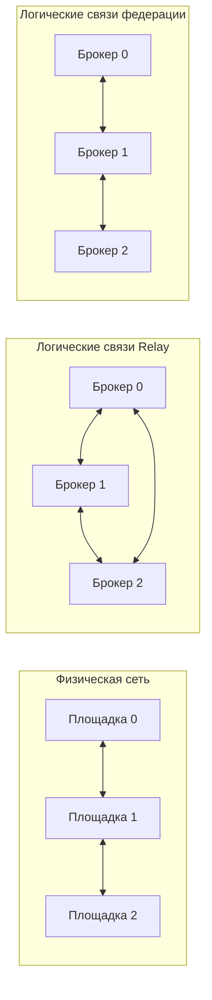

# Relay и статическая федерация: условия сравнения и проверяемые свойства

Это техническое описание для подготовки второй статьи и главы диссертации. Оно фиксирует, что именно реализовано, какие величины сравниваются и где заканчиваются доказательства. Автор пишет статью и принимает научные выводы; этот документ предоставляет проверенную основу.

## Кто выполняет опыт

| Компонент | Обязанность |
| --- | --- |
| MqttBenchmark | Заранее измерить настоящий брокер; в сетевом опыте не запускается |
| `calibrate` приложения MqttY | Заранее построить профиль по натурной серии |
| `EntityFX.MqttY.Federation.App` | Прочитать входы, проверить точные точки профиля, построить сеть, запустить фазы, сохранить журналы и диаграммы |
| Ядро MqttY и MQTT-плагин | Выполнить модельное время, передачу пакетов, сетевые очереди и MQTT-обмен |
| Модель брокера | Принять публикации, обработать подписки и передать сообщения подписчикам |
| `StaticFederator` | Подавить повторный ID, поставить локальную доставку и пересылки в очереди, выполнить их через модельные MQTT-соединения |
| Существующий `MqttRelay` | По конфигурации экспортировать локальный источник каждому другому брокеру; импорт передать локальному получателю |
| Python-верификатор | Независимо пересчитать сохранённые публикации, пересылки, получения, гистограммы и знаменатели |

CLI запускает эксперимент; брокер не запускает симулятор или калибровку. Федератор и Relay — модельные приложения, а не реальные сетевые службы Linux. Двойник не воспроизводит CPU/RSS настоящего брокера.

## Два разных графа

**Физическая сеть** `G_P=(V_P,E_P)` описывает площадки и каналы между ними. Каждая неориентированная связь создаёт два направления передачи. Маршрутизатор MqttY выбирает физический путь; межброкерное сообщение проходит очереди этого пути.

**Логическая сеть** `G_L=(B,E_L)` описывает MQTT-соединения между брокерами. Один логический переход может проходить несколько физических каналов. Промежуточный сетевой узел без брокера не становится участником федерации.

Пусть `N` — число площадок, `P` — число publishers, `S` — множество получателей. Publisher с номером `p` находится на площадке `p mod N`. Получатель остаётся на своей площадке во всех режимах. В текущем приложении на выбранной площадке один получатель.

| Режим | Брокеры и подключения клиентов | Межброкерная пересылка |
| --- | --- | --- |
| `single` | Один брокер на площадке 0; удалённые клиенты подключаются к нему по физической сети | Отсутствует |
| `relay` | По брокеру на площадку; клиенты подключаются локально | Полный ориентированный граф: `N(N−1)` направлений. Исходное сообщение экспортируется в каждый другой брокер один раз |
| `federation` | По брокеру на площадку; клиенты подключаются локально | Для линии/кольца/custom — соседям заданного графа. Для звезды с пустым транзитом — всем остальным брокерам через этот сегмент |

В Relay импортное сообщение попадает в отдельную тему и повторно не экспортируется. Поэтому полный граф соединений не создаёт бесконечную рассылку. Это актуальная реализация; прежняя серия с деревьями BFS описывает другой протокол и в это сравнение не входит.

Пример: три площадки на физической линии. Relay всё равно соединяет крайние брокеры логически напрямую, но пакет между ними проходит площадку 1. Федератор передаёт сообщение через соседний брокер.



Это схема различий, а не новый эксперимент. В проверенной короткой серии использовано кольцо; отдельная серия с десятью брокерами содержит Relay и пустой транзитный узел.

## Правило федерации и предел его доказательства

ID сообщения — пара `(площадка-источник, последовательный номер)`. При первом получении федератор сохраняет ID, ставит сообщение на локальную доставку выбранному получателю и отправляет соседям, кроме отправителя. При повторном ID увеличивается счётчик подавления: повторная доставка и пересылка не выполняются. Байты payload сохраняются; служебные поля передаются в теме.

Кэш ID не очищается до окончания ограниченного опыта. Проверка конфигурации заранее требует вместимость для всего запланированного прогрева и измерения. Превышение вместимости во время работы означает технический отказ. Очередь каждого выхода ограничена; переполнение и исчерпание числа переходов отражаются отдельными счётчиками. Отправка из очереди ожидает завершения предыдущего MQTT-обмена на этом соединении.

Для одного ID каждый из `N` федераторов обрабатывает первое получение не более одного раза. При конечном графе и сохранённом кэше это ограничивает число постановок на межброкерную пересылку сверху `2|E_L|`, где здесь `E_L` — неориентированные связи соседства. Локальная доставка ставится не более одного раза на площадке. Так обосновывается отсутствие бесконечного размножения сообщений; получение всеми узлами требует дополнительных условий.

Полная доставка в идеальном опыте ожидается при связном графе, достаточном лимите переходов, отсутствии потерь/переполнений, успешной обработке очередей и достаточном drain. Конечность пересылки сама по себе не доказывает полноту доставки, отказоустойчивость или самоорганизацию. Выбор ядра, beacons и перестроение маршрутов не реализованы.

## Полезный результат и формулы

Пусть `A` — число фактических исходных API-попыток измерительной группы, `C` — число завершений этих публикаций, `M` — число получателей, `D` — число уникальных пар `(ID, получатель)`, `T` — длина измерительного окна.

| Показатель | Формула и смысл |
| --- | --- |
| Ожидаемые доставки | `E=A×M`, включая локальные и удалённые получения; отказ API не исключает попытку из этого знаменателя |
| Полнота доставки | `D/E`; при `E=0` неприменима |
| Недоставка | `1−D/E`; при отсутствии получателей неприменима |
| Исходная скорость завершений | `C/T`; пересылки и локальные служебные перепубликации не добавляются к `C` |
| Скорость полезных доставок | `D/T`; может быть больше исходной скорости, поскольку получателей несколько |
| Дошедшие всем публикации | Число ID, присутствующих у каждого ожидаемого получателя; при `M=0` неприменимо |
| Backpressure | Запланированные публикации минус фактические API-попытки; это отдельная характеристика, не часть `1−D/E` |

Получения и завершения во время drain входят в итоговые числители, но показываются отдельно от измерительного окна. Поэтому `C/T` и `D/T` здесь не означают скорость событий строго внутри окна. Для анализа установившегося режима нужны также `sourceCompletedBeforeDrain/T`, `uniqueBeforeDrain/T` и проверка более длинных фаз.

Задержка доставки — время от исходного вызова Publish до уникального получения данным subscriber. Её p50/p95/p99 вычисляются по объединённой гистограмме пар доставки. Публикационный ACK — другая задержка; у QoS 0 она неприменима. Время ожидания запланированного слота до вызова Publish в эти задержки не входит.

### Независимая проверка числа пересылок

Для идеального режима без потерь, отказов, переполнений и обрезания переходов:

- Single: `F=0` межброкерных пересылок.
- Relay: `F=A(N−1)`.
- Федерация с сохранением всех ID и лимитом переходов не меньше `N`: `F=A[2|E_L|−(N−1)]`.
- У федерации число подавленных повторных прибытий равно `F−A(N−1)`.

Последняя формула получается из суммы степеней: источник отправляет всем соседям; каждый другой узел при первом получении исключает одно ребро прибытия. Повторное получение не порождает новых отправок. Для дерева стоимость `A(N−1)`, для полного графа — `A(N−1)²`. Это подсчёт прикладных MQTT-пересылок, без протокольных ACK и повторных физических передач.

Для кольца из трёх узлов и `A=200`: Relay — 400 пересылок, федерация — 800 и 400 подавленных повторов. В обоих случаях ожидается 600 уникальных доставок трём получателям. Для Relay из десяти брокеров: 1800 пересылок и 2000 доставок. Эти равенства подтверждены сохранёнными идеальными журналами.

## Что действительно одинаково при сравнении

Внутри каждой группы совпадают физическая сеть и параметры её очередей, расположение publishers/subscribers, payload, QoS, суммарный offeredRps, seed, фазы и tick. У каждого publisher собственные слоты и ограниченный кредит нагрузки; занятый publisher не передаёт нагрузку свободному. При backpressure совпадает заданное расписание, но фактические попытки могут отличаться — их нужно сравнивать отдельно.

Ресурсы приложений различаются:

| Свойство | Single | Relay | Федерация |
| --- | --- | --- | --- |
| Число брокеров | 1 | N | N |
| Удалённые служебные MQTT-соединения | 0 | `N(N−1)` | `2\|E_L\|` |
| Дополнительные локальные соединения | Нет | Отдельные listeners и выходы для локального импорта | Listener и выход локальной доставки на площадке |
| Очередь приложения | Нет пересылки | Вызов `Publish` непосредственно из обработчика; принятие/отказ наблюдается MQTT-клиентом | Отдельная ограниченная FIFO каждого выхода |
| Дополнительный параллелизм брокеров | Нет | Есть | Есть |

Поле `queueCapacity` относится к очередям федератора. Одинаковое значение в конфигурациях не создаёт такую очередь в Relay. Сетевые и MQTT-очереди также участвуют в результате. Суммарный CPU, RSS, число физических ядер и равный аппаратный бюджет эта модель не проверяет. Преимущество по доставке/задержке нельзя без дополнительных опытов приписывать исключительно алгоритму маршрутизации.

## Что проверено и что ещё нужно

Повторная проверка охватила 54 опыта кольца и 18 опытов с транзитом, включая идеальную и профилированную модели, QoS 0/1/2, seeds 42/43/44. Проверены первичные журналы, seals, payload, реальные физические графы и размещение клиентов, пары доставки, формулы и гистограммы. Совпали 12 сохранённых повторов scientific summary. Все 39 целевых интеграционных тестов прошли: линия, кольцо/ромб, транзит, очередь, лимит переходов, ID, прогрев, drain и технические отказы. Добавлены пять отрицательных и расчётных тестов независимого верификатора.

Кольцевая серия даёт 18 групп с тремя режимами и одинаковыми условиями внутри группы. Серия с десятью брокерами содержит только Relay: она проверяет транзит и не доказывает преимущество Relay над федерацией на десяти брокерах.

Профиль Mosquitto использует точные N=16/N=64 в кольцевой серии и N=16 на распределённый брокер в транзитной. Дополнительные соединения и пересылки выходят за условия натурной калибровки; большой процент недоставки здесь не доказывает дефект реального Mosquitto. Single с 160 publishers требует отсутствующей точки N=160 и не подменяется соседней.

Следующие технические шаги: зафиксировать более длинную сетевую программу, провести ограниченный pilot, оценить стоимость и достаточность наблюдений, затем выполнить новую матрицу. Нужны отдельные разрезы по исходной скорости, доставкам на получателя, пересылкам, очередям и drain. При запуске длительного расчёта сохранить состояние и завершить работу агента до ручного продолжения. Эти будущие опыты не засчитываются как выполненные короткой приёмочной серией.

## Как повторить эту проверку

Из корня мета-репозитория, с установленными .NET SDK/runtime 6 и Python 3.11 или новее:

```powershell
dotnet test mqtty/src/EntityFX.MqttSimulator/EntityFX.Tests.Integration/EntityFX.Tests.Integration.csproj -c Release --filter FullyQualifiedName~FederationTests --logger 'trx;LogFileName=federation-review.trx' --results-directory <test-results>
python -m unittest discover -s tools/dissertation -p test_network_review.py -v
python tools/dissertation/network_review.py --mesh-work <полные-данные-кольца> --transit-work <полные-данные-транзита> --trx <test-results>/federation-review.trx --output <новый-каталог-проверки>
```

Полные журналы берутся из архивов, указанных в `reports/data/federation-full-mesh-v1/archive-receipt.json` и `reports/data/federation-transit-10-v1/archive-receipt.json`. После проверки SHA архивы распаковываются в новые каталоги без изменения исходных данных. Верификатор ничего не симулирует и не переписывает прежние результаты. Пакет текущей проверки: [network-model-review-v1](../../reports/audits/dissertation/network-model-review-v1/verification.json).
