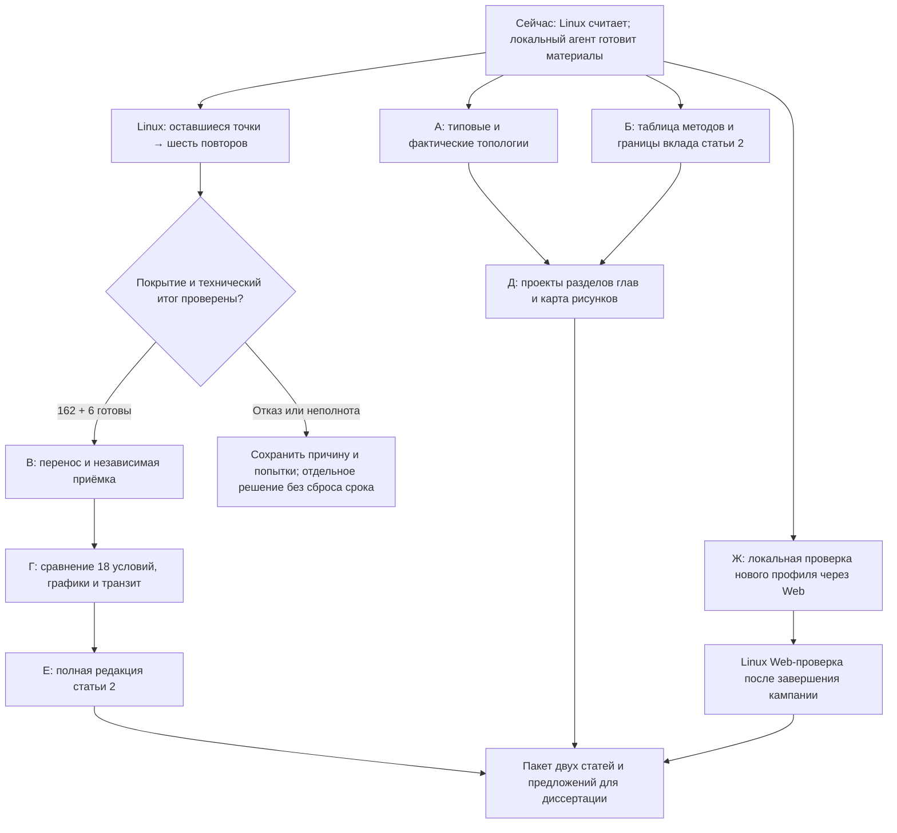

# Крупный блок: закончить сетевую статью и подготовить перенос результатов

**Цель:** собрать один проверяемый пакет «данные → сравнение → статья 2 → материалы глав → проверяемый путь Web», максимально используя время работающего Linux. Это план работ, а не отметка об их выполнении.

**Основа:** [исходные 42 шага](articles-and-work-plan.md), [цель](../../reports/status/Goal.md), [проверенные положения](claim-evidence-map.md), [план Web](../plans/MqttY.Web.single-broker-validation.md). Используется SUPERPOWERS writing-plans; код — через test-driven-development, завершение — через verification-before-completion. Исполнять самостоятельно по задачам; делегирование не требуется.

**Обновление исполнения:** блоки А и Б выполнены. Технический шаг 18 добавил 1,0 дня: текущий общий план **43,6% = 20,5/47**.

**База при составлении:** общий план 41,5% = 19,5/47 плановых человеко-дней. На 26 октября, 19:58 МСК, Linux исполнил 118/162 точки, повторы 0/6; нет неустранённых технических ошибок. Осталось 44 точки и шесть повторов. Предел дополнительной сессии — 27 октября, 01:33 МСК, не прогноз окончания.

## Очерёдность и параллельные ветки

Одному агенту не нужно ждать окончания L: сначала А и Б, затем Д или локальная часть Ж. При одном ожидании — остановка агента без таймеров и циклического опроса. Сам этот документ не запускает никаких новых задач.

## А. Каталог топологий — выполнить сейчас

**Файлы:** `docs/topologies/README.md`, `catalog.json`, `templates/`, `studies/`. Отдельный общий framework не создавать.

- [x] Подготовить типовые линию, кольцо, звезду, дерево, полный граф, ромб и многоуровневую сеть. Сохранять исходное описание, Mermaid и SVG.
- [x] Скопировать фактические физические и логические схемы четырёх площадок и десяти брокеров через транзит; добавить схемы балансировщика. Для каждой — ссылка на отчёт и источник, SHA копий.
- [x] Отделить учебные шаблоны от выполненных опытов. Звезду текущей кампании не выдавать за окончательно принятую серию до приёмки.
- [x] Проверить числа узлов/связей и соответствие SVG/Mermaid описанию; просмотреть рисунки. JSON документации не называть импортируемой топологией Web без проверки его формата.

**Статус:** выполнено: семь типовых и пять фактических схем, 169 проверок каталога и плана.

**Готово, когда:** каталог открывается с понятной навигацией, схемы не путают физическую сеть и MQTT-маршруты, все копии прослеживаются до источника. Это подготовка материалов, отдельного веса в исходном плане нет.

## Б. Сопоставление методов для статьи 2 — локально

**Файлы:** создать `docs/dissertation/article-2-contribution-and-related-work.md`; использовать существующую статью 2 и `network-forwarding-proofs.md`.

- [x] По academic-citation прочитать первоисточники bridges, клиентских ретрансляторов и Ribas–Spohn; метаданные или аннотация не заменяют прочтение нужного механизма.
- [x] Составить таблицу: кто поддерживает маршруты; какие изменения нужны брокеру; кто обрабатывает дубликаты; какие свойства реально проверены.
- [x] Сформулировать узкий вопрос и вклад; отсутствие самоорганизации и натурного сравнения сохранить явно.
- [x] Проверить утверждения по источникам, вставить результат в статью. Выбор журнала остаётся автору, повторно о нём не спрашивать.

**Проверка:** каждый сравнительный тезис имеет источник; новый результат не объявлен первым без основания; авторские публикации учтены по уже проверенным сведениям. При выполнении можно зачесть технический результат **шага 18, 1,0 планового дня**; утверждение новизны автором — отдельно.

## В. Приёмка законченной Linux-серии — после окончания L

**Входы:** тот же `network-full-3h-v1`, отдельный бюджет remaining-v1; существующие 106 raw и все попытки сохраняются. **Выход:** новый локальный каталог полного evidence вне Git и новый компактный пакет `reports/audits/dissertation/network-main-final-v1/`.

- [ ] Однократно проверить службу, общий progress и бюджет. Успешное завершение — inactive/success, не обязательный active. Старый скрипт подтверждения старта с assert active не использовать как критерий завершения.
- [ ] Проверить 162 различных ключа матрицы и шесть заданных повторов; полные seals, immutable runtime/конфиги, receipts и технические отказы. 18 предупреждений не скрывать и не превращать автоматически в техническую ошибку.
- [ ] Перенести стабильный итоговый снимок с SHA каждого файла в новый локальный каталог. Не дописывать в прежний уже проверенный raw-001. Не упаковывать меняющийся каталог как окончательный архив.
- [ ] Запустить существующий `audit_network_main_results.py` на новой копии; все сырые ID, метрики, гистограммы и фазы — отдельный пересчёт. Пакет v1 не перезаписывать.
- [ ] Отдельно сравнить шесть повторов по заранее заданной научной области. У существующего счётчика поле `mainCampaignComplete=False` отражает его исходную область частичной проверки: не менять старую квитанцию; создать отдельную итоговую приёмку с тестами на отсутствующий replay, неверный SHA и неполное покрытие.
- [ ] При отказе остановить выпуск новых заданий, сохранить точную причину и доступные данные. Не увеличивать ресурс или время без конкретного разбора; новую научную матрицу с нуля не запускать.

**Готово, когда:** 162/162 пересчитаны и шесть повторов проверены либо открыт честный список недостающих точек. Только полный результат закрывает **шаг 23, 1,5 планового дня**. За целостность архива не начислять второй вес.

## Г. Полное сравнение сети и стоимость транзита

**Файлы:** новый итоговый CSV/JSON, SVG/PDF/PNG, фактические SVG/Mermaid; отдельный `reports/analysis/Network-main-final.md`. Расширять существующий узкий renderer, не строить новый framework.

- [ ] Сравнить 18 условий topology/QoS/RPS, в каждом три режима и три общих seed: 54 агрегированные строки, 54 парные тройки по seed. Если покрытие неполное — явно изменить фактические n, не ожидаемые знаменатели.
- [ ] Показать полноту, доставку всем получателям, p99 рядом с числом получений, исходные завершения, переполнения и drain. QoS 0 ACK и p99 без получений — неприменимы.
- [ ] Из журнала транзита и GraphML выделить физические переходы и байты, если соответствующие события сохранены. При их отсутствии показать доступные показатели и ограничение, не подставлять logical forward count вместо нагрузки физического узла.
- [ ] Отдельно показать: физическая звезда с транзитом без брокера; логические связи Relay и федерации. Тип графа брать из фактического исполнения, не из одного названия конфигурации.
- [ ] Проверить формулы независимо от renderer, все n/знаменатели, SHA источников и видимость подписей на изображениях.

**Готово, когда:** полная сопоставимая таблица и транзитный разрез связаны с исполненным графом. Только тогда **шаг 24, 1,0 дня**. Нехватка сохранённых транзитных данных оставляет этот пункт частичным; не компенсировать новой серией автоматически.

## Д. Проекты глав без ожидания Linux

**Файлы:** `docs/dissertation/drafts/chapter-2-measurement.md`, `chapter-3-relay.md`, `chapter-4-validation.md`; опора — `Dissertation-evidence-integration.md` и текущая матрица положений.

- [x] Глава 2: как запускался настоящий брокер; что записывает MqttBenchmark; смысл показателей; новый контроль и старый EST отдельно.
- [x] Глава 3: физический/логический графы; темы; Relay «каждый каждому»; доказательства конечности; H≥N−1 и H≥N; ограничения очередей и контрпример диаметру.
- [x] Глава 4: архитектура MqttY, профиль, фазы и фактические тики; результаты статьи 1; окончательные сетевые таблицы — после В/Г; текущий срез 106 явно обозначен как частичный.
- [x] Для каждого рисунка указать каталог topologies и источник. Сохранить личный вклад как проект для подтверждения, не выдумывать распределение труда.
- [x] Провести проверку чисел и границ утверждений между проектами глав и статьями.

**Готово, когда:** автор получает связные русские проекты разделов с источниками. Подрепозиторий `diss` пока не менять. Проекты не закрывают автоматически шаги 30–35: для этого нужны собственно согласованные изменения глав и сквозная проверка. Ускорение 12,5× не восстанавливать по одной исторической таблице.

Подготовлены три проекта и навигация: [каталог](drafts/README.md). Пройдены 340 проверок таблиц, фаз, ссылок и неизменности исходников: [квитанция](../../reports/audits/dissertation/chapter-drafts-v1/verification.json). Это завершение подготовительного блока Д, не зачёт основных шагов 31/32/34.

## Е. Закончить рукопись статьи 2 и общий пакет

**Файлы:** существующая статья 2, новый отчёт приёмки, актуальная матрица доказательств, Progress.md/Goal.md/JSON.

- [ ] Включить полные результаты В/Г и сопоставление Б; короткая и длинная серии остаются разными.
- [ ] Переписать аннотацию и выводы под окончательное покрытие. При неполноте оставить рабочую редакцию с этим ограничением.
- [ ] Проверить ссылки, числа, определения потерь, тики, подписи и цитаты; собственное чтение агента не выдавать за независимое чтение человеком.
- [ ] Собрать пакет двух рукописей, таблиц, рисунков и команд пересчёта. Ссылки на внешние архивы и доступность данных описать явно.
- [ ] Commit/push проверенных файлов; не добавлять raw, сборки, логи и посторонние изменения. Записать подтверждённый remote commit в Progress.md.

**Готово, когда:** вторая рукопись полностью описывает принятый объём и ограничения. При полном выполнении **шаг 25, 2,0 дня**. Рецензирование, подача, принятие статьи и научное утверждение автором не засчитываются.

## Ж. Подтвердить путь через Web — отдельная техническая ветка

**Файлы:** существующие `TwinValidationsController.cs`, `BrokerProfilesController.cs`, `SimulationsController.cs`, соответствующие Contracts/Engines и `EntityFX.Tests.Web`; требования — `docs/plans/MqttY.Web.single-broker-validation.md`.

- [ ] Локальным коротким тестом выяснить, какой формат нового одноточечного профиля реально принимает Web. Не подставлять старый профиль под новым названием.
- [ ] RED-тесты на неизвестную точку профиля, подмену профиля после постановки задания, смешение калибровочного и нового контрольного эталона, сохранение ID и фаз; затем минимальные исправления.
- [ ] Проверить короткий путь UI/API → очередь → модель → файлы → статистика и ошибки; сравнить с эталоном того же входа. Не переносить измеритель настоящих брокеров внутрь Web.
- [ ] Развёртывание и проверку на Linux выполнять после завершения кампании, не меняя занятый runtime и не отнимая её память. Сохранить отдельно версию Web и идентичность модели.

**Готово, когда:** есть проверяемая квитанция конкретного Web-запуска по нужному профилю, а не только работающая главная страница. Ветка улучшает практическую пригодность; нового веса сверх исходных 47 дней ей не приписывать.

## Рубежи прогресса и предел обещаний

| Рубеж | Что должно быть реально принято | Вес исходного плана | Общий показатель |
| --- | --- | ---: | ---: |
| Сейчас | Уже проверенные результаты, включая шаг 18 | 20,5/47 | **43,6%** |
| После приёмки сети | Полный шаг 23 | +1,5 | **46,8%** |
| После графиков и транзита | Полный шаг 24 | +1,0 | **48,9%** |
| После полной статьи 2 | Полный шаг 25 | +2,0 | **53,2%** |
| Проекты глав и Web | Подготовленные материалы/короткие проверки | Без автоматической прибавки | Считать по готовности соответствующего исходного шага |

Эти человеко-дни — исходные веса результата, не время агента и не прогноз машинного расчёта. Первый рубеж возможен только после полного покрытия, повторов и всех проверок; не обещается заранее. На ближайшие два рабочих дня разумно целиться в пакет до 53,2% плюс готовые проекты глав и доказанный короткий путь Web. Это ориентир организации работ, не гарантия срока или научной приёмки.

Не включать автоматически: новую калибровочную матрицу, натурную сеть брокеров, самоорганизацию, benchmark ускорения, выбор журналов или новые таймеры. Любое новое научное утверждение требует собственной программы.
