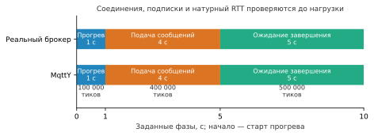
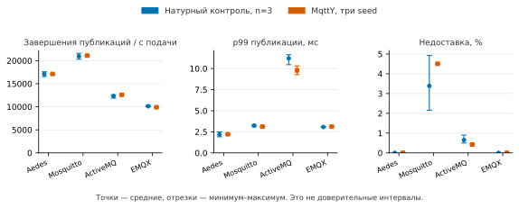
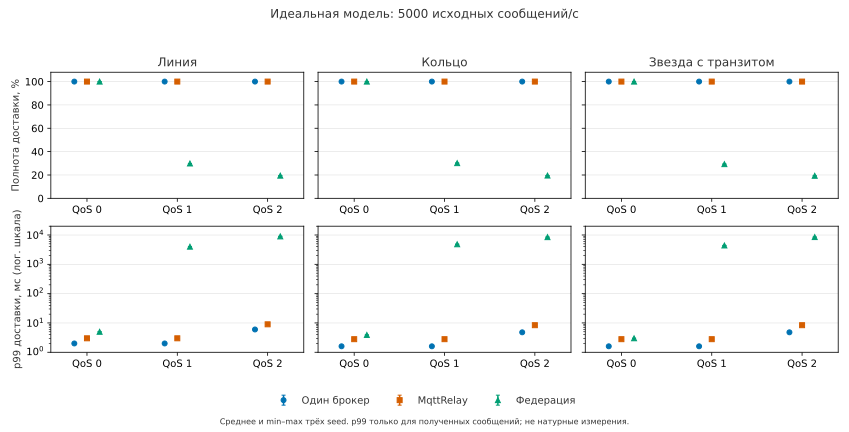

# Основа доклада: измерение и моделирование MQTT-брокеров и сетей

Рабочий макет для редакции автором, 30 октября 2026 года. Это отдельный материал, а не изменение диссертации и не утверждённый доклад. Предлагаемая длительность — 10–12 минут. Имена, официальное название работы, формулировки защищаемых положений и оформление заполняет автор.

## Слайд 1. Задача

**Как получить проверяемую модель MQTT-системы и понять границы её точности?**

Нужно отдельно проверить настоящий брокер, его профильную модель и сеть нескольких модельных брокеров. Близкая скорость сама по себе не подтверждает доставку; повторяемость расчёта не равна точности относительно настоящей системы.

Что сказать: «Показываю путь от измерения настоящего брокера к модели и затем к сравнению способов доставки в сети».

Основание: [статья 1](../articles/article-1-twin-validation.md), [статья 2](../articles/article-2-relay-federation.md).

## Слайд 2. Роли программ

- **MqttBenchmark** подключает настоящих отправителей и подписчика к реальному брокеру. Сохраняет попытки, исходы, получения и состояние соединений.
- **MqttY** строит профиль по измерениям и исполняет модель клиентов, брокера, MQTT-обмена и сети.
- **Web** позволяет задать модельный опыт, поставить его в очередь и просмотреть результат; настоящее измерение MqttBenchmark остаётся отдельным.
- **Проверяющие процедуры** пересчитывают сохранённые события и контрольные суммы.

Что сказать: «Натурные показатели получает MqttBenchmark. Модельный результат получает MqttY. Сайт — средство управления, а не замена измерителя».

Основание: [проверенный Web-путь](../../../reports/analysis/Article-1-native-control-web.md).

## Слайд 3. Что измеряем

Скорость попыток и успешных публикаций; доли ошибок и недоставки; p99 публикации; уникальные получения, повторы и незавершённые операции. Для сети получателем считается конкретный подписчик: одно сообщение может породить несколько ожидаемых доставок.

Что сказать: «Успешная публикация — исход операции у отправителя. Доставка — отдельное получение сообщения подписчиком. Эти числа проверяются раздельно».

p99 — время, за которое закончились 99% успешных публикаций. Это не время доставки и не показатель потерянных сообщений.

Основание: определения в разделах 1 и 4 статьи 1, раздел 5 статьи 2.

## Слайд 4. Измерение и профиль

Настоящий брокер измеряется три раза при фиксированных размере сообщения, QoS и числе отправителей. Из этих данных строится профиль с измеренными скоростями, долями и распределением задержек. Затем профиль фиксируется; только после этого выполняется отдельный натурный контроль.

Что сказать: «Профиль описывает внешние характеристики измеренного тракта. Он не восстанавливает внутреннее устройство брокера и не синхронизируется постоянно с сервером».

Оговорка: генератор и подробная запись событий входят в условия измерения. Их влияние не признано пренебрежимым.

Основание: [приёмка серии](../../../reports/audits/dissertation/article-1-matched-main-final-v1/verification.json).

## Слайд 5. Этапы одного опыта

Прогрев — **1 с / 100 000 тиков**; подача — **4 с / 400 000 тиков**; полное наблюдение после подачи — **5 с / 500 000 тиков**. Шаг модели — **10 мкс**. Подключение и подписка добавляют 14–18 тиков: всего **1 000 014–1 000 018 тиков**.

Что сказать: «Это модельное время. Время вычисления на компьютере — другая величина. Поздние исходы выбранных публикаций учитываются до конца наблюдения».

Основание: раздел 3 статьи 1. Рисунок сохранён из принятой программы, не строился заново для доклада.

## Слайд 6. Стенд и программа проверки

Simply Linux 11.1; Xeon E5-2680 v3, 12 физических ядер / 24 логических CPU. Брокер закреплён за CPU 0, измеритель — CPU 2–3; вся группа службы ограничена 4 ГиБ и 300% CPU. Ограничение группы не является объёмом установленной RAM.

Четыре брокера: Aedes 1.1.2, Mosquitto 2.0.15, ActiveMQ Classic 6.3.2, EMQX 6.3.0. Нагрузка: 16 отправителей, один подписчик, сообщения 16 байт, QoS 1.

**40 запусков:** 12 натурных настроек + 12 натурных контролей + 12 моделей + 4 точных повтора. Это четыре условия, а не полная область нагрузок.

Основание: раздел 5 статьи 1 и [зафиксированные версии](../../../reports/audits/dissertation/article-1-main-execution-v1/runtime-manifest.json).

## Слайд 7. Насколько близка модель брокера

Все **12 моделей** укладываются в заданные допуски. Наибольшие ошибки: **2,833% скорости**, **17,272% p99**, **1,162 процентного пункта недоставки**.

Что сказать: «Это выполнение инженерных допусков в четырёх проверенных условиях. Оно не означает 100% точность симулятора».

Сохранён важный результат сравнения: таблица калибровочных средних также проходит допуски. Преимущество симуляции над ней в прогнозе этих четырёх агрегатов не установлено.

Основание: [окончательная таблица](../../../reports/audits/dissertation/article-1-matched-main-final-v1/native-model.csv), [пересчёт](../../../reports/audits/dissertation/article-1-matched-main-final-v1/verification.json).

## Слайд 8. Повторяемость и другая машина

Четыре выбранных точных повтора дали побайтовое совпадение шести научных файлов на брокер; выбранная научная часть счётчиков совпала отдельно. Служебные даты и весь журнал соединений в это требование не входят.

Перенос настоящего брокера на другую машину может изменить показатели и потребовать нового профиля. Перенос только симулятора при том же профиле — отдельная проверка. Данные данного стенда не доказывают переносимость точности на другое оборудование.

Что сказать: «Повторяемость вычисления подтверждена в объявленной области. Независимое повторение всего исследования другим человеком пока не выполнено».

Основание: раздел 7 статьи 1, [пакет для повторения](../reproduction-handoff.md).

## Слайд 9. Сеть: три способа доставки

**Single:** центральный брокер. **MqttRelay:** полный логический граф клиентской пересылки. **Статическая федерация:** заданные соседи и подавление повторов.

Основная программа: четыре площадки; у Relay и федерации по брокеру на площадку, у single один центральный брокер; линия, кольцо и звезда с промежуточным сетевым узлом; QoS 0/1/2; 1000 и 5000 исходных сообщений/с; по три начальных состояния. Всего **162 симуляции + 6 точных повторов**.

Что сказать: «Физическая сеть и логические связи пересылки — разные графы. Сравнивается одинаковая полезная задача для получателей».

Оговорка: это идеальные модели конкретных реализаций, а не натурный аппаратный рейтинг и не самоорганизация по Ribas–Spohn.

Основание: [основная приёмка](../../../reports/audits/dissertation/network-main-final-v1/acceptance.json), раздел 7 статьи 2.

## Слайд 10. Доставка и цена пересылки

Центральный брокер и Relay доставили все ожидаемые пары в 18 условиях. У федерации при 5000 сообщ./с полнота **29,290–30,144% для QoS 1** и **19,305–19,505% для QoS 2**. В этих режимах зарегистрированы переполнения очередей.

Что сказать: «Задержку нужно читать вместе с полнотой. Низкая задержка среди полученных сообщений не описывает потерянные».

Логические экспорты, topic+payload и физический транзит считаются отдельно. Разная организация очередей входит в сравнение целых реализаций; собственный эффект маршрутизации не выделен.

Основание: [таблица](../../../reports/audits/dissertation/network-main-final-v1/raw-recount/comparison.csv), [транзит](../../../reports/audits/dissertation/network-main-final-v1/transit.csv).

## Слайд 11. Что установлено и что остаётся открытым

Установлены: согласованность проверенных событий и метрик, близость профилей в четырёх условиях, повторяемость выбранных моделей, свойства доставки и пересылки конкретных сетевых реализаций.

Не установлены: универсальная точность, преимущество над средними для четырёх агрегатов, натурная точность многоброкерной сети, отказоустойчивость и самоорганизация, количественное историческое ускорение по полному комплекту первичных доказательств.

Что сказать: «Новый опыт с очередями и новый benchmark — отдельные программы. Их подготовка не является положительным результатом».

Основание: [аудит ускорения](../../../reports/audits/dissertation/acceleration-evidence-v1/Review.md), [неинформативная короткая пара](../../../reports/analysis/Queue-capacity-short.md).

## Слайд 12. Итог и проверяемая передача

Получена цепочка: **MqttBenchmark измеряет → MqttY строит и исполняет профиль → отдельные процедуры проверяют результат**. Для сети явно учитываются получатели, очереди и стоимость пересылки. Данные и границы выводов сохраняются вместе.

Другому исследователю доступны две рукописи, таблицы, рисунки и три полных примера с одной командой пересчёта. Полные архивы находятся отдельно; публичный постоянный архив и независимое человеческое повторение ещё не подтверждены.

Что сказать: «Следующая научная работа — расширять проверяемую область применимости и различать причины расхождений, сохраняя отрицательные результаты».

Основание: [памятка исследователю](../../../reports/audits/dissertation/articles-handoff-v4/Reader-guide.md).

## Вопросы для подготовки автора

1. Что является самостоятельным вкладом сверх таблицы средних? Ответ не должен утверждать неиспытанное преимущество прогноза.
2. Почему выбраны такие допуски? Это соглашение данной проверки; прикладная пригодность требует требований конкретной системы.
3. Почему 12/12 не означает 100% точность? Это четыре фиксированных условия и три модельных начальных состояния.
4. Почему у федерации потери? Связь с переполнениями видна; вклад размера очереди, одновременных отправок и маршрутов пока не разделён.
5. Насколько быстрее MqttY? Без восстановленных парных первичных журналов или нового согласованного benchmark количественный ответ не защищается.

Автору остаются выбор акцентов, точные положения, личный вклад, согласование и репетиция. Макет не объявляется готовой презентацией предзащиты и не закрывает исходный шаг 40.
