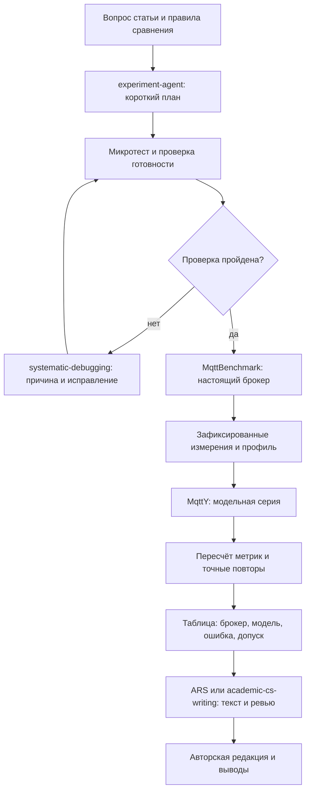

# Навыки ИИ-агента для исследований MqttY и MqttBenchmark

Подборка для двух статей и диссертации: измерение настоящих MQTT-брокеров, построение профилей, проверка моделей, сравнение MqttRelay и федерации, подготовка понятного научного текста. Источники проверены, восемь выбранных навыков установлены 25 октября 2026 года. Ниже описаны их назначение и границы применения.

## Что выбрать

Рекомендуется начать с ARS-Codex для исследовательских задач и отдельных навыков Superpowers для исправления кода. Для ускорения расчётов подключать один навык оптимизации. Написание и ревью статьи проводить отдельным этапом по уже проверенным результатам.

**Superpowers и ARS-Codex — разные проекты.** Первый организует разработку программ, второй помогает вести исследовательскую работу. Перечисленные ниже сторонние навыки не становятся частью Superpowers только из-за совместного использования. Названия сами по себе также не гарантируют совместимость с текущим агентом.

| Область | Выбор | Зачем в этом исследовании | Приоритет |
| --- | --- | --- | --- |
| Исследование | ARS-Codex: `academic-research-suite` | Обзор, план проверки, связь утверждений с данными, ревью | Основной набор |
| Эксперимент | Режим `experiment-agent` внутри ARS-Codex | План нагрузки, повторов, контрольных сравнений и воспроизводимости | Первый этап |
| Поиск ошибок | Superpowers: `systematic-debugging` | Установить причину отказа короткой проверкой до повторения серии | Первый этап |
| Проверка исправлений | Superpowers: `verification-before-completion` | Подтверждать результат командами и сохранёнными данными | Первый этап |
| Работа с кодом | Superpowers: `test-driven-development` | Зафиксировать ошибку доставки, фаз или очередей тестом и исправить её | При изменении поведения |
| Планирование кода | Superpowers: `writing-plans` | Разделить доработку на небольшие проверяемые шаги | Для крупных изменений |
| Скорость расчётов | `performance-optimization`, источник magnus919 | Найти, где тратится время, и проверить эффект оптимизации | После исправления ошибок |
| Статья по информатике | `academic-cs-writing`, источник AGISAFETYLAB | Структура статьи, таблицы, рисунки, ссылки и редактура | Отдельный этап |
| Проверка MQTT | Официальный `mqttx-cli` | Быстрый независимый обмен с настоящим брокером | Дополнительно |
| Полнота журналов и причинность | Две предметные проверки проекта, описанные ниже | Проверить достаточность событий и правильный порядок обработки | Обязательно по содержанию |

Это предлагаемое распределение работы под проект, а не результат сравнительного испытания навыков. Снижение расхода токенов или времени пока не измерено.

## Описание и источники

### ARS-Codex — общий исследовательский набор

В ARS-Codex опубликован единый навык `academic-research-suite`. Среди его направлений — обзор литературы, подготовка и ревью статьи, исследовательский процесс и `experiment-agent`. Последний является направлением внутри набора; отдельно устанавливать второй экземпляр для него не требуется. Источник: [репозиторий ARS-Codex](https://github.com/Imbad0202/academic-research-skills-codex).

Для нашего проекта предлагается использовать его так: сначала получить план опыта и список недостающих доказательств, затем передать ему результаты фактических измерений для проверки выводов. Запускать весь многоэтапный процесс ради одного вопроса нецелесообразно.

Пример задания после установки:

```text
Используй $academic-research-suite, направление experiment-agent.
Подготовь короткую проверку реального MQTT-брокера и его модели MqttY.
Укажи одинаковые условия, измеряемые события, правила сравнения,
прогрев, основную нагрузку, ожидание завершения и число тиков модели.
Отдельно перечисли ограничения. Пока не запускай большую серию.
```

### Superpowers — исправления и проверка кода

В библиотеке Superpowers есть навыки систематического поиска ошибок, разработки через тесты, планирования и проверки результата перед завершением работы. Это основа для доработки runner, MQTT-модели и Web. Источник: [библиотека Superpowers](https://github.com/obra/superpowers#whats-inside).

Предлагаемое применение:

- `systematic-debugging`: сохранить точный отказ, воспроизвести его на одной точке, проверить объяснение и только затем исправлять код;
- `test-driven-development`: добавить короткий тест на подтверждённую ошибку поведения, например неверное отделение прогрева или повторную доставку ID;
- `verification-before-completion`: после исправления проверить нужный сценарий и регрессию, приложить фактические результаты;
- `writing-plans`: для большой доработки записать файлы, шаги, проверки и условия завершения.

Полный цикл с дополнительными агентами имеет смысл для независимых крупных задач. Для небольшой починки достаточно одного исполнителя и короткой проверки. Устанавливать несколько перекрывающихся оркестраторов одновременно не рекомендуется.

### performance-optimization — ускорение на основании измерений

Выбран конкретный источник: [magnus919/agent-skills, performance-optimization](https://github.com/magnus919/agent-skills/blob/main/performance-optimization/SKILL.md). Навык описывает последовательность «измерить исходное состояние → найти узкое место → изменить один фактор → проверить результат», включая проверку корректности измерений.

В MqttY предлагается применять его для поиска затрат на обработку тиков, очереди, запись журналов и подготовку запуска. Возможные направления проверки — распределение независимых модельных точек между процессами и повторное использование неизменных входов. Ускорение подтверждается временем расчёта при сохранении научных результатов.

Натурные измерения нельзя автоматически распараллеливать на тех же ресурсах: конкуренция генераторов и брокеров меняет условия. Уменьшение окна или числа повторов также меняет программу исследования и должно быть обозначено отдельно.

`software-performance` оставлен альтернативным названием из исходного списка: конкретный подходящий источник в этой подборке не подтверждён. Для начала достаточно одного выбранного навыка оптимизации.

### academic-cs-writing — понятная статья по информатике

Подтверждён пакет [AGISAFETYLAB/Paper-Writing-skill, academic-cs-writing](https://github.com/AGISAFETYLAB/Paper-Writing-skill/blob/main/skills/academic-cs-writing/SKILL.md). Он разделяет работу над текстом, рисунками, ссылками и итоговым ревью. Эксперименты этот пакет не выполняет.

Для первой статьи предлагается проверять последовательность: что измерили у настоящего брокера, как построили профиль, как запустили модель, какие числа получили и насколько они различаются. Для второй — одинаковую полезную нагрузку, различие маршрутов и цену пересылки в single, Relay и федерации.

Не следует одновременно поручать ARS и этому пакету переписывать одну рукопись. Один отвечает за выбранный этап, другой при необходимости выполняет отдельную проверку. Требование проекта — простой русский язык, определение каждого показателя и отсутствие выводов, которых нет в данных. Автор редактирует и утверждает итоговый текст.

### mqttx-cli — дополнительная проверка настоящего MQTT

Официальный навык существует: [документация MQTTX для ИИ-агентов](https://mqttx.app/docs/cli/agent-skill), [исходники mqttx-cli](https://github.com/emqx/MQTTX/tree/main/skills/mqttx-cli). Он помогает пользоваться MQTTX CLI: подключаться, публиковать и получать сообщения, задавать параметры протокола и выполнять нагрузочные команды. Сам исполняемый MQTTX CLI и навык управления им — отдельные составляющие.

В проекте он полезен для короткой проверки CONNECT и обмена с уникальной темой перед основным запуском. Это дополнительный инструмент проверки MQTT. Переход с MqttBenchmark на другой генератор требует отдельной программы сравнения: нельзя незаметно объединять результаты разных измерителей.

## Что уточнить в исходном списке

| Название | Результат проверки | Решение для проекта |
| --- | --- | --- |
| `benchmark-design` | Название неоднозначно. Найденная карточка относится к оценке ИИ-агентов; указанный исходный файл Prism-Shadow/penguin-harness при проверке недоступен | Не рекомендовать как проверенный навык сравнения MQTT-брокеров. Задать условия сравнения через experiment-agent и предметный контракт измерений |
| `trace-completeness-audit` | Публичный первичный источник готового навыка по точному названию не подтверждён | Сохранить как название необходимой проверки; готовым установленным навыком не считать |
| `simulation-causality-audit` | Публичный первичный источник готового навыка по точному названию не подтверждён | Аналогично: предметная проверка проекта, при необходимости будущий локальный навык |
| `software-performance` | Конкретный источник под этот проект не выбран | Использовать подтверждённый performance-optimization |

«Не подтверждён» означает результат текущего поиска, а не доказательство отсутствия пакета. Для неподтверждённых названий команды установки не приводятся.

### Проверка полноты журналов

Предлагаемый результат: таблица «что нужно знать → какое событие это доказывает → где сохранено → чего не хватает». Для публикации нужны источник и номер сообщения, попытка, результат операции, получения у каждого ожидаемого подписчика и границы фаз. Для модели дополнительно нужны tick, seed и идентичность входов.

Нужно установить, можно ли по сохранённым событиям независимо пересчитать скорость, ошибки, задержку и недоставку. Полнота журналов для пересчёта показателей и достаточность данных для точного повтора всего исполнения проверяются отдельно. Если часть событий отсутствует, это ограничение фиксируется явно.

### Проверка причинности симуляции

Предлагаемый результат: короткие тесты и отчёт о порядке событий. Нужно проверить, что получение следует за отправкой и сетевой передачей, подтверждение связано с нужной публикацией, очереди соблюдают ограничения, а время продвигается последовательно. Совпадающие номера у разных источников не должны смешиваться.

Для Relay и федерации отдельно проверяются физические сетевые переходы, подавление повторов и конечность пересылки в цикле. Эта проверка может обнаружить ошибку модели; сама по себе она не устанавливает причину наблюдаемой недоставки настоящего брокера.

## Как применять без лишних запусков



Перед большой серией фиксируются входы, версии, допуски, лимит времени и правила восстановления. При техническом отказе сохраняется неудачная попытка; после подтверждённого исправления повторяются недостающие точки. Отдельный процесс ведёт мониторинг, агент обращается к компактному состоянию по необходимости. Во время долгого расчёта полезная независимая работа продолжается; если осталось только ждать, агент останавливается.

Навыки дают инструкции агенту. Реальные измерения выполняет MqttBenchmark, модельные расчёты — MqttY; сохранённые скрипты и тесты подтверждают результат. Ревью навыком не заменяет проверки данных, а технический успех серии не означает совпадения модели с настоящим брокером.

## Порядок подключения

1. Выбрать и проверить конкретную ревизию ARS-Codex и нужных навыков Superpowers; сохранить источник и commit, чтобы обновление пакета не изменяло процесс незаметно.
2. Проверить набор на одном завершённом опыте: план, краткая диагностика, пересчёт метрик и отчёт об ограничениях. Сравнить пользу и затраты с текущим процессом.
3. Подключить performance-optimization для одной задачи ускорения с измеренным исходным временем.
4. Использовать academic-cs-writing на одном разделе готовой статьи; проверить понятность русского текста и сохранность чисел.
5. Подключить mqttx-cli, если нужна независимая короткая проверка MQTT. Предметные проверки журналов и причинности сначала реализовать тестами и отчётом; оформлять в локальные навыки при повторном использовании.

## Выполненная установка

Установлены `academic-research-suite`, `systematic-debugging`, `verification-before-completion`, `test-driven-development`, `writing-plans`, `performance-optimization`, `academic-cs-writing` и `mqttx-cli` в пользовательский каталог `C:/Users/entityfx/.codex/skills`. Для каждого источника зафиксирован commit, для файлов — SHA-256 в [квитанции установки](../../reports/status/research-skills-installation.json). Установлен PyYAML 6.0.3 для журнала ARS. Исполняемый MQTTX CLI этой установкой не устанавливался.

Стандартное обнаружение навыков доступно со следующего обращения агента. В установившей их сессии инструкции выбранных навыков прочитаны непосредственно с диска. Первый результат применения — [проверка финальной серии первой статьи](../../reports/analysis/Article-1-skills-validation.md). Остальные навыки установлены, но их эффективность в проекте ещё не оценена. Замороженные научные входы и параметры опытов не менялись.

Установка инструментов не увеличивает процент научной готовности: он растёт после выполнения проверяемых шагов исследования.
