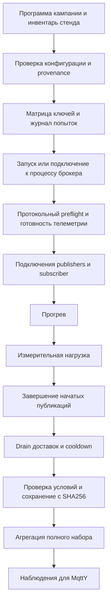
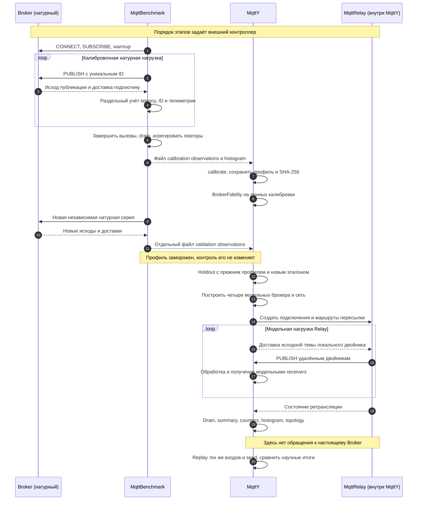
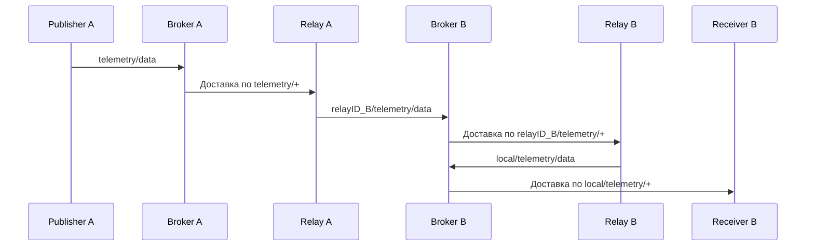

# MqttBenchmark MqttY и MqttRelay в вопросах и ответах

Документ объясняет, как измерить настоящий MQTT-брокер, запустить измеритель непосредственно через Windows `.exe`, построить по результатам модель брокера и использовать её в сети MqttRelay. Последний ответ оценивает материал для двух научных статей и отделяет уже полученные результаты от экспериментов, которые ещё необходимы.

**Главный вывод:** в проекте есть законченная цепочка «натурное измерение → профиль → симуляция → проверка». Собранных материалов достаточно для подробной статьи о построении и ограничениях двойников брокеров. Для статьи о воспроизводимой сетевой симуляции есть реализация, результаты и примеры повторяемости. Однако утверждение о подтверждённой точности двойника настоящей Relay-сети пока не обеспечено натурным сетевым экспериментом.

Разбор относится к состоянию исходников на **21 октября 2026 года**: `mqtty-meta` — `4cdcbe3`, `MqttBenchmark` — `30c21c4`, `mqtty` — `115885e`. Количественные результаты относятся к опубликованной оценке от **19 октября 2026 года**, а не к новому запуску нагрузки. Версии отдельных частей исторической серии указаны в её manifests: текущий checkout сам по себе не заменяет сведения о происхождении измерений.

В тексте «двойник» означает **калиброванную поведенческую модель**. Она воспроизводит выбранные наблюдаемые характеристики при заданных условиях; это не копия исходников брокера и не полная эмуляция его операционной системы, хранилища и внутренних потоков.

## Содержание

1. [Что делает MqttBenchmark](#вопрос-1-что-делает-mqttbenchmark)
2. [Как организовать тест непосредственно через exe](#вопрос-2-как-организовать-тест-mqttbenchmark-напрямую-через-exe)
3. [Что такое RPS брокера](#вопрос-3-что-такое-rps-брокера)
4. [Какие другие метрики есть](#вопрос-4-какие-другие-метрики-есть)
5. [Как работает MqttBenchmark](#вопрос-5-как-работает-mqttbenchmark)
6. [Как работают сценарии MqttBenchmark](#вопрос-6-как-работают-сценарии-mqttbenchmark)
7. [Как работают сценарии метрик MqttBenchmark](#вопрос-7-как-работают-сценарии-метрик-mqttbenchmark)
8. [Как работает MqttY](#вопрос-8-как-работает-mqtty)
9. [Как применить результаты MqttBenchmark в MqttY](#вопрос-9-как-применить-результаты-mqttbenchmark-в-mqtty)
10. [Как реализуется архитектура MqttRelay](#вопрос-10-как-реализуется-архитектура-mqttrelay)
11. [Как применить результаты MqttBenchmark к MqttRelay](#вопрос-11-как-применить-результаты-mqttbenchmark-к-архитектуре-mqttrelay)
12. [Достаточно ли данных на две статьи](#вопрос-12-достаточно-ли-данных-на-две-статьи)

## Вопрос 1 Что делает MqttBenchmark

**Ответ.** MqttBenchmark создаёт настоящие MQTT-соединения с установленным брокером, публикует сообщения, наблюдает завершения публикаций и получения подписчиком, собирает показатели стенда и сохраняет результаты. На его основе можно узнать, как конкретная установка Mosquitto, Aedes, ActiveMQ Classic или EMQX ведёт себя под выбранной нагрузкой.

Брокер при этом выполняет собственный настоящий код. MQTTnet на стороне измерителя обеспечивает клиентский протокольный обмен. MqttBenchmark не подставляет заранее известную производительность и не симулирует ответы брокера.

### Какие задачи он решает

| Задача | Что делает программа | Что получается |
| --- | --- | --- |
| Проверить готовность стенда | Проверяет процесс, MQTT-подключения, подписки, обмен, исходный RTT и телеметрию | Отчёт `preflight` |
| Создать нагрузку | Запускает заданное число publishers с определёнными QoS и размером payload | Последовательность настоящих операций MQTT |
| Посчитать исходы | Сопоставляет попытки, завершения, ошибки и получения по ID | Счётчики, доли ошибок и недоставки |
| Измерить время | Измеряет фактическое окно и длительности завершившихся публикаций | RPS и распределение latency |
| Проверить условия | Наблюдает загрузку генератора и телеметрию брокера | Признаки перегруженного или некорректно измеренного стенда |
| Обеспечить проверяемость | Сохраняет конфигурации, версии, журналы, результаты и SHA-256 | Набор первичных доказательств опыта |
| Подготовить вход модели | Агрегирует успешные повторы одной и той же точки | `broker-observations.v3.json` |

Например, запрос «измерить Mosquitto, 256 байт, QoS 1, 16 отправителей» означает создание 16 клиентов публикации и дополнительного подписчика. Программа измерит, сколько публикаций удалось завершить за фактическое время, сколько вызовов завершилось ошибкой, сколько уникальных ID пришло подписчику и как распределились задержки завершения успешных публикаций.

### Что именно называется MqttBenchmark

В репозитории это семейство проектов, а не один универсальный исполняемый файл.

| Проект | Назначение |
| --- | --- |
| `EntityFX.MqttBenchmark.Cli` | Основной командный интерфейс воспроизводимой кампании: `preflight`, `matrix`, `aggregate`, а также мониторинг |
| `EntityFX.MqttBenchmark.Campaign` | Реализация кампании v3, журнала попыток, измерений, стенда и агрегации |
| `EntityFX.MqttBenchmark` | Общие классы, прежняя нагрузочная библиотека и цепочка калибровки v2 |
| `EntityFX.MqttBenchmark.Bomber` | Нагрузочное приложение на NBomber с шаблонами сценариев |
| `EntityFX.MqttBenchmark.Scenario` | Отдельный исполнитель групп тестов из `Tests` в конфигурации |
| `EntityFX.MqttBenchmark.Counters` | MQTT-подписчик с HTTP API счётчиков для прежних приложений |
| `EntityFX.MqttBenchmark.StatAggregator` | Обработка сохранённых CSV системных показателей |

Для новых данных, которые затем должны перейти в MqttY и научный отчёт, основной маршрут — **CLI кампании v3**. Bomber полезен для его собственного набора нагрузочных сценариев, но его отчёт нельзя считать готовым эквивалентом observations v3.

### Чего результат измерения сам по себе не доказывает

Измерение характеризует сочетание версии брокера, его настроек, оборудования, ОС, сети, клиента, нагрузки и окна наблюдения. Оно не определяет «вечную скорость Mosquitto» и не устанавливает единственную причину каждой ошибки. Например, потери могут быть связаны с обработкой у подписчика, а быстрые ошибки публикации — с уже отключённым клиентом.

Также MqttBenchmark не строит всю модель MqttY автоматически: он выдаёт наблюдения. Преобразование наблюдений в параметры двойника выполняет отдельная команда `calibrate` в MqttY.

Основание: [архитектура проекта](architecture.md), [CLI](../MqttBenchmark/src/EntityFX.MqttBenchmark.Cli/Program.cs), [исполнитель нагрузки](../MqttBenchmark/src/EntityFX.MqttBenchmark.Campaign/Workload/CampaignWorkloadRunner.cs).

## Вопрос 2 Как организовать тест MqttBenchmark напрямую через exe

**Ответ.** Нужно опубликовать проект `EntityFX.MqttBenchmark.Cli`, подготовить два JSON-файла — описание стенда и программу измерений — и вызвать полученный `.exe` с командами `preflight`, `matrix`, `aggregate`. IDE и `dotnet run` после публикации не нужны.

Ниже приведён маршрут для **Windows x64, PowerShell 7 и одного локального Mosquitto**. Он подходит для знакомства и получения полного профиля одного брокера. Переход на несколько брокеров или удалённую машину требует другого описания стенда, но смысл команд остаётся тем же.

### 2.1 Что должно быть подготовлено

Нужны исходники MqttBenchmark, Git, PowerShell 7 и установленный Mosquitto. Для сборки нужен .NET SDK, способный собрать целевой `net6.0`. При self-contained публикации среда выполнения .NET войдёт в каталог приложения. Брокер и скрипты управления в такой каталог автоматически не включаются.

В примере используются:

- репозиторий `C:\projects\mqtty-meta\MqttBenchmark`;
- брокер `C:\Program Files\mosquitto\mosquitto.exe`;
- отдельный доступный тестовый порт `1883`;
- конфигурация Mosquitto из репозитория с loopback listener;
- режим `managed`: программа сама запускает и завершает идентифицированный процесс брокера.

Если Mosquitto уже работает как служба на том же порту, сначала выберите свободный тестовый порт и согласуйте его в MQTT URI и конфигурации listener либо подготовьте выделенную тестовую установку. Для режима `managed` порт должен быть свободен перед запуском.

Проверки среды:

```powershell
$BenchmarkRoot = 'C:\projects\mqtty-meta\MqttBenchmark'
Set-Location $BenchmarkRoot
$PSVersionTable.PSVersion
dotnet --list-sdks
git status --short
Test-Path 'C:\Program Files\mosquitto\mosquitto.exe'
Get-NetTCPConnection -LocalPort 1883 -State Listen -ErrorAction SilentlyContinue
```

У воспроизводимой кампании проверяется чистота исходников. Локальные входы и выходы следует хранить в предусмотренных исключённых из Git местах: `config/*.local.json` и `artifacts/`. Не надо обходить проверку provenance, подменять SHA-256 или незаметно изменять код между повторами.

### 2.2 Собрать приложение с exe и своей средой выполнения

```powershell
dotnet publish .\src\EntityFX.MqttBenchmark.Cli\EntityFX.MqttBenchmark.Cli.csproj `
  -c Release -r win-x64 --self-contained true -p:UseAppHost=true `
  -o .\artifacts\mqttbenchmark-win-x64
if ($LASTEXITCODE -ne 0) { throw 'Ошибка публикации MqttBenchmark' }

$BenchmarkExe = Join-Path $BenchmarkRoot `
  'artifacts\mqttbenchmark-win-x64\EntityFX.MqttBenchmark.Cli.exe'
& $BenchmarkExe --help
```

Передавайте **весь каталог публикации**, если переносите приложение. Self-contained здесь означает наличие runtime в поставке, а не то, что достаточно скопировать один файл `.exe`. Рядом остаются библиотеки и другие файлы публикации.

Вариант `--self-contained false` также может создавать `.exe`, но на машине запуска тогда нужна подходящая среда .NET 6. Запуск `dotnet EntityFX.MqttBenchmark.Cli.dll ...` — ещё один вариант того же приложения; он не является запуском через apphost `.exe`.

Для кампании v3 дополнительно нужны каталог `scripts`, входные JSON и сведения об исходном репозитории. Поэтому простой практический вариант — запускать опубликованный `.exe` из подготовленной рабочей копии, как в этом примере.

### 2.3 Создать локальное описание Mosquitto

```powershell
$SpecPath = Join-Path $BenchmarkRoot 'config\brokers.qa.local.json'
$StandPath = Join-Path $BenchmarkRoot 'config\broker-stand.qa.local.json'
$CampaignPath = Join-Path $BenchmarkRoot 'config\campaign.qa.local.json'

if (Test-Path -LiteralPath $SpecPath) {
  throw 'Описание уже существует. Используйте его осознанно либо выберите новое имя.'
}
Copy-Item -LiteralPath .\docs\examples\mosquitto.windows.spec.json `
  -Destination $SpecPath
Get-Content -LiteralPath $SpecPath
```

В существующем шаблоне указаны путь к `mosquitto.exe`, MQTT URI, аргумент `-c`, список конфигурационных файлов и аргументы получения версии. Если установка отличается, измените **локальную копию** перед формированием стенда. Строка `${MqttBenchmarkRoot}` внутри JSON — специальный маркер генератора, который разрешается относительно корня репозитория.

Сформируйте инвентарь и программу:

```powershell
& .\scripts\NewNativeStand.ps1 `
  -BrokerSpecPath $SpecPath `
  -StandPath $StandPath `
  -CampaignPath $CampaignPath `
  -CpuMode hostAllCores `
  -Lifecycle managed

Get-Content -LiteralPath $CampaignPath
```

Генератор вычисляет хэши существующих входов и создаёт новые файлы. Он не устанавливает брокер. Повторная запись в те же выходные пути отвергается.

По умолчанию получится матрица `16/256 байт × QoS 0/1/2 × 1/16/64/128 отправителей × 3 повтора`, то есть **72 измерения одного брокера**. Сгенерированные длительности — 5 секунд прогрева, 30 секунд нагрузки, 5 секунд cooldown, до 30 секунд drain, quiet period 2 секунды. Это параметры нового примера, а не длительности опубликованной ночной серии.

Для первого знакомства можно оставить полную матрицу и выполнить только один ключ с `--max-runs 1`. Это позволяет затем продолжить **ту же** программу без редактирования JSON. Если нужна отдельная сокращённая программа, создайте её до первого запуска под другим именем; её полнота не равна полноте стандартной калибровочной сетки.

### 2.4 Проверить развёртку матрицы

```powershell
$RunTag = Get-Date -Format 'yyyyMMdd-HHmmss'
$RunDirectory = Join-Path $BenchmarkRoot "artifacts\qa-$RunTag"
$PreflightDirectory = Join-Path $BenchmarkRoot "artifacts\qa-$RunTag-preflight"
$AggregateDirectory = Join-Path $BenchmarkRoot "artifacts\qa-$RunTag-aggregate"

& $BenchmarkExe matrix `
  --config $CampaignPath --stand $StandPath `
  --campaign $RunDirectory --benchmark-repo $BenchmarkRoot --dry-run
if ($LASTEXITCODE -ne 0) { throw 'Ошибка развёртки матрицы' }
```

Ожидается сообщение о 72 ключах. `dry-run` проверяет программу и её развёртку, но не подтверждает работоспособность брокера, правильность всех его хэшей и качество телеметрии.

### 2.5 Выполнить preflight

```powershell
& $BenchmarkExe preflight `
  --config $CampaignPath --stand $StandPath `
  --output $PreflightDirectory --benchmark-repo $BenchmarkRoot
if ($LASTEXITCODE -ne 0) {
  throw "Preflight не пройден. Проверьте $PreflightDirectory"
}
```

Это уже настоящий запуск проверки стенда. Успешный preflight означает, что пройдены предусмотренные протокольные и инфраструктурные проверки. Он ещё не устанавливает производительность и не гарантирует прохождения контроля ресурсов под максимальной нагрузкой.

При ошибке изучите `preflight.json` и вложенные материалы. Исправив причину, используйте новый каталог preflight. Сохранённый неуспешный результат не следует перезаписывать.

### 2.6 Выполнить один измерительный запуск

```powershell
& $BenchmarkExe matrix `
  --config $CampaignPath --stand $StandPath `
  --campaign $RunDirectory --benchmark-repo $BenchmarkRoot `
  --max-runs 1
if ($LASTEXITCODE -ne 0) {
  throw "Измерение завершилось ошибкой. Проверьте $RunDirectory"
}
```

Ожидается одна успешная попытка с `result.json`, журналами публикаций и доставок, телеметрией и `sha256.json`. Первый ключ определяется порядком матрицы с seed; он не обязан быть самым лёгким вариантом с одним отправителем.

`--max-runs 1` ограничивает число выполняемых ключей, но не меняет определение всей кампании. Код возврата 0 в таком режиме не означает, что собрано 72 измерения. Полноту затем проверит агрегация.

### 2.7 Продолжить и агрегировать

```powershell
& $BenchmarkExe matrix `
  --config $CampaignPath --stand $StandPath `
  --campaign $RunDirectory --benchmark-repo $BenchmarkRoot --resume
if ($LASTEXITCODE -ne 0) { throw 'Кампания не завершена успешно' }

& $BenchmarkExe aggregate `
  --config $CampaignPath --stand $StandPath `
  --raw $RunDirectory --output $AggregateDirectory `
  --benchmark-repo $BenchmarkRoot
if ($LASTEXITCODE -ne 0) { throw 'Агрегация не выполнена' }

Get-Item (Join-Path $AggregateDirectory 'broker-observations.v3.json')
```

Между первым запуском и `--resume` сохраняйте исходные config/stand bytes и идентичность исходников. Изменение даже форматирования JSON меняет его хэш. При продолжении в новом терминале восстановите значения переменных, особенно прежний `$RunDirectory`; не создавайте новый RunTag для продолжения старой кампании.

Полный результат одного брокера содержит 72 успешных ключа и 24 агрегированные точки. В текущем MqttY он подходит для **явной** команды `calibrate --broker Mosquitto`. Без `--broker` стандартный калибратор ожидает полную четырёхброкерную программу. Утверждение старого локального руководства о невозможности калибровки одного брокера уже не соответствует текущему интерфейсу.

### 2.8 Если нужен уже работающий брокер

При генерации замените `-Lifecycle managed` на `-Lifecycle external` и самостоятельно запустите процесс в согласованной конфигурации. Контроллер проверяет его принадлежность и снимает телеметрию, но не становится владельцем его жизненного цикла. Это не режим подключения к произвольному чужому MQTT endpoint без доступа к процессу.

Для отдельной машины используйте поддерживаемый удалённый native-стенд по SSH и его инвентарь. Сетевой путь, CPU и фактическая скорость физического интерфейса становятся частью условий опыта. Подробности: [варианты размещения](../MqttBenchmark/docs/deployment-layouts.md) и [две машины](../MqttBenchmark/docs/two-machine-campaign.md).

### 2.9 Если имеется в виду Bomber exe или Scenario exe

Это другие приложения с другим форматом конфигурации. Они тоже публикуются через `dotnet publish`, но используют `appsettings`, собственные шаблоны и HTTP-сервис Counters. Например, после соответствующей публикации вызов имеет вид:

```powershell
& '.\EntityFX.MqttBenchmark.Bomber.exe' --config '.\appsettings.local.json'
```

Для `EntityFX.MqttBenchmark.Scenario.exe` также предусмотрен `--config`. Этот пример описывает форму вызова, а не готовый стенд: перед запуском нужно подготовить MQTT endpoints, темы, URL Counters, конфигурацию подписчика и для Bomber файлы `templates`/`infra-config.json`. Существующие примеры содержат адреса исторического стенда, их нельзя воспринимать как локальные значения по умолчанию.

Практическое различие: `Cli.exe matrix --config campaign.v3.json` запускает кампанию с доказательствами v3; `Bomber.exe --config appsettings...json` запускает сценарии NBomber. Их флаги и JSON не взаимозаменяемы.

### 2.10 Как разбирать типичные ошибки

| Симптом | Что проверить |
| --- | --- |
| Exe отсутствует | Успешность `publish`, каталог output, `UseAppHost` и выбранный RID |
| Программа просит runtime | Возможно, скопирована framework-dependent публикация или запускается DLL другого каталога |
| Не найден скрипт стенда | Рабочий каталог, `--benchmark-repo`, наличие `scripts/BrokerStand.ps1` и PowerShell 7 |
| Preflight не проходит | MQTT URI, listener, права на процесс, конфигурацию, хэши и подробный `preflight.json` |
| Неподходящая CPU affinity | Согласованность `cpuMode`, инвентаря и фактической маски процесса |
| Сработал load-generator guard | CPU контроллера, NIC при удалённом стенде, пропуски отсчётов, конкуренцию за ресурсы |
| `aggregate` сообщает неполное покрытие | Не остался ли запуск ограниченным `--max-runs 1` или фильтром `--broker` |
| `--resume` отвергает identity | Не менялись ли config/stand bytes, исходники и исходный каталог кампании |
| Выходной файл уже существует | Используйте новый output для нового артефакта; продолжение кампании выполняйте через `--resume` |

Стандартный CPU guard — 70 %, если его явно не переопределили в программе. На одной машине генератор и брокер делят ресурсы. При нарушении guard сначала устраните причину или разделите нагрузку, а не повышайте порог только ради получения успешного статуса. Опубликованная исследовательская серия использовала собственные явно записанные настройки, включая иной порог; их перенос означает изменение методики нового опыта.

Если в окружении задана `MQB_GUARD_SAMPLER_CLI`, guard запускает дополнительный измерительный процесс через команду `dotnet`. Для такого режима нужен доступный `dotnet` host и совместимая поставка sampler, даже если основной процесс запущен через self-contained `.exe`. Это отдельная зависимость из [LoadGeneratorGuard](../MqttBenchmark/src/EntityFX.MqttBenchmark.Campaign/Guard/LoadGeneratorGuard.cs); обычная публикация `.exe` её не отменяет.

Основание команд: [Program.cs CLI](../MqttBenchmark/src/EntityFX.MqttBenchmark.Cli/Program.cs), [разбор параметров v3](../MqttBenchmark/src/EntityFX.MqttBenchmark.Campaign/Commands/CampaignCommandOptions.cs), [генератор native-стенда](../MqttBenchmark/scripts/NewNativeStand.ps1), [локальный стенд](../MqttBenchmark/docs/local-stand.md), [текущая команда калибровки](../mqtty/src/EntityFX.MqttSimulator/EntityFX.MqttY.MqttRelay.App/MqttRelayExperimentCommand.cs).

## Вопрос 3 Что такое RPS брокера

**Ответ.** RPS — число учитываемых операций в секунду. В этом проекте речь обычно идёт о публикациях MQTT, поэтому корректная подпись — «публикаций/с» с уточнением, считаются попытки, успешные завершения или доставки. Одно число «RPS брокера» без такого уточнения неоднозначно.

### Какие RPS различаются

Обозначим `A` — число попыток публикации, `C` — число успешно завершённых вызовов, `F` — число неуспешных вызовов, `D_C` — число уникальных полученных ID среди успешных публикаций, `T` — фактическую длительность измерения.

| Величина | Формула | Смысл |
| --- | --- | --- |
| `attemptedRps` | `A / T` | Частота попыток вызова публикации |
| `completedRps` | `C / T` | Частота успешно завершённых публикаций |
| Дополнительная производная `D_C / T` | Уникальные доставки успешных публикаций на длительность нагрузки | Полезный результат выбранной когорты сообщений с учётом drain |
| Заданный `offeredRps` в MqttY | Параметр генератора | План подачи нагрузки; фактическое выполнение может быть меньше |

`D_C / T` не является штатным полем `MeasurementSummary`. Её можно вычислить отдельно, но необходимо указать, что числитель включает получения до конца drain, а знаменатель относится к нагрузке. Для средней скорости работы всего опыта понадобится другое время, включающее выбранные дополнительные фазы.

### Почему завершённая публикация ещё не равна доставке

На уровне MQTT QoS 0 не имеет подтверждения публикации, QoS 1 использует PUBACK, а QoS 2 — последовательность PUBREC/PUBREL/PUBCOMP. Эти механизмы действуют между участниками соответствующего обмена. Завершение исходной публикации не является общим подтверждением обработки сообщения всеми приложениями-подписчиками или всеми узлами Relay. Нормативное описание: [OASIS MQTT 3.1.1](https://docs.oasis-open.org/mqtt/mqtt/v3.1.1/mqtt-v3.1.1.html).

В реализации измерителя успех `PublishAsync` записывается отдельно от получения подписчиком. Поэтому при высоком `completedRps` возможна существенная `deliveryLossRate`. При QoS 0 слово «completed» означает успешное завершение клиентского вызова, а не получение MQTT ACK.

### Числовой пример

Пусть за фактические 20 секунд выполнено 100 000 попыток, 98 000 завершились успешно, 2 000 — ошибкой. Подписчик получил 97 000 уникальных ID успешных публикаций. Это **учебный пример**, а не результат одного из брокеров.

```text
attemptedRps       = 100000 / 20 = 5000 публикаций/с
completedRps       =  98000 / 20 = 4900 публикаций/с
publishFailureRate =   2000 / 100000 = 2 %
deliveryLossRate   = 1 - 97000 / 98000 ≈ 1,0204 %
доставки / T       =  97000 / 20 = 4850 доставок/с
```

У всех трёх скоростей разные смыслы, хотя все выражены числом событий в секунду. Подмена 4 850 значением 5 000 скрыла бы как неуспешные вызовы, так и недоставленные сообщения.

### Почему это не обязательно максимальная пропускная способность

Натурный v3 runner запускает цикл на каждого publisher и ждёт завершения очередного вызова. Для QoS 1/2 это создаёт обратное давление: чем дольше ACK, тем реже клиент может начать следующий publish. На наблюдаемую скорость влияют число отправителей, задержки, клиентский код и ограничения брокера.

При отсутствии других задержек приблизительная оценка для такого режима — `R ≈ N / E[L]`, где `N` — число одновременно действующих publishers, `E[L]` — средняя длительность их операции в секундах. Это поясняющая оценка, а не формула калибратора; локальные накладные расходы и ошибки меняют картину. Нельзя подставлять вместо средней задержки p99 и считать результат точным пределом.

Особенно опасен высокий attempted RPS после разрыва соединения: локальный вызов может быстро завершаться ошибкой и повторяться много раз, практически не создавая соответствующего MQTT-трафика. Такой эффект отмечен в диагностике ActiveMQ. Следовательно, `attemptedRps` нельзя без проверки назвать количеством PUBLISH, принятых брокером.

Наконец, используйте `actualMeasurementSeconds`, а не только плановые 20 или 30 секунд. Runner ожидает исход уже начатой операции, поэтому фактическое окно может выйти за номинальную границу. В опубликованной серии оно составляло примерно 20,000106–29,920572 секунды при плановых 20 секундах.

Источники: [формулы MeasurementSummary](../MqttBenchmark/src/EntityFX.MqttBenchmark.Campaign/Workload/MeasurementSummary.cs), [исполнитель](../MqttBenchmark/src/EntityFX.MqttBenchmark.Campaign/Workload/CampaignWorkloadRunner.cs), [оценка доказательств](../reports/Evidence-assessment.md), [диагностика ActiveMQ](../reports/ActiveMQ-diagnosis.md).

## Вопрос 4 Какие другие метрики есть

**Ответ.** Кроме скорости, нужно измерять исходы публикаций, уникальную доставку, задержки, разброс повторов и состояние ресурсов. Для симуляции добавляются показатели соответствия эталону и повторяемости. Эти группы отвечают на разные вопросы и не заменяют друг друга.

### 4.1 Ошибки публикации и недоставка

`publishFailureRate = F/A` показывает долю неуспешных вызовов публикации. В причинах могут быть исключения транспорта, таймауты, отключённое соединение и другие зарегистрированные ошибки. Это не исключительно «доля отказов внутреннего алгоритма брокера».

`deliveryLossRate = 1 − D_C/C` показывает долю успешно завершённых публикаций, чьи ID не были замечены подписчиком к окончанию наблюдения. Здесь знаменатель — успешные публикации, а не все попытки. При `C=0` реализация возвращает 0 по соглашению; такой ноль не доказывает идеальную доставку, потому что успешной когорты нет.

`uniqueDeliveries` включает уникальные известные ID независимо от конечного исхода публикации. Поэтому оно может отличаться от `completedIdsDelivered`. Дополнительное поле `deliveredAfterFailedPublish` означает, что подписчик получил ID, хотя исход вызова публикации записан как неуспешный. Название поля не доказывает временной порядок получения и регистрации ошибки.

`duplicateDeliveries` и `unexpectedDeliveries` помогают обнаруживать повторные получения и сообщения, не соответствующие ожидаемым ID. Повторное получение не должно улучшать delivery loss: для её числителя используется уникальная принадлежность ID успешной когорте.

### 4.2 Задержки

| Показатель | Как читать |
| --- | --- |
| p50 | Половина наблюдавшихся успешных завершений имеет задержку не выше этого значения |
| p95 | Характеристика верхнего хвоста: примерно 95 % наблюдений не выше этого значения |
| p99 | Более редкий хвост, чувствительный к числу сообщений и устойчивости стенда |
| Минимум и максимум | Границы сохранённой выборки, а не гарантии будущего поведения |
| RTT baseline | Отдельное измерение исходного обмена, используемое при калибровке |
| Сквозная latency | Время от исходного приложения до конечного получения; требует отдельного определения и учёта |

В MqttBenchmark v3 `publishLatencyMs` — длительность успешной публикации QoS 1/2, измеренная на стороне издателя. Это не время между отправкой publisher и обработкой сообщения subscriber. Для QoS 0 поле имеет `null` и статус `notApplicable`.

Внутри одного натурного запуска квантили рассчитываются по успешным завершениям. При агрегации усредняются одноимённые квантили повторов. **Среднее трёх p99 не равно p99 всех сообщений трёх запусков, объединённых в одну выборку.** У эмпирической модели v4 дополнительно используется объединённое распределение с весами по числу завершений; его смысл тоже нужно обозначать отдельно.

RTT baseline получают из QoS 0 echo-проб: медиана внутри одного запуска, затем среднее по повторам в observations. Это опорная величина установки, а не p99 под рабочей нагрузкой и не непосредственно измеренное время только кабеля.

### 4.3 Ресурсы и область измерения

| Метрика | Что наблюдается | Существенное ограничение |
| --- | --- | --- |
| CPU брокера | Использование процессорного времени измеряемым процессом | Нормировка зависит от CPU mode и affinity |
| RSS или working set | Наблюдаемая резидентная память процесса | Максимум отсчётов может пропустить кратковременный пик |
| Дисковый ввод-вывод | Доступные счётчики процесса | Некоторые показатели на Windows отсутствуют |
| Сетевые байты | Счётчики интерфейса или хоста | Не всегда отделены от стороннего трафика |
| CPU генератора | В предусмотренном guard — загрузка машины контроллера | Это не автоматически CPU одного CLI-процесса |
| Интервалы телеметрии | Частота и покрытие отсчётов | Пропуск измерений может сделать запуск непригодным |

На loopback нет измеренной физической скорости порта Ethernet: порог NIC для него задаётся как `null`. Значение capacity в последующей сетевой симуляции в таком случае является отдельным предположением.

Высокий CPU сам по себе не означает плохой брокер: процесс может эффективно использовать доступное ядро. Низкий CPU сам по себе не означает хороший брокер: процесс может простаивать из-за сети, клиента или отказов. Для эффективности полезны связанные показатели, например процессорное время на полезную доставку, но такой расчёт требует согласованных интервалов и не является автоматически готовой ресурсной моделью MqttY.

### 4.4 Разброс и доверительные интервалы

Для rate-показателей observations сохраняют среднее, выборочное стандартное отклонение, минимум, максимум, число повторов и Student-t CI95. Для трёх повторов используется:

```text
CI95 = mean ± 4,30265273 × s / sqrt(3)
```

Этот интервал относится к оценке среднего при статистических предпосылках, а не к задержкам 95 % сообщений. Три повтора позволяют увидеть некоторый разброс, но плохо характеризуют редкие события, междневной дрейф и нестабильность стенда. Корректная арифметика CI не доказывает независимость или стационарность исходных повторов.

### 4.5 Метрики качества модели

Для одиночного двойника используются относительные ошибки completed RPS и p99, абсолютные различия долей failure/loss, а также применимость каждого критерия. Порог `0,05` для долей — **5 процентных пунктов**, а не 5 % относительной ошибки.

При ненулевом эталоне относительное отклонение можно записать как `abs(simulated − reference) / abs(reference)`. Например, изменение loss с 0,10 до 0,14 даёт абсолютную разницу 0,04 и проходит допуск 0,05, хотя относительно исходной доли это рост на 40 %.

Полезно показывать не только среднюю ошибку, но и карту не прошедших точек. Средняя ошибка может скрывать отдельный режим, в котором модель практически непригодна. `notApplicable` надо сохранять отдельным состоянием: отсутствие применимого теста не является успехом.

### 4.6 Интегральная оценка EST

В отчётах есть EST и адаптация EST*, объединяющие скорость, CPU, задержку и успешность доставки с заданными весами. Они подходят для условного сравнения при этих предпочтениях. Это не «процент достоверности» и не вероятность того, что брокер лучший.

Для QoS 0 отсутствует измеренная ACK latency, поэтому вариант EST* с обработкой неприменимого компонента необходимо отличать от строгой четырёхкомпонентной оценки. В опубликованном сравнении равные веса дают преимущество Mosquitto, а повышенный вес доставки — Aedes. Практический выбор должен сначала удовлетворять заданным ограничениям по доставке и задержке, а затем учитывать интегральную оценку.

Подробные определения: [метрики MqttBenchmark](../MqttBenchmark/docs/metrics.md), [метрики всей кампании](campaign-metrics.md), [сравнение брокеров](../reports/Broker-comparison.md), [проверка арифметики и ограничений](../reports/Evidence-assessment.md).

## Вопрос 5 Как работает MqttBenchmark

**Ответ.** В основном маршруте CLI читает программу, разворачивает её в отдельные ключи, подготавливает стенд для каждого измерения, запускает нагрузку, фиксирует исходы и проверяет пригодность результата. После завершения всех ключей отдельная команда агрегирует успешные попытки.



### 5.1 От программы к отдельному запуску

`CampaignDefinition` содержит брокеры, размеры сообщений, QoS, число publishers, повторы, длительности и ограничения. Из этих осей получается декартово произведение. Порядок детерминирован хэшированием seed и ключей; брокеры группируются, чтобы управлять стендом последовательно.

`CampaignIdentityFactory` связывает серию с конфигурацией, инвентарём, исходниками и условиями. `CampaignJournal` хранит попытки каждого ключа. Благодаря этому продолжение кампании не должно незаметно смешивать старую и новую методику.

Здесь важно различать **повтор** и **попытку**. Повтор — предусмотренное программой самостоятельное измерение, например `r=2`. Попытка — техническое выполнение этого ключа, которое может не удаться из-за стенда или телеметрии. Повторные технические попытки не увеличивают запланированное число независимых повторов.

### 5.2 Подготовка процесса и протокола

Через `StandSession` и скрипты контроллера программа проверяет и запускает выбранный native-процесс либо обращается к внешнему процессу в соответствующем lifecycle. Фиксируются сведения о версии, хэши исполняемых файлов и конфигурации, привязка CPU и доступные ресурсы.

Затем `MqttPreflightProbe` проверяет MQTT-обмен и получает RTT baseline. Протокольная готовность проверяется отдельно от самого факта, что TCP-порт слушает: открытый порт ещё не гарантирует успешные CONNECT, SUBSCRIBE и публикацию нужного QoS.

Сбор телеметрии запускается до измерения и должен покрывать его границы. Для этого используются readiness и завершение рабочего окна, а не только предположение «мы запустили счётчик примерно в то же время».

### 5.3 Publishers, subscriber и нагрузочный цикл

`CampaignWorkloadRunner` создаёт один subscriber и `N` publisher-клиентов. Сначала subscriber подключается и подписывается, затем подключаются publishers. У каждого publisher свой цикл:

```text
пока не закончено время подачи:
    сформировать ID и payload
    зарегистрировать attempted
    вызвать PublishAsync и дождаться исхода
    записать completed с latency либо failed с причиной
    начать следующий вызов
```

Циклы разных publishers выполняются конкурентно. Внутри одного цикла следующий вызов следует за завершением предыдущего. Поэтому «64 publishers» здесь означает конкретную модель конкуренции, а не просто число имён клиентов и не заданные 64 публикации в секунду.

В payload используется 16-байтовый идентификатор, зависящий от кампании, попытки, publisher и последовательности. Стандартные размеры 16 и 256 байт включают этот ID. Это размер payload, а не длина всего Ethernet/IP/TCP/MQTT сообщения.

Прогрев публикуется в отдельную тему и имеет отдельное пространство идентификаторов. В измерительный ledger его публикации не попадают. При этом прогрев не обязан воспроизводить весь путь выдачи подписчику так же, как измерительная тема: у этого runner subscriber фильтрует именно измерительную тему. Поэтому длину прогрева разумно проверять экспериментально, особенно для процессов с JIT и прогревом памяти.

### 5.4 Как различаются три времени

Есть плановая продолжительность подачи, фактическая продолжительность измерения и дополнительный drain доставок.

Плановая граница прекращает выдачу новых вызовов. Уже начатые вызовы должны получить исход, после чего измеритель фиксирует `actualMeasurementSeconds`. Затем subscriber продолжает принимать возможные оставшиеся доставки до выполнения политики drain. RPS использует фактическую длительность измерения без дополнительного drain; delivery loss учитывает доставки, наблюдённые до остановки drain.

`DrainPolicy` прекращает ожидание, если получены все ID завершённых публикаций, достигнут общий timeout либо прошёл quiet period. После этого ledger фиксируется: более поздние получения не меняют уже сохранённый результат.

Следствие: loss означает «не получено в условиях этой процедуры наблюдения». Она не тождественна доказанной безвозвратной утрате сообщения внутри брокера.

### 5.5 Учёт и журналы

`DeliveryLedger` хранит исход каждого ID, количество его получений и диагностические данные. Требование `A = C + F` проверяет, что у каждой зарегистрированной попытки есть один конечный исход. Один ID не должен дважды становиться завершённой публикацией.

`publishes.ndjson` сохраняет события попыток и исходов. `deliveries.ndjson` сохраняет получения. Запись доставок буферизована, чтобы синхронный файловый ввод-вывод в callback не становился искусственным ограничением подписчика. В истории проекта такое ограничение уже потребовало исправления инструментария.

Телеметрия брокера и load-generator guard сохраняются отдельно от сообщения. Эти данные отвечают на вопрос, насколько условия измерения соответствовали заявленным: например, не перегружен ли контроллер и нет ли больших пропусков в отсчётах.

### 5.6 Что означает успешная попытка

Успех попытки означает, что процедура получила пригодный результат и необходимые доказательства. Он **не означает**, что все публикации доставлены или что брокер соответствует прикладному SLA. Высокие failure/loss могут быть настоящим измеренным результатом успешного опыта.

Обратная ситуация — инфраструктурный сбой, непокрытое окно телеметрии или нарушение guard — требует отделить попытку от пригодных повторов. Иначе отчёт смешает поведение исследуемого объекта с невозможностью его надёжно измерить.

После записи сохраняются хэши файлов. Они позволяют обнаружить изменение данных при последующей проверке и продолжении. SHA-256 не подтверждает сам по себе истинность измерения или независимость автора: он фиксирует целостность относительно сохранённой записи.

### 5.7 Что делает aggregate

Агрегатор проверяет идентичности, доступные sealed attempts и полноту матрицы. Затем объединяет повторы одинаковой точки, вычисляет статистики и формирует observations. Он не должен усреднять «похожие» измерения с разных машин или конфигураций как будто это одна серия.

Именно observations становятся входом `calibrate`. Большие журналы остаются первичным материалом для проверки формул, квантилей, ID и диагностики расхождений.

Исходники: [CampaignCommands](../MqttBenchmark/src/EntityFX.MqttBenchmark.Campaign/Commands/CampaignCommands.cs), [CampaignDefinition](../MqttBenchmark/src/EntityFX.MqttBenchmark.Campaign/CampaignDefinition.cs), [CampaignWorkloadRunner](../MqttBenchmark/src/EntityFX.MqttBenchmark.Campaign/Workload/CampaignWorkloadRunner.cs), [DeliveryLedger](../MqttBenchmark/src/EntityFX.MqttBenchmark.Campaign/Workload/DeliveryLedger.cs), [DrainPolicy](../MqttBenchmark/src/EntityFX.MqttBenchmark.Campaign/Workload/DrainPolicy.cs), [CampaignAggregator](../MqttBenchmark/src/EntityFX.MqttBenchmark.Campaign/CampaignAggregator.cs).

## Вопрос 6 Как работают сценарии MqttBenchmark

**Ответ.** Слово «сценарий» в репозитории используется для нескольких механизмов. Для кампании v3 это точка нагрузочной матрицы и её жизненный цикл. Для Bomber это сценарий NBomber, развёрнутый из шаблона. Для приложения Scenario — группа тестов с общими и индивидуальными настройками.

### 6.1 Сценарий кампании v3

Научно однозначное описание одного запуска имеет вид:

```text
broker = Mosquitto
messageBytes = 256
qos = 1
publishers = 16
repeat = 2
```

К нему относятся фиксированные для кампании времена, версии, CPU mode и способ размещения. Сама точка нагрузки — первые четыре параметра; repeat задаёт повтор этой точки.

Для стандартной сетки одного брокера `2 × 3 × 4 = 24` точки. При трёх повторах это 72 запуска. Для четырёх брокеров — 96 точек и 288 запусков одного натурного этапа.

Каждый ключ проходит одинаковые фазы. Различается сила нагрузки и протокольный режим. Это позволяет сопоставлять изменения между QoS, размерами payload и числом publishers при сохранении остальной методики.

**Seed кампании и seed симуляции имеют разный смысл.** В натурной кампании seed стабилизирует порядок программы; он не делает ОС, сеть и настоящий брокер детерминированными. В симуляции seed также управляет модельными случайными решениями и является одним из условий повторения результата.

### 6.2 Сценарии NBomber

В `EntityFX.MqttBenchmark.Bomber` конфигурация задаёт `TestParams`, `ScenarioNameTemplates`, `TemplateFiles`, адрес Counters и режим параллельности. Значения вроде QoS, clients, message и server подставляются в шаблоны имён, тем и параметров.

`Benchmark` создаёт конфигурации NBomber для полученных групп. В существующих шаблонах используется `KeepConstant`: количество одновременно действующих сценариев поддерживается постоянным в течение заданного времени. Например, `KeepConstant: [16, "00:00:30"]` означает постоянную конкуренцию 16 в течение 30 секунд, **а не** ровно 16 RPS и не ограничение в 16 сообщений за весь тест.

`MqttScenarioBuilder` создаёт сценарий с тремя частями:

1. `Init`: очистка счётчика нужной пары broker/topic, создание MQTT-клиентов и заранее подготовленных сообщений.
2. Основной шаг `publish`: выбор клиента из созданного набора, выполнение `PublishAsync`, передача NBomber успешного или неуспешного результата.
3. `Clean`: отключение клиентов, чтение приёмного счётчика и его последующая очистка с предусмотренными паузами.

Сценарий строится с `WithoutWarmUp`; наличие ожиданий в Init/Clean не превращает их в измерительный warmup v3. NBomber считает свои request/response статистики, а отдельный Counters сообщает число получений. Итоговый sink объединяет эти сведения в отчёты.

`InParallel` влияет на исполнение групп сценариев. Если одновременно нагружать несколько брокеров с одного генератора, они могут конкурировать за его CPU и сеть. Результат такой программы не равнозначен последовательному измерению каждого брокера при свободном генераторе.

### 6.3 Приложение Scenario

Здесь основная конфигурация находится в `Tests`. Есть общие `Settings` и вложенные словари `Scenarios`. Для теста общие настройки клонируются, затем переопределяются индивидуальными значениями: брокер, QoS, размер, число сообщений, предельное время, clients и другие поля.

Группы могут выполняться последовательно или параллельно. Для нагрузки используется класс `MqttBenchmark`; отдельный HTTP-клиент сбрасывает и читает Counters. Выходами становятся `results.md`, `results.csv` и дополнительные результаты отдельных тестов.

Этот механизм полезен для исторических конфигураций и прикладных тестов. Он не содержит автоматически всего контракта кампании v3: идентичности кампании, точного ledger по уникальным ID, текущих guard и обязательной полной калибровочной матрицы.

### 6.4 Как выбрать сценарий для исследовательского вопроса

Если вопрос звучит «как меняется скорость одного брокера при росте конкуренции», фиксируйте размер и QoS, меняйте publishers. Если нужен эффект размера сообщения — фиксируйте остальные параметры. Если важна сеть с несколькими брокерами, одной этой матрицы недостаточно: появляется топология, fan-out, ретрансляция и сквозная доставка.

Стандартная матрица не исследует автоматически TLS, retained messages, persistence, восстановление сессий, reconnect, много тем, wildcard-нагрузку и большое число подписчиков. Для каждого такого свойства нужен отдельный сценарий, соответствующие первичные метрики и новая область применимости профиля.

Для статьи заранее определите, какие факторы действительно варьируются, а какие контролируются. Формулировка «проверили много сценариев» слабее, чем полная таблица факторов с количеством повторов и обоснованием диапазона.

Код: [Bomber Benchmark](../MqttBenchmark/src/EntityFX.MqttBenchmark.Bomber/Benchmark.cs), [MqttScenarioBuilder](../MqttBenchmark/src/EntityFX.MqttBenchmark.Bomber/MqttScenarioBuilder.cs), [пример шаблона](../MqttBenchmark/src/EntityFX.MqttBenchmark.Bomber/templates/scenarios_m16_t10.template.json), [Scenario Benchmark](../MqttBenchmark/src/EntityFX.MqttBenchmark.Scenario/Benchmark.cs), [общие настройки](../MqttBenchmark/src/EntityFX.MqttBenchmark/Settings.cs).

### 6.5 Примеры конфигураций из настоящей серии

Ниже разобрана точка **Aedes 1.1.2, 256 байт, QoS 1, 64 отправителя** из опубликованной серии. Для неё доступны три полных JSON, а не только условные шаблоны:

| Файл | Что запускает | Происхождение |
| --- | --- | --- |
| [Aedes-calibration.json](examples/qa/Aedes-calibration.json) | Все 72 натурных калибровочных измерения Aedes | Точная копия [сохранённой программы](../reports/data/inputs/Aedes-calibration.json) |
| [Aedes-holdout-m256.q1.p64.s42.json](examples/qa/Aedes-holdout-m256.q1.p64.s42.json) | Одну контрольную симуляцию двойника | Архивный config точки `holdout/m256.q1.p64.s42`, seed 42 |
| [Aedes-relay-m256.q1.p64.s42.json](examples/qa/Aedes-relay-m256.q1.p64.s42.json) | Одну однородную сеть четырёх двойников Aedes | Архивный config точки `relay/m256.q1.p64.s42`, seed 42 |

В двух модельных файлах изменены **только пути** к репозиториям, профилю и observations. Они заданы относительно **корня `mqtty-meta`**, из которого надо выполнять команду `experiment`. Параметры нагрузки, транспорта и seed сохранены. [SHA-256 архивных и адаптированных конфигураций](assets/qa-aedes-holdout-sources.json) позволяют проверить это различие. ZIP остаётся на диске результатов и не включается в Git.

**Натурная программа.** Существенные поля полной конфигурации показаны ниже; этот фрагмент не заменяет полный JSON по ссылке:

```json
{
  "schemaVersion": 3,
  "seed": 20260909,
  "deploymentMode": "singleHostSequential",
  "cpuMode": "singleCorePinned",
  "brokers": ["Aedes"],
  "messageBytes": [16, 256],
  "qos": [0, 1, 2],
  "publishers": [1, 16, 64, 128],
  "repeats": 3,
  "warmupSeconds": 5,
  "measurementSeconds": 20,
  "cooldownSeconds": 1,
  "drainTimeoutSeconds": 10,
  "quietPeriodSeconds": 10,
  "cpuThresholdPercent": 99,
  "maxAttempts": 2
}
```

Это исторические длительности серии Aedes, а не параметры по умолчанию генератора из ответа 2. Массивы задают всю сетку из 24 точек, а не одну точку на 64 отправителя. Описание процесса и его привязка находятся отдельно в [инвентаре Aedes](../reports/data/inputs/Aedes-stand.json): native Node.js, loopback, одно логическое CPU. Для другого стенда инвентарь нужно сформировать заново, а не копировать его старые пути и хэши. Резерв телеметрии в исходной программе также исторический; его достаточность для новой машины проверяется preflight и pilot.

Для новых натурных контрольных измерений использовалась [отдельная программа Aedes-validation](../reports/data/inputs/Aedes-validation.json) с seed порядка `20260910`. По этим данным профиль заново не строился.

**Контрольная симуляция MqttY.** Здесь уже задана одна точка, а `offeredRps` взят из её независимого натурного наблюдения. Фрагмент полного модельного JSON:

```json
{
  "experiment": {
    "topologyMode": "brokerFidelity",
    "profileClientCountMode": "publishers",
    "brokers": 1,
    "networkLength": 1,
    "clientsPerBroker": 64,
    "publishQos": "atLeastOnce",
    "subscribeQos": "atLeastOnce",
    "payloadBytes": 256,
    "brokerAssignmentMode": "aedes",
    "warmupTicks": 100000,
    "measurementTicks": 200000,
    "drainTimeoutTicks": 500000,
    "offeredRps": 19676.676323448803,
    "randomSeed": 42,
    "parallel": false,
    "loadMode": "closedLoopPerPublisher",
    "transportTiming": "empiricalServiceBudget"
  },
  "brokerProfilePath": "reports/data/Aedes/profile/broker-calibration.v3.json",
  "referenceObservationsPath": "reports/data/Aedes/validation/observations.json"
}
```

В полном файле заданы также `ticks`, `network`, counters, fidelity mode и пути к исходникам. При tick `10 мкс` длительности означают **1 с прогрева, 2 с нагрузки и до 5 с drain**, а не 100 000 секунд прогрева. Число `clientsPerBroker=64` при lookup по publishers выбирает профильную точку для 64 исходных отправителей.

Профиль по пути с историческим именем `broker-calibration.v3.json` внутри содержит эмпирическую schema 4. Его SHA-256 — `e16c599ebf32dda761f84afa2e21c8d2fc29e95bbb31b987607d83906b347239`. Название файла не определяет версию схемы. Этот профиль нужен для `empiricalServiceBudget`; произвольный старый v3-профиль не является заменой.

**Сеть MqttRelay.** В третьем JSON сохранён тот же профиль, но меняются задача и режим нагрузки:

| Параметр | Одиночный holdout | Однородная Relay-сеть |
| --- | --- | --- |
| `topologyMode` / `brokers` | `brokerFidelity` / 1 | `mqttRelay` / 4 |
| `networkLength` | 1 | 2 |
| `clientsPerBroker` | 64 | 64 на каждом брокере |
| `loadMode` / `transportTiming` | `closedLoopPerPublisher` / `empiricalServiceBudget` | `openLoopRate` / `fixed` |
| Tick | 10 мкс | 100 мкс |
| `measurementTicks` | 200 000 | 20 000; тоже 2 с |
| Суммарный `offeredRps` | 19 676,6763 из контрольной точки | 75 596,6840 = 4 × 18 899,1710 из калибровочной точки |
| Эталон | Отдельные контрольные observations | Натурного эталона связанной сети нет |

В Relay каждый из четырёх узлов получает четверть внешней подачи; внутренние пересылки добавляют операции. Скорость 75 596,6840 не означает столько уникальных сквозных доставок в секунду. Capacity 1 Гбит/с и очередь 100 000 — параметры сетевого допущения, а не измеренная пропускная способность loopback. Поэтому эти два модельных сценария нельзя сравнивать как два одинаковых эксперимента.

**Достоинство** этих конфигураций — связь каждого параметра с сохранённым опытом. **Ограничение** — они воспроизводят конкретную задачу и условия, а не автоматически любую установку Aedes. Для точного replay нужен зафиксированный runtime из [протокола](../reports/data/replay-results.json); новая сборка и новые пути создают новый manifest. При доработке прежде всего нужны проверка совместимости schema и runtime, явные единицы времени и автоматическая подготовка путей для новой машины.

## Вопрос 7 Как работают сценарии метрик MqttBenchmark

**Ответ.** В основном v3-пути отдельного самостоятельного типа «сценарий метрик» нет. Есть нагрузочный сценарий, измерительные фазы и сборщики, которые наблюдают его с разных сторон. В прежнем пути дополнительно работает сервис Counters. Поэтому этот вопрос полезно разделить на «когда считается метрика», «где она считается» и «какой научный этап её использует».

### 7.1 В какой фазе появляются показатели

| Фаза | Что собирается | Как используется |
| --- | --- | --- |
| Preflight | Результаты протокольных проб, RTT, готовность телеметрии | Проверка установки и опорное время обмена |
| Warmup | Состояние прогрева и телеметрия | Подготовка процесса; сообщения прогрева исключены из измерительного ledger |
| Measurement | Attempt/completed/failed, задержки, получения, CPU и прочие отсчёты | Основная статистика нагрузки |
| Завершение начатых вызовов | Конечные исходы публикаций | Формирование фактического окна `T` |
| Drain | Оставшиеся получения и причина остановки ожидания | Завершение расчёта delivery loss |
| Cooldown | Дополнительное ожидание после результата | Разделение последовательных опытов по выбранной методике |
| Aggregate | Средние, SD, CI и проверка покрытия | Вход калибровки и отчётов |

Один и тот же timestamp без обозначения фазы мало полезен. Например, усреднение CPU по всему времени запуска вместе со стартом процесса и cooldown даст другую величину, чем усреднение внутри нагрузки. В опубликованном анализе CPU учитывается по внутренним интервалам рабочего окна; граничные неоднозначные интервалы исключаются.

### 7.2 Почему сбор метрик способен менять результат

Каждая запись журнала, обработчик подписчика и системный опрос потребляют ресурсы. Если записывать каждое получение синхронно в медленный файл, подписчик может не успевать принимать сообщения. Тогда эксперимент начнёт измерять ограничение собственного инструментария.

В текущем runner доставка журналируется через `BufferedEventLog`. Это уменьшает конкретный известный источник ограничения, но не делает измерение полностью бесплатным. Поэтому сохраняются ресурсные показатели и проверяются пропуски отсчётов. Для диагностики спорной точки полезно отдельное контролируемое сравнение способов инструментирования; менять их посреди серии без новой идентичности нельзя.

### 7.3 Как работает сервис Counters в старых сценариях

`EntityFX.MqttBenchmark.Counters` подключается к брокерам, подписывается на темы из `Mqtt` в конфигурации и увеличивает счётчики получений по паре broker/topic. HTTP API позволяет получить счётчики, узнать статус подключения или очистить значения. Bomber и Scenario вызывают этот API перед тестом и после него.

Это простой внешний наблюдатель количества сообщений. Он не равнозначен ledger v3: по одному числу получений нельзя восстановить, какие уникальные ID успешно опубликованы, какие получили дубликаты и какие дошли после неуспешного исхода вызова. Сбросы, повторные подключения и несовпадение измерительных границ также влияют на интерпретацию.

Следовательно, «Counters показывает столько же, сколько отправлено» — полезная базовая проверка количества, но недостаточное доказательство exactly-once на уровне бизнес-событий или корректного сквозного учёта сети Relay.

### 7.4 Как измерения переходят между научными этапами

| Этап | Чьи данные используются | Что проверяется |
| --- | --- | --- |
| Натурная калибровка | Первая серия MqttBenchmark | Наблюдаемое поведение, по которому строится профиль |
| Построение профиля | Агрегированные калибровочные observations, при v4 также histogram | Корректность преобразования в параметры модели |
| BrokerFidelity | Замороженный профиль и калибровочный эталон | Воспроизведение данных, использованных для настройки |
| Натурный независимый контроль | Другая серия MqttBenchmark | Новое наблюдение поведения установки |
| Holdout-симуляции | Тот же профиль и отдельный контрольный эталон | Перенос точности на не использованные для профиля измерения |
| Relay | Набор профилей и сетевые предположения | Поведение составной модельной сети |
| Replay | Те же seed, конфигурация, профиль и версия | Повторяемость научных результатов |

BrokerFidelity и Relay исполняются MqttY, а не MqttBenchmark. Контроллер верхнего уровня связывает приложения, поэтому в отчёте они выглядят как одна программа исследования.

На sequence diagram `Broker` — **настоящий процесс** только в натурных этапах. `MqttRelay` справа — **модельное приложение внутри MqttY**. Пунктирная передача observations обозначает файлы между этапами; команды запускает внешний контроллер, а не брокер. Это схема ответственности, не полная трасса каждого MQTT-пакета.



Подтверждение публикации и доставка на схеме сведены в одну ответную стрелку только для компактности: в измерении это **разные события и счётчики**. Для QoS 0 нет ACK latency. CPU/RSS собираются отдельно по процессу и не переходят в модель как предсказываемые показатели.

[Открыть sequence diagram отдельно, SVG](assets/qa-campaign-sequence.svg).

Fidelity по калибровочным данным — необходимая проверка согласованности, но её нельзя выдавать за независимое подтверждение прогноза. Holdout сильнее, пока его не использовали для настройки. После анализа ошибок и изменения модели тот же контроль становится регрессионной проверкой; для нового независимого вывода нужны новые данные.

Ещё одна тонкость текущей методики: для контрольной симуляции `offeredRps` может задаваться из соответствующей натурной контрольной точки. Это **условная проверка поведения при наблюдаемой подаче**, а не полностью слепой прогноз всех параметров нагрузки. Этот известный вход должен быть явно указан в статье.

Источники: [этапы кампании](campaign-stages.md), [Counters](../MqttBenchmark/src/EntityFX.MqttBenchmark.Counters/Program.cs), [модельная валидация](../reports/Model-validation.md), [происхождение серии](../reports/data/series.json).

### 7.5 Что показывает график по настоящим данным

На рисунке — **Aedes, 256 байт, QoS 1**: независимые натурные измерения и контрольные симуляции MqttY. Он продолжает пример конфигураций из ответа 6.5; кроме 64 отправителей показаны соседние точки 1, 16 и 128. Это выбранный срез для разбора метрик, а не рейтинг всех брокеров.

Доля ошибок вызова публикации в выбранных натурных и модельных точках равна нулю и отдельно не показана. Нулевая доля ошибок публикации при этом совместима с большой недоставкой подписчику.


Крупные маркеры и линии показывают средние. Малые маркеры — **три отдельных натурных повтора** либо **три model seed 42/43/44**. Усы обозначают CI95 Стьюдента среднего **только натурного RPS**. Для p99 и недоставки показаны отдельные значения без доверительных интервалов. Линии соединяют исследованные точки; промежуточные значения числа отправителей не измерялись. Три seed не являются тремя независимыми натурными экспериментами.

Натурная нагрузка длится 20 с, модельная — 2 с. Натурный RPS делится на фактическое время завершения вызовов, модельный — на фиксированное окно. p99 здесь — задержка завершения публикации, а не сквозной доставки; среднее p99 повторов не равно p99 объединённых сообщений. Поэтому даже близость кривых надо читать вместе с определениями и ограничениями измерения.

**Что видно при 64 отправителях:**

| Показатель | Натурный контроль, среднее | MqttY, среднее трёх seed | Вывод по допуску |
| --- | --- | --- | --- |
| Completed RPS | 19 676,68 | 18 780,67 | Ошибка среднего около 4,55%; все три seed проходят порог 15% |
| p99 завершения, мс | 8,3559 | 8,0067 | Ошибка среднего около 4,18%; все три seed проходят порог 20% |
| Недоставка | 70,30% | 32,39% | Разница около 37,91 п.п.; все три seed нарушают порог 5 п.п. |

Решения `passed/failed` в серии принимаются **для каждого seed**, а не по средней кривой. Достоинство примера — одновременная проверка нескольких свойств: близкий RPS не скрывает провал доставки. Недостаток текущего профиля — недостаточное описание изменения доставки между сериями и динамики состояния. При 64 отправителях натурные повторы сами сильно расходятся по недоставке; это видно по малым маркерам. Причину такого разброса нельзя установить по одному графику или целиком приписать брокеру.

[Данные всех 24 показанных наблюдений, CSV](assets/qa-aedes-holdout.csv) · [Векторный рисунок, SVG](assets/qa-aedes-holdout.svg) · [Источники и SHA-256](assets/qa-aedes-holdout-sources.json). Исходные [observations](../reports/data/Aedes/validation/observations.json), [модельные результаты](../reports/data/model-evidence.json) и [полный отчёт Aedes](../reports/Aedes.md) позволяют проверить числа. Генератор [build-qa-examples.py](../tools/campaign/build-qa-examples.py) пересоздаёт рисунок и примеры из сохранённых данных; новый брокерный прогон не требуется.

### 7.6 Достоинства, недостатки и приоритеты доработки

| Часть | Достоинство | Текущий недостаток | Что доработать и как проверить |
| --- | --- | --- | --- |
| Учёт сообщений | Уникальные ID разделяют попытку, исход вызова и получение | Локальная ошибка отключённого клиента увеличивает attempted, хотя новая публикация может не выйти в сеть | Ввести состояния соединения и явную reconnect-политику; раздельно считать локальные вызовы и сетевые публикации; проверить управляемым разрывом |
| Калибровка и контроль | Профиль заморожен, контрольные данные сохранены отдельно | Состояние стенда и доставка меняются между сессиями; offeredRps контроля известен модели | Указать известные входы заранее, провести новые независимые сессии и не настраивать профиль по будущему контролю |
| Время и latency | Сохраняются фактическое окно и перцентили | Окна натурного опыта и модели различаются; усредняемые и объединённые распределения не тождественны | Унифицировать границы и оценки; проверить длину окна и tick по одному изменяемому фактору |
| Модель брокера | Эмпирические параметры дают близкие RPS и p99 в части точек | Фиксированный профиль не восстанавливает временную динамику очереди, соединений и нестабильной доставки | Проверить модели очередей и состояний на новом контроле; сравнить с простой моделью постоянной скорости |
| Телеметрия | Можно обнаружить ограничение генератора и отделить CPU процесса | Сбор сам потребляет ресурсы, границы отсчётов дискретны, CPU/RSS не предсказываются двойником | Оценить влияние инструментирования отдельным опытом, сохранять контроль границ; не объявлять эти показатели модельными |
| Relay | Можно исследовать композицию четырёх отдельных профилей | Нет натурного сетевого эталона; receiver receipts не равны уникальному сквозному goodput | Добавить origin/destination ID, фазу и дедупликацию; затем измерить настоящую сеть того же маршрута |
| Повторение | Фиксируются seed, версии, config и SHA-256 | Шесть выбранных replay не доказывают повторяемость всей сетки и воспроизводимость другой командой | Расширить replay на low/high load, оба payload и все QoS; передать пакет независимому исполнителю |

**Очередность:** сначала исправить измерительный учёт после отключения и сделать сравниваемые метрики однозначными; затем проверять изменения модели на новой калибровке и новом контроле; после этого расширять Relay и независимое повторение. Это позволит связывать улучшение с проверенной причиной. Одно повышение сложности модели или увеличение числа запусков не устраняет ошибки определения метрик.

## Вопрос 8 Как работает MqttY

**Ответ.** MqttY строит программный граф сети и продвигает его модельное время дискретными шагами. Узлы, каналы, MQTT-клиенты, брокеры и Relay обмениваются модельными пакетами. Поведение брокера зависит от профиля, который получен из натурных измерений.

### 8.1 Основные уровни

| Уровень | Реализация и назначение |
| --- | --- |
| Ядро | `NetworkSimulator`, сети, узлы, связи, обновление состояния и модельное время |
| Маршрутизация | Поиск путей по графу, в том числе Dijkstra |
| Каналы и очереди | Пропускная способность, длина очереди, задержки передачи и ожидания |
| MQTT | Connect/subscribe/publish, состояние протокольных подтверждений, темы и подписки |
| Профили | Выбор параметров брокера по типу, payload, QoS и числу publishers |
| Приложения | Исходные publishers, receivers, MqttRelay |
| Эксперимент | Построение, фазовые барьеры, нагрузка, drain, сохранение результатов и критерии |
| Интерфейсы | Командные приложения и отдельный графический редактор |

Для пакетной научной серии графический интерфейс не требуется. Команды `calibrate` и `experiment` обслуживаются приложением `EntityFX.MqttY.MqttRelay.App`, несмотря на Relay в его имени: оно также запускает одиночный `brokerFidelity`.

### 8.2 Модельное и реальное время

Если `tickPeriod = 10 мкс`, то 200 000 ticks соответствуют двум секундам модельного времени. Компьютер может считать эти две секунды десятки секунд или минуты. Реальное время вычисления характеризует стоимость симуляции, а не пропускную способность MQTT-брокера.

При смене tick нужно пересчитать все связанные длительности: warmup, measurement, drain, transfer, окна throughput и другие параметры. Замена одной строки tickPeriod без пересчёта остальных значений меняет физический смысл сценария.

Дискретность создаёт минимально представимое время прохождения протокола. Если реальное завершение быстрее модельного минимума, симулятор не сможет его буквально воспроизвести. Более мелкий tick может уменьшить ошибку, но увеличит вычислительную стоимость и сам по себе не исправит неверные допущения.

### 8.3 Как моделируется обмен

Пакет проходит маршрут через узлы и сетевые области. На движение влияют capacity, очередь, transfer ticks и порядок обновления. MQTT-клиент отслеживает состояние соответствующего протокольного обмена, а брокер обрабатывает публикацию и доставку подписчикам.

Это не просто вычисление «выдать RPS из таблицы». Подтверждения, ограничения и очереди реально участвуют в изменении состояния модели. Итоговые счётчики получаются из исполнения. Поэтому профиль, чей target RPS выглядит правильным, ещё может дать неверный итог: например, из-за дополнительного модельного времени или несовпадения режима подачи.

### 8.4 Какие параметры даёт профиль

Профиль задаёт ограничения скорости, условную вероятность неуспешной публикации, условную недоставку и распределение обработки. Часть наблюдаемой задержки отделяется как транспортное приближение, остальное используется как модельная задержка обслуживания.

Модель случайным образом реализует исходы с воспроизводимым seed. Вероятность 0,02 не означает, что в каждой небольшой выборке будет ровно 2 % ошибок. Она задаёт поведение выборки; наблюдаемые доли зависят от числа событий и реализации генератора.

В режиме `profileClientCountMode=publishers` профиль выбирается по исходным отправителям. В альтернативном режиме учитывается число соединений. Для калибровки v3/v4 в этой программе важна именно ось publishers; число дополнительных клиентов нельзя незаметно использовать как другую калибровочную точку.

### 8.5 Профили v3 и v4

В v3 задержки представлены квантильными характеристиками. В эмпирическом v4 дополнительно сохранена гистограмма задержек, связанная с observations и исходными архивами. Выборка задержки выполняется по накопленным частотам, поэтому редкий максимум сохраняет свою наблюдавшуюся частоту.

Это важно для p99: если ошибочно распределить большой участок вероятности между p99 и единичным огромным максимумом, модель создаст слишком много длинных задержек. Эмпирическая CDF уменьшает такую ошибку представления распределения, но не восстанавливает автоматически временные корреляции, внутренние очереди и переключения состояния брокера.

Для эмпирических профилей требуются наблюдённые значения publisher count; неизвестная точка отвергается. Поддержка более старых способов профилирования не означает, что интерполяция произвольного нового числа клиентов подтверждена для v4.

### 8.6 Режим нагрузки

`openLoopRate` задаёт подачу, которая в основном определяется плановой частотой. При накоплении работы очередь и отказы могут расти.

`closedLoopPerPublisher` ограничивает QoS 1/2 одним незавершённым подтверждаемым publish на исходного publisher. Он ближе к натурному runner: ожидание ответа замедляет следующую публикацию. `offeredRps` выступает верхней границей подачи. QoS 0 не ждёт ACK и обрабатывается отдельно.

Одинаковые `offeredRps` в open-loop и closed-loop не гарантируют одинаковую фактическую нагрузку. Поэтому сравнивать две модели по одному числу скорости без режима подачи некорректно.

### 8.7 Что изменяет empiricalServiceBudget

Текущий режим одиночной эмпирической проверки `transportTiming=empiricalServiceBudget` требует v4 и closed-loop. Он ограничивает транспортное приближение калибровочными задержками и измеряет минимальную длительность протокола на идеальной модельной сети.

Для ограничения обслуживания используются FIFO-резервации дробного модельного времени. Задержка ожидания доступной мощности и эмпирический остаток сочетаются через максимум нижних границ: наблюдаемое end-to-end распределение уже включает часть настоящего ожидания, и простое добавление ещё одной очереди могло бы посчитать его дважды.

Это осознанная агрегированная модель обслуживания, а не идентифицированная внутренняя очередь Mosquitto или EMQX. Наблюдения, которые лежат ниже неизбежного модельного минимума, сохраняются и отражаются через `clippedEmpiricalSamples`. Их не удаляют ради прохождения критерия.

Для Relay этот режим недоступен. В опубликованной серии одиночные модели использовали шаг 10 мкс и empiricalServiceBudget; Relay — шаг 100 мкс, open-loop и явные фиксированные параметры транспорта. Следовательно, «это тот же профиль» не означает «это полностью тот же режим исполнения».

### 8.8 Повторяемость

Для воспроизводимого исполнения внутри модели важны фиксированные seed, порядок обновления, версии, profile bytes, конфигурация сети и runtime. В fidelity-режиме параллельное обновление одной модели запрещается; используется последовательное.

Несколько независимых симуляций можно исполнять отдельными процессами. Это другая параллельность: она ускоряет обработку матрицы и не требует параллельного обновления состояния внутри одного графа.

При replay сравнивают summary, научные counters, histogram и фазы. `runId`, отметки календарного времени и длительность вычисления могут различаться. Совпадение научных результатов подтверждает повторяемость на проверенных входах, но не соответствие настоящей сети.

Источники: [архитектура MqttY](../mqtty/doc/architecture.md), [runner](../mqtty/src/EntityFX.MqttSimulator/EntityFX.MqttY.Plugin.Mqtt/Experiments/MqttRelayExperimentRunner.cs), [параметры эксперимента](../mqtty/src/EntityFX.MqttSimulator/EntityFX.MqttY.Plugin.Mqtt/Experiments/MqttRelayExperimentOptions.cs), [эмпирическая модель](../mqtty/doc/empirical-fidelity.md), [service budget](../mqtty/doc/empirical-service-budget.md).

## Вопрос 9 Как применить результаты MqttBenchmark в MqttY

**Ответ.** Результаты нужно преобразовать в версионированный профиль через `calibrate`, указать этот внешний профиль в конфигурации `experiment`, а затем проверить фактически получившиеся показатели. Копирование одного среднего RPS в модель не создаёт полноценного двойника.

### 9.1 Последовательность артефактов

```text
Первичные попытки MqttBenchmark
    ↓ aggregate с проверкой покрытия и seals
broker-observations.v3.json
    ↓ calibrate
broker-calibration.v3.json

При наличии проверенных первичных задержек:
observations + latency-histograms.json
    ↓ calibrate --latency-histograms ...
эмпирический broker-calibration.v4.json
    ↓ experiment с выбранным профилем
summary + counters + histogram + manifest + topology
```

Raw-журналы не передаются напрямую runtime брокера. Преобразование отделяет наблюдения от модельных допущений и сохраняет происхождение каждого параметра.

### 9.2 Преобразование параметров v3

Пусть `R_A` — средний attempted RPS, `f` — средняя доля ошибок публикации, `l` — средняя условная недоставка, `r` — явно выбранная доля rate rejection.

| Параметр модели | Преобразование |
| --- | --- |
| `attemptedRps` | Наблюдаемое среднее `R_A` |
| `targetCompletedRps` | Наблюдаемое среднее completed RPS |
| `capacityRps` | `R_A × (1 − r)` |
| `conditionalPublishFailureRate` | `(f − r) / (1 − r)` |
| `conditionalDeliveryLossRate` | `l` |
| Processing latency QoS 1 | `max(0, observed latency − RTT)` для соответствующих квантилей |
| Processing latency QoS 2 | `max(0, observed latency − 2 × RTT)` |
| Latency QoS 0 | Неприменима |

При default `r=0` capacity равна наблюдаемой частоте попыток. Это параметр модели в данной точке, **не доказанный физический максимум брокера**. Бенчмарк не измеряет rate rejection как отдельную причину; его выделение задаётся допущением. Недопустимые значения, например `r > f`, отклоняются.

Формула условной ошибки обеспечивает общий целевой failure: `r + (1−r) × conditionalFailure = f`. Но реальное число rate rejects в симуляции зависит ещё от дискретности подачи и поведения limiter. Поэтому после запуска смотрят exported counters, а не только алгебру параметров.

Вычитание постоянного RTT из квантилей — приближение. Оно не является точной декомпозицией распределения времени и не восстанавливает физическое service time. Эмпирический service budget уточняет способ исполнения этого приближения в одиночной модели, сохраняя необходимость проверки.

### 9.3 Практический запуск калибровки одного брокера

Ниже подразумеваются observations полной сетки Mosquitto из ответа 2. Команды выполняются из корня `mqtty`; пути к данным подставляются по фактическому результату кампании.

```powershell
$MqttyRoot = 'C:\projects\mqtty-meta\mqtty'
Set-Location $MqttyRoot

$ObservationsPath = 'C:\projects\mqtty-meta\MqttBenchmark\artifacts\qa-REPLACE-aggregate\broker-observations.v3.json'
$ProfilePath = Join-Path $MqttyRoot 'results\qa-mosquitto-calibration.v3.json'

dotnet run -c Release `
  --project .\src\EntityFX.MqttSimulator\EntityFX.MqttY.MqttRelay.App -- `
  calibrate --broker Mosquitto `
  --observations $ObservationsPath --output $ProfilePath `
  --mqtty-repository $MqttyRoot
if ($LASTEXITCODE -ne 0) { throw 'Ошибка калибровки' }
Get-FileHash -LiteralPath $ProfilePath -Algorithm SHA256
```

`REPLACE` — явное место подстановки каталога из ответа 2. Выходной файл должен быть новым. Для стандартного режима одного брокера нужны 24 точки по три повтора; одного пилотного измерения недостаточно.

Для четырёх брокеров можно использовать полную совместимую программу и калибровку без `--broker`, либо отдельные корректные профили с их собственным provenance. Сокращённое покрытие должно быть явно обозначено поддерживаемым `--coverage-protocol compact-v1`; оно не становится полной сеткой от изменения имени файла.

### 9.4 Как получить эмпирический профиль v4

Нужны не только p50/p95/p99, но проверенные частоты задержек по первичным журналам. Экспортёр [export-latency-histograms.py](../tools/campaign/export-latency-histograms.py) работает с исходными материалами кампании; контракт входной гистограммы описан в [empirical-fidelity.md](../mqtty/doc/empirical-fidelity.md).

Гистограмма должна быть связана с точными bytes observations и campaign identity. Для каждой подтверждаемой точки сохраняются три повтора, archive SHA-256, completed count, фактическое время и bins. Нельзя синтезировать «эмпирическую гистограмму» из одного p99 или нескольких средних и считать её первичными данными.

К предыдущему вызову `calibrate` добавляется `--latency-histograms <путь-к-проверенной-гистограмме>`, выход задаётся новым файлом v4. Это уже иной способ представления профиля; выбранный runtime должен его поддерживать.

### 9.5 Как настроить experiment

Начать можно с [broker-fidelity.v3.json](../mqtty/doc/examples/broker-fidelity.v3.json). Название примера не гарантирует соответствия последней опубликованной серии: это шаблон конфигурации. Для конкретного опыта проверьте:

- `topologyMode=brokerFidelity`, `brokers=1`;
- тип брокера, payload, publish/subscribe QoS и `clientsPerBroker`;
- `profileClientCountMode=publishers`;
- путь `brokerProfilePath` и пути репозиториев;
- `offeredRps` из соответствующей измеренной точки;
- mode нагрузки, timing и физический смысл tick-параметров;
- seed, `parallel=false`, counters и fidelity mode.

Для простого профиля v3 используйте совместимый режим, а для повторения последней эмпирической серии нужны v4, `closedLoopPerPublisher`, `empiricalServiceBudget` и соответствующие значения ticks. Нельзя просто включить empiricalServiceBudget у v3-профиля.

Сам запуск:

```powershell
dotnet run -c Release `
  --project .\src\EntityFX.MqttSimulator\EntityFX.MqttY.MqttRelay.App -- `
  experiment --config .\results\qa-fidelity.json `
  --output .\results\qa-fidelity-runs

$ExperimentExitCode = $LASTEXITCODE
```

`qa-fidelity.json` здесь означает подготовленную конфигурацию с указанными выше значениями. У команды `experiment` различаются коды: 0 — завершение без failed-критериев, 3 — завершённая симуляция с нарушением критерия, 2 — незавершённый/неуспешный модельный запуск, 1 — ошибка входа или внешнего выполнения команды. Нужно читать `summary.json`, потому что «процесс закончил работу» и «модель прошла проверку» — разные результаты.

Для Relay критерии точности одиночного брокера неприменимы, поэтому даже код 0 не является доказательством точности настоящей распределённой сети.

### 9.6 Как проверить перенос на новые данные

Сначала заморозьте профиль и его SHA-256. Затем получите другую натурную серию. В одиночном эксперименте укажите `referenceObservationsPath`; это эталон сравнения, а не разрешение заново подстроить профиль.

Проверяются completed RPS, p99 там, где он применим, publish failure и delivery loss. Текущие допуски — 15 %, 20 %, 0,05 и 0,05 соответственно. Если нужный режим не проходит критерии, корректный результат — указать границу применимости и исследовать причину.

В опубликованном holdout значение `offeredRps` взято из `attemptedRps` новой натурной точки. Поэтому проверяется соответствие модели **при уже известной интенсивности попыток**, а не способность заранее предсказать эту интенсивность на новой установке. В режиме `closedLoopPerPublisher` она также ограничивает подачу в модель. Для проверки такого прогноза входную нагрузку нужно определить до получения контрольных результатов и провести отдельный опыт. Профиль в имеющейся проверке остаётся неизменным.

Практический пример из сохранённого holdout Mosquitto `m16.q1.p1.s42`: модель дала 14 697 завершений за 2 модельные секунды, то есть 7 348,5 публикаций/с; натурный reference — около 7 423,426 публикаций/с. Относительное расхождение около 1,009 %, p99 модели — 0,16 мс против примерно 0,164033 мс. Эта точка соответствует критериям; она не доказывает точность остальных режимов. [Сохранённый результат](../reports/data/Mosquitto/holdout/m16.q1.p1.s42.json).

### 9.7 Что не переносится автоматически

CPU, RSS, энергия, дисковая подсистема, внутренние thread pools, TCP retransmissions, устойчивость к reconnect, persistence и поведение при изменении оборудования не выводятся автоматически из одного observations. Для них нужны самостоятельные модели и данные.

Профиль, полученный на одном logical CPU и конкретной конфигурации брокера, нельзя считать проверенным для другой машины или другого режима persistence. Даже внешняя нагрузка с большим fan-out может требовать отдельной калибровки, несмотря на совпадение payload и QoS.

Источники: [контракт калибровки](../mqtty/doc/calibration-v3.md), [код calibrate и experiment](../mqtty/src/EntityFX.MqttSimulator/EntityFX.MqttY.MqttRelay.App/MqttRelayExperimentCommand.cs), [эмпирическое профилирование](../mqtty/doc/empirical-fidelity.md), [проверка моделей](../reports/Model-validation.md).

## Вопрос 10 Как реализуется архитектура MqttRelay

**Ответ.** В текущем проекте MqttRelay реализован как приложение внутри MqttY. Оно создаёт MQTT-клиентов, подписывается на входные темы, выбирает маршрут и повторно публикует полученное содержимое у нужных брокеров. Имя `MqttRelay.App` у исполняемого проекта не означает, что это уже готовый промышленный сервис ретрансляции между настоящими брокерами.

### 10.1 Два уровня архитектуры

Есть логическая архитектура пересылки и граф модельной сети. Логически каждый брокер в штатной схеме обменивается данными со всеми остальными через Relay. Физический граф симулятора строится из общего сетевого узла и ветвей к брокерам. Эти две схемы нельзя отождествлять: логическая связность «все со всеми» не означает наличие прямого физического канала между каждой парой.

`networkLength` определяет длину модельной ветви в сетевых участках. Он не задаёт число брокеров, число Relay и количество приложений, повторно публикующих одно сообщение.

### 10.2 Состав одной области

В области находятся модель брокера, исходные publishers, receiver и Relay с собственными клиентами. Receiver подписан на исходные темы `telemetry/+` и на локально принятые из других областей `local/telemetry/+`.

Relay создаёт отдельные клиентские роли для слушания и пересылки. В реализации они строятся через `IClientBuilder`; подключение начинается вызовами `BeginConnect`, затем подписки выполняются через `BeginSubscribe`. Runner ожидает фазовые барьеры подключения и подписки перед нагрузкой.

Количество MQTT-подключений больше, чем `clientsPerBroker`. В формуле выбора по `connectedClients` текущие options учитывают для Relay `clientsPerBroker + brokers + 3`. Но при `profileClientCountMode=publishers` lookup остаётся по исходным publishers. Это фиксирует применённое допущение; дополнительные соединения не становятся автоматически экспериментально измеренной нагрузочной осью.

### 10.3 Настройки маршрутов

| Поле | Роль |
| --- | --- |
| `ListenTopics` | Источники, темы и QoS подписки |
| `RelayTopics` | Получатели повторной публикации и преобразование темы |
| `RouteMap` | Соответствие входного источника списку выходных направлений |
| `TopicPrefix` | Добавляемый префикс темы |
| `ReplaceRelaySegment` | Нужно ли удалить первый сегмент входной темы перед добавлением нового префикса |

`MqttNetworkBuilder` создаёт эти таблицы для штатной топологии. Сам `MqttRelay` использует таблицы при обработке события `MessageReceived`: проверяет источник и соответствие теме, находит RouteMap, преобразует topic, проверяет допустимость нового имени и вызывает `Publish` у клиентской стороны направления.

Содержимое payload сохраняется. Для новой публикации используется QoS полученного сообщения. Каждая такая публикация имеет собственный протокольный обмен; это не продолжение исходного ACK от первого publisher.

### 10.4 Путь сообщения из области A в область B



Здесь `relayID_B` обозначает строковый префикс `relay{числовой индекс B}`, а не буквальное имя из конфигурации. В целевой области сообщение сначала поступает в служебную тему, затем местный Relay публикует его с префиксом `local/`.

На исходном брокере есть также местный receiver. При успешном выполнении штатной схемы одно исходное сообщение может быть получено receiver каждой области.

### 10.5 Почему штатная схема не зацикливается

Исходящие правила слушают `telemetry/+`. Сообщение, принятое извне и опубликованное как `local/telemetry/data`, этому фильтру не соответствует. За счёт раздельных пространств тем оно не отправляется снова во все области.

Это свойство конкретного набора фильтров и префиксов. В произвольной пользовательской конфигурации могут появиться циклы. Универсальный TTL, глобальная дедупликация бизнес-событий и защита от любого циклического маршрута из этой схемы не следуют.

### 10.6 Почему Relay увеличивает работу брокеров

Рассмотрим **идеальный случай без отказов, повторов и недоставки**, с полной штатной рассылкой в `B` областей. Для одного внешнего сообщения выполняются:

1. Одна исходная публикация у своего брокера.
2. По одной удалённой публикации в служебную тему каждого из `B−1` других брокеров.
3. По одной местной перепубликации из служебной темы в `local/` у каждого из этих брокеров.

Итого `1 + 2(B−1) = 2B−1` публикаций. При четырёх брокерах это **7 публикаций на одно исходное сообщение**. Доставки подписчикам и ACK добавляют ещё протокольную работу; они не входят в эту простую оценку числа публикаций.

Эта оценка выведена из маршрутов, а не измерена как неизменная константа всех запусков. Отказы, ограничения, очереди и особенности временного окна меняют фактические счётчики. Тем не менее она объясняет, почему суммарный broker RPS способен превышать внешний поток и почему это не означает создание дополнительной полезной информации.

### 10.7 Что нужно для настоящего сервиса Relay

Если цель — реализовать такую архитектуру между настоящими процессами, потребуется отдельный адаптер или сервис с реальными MQTT-клиентами. В нём нужны явные правила подключения, подписки, маршрутизации и префиксов, а также прикладной учёт идентификаторов.

Для экспериментальной реализации существенны восстановление соединения и подписок, ограниченные очереди, политика backpressure, обработка недоступного направления, предотвращение циклов, поведение при дублях и сбор сквозных времён. Для разных host clocks сквозная задержка требует согласованного способа синхронизации или другой схемы измерения; иначе разность часов попадёт в latency.

Эти пункты описывают необходимые элементы будущего натурного стенда. Их нельзя объявлять уже реализованными свойствами текущего модельного `MqttRelay` на основании одного совпадения названий.

Источники: [объяснение MqttRelay](mqtt-relay-explained.md), [MqttRelay.cs](../mqtty/src/EntityFX.MqttSimulator/EntityFX.MqttY.Plugin.Mqtt/Application/Mqtt/MqttRelay.cs), [построитель сети](../mqtty/src/EntityFX.MqttSimulator/EntityFX.MqttY.Plugin.Mqtt/Helper/MqttNetworkBuilder.cs), [options и формула числа клиентов](../mqtty/src/EntityFX.MqttSimulator/EntityFX.MqttY.Plugin.Mqtt/Experiments/MqttRelayExperimentOptions.cs).

## Вопрос 11 Как применить результаты MqttBenchmark к архитектуре MqttRelay

**Ответ.** Измерения дают поведенческие профили отдельных брокеров. Эти профили назначаются узлам Relay-сети, а параметры каналов, маршрутов и внешнего трафика задаются отдельно. После этого можно исследовать, как характеристики компонентов взаимодействуют в составной модели.

### 11.1 Что именно назначается узлам

Для однородной сети все четыре области получают профиль одного типа, например Mosquitto. Для смешанной — по одному профилю Aedes, Mosquitto, ActiveMQ и EMQX. В обоих случаях выбирается одна согласованная точка по payload, QoS и исходным publishers.

Если брокеры калиброваны отдельными кампаниями, используйте `brokerProfilePaths` с путями к их валидным профилям. Не склеивайте вручную observations и не присваивайте разным исходным сериям общую вымышленную identity. В runtime выбирается ровно один механизм: одиночный `brokerProfilePath` либо массив `brokerProfilePaths`.

Набор профилей проверяется на совместимость методов. В опубликованной mixed-сети сохранены четыре независимых provenance и четыре замороженных SHA-256. Это позволяет выяснить, какой натурный материал определял поведение каждого узла.

### 11.2 Как задаётся внешний поток

В принятой программе однородная четырёхброкерная сеть получает суммарную внешнюю скорость `4 × attemptedRps` соответствующей калибровочной точки выбранного брокера. Для mixed используется `4 × min(attemptedRps_i)` четырёх профилей. Исходные публикации распределяются по publishers; при одинаковом их числе на область приходится четверть планового потока.

Такая подача позволяет исследовать сеть при заданной интенсивности. Она не обещает, что весь поток вместе с внутренними пересылками будет обслужен. В частности, `4 × минимум` не является доказанной устойчивой пропускной способностью смешанной архитектуры.

В идеальной симметричной схеме из предыдущего ответа, если каждая область порождает `λ` сообщений/с, её брокер обслуживает примерно `λ + 2 × 3λ = 7λ` публикаций/с. Внешний поток всей сети — `4λ`, а общий поток публикаций брокерам — `28λ`. Это расчёт для понимания усиления нагрузки, без учёта потерь и ограничения подачи.

Если `μ_i` — самостоятельно обоснованная допустимая интенсивность публикаций i-го узла при таком составе трафика, необходимая предварительная проверка может иметь вид:

```text
λ_i + 2 × sum(λ_j, j != i) < μ_i
```

Но `capacityRps` из одиночного профиля нельзя без дополнительной проверки принять за такой универсальный `μ_i`: профиль получен при другой структуре клиентов, подписок и доставки. Формула помогает поставить гипотезу о перегрузке, а не заменяет сетевое измерение.

### 11.3 Что требуется задать отдельно

| Параметр | Откуда его брать |
| --- | --- |
| Версия и режим брокера | Из соответствующего натурного опыта и profile provenance |
| QoS, payload, publishers | Из исследуемой точки профиля |
| Топология и RouteMap | Из исследуемой архитектуры |
| Capacity каналов | Из сетевого измерения либо явного допущения |
| Задержки каналов | Из измерения либо модельного предположения |
| Очереди и дисциплина обработки | Из требований модели и проверяемой гипотезы |
| Внешняя подача | Из сценария приложения или согласованной программы эксперимента |
| Продолжительность и drain | Из заранее выбранной методики |

В опубликованной mixed-сети transport capacity равна 125 000 000 байт/с, то есть 1 Гбит/с, очередь — 100 000, `transferTicks=2`, tick — 0,1 мс, `networkLength=2`. Capacity и очередь объявлены допущениями. Натурные loopback-измерения не измеряли такую Ethernet-сеть.

### 11.4 Какие выводы можно получить

В рамках модели можно сравнить однородные и смешанные сети, увидеть рост внутренних публикаций, rate rejects и недоставки, изучить влияние параметров канала и определить сценарии для будущего натурного эксперимента.

Например, если смешанная конфигурация при увеличении publishers получает больше rateRejected и хуже доставку, это наблюдение о данной модели с заданными ограничениями. Следующий вопрос — насколько эффект сохраняется при другой внешней подаче, capacity, очереди и при ограничении анализа точками, где одиночные двойники уже прошли контроль.

Это полезно для выбора приоритетов испытаний: какие узлы проверить, какие уровни нагрузки взять и какие маршруты способны создавать дополнительную работу. Утверждение «так будет работать реальная система» требует отдельного сопоставления с натурным Relay.

### 11.5 Как читать результаты Relay

| Выход | Что он даёт | Чего из него нельзя автоматически заключить |
| --- | --- | --- |
| Broker counters | Внутренние попытки, завершения, отказы, доставки | Уникальный внешний goodput |
| Receiver counters | Число наблюдённых модельных получений | Долю уникальных исходных сообщений, доставленных каждому требуемому адресату |
| Latency histogram | Распределение учитываемых модельных задержек публикаций | Сквозную задержку исходный publisher → удалённое приложение |
| Summary | Итоги и статусы критериев | Натурную точность при `notApplicable` |
| Topology | Реально построенный модельный граф | Измеренную конфигурацию физических каналов |
| Manifest | Версии, профили, seed, фазы и параметры | Независимую проверку истинности допущений |

Особенно важно ограничение receivers: счётчики снимаются после reset и до завершения drain. В них могут попасть сообщения прогрева, которые ещё находились в пути. Кроме того, без пары «исходный ID — целевой receiver» нельзя отделить дубликаты от успешного достижения всех нужных адресатов.

Для будущей строгой сквозной метрики удобно определять множество ожидаемых пар `(sourceMessageId, destinationReceiverId)`. Тогда delivery ratio — доля реально наблюдённых уникальных пар, а duplicate rate — число дополнительных получений этих же пар. Это предложение по расширению учёта, не описание уже существующего полного Relay-ledger.

### 11.6 Почему точность отдельных брокеров не складывается автоматически

Даже четыре прошедших одиночных двойника не доказывают точности сети. При композиции меняются fan-out, клиентские роли, число внутренних публикаций, конкуренция очередей и режим нагрузки. Погрешности отдельных компонентов могут усиливаться возле насыщения.

В данном наборе есть ещё более конкретная причина осторожности: одиночная проверка и Relay используют разные режимы timing и подачи. Поэтому перенос результатов — проверяемая гипотеза о применимости профилей, а не уже доказанное свойство композиции.

Практический порядок: сначала проверить профиль в одиночном режиме, затем простую пару брокеров с одним маршрутом, затем четыре брокера с полной схемой, затем mixed-вариант. На каждой ступени сравнивать однозначные внешние сообщения и получателей, а не только сумму broker RPS.

Источники: [mixed-отчёт](../reports/MqttRelay-Mixed.md), [модельные доказательства](../reports/Model-validation.md), [настройки серии](../reports/data/series.json), [контракт набора профилей](../mqtty/src/EntityFX.MqttSimulator/EntityFX.MqttY.Plugin.Mqtt/BrokerProfile/BrokerProfileSet.cs).

## Вопрос 12 Достаточно ли данных на две статьи

**Ответ.** Для двух содержательно разных статей есть достаточная программная и экспериментальная основа. Первая уже может опираться на количественную оценку двойников и их ограничений. Вторая сейчас убедительнее как статья о методе обеспечения проверяемости и повторяемости составной симуляции. Для сильного утверждения о независимой воспроизводимости и особенно натурной точности Relay нужны дополнительные результаты.

Разделение определяется исследовательскими вопросами, а не желанием разделить одни графики на две публикации. Первая статья отвечает «насколько калиброванная модель описывает поведение брокера». Вторая — «как сохранить и независимо повторить составной эксперимент, и где проходят границы переноса компонентных моделей в сеть».

### 12.1 Какой объём имеется и какое приложение выполняет каждую часть

Здесь «программа» — весь план экспериментов. Его этапы выполняют два командных приложения:

- **MqttBenchmark** — `EntityFX.MqttBenchmark.Cli`: создаёт настоящую нагрузку, учитывает сообщения и агрегирует измерения. Отдельный процесс Aedes, Mosquitto, ActiveMQ Classic или EMQX обрабатывает этот MQTT-трафик.
- **MqttY** — `EntityFX.MqttY.MqttRelay.App`: команда `calibrate` строит профиль, а команда `experiment` запускает одиночную или сетевую модель. **MqttRelay работает внутри MqttY** как модельное приложение пересылки; отдельный настоящий брокер для этих симуляций не запускается.

В таблице `brokerFidelity` и `mqttRelay` — значения `experiment.topologyMode` в JSON, а не отдельные команды. Натурная калибровка означает сбор данных для профиля; само построение профиля выполняется после неё отдельным вызовом `calibrate`.

| Часть программы | Приложение и действие | Что получаем | Расчёт | Завершено |
| --- | --- | --- | --- | ---: |
| Натурная калибровка | **MqttBenchmark:** `matrix`, затем `aggregate` | Первичные журналы и калибровочные observations | 4 брокера × 24 точки × 3 повтора | 288 |
| Натурный контроль | **MqttBenchmark:** новые `matrix` и `aggregate` с программой `validation` | Отдельные журналы и контрольные observations | 4 × 24 × 3 повтора | 288 |
| Fidelity на калибровочном эталоне | **MqttY:** `experiment`, режим `brokerFidelity` | Метрики двойника и их сравнение с калибровочными observations | 4 × 24 × 3 seed | 288 |
| Контрольные симуляции — holdout | **MqttY:** `experiment`, режим `brokerFidelity`, отдельный `referenceObservationsPath` | Сравнение прежнего профиля с новыми натурными observations | 4 × 24 × 3 seed | 288 |
| Однородный Relay | **MqttY с MqttRelay:** `experiment`, режим `mqttRelay`, четыре двойника одного типа | Топология, модельные публикации, пересылки и получения | 4 типа сети × 24 × 3 seed | 288 |
| Смешанный Relay | **MqttY с MqttRelay:** `experiment`, режим `mqttRelay`, по одному двойнику каждого типа | Те же сетевые показатели при четырёх разных профилях | 1 сеть × 24 × 3 seed | 72 |
| **Итого** | **MqttBenchmark: 576; MqttY: 936** | **Завершённое покрытие основной матрицы** | **576 натурных + 576 одиночных модельных + 360 сетевых** | **1512** |

Одна нагрузочная точка — сочетание размера payload, QoS и числа publishers: `2 × 3 × 4 = 24`. **«Завершено» означает наличие результата, а не прохождение критериев точности.** Число прошедших проверку запусков и точек приведено в 12.2; у Relay натурная точность пока не проверена.

Порядок вызовов и продолжение серии задаёт внешний **Python-контроллер**. Он обращается к обоим CLI, сохраняет состояние и организует архивирование. Основной код — [run.py](../MqttBenchmark/scripts/campaign/run.py); в опубликованной серии применены адаптеры [compact-campaign.py](../tools/campaign/compact-campaign.py) и [accelerated-resume.py](../tools/campaign/accelerated-resume.py). Название первого адаптера не определяет объём: [series.json](../reports/data/series.json) фиксирует полную программу `overnight-v1`. Точные версии исполнителей нужно брать из manifest соответствующего этапа.

Помимо матрицы выполняются следующие операции:

| Операция | Исполнитель | Результат и способ учёта |
| --- | --- | --- |
| Подготовка и pilot | MqttBenchmark `preflight` и отдельная пилотная `matrix` | Проверка стенда; в 1512 основных запусков не входит |
| Построение эмпирических профилей | [export-latency-histograms.py](../tools/campaign/export-latency-histograms.py), затем MqttY `calibrate --broker … --latency-histograms …` | Четыре зафиксированных профиля; это обработка данных, а не дополнительные натурные измерения |
| Повторение симуляций — replay | [replay-final-models.py](../tools/campaign/replay-final-models.py) повторно вызывает MqttY `experiment` и сравнивает результаты | Шесть проверенных повторений сверх 1512: четыре одиночных, одно однородное и одно смешанное Relay |
| Сравнение брокеров и EST | [render-final-reports.py](../tools/campaign/render-final-reports.py) | Таблицы, оценки, графики и отчёты по сохранённым данным |
| Проверка расчётов | [assess-evidence.py](../tools/campaign/assess-evidence.py) | Отдельный пересчёт показателей и критериев в пределах описанного в 12.3 аудита |

Технические неуспешные попытки, preflight и вспомогательные диагностические запуски сохраняются отдельно; их не надо переименовывать в дополнительные независимые измерения основной матрицы. Bomber, Scenario и HTTP-сервис Counters в этой измерительно-модельной цепочке не используются.

Все натурные и модельные запуски не являются 1512 независимыми наблюдениями одного статистического эксперимента. Модельные точки используют общие профили, часть сравнений — общие эталоны; три seed дают вариативность одной модели, а не три новых физических стенда.

В серии сохранены origins и сведения о заимствованных завершённых материалах предыдущих этапов. Часть натурного контроля выполнялась с паузами. Поэтому корректное описание должно сохранять происхождение и сессии, а не изображать весь набор одной непрерывной однородной ночной записью.

### 12.2 Насколько точны одиночные двойники

Ниже число запусков, прошедших все применимые критерии, и число точек, в которых прошли все три seed.

| Брокер | Fidelity по калибровке | Точек Fidelity | Holdout | Точек holdout |
| --- | ---: | ---: | ---: | ---: |
| Aedes | 64/72 | 20/24 | 58/72 | 18/24 |
| Mosquitto | 70/72 | 22/24 | 58/72 | 18/24 |
| ActiveMQ | 70/72 | 22/24 | 29/72 | 9/24 |
| EMQX | 72/72 | 24/24 | 58/72 | 19/24 |

По отдельным критериям независимого контроля:

| Брокер | RPS ≤15 % | p99 ≤20 % | Failure ≤0,05 | Loss ≤0,05 |
| --- | ---: | ---: | ---: | ---: |
| Aedes | 69/72 | 46/48 | 72/72 | 63/72 |
| Mosquitto | 70/72 | 48/48 | 72/72 | 60/72 |
| ActiveMQ | 62/72 | 44/48 | 66/72 | 39/72 |
| EMQX | 69/72 | 38/48 | 72/72 | 66/72 |

Знаменатель 48 у p99 возникает потому, что QoS 0 исключён как неприменимый. Его нельзя добавить как 24 автоматических успеха. Процент прохождения описывает покрытие конкретной сетки, а не вероятность точности будущего произвольного сценария.

Таблица относится к проверке при известной интенсивности контрольных попыток: `offeredRps` взят из новых наблюдений, как пояснено в 9.6. Это ограничивает вывод о прогнозной точности, даже когда профиль и пороги не менялись.

Эти данные достаточно содержательны: видно отличие восстановления калибровочных данных от поведения на новом эталоне, а также различие ошибок между брокерами и метриками. Особенно существенен ActiveMQ: хороший Fidelity не обеспечил аналогичного holdout. Это материал для анализа ограничений модели, а не повод удалить неудобные точки.

### 12.3 Что подтверждено проверками данных

В опубликованной оценке отдельно пересчитана арифметика RPS/failure/loss для 576 результатов, статистики повторов и применимые критерии моделей. В частности, описаны 2 304 производных значения RPS/failure/loss, 768 групп статистик и 2 112 применимых решений Fidelity/holdout.

Это усиливает проверяемость вычислений. Однако полная новая сортировка первичных задержек и сквозной аудит каждого ID всех исходных журналов той оценкой не выполнены. Проверка арифметики JSON и проверка первичного сетевого события — разные уровни доказательств.

Большие raw-архивы находятся на диске результатов, а в репозитории сохранены их реестры, хэши и компактные данные. Для доступного внешнему исследователю артефакта одних путей вида `/run/media/...` недостаточно: нужен реально доступный пакет или архивный репозиторий с описанной процедурой получения.

### 12.4 Первая статья о симуляции двойников брокеров

Возможное рабочее название: **«Калибровка и валидация поведенческих двойников MQTT-брокеров по натурным измерениям»**.

Её основной вклад может состоять в следующем: единая методика собирает раздельные показатели публикации и доставки, преобразует их в профиль с явными допущениями, исполняет профиль в протокольной модели и показывает, где он соответствует новым измерениям и где перестаёт соответствовать.

Рекомендуемые исследовательские вопросы:

1. Насколько точно профиль восстанавливает completed RPS, p99, failure и loss в разных точках нагрузки?
2. Как меняется качество при переходе от калибровочных данных к отдельной контрольной серии?
3. Какие расхождения связаны с модельным временем и режимом подачи, а какие — с изменчивостью натурной установки и ограничениями измерителя?
4. Какие области параметров можно считать проверенными при заранее установленных критериях?

Структура статьи может включать постановку задачи, измерительный стенд, определения метрик, преобразование observations в профиль, устройство исполнения, программу проверки, результаты и угрозы валидности. Основные рисунки — измеренный и модельный RPS, p99, карты failure/loss и карта прошедших точек по брокерам.

Не следует делать главным результатом число строк кода или общее число запусков. Более сильный результат — воспроизводимая процедура с количественно показанной областью применимости.

**Готовность:** материала достаточно для рукописи эмпирической статьи с честно ограниченными выводами. Для формулировки «точный двойник каждого брокера во всей области» данных недостаточно, потому что собственные критерии уже показывают нарушения.

### 12.5 Что усилит первую статью

Самый полезный следующий шаг — контрольные опыты на спорных и пограничных точках. Следует исправить или отдельно учитывать локальные ошибки после отключения, затем собрать новую калибровку и ранее не использованный контроль для обновлённой модели.

Нужны проверки чувствительности к длительности нагрузки, прогреву, drain и tick. При сравнении версий модели остальные факторы должны быть одинаковыми. Историческое сравнение compact и full, в котором одновременно менялись модель, инструментирование и времена, не является чистой ablation-проверкой одного изменения.

Можно добавить простой baseline: модель только со средней скоростью или с постоянной задержкой. Если более сложная эмпирическая модель лучше, это покажет пользу конкретного механизма. Но сравнение должно опираться на новые измерения или корректно обозначенную регрессионную выборку, а не на выбор победителя по уже многократно просмотренному holdout.

Для разброса нужны дополнительные независимые сессии, а не только новые seed. Требуемое число повторов зависит от вариативности и цели статистического вывода; произвольное правило «трёх всегда достаточно» здесь не обосновано.

### 12.6 Вторая статья о воспроизводимости на примере MqttRelay

Возможное рабочее название: **«Обеспечение повторяемости составных MQTT-симуляций на примере архитектуры MqttRelay»**. После независимого повторения заголовок и утверждения можно расширить до воспроизводимости внешним исполнителем.

Её самостоятельный предмет — переносимые артефакты, идентичность компонентов, deterministic execution, композиция нескольких профилей и процедура сравнения научных результатов. Relay здесь демонстрирует, как эксперимент становится сложнее при нескольких брокерах, внутренних публикациях и маршрутах.

Для неё уже есть:

- реализация однородной и mixed-топологий;
- 360 завершённых сетевых симуляций;
- четыре замороженных профиля и раздельный provenance в mixed-сети;
- manifests, topology, counters, summary и histogram;
- процедура сравнения повторных запусков;
- выявленные ограничения receiver-счётчиков и отсутствия натурного сетевого эталона.

Исследовательские вопросы второй статьи могут быть такими: какие данные необходимы для восстановления сетевого опыта; какие результаты должны совпасть при replay; как не смешать различающиеся профили и версии; как отличить детерминированность вычисления от достоверности составной модели.

**Готовность:** основы достаточно для статьи о методе и демонстрации. Для сильного эмпирического тезиса «все Relay-эксперименты воспроизводятся независимо» текущая проверка слишком узка. Для тезиса «двойник точно описывает настоящую Relay-архитектуру» отсутствует необходимый натурный эталон.

### 12.7 Что именно повторено

В отчёте сохранены шесть повторений с прежними config, seed и runtime: по одному одиночному holdout каждого брокера, одна однородная Aedes Relay и одна mixed Relay. Все относятся к 16 байтам, QoS 1, одному publisher на брокер, seed 42.

Совпали summary, научные counters, histogram и фазы. Реальное время вычисления не входит в это требование. Таким образом, **для Relay отдельно подтверждены два выбранных повторения**, а не 360 повторённых точек.

Термины следует определить в самой статье. Здесь повторяемость означает повтор своей командой при фиксированных входах и среде; независимая воспроизводимость — получение результатов другим исполнителем по переданным материалам. Проверка на существенно иной установке должна быть обозначена отдельно. В процедуре ACM SIGSIM-PADS уровень `Results Reproduced` также требует получения основных результатов человеком или командой вне авторского коллектива. [Требования SIGSIM-PADS к оценке артефактов](https://sigsim.acm.org/conf/pads/2024/blog/artifact-evaluation/).

Независимый исполнитель может восстановить эквивалентную программную среду на другом компьютере; важно отдельно описать, что сохранено эквивалентным и что изменилось. Просто запуск с другим seed проверяет другую реализацию случайных исходов, а не повторяемость того же результата.

### 12.8 Минимальный следующий эксперимент для второй статьи

Ниже — **предлагаемая программа усиления доказательств**, а не уже выполненные результаты.

| Задача | Практический эксперимент | Какой вывод станет возможен |
| --- | --- | --- |
| Расширить replay | Повторить фиксированные low/high-load точки QoS 0/1/2, оба payload, homogeneous и mixed | Повторяемость не ограничивается одним лёгким режимом |
| Независимый запуск | Другой исполнитель разворачивает опубликованный пакет по инструкции | Проверяемость процедуры внешним участником |
| Проверить перенос среды | Повторить на другой машине с зафиксированными runtime и входами | Устойчивость выбранных научных итогов к оговорённой смене среды |
| Проверить чувствительность | Менять по одному tick, длину окна, capacity или очередь | Зависимость выводов от конкретных допущений |
| Проверить сообщения | Добавить origin ID, destination ID, принадлежность фазе и дедупликацию | Однозначный внешний goodput и сквозная доставка |
| Проверить натурную точность | Собрать настоящую Relay-сеть тех же маршрутов и сравнить отдельный контроль | Соответствие составной модели настоящей архитектуре |

Для вычислительной части полезно начать с 12 заранее выбранных конфигураций: 2 типа сети × 3 QoS × 2 уровня нагрузки. Распределение размеров payload и конкретные точки надо указать до запуска; это выборочное расширение, не полная сетка. Для строгой проверки обоих размеров в каждом сочетании потребуется уже 24 конфигурации. В каждой сначала повторяется **тот же** seed, затем отдельной серией изучается вариативность разных seed.

Натурный Relay стоит начать с двух брокеров и одного направления, затем проверить полный четырёхузловой маршрут. До опыта определить допустимые ошибки для end-to-end latency и уникальной доставки. Пороги одиночного BrokerFidelity нельзя автоматически объявлять обоснованными порогами всей сети.

### 12.9 Как развести статьи без дублирования вклада

| Аспект | Статья о двойниках | Статья о MqttRelay и повторении |
| --- | --- | --- |
| Единица исследования | Один брокер и его профиль | Составная сеть и её пакет артефактов |
| Основная гипотеза | Наблюдения позволяют воспроизвести выбранные характеристики | Зафиксированные компоненты и порядок исполнения позволяют восстановить научные результаты |
| Основные данные | 576 натурных и 576 одиночных модельных запусков | 360 Relay-симуляций, replay и новые независимые повторы |
| Главные показатели | Ошибки RPS, p99, failure/loss, области применимости | Совпадение результатов, полнота восстановления, сквозной учёт и чувствительность |
| Сильное ограничение | Нет полной точности всех брокеров во всех точках | Нет натурной валидации Relay и широкого независимого replay |
| Связь статей | Даёт обоснованные компонентные профили | Использует их как зафиксированные входы и проверяет новую задачу |

Профили и краткую методику измерения можно описывать во второй статье со ссылкой на первую и общий набор данных. Основные таблицы первой не должны превращаться в основной «новый результат» второй.

### 12.10 Какие утверждения уже можно защищать

Можно утверждать, что реализована измерительно-модельная цепочка с контролем происхождения данных; получены количественные карты соответствия четырёх двойников; выполнены однородные и mixed-сетевые симуляции; выбранные научные результаты повторились при фиксированных входах; выявлены конкретные ограничения метрик и модели.

Нельзя утверждать, что все четыре двойника точны на всей сетке, что completed RPS равен полезной сквозной доставке, что Relay валидирован на настоящей распределённой сети, что CPU/RSS предсказываются моделью или что шесть replay доказывают независимую воспроизводимость всех 1512 запусков.

Научная новизна относительно других работ и пригодность для конкретного журнала требуют отдельного обзора литературы и сопоставления с требованиями площадки. Объём данных и завершённость программы — важные основания для рукописи, но не гарантия её принятия.

Практическое решение: **первую статью уже можно писать по имеющимся результатам, показывая ограничения точности. Вторую можно готовить параллельно как работу о методе повторения составной симуляции; её экспериментальную часть прежде всего стоит усилить независимым replay и однозначным сквозным учётом, а для заявления о сетевой точности — натурным Relay.**

### 12.11 Что включить в пакет для читателя статей

Пакет должен позволять пройти от входных данных до каждой опубликованной таблицы. Полезно выделить три независимых маршрута: пересчитать отчёт по готовым результатам, повторить симуляции по замороженным профилям, повторить натурные измерения на подготовленном стенде. У них разные требования к времени, ресурсам и доступу к оборудованию.

В пакет входят версии всех репозиториев, зависимости и runtime, характеристики стенда, точные конфигурации, seed, профили с provenance, observations, доступные первичные архивы и их хэши. Нужны инструкции запуска, лицензия, скрипты построения таблиц и рисунков, ожидаемые результаты и правила сравнения. Для натурных повторов обычно ожидается статистическая согласованность в заданных пределах; для детерминированного replay можно требовать совпадения выбранных научных структур.

Отдельно укажите, какие поля исключаются из точного сравнения и почему: например, `runId` и реальное время исполнения. Нельзя расширять список исключений после обнаружения неудобного расхождения научной метрики. Для публикации полезно сохранить и неуспешные проверки, чтобы читатель видел фактические границы метода.

Для MqttRelay пакет должен содержать также конкретные построенные GraphML/PlantUML, порядок назначения типов брокеров и соответствие каждого узла его профилю. Только четыре файла профилей без полной сетевой конфигурации не позволяют восстановить эксперимент.

Основания количественной оценки: [Model-validation](../reports/Model-validation.md), [Evidence-assessment](../reports/Evidence-assessment.md), [сводка проверок публикации](../reports/data/publication-validation.json), [протокол шести replay](../reports/data/replay-results.json), [реестр внешних архивов](../reports/data/external-archives.json), [полная и сокращённая программы](../reports/Full-vs-Compact.md).

## Дополнительные материалы и проверка команд

Для последовательного изучения проекта удобны [архитектура](architecture.md), [этапы эксперимента](campaign-stages.md), [полное руководство запуска](full-campaign-runbook.md), [метрики](campaign-metrics.md), [объяснение Relay](mqtt-relay-explained.md) и [опубликованные отчёты](../reports/README.md).

Команда self-contained публикации Windows x64 из ответа 2 проверена на текущих исходниках с SDK 10.0.202: получен `EntityFX.MqttBenchmark.Cli.exe`, выполнены его `--help` и `matrix --dry-run` для штатной программы, развёрнуты 288/288 ключей. Это проверка сборки и CLI без нагрузки на брокер. Полный native-запуск на Windows по этому руководству отдельно не выполнялся; опубликованные числовые результаты выше относятся к сохранённой исследовательской серии.
