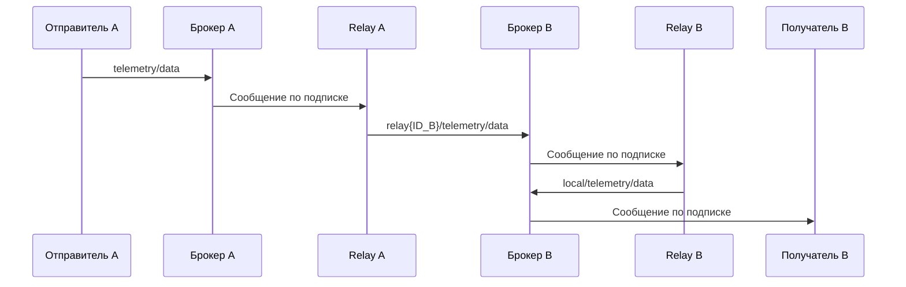

# Как устроен и работает MqttRelay

**MqttRelay переносит сообщения между брокерами:** подписывается на нужные темы у одного брокера и публикует полученные сообщения у других. Здесь описана его реализация **внутри симулятора MqttY**. Все участники такой сети — программные модели; реальные брокеры во время этой симуляции не запускаются.

Место Relay в проекте, ключевые классы и связи с измерителем описаны в [архитектуре](architecture.md). Для автоматической серии используется команда `experiment` приложения `MqttRelay.App`; графический редактор не требуется.

## Зачем он нужен в эксперименте

Сначала мы получаем двойник каждого брокера по натурным измерениям. Затем соединяем двойники через Relay и исследуем, как сообщения проходят через несколько брокеров, очереди и модельные каналы связи.

| Режим | Состав сети | Что исследуем |
| --- | --- | --- |
| Однородная сеть | Несколько двойников одного брокера | Поведение сети с одинаковыми брокерами |
| Смешанная сеть | Двойники разных брокеров | Взаимодействие моделей с разными характеристиками |

В принятой программе используется четыре брокера. Для каждого выполняются 72 однородные сетевые симуляции, затем ещё 72 — для смешанной сети. В сокращённой программе — по 36. Эти запуски не заменяют проверку точности одиночного двойника.

## Из каких частей состоит модель

| Часть | Работа |
| --- | --- |
| Отправитель | Публикует исходные сообщения в своём брокере |
| Двойник брокера | Обрабатывает MQTT с параметрами из калибровочного профиля |
| Relay | Получает сообщения по подписке, выбирает направления и повторно публикует их |
| Получатель — receiver | Подписывается на темы своего брокера и считает получения |
| Модель сети | Задаёт связи, задержки передачи, пропускную способность и очереди |

Relay создаёт собственные MQTT-клиенты для подписок и публикаций. Поэтому число подключений к брокеру больше числа исходных отправителей. В режиме `profileClientCountMode=publishers` точка профиля выбирается по числу отправителей; дополнительные подключения не превращают её в измеренную точку с большим числом клиентов.

## Как проходит одно сообщение

Штатный сценарий публикует сообщения в тему `telemetry/data`. Ниже показан путь от брокера A к получателю брокера B; аналогичные пересылки идут к остальным брокерам.

`ID_B` — внутренний номер брокера B, назначенный построителем модели. Relay B заменяет служебный первый сегмент темы на `local/`. Получатель подписан на исходные темы `telemetry/+` и на пришедшие извне `local/telemetry/+`.

**Почему нет бесконечной пересылки:** в штатной схеме исходящие пересылки слушают `telemetry/+`, а сообщения после приёма получают тему `local/telemetry/...`. Они больше не подходят под исходящий фильтр. Это свойство выбранных маршрутов, а не универсальная защита от циклов в любой пользовательской конфигурации.

Содержимое сообщения сохраняется, а повторная публикация использует QoS полученного сообщения. Каждая пересылка — отдельная MQTT-операция. Подтверждение первоначальной публикации не является общим подтверждением доставки во все брокеры.

## Как задаются маршруты

| Настройка Relay | Смысл |
| --- | --- |
| `ListenTopics` | У каких брокеров и на какие темы подписаться |
| `RelayTopics` | В какие брокеры публиковать и какой префикс темы применять |
| `RouteMap` | Какие направления соответствуют каждой входной подписке |
| `TopicPrefix` | Префикс новой темы |
| `ReplaceRelaySegment` | Удалять ли первый сегмент входной темы перед добавлением префикса |

В штатном построителе каждый брокер пересылает исходные сообщения всем остальным. Сами сетевые связи образуют общий узел с отдельными ветвями к брокерам. `networkLength` задаёт число модельных сетевых участков в ветви; это не количество брокеров и не число повторных публикаций Relay.

## Откуда берутся нагрузка и параметры брокеров

Профиль задаёт поведение двойника для выбранных размера сообщения, QoS и числа отправителей. Для однородной сети используется профиль одного типа, для смешанной — профили всех участвующих типов.

В программе экспериментов исходные публикации распределяются между отправителями по очереди:

- Однородная сеть: суммарная заданная скорость равна четырём скоростям попыток публикации соответствующей калибровочной точки.
- Смешанная сеть: берётся четырёхкратная **минимальная** скорость попыток среди соответствующих точек четырёх профилей.
- При одинаковом числе отправителей у каждого из четырёх брокеров на него приходится четверть внешней заданной нагрузки. Фактическое число завершений может отличаться.

Внутренние пересылки создают дополнительную работу. Поэтому заданная внешняя скорость не равна сумме всех попыток публикации, зарегистрированных брокерами.

В идеальной штатной схеме без потерь одно исходное сообщение вызывает `1 + 2 × (B − 1)` публикаций: одну у своего брокера, затем удалённую публикацию и местную перепубликацию в каждой другой области. Для четырёх брокеров получается семь публикаций. Это оценка по маршрутам, а не гарантированное соотношение наблюдаемых счётчиков при отказах и конечном окне.

Задержки и очереди сети задаются отдельно от профиля брокера. Их происхождение записывается в конфигурации: измерение или допущение. Измерение брокера на одной машине не определяет автоматически параметры физической сети между машинами.

## Кто запускает и как выполняется симуляция

В полной серии контроллер запускает MqttY командой `experiment` с готовой конфигурацией. Сотрудник не запускает каждый Relay вручную.

Один модельный запуск проходит последовательно: **построение сети → подключения → подписки → прогрев → сброс измерительных счётчиков → нагрузка → ожидание оставшихся операций → сохранение результатов**.

MqttY двигает модельное время шагами. При одном и том же seed, версии, профилях и настройках проверяется совпадение научных результатов; реальное время вычислений может различаться. Неудачное подключение, подписка или незавершённая за отведённое время работа фиксируются как ошибка этапа модели.

Для отдельного запуска возьмите сохранённую конфигурацию завершённой точки. Команда повторения приведена в [руководстве](full-campaign-runbook.md#10-как-проверить-повторяемость-mqtty). [Пример конфигурации Relay](../mqtty/doc/examples/mqtt-relay.v3.json) требует подстановки своих путей, профилей и нагрузки; это не готовый результат измерения.

## Что получаем и как это читать

| Файл | Содержание |
| --- | --- |
| `experiment-manifest.json` | Настройки, версии, seed, сведения о профилях и выполненных фазах |
| `summary.json` | Итоговые показатели и статус запуска |
| `counters.json` | Счётчики брокеров и конечных получателей |
| `latency-histogram.json` | Распределение модельных задержек |
| `topology.graphml`, `topology.puml` | Построенная схема сети |

Сумма брокерных RPS включает внутренние пересылки. Она не равна скорости получения уникальных внешних сообщений. Счётчики receivers подтверждают получения в модели, но для проверки уникальной сквозной доставки требуется учёт ID и источника каждого сообщения.

Получения учитываются после сброса счётчиков до конца drain; среди них могут оказаться сообщения прогрева, оставшиеся в пути. Для строгой оценки нужны уникальные пары «исходное сообщение — целевой получатель» и принадлежность сообщения измерительной фазе.

**Результат этапа — показатели и схема модельной сети.** Повторяемость проверяется отдельным повторением тех же настроек и seed; само завершение сетевых запусков с разными seed её не доказывает. Допуски одиночного BrokerFidelity здесь имеют статус `notApplicable`. Чтобы подтвердить точность для настоящей сети, нужно собрать такую сеть, измерить её отдельно и сравнить результаты.

Связанные документы: [показатели](campaign-metrics.md), [этапы и исполнители](campaign-stages.md), [руководство запуска](full-campaign-runbook.md).

Описание сверено с кодом: [пересылка сообщений](../mqtty/src/EntityFX.MqttSimulator/EntityFX.MqttY.Plugin.Mqtt/Application/Mqtt/MqttRelay.cs), [построение маршрутов](../mqtty/src/EntityFX.MqttSimulator/EntityFX.MqttY.Plugin.Mqtt/Helper/MqttNetworkBuilder.cs), [выполнение эксперимента](../mqtty/src/EntityFX.MqttSimulator/EntityFX.MqttY.Plugin.Mqtt/Experiments/MqttRelayExperimentRunner.cs).

Пример завершённого сетевого этапа: [отчёт Aedes](../reports/Aedes.md). Его сетевые счётчики относятся к модели, а не к четырём настоящим удалённым брокерам.
