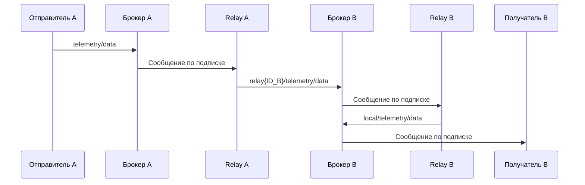
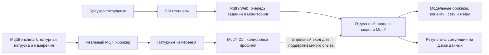

# MqttY: модель, калибровка и режимы симулятора

Объединённый справочник по MqttY: калибровка профилей, Relay, федерация, балансировка подключений и развёртывание Web. Информация из tidligere отдельных файлов `README.md`, `calibration-v3.md`, `mqtt-relay.md`, `federation/README.md`, `load-balancing/README.md`, `web-deployment.md` сохранена без сокращений выводов.

---

## 1. Обзор и роли

MqttY рассчитывает модель брокеров, клиентов и сети. Реальные MQTT-измерения выполняет MqttBenchmark отдельно. Профиль задаёт наблюдаемые ограничения модели и не воспроизводит все внутренние механизмы исходного брокера.

| Задача | Документ / раздел |
|--------|-------------------|
| Построить и проверить профиль | §2 Калибровка v3 |
| Настроить пересылку | §3 MqttRelay |
| Распределить клиентские соединения | §4 Балансировка |
| Редактировать и просматривать граф | §5 Designer |
| Развернуть Web на Linux | §6 Web развёртывание |

Научные границы модели зафиксированы в [контракте сети](../dissertation/network-model-contract.md) и [карте метода](../dissertation/broker-twin-method-map.md). Итоги экспериментов находятся в [отчётах](../../reports/README.md), а не в нескольких параллельных планах новых запусков.

---

## 2. Калибровка v3: raw → observations → calibration

Нужны завершённая кампания MqttBenchmark v3, .NET 6 runtime/SDK и чистые tracked исходники MqttY. Команды одинаковы в Linux/Windows; ниже PowerShell 7. Рабочий каталог — корень mqtty, sibling MqttBenchmark расположен в ../MqttBenchmark.

### 2.1 Проверить и перенести исходные измерения

Для последовательной обработки одного брокера доступен явный `calibrate --broker <Name>`:
требуются все 72 успешных ключа/24 точки этого брокера с тремя повторами.
Без `--broker` сохраняется требование полного набора 288/96.
Single-broker calibration сохраняет schemaVersion3, runCount72 и собственную provenance;
runtime проверяет полную матрицу одного брокера, а не произвольный subset.

Стандартный калибратор требует **288 успешных запусков и ровно 96 точек**, по три повтора:
Aedes/Mosquitto/EMQX/ActiveMQ × 16/256 bytes × QoS 0/1/2 × publishers 1/16/64/128.
Raw не импортируется напрямую. Короткий pilot, 72 запуска одного Mosquitto или сокращённый smoke не дают калибровку четырёх брокеров.

Завершите запись, сохраните campaign manifest, исходные config/stand bytes, все attempts с seals, aggregate, версии кода и инструментов. Перенос архива и проверка SHA-256 описаны в [метриках](../mqtt-benchmark/artifact-format.md). Абсолютные старые пути в manifest — provenance исходного запуска, а не инструкция перезаписать файлы там. Private keys/пароли не переносятся в результаты.

На машине с распакованными результатами выполните aggregate повторно через CLI точной версии MqttBenchmark с исходными config/stand, новым output и чистым benchmark source checkout:

```powershell
# Из корня MqttBenchmark; затем вернуться в mqtty.
dotnet run -c Release --project src/EntityFX.MqttBenchmark.Cli -- aggregate `
  --config config/campaign.local.json --stand config/broker-stand.local.json `
  --raw artifacts/baseline-001 --output artifacts/aggregate-002 --benchmark-repo .
```

Aggregate проверяет покрытие заданного config, identities и sealed files. Для стандартной серии ожидаются runCount=288, points.Count=96. Калибратор затем дополнительно проверяет полную фиксированную матрицу и статистический контракт. Разные CPU/deployment/source/config/stand identities не объединяются. Оригинальные observations сохраняются отдельно от параметров модели.

### 2.2 Выполнить calibrate руками или скриптом

Из корня mqtty, после копирования проверенного observations в выбранный каталог:

```powershell
$Observations = '../MqttBenchmark/artifacts/aggregate-002/broker-observations.v3.json'
Get-FileHash $Observations -Algorithm SHA256
dotnet run -c Release --project src/EntityFX.MqttSimulator/EntityFX.MqttY.MqttRelay.App -- `
  calibrate --observations $Observations --output results/broker-calibration.v3.json `
  --mqtty-repository .
Get-FileHash results/broker-calibration.v3.json -Algorithm SHA256
```

Выход 0: создан новый файл schemaVersion=3, artifactType=broker-calibration, runCount=288, profileClientCountMode=publishers. Выход 1: invalid input, dirty Git или конфликт output. Calibrate не выполняет натурный benchmark. Для повторения выберите новый output, старый не перезаписывается. Ctrl+C прерывает команду; возможный незавершённый файл не используют как готовую калибровку.

Для запуска скриптом используйте [RunSimulation.ps1](../../mqtty/doc/examples/RunSimulation.ps1): с `-ObservationsPath` он вызывает эту же calibrate, генерирует brokerFidelity config выбранной точки и запускает experiment. Если calibration уже есть, задайте `-CalibrationPath` без ObservationsPath. Скрипт не восполняет отсутствующую матрицу и не ослабляет проверки.

Для машины только с runtime предварительно опубликуйте CLI на машине с SDK. Из корня чистого mqtty:

```powershell
dotnet publish src/EntityFX.MqttSimulator/EntityFX.MqttY.MqttRelay.App -c Release -o ../simulator-portable/bin
```

Перенесите **весь** каталог `simulator-portable/bin`, входные JSON и чистые Git checkout обоих проектов. На целевой Linux/Windows-машине нужны .NET6 runtime, Git и PowerShell7. Добавьте к вызову скрипта `-SimulatorCliPath ../simulator-portable/bin/EntityFX.MqttY.MqttRelay.App.dll`; сборка исходников на целевой машине тогда не выполняется. Без этого параметра скрипт использует `dotnet run` и требует SDK. Ручной эквивалент каждого вызова — `dotnet ../simulator-portable/bin/EntityFX.MqttY.MqttRelay.App.dll calibrate ...` или `experiment ...` с теми же аргументами ниже/в [руководстве сетей](https://github.com/EntityFX/mqtty-meta/blob/8b27518e1d206f90d2da4fbac0aa30c542834803/docs/mqtty/network-experiments.md). Ожидаются тот же calibration artifact и новый run bundle; остановка длительного experiment — Ctrl+C, после неё неполный bundle не считается успешным результатом.

### 2.3 Что преобразуется

| Поле calibration | Источник / формула |
|---|---|
| attemptedRps | observations.attemptedRps.mean |
| targetCompletedRps | observations.completedRps.mean |
| targetPublishFailureRate | observations.publishFailureRate.mean |
| rateRejectionRate = r | явное допущение, default 0 |
| capacityRps | attemptedRps × (1−r) |
| conditionalPublishFailureRate | (targetPublishFailureRate−r)/(1−r) |
| conditionalDeliveryLossRate | observations.deliveryLossRate.mean, уже условная среди completed |
| observedLatencyQuantiles | исходные completion knots |
| processingLatencyQuantiles | max(0, observed knot−RTT) для QoS1; −2×RTT для QoS2 |
| rttBaselineMs | наблюдаемый baseline |
| latencyStatus | observed для QoS1/2; notApplicable для QoS0 |

Rate rejection отдельно не измеряется. Default r=0 означает capacity=offered load и отнесение наблюдаемого publish failure к условному gate, а не оценку физического максимума брокера. `--rate-rejection-rate <fraction>` задаёт одно допущение для всех точек; r>target failure или r=1 отклоняются. Фактический RateRejected/Attempted в симуляции зависит также от ticks и bursts; проверяйте exported counters.

Разность квантилей с постоянным RTT — детерминированное приближение, не точная декомпозиция распределений. Queues/ticks/сеть дополнительно влияют на итоговую ACK latency. Mean(completed RPS)/mean(attempted RPS) может отличаться от mean(completion fraction) трёх повторов: сохраняются оба target, ни один не подменяет другой.

**CPU/RSS/disk/NIC не импортируются автоматически.** Они валидируют измерительную установку, но не создают CPU/память/энергетическую модель MqttY. QoS0 не получает выдуманную задержку ACK; его latency поля null.

### 2.4 Строгая проверка и provenance

Вход проверяется на неизвестные/отсутствующие/дублированные поля и точки, finite значения, физические диапазоны, count=3, ordering min/max, Student-t CI95 (df=2) и null QoS0 latency. Допуск mean/min/max на roundoff — восемь binary64 machine epsilons в масштабе сравниваемых величин; calculated mean сохраняется, не clamp. CI может выходить за физический диапазон — это статистический интервал, не параметр модели.

Calibration сохраняет полную observation provenance, SHA-256 **точных bytes observations**, clean MqttY commit и method conditional-failure-rtt-v1. Wall-clock timestamp отсутствует: одинаковые bytes/commit/r воспроизводят одинаковые bytes calibration. Runtime повторно проверяет формулы и RTT-поправки. Hash обнаруживает изменение относительно registry, но не удостоверяет независимую подлинность измерений.

Не заменяйте embedded профиль и working configs. Новый внешний путь задаётся через brokerProfilePath в отдельном экспериментальном JSON. Дальнейшие команды: [сети](https://github.com/EntityFX/mqtty-meta/blob/8b27518e1d206f90d2da4fbac0aa30c542834803/docs/mqtty/network-experiments.md); критерии приемлемости: [валидация](https://github.com/EntityFX/mqtty-meta/blob/8b27518e1d206f90d2da4fbac0aa30c542834803/docs/mqtty/validation.md).

---

## 3. MqttRelay: устройство и работа

**MqttRelay переносит сообщения между брокерами:** подписывается на нужные темы у одного брокера и публикует полученные сообщения у других. Здесь описана его реализация **внутри симулятора MqttY**. Все участники такой сети — программные модели; реальные брокеры во время этой симуляции не запускаются.

Место Relay в проекте, ключевые классы и связи с измерителем описаны в [архитектуре](../overview/architecture.md). Для автоматической серии используется команда `experiment` приложения `MqttRelay.App`; графический редактор не требуется.

### 3.1 Зачем он нужен в эксперименте

Сначала мы получаем двойник каждого брокера по натурным измерениям. Затем соединяем двойники через Relay и исследуем, как сообщения проходят через несколько брокеров, очереди и модельные каналы связи.

| Режим | Состав сети | Что исследуем |
|---|---|---|
| Однородная сеть | Несколько двойников одного брокера | Поведение сети с одинаковыми брокерами |
| Смешанная сеть | Двойники разных брокеров | Взаимодействие моделей с разными характеристиками |

В принятой программе используется четыре брокера. Для каждого выполняются 72 однородные сетевые симуляции, затем ещё 72 — для смешанной сети. В сокращённой программе — по 36. Эти запуски не заменяют проверку точности одиночного двойника.

### 3.2 Из каких частей состоит модель

| Часть | Работа |
|---|---|
| Отправитель | Публикует исходные сообщения в своём брокере |
| Двойник брокера | Обрабатывает MQTT с параметрами из калибровочного профиля |
| Relay | Получает сообщения по подписке, выбирает направления и повторно публикует их |
| Получатель — receiver | Подписывается на темы своего брокера и считает получения |
| Модель сети | Задаёт связи, задержки передачи, пропускную способность и очереди |

Relay создаёт собственные MQTT-клиенты для подписок и публикаций. Поэтому число подключений к брокеру больше числа исходных отправителей. В режиме `profileClientCountMode=publishers` точка профиля выбирается по числу отправителей; дополнительные подключения не превращают её в измеренную точку с большим числом клиентов.

### 3.3 Как проходит одно сообщение

Штатный сценарий публикует сообщения в тему `telemetry/data`. Ниже показан путь от брокера A к получателю брокера B; аналогичные пересылки идут к остальным брокерам.



`ID_B` — внутренний номер брокера B, назначенный построителем модели. Relay B заменяет служебный первый сегмент темы на `local/`. Получатель подписан на исходные темы `telemetry/+` и на пришедшие извне `local/telemetry/+`.

**Почему нет бесконечной пересылки:** в штатной схеме исходящие пересылки слушают `telemetry/+`, а сообщения после приёма получают тему `local/telemetry/...`. Они больше не подходят под исходящий фильтр. Это свойство выбранных маршрутов, а не универсальная защита от циклов в любой пользовательской конфигурации.

Содержимое сообщения сохраняется, а повторная публикация использует QoS полученного сообщения. Каждая пересылка — отдельная MQTT-операция. Подтверждение первоначальной публикации не является общим подтверждением доставки во все брокеры.

### 3.4 Как задаются маршруты

| Настройка Relay | Смысл |
|---|---|
| `ListenTopics` | У каких брокеров и на какие темы подписаться |
| `RelayTopics` | В какие брокеры публиковать и какой префикс темы применять |
| `RouteMap` | Какие направления соответствуют каждой входной подписке |
| `TopicPrefix` | Префикс новой темы |
| `ReplaceRelaySegment` | Удалять ли первый сегмент входной темы перед добавлением префикса |

В штатном построителе каждый брокер пересылает исходные сообщения всем остальным. Сами сетевые связи образуют общий узел с отдельными ветвями к брокерам. `networkLength` задаёт число модельных сетевых участков в ветви; это не количество брокеров и не число повторных публикаций Relay.

### 3.5 Откуда берутся нагрузка и параметры брокеров

Профиль задаёт поведение двойника для выбранных размера сообщения, QoS и числа отправителей. Для однородной сети используется профиль одного типа, для смешанной — профили всех участвующих типов.

В программе экспериментов исходные публикации распределяются между отправителями по очереди:

- Однородная сеть: суммарная заданная скорость равна четырём скоростям попыток публикации соответствующей калибровочной точки.
- Смешанная сеть: берётся четырёхкратная **минимальная** скорость попыток среди соответствующих точек четырёх профилей.
- При одинаковом числе отправителей у каждого из четырёх брокеров на него приходится четверть внешней заданной нагрузки. Фактическое число завершений может отличаться.

Внутренние пересылки создают дополнительную работу. Поэтому заданная внешняя скорость не равна сумме всех попыток публикации, зарегистрированных брокерами.

В идеальной штатной схеме без потерь одно исходное сообщение вызывает `1 + 2 × (B − 1)` публикаций: одну у своего брокера, затем удалённую публикацию и местную перепубликацию в каждой другой области. Для четырёх брокеров получается семь публикаций. Это оценка по маршрутам, а не гарантированное соотношение наблюдаемых счётчиков при отказах и конечном окне.

Задержки и очереди сети задаются отдельно от профиля брокера. Их происхождение записывается в конфигурации: измерение или допущение. Измерение брокера на одной машине не определяет автоматически параметры физической сети между машинами.

### 3.6 Кто запускает и как выполняется симуляция

В полной серии контроллер запускает MqttY командой `experiment` с готовой конфигурацией. Сотрудник не запускает каждый Relay вручную.

Один модельный запуск проходит последовательно: **построение сети → подключения → подписки → прогрев → сброс измерительных счётчиков → нагрузка → ожидание оставшихся операций → сохранение результатов**.

MqttY двигает модельное время шагами. При одном и том же seed, версии, профилях и настройках проверяется совпадение научных результатов; реальное время вычислений может различаться. Неудачное подключение, подписка или незавершённая за отведённое время работа фиксируются как ошибка этапа модели.

Для отдельного запуска возьмите сохранённую конфигурацию завершённой точки. Команда повторения приведена в [руководстве](../mqtt-benchmark/runbook.md#10-как-проверить-повторяемость-mqtty). [Пример конфигурации Relay](../../mqtty/doc/examples/mqtt-relay.v3.json) требует подстановки своих путей, профилей и нагрузки; это не готовый результат измерения.

### 3.7 Что получаем и как это читать

| Файл | Содержание |
|---|---|
| `experiment-manifest.json` | Настройки, версии, seed, сведения о профилях и выполненных фазах |
| `summary.json` | Итоговые показатели и статус запуска |
| `counters.json` | Счётчики брокеров и конечных получателей |
| `latency-histogram.json` | Распределение модельных задержек |
| `topology.graphml`, `topology.puml` | Построенная схема сети |

Сумма брокерных RPS включает внутренние пересылки. Она не равна скорости получения уникальных внешних сообщений. Счётчики receivers подтверждают получения в модели, но для проверки уникальной сквозной доставки требуется учёт ID и источника каждого сообщения.

Получения учитываются после сброса счётчиков до конца drain; среди них могут оказаться сообщения прогрева, оставшиеся в пути. Для строгой оценки нужны уникальные пары «исходное сообщение — целевой получатель» и принадлежность сообщения измерительной фазе.

**Результат этапа — показатели и схема модельной сети.** Повторяемость проверяется отдельным повторением тех же настроек и seed; само завершение сетевых запусков с разными seed её не доказывает. Допуски одиночного BrokerFidelity здесь имеют статус `notApplicable`. Чтобы подтвердить точность для настоящей сети, нужно собрать такую сеть, измерить её отдельно и сравнить результаты.

Связанные документы: [показатели](../mqtt-benchmark/metrics.md), [руководство запуска](../mqtt-benchmark/runbook.md).

Описание сверено с кодом: [пересылка сообщений](../../mqtty/src/EntityFX.MqttSimulator/EntityFX.MqttY.Plugin.Mqtt/Application/Mqtt/MqttRelay.cs), [построение маршрутов](../../mqtty/src/EntityFX.MqttSimulator/EntityFX.MqttY.Plugin.Mqtt/Helper/MqttNetworkBuilder.cs), [выполнение эксперимента](../../mqtty/src/EntityFX.MqttSimulator/EntityFX.MqttY.Plugin.Mqtt/Experiments/MqttRelayExperimentRunner.cs).

Пример завершённого сетевого этапа: [отчёт Aedes](../../reports/mqtt-benchmark/brokers/Aedes.md). Его сетевые счётчики относятся к модели, а не к четырём настоящим удалённым брокерам.

---

## 4. Балансировка подключений

Приложение сравнивает один брокер, заранее распределённый пул, Round Robin и Least Connections. Backend выбирается перед CONNECT и сохраняется до окончания опыта. Нового solution нет: проект включён в существующий `EntityFX.Mqtty.sln`. Старые приложения, протокол и ядро не изменяются.

### 4.1 Кто что делает

| Часть | Обязанность |
|---|---|
| Сотрудник | Выбирает демонстрацию или опыт с профилем, параметры нагрузки и при необходимости диск результата |
| MqttBenchmark и calibrate | Заранее измеряют настоящий брокер и создают профиль; это приложение их не запускает |
| LoadBalancing.App | Проверяет входы, назначает подключения, создаёт сеть, выполняет фазы, сохраняет результаты |
| Ядро MqttY и MQTT plugin | Исполняют модельное время, сетевые очереди и MQTT; дают готовые метрики backend |
| plot_results.py | Читает сохранённые таблицы и строит SVG; не запускает симуляцию |

### 4.2 Демонстрация без конфига и реального профиля

Из корня репозитория **mqtty**:

```text
dotnet run --project src/EntityFX.MqttSimulator/EntityFX.MqttY.LoadBalancing.App -c Release -- demo
dotnet run --project src/EntityFX.MqttSimulator/EntityFX.MqttY.LoadBalancing.App -c Release -- demo --brokers 3 --publishers 10 --mode leastConnections --qos 2
```

Первая команда использует встроенные настройки. Вторая создаёт три идеальных брокера и десять publishers, назначает соединения по Least Connections и выполняет MQTT-обмен с QoS 2. Файлы конфигурации, профили настоящих брокеров и Python не нужны. `dotnet run` при необходимости сначала собирает приложение; после сборки те же аргументы можно передавать непосредственно DLL.

В консоли отображаются две диаграммы: число назначенных publisher-соединений и число уникальных сообщений, полученных receiver каждого брокера. Например, распределение десяти publishers между тремя брокерами:

```text
broker0  [####################] 4
broker1  [###############.....] 3
broker2  [###############.....] 3
```

Длина полосы сравнивается с максимумом в своей диаграмме; точное число стоит справа. Далее выводятся заданная и фактически отправленная нагрузка, goodput, недоставка, p99, получения во время drain и статус. Это результаты симуляции идеального механизма, а не измерения производительности конкретного настоящего брокера. Служебные receivers не участвуют в назначении publishers.

| Аргумент | По умолчанию | Значение |
|---|---|---|
| `--brokers` | 4; для single — 1 | Число backend, от 1 до 64, не больше числа publishers |
| `--mode` | `roundRobin` | `single`, `directBalanced`, `roundRobin`, `leastConnections`; регистр не важен |
| `--publishers` | 64 | Всего отправителей, от 1 до 4096 |
| `--qos` | 1 | QoS публикации и подписки: 0, 1 или 2 |
| `--rps` | 1000 | Общая заданная интенсивность, сообщений/с |
| `--seconds` | 0.1 | Длительность нагрузки в модельных секундах: больше 0 и до 10, шаг 0.0001 |
| `--seed` | 42 | Seed опыта |
| `--output` | Отсутствует | Новый каталог для сохранения полного пакета результатов |

Дробные числа задаются через точку независимо от языка ОС. Прогрев составляет 0.01 модельной секунды, drain — до 1 секунды. Остальные сетевые настройки встроены и одинаковы для режимов. Действуют общие ограничения объёма опыта, описанные ниже; реальное время расчёта зависит от параметров и оборудования.

По умолчанию опыт выполняется в памяти и **не записывает файлы**. Для сохранения и последующего воспроизведения добавьте `--output` с новым путём на диске данных:

```text
dotnet run --project src/EntityFX.MqttSimulator/EntityFX.MqttY.LoadBalancing.App -c Release -- demo --brokers 3 --publishers 10 --mode leastConnections --output /data/mqtt/demo-new
```

В этом каталоге будут сгенерированный конфиг, JSON/CSV, топология, Markdown-отчёт и SHA-256. Повторить опыт можно обычной командой `run --config <result>/run-config.json --output <new-result>`. Для остальных параметров опыта используйте обычный `run` с конфигом. Справка по демонстрации: `demo --help`.

### 4.3 Сборка и проверка механизма

Нужен .NET SDK с возможностью сборки net6.0 и .NET 6 runtime для запуска. Команды ниже выполняются **из корня репозитория mqtty**; путь результата замените новым каталогом на диске данных. В Linux команды dotnet такие же.

```text
dotnet build src/EntityFX.MqttSimulator/EntityFX.MqttY.LoadBalancing.App/EntityFX.MqttY.LoadBalancing.App.csproj -c Release
dotnet src/EntityFX.MqttSimulator/EntityFX.MqttY.LoadBalancing.App/bin/Release/net6.0/EntityFX.MqttY.LoadBalancing.App.dll validate --config doc/examples/load-balancing/ideal.json
dotnet src/EntityFX.MqttSimulator/EntityFX.MqttY.LoadBalancing.App/bin/Release/net6.0/EntityFX.MqttY.LoadBalancing.App.dll matrix --config doc/examples/load-balancing/ideal.json --output /data/mqtt/lb-smoke
dotnet test src/EntityFX.MqttSimulator/EntityFX.Tests.Integration/EntityFX.Tests.Integration.csproj -c Release --filter "TestCategory!=LongRunning"
```

Идеальная матрица: **12 опытов** — четыре режима × три QoS, seed 42. Профили не используются; эти результаты проверяют механизм и учёт, а не точность двойника. `run` вместо `matrix` выполняет один опыт. `validate` только проверяет входы и показывает назначения.

### 4.4 Реальные профили

Путь профиля разрешается относительно JSON конфигурации. При `ideal=false` нужен внешний профиль v3/v4; встроенный старый эталон не используется. Для каждого backend необходима точная измеренная точка `(brokerType, payloadBytes, publishQos, publishersOnBackend)`. Receivers не входят в число publishers. Подмена ближайшим N и интерполяция не допускаются.

Пример одной точки — JSON со следующими полями; сетевые числа являются допущениями опыта:

```json
{
  "schemaVersion": 1,
  "mode": "roundRobin",
  "brokerType": "Aedes",
  "backendCount": 4,
  "ideal": false,
  "brokerProfilePath": "profiles/aedes.json",
  "totalPublishers": 64,
  "payloadBytes": 16,
  "publishQos": 1,
  "subscribeQos": 1,
  "offeredRps": 20179.382680945022,
  "seed": 42,
  "warmupSeconds": 1,
  "measurementSeconds": 2,
  "drainTimeoutSeconds": 5,
  "tickPeriod": "00:00:00.0001000",
  "networkLength": 2,
  "network": {
    "capacityBytesPerSecond": 125000000,
    "throughputWindowTicks": 100,
    "queueCapacity": 100000,
    "transferTicks": 2
  }
}
```

Для профилированной `matrix` вместо одиночного `brokerProfilePath` укажите `brokerProfiles`: четыре объекта с `brokerType`, `brokerProfilePath`, `calibrationObservationsPath`, в порядке Aedes, Mosquitto, ActiveMQ, EMQX. В мета-репозитории готовые примеры с сохранёнными измерениями находятся в `docs/mqtty/examples/load-balancing/`.

Матрица: **144 опыта** = четыре типа × четыре режима × три QoS × seeds 42/43/44. Payload 16 байт; 64 publishers на single либо по 16 на каждом из четырёх backend. Общая offeredRps берётся из средней attemptedRps калибровочной точки N=64 и одинакова для четырёх режимов. SHA observations проверяется по provenance профиля; контрольные измерения для выбора нагрузки не используются. Длительности и фиксированная сеть берутся из конфигурации; последовательно обновляются и граф, и опыты. Реальное время расчёта зависит от оборудования и трафика; модельные секунды не равны реальным.

Проверяется совпадение commits источников, CPU/deployment modes, протокола покрытия и метода калибровки четырёх профилей. Это необходимая проверка совместимости; она сама по себе не доказывает равенство аппаратных условий. Исходные campaign identities сохраняются раздельно. Защита v1 ограничивает один опыт миллионом запланированных публикаций, 4096 publishers, 64 backend и 1024 сетевыми участками backend; payload разрешён только 16 или 256 байт. Это ограничения входов, а не гарантия потребления RSS; перед большим опытом всё равно нужен pilot.

### 4.5 Что сохраняется и как повторить

Команды `run`, `matrix` и `demo --output` пишут отдельный новый каталог: `summary.json`, `manifest.json`, `inputs/`, переносимый `run-config.json`, `assignments.csv`, `backend-metrics.csv`, `histograms.json`, `phases.json`, `topology.graphml`, `topology.puml`, `report.md`, `sha256.json`. Матрица также сохраняет `matrix-summary.json` после каждого опыта. Ошибки подключения, подписки и drain содержат причину и частичные данные. Существующий каталог не перезаписывается. Обычный `demo` работает без записи на диск; при отказе причина видна в консоли.

Для повторения укажите `run --config <result>/run-config.json --output <new-result>`. Профиль читается из сохранённого snapshot. Сравнивайте `summary.json`: служебные сведения о компьютере, commit и бинарях вынесены в manifest. Одинаковые входы, сборка и seed должны давать одинаковый научный summary. Хэши подтверждают целостность сохранённых файлов; независимая проверка требует повторения расчёта.

Графики строятся отдельно стандартным Matplotlib:

```text
python -m pip install matplotlib
python doc/examples/load-balancing/plot_results.py /data/mqtt/lb-smoke
```

Скрипт строит графики backend из CSV. Для матрицы он также создаёт `comparison.csv` и графики по типам; столбец — среднее, точки — отдельные seeds. Это описание разброса, а не доверительный интервал. После добавления SVG скрипт обновляет реестры SHA-256.

### 4.6 Метрики и ограничения

- `scheduledPublishes` — заданное расписание; `apiAttempts` — вызовы Publish; `sendRejected` — немедленные отказы метода. Разность scheduled−apiAttempts отражает непереданную нагрузку при ограничении подачи. Для QoS 1/2 один publisher ждёт завершения предыдущего обмена; исчезновение pending не считается само по себе доказательством успеха.
- Слоты подачи распределены поровну между publishers с сохранением общей дробной части интенсивности. У каждого собственный ограниченный запас слотов: `ceil(offeredRps × tickSeconds / publishers) + 1`. Занятый publisher не передаёт нагрузку свободному. Остаток и вытесненные слоты входят в scheduled−apiAttempts. Указанная доля offeredRps backend — план, а фактические попытки и получения показаны отдельно.
- `backendCompletedRps` — завершения backend / длительность measurement. `uniqueGoodput` — уникально полученные измерительные ID / ту же длительность. Поздние завершения и доставки в drain входят в когорту и показаны отдельно. Прогрев исключён.
- `attemptDeliveryLoss = 1−uniqueReceived/apiAttempts`; backend failure = `(rateRejected+publishFailed)/attempted`; backend loss = `1−delivered/expectedDeliveries`. Эти знаменатели различаются; нельзя смешивать показатели. Нулевой знаменатель даёт null/notApplicable.
- p50/p95/p99 завершения — объединённая гистограмма backend, а не среднее их p99; QoS 0 ACK latency неприменима. Receiver latency измеряется от вызова Publish до первого корректного получения ID.
- Один receiver подключён напрямую к каждому backend. Независимые брокеры **не объединяют подписки**. Результат относится к сумме локальных доставок, а не к единому кластерному подписчику.
- Моделируется выбор соединения, без стоимости TCP proxy, health checks, failover, миграции сессий и ресурсов CPU/RSS. Транспорт фиксирован; специальный EmpiricalServiceBudget одиночного BrokerFidelity не переносится на пул. Это исследовательская модель; её точность для настоящего балансировщика не подтверждена натурным эталоном.
- В постоянных одинаковых сессиях DirectBalanced, Round Robin и Least Connections имеют одинаковые назначения. Они должны давать одинаковый результат при одинаковых прочих условиях. Увеличение числа брокеров само по себе не доказывает преимущество алгоритма.

Коды завершения: 0 — предусмотренные фазы завершены; 1 — неверные входы; 2 — техническая ошибка опыта. Код 0 не означает прохождение проверки натурной точности.

### 4.7 Разделение кода

`ConnectionPolicies` только назначает backend; `LoadBalancingOptions` проверяет параметры; `ExperimentInput` загружает и фиксирует входные байты; `LoadBalancingTopologyBuilder` строит сеть через публичный builder; `LoadBalancingExperimentRunner` управляет фазами; `DeliveryLedger` различает уникальные ID, прогрев, дубликаты и неверного получателя; `ExperimentResultWriter` пишет артефакты и формулы отчёта. Новых слоёв ядра, DI-контейнера и отдельного framework политик не требуется.

`Cli/DemoCommandOptions` разбирает аргументы демонстрации и создаёт идеальный опыт; `Results/DemoConsoleView` отображает его числа и полосы. Демо использует тот же runner; `RunInMemory` отключает только экспорт файлов, сохраняя модель и правила учёта.

Каждый объявленный тип находится в отдельном файле. Каталоги отражают обязанности:

```text
Cli/            разбор команд
Configuration/  настройки опыта, сети и путей профилей
Inputs/         чтение и проверка неизменяемых снимков входов
Policies/       режимы и назначение соединений
Topology/       граф, клиенты и создание backend через публичный builder
Execution/      подготовленный опыт и управление фазами
Delivery/       реестр сообщений и снимки учёта доставок
Results/        типы результатов, экспорт и реестр целостности
Program.cs      точка входа
```

---

## 5. Статическая федерация брокеров

Приложение сравнивает централизованную доставку, заранее настроенный MqttRelay и статическую федерацию. Все результаты получаются симуляцией: настоящие брокеры здесь не запускаются. Проект входит в существующий solution; ядро MQTT сохраняет прежнее поведение.

### 5.1 Ответственность приложений

| Компонент | Что делает |
|---|---|
| Сотрудник | Выбирает сеть, нагрузку, модель брокера и каталог результатов |
| MqttBenchmark и calibrate | Заранее измеряют настоящий брокер и создают профиль; это приложение их не вызывает |
| Federation.App | Проверяет входы, строит сеть, запускает фазы и сохраняет доказательства |
| Ядро MqttY и MQTT-плагин | Исполняют модельное время, MQTT-обмен, сетевые очереди и ограничения профиля |
| StaticFederator | Через MQTT принимает публикации, подавляет повторы и пересылает соседям |
| MqttRelay | В режиме relay связывает каждый брокер со всеми остальными; принятые извне сообщения доставляет только локально |
| Python-сценарий исследования | Запускает готовое приложение, независимо проверяет журналы и строит сравнительный отчёт |

### 5.2 Запуск без конфига

Нужны .NET SDK с поддержкой сборки net6.0 и .NET 6 runtime. Из корня репозитория **mqtty**:

```text
dotnet run --project src/EntityFX.MqttSimulator/EntityFX.MqttY.Federation.App -c Release -- demo
dotnet run --project src/EntityFX.MqttSimulator/EntityFX.MqttY.Federation.App -c Release -- demo --brokers 3 --topology ring --mode relay --publishers 12 --qos 2
```

Демо не требует профиля, конфига или Python. По умолчанию: три площадки, кольцо, 12 publishers, по одному subscriber на площадке, QoS 1, 1000 исходных публикаций/с, payload 16 байт, seed 42. Прогрев — 0,01 с, нагрузка — 0,2 с, drain — до 1 модельной секунды, tick — 0,1 мс. После прогрева ожидается завершение его обменов до начала измерения.

Аргументы: `--brokers`, `--publishers`, `--topology line|ring|star`, `--mode single|relay|federation`, `--qos 0|1|2`, `--rps`, `--seconds`, `--seed`, `--output`. Дроби вводятся через точку. Без `--output` файлы не создаются. Консоль показывает связи, доставки каждому subscriber, исходные завершения, недоставку и повторы. Для сохранения добавьте `--output <новый-каталог-на-диске-данных>`.

### 5.3 Десять брокеров с промежуточным сетевым узлом

```text
dotnet run --project src/EntityFX.MqttSimulator/EntityFX.MqttY.Federation.App -c Release -- demo --brokers 10 --publishers 160 --topology star --mode relay --qos 1 --seed 42
```

`star` создаёт десять площадок с брокерами и дополнительную сеть `transit` без брокера, клиентов и приложений. Каждая площадка связана только с `transit`: межплощадочный путь имеет вид `siteA → transit → siteB`. Пакеты проходят обычные модельные очереди, ограничения пропускной способности и задержки всех трёх сетей. У `transit` те же сетевые параметры, что у площадок; это общий ограничиваемый ресурс, а не идеальная мгновенная связь. Отказоустойчивость этой схемы не проверяется.

В Relay остаются 90 направленных MQTT-связей «каждый с каждым», экспортируется только собственный исходный поток. Физическая звезда не заменяет полносвязную логическую схему. SVG физической сети показывает промежуточный узел, SVG логической сети — матрицу направлений, Mermaid содержит все связи. Готовый JSON: `doc/examples/federation/relay-star-10.json`.

При сохранении `star` дополнительно записывается `network-evidence.json`: маршруты, полученные от PathFinder, наличие конечных устройств у транзита и счётчики его пакетов/байтов. Разность снимков до нагрузки и после drain исключает соединения, подписки и прогрев. `Refused` — число отказов приёма в сетевую очередь, а не доказанная потеря сообщения: транспорт может отложить пакет и повторить попытку.

`single` на той же физической звезде оставляет один брокер на площадке 0. В режиме `federation` все брокеры общего транзитного сегмента образуют полносвязную логическую сеть федераторов с подавлением повторов. Транзитный узел не выполняет MQTT-пересылку ни в одном режиме.

Для профиля Mosquitto 160 publishers дают точную точку N=16 на каждом из десяти распределённых брокеров. Дополнительные служебные клиенты и fanout остаются вне калибровки. Для `single` требуется N=160; без такой точки тот же профиль не разрешает запуск. Отсутствующие точки не заменяются соседними.

### 5.4 Как работают режимы

- `single`: единственный брокер на площадке 0; все клиенты подключаются к нему, оставаясь на своих физических площадках. Исходная публикация идёт сразу в тему доставляемых данных.
- `relay`: брокер и один существующий MqttRelay на каждой площадке. Каждый брокер отправляет свои исходные сообщения напрямую всем остальным брокерам через модельные MQTT-соединения. Полученные извне сообщения передаются только локальным subscribers и не пересылаются другим брокерам. Для N брокеров настроено N × (N−1) направлений между брокерами. Физическая сеть задаётся отдельно: line, ring, star или custom; логическое соединение может проходить через несколько физических участков. Темы input, routing и delivered разделяют исходный поток, импорт и доставку, поэтому повторной рассылки и циклов обработки нет.
- `federation`: брокер и федератор на каждой площадке. Первое получение пары «источник, последовательный номер» вызывает локальную доставку и пересылку соседям, кроме отправителя. Повтор подавляется до доставки. В кольце возможны повторные межброкерные получения; они показаны отдельным счётчиком.

Межброкерная связь выполняется обычными модельными MQTT-клиентами: она потребляет пропускную способность, проходит очереди и MQTT-подтверждения. Нет мгновенной передачи данных между объектами брокеров.

Тематические пространства разделены: `federation/input/<источник>` — исходные сообщения; `federation/routing/...` — пересылка; `federation/delivered/<источник>` — доставки subscribers. Payload сохраняется побайтно. Служебные поля федерации размещены в теме; её длина учитывается модельным транспортом. Исследовательский payload содержит ID и tick исходной публикации; реестр отдельно хранит источник и его последовательный номер.

Кэш ID не очищается до конца ограниченного опыта. Конфигурация заранее проверяет, что он вместит всю заданную нагрузку вместе с прогревом. Очереди отправки ограничены; переполнения и исчерпания числа переходов считаются явно. У каждого исходного publisher собственные слоты подачи: занятый клиент не передаёт нагрузку свободному. Ошибки исходного Publish не считаются успешными завершениями.

### 5.5 Запуск по конфигурации

```text
dotnet build src/EntityFX.MqttSimulator/EntityFX.MqttY.Federation.App -c Release
dotnet src/EntityFX.MqttSimulator/EntityFX.MqttY.Federation.App/bin/Release/net6.0/EntityFX.MqttY.Federation.App.dll validate --config doc/examples/federation/ideal.json
dotnet src/EntityFX.MqttSimulator/EntityFX.MqttY.Federation.App/bin/Release/net6.0/EntityFX.MqttY.Federation.App.dll run --config doc/examples/federation/ideal.json --output /data/mqtt/federation-new
```

Путь `/data/mqtt/federation-new` замените новым каталогом своего диска данных; на Windows можно указать путь с буквой диска. `validate` не запускает модель. `matrix` вместо `run` выполняет **27 опытов**: три режима × QoS 0/1/2 × seeds 42/43/44, сохраняя остальные условия конфига. Входной профиль читается один раз для всей матрицы.

Для произвольной связной сети укажите `topology: "custom"` и `links: [{"a":0,"b":1}, ...]`. Связи двусторонние, без петель и дублей. Площадок — от 1 до 16; publishers — от числа площадок до 4096. `receiverSites` задаёт площадки subscribers: по одному на выбранной площадке; пустой массив разрешён. По умолчанию они есть везде. `hopLimit` по умолчанию равен числу площадок; `queueCapacity` — 1024, `cacheCapacity` — 100000. Ограничение программы — не более 100000 запланированных публикаций вместе с прогревом и миллиона ожидаемых доставок. Эти пределы не гарантируют конкретный RSS. Перед записью CLI требует не менее 5 ГиБ свободного места.

Для профиля: `ideal: false`, `brokerType: "Mosquitto"`, `brokerProfilePath: "<путь>"`. Путь разрешается относительно конфига. Принимается внешний профиль v3/v4 с точными наблюдавшимися точками payload/QoS/числа исходных publishers на брокере; подмена ближайшей точкой запрещена. Receiver и федератор не включены в этот индекс. Поэтому профиль не подтверждает точность обработки дополнительной пересылки и fanout. Пример мета-репозитория использует четыре площадки и 64 publishers: N=64 в single, N=16 в остальных режимах. Транспорт фиксирован, специальный EmpiricalServiceBudget одиночного BrokerFidelity не применяется.

### 5.6 Результаты и формулы

Сохраняются `summary.json`, `manifest.json`, `inputs`, переносимый `run-config.json`, `sources.csv`, `receivers.csv`, `publications.json`, `delivery-receipts.json`, `transmissions.json`, гистограммы, фазы, GraphML, SVG/Mermaid физической и логической топологии, `report.md`, `sha256.json`. Диаграммы проверяют реальные площадки, связи и размещение исходных клиентов по GraphML. Логическая схема показывает MQTT-соединения; их пакеты могут проходить несколько физических связей. В метриках пересылки считается сумма байтов темы UTF-8 и payload, без заголовков MQTT/сети; сам симулятор передаёт полные сериализованные пакеты.

| Метрика | Определение |
|---|---|
| Source completed RPS | Завершения только исходных publishers / длительность нагрузки; сумма всех завершений брокеров сюда не входит |
| Unique goodput | Уникальные пары «ID, subscriber» / ту же длительность; при нескольких subscribers может превышать RPS исходных сообщений |
| Ожидаемые доставки | Число вызовов исходного Publish × число subscribers; немедленные отказы входят в знаменатель |
| Delivery loss | 1 − уникальные доставки / ожидаемые доставки; без subscribers неприменима |
| Полная доставка публикации | Число исходных ID, полученных всеми ожидаемыми subscribers; без subscribers неприменима |
| Backpressure | Запланированные слоты − вызовы Publish |
| p50/p95/p99 получения | От вызова исходного Publish до первого получения данным subscriber; объединённая гистограмма уникальных пар |
| p50/p95/p99 ACK | По исходным publishers для QoS 1/2; для QoS 0 неприменимы |

Поздние завершения и получения в drain входят в исходную измерительную когорту; они также выделены отдельными числами. Прогрев исключён по ID. Нулевой знаменатель даёт null/notApplicable. Статус `completed` означает техническое завершение фаз, а не отсутствие потерь.

Повтор: `run --config <результат>/run-config.json --output <новый-результат>`. Сравнивать нужно байты `summary.json`; сведения о компьютере и бинарях находятся в manifest. Старый каталог не перезаписывается. При техническом отказе сохраняются причина и доступные частичные данные. Хэши подтверждают целостность; проверяемость обеспечивается сохранёнными журналами и повторным расчётом.

### 5.7 Границы научного вывода

Это **статическая исследовательская федерация**, а не воспроизведение самоорганизующегося протокола Ribas–Spohn. В статье используются объявления ядра, членства, beacons и MQTT 5 No Local. Здесь связи заданы заранее, а разделение тем требует соответствующего соглашения с клиентами. Источник: https://thescipub.com/pdf/jcssp.2022.687.694.pdf.

Не моделируются выбор ядра, обнаружение соседей, перестроение после отказа, стоимость CPU/RSS, безопасность и EST. Приёмочная короткая матрица проверяет механизм, не стационарную производительность или натурную точность федерации. Высокая потеря в исходном профиле переносится в расчёт; она не доказывает ту же потерю у настоящего брокера при новой нагрузке. Сравнение с single сохраняет географию клиентов, но меняет число брокеров и обработок публикации — это сравнение архитектур, а не изолированной стоимости одного алгоритма.

Проверки: `dotnet test src/EntityFX.MqttSimulator/EntityFX.Tests.Integration -c Release --filter "TestCategory!=LongRunning"`.

Код разделён по обязанностям: Configuration и Inputs проверяют параметры и snapshot; Topology строит сеть; Federation задаёт политики и конечную пересылку; Execution управляет фазами; Delivery учитывает уникальные пары и первичные журналы; Results экспортирует числа и схемы; Cli разбирает команды. Поддержка исходных publisher-счётчиков включается отдельно; старые агрегаты брокера не меняют формат. Расширение MqttRelay `TargetTopic` необязательно: без него действуют прежние правила префиксов.

---

## 6. Развёртывание MqttY.Web на Linux

MqttY.Web позволяет настроить модель в браузере, запустить её отдельным процессом и увидеть состояние задания. Это интерфейс к симулятору MqttY. Реальные брокеры и натурные MQTT-измерения запускает MqttBenchmark отдельно от веб-приложения.



CPU и RSS веб-сервера или дочернего процесса показывают затраты расчёта. Это не оценка CPU и памяти реального брокера. Профиль калибровки и научные результаты прежних кампаний при развёртывании не меняются.

### 6.1 Что требуется

- Linux x64, Python 3 и пользовательский systemd.
- .NET 8 Runtime и ASP.NET Core Runtime для framework-dependent сборки. Наличие проверяют командой `dotnet --list-runtimes`. Если их нет, следует опубликовать отдельную self-contained сборку и явно адаптировать команду запуска: данный помощник запускает `/bin/dotnet`.
- Отдельный смонтированный диск с каталогом для релизов, результатов и журналов; свободно не менее 10 ГиБ сверх потребностей приложения.
- SSH-доступ к владельцу службы. Административные права не нужны.

Веб-приложение не имеет системы учётных записей. Служба слушает только `127.0.0.1:5088`; доступ с рабочего места идёт через SSH. Не следует открывать порт в локальную сеть.

### 6.2 Опубликовать зафиксированную версию

Сначала завершите проверку приложения, сохраните его исходники коммитом и убедитесь, что дерево MqttY чистое. Публикация должна включать зависимости рабочих движков.

```powershell
dotnet publish mqtty/src/EntityFX.MqttSimulator/EntityFX.MqttY.Web.App/EntityFX.MqttY.Web.App.csproj -c Release --self-contained false -p:UseAppHost=false -o <payload>
python tools/web/linux_web_host.py manifest --payload <payload> --mqtty-commit <полный-SHA-коммита-MqttY> --output <payload-manifest.json>
```

Это переносимая framework-dependent публикация: Linux запускает управляемый DLL через установленный .NET, apphost не нужен. Публикация с RID `linux-x64` в проверенной версии SDK столкнулась с `NETSDK1151` у транзитивных исполняемых проектов на .NET 6; переносимая сборка обходит эту упаковочную проблему без изменения движков.

Manifest перечисляет SHA-256 каждого опубликованного файла и указанный коммит. Он подтверждает целостность доставленной сборки; соответствие сборки коммиту обеспечивается также сохранением команды публикации и чистого исходного дерева.

Передайте каталог `<payload>`, manifest и `tools/web/linux_web_host.py` через SCP в новый входной каталог на диске данных. Не передавайте архивы в Git. Определите на Linux переменные:

```bash
evidence_mount=<точка-монтирования-диска>
web_root="$evidence_mount/mqtty-web"
incoming=<новый-каталог-с-переданной-сборкой>
```

### 6.3 Создать отдельный релиз

```bash
python3 "$incoming/linux_web_host.py" stage --payload "$incoming/payload" --manifest "$incoming/payload-manifest.json" --mount "$evidence_mount" --root "$web_root"
```

Команда вернёт абсолютный путь нового релиза. Запишите его в `release_dir`. Имя релиза вычисляется из хэшей файлов. Помощник проверяет mount, свободное место, границы каталога, полный состав файлов и отсутствие символьных ссылок. Код копируется в отдельный каталог с правами только для чтения; готовый релиз не перезаписывается. При сбое остаётся неполная копия с признаком отказа для расследования.

Данные хранятся отдельно: `$web_root/data`. Поэтому остановка службы или установка новой версии не требует удаления результатов.

Без внешних файлов доступен пресет `ideal-demo`. Для реальных двойников отдельно скопируйте проверенные профили в `data/profiles/<Broker>/broker-calibration.v3.json`, где `<Broker>` — `Aedes`, `Mosquitto`, `ActiveMQ` или `EMQX`. Сохраните SHA-256 исходника и копии. Приложение создаёт снимок профиля по содержимому и строго выбирает точку; отсутствие файла или точки не заменяется идеальным брокером. Само наличие профиля не подтверждает точность сети за пределами исходной калибровки.

### 6.4 Подготовить службу и запустить

Создавать unit следует только после проверки, что служба с этим именем отсутствует либо остановлена намеренно. Помощник сам не вызывает `restart`.

```bash
release_dir=<путь-из-stage>
mkdir -p "$HOME/.config/systemd/user"
python3 "$release_dir/linux_web_host.py" unit --release "$release_dir" --mount "$evidence_mount" --root "$web_root" > "$HOME/.config/systemd/user/mqtty-web.service"
systemctl --user daemon-reload
systemctl --user start mqtty-web.service
systemctl --user show mqtty-web.service -p MainPID -p ActiveState -p SubState -p Result -p MemoryCurrent -p MemoryPeak
```

Настройки службы: одно задание одновременно, исполнение отдельным процессом, обычный предел задания две минуты, cgroup `MemoryMax=2G`, без swap, `CPUQuota=150%`. Через настройки интерфейса предел параллельных заданий не увеличивается выше одного. Эти значения ограничивают сервер расчётов; модельное время задаётся конфигурацией опыта. Процессам доступны собственные результаты и временные файлы на диске данных. Остановка затрагивает только процессы этой службы. Автоматического перезапуска нет: причина сбоя должна быть проверена до новой попытки.

Перед запуском служба проверяет mount через `mountpoint`; приложение дополнительно получает `MqttYWeb__RequiredMountPoint` и резерв 10 ГиБ, которые проверяет до приёма задания и чтения профилей.

Служба запускается на текущую сессию user systemd. Для работы после выхода из всех сеансов нужно заранее проверить `loginctl show-user "$USER" -p Linger`; настройка linger зависит от политики ОС и в этот помощник не входит.

### 6.5 Проверить доступ и мониторинг

На Linux:

```bash
python3 "$release_dir/linux_web_host.py" health
cat "$web_root/data/monitoring/latest.json"
```

На рабочем месте:

```text
ssh -N -L 5088:127.0.0.1:5088 <пользователь>@<Linux-хост>
```

Откройте `http://127.0.0.1:5088`. Проверка HTTP сама по себе не доказывает корректность симуляции: дополнительно выполните короткое задание, убедитесь в его конечном состоянии и наличии научного результата, manifest и данных доставки. Сохраняйте идентификатор задания и причину отказа.

Ограниченная проверка трёх движков запускается на Linux: `python3 smoke_web.py --output <новый-каталог-проверки> --data-root "$web_root/data"`. Для двойника добавьте `--profile Mosquitto`, при необходимости `--qos 0`. Помощник проверяет все файлы по seals и совпадение HTTP-summary с файлом на диске. Он сохраняет неудовлетворительные показатели доставки; статус `Completed` означает завершение расчёта, а не принятие научных критериев. Это короткая проверка развёртывания, не серия измерений точности.

Помощник раз в десять секунд сохраняет один текущий снимок: PID веб-процесса, фактический RSS, ответ `/healthz`, объём данных и свободное место. Это ограниченный мониторинг службы, не новая кампания измерений. Три неудачные проверки HTTP после первой минуты останавливают принадлежащие службе процессы и сохраняют причину. Исчезновение mount, остаток менее 10 ГиБ или более 5 ГиБ данных также останавливают расчёты. При исчезновении mount запись на системный диск запрещена.

Вывод приложения ограничен четырьмя файлами не более 5 МиБ каждый: `data/logs/web.log` и три предыдущих файла. Научные результаты автоматически не удаляются. Краткие ошибки самого помощника доступны через `journalctl --user -u mqttp-web.service`; systemd ограничивает частоту их записи.

### 6.6 Завершение и обновление

```bash
systemctl --user stop mqtttp-web.service
```

Сначала убедитесь, что задания завершены либо остановлены с сохранённой причиной. Для новой версии повторите публикацию и stage в новый релиз, затем смените путь в unit и запускайте службу после проверки остановленного состояния. Прежний релиз, данные, профили и evidence остаются на месте. Служба не восстанавливает научную кампанию с нуля.

Тесты помощника: `python -m unittest discover -s tools/web -v`. Они проверяют отказ при отсутствующем mount, выходе за каталог, нехватке места и подмене payload; неизменяемость релиза, границы журналов и запрет внешних HTTP-проверок.

---

## 7. MqttY Designer — Функциональные возможности приложения

**MqttY Designer** — десктопное приложение на Avalonia UI для визуального конструирования симулируемых сетей на движке MqttY. Приложение позволяет создавать, редактировать, сохранять и загружать конфигурации сетей, запускать симуляцию и просматривать мониторинг в реальном времени.

**Целевая платформа:** .NET 8, Avalonia UI 11.1.3
**Архитектура:** MVVM с использованием ReactiveUI
**DI-контейнер:** Microsoft.Extensions.DependencyInjection

### 7.1 Основные функции

**Визуальный редактор графа сети** — компонент `NetworkGraphCanvas` — кастомный Avalonia Control, наследующий от `Control`.

**Отображаемые элементы:**
- Network (сеть) — Прямоугольник с закруглёнными углами, Голубой (#4A90D9), 140×70
- Server (сервер) — Прямоугольник, Синий (#2196F3), 120×60
- Client (клиент) — Эллипс, Зелёный (#4CAF50), 120×60
- Application (приложение) — Прямоугольник, Оранжевый (#FF9800), 120×60
- Link (связь) — Линия со стрелкой, Серый с подписью веса
- Connection (подключение) — Пунктирная линия от узла к сети, Серый

**Взаимодействие:** Клик (выбор элемента), Drag-and-drop (перемещение), Колёсико мыши (зум), Контекстное меню (правый клик), Двойной клик (редактор свойств).

### 7.2 Сервисный слой

| Сервис | Интерфейс | Назначение |
|---|---|---|
| `ConfigurationService` | `IConfigurationService` | Загрузка/сохранение JSON |
| `GraphLayoutService` | `IGraphLayoutService` | 4 алгоритма расстановки |
| `SimulationService` | — | Управление симуляцией MqttY |
| `GraphMLImporterService` | — | Импорт GraphML |
| `DialogService` | `IDialogService` | Отображение диалоговых окон |

### 7.3 Поток данных при запуске симуляции

`User → Canvas → NetworkEditorVM → SimulationVM → SimulationService → MqttY Engine`

Построение сети → подключения → подписки → прогрев → сброс измерительных счётчиков → нагрузка → ожидание оставшихся операций → сохранение результатов.

### 7.4 Ограничения и заметки

- Максимум логов: 1000 записей (кольцевой буфер)
- Диапазон зума: 0.1x — 5.0x
- Force-Directed: 100 итераций, фиксированный seed (42) для воспроизводимости
- Сборка: .NET 8 для Designer, .NET 6 для MqttY Core

---

## Связанные документы

- [Контракт измерений](../overview/measurement-contract.md)
- [Контракт сети](../dissertation/network-model-contract.md)
- [Карта метода двойника](../dissertation/broker-twin-method-map.md)
- [Метрики эксперимента](../mqtt-benchmark/metrics.md)
- [План завершения](../plans/completion.md)
- [Принятые результаты](../../reports/README.md)