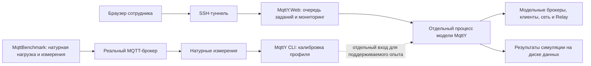

# Развёртывание MqttY.Web на Linux

MqttY.Web позволяет настроить модель в браузере, запустить её отдельным процессом и увидеть состояние задания. Это интерфейс к симулятору MqttY. Реальные брокеры и натурные MQTT-измерения запускает MqttBenchmark отдельно от веб-приложения.



CPU и RSS веб-сервера или дочернего процесса показывают затраты расчёта. Это не оценка CPU и памяти реального брокера. Профиль калибровки и научные результаты прежних кампаний при развёртывании не меняются.

## Что требуется

- Linux x64, Python 3 и пользовательский systemd.
- .NET 8 Runtime и ASP.NET Core Runtime для framework-dependent сборки. Наличие проверяют командой `dotnet --list-runtimes`. Если их нет, следует опубликовать отдельную self-contained сборку и явно адаптировать команду запуска: данный помощник запускает `/bin/dotnet`.
- Отдельный смонтированный диск с каталогом для релизов, результатов и журналов; свободно не менее 10 ГиБ сверх потребностей приложения.
- SSH-доступ к владельцу службы. Административные права не нужны.

Веб-приложение не имеет системы учётных записей. Служба слушает только `127.0.0.1:5088`; доступ с рабочего места идёт через SSH. Не следует открывать порт в локальную сеть.

## 1. Опубликовать зафиксированную версию

Сначала завершите проверку приложения, сохраните его исходники коммитом и убедитесь, что дерево MqttY чистое. Публикация должна включать зависимости рабочих движков.

```powershell
dotnet publish mqtty/src/EntityFX.MqttSimulator/EntityFX.MqttY.Web.App/EntityFX.MqttY.Web.App.csproj -c Release --self-contained false -p:UseAppHost=false -o <payload>
python tools/web/linux_web_host.py manifest --payload <payload> --mqtty-commit <полный-SHA-коммита-MqttY> --output <payload-manifest.json>
```

Это переносимая framework-dependent публикация: Linux запускает управляемый DLL через установленный .NET, apphost не нужен. Публикация с RID `linux-x64` в проверенной версии SDK столкнулась с `NETSDK1151` у транзитивных исполняемых проектов на .NET 6; переносимая сборка обходит эту упаковочную проблему без изменения движков.

Manifest перечисляет SHA-256 каждого опубликованного файла и указанный коммит. Он подтверждает целостность доставленной сборки; соответствие сборки коммиту обеспечивается также сохранением команды публикации и чистого исходного дерева.

Передайте каталог `<payload>`, manifest и `tools/web/linux_web_host.py` через SCP в новый входной каталог на диске данных. Не передавайте архивы в Git. Определите на Linux переменные:

```bash
evidence_mount=<точка-монтирования-диска>
web_root="$evidence_mount/mqtty-web"
incoming=<новый-каталог-с-переданной-сборкой>
```

## 2. Создать отдельный релиз

```bash
python3 "$incoming/linux_web_host.py" stage --payload "$incoming/payload" --manifest "$incoming/payload-manifest.json" --mount "$evidence_mount" --root "$web_root"
```

Команда вернёт абсолютный путь нового релиза. Запишите его в `release_dir`. Имя релиза вычисляется из хэшей файлов. Помощник проверяет mount, свободное место, границы каталога, полный состав файлов и отсутствие символьных ссылок. Код копируется в отдельный каталог с правами только для чтения; готовый релиз не перезаписывается. При сбое остаётся неполная копия с признаком отказа для расследования.

Данные хранятся отдельно: `$web_root/data`. Поэтому остановка службы или установка новой версии не требует удаления результатов.

Без внешних файлов доступен пресет `ideal-demo`. Для реальных двойников отдельно скопируйте проверенные профили в `data/profiles/<Broker>/broker-calibration.v3.json`, где `<Broker>` — `Aedes`, `Mosquitto`, `ActiveMQ` или `EMQX`. Сохраните SHA-256 исходника и копии. Приложение создаёт снимок профиля по содержимому и строго выбирает точку; отсутствие файла или точки не заменяется идеальным брокером. Само наличие профиля не подтверждает точность сети за пределами исходной калибровки.

## 3. Подготовить службу и запустить

Создавать unit следует только после проверки, что служба с этим именем отсутствует либо остановлена намеренно. Помощник сам не вызывает `restart`.

```bash
release_dir=<путь-из-stage>
mkdir -p "$HOME/.config/systemd/user"
python3 "$release_dir/linux_web_host.py" unit --release "$release_dir" --mount "$evidence_mount" --root "$web_root" > "$HOME/.config/systemd/user/mqtty-web.service"
systemctl --user daemon-reload
systemctl --user start mqtty-web.service
systemctl --user show mqtty-web.service -p MainPID -p ActiveState -p SubState -p Result -p MemoryCurrent -p MemoryPeak
```

Настройки службы: одно задание одновременно, исполнение отдельным процессом, обычный предел задания две минуты, cgroup `MemoryMax=2G`, без swap, `CPUQuota=150%`. Через настройки интерфейса предел параллельных заданий не увеличивается выше одного. Эти значения ограничивают сервер расчётов; модельное время задаётся конфигурацией опыта. Процессам доступны собственные результаты и временные файлы на диске данных. Остановка затрагивает только процессы этой службы. Автоматического перезапуска нет: причина сбоя должна быть проверена до новой попытки.

Перед запуском служба проверяет mount через `mountpoint`; приложение дополнительно получает `MqttYWeb__RequiredMountPoint` и резерв 10 ГиБ, которые проверяет до приёма задания и чтения профилей.

Служба запускается на текущую сессию user systemd. Для работы после выхода из всех сеансов нужно заранее проверить `loginctl show-user "$USER" -p Linger`; настройка linger зависит от политики ОС и в этот помощник не входит.

## 4. Проверить доступ и мониторинг

На Linux:

```bash
python3 "$release_dir/linux_web_host.py" health
cat "$web_root/data/monitoring/latest.json"
```

На рабочем месте:

```text
ssh -N -L 5088:127.0.0.1:5088 <пользователь>@<Linux-хост>
```

Откройте `http://127.0.0.1:5088`. Проверка HTTP сама по себе не доказывает корректность симуляции: дополнительно выполните короткое задание, убедитесь в его конечном состоянии и наличии научного результата, manifest и данных доставки. Сохраняйте идентификатор задания и причину отказа.

Ограниченная проверка трёх движков запускается на Linux: `python3 smoke_web.py --output <новый-каталог-проверки> --data-root "$web_root/data"`. Для двойника добавьте `--profile Mosquitto`, при необходимости `--qos 0`. Помощник проверяет все файлы по seals и совпадение HTTP-summary с файлом на диске. Он сохраняет неудовлетворительные показатели доставки; статус `Completed` означает завершение расчёта, а не принятие научных критериев. Это короткая проверка развёртывания, не серия измерений точности.

Помощник раз в десять секунд сохраняет один текущий снимок: PID веб-процесса, фактический RSS, ответ `/healthz`, объём данных и свободное место. Это ограниченный мониторинг службы, не новая кампания измерений. Три неудачные проверки HTTP после первой минуты останавливают принадлежащие службе процессы и сохраняют причину. Исчезновение mount, остаток менее 10 ГиБ или более 5 ГиБ данных также останавливают расчёты. При исчезновении mount запись на системный диск запрещена.

Вывод приложения ограничен четырьмя файлами не более 5 МиБ каждый: `data/logs/web.log` и три предыдущих файла. Научные результаты автоматически не удаляются. Краткие ошибки самого помощника доступны через `journalctl --user -u mqtty-web.service`; systemd ограничивает частоту их записи.

## 5. Завершение и обновление

```bash
systemctl --user stop mqtty-web.service
```

Сначала убедитесь, что задания завершены либо остановлены с сохранённой причиной. Для новой версии повторите публикацию и stage в новый релиз, затем смените путь в unit и запускайте службу после проверки остановленного состояния. Прежний релиз, данные, профили и evidence остаются на месте. Служба не восстанавливает научную кампанию с нуля.

Тесты помощника: `python -m unittest discover -s tools/web -v`. Они проверяют отказ при отсутствующем mount, выходе за каталог, нехватке места и подмене payload; неизменяемость релиза, границы журналов и запрет внешних HTTP-проверок.
