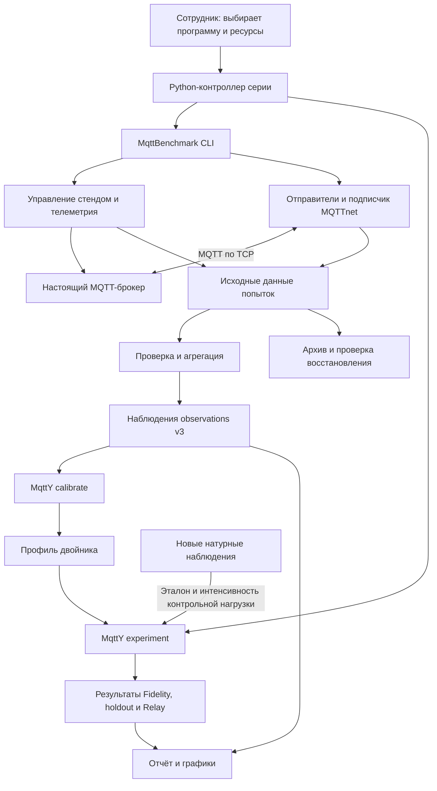

# Архитектура проекта: от измерения брокера до его модели

Проект решает одну задачу: **измерить настоящий MQTT-брокер, построить по этим данным двойник в MqttY и проверить его на новых измерениях**. Двойник воспроизводит наблюдаемое поведение в заданных условиях. Он не исполняет код исходного брокера и не воспроизводит все его внутренние механизмы.

Этот документ описывает состав исходников и основные связи между ними. Команды установки находятся в [руководстве запуска](../mqtt-benchmark/runbook.md), порядок работы — в [этапах эксперимента](../mqtt-benchmark/stages.md), определения показателей — в [метриках](../mqtt-benchmark/metrics.md).

## 1. Что входит в проект

`mqtty-meta` — корневой Git-репозиторий. Он связывает три подмодуля, каждый со своей историей изменений. Версия корневого репозитория фиксирует выбранные версии подмодулей.

| Компонент | Что содержит | Роль в эксперименте |
| --- | --- | --- |
| [MqttBenchmark](../../MqttBenchmark) | Генератор настоящей MQTT-нагрузки, управление брокерами, сбор и проверку измерений | Получает исходные данные и сводные наблюдения |
| [mqtty](../../mqtty) | Ядро симулятора MqttY, модель MQTT, калибровку, сетевые эксперименты, графический редактор | Строит профиль двойника и рассчитывает его поведение |
| [diss](../../diss) | Исследовательские тексты, библиографию, рисунки и средства сборки публикации | Использует результаты для научного описания; в запуске стенда не участвует |
| [tools/campaign](../../tools/campaign) | Python-сценарии подготовки, продолжения, ограничения времени и подготовки отчётов | Связывает измерения и симуляции в полную серию |
| [docs](..) | Руководства и четыре описания брокеров в `brokers/` | Объясняет методику и работу программ |
| [reports](../../reports/README.md) | Опубликованные отчёты, графики, таблицы, небольшие снимки данных | Сохраняет проверяемые результаты на указанную дату |

Сами Aedes, Mosquitto, ActiveMQ Classic и EMQX — **внешние программы**. Их дистрибутивы не являются модулями MqttY. Исходные журналы большого объёма и архивы опытов хранятся на выделенном диске результатов; опубликованный отчёт содержит ссылки и контрольные суммы.

## 2. Как связаны компоненты



**Контроллер серии** решает, какой этап запускать следующим, следит за ресурсами и сохраняет состояние. **MqttBenchmark** выполняет отдельные настоящие измерения. **MqttY** строит профиль и выполняет симуляции. Это разные процессы; графический редактор для автоматической серии не нужен.

Настоящие измерения выполняются последовательно. Независимые симуляции могут идти в нескольких процессах при достаточной памяти. Внутри воспроизводимой симуляции узлы обновляются последовательно. Параллельный запуск нескольких опытов и параллельное обновление одной модели — разные настройки.

MqttBenchmark поддерживает локальное управление, удалённый native-стенд по SSH и контейнерные варианты. Готовый переносимый сценарий корневого репозитория использует Linux, systemd и cgroup v2; контроллер и брокеры размещаются на одном хосте. Возможности библиотеки шире возможностей этого сценария. Подробности: [варианты размещения](../mqtt-benchmark/deployment-layouts.md).

## 3. Размер модулей

Таблица показывает **физические строки исходных файлов**, включая комментарии и пустые строки. Второй показатель исключает только пустые строки; это не число операторов и не оценка сложности программы.

Подсчёт охватывает рабочую копию четырёх репозиториев: файлы, известные Git, и новые файлы, не исключённые `.gitignore`. Для .NET исходники сгруппированы по ближайшему `.csproj`; C# и разметка интерфейса `.axaml`/`.xaml` считаются вместе. Тестовые проекты, примеры и вспомогательные скрипты выделены отдельно. Наличие файла в таблице не означает, что он запускается в основной кампании.

Считаются `.cs`, `.py`, `.ps1`, `.psm1`, `.sh`, `.js`, `.axaml`, `.xaml`, `.lua`. Исключены сборки `bin`/`obj`, результаты, пакеты зависимостей и файлы с суффиксами `.g.cs`, `.g.i.cs`, `.Designer.cs`. Тексты Markdown/LaTeX, JSON-конфигурации, ноутбуки, графики, дистрибутивы брокеров и сторонние библиотеки в число строк кода не входят. Для `diss` посчитаны только вспомогательные скрипты.

<!-- code-inventory:start -->

| Компонент / модуль | Вид | Файлов | Строк всего | Непустых строк |
| --- | --- | ---: | ---: | ---: |
| **Корневой репозиторий** | **Итого** | **81** | **12726** | **11535** |
| [tools](../../tools/) | Скрипты | 1 | 116 | 104 |
| [tools/campaign](../../tools/campaign/) | Скрипты | 34 | 6635 | 6078 |
| [tools/campaign](../../tools/campaign/) | Тестовые скрипты | 16 | 1244 | 1076 |
| [tools/dissertation](../../tools/dissertation/) | Скрипты | 8 | 1753 | 1592 |
| [tools/dissertation](../../tools/dissertation/) | Тестовые скрипты | 6 | 599 | 524 |
| [tools/documentation](../../tools/documentation/) | Скрипты | 4 | 275 | 240 |
| [tools/documentation](../../tools/documentation/) | Тестовые скрипты | 1 | 55 | 47 |
| [tools/federation](../../tools/federation/) | Скрипты | 4 | 890 | 822 |
| [tools/federation](../../tools/federation/) | Тестовые скрипты | 3 | 198 | 176 |
| [tools/load-balancing](../../tools/load-balancing/) | Скрипты | 3 | 861 | 787 |
| [tools/load-balancing](../../tools/load-balancing/) | Тестовые скрипты | 1 | 100 | 89 |
| **MqttBenchmark** | **Итого** | **177** | **14082** | **12782** |
| [EntityFX.MqttBenchmark](../../MqttBenchmark/src/EntityFX.MqttBenchmark/) | Модуль .NET | 28 | 1281 | 1139 |
| [EntityFX.MqttBenchmark.Bomber](../../MqttBenchmark/src/EntityFX.MqttBenchmark.Bomber/) | Модуль .NET | 16 | 1338 | 1108 |
| [EntityFX.MqttBenchmark.Campaign](../../MqttBenchmark/src/EntityFX.MqttBenchmark.Campaign/) | Модуль .NET | 64 | 3413 | 3183 |
| [EntityFX.MqttBenchmark.Cli](../../MqttBenchmark/src/EntityFX.MqttBenchmark.Cli/) | Модуль .NET | 1 | 153 | 142 |
| [EntityFX.MqttBenchmark.Counters](../../MqttBenchmark/src/EntityFX.MqttBenchmark.Counters/) | Модуль .NET | 4 | 254 | 199 |
| [EntityFX.MqttBenchmark.Scenario](../../MqttBenchmark/src/EntityFX.MqttBenchmark.Scenario/) | Модуль .NET | 6 | 547 | 445 |
| [EntityFX.MqttBenchmark.StatAggregator](../../MqttBenchmark/src/EntityFX.MqttBenchmark.StatAggregator/) | Модуль .NET | 4 | 208 | 165 |
| [EntityFX.MqttBenchmark.Tests](../../MqttBenchmark/src/EntityFX.MqttBenchmark.Tests/) | Тесты .NET | 19 | 3203 | 2996 |
| [data_processing](../../MqttBenchmark/data_processing/) | Скрипты | 1 | 102 | 78 |
| [docker](../../MqttBenchmark/docker/) | Скрипты | 2 | 64 | 60 |
| [scripts](../../MqttBenchmark/scripts/) | Скрипты | 26 | 3101 | 2888 |
| [scripts](../../MqttBenchmark/scripts/) | Тестовые скрипты | 3 | 299 | 266 |
| [src](../../MqttBenchmark/src/) | Скрипты | 2 | 14 | 8 |
| [src](../../MqttBenchmark/src/) | Тестовые скрипты | 1 | 105 | 105 |
| **mqtty** | **Итого** | **369** | **30876** | **26188** |
| [CustomNetwork](../../mqtty/doc/examples/custom-network/) | Пример .NET | 1 | 118 | 115 |
| [EntityFX.MqttY](../../mqtty/src/EntityFX.MqttSimulator/EntityFX.MqttSimulator/) | Модуль .NET | 57 | 6365 | 5110 |
| [EntityFX.MqttY.Cli](../../mqtty/src/EntityFX.MqttSimulator/EntityFX.MqttY.Cli/) | Модуль .NET | 4 | 269 | 226 |
| [EntityFX.MqttY.Contracts](../../mqtty/src/EntityFX.MqttSimulator/EntityFX.MqttSimulator.Contracts/) | Модуль .NET | 52 | 1061 | 786 |
| [EntityFX.MqttY.Contracts.Mqtt](../../mqtty/src/EntityFX.MqttSimulator/EntityFX.MqttY.Contracts.Mqtt/) | Модуль .NET | 40 | 1366 | 1154 |
| [EntityFX.MqttY.Contracts.Scenarios](../../mqtty/src/EntityFX.MqttSimulator/EntityFX.MqttY.Contracts.Scenarios/) | Модуль .NET | 6 | 148 | 113 |
| [EntityFX.MqttY.Designer](../../mqtty/src/EntityFX.MqttSimulator/EntityFX.MqttY.Designer/) | Модуль .NET | 39 | 5334 | 4692 |
| [EntityFX.MqttY.Federation.App](../../mqtty/src/EntityFX.MqttSimulator/EntityFX.MqttY.Federation.App/) | Модуль .NET | 37 | 1125 | 1085 |
| [EntityFX.MqttY.LoadBalancing.App](../../mqtty/src/EntityFX.MqttSimulator/EntityFX.MqttY.LoadBalancing.App/) | Модуль .NET | 26 | 1099 | 1013 |
| [EntityFX.MqttY.MqttRelay.App](../../mqtty/src/EntityFX.MqttSimulator/EntityFX.MqttY.MqttRelay.App/) | Модуль .NET | 4 | 1071 | 896 |
| [EntityFX.MqttY.Plugin.Mqtt](../../mqtty/src/EntityFX.MqttSimulator/EntityFX.MqttY.Plugin.Mqtt/) | Модуль .NET | 57 | 6327 | 5253 |
| [EntityFX.MqttY.Plugin.Scenarios](../../mqtty/src/EntityFX.MqttSimulator/EntityFX.MqttY.Plugin.Scenarios/) | Модуль .NET | 8 | 388 | 311 |
| [EntityFX.Tests.Integration](../../mqtty/src/EntityFX.MqttSimulator/EntityFX.Tests.Integration/) | Тесты .NET | 33 | 5961 | 5221 |
| [doc](../../mqtty/doc/) | Скрипты | 3 | 165 | 154 |
| [tools](../../mqtty/tools/) | Скрипты | 1 | 34 | 29 |
| [utils](../../mqtty/utils/) | Скрипты | 1 | 45 | 30 |
| **diss** | **Итого** | **6** | **410** | **364** |
| [biblio](../../diss/biblio/) | Скрипты | 1 | 102 | 97 |
| [book](../../diss/book/) | Скрипты | 5 | 308 | 267 |
| **Всего** | | **633** | **58094** | **50869** |

<!-- code-inventory:end -->

Точные версии Git, расширения файлов и SHA-256 набора исходников находятся в [code-inventory.json](code-inventory.json). Хэш вычисляется по путям и содержимому с приведением переводов строк к одному виду. Он позволяет заметить изменение исходников; это не доказательство правильности модели.

Повторить подсчёт из корня репозитория, Python 3.11+ и Git:

```bash
python tools/code-inventory.py
python tools/code-inventory.py --check
```

Первая команда обновляет эту таблицу и JSON, вторая проверяет их соответствие рабочей копии. Повторный подсчёт нужен после изменений кода или версий Git. Сама программа подсчёта тоже включена в объём исходников.

## 4. MqttBenchmark: модули и ключевые классы

Основной путь новой кампании: **Cli → Campaign → MQTTnet и скрипты стенда**. Проект `EntityFX.MqttBenchmark` содержит общие средства и прежнюю калибровочную цепочку. `Bomber`, `Scenario`, `Counters` и `StatAggregator` — отдельные приложения для других способов нагрузки и обработки; стандартная кампания v3 их не запускает.

| Модуль | Назначение |
| --- | --- |
| `EntityFX.MqttBenchmark.Cli` | Входные команды `preflight`, `matrix`, `aggregate`, `monitor` |
| `EntityFX.MqttBenchmark.Campaign` | Измерительная кампания v3: попытки, стенд, нагрузка, условия измерения, архивы и сводные результаты |
| `EntityFX.MqttBenchmark` | Общие классы нагрузки и статистики; прежняя матрица и профиль v2 |
| `EntityFX.MqttBenchmark.Bomber` | Отдельное приложение массовой нагрузки из собственной конфигурации |
| `EntityFX.MqttBenchmark.Scenario` | Отдельный запуск заданного сценария нагрузки |
| `EntityFX.MqttBenchmark.Counters` | HTTP-сервис счётчиков полученных MQTT-сообщений для этих приложений |
| `EntityFX.MqttBenchmark.StatAggregator` | Обработка и усреднение ранее сохранённых CSV с системными показателями |
| `EntityFX.MqttBenchmark.Tests` | Проверки контрактов, нагрузки, стенда, архивирования и команд |

### Управление и измерение

| Класс или группа | Назначение |
| --- | --- |
| [CampaignCommands](../../MqttBenchmark/src/EntityFX.MqttBenchmark.Campaign/Commands/CampaignCommands.cs) | Выполняет команды кампании; координирует попытки, стенд, измеритель и агрегацию |
| [CampaignDefinition](../../MqttBenchmark/src/EntityFX.MqttBenchmark.Campaign/CampaignDefinition.cs), [CampaignIdentityFactory](../../MqttBenchmark/src/EntityFX.MqttBenchmark.Campaign/Commands/CampaignIdentityFactory.cs) | Описывают сетку и длительности; фиксируют происхождение и условия серии |
| [StandSession](../../MqttBenchmark/src/EntityFX.MqttBenchmark.Campaign/Stand/StandSession.cs) | Создаёт сеанс выбранного брокера, связывает управление процессом и сбор телеметрии |
| [StandLifecycle](../../MqttBenchmark/src/EntityFX.MqttBenchmark.Campaign/Stand/StandLifecycle.cs), [StandTelemetry](../../MqttBenchmark/src/EntityFX.MqttBenchmark.Campaign/Stand/StandTelemetry.cs) | Вызывают операции стенда, принимают показания и проверяют готовность сбора |
| [IMqttCampaignRunner](../../MqttBenchmark/src/EntityFX.MqttBenchmark.Campaign/Probing/IMqttCampaignRunner.cs), [MqttCampaignRunner](../../MqttBenchmark/src/EntityFX.MqttBenchmark.Campaign/Probing/MqttCampaignRunner.cs) | Задают интерфейс измерителя и объединяют предварительную проверку MQTT с выполнением нагрузки |
| [MqttTransportClient](../../MqttBenchmark/src/EntityFX.MqttBenchmark.Campaign/Transport/MqttTransportClient.cs) | Выполняет CONNECT, SUBSCRIBE, PUBLISH и DISCONNECT через MQTTnet; проверяет ответы и таймауты |
| [MqttPreflightProbe](../../MqttBenchmark/src/EntityFX.MqttBenchmark.Campaign/Probing/MqttPreflightProbe.cs) | Проверяет протокольный обмен и измеряет исходный RTT |
| [CampaignWorkloadRunner](../../MqttBenchmark/src/EntityFX.MqttBenchmark.Campaign/Workload/CampaignWorkloadRunner.cs) | Запускает отправителей и подписчика, управляет прогревом, нагрузкой и ожиданием завершений |
| [DeliveryLedger](../../MqttBenchmark/src/EntityFX.MqttBenchmark.Campaign/Workload/DeliveryLedger.cs), [DrainPolicy](../../MqttBenchmark/src/EntityFX.MqttBenchmark.Campaign/Workload/DrainPolicy.cs) | Сопоставляют попытки, исходы и получения по ID; определяют завершение ожидания доставок |
| [LoadGeneratorGuard](../../MqttBenchmark/src/EntityFX.MqttBenchmark.Campaign/Guard/LoadGeneratorGuard.cs), [ExternalGuardSampler](../../MqttBenchmark/src/EntityFX.MqttBenchmark.Campaign/Guard/ExternalGuardSampler.cs) | Собирают показатели контроллера и проверяют, не нарушены ли заданные условия измерения |
| [CampaignAggregator](../../MqttBenchmark/src/EntityFX.MqttBenchmark.Campaign/CampaignAggregator.cs) | Проверяет набор попыток v3 и рассчитывает наблюдения по точкам нагрузки |
| [CampaignJournal](../../MqttBenchmark/src/EntityFX.MqttBenchmark.Campaign/CampaignJournal.cs), [EvidenceArchive](../../MqttBenchmark/src/EntityFX.MqttBenchmark.Campaign/EvidenceArchive.cs) | Сохраняют состояние попыток, проверяют целостность и архивируют исходные данные |

На стороне стенда работают [BrokerStand.ps1](../../MqttBenchmark/scripts/BrokerStand.ps1) и, при удалённом запуске, [RemoteNativeStand.ps1](../../MqttBenchmark/scripts/RemoteNativeStand.ps1). Они управляют выделенным экземпляром брокера, проверяют его процесс и собирают ресурсы. Права на остановку относятся к процессу, которым владеет этот запуск.

Телеметрия должна покрывать завершение нагрузки. Для этого используются сигнал готовности сборщика и отметка окончания работы — `fence`. Время сравнивается на монотонных часах одной машины. Успешная передача MQTT сама по себе не делает попытку пригодной, если сбор ресурсов закончился раньше нагрузки.

### Прежний путь v2

В каталоге [Calibration](../../MqttBenchmark/src/EntityFX.MqttBenchmark/Calibration) сохранены `MqttMatrixRunner`, `BenchmarkAggregator`, `BrokerProfileGenerator`, `AggregatedArtifactStore` и `QosProfileEntry`.

- `MqttMatrixRunner` выполняет измерение прежней матрицы, `BenchmarkAggregator` объединяет повторы.
- `AggregatedArtifactStore` записывает сводные JSON/CSV в новые файлы.
- `BrokerProfileGenerator` создаёт прежний `broker-benchmark.v2.json`; `QosProfileEntry` хранит набор его точек для одного QoS.

Эти классы не следует принимать за калибратор текущей кампании: **в v3 MqttBenchmark выдаёт наблюдения, а профиль строит MqttY**. CLI выбирает путь по версии конфигурации. Подробная архитектура измерителя: [docs/mqtt-benchmark/architecture.md](../mqtt-benchmark/architecture.md).

## 5. MqttY: ядро, модель MQTT и эксперимент

| Модуль | Назначение |
| --- | --- |
| `EntityFX.MqttY.Contracts` | Интерфейсы узлов, сетей, пакетов и параметров времени |
| `EntityFX.MqttY` | Ядро: модельное время, движение пакетов, граф, маршруты и счётчики |
| `EntityFX.MqttY.Contracts.Mqtt` | MQTT-пакеты, QoS, интерфейсы клиентов/брокеров и структура профилей |
| `EntityFX.MqttY.Plugin.Mqtt` | Модель брокера и клиента, Relay, калибровка и выполнение научного эксперимента |
| `EntityFX.MqttY.Contracts.Scenarios` / `Plugin.Scenarios` | Контракты и реализация последовательностей действий: подготовка сети, ожидание, экспорт |
| `EntityFX.MqttY.MqttRelay.App` | Команды `calibrate` и `experiment`, используемые контроллером серии |
| `EntityFX.MqttY.Cli` | Отдельное консольное приложение общих сценариев симулятора |
| `EntityFX.MqttY.Designer` | Графический редактор сети на Avalonia; отдельное приложение .NET 8 |
| `EntityFX.Tests.Integration` | Проверки ядра, MQTT, калибровки, повторяемости и экспериментов |
| `CustomNetwork` | Компилируемый пример собственной топологии через API |

Остальные перечисленные исполняемые проекты и библиотеки основной цепочки имеют целевую платформу .NET 6. Каталоги ядра исторически называются `EntityFX.MqttSimulator` и `EntityFX.MqttSimulator.Contracts`, хотя имена их проектов — `EntityFX.MqttY` и `EntityFX.MqttY.Contracts`.

| Класс или группа | Назначение |
| --- | --- |
| [NetworkSimulator](../../mqtty/src/EntityFX.MqttSimulator/EntityFX.MqttSimulator/Network/NetworkSimulator.cs) | Хранит сеть и продвигает модельное время при обновлении узлов |
| [Network](../../mqtty/src/EntityFX.MqttSimulator/EntityFX.MqttSimulator/Network/Network.cs), [Node](../../mqtty/src/EntityFX.MqttSimulator/EntityFX.MqttSimulator/Network/Node.cs) | Представляют сетевые участки и узлы; обрабатывают движение пакетов и очереди |
| [DijkstraPathFinder](../../mqtty/src/EntityFX.MqttSimulator/EntityFX.MqttSimulator/PathFinder/DijkstraPathFinder.cs) | Рассчитывает пути по графу сети |
| [MqttClient](../../mqtty/src/EntityFX.MqttSimulator/EntityFX.MqttY.Plugin.Mqtt/MqttClient.cs), [MqttBroker](../../mqtty/src/EntityFX.MqttSimulator/EntityFX.MqttY.Plugin.Mqtt/MqttBroker.cs) | Моделируют подключения, подписки, публикации и подтверждения MQTT; брокер применяет профиль |
| [BrokerCalibrationV3](../../mqtty/src/EntityFX.MqttSimulator/EntityFX.MqttY.Plugin.Mqtt/BrokerProfile/BrokerCalibrationV3.cs) | Проверяет наблюдения и полноту сетки, преобразует показатели в параметры профиля |
| [BrokerCalibrationEmpirical](../../mqtty/src/EntityFX.MqttSimulator/EntityFX.MqttY.Plugin.Mqtt/BrokerProfile/BrokerCalibrationEmpirical.cs) | Создаёт профиль v4 с измеренным распределением задержек и происхождением гистограмм |
| [BrokerBenchmarkRepository](../../mqtty/src/EntityFX.MqttSimulator/EntityFX.MqttY.Plugin.Mqtt/BrokerProfile/BrokerBenchmarkRepository.cs), [BrokerProfileSet](../../mqtty/src/EntityFX.MqttSimulator/EntityFX.MqttY.Plugin.Mqtt/BrokerProfile/BrokerProfileSet.cs) | Читают один или несколько профилей; проверяют совместимость, хэши и отсутствие повторяющихся брокеров |
| [BrokerRateLimiter](../../mqtty/src/EntityFX.MqttSimulator/EntityFX.MqttY.Plugin.Mqtt/BrokerProfile/BrokerRateLimiter.cs), [DeterministicMqttSampler](../../mqtty/src/EntityFX.MqttSimulator/EntityFX.MqttY.Plugin.Mqtt/BrokerProfile/DeterministicMqttSampler.cs) | Задают модельный темп обработки и воспроизводимый выбор случайных исходов |
| [MqttRelayExperimentCommand](../../mqtty/src/EntityFX.MqttSimulator/EntityFX.MqttY.MqttRelay.App/MqttRelayExperimentCommand.cs) | Читает CLI-параметры, конфигурацию и профили; вызывает калибровку или эксперимент |
| [MqttRelayExperimentRunner](../../mqtty/src/EntityFX.MqttSimulator/EntityFX.MqttY.Plugin.Mqtt/Experiments/MqttRelayExperimentRunner.cs) | Строит топологию, выполняет фазы опыта, собирает показатели и проверяет критерии |
| [IndependentObservationReference](../../mqtty/src/EntityFX.MqttSimulator/EntityFX.MqttY.Plugin.Mqtt/Experiments/IndependentObservationReference.cs) | Проверяет и предоставляет новые натурные наблюдения как эталон контрольной симуляции |
| [BrokerMeasurement](../../mqtty/src/EntityFX.MqttSimulator/EntityFX.MqttY.Plugin.Mqtt/Counter/BrokerMeasurement.cs), [LatencyHistogram](../../mqtty/src/EntityFX.MqttSimulator/EntityFX.MqttY.Plugin.Mqtt/Counter/LatencyHistogram.cs) | Учитывают модельные события измерительного окна и распределение задержек |
| [MqttRelay](../../mqtty/src/EntityFX.MqttSimulator/EntityFX.MqttY.Plugin.Mqtt/Application/Mqtt/MqttRelay.cs), [MqttReceiver](../../mqtty/src/EntityFX.MqttSimulator/EntityFX.MqttY.Plugin.Mqtt/Application/Mqtt/MqttReceiver.cs) | Перепубликуют сообщения между модельными брокерами и учитывают получения |
| [SimulationService](../../mqtty/src/EntityFX.MqttSimulator/EntityFX.MqttY.Designer/Services/SimulationService.cs) | Строит и запускает сеть из графического редактора, управляет паузой и остановкой |

Версия наблюдений и версия профиля — разные вещи. Наблюдения v3 могут быть преобразованы в профиль v3 по квантилям либо в профиль v4 с эмпирической гистограммой. Профиль задаёт параметры; выбранный в эксперименте механизм обработки задаёт, как симулятор их применяет. Например, `empiricalServiceBudget` учитывает бюджет времени обработки с учётом протокольного обмена. Поэтому для повторения нужны **и профиль, и конфигурация, и версия симулятора**.

Подробности: [архитектура MqttY](../mqtty/architecture.md), [эмпирическая модель](../mqtty/empirical-service-budget.md), [работа MqttRelay](../mqtty/mqtt-relay.md).

## 6. Кто управляет полной серией

| Файл / объект | Ответственность |
| --- | --- |
| [portable-linux.py](../../tools/campaign/portable-linux.py) | Готовит новую установку, фиксирует входы и запускает пользовательскую службу systemd |
| [Campaign в run.py](../../MqttBenchmark/scripts/campaign/run.py) | Последовательно вызывает реальные измерения, агрегацию, калибровку, симуляции и проверку архивов |
| [accelerated-resume.py](../../tools/campaign/accelerated-resume.py) | Управляет несколькими процессами симуляции, учитывает доступную память и сохраняет завершённые результаты |
| [compact-campaign.py](../../tools/campaign/compact-campaign.py) | Создаёт сокращённую программу и выполняет серию с ограничением времени |
| [extend-campaign-deadline.py](../../tools/campaign/extend-campaign-deadline.py) | После решения сотрудника продлевает срок на границе без активных заданий и сохраняет историю изменения |
| [publish-broker-reports.py](../../tools/campaign/publish-broker-reports.py) | Собирает снимок поддерживаемой программы, проверяет его данные и формирует публикацию |
| [render-final-reports.py](../../tools/campaign/render-final-reports.py), [assess-evidence.py](../../tools/campaign/assess-evidence.py) | Пересчитывают опубликованное сравнение и отдельно проверяют арифметику метрик и критериев по сохранённым данным |

`series.json` описывает программу и пути; `state.json` — состояние контроллера; индексы симуляций — завершённые модельные запуски. Для возобновления контроллер проверяет совместимость входов и использует уже завершённые результаты. Отчёт в `reports` является опубликованным снимком, а не индикатором работающего процесса.

Сценарии перехода между версиями обслуживают конкретные серии. Они не заменяют подготовку нового стенда. Назначения и ограничения перечислены в [docs/mqtt-benchmark/automation.md](../mqtt-benchmark/automation.md).

## 7. Что сохраняем и что этим доказываем

| Результат | Что позволяет проверить |
| --- | --- |
| Исходные попытки, журналы публикаций/получений, телеметрия | Как фактически проходило измерение, где возникла техническая ошибка |
| Наблюдения по повторам | Средние показатели, разброс и полноту сетки нагрузок |
| Профиль и его происхождение | Какие калибровочные данные использованы для двойника |
| Конфигурация, seed, версии программ и модельные итоги | Повторяемость вычислений MqttY при тех же входах |
| Независимые наблюдения и критерии сравнения | Точность неизменённого двойника на новых данных |
| Архивы, хэши и повторная агрегация восстановленных файлов | Целостность исходных данных и возможность пересчитать результат |

Успешный запуск, полнота покрытия и точность — отдельные свойства. Для одиночного двойника применяются прежние критерии: RPS ≤15%, p99 ≤20%, абсолютная разность долей ошибок и недоставки ≤0,05. QoS 0 не имеет задержки подтверждения. У Relay без натурного сетевого эталона эти критерии неприменимы.

Повторяемость симуляции не обещает одинаковых натурных чисел на разных машинах. Профиль относится к измеренной установке и диапазону нагрузок. CPU/RSS используются для проверки условий настоящего опыта; текущий двойник их не моделирует. Проверка собственной сети и выход за измеренный диапазон требуют новых экспериментов.

В контрольных симуляциях профиль сохраняется, но интенсивность подачи берётся из новых измерений. Поэтому точность проверяется при известной контрольной нагрузке. Это ограничение относится к интерпретации результата, а не к целостности профиля.
