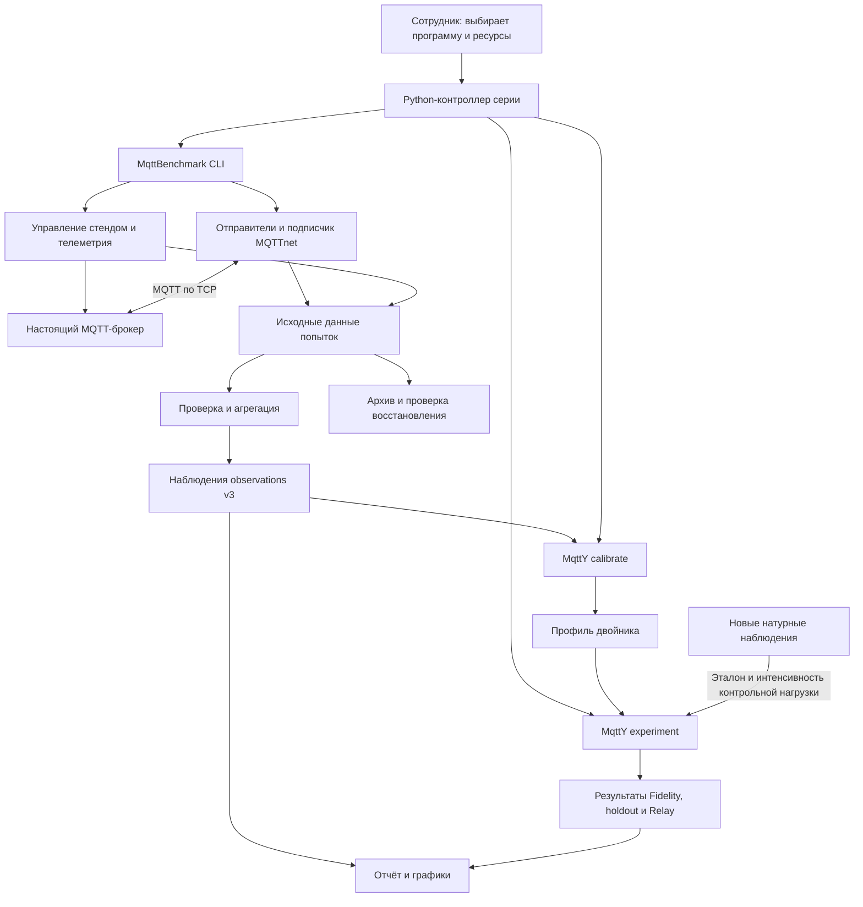
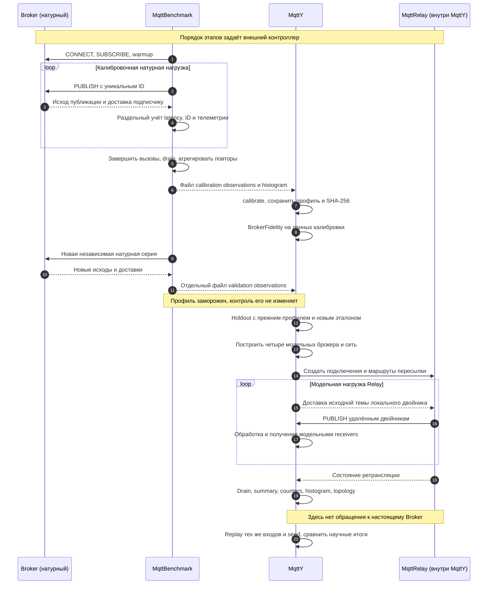
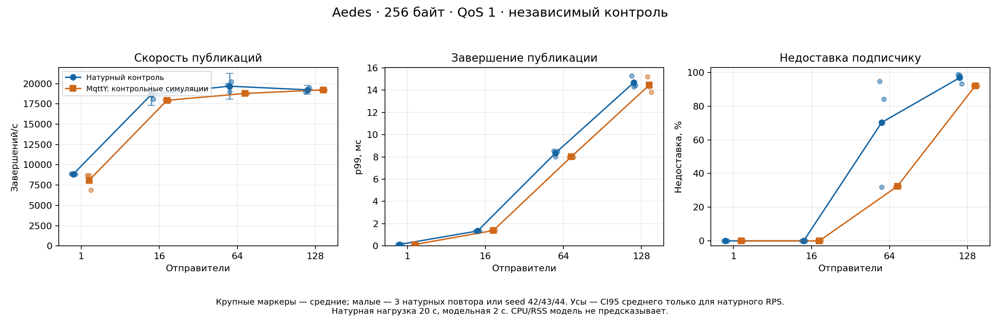
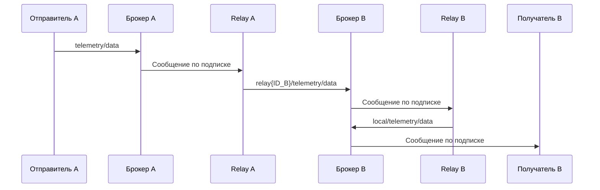

# Общее руководство: MqttBenchmark, MqttY и MqttRelay

Руководство объясняет состав проекта, работу приложений, измерительные метрики, этапы кампании и запуск на новом стенде. Далее приведены реальные результаты четырёх брокеров, границы точности моделей и ответы на основные вопросы.

Для первого знакомства прочитайте цель и приложения; для работы на стенде перейдите к запуску Linux или Windows. Сохранённые численные результаты отделены от команд новой серии. Роли приложений, команды и результаты приведены внутри этого руководства.

**Рабочий маршрут сотрудника:** определить программу и условия → подготовить новую серию → пройти preflight и pilot → выполнить измерения и построить профиль → заморозить профиль и модель → проверить на новых данных → разобрать точность и сохранить доказательства. В разделах запуска описаны возможности имеющихся скриптов; предлагаемые изменения программы вынесены в раздел 14.

## Содержание

1. [Цель, результаты и границы исследования](#purpose)
2. [Архитектура и объём исходников](#architecture)
3. [Приложения, библиотеки и ключевые классы](#applications)
4. [Этапы кампании, исполнители и число запусков](#stages)
5. [Метрики, критерии точности и интегральная оценка](#metrics)
6. [Как строится и выполняется двойник в MqttY](#twin)
7. [Сетевая модель MqttRelay](#relay)
8. [Пошаговый запуск полной и сокращённой серий на Linux](#linux-runbook)
9. [Отдельное натурное измерение через Windows exe](#windows-runbook)
10. [Разбор четырёх брокеров по завершённой серии](#broker-results)
11. [Сравнение брокеров и выбор по EST](#comparison)
12. [Проверяемость, повторение и перенос на другую машину](#reproducibility)
13. [Краткие ответы на вопросы](#faq)
14. [Результат проверки и предлагаемые улучшения](#review)
15. [Что должно остаться у сотрудника после прогона](#sources)

<a id="purpose"></a>

## 1. Цель, результаты и границы исследования

Проект связывает **натурное измерение → профиль → симуляцию → независимую проверку**. Двойник — калиброванная поведенческая модель конкретной установки брокера. Он воспроизводит выбранные наблюдаемые свойства; CPU, RSS, дисковая подсистема и все внутренние механизмы брокера в него автоматически не переходят.

Нужно проверять четыре разных свойства:

| Свойство                        | Чем подтверждаем                                                   |
| ------------------------------- | ------------------------------------------------------------------ |
| Работоспособность               | Этап завершился, файлы и предусмотренные проверки сохранены        |
| Проверяемость расчётов          | Из сохранённых данных можно пересчитать показатели и критерии      |
| Повторяемость симуляции         | Те же входы и seed дают те же заранее выбранные научные результаты |
| Соответствие настоящему брокеру | Неизменённая модель проходит критерии на новых натурных данных     |

В эталонной серии завершены: 576 натурных измерений, 576 одиночных и 360 сетевых симуляций, всего **1512**. Шесть replay выполнены дополнительно. Ни один двойник не прошёл все независимые точки; настоящая Relay-сеть в этой кампании не измерялась. Эти результаты служат примером и материалом анализа, а не гарантией точности нового запуска.

<a id="architecture"></a>

## 2. Архитектура и объём исходников

<a id="architecture-1-что-входит-в-проект"></a>

### 2.1 Что входит в проект

`mqtty-meta` — корневой Git-репозиторий. Он связывает три подмодуля, каждый со своей историей изменений. Версия корневого репозитория фиксирует выбранные версии подмодулей.

| Компонент      | Что содержит                                                                               | Роль в эксперименте                                                        |
| -------------- | ------------------------------------------------------------------------------------------ | -------------------------------------------------------------------------- |
| MqttBenchmark  | Генератор настоящей MQTT-нагрузки, управление брокерами, сбор и проверку измерений         | Получает исходные данные и сводные наблюдения                              |
| mqtty          | Ядро симулятора MqttY, модель MQTT, калибровку, сетевые эксперименты, графический редактор | Строит профиль двойника и рассчитывает его поведение                       |
| diss           | Исследовательские тексты, библиографию, рисунки и средства сборки публикации               | Использует результаты для научного описания; в запуске стенда не участвует |
| tools/campaign | Python-сценарии подготовки, продолжения, ограничения времени и подготовки отчётов          | Связывает измерения и симуляции в полную серию                             |
| docs           | Руководства и четыре описания брокеров в `brokers/`                                        | Объясняет методику и работу программ                                       |
| reports        | Опубликованные отчёты, графики, таблицы, небольшие снимки данных                           | Сохраняет проверяемые результаты выбранной серии                           |

Сами Aedes, Mosquitto, ActiveMQ Classic и EMQX — **внешние программы**. Их дистрибутивы не являются модулями MqttY. Исходные журналы большого объёма и архивы опытов хранятся на выделенном диске результатов; опубликованный отчёт содержит ссылки и контрольные суммы.

<a id="architecture-2-как-связаны-компоненты"></a>

### 2.2 Как связаны компоненты



**Контроллер серии** решает, какой этап запускать следующим, следит за ресурсами и сохраняет состояние. **MqttBenchmark** выполняет отдельные настоящие измерения. **MqttY** строит профиль и выполняет симуляции. Это разные процессы; графический редактор для автоматической серии не нужен.

Настоящие измерения выполняются последовательно. Независимые симуляции могут идти в нескольких процессах при достаточной памяти. Внутри воспроизводимой симуляции узлы обновляются последовательно. Параллельный запуск нескольких опытов и параллельное обновление одной модели — разные настройки.

MqttBenchmark поддерживает локальное управление, удалённый native-стенд по SSH и контейнерные варианты. Готовый переносимый сценарий корневого репозитория использует Linux, systemd и cgroup v2; контроллер и брокеры размещаются на одном хосте. Возможности библиотеки шире возможностей этого сценария. 

<a id="architecture-3-размер-модулей"></a>

### 2.3 Размер модулей

Таблица показывает **физические строки исходных файлов**, включая комментарии и пустые строки. Второй показатель исключает только пустые строки; это не число операторов и не оценка сложности программы.

Подсчёт охватывает рабочую копию четырёх репозиториев: файлы, известные Git, и новые файлы, не исключённые `.gitignore`. Для .NET исходники сгруппированы по ближайшему `.csproj`; C# и разметка интерфейса `.axaml`/`.xaml` считаются вместе. Тестовые проекты, примеры и вспомогательные скрипты выделены отдельно. Наличие файла в таблице не означает, что он запускается в основной кампании.

Считаются `.cs`, `.py`, `.ps1`, `.psm1`, `.sh`, `.js`, `.axaml`, `.xaml`, `.lua`. Исключены сборки `bin`/`obj`, результаты, пакеты зависимостей и файлы с суффиксами `.g.cs`, `.g.i.cs`, `.Designer.cs`. Тексты Markdown/LaTeX, JSON-конфигурации, ноутбуки, графики, дистрибутивы брокеров и сторонние библиотеки в число строк кода не входят. Для `diss` посчитаны только вспомогательные скрипты.

<!-- code-inventory:start -->

| Компонент / модуль                    | Вид              |  Файлов | Строк всего | Непустых строк |
| ------------------------------------- | ---------------- | ------: | ----------: | -------------: |
| **Корневой репозиторий**              | **Итого**        |  **51** |    **7972** |       **7237** |
| tools                                 | Скрипты          |       1 |         109 |             97 |
| tools/campaign                        | Скрипты          |      34 |        6619 |           6064 |
| tools/campaign                        | Тестовые скрипты |      16 |        1244 |           1076 |
| **MqttBenchmark**                     | **Итого**        | **177** |   **14082** |      **12782** |
| EntityFX.MqttBenchmark                | Модуль .NET      |      28 |        1281 |           1139 |
| EntityFX.MqttBenchmark.Bomber         | Модуль .NET      |      16 |        1338 |           1108 |
| EntityFX.MqttBenchmark.Campaign       | Модуль .NET      |      64 |        3413 |           3183 |
| EntityFX.MqttBenchmark.Cli            | Модуль .NET      |       1 |         153 |            142 |
| EntityFX.MqttBenchmark.Counters       | Модуль .NET      |       4 |         254 |            199 |
| EntityFX.MqttBenchmark.Scenario       | Модуль .NET      |       6 |         547 |            445 |
| EntityFX.MqttBenchmark.StatAggregator | Модуль .NET      |       4 |         208 |            165 |
| EntityFX.MqttBenchmark.Tests          | Тесты .NET       |      19 |        3203 |           2996 |
| data_processing                       | Скрипты          |       1 |         102 |             78 |
| docker                                | Скрипты          |       2 |          64 |             60 |
| scripts                               | Скрипты          |      26 |        3101 |           2888 |
| scripts                               | Тестовые скрипты |       3 |         299 |            266 |
| src                                   | Скрипты          |       2 |          14 |              8 |
| src                                   | Тестовые скрипты |       1 |         105 |            105 |
| **mqtty**                             | **Итого**        | **301** |   **27453** |      **22965** |
| CustomNetwork                         | Пример .NET      |       1 |         118 |            115 |
| EntityFX.MqttY                        | Модуль .NET      |      57 |        6365 |           5110 |
| EntityFX.MqttY.Cli                    | Модуль .NET      |       4 |         269 |            226 |
| EntityFX.MqttY.Contracts              | Модуль .NET      |      52 |        1061 |            786 |
| EntityFX.MqttY.Contracts.Mqtt         | Модуль .NET      |      39 |        1358 |           1147 |
| EntityFX.MqttY.Contracts.Scenarios    | Модуль .NET      |       6 |         148 |            113 |
| EntityFX.MqttY.Designer               | Модуль .NET      |      39 |        5334 |           4692 |
| EntityFX.MqttY.MqttRelay.App          | Модуль .NET      |       4 |        1071 |            896 |
| EntityFX.MqttY.Plugin.Mqtt            | Модуль .NET      |      57 |        6280 |           5209 |
| EntityFX.MqttY.Plugin.Scenarios       | Модуль .NET      |       8 |         388 |            311 |
| EntityFX.Tests.Integration            | Тесты .NET       |      30 |        4901 |           4220 |
| doc                                   | Скрипты          |       2 |          81 |             81 |
| tools                                 | Скрипты          |       1 |          34 |             29 |
| utils                                 | Скрипты          |       1 |          45 |             30 |
| **diss**                              | **Итого**        |   **9** |    **1140** |       **1038** |
| biblio                                | Скрипты          |       1 |         102 |             97 |
| book                                  | Скрипты          |       5 |         308 |            267 |
| doc                                   | Скрипты          |       2 |         582 |            539 |
| doc                                   | Тестовые скрипты |       1 |         148 |            135 |
| **Всего**                             |                  | **538** |   **50647** |      **44022** |

<!-- code-inventory:end -->

Версии исходников, для которых выполнен подсчёт:

| Репозиторий               | Git commit                                 |
| ------------------------- | ------------------------------------------ |
| Мета-репозиторий          | `afd816c4bf67ef2d49282b31e66201d30b1a116c` |
| MqttBenchmark             | `30c21c4537f090f5b52507374e9c2e5fabdcb41a` |
| MqttY                     | `115885e012053d0112413e07743b061369ebea93` |
| Диссертационные материалы | `ec51bde8d6cda707eb27eb99857417a733ccd730` |

SHA-256 набора исходников: `861da276207661a70a06e25ab8c3d3ebc2acd7258e04032bb43d51064dfc8a5d`. Хэш вычисляется по путям и содержимому с приведением переводов строк к одному виду. Он позволяет заметить изменение исходников; это не доказательство правильности модели. Версии относятся к инвентаризации кода, а не автоматически ко всем измеренным и модельным запускам: для каждого запуска сохраняется собственный manifest.

Повторить подсчёт из корня репозитория, Python 3.11+ и Git:

```bash
python tools/code-inventory.py
python tools/code-inventory.py --check
```

Первая команда пересчитывает инвентарь, вторая проверяет его соответствие рабочей копии. После изменения кода или версий Git обновите также приведённую здесь таблицу: генератор не переписывает общее руководство автоматически. Сама программа подсчёта включена в объём исходников.

<a id="applications"></a>

## 3. Приложения, библиотеки и ключевые классы

<a id="responsibility"></a>

### 3.1 Кто запускает кого и за что отвечает

**Владелец порядка этапов — Python-контроллер. Владелец натурного измерения — MqttBenchmark CLI. Владелец калибровки и модельного расчёта — MqttY.MqttRelay.App. MqttRelay — объект внутри симуляции.** Название последнего CLI не означает, что оно выполняет только Relay.

| Участник                                            | Кто и как его запускает                                                                                              | Вход                                                               | Ответственность                                                                                                        | Выход                                                    |
| --------------------------------------------------- | -------------------------------------------------------------------------------------------------------------------- | ------------------------------------------------------------------ | ---------------------------------------------------------------------------------------------------------------------- | -------------------------------------------------------- |
| Сотрудник                                           | Выбирает программу и выполняет prepare / launch                                                                      | Условия опыта, установленное ПО и свободные ресурсы                | Готовит стенд, принимает методические решения, разбирает результаты                                                    | Настройки и выбранная программа                          |
| `portable-linux.py`                                 | Сотрудник: Python `prepare`, затем `launch --mode …`                                                                 | Пути, spec брокеров, CPU, раздел данных, сборки                    | Создаёт входы; через systemd запускает управляющий процесс                                                             | `series.json`, `environment.json`, `inputs/`, имя службы |
| Python-контроллер `Campaign` и адаптеры             | Служба запускает `accelerated-resume.py` либо `compact-campaign.py`; они используют `run.py`                         | Программа серии и сохранённое состояние                            | Выбирает этап, вызывает дочерние CLI, ограничивает параллельность симуляций, организует проверку архивов и продолжение | `state.json`, журнал команд, индексы этапов              |
| `EntityFX.MqttBenchmark.Cli`                        | Контроллер или сотрудник: `preflight`, `matrix`, `aggregate`                                                         | Campaign v3, stand, каталоги результатов                           | Проверяет стенд, создаёт реальную нагрузку, учитывает исходы, агрегирует повторы                                       | Raw-журналы, телеметрия, observations                    |
| `BrokerStand.ps1` и native worker                   | MqttBenchmark вызывает PowerShell; при SSH удалённую операцию выполняет worker                                       | Stand с executable/launcher, конфигурациями, портом и CPU          | Запускает и проверяет выделенный процесс брокера, снимает ресурсы, останавливает принадлежащий опыту процесс           | PID, identity, телеметрия и результат управления         |
| Настоящий Aedes / Mosquitto / ActiveMQ / EMQX       | Worker запускает executable или launcher из stand; в lifecycle external процесс заранее запускает сотрудник          | Конфигурация брокера и настоящий MQTT-трафик                       | Выполняет собственный код брокера и обслуживает клиентов                                                               | Протокольные ответы и доставки подписчикам               |
| Guard sampler                                       | При `MQB_GUARD_SAMPLER_CLI` MqttBenchmark создаёт отдельный `dotnet … sample-guard`; иначе использует свой поток     | Endpoint, каталог и PID родительского процесса                     | Наблюдает загрузку контроллера и интервалы отсчётов                                                                    | Guard-данные для решения о пригодности попытки           |
| `export-latency-histograms.py`                      | Контроллер эмпирической серии или сотрудник                                                                          | Проверенные журналы и observations калибровки                      | Экспортирует измеренные частоты задержек                                                                               | Гистограммы с provenance для профиля v4                  |
| `EntityFX.MqttY.MqttRelay.App`, команда `calibrate` | Контроллер или сотрудник вызывает CLI один раз на профиль                                                            | Observations; для v4 также гистограммы                             | Проверяет покрытие и превращает калибровочные показатели в параметры модели                                            | Профиль v3/v4 и его SHA-256                              |
| Тот же CLI, команда `experiment`                    | Контроллер вызывает отдельный процесс для каждой конфигурации и seed                                                 | Config, замороженные профили, при holdout контрольные observations | Строит модель, исполняет фазы, считает показатели и критерии                                                           | Summary, counters, histogram, manifest и topology        |
| Ядро MqttY, модель брокера и `MqttRelay`            | `experiment` создаёт объекты библиотек внутри своего процесса                                                        | Параметры времени, сети, профиля и маршрутов                       | Ядро двигает модельное время; брокер обслуживает модельные операции; Relay перепубликует сообщения между двойниками    | События и счётчики того же модельного запуска            |
| Генератор отчётов                                   | Контроллер обновляет рабочий отчёт; сотрудник отдельно вызывает `render-final-reports.py` для опубликованного набора | Сохранённые результаты                                             | Строит таблицы, EST, графики и документы                                                                               | Markdown/HTML, CSV и изображения                         |
| `assess-evidence.py` и `replay-final-models.py`     | Сотрудник отдельной проверочной командой                                                                             | Сохранённые данные либо конфигурации и frozen runtime              | Первый пересчитывает арифметику; второй запускает выбранные модели ещё раз и сравнивает итоги                          | Протокол проверки данных или replay                      |

Передача observations от MqttBenchmark к MqttY выполняется через файл. MqttBenchmark не вызывает калибратор автоматически в своей команде `aggregate`; следующую команду выбирает контроллер или сотрудник. Настоящий брокер не управляет последующими этапами. В модельном этапе настоящие брокеры не участвуют. При натурном этапе работает subscriber измерителя; при Relay — модельный receiver.

Калибровочный и симуляционный CLI имеют одно имя приложения, но в сохранённой серии могут быть разными зафиксированными сборками. Их версии и хэши определяются входами соответствующего этапа. Передача profile JSON не означает замену одной сборки другой.

### 3.2 Как запускаются приложения

Ниже **формы вызова**, а не готовый скрипт: `<…>` заменяется подготовленным путём или значением. Реальные переменные, порядок подготовки и проверки показаны в разделах запуска. DLL запускается через `dotnet`; у self-contained публикации вместо `dotnet путь.dll` вызывается соответствующий executable.

| Что запускаем                  | Форма команды                                                                                                                                    | Кто обычно вызывает                                                                       |
| ------------------------------ | ------------------------------------------------------------------------------------------------------------------------------------------------ | ----------------------------------------------------------------------------------------- |
| Подготовка серии               | `python portable-linux.py prepare …`                                                                                                             | Сотрудник                                                                                 |
| Весь управляемый прогон        | `python portable-linux.py launch --series <controller> --mode run`                                                                               | Сотрудник; дальше работает контроллер                                                     |
| Проверка стенда                | `dotnet EntityFX.MqttBenchmark.Cli.dll preflight --config <campaign> --stand <stand> --output <new-dir> --benchmark-repo <repo>`                 | Контроллер или сотрудник                                                                  |
| Натурная матрица               | `dotnet EntityFX.MqttBenchmark.Cli.dll matrix --config <campaign> --stand <stand> --campaign <raw-dir> --benchmark-repo <repo>`                  | Контроллер; при продолжении добавляет `--resume`                                          |
| Сводные наблюдения             | `dotnet EntityFX.MqttBenchmark.Cli.dll aggregate --config <campaign> --stand <stand> --raw <raw-dir> --output <new-dir> --benchmark-repo <repo>` | Контроллер после полного набора                                                           |
| Профиль одного брокера         | `dotnet EntityFX.MqttY.MqttRelay.App.dll calibrate --broker <name> --observations <json> --output <new-profile> --mqtty-repository <repo>`       | Контроллер или сотрудник                                                                  |
| Fidelity, holdout или Relay    | `dotnet EntityFX.MqttY.MqttRelay.App.dll experiment --config <json> --output <new-dir>`                                                          | Контроллер; режим определяется JSON                                                       |
| Bomber                         | `dotnet EntityFX.MqttBenchmark.Bomber.dll --config <appsettings.json>`                                                                           | Сотрудник в отдельной NBomber-программе                                                   |
| Scenario                       | `dotnet EntityFX.MqttBenchmark.Scenario.dll --config <appsettings.json>`                                                                         | Сотрудник в отдельной программе Tests                                                     |
| HTTP-счётчик прежних сценариев | `dotnet EntityFX.MqttBenchmark.Counters.dll` из подготовленного каталога приложения                                                              | Сотрудник перед Bomber/Scenario; настройки MQTT и HTTP берутся из конфигурации приложения |
| Агрегатор системного CSV       | `dotnet EntityFX.MqttBenchmark.StatAggregator.dll <input.csv> 00:00:30`                                                                          | Сотрудник; результат `<имя>.new.csv` записывается в рабочий каталог                       |
| Общие сценарии MqttY           | `dotnet EntityFX.MqttY.Cli.dll` из каталога с подготовленным `appsettings.json`                                                                  | Сотрудник; поддерживается также `appsettings.nodes.json`                                  |
| Графический редактор           | `dotnet EntityFX.MqttY.Designer.dll` из публикации редактора                                                                                     | Сотрудник в графической среде, требуется .NET 8                                           |

Для Bomber заранее нужны шаблоны и `infra-config.json`, для Scenario — секция `Tests`, для обоих — работающий Counters и согласованные MQTT endpoints. Это самостоятельные пути нагрузки, их отчёты не являются observations кампании v3. `MqttY.Cli` также не является альтернативным именем `MqttRelay.App` и не принимает команды `calibrate`/`experiment` этого приложения.

Библиотеки `Campaign`, `Contracts`, ядро, плагины, `MqttRelay` и `MqttReceiver` отдельно не запускаются: их вызывает код соответствующего приложения. При использовании `MqttRelay.App` явно указывайте `calibrate` или `experiment`: запуск без команды входит в прежнюю встроенную программу экспериментов.


<a id="architecture-4-mqttbenchmark-модули-и-ключевые-классы"></a>

### 3.3 MqttBenchmark: модули и ключевые классы

Основной путь новой кампании: **Cli → Campaign → MQTTnet и скрипты стенда**. Проект `EntityFX.MqttBenchmark` содержит общие средства и прежнюю калибровочную цепочку. `Bomber`, `Scenario`, `Counters` и `StatAggregator` — отдельные приложения для других способов нагрузки и обработки; стандартная кампания v3 их не запускает.

| Модуль                                  | Назначение                                                                                          |
| --------------------------------------- | --------------------------------------------------------------------------------------------------- |
| `EntityFX.MqttBenchmark.Cli`            | Входные команды `preflight`, `matrix`, `aggregate`, `monitor`                                       |
| `EntityFX.MqttBenchmark.Campaign`       | Измерительная кампания v3: попытки, стенд, нагрузка, условия измерения, архивы и сводные результаты |
| `EntityFX.MqttBenchmark`                | Общие классы нагрузки и статистики; прежняя матрица и профиль v2                                    |
| `EntityFX.MqttBenchmark.Bomber`         | Отдельное приложение массовой нагрузки из собственной конфигурации                                  |
| `EntityFX.MqttBenchmark.Scenario`       | Отдельный запуск заданного сценария нагрузки                                                        |
| `EntityFX.MqttBenchmark.Counters`       | HTTP-сервис счётчиков полученных MQTT-сообщений для этих приложений                                 |
| `EntityFX.MqttBenchmark.StatAggregator` | Обработка и усреднение ранее сохранённых CSV с системными показателями                              |
| `EntityFX.MqttBenchmark.Tests`          | Проверки контрактов, нагрузки, стенда, архивирования и команд                                       |

<a id="architecture-управление-и-измерение"></a>

#### Управление и измерение

| Класс или группа                            | Назначение                                                                                    |
| ------------------------------------------- | --------------------------------------------------------------------------------------------- |
| CampaignCommands                            | Выполняет команды кампании; координирует попытки, стенд, измеритель и агрегацию               |
| CampaignDefinition, CampaignIdentityFactory | Описывают сетку и длительности; фиксируют происхождение и условия серии                       |
| StandSession                                | Создаёт сеанс выбранного брокера, связывает управление процессом и сбор телеметрии            |
| StandLifecycle, StandTelemetry              | Вызывают операции стенда, принимают показания и проверяют готовность сбора                    |
| IMqttCampaignRunner, MqttCampaignRunner     | Задают интерфейс измерителя и объединяют предварительную проверку MQTT с выполнением нагрузки |
| MqttTransportClient                         | Выполняет CONNECT, SUBSCRIBE, PUBLISH и DISCONNECT через MQTTnet; проверяет ответы и таймауты |
| MqttPreflightProbe                          | Проверяет протокольный обмен и измеряет исходный RTT                                          |
| CampaignWorkloadRunner                      | Запускает отправителей и подписчика, управляет прогревом, нагрузкой и ожиданием завершений    |
| DeliveryLedger, DrainPolicy                 | Сопоставляют попытки, исходы и получения по ID; определяют завершение ожидания доставок       |
| LoadGeneratorGuard, ExternalGuardSampler    | Собирают показатели контроллера и проверяют, не нарушены ли заданные условия измерения        |
| CampaignAggregator                          | Проверяет набор попыток v3 и рассчитывает наблюдения по точкам нагрузки                       |
| CampaignJournal, EvidenceArchive            | Сохраняют состояние попыток, проверяют целостность и архивируют исходные данные               |

На стороне стенда работают BrokerStand.ps1 и, при удалённом запуске, RemoteNativeStand.ps1. Они управляют выделенным экземпляром брокера, проверяют его процесс и собирают ресурсы. Права на остановку относятся к процессу, которым владеет этот запуск.

Телеметрия должна покрывать завершение нагрузки. Для этого используются сигнал готовности сборщика и отметка окончания работы — `fence`. Время сравнивается на монотонных часах одной машины. Успешная передача MQTT сама по себе не делает попытку пригодной, если сбор ресурсов закончился раньше нагрузки.

<a id="architecture-прежний-путь-v2"></a>

#### Прежний путь v2

В каталоге Calibration сохранены `MqttMatrixRunner`, `BenchmarkAggregator`, `BrokerProfileGenerator`, `AggregatedArtifactStore` и `QosProfileEntry`.

- `MqttMatrixRunner` выполняет измерение прежней матрицы, `BenchmarkAggregator` объединяет повторы.
- `AggregatedArtifactStore` записывает сводные JSON/CSV в новые файлы.
- `BrokerProfileGenerator` создаёт прежний `broker-benchmark.v2.json`; `QosProfileEntry` хранит набор его точек для одного QoS.

Эти классы не следует принимать за калибратор текущей кампании: **в v3 MqttBenchmark выдаёт наблюдения, а профиль строит MqttY**. CLI выбирает путь по версии конфигурации. 

<a id="architecture-5-mqtty-ядро-модель-mqtt-и-эксперимент"></a>

### 3.4 MqttY: ядро, модель MQTT и эксперимент

| Модуль                                                    | Назначение                                                                              |
| --------------------------------------------------------- | --------------------------------------------------------------------------------------- |
| `EntityFX.MqttY.Contracts`                                | Интерфейсы узлов, сетей, пакетов и параметров времени                                   |
| `EntityFX.MqttY`                                          | Ядро: модельное время, движение пакетов, граф, маршруты и счётчики                      |
| `EntityFX.MqttY.Contracts.Mqtt`                           | MQTT-пакеты, QoS, интерфейсы клиентов/брокеров и структура профилей                     |
| `EntityFX.MqttY.Plugin.Mqtt`                              | Модель брокера и клиента, Relay, калибровка и выполнение научного эксперимента          |
| `EntityFX.MqttY.Contracts.Scenarios` / `Plugin.Scenarios` | Контракты и реализация последовательностей действий: подготовка сети, ожидание, экспорт |
| `EntityFX.MqttY.MqttRelay.App`                            | Команды `calibrate` и `experiment`, используемые контроллером серии                     |
| `EntityFX.MqttY.Cli`                                      | Отдельное консольное приложение общих сценариев симулятора                              |
| `EntityFX.MqttY.Designer`                                 | Графический редактор сети на Avalonia; отдельное приложение .NET 8                      |
| `EntityFX.Tests.Integration`                              | Проверки ядра, MQTT, калибровки, повторяемости и экспериментов                          |
| `CustomNetwork`                                           | Компилируемый пример собственной топологии через API                                    |

Остальные перечисленные исполняемые проекты и библиотеки основной цепочки имеют целевую платформу .NET 6. Каталоги ядра исторически называются `EntityFX.MqttSimulator` и `EntityFX.MqttSimulator.Contracts`, хотя имена их проектов — `EntityFX.MqttY` и `EntityFX.MqttY.Contracts`.

| Класс или группа                            | Назначение                                                                                            |
| ------------------------------------------- | ----------------------------------------------------------------------------------------------------- |
| NetworkSimulator                            | Хранит сеть и продвигает модельное время при обновлении узлов                                         |
| Network, Node                               | Представляют сетевые участки и узлы; обрабатывают движение пакетов и очереди                          |
| DijkstraPathFinder                          | Рассчитывает пути по графу сети                                                                       |
| MqttClient, MqttBroker                      | Моделируют подключения, подписки, публикации и подтверждения MQTT; брокер применяет профиль           |
| BrokerCalibrationV3                         | Проверяет наблюдения и полноту сетки, преобразует показатели в параметры профиля                      |
| BrokerCalibrationEmpirical                  | Создаёт профиль v4 с измеренным распределением задержек и происхождением гистограмм                   |
| BrokerBenchmarkRepository, BrokerProfileSet | Читают один или несколько профилей; проверяют совместимость, хэши и отсутствие повторяющихся брокеров |
| BrokerRateLimiter, DeterministicMqttSampler | Задают модельный темп обработки и воспроизводимый выбор случайных исходов                             |
| MqttRelayExperimentCommand                  | Читает CLI-параметры, конфигурацию и профили; вызывает калибровку или эксперимент                     |
| MqttRelayExperimentRunner                   | Строит топологию, выполняет фазы опыта, собирает показатели и проверяет критерии                      |
| IndependentObservationReference             | Проверяет и предоставляет новые натурные наблюдения как эталон контрольной симуляции                  |
| BrokerMeasurement, LatencyHistogram         | Учитывают модельные события измерительного окна и распределение задержек                              |
| MqttRelay, MqttReceiver                     | Перепубликуют сообщения между модельными брокерами и учитывают получения                              |
| SimulationService                           | Строит и запускает сеть из графического редактора, управляет паузой и остановкой                      |

Версия наблюдений и версия профиля — разные вещи. Наблюдения v3 могут быть преобразованы в профиль v3 по квантилям либо в профиль v4 с эмпирической гистограммой. Профиль задаёт параметры; выбранный в эксперименте механизм обработки задаёт, как симулятор их применяет. Например, `empiricalServiceBudget` учитывает бюджет времени обработки с учётом протокольного обмена. Поэтому для повторения нужны **и профиль, и конфигурация, и версия симулятора**.


<a id="architecture-6-кто-управляет-полной-серией"></a>

### 3.5 Кто управляет полной серией

| Файл / объект                               | Ответственность                                                                                                 |
| ------------------------------------------- | --------------------------------------------------------------------------------------------------------------- |
| portable-linux.py                           | Готовит новую установку, фиксирует входы и запускает пользовательскую службу systemd                            |
| Campaign в run.py                           | Последовательно вызывает реальные измерения, агрегацию, калибровку, симуляции и проверку архивов                |
| accelerated-resume.py                       | Управляет несколькими процессами симуляции, учитывает доступную память и сохраняет завершённые результаты       |
| compact-campaign.py                         | Создаёт сокращённую программу и выполняет серию с ограничением времени                                          |
| extend-campaign-deadline.py                 | После решения сотрудника продлевает срок на границе без активных заданий и сохраняет историю изменения          |
| publish-broker-reports.py                   | Собирает снимок поддерживаемой программы, проверяет его данные и формирует публикацию                           |
| render-final-reports.py, assess-evidence.py | Пересчитывают опубликованное сравнение и отдельно проверяют арифметику метрик и критериев по сохранённым данным |

`series.json` описывает программу и пути; `state.json` — состояние контроллера; индексы симуляций — завершённые модельные запуски. Для возобновления контроллер проверяет совместимость входов и использует уже завершённые результаты. Отчёт в `reports` является опубликованным снимком, а не индикатором работающего процесса.

Сценарии `service-revision-handoff.py`, `repair-campaign-handoff.py` и `relay-concurrency-handoff.py` обслуживают переходы существующих серий между версиями. Они ждут границы без активных заданий, проверяют совместимость входов и сохраняют историю перехода. Для нового стенда используется `portable-linux.py prepare`. Результаты старой модели нельзя объявлять результатами новой; повторно используемые измерения должны сохранять исходные версии и условия.

<a id="mqtt-benchmark-mqtty-relay-questions-and-answers-62-сценарии-nbomber"></a>

### 3.6 Сценарии NBomber

В `EntityFX.MqttBenchmark.Bomber` конфигурация задаёт `TestParams`, `ScenarioNameTemplates`, `TemplateFiles`, адрес Counters и режим параллельности. Значения вроде QoS, clients, message и server подставляются в шаблоны имён, тем и параметров.

`Benchmark` создаёт конфигурации NBomber для полученных групп. В существующих шаблонах используется `KeepConstant`: количество одновременно действующих сценариев поддерживается постоянным в течение заданного времени. Например, `KeepConstant: [16, "00:00:30"]` означает постоянную конкуренцию 16 в течение 30 секунд, **а не** ровно 16 RPS и не ограничение в 16 сообщений за весь тест.

`MqttScenarioBuilder` создаёт сценарий с тремя частями:

1. `Init`: очистка счётчика нужной пары broker/topic, создание MQTT-клиентов и заранее подготовленных сообщений.
2. Основной шаг `publish`: выбор клиента из созданного набора, выполнение `PublishAsync`, передача NBomber успешного или неуспешного результата.
3. `Clean`: отключение клиентов, чтение приёмного счётчика и его последующая очистка с предусмотренными паузами.

Сценарий строится с `WithoutWarmUp`; наличие ожиданий в Init/Clean не превращает их в измерительный warmup v3. NBomber считает свои request/response статистики, а отдельный Counters сообщает число получений. Итоговый sink объединяет эти сведения в отчёты.

`InParallel` влияет на исполнение групп сценариев. Если одновременно нагружать несколько брокеров с одного генератора, они могут конкурировать за его CPU и сеть. Результат такой программы не равнозначен последовательному измерению каждого брокера при свободном генераторе.

<a id="mqtt-benchmark-mqtty-relay-questions-and-answers-63-приложение-scenario"></a>

### 3.7 Приложение Scenario

Здесь основная конфигурация находится в `Tests`. Есть общие `Settings` и вложенные словари `Scenarios`. Для теста общие настройки клонируются, затем переопределяются индивидуальными значениями: брокер, QoS, размер, число сообщений, предельное время, clients и другие поля.

Группы могут выполняться последовательно или параллельно. Для нагрузки используется класс `MqttBenchmark`; отдельный HTTP-клиент сбрасывает и читает Counters. Выходами становятся `results.md`, `results.csv` и дополнительные результаты отдельных тестов.

Этот механизм полезен для исторических конфигураций и прикладных тестов. Он не содержит автоматически всего контракта кампании v3: идентичности кампании, точного ledger по уникальным ID, текущих guard и обязательной полной калибровочной матрицы.

<a id="mqtt-benchmark-mqtty-relay-questions-and-answers-73-как-работает-сервис-counters-в-старых-сценариях"></a>

### 3.8 Как работает сервис Counters в старых сценариях

`EntityFX.MqttBenchmark.Counters` подключается к брокерам, подписывается на темы из `Mqtt` в конфигурации и увеличивает счётчики получений по паре broker/topic. HTTP API позволяет получить счётчики, узнать статус подключения или очистить значения. Bomber и Scenario вызывают этот API перед тестом и после него.

Это простой внешний наблюдатель количества сообщений. Он не равнозначен ledger v3: по одному числу получений нельзя восстановить, какие уникальные ID успешно опубликованы, какие получили дубликаты и какие дошли после неуспешного исхода вызова. Сбросы, повторные подключения и несовпадение измерительных границ также влияют на интерпретацию.

Следовательно, «Counters показывает столько же, сколько отправлено» — полезная базовая проверка количества, но недостаточное доказательство exactly-once на уровне бизнес-событий или корректного сквозного учёта сети Relay.

<a id="mqtt-benchmark-mqtty-relay-questions-and-answers-53-publishers-subscriber-и-нагрузочный-цикл"></a>

### 3.9 Publishers, subscriber и нагрузочный цикл

`CampaignWorkloadRunner` создаёт один subscriber и `N` publisher-клиентов. Сначала subscriber подключается и подписывается, затем подключаются publishers. У каждого publisher свой цикл:

```text
пока не закончено время подачи:
    сформировать ID и payload
    зарегистрировать attempted
    вызвать PublishAsync и дождаться исхода
    записать completed с latency либо failed с причиной
    начать следующий вызов
```

Циклы разных publishers выполняются конкурентно. Внутри одного цикла следующий вызов следует за завершением предыдущего. Поэтому «64 publishers» здесь означает конкретную модель конкуренции, а не просто число имён клиентов и не заданные 64 публикации в секунду.

В payload используется 16-байтовый идентификатор, зависящий от кампании, попытки, publisher и последовательности. Стандартные размеры 16 и 256 байт включают этот ID. Это размер payload, а не длина всего Ethernet/IP/TCP/MQTT сообщения.

Прогрев публикуется в отдельную тему и имеет отдельное пространство идентификаторов. В измерительный ledger его публикации не попадают. При этом прогрев не обязан воспроизводить весь путь выдачи подписчику так же, как измерительная тема: у этого runner subscriber фильтрует именно измерительную тему. Поэтому длину прогрева разумно проверять экспериментально, особенно для процессов с JIT и прогревом памяти.

<a id="mqtt-benchmark-mqtty-relay-questions-and-answers-55-учёт-и-журналы"></a>

### 3.10 Учёт и журналы

`DeliveryLedger` хранит исход каждого ID, количество его получений и диагностические данные. Требование `A = C + F` проверяет, что у каждой зарегистрированной попытки есть один конечный исход. Один ID не должен дважды становиться завершённой публикацией.

`publishes.ndjson` сохраняет события попыток и исходов. `deliveries.ndjson` сохраняет получения. Запись доставок буферизована, чтобы синхронный файловый ввод-вывод в callback не становился искусственным ограничением подписчика. В истории проекта такое ограничение уже потребовало исправления инструментария.

Телеметрия брокера и load-generator guard сохраняются отдельно от сообщения. Эти данные отвечают на вопрос, насколько условия измерения соответствовали заявленным: например, не перегружен ли контроллер и нет ли больших пропусков в отсчётах.

<a id="mqtt-benchmark-mqtty-relay-questions-and-answers-56-что-означает-успешная-попытка"></a>

### 3.11 Что означает успешная попытка

Успех попытки означает, что процедура получила пригодный результат и необходимые доказательства. Он **не означает**, что все публикации доставлены или что брокер соответствует прикладному SLA. Высокие failure/loss могут быть настоящим измеренным результатом успешного опыта.

Обратная ситуация — инфраструктурный сбой, непокрытое окно телеметрии или нарушение guard — требует отделить попытку от пригодных повторов. Иначе отчёт смешает поведение исследуемого объекта с невозможностью его надёжно измерить.

После записи сохраняются хэши файлов. Они позволяют обнаружить изменение данных при последующей проверке и продолжении. SHA-256 не подтверждает сам по себе истинность измерения или независимость автора: он фиксирует целостность относительно сохранённой записи.

<a id="mqtt-benchmark-mqtty-relay-questions-and-answers-57-что-делает-aggregate"></a>

### 3.12 Что делает aggregate

Агрегатор проверяет идентичности, доступные sealed attempts и полноту матрицы. Затем объединяет повторы одинаковой точки, вычисляет статистики и формирует observations. Он не должен усреднять «похожие» измерения с разных машин или конфигураций как будто это одна серия.

Именно observations становятся входом `calibrate`. Большие журналы остаются первичным материалом для проверки формул, квантилей, ID и диагностики расхождений.


<a id="stages"></a>

## 4. Этапы кампании, исполнители и число запусков

<a id="full-campaign-runbook-2-сколько-запусков-требуется"></a>

### 4.1 Сколько запусков требуется

**Точка нагрузки** — сочетание размера сообщения, QoS и числа отправителей. Каждый натурный опыт повторяется три раза; каждая модельная точка выполняется с тремя начальными числами генератора случайных событий (`seed`).

| Программа                 | Точки нагрузки                                          | На один измерительный или модельный этап |
| ------------------------- | ------------------------------------------------------- | ---------------------------------------- |
| Полная                    | 2 размера сообщения × 3 QoS × 4 числа отправителей = 24 | 24 × 3 = 72 запуска                      |
| Сокращённая, `compact-v1` | 2 размера × 3 QoS × 2 числа отправителей = 12           | 12 × 3 = 36 запусков                     |

Полная сетка: **16/256 байт, QoS 0/1/2, 1/16/64/128 отправителей**. В сокращённой остаются 1 и 16 отправителей. Это параметры программы опыта, общие для разных машин.

| Работа                      | Полная: на брокер / всего | Сокращённая: на брокер / всего |
| --------------------------- | ------------------------- | ------------------------------ |
| Натурная калибровка         | 72 / 288                  | 36 / 144                       |
| Fidelity                    | 72 / 288                  | 36 / 144                       |
| Независимые замеры          | 72 / 288                  | 36 / 144                       |
| Контрольные симуляции       | 72 / 288                  | 36 / 144                       |
| Однородный Relay            | 72 / 288                  | 36 / 144                       |
| Смешанный Relay             | — / 72                    | — / 36                         |
| **Всего основных запусков** | **360 / 1512**            | **180 / 756**                  |

Дополнительно выполняются 3 пробных запуска на брокер — 12 всего. Повторные попытки после технических ошибок учитываются отдельно. Построение профиля и отчёта не считается измерительным запуском.

Сокращённая программа нужна для проверки всей цепочки. Она не проверяет нагрузки 64/128 отправителей и не заменяет полную. Ограничение времени в шесть часов означает срок остановки, а не гарантию выполнения всех 756 запусков на любой машине.

<a id="campaign-stages-кто-за-что-отвечает"></a>

### 4.2 Кто за что отвечает

| Участник                     | Ответственность                                                                         |
| ---------------------------- | --------------------------------------------------------------------------------------- |
| Сотрудник                    | Устанавливает программы, выбирает условия опыта, запускает серию и разбирает результаты |
| Сценарий запуска             | Проверяет пути и ресурсы, создаёт процесс контроллера через systemd                     |
| Контроллер серии — Python    | Выбирает следующий этап, вызывает программы, следит за состоянием и сохраняет историю   |
| MqttBenchmark                | Запускает натурные проверки и нагрузку, собирает данные, рассчитывает показатели        |
| Скрипты управления брокерами | Запускают и останавливают выделенный экземпляр настоящего брокера                       |
| MqttY                        | Рассчитывает профиль двойника и выполняет одиночные и сетевые симуляции                 |
| Генератор отчётов            | Собирает сохранённые результаты в таблицы, графики, Markdown и HTML                     |

Контроллер — управляющая программа, а не обязательно отдельная машина. В переносимом односерверном варианте он работает на том же Linux-хосте, что и брокер. Программы запускаются от имени сотрудника, а не от отдельного «пользователя симулятора».

<a id="mqtt-benchmark-mqtty-relay-questions-and-answers-74-как-измерения-переходят-между-научными-этапами"></a>

### 4.3 Как измерения переходят между научными этапами

| Этап                          | Чьи данные используются                                           | Что проверяется                                             |
| ----------------------------- | ----------------------------------------------------------------- | ----------------------------------------------------------- |
| Натурная калибровка           | Первая серия MqttBenchmark                                        | Наблюдаемое поведение, по которому строится профиль         |
| Построение профиля            | Агрегированные калибровочные observations, при v4 также histogram | Корректность преобразования в параметры модели              |
| BrokerFidelity                | Замороженный профиль и калибровочный эталон                       | Воспроизведение данных, использованных для настройки        |
| Натурный независимый контроль | Другая серия MqttBenchmark                                        | Новое наблюдение поведения установки                        |
| Holdout-симуляции             | Тот же профиль и отдельный контрольный эталон                     | Перенос точности на не использованные для профиля измерения |
| Relay                         | Набор профилей и сетевые предположения                            | Поведение составной модельной сети                          |
| Replay                        | Те же seed, конфигурация, профиль и версия                        | Повторяемость научных результатов                           |

BrokerFidelity и Relay исполняются MqttY, а не MqttBenchmark. Контроллер верхнего уровня связывает приложения, поэтому в отчёте они выглядят как одна программа исследования.

На sequence diagram `Broker` — **настоящий процесс** только в натурных этапах. `MqttRelay` справа — **модельное приложение внутри MqttY**. Пунктирная передача observations обозначает файлы между этапами; команды запускает внешний контроллер, а не брокер. Это схема ответственности, не полная трасса каждого MQTT-пакета.



Подтверждение публикации и доставка на схеме сведены в одну ответную стрелку только для компактности: в измерении это **разные события и счётчики**. Для QoS 0 нет ACK latency. CPU/RSS собираются отдельно по процессу и не переходят в модель как предсказываемые показатели.

Открыть sequence diagram отдельно, SVG.

Fidelity по калибровочным данным — необходимая проверка согласованности, но её нельзя выдавать за независимое подтверждение прогноза. Holdout сильнее, пока его не использовали для настройки. После анализа ошибок и изменения модели тот же контроль становится регрессионной проверкой; для нового независимого вывода нужны новые данные.

Ещё одна тонкость текущей методики: для контрольной симуляции `offeredRps` может задаваться из соответствующей натурной контрольной точки. Это **условная проверка поведения при наблюдаемой подаче**, а не полностью слепой прогноз всех параметров нагрузки. Этот известный вход должен быть явно указан в статье.


<a id="campaign-stages-1-подготовка-серии"></a>

### 4.4 Подготовка серии

**Кто выполняет:** сотрудник, команда `portable-linux.py prepare` для полного переносимого варианта.

**Что происходит:** фиксируются версии, файлы настройки брокеров, наборы нагрузок, используемые CPU, каталоги и ограничения ресурсов. Для сокращённой программы создаётся отдельная серия.

**Результат:** `series.json`, `environment.json`, каталог `inputs/`. Это описание того, что и в каких условиях предстоит выполнить; измерений на этом этапе ещё нет.

<a id="campaign-stages-2-предварительная-проверка--preflight"></a>

### 4.5 Предварительная проверка — preflight

**Кто выполняет:** сотрудник через `--mode preflight`; контроллер также вызывает проверку перед натурными этапами.

**Что происходит:** MqttBenchmark проверяет доступность MQTT, версию и процесс брокера, конфигурацию и условия измерения. Скрипты управления запускают выделенный экземпляр брокера по описанию стенда.

**Результат:** журналы предварительной проверки и статус её завершения. Успех означает готовность к опыту, а не доказанную производительность или точность будущего двойника.

<a id="campaign-stages-3-пробный-запуск--pilot"></a>

### 4.6 Пробный запуск — Pilot

**Кто выполняет:** контроллер автоматически; сотрудник может вызвать его отдельно через `--mode pilot`.

**Что происходит:** MqttBenchmark проверяет всю цепочку — нагрузку, получение сообщений, сбор CPU/RSS и сохранение данных. Проверяются три QoS.

**Результат:** три пробных запуска на брокер. Их данные сохраняются отдельно и не используются для настройки профиля. По ним также оценивают расход места и пригодность выбранных ресурсов.

<a id="campaign-stages-4-натурная-калибровка"></a>

### 4.7 Натурная калибровка

**Кто выполняет:** контроллер вызывает MqttBenchmark `matrix` с калибровочной конфигурацией.

**Что происходит:** настоящий брокер получает разные нагрузки. Для каждого сочетания размера сообщения, QoS и числа отправителей выполняются три повтора. Записываются попытки, завершения, получения, задержки и состояние машины.

**Результат:** 72 успешных измерения на брокер в полной программе или 36 в сокращённой. Неудачные технические попытки сохраняются отдельно. Именно эти данные разрешено использовать для настройки двойника.

<a id="campaign-stages-5-расчёт-показателей-и-проверка-архивов"></a>

### 4.8 Расчёт показателей и проверка архивов

**Кто выполняет:** контроллер вызывает MqttBenchmark `aggregate` и процедуры архивирования.

**Что происходит:** проверяются исходные файлы и полнота набора, рассчитываются средние и доверительные интервалы по повторам. Подробные данные архивируются; затем восстанавливаются во временный каталог и рассчитываются повторно.

**Результат:** `broker-observations.v3.json`, архивы с контрольными суммами, `archive-verification.json` и обновлённый отчёт. При повторном расчёте должны совпасть показатели и описание исходной серии. Этот этап выполняется и после независимых натурных замеров.

Архивирование отдельных попыток идёт по ходу измерений. Очистка распакованных файлов допускается только после предусмотренных проверок; единственная архивная копия сохраняется.

<a id="campaign-stages-6-построение-профиля-двойника"></a>

### 4.9 Построение профиля двойника

**Кто выполняет:** контроллер вызывает MqttY `calibrate --broker <имя>`; для сокращённого набора дополнительно используется `--coverage-protocol compact-v1`.

**Что происходит:** калибратор читает только калибровочные показатели. В варианте с эмпирическим распределением задержек используются также гистограммы исходных измерений. Рассчитываются параметры модели для каждой точки нагрузки.

**Результат:** файл профиля `broker-calibration.v3.json` и его SHA-256. Фактическая версия формата определяется полем внутри файла; историческое имя файла не всегда совпадает с ней. Профиль фиксируется и дальше проверяется на неизменность.

Параметры модельного транспорта также задаются до независимой проверки. Измеренные значения и допущения указываются отдельно.

<a id="campaign-stages-7-проверка-на-калибровочных-данных--fidelity"></a>

### 4.10 Проверка на калибровочных данных — Fidelity

**Кто выполняет:** контроллер создаёт конфигурации точек и вызывает MqttY `experiment`.

**Что происходит:** запускается один двойник. Заданная нагрузка берётся из соответствующей калибровочной точки. Результаты модели сравниваются с данными, использованными для её настройки.

**Результат:** 72 симуляции на брокер в полной программе или 36 в сокращённой. Для каждой сохраняются `summary.json`, критерии сравнения, счётчики и сведения о запуске. Это проверка воспроизведения исходных данных; она не заменяет независимый контроль.

<a id="campaign-stages-8-независимые-натурные-замеры"></a>

### 4.11 Независимые натурные замеры

**Кто выполняет:** контроллер снова вызывает MqttBenchmark `matrix`, теперь с конфигурацией `validation`.

**Что происходит:** настоящий брокер измеряется заново на той же сетке нагрузок. Порядок запусков задаётся другим seed. После измерений выполняются расчёт показателей и проверка архивов.

**Результат:** ещё 72 натурных измерения на брокер или 36 в сокращённой программе. Эти результаты хранятся отдельно от калибровки. Профиль по ним не изменяется.

«Независимые» здесь означает «не использованные для настройки». Другой порядок запусков сам по себе не гарантирует статистическую независимость: условия, паузы и фоновые нагрузки тоже нужно учитывать.

<a id="campaign-stages-9-контрольные-симуляции--holdout"></a>

### 4.12 Контрольные симуляции — holdout

**Кто выполняет:** контроллер вызывает MqttY `experiment` с прежним профилем и `referenceObservationsPath`, указывающим на независимые замеры.

**Что происходит:** двойник получает нагрузку соответствующей контрольной точки. Новые измеренные показатели служат эталоном сравнения; параметры профиля и транспорта по ним не подбираются.

В текущей программе `offeredRps` берётся из attempted RPS контрольной точки. Это проверка при уже известной интенсивности попыток, а не прогноз этой интенсивности на новой машине. Факт использования контрольного показателя как входа нужно сохранять в описании проверки.

**Результат:** 72 контрольные симуляции на брокер или 36 в сокращённой программе. Это основная проверка точности двойника на новых данных. Если модель исправляют по найденным расхождениям, для следующего независимого контроля нужны новые измерения.

<a id="campaign-stages-10-однородная-и-смешанная-сети-relay"></a>

### 4.13 Однородная и смешанная сети Relay

**Кто выполняет:** контроллер вызывает MqttY `experiment` в режиме `mqttRelay`.

**Что происходит:** сначала соединяются четыре двойника одного брокера. После завершения необходимых этапов всех брокеров строится сеть с одним двойником каждого типа. Настройку маршрутов и соединения выполняет MqttY.

**Результат:** 72 сетевых запуска на каждый тип брокера и 72 смешанных, либо по 36 в сокращённой программе. Сохраняются схема сети, показатели брокеров и получения в конечных модельных узлах.

У этих запусков нет натурного эталона всей сети. Критерии одиночного Fidelity имеют статус `notApplicable`. Подробности: [как работает MqttRelay](#relay).

<a id="campaign-stages-11-отчёт-и-оценка-результата"></a>

### 4.14 Отчёт и оценка результата

**Кто выполняет:** контроллер вызывает генератор отчётов; итоговые выводы проверяет сотрудник.

**Что получаем:** отдельный отчёт Markdown и HTML для каждого брокера и смешанной сети, графики, таблицы CSV/JSON, ссылки на исходные данные и контрольные суммы. В мета-репозитории они публикуются в reports. Если этапы не закончены, документ называется частичным и перечисляет невыполненную работу.

Сотрудник проверяет три вещи:

1. **Полнота:** все запланированные точки выполнены, ошибки и повторные попытки учтены.
2. **Повторяемость MqttY:** повторение одинаковых входов даёт одинаковые научные результаты. Проверочные повторы выполняются отдельно; обычная серия с разными seed эту проверку не заменяет.
3. **Точность:** на независимых данных выполнены применимые допуски RPS ≤15%, p99 ≤20%, абсолютной разности долей ошибок и недоставки ≤0,05.

Техническая ошибка запуска и нарушение критерия точности — разные результаты. Контроллер сохраняет оба; поведение после технической ошибки зависит от программы серии. Нарушение Fidelity не следует устранять исключением неудобной точки или ослаблением допуска.

Для продолжения контроллер читает `state.json` и индексы завершённых запусков. Перечень файлов не заменяет проверку целостности: изменённый профиль или несовместимые входы нельзя выдавать за продолжение прежнего опыта.


<a id="metrics"></a>

## 5. Метрики, критерии точности и интегральная оценка

<a id="campaign-metrics-какие-показатели-измеряем"></a>

### 5.1 Какие показатели измеряем

| Группа             | На какой вопрос отвечает                                         | Основные показатели                                     |
| ------------------ | ---------------------------------------------------------------- | ------------------------------------------------------- |
| Нагрузка           | Сколько работы предлагаем?                                       | Размер сообщения, число отправителей, заданная скорость |
| Производительность | Сколько операций выполняется за секунду?                         | attempted RPS, completed RPS                            |
| Ошибки и доставка  | Какие публикации завершились ошибкой и какие сообщения получены? | Доля ошибок, доля недоставленных сообщений              |
| Задержки           | Как долго длится операция?                                       | p50, p95, p99; отдельно RTT                             |
| Ресурсы            | Сколько процессора и памяти использует настоящий брокер?         | CPU, RSS                                                |
| Разброс            | Насколько отличаются повторные запуски?                          | Среднее, стандартное отклонение, доверительный интервал |

<a id="campaign-metrics-нагрузка"></a>

### 5.2 Нагрузка

- **Payload** (`messageBytes`, `payloadBytes`) — размер содержимого сообщения в байтах, без служебных данных протоколов.
- **Publishers** — число отправляющих клиентов. В сетевой модели уточняйте, задано оно на один брокер или на всю сеть.
- **QoS** — режим обмена MQTT. QoS 0 не предусматривает подтверждения публикации; QoS 1 завершается обменом с PUBACK, QoS 2 — с PUBCOMP. Режим подписки задаётся отдельно.
- **Offered RPS** — заданное число внешних публикаций в секунду. Фактическое число попыток или завершений может быть меньше.
- **Repeat** — повторный натурный запуск. **Seed** — начальное число генератора случайных событий модели. Разные seed проверяют разброс модели, но не заменяют новые натурные измерения.

В режиме `closedLoopPerPublisher` отправитель QoS 1/2 ждёт завершения предыдущей публикации. В `openLoopRate` попытки планируются по заданной скорости. Эти способы создания нагрузки нельзя считать одинаковыми только потому, что совпадает offered RPS.

<a id="campaign-metrics-производительность-ошибки-и-доставка"></a>

### 5.3 Производительность, ошибки и доставка

Завершение публикации у отправителя и получение сообщения подписчиком — разные события. Подтверждение от брокера само по себе не означает получение сообщения прикладным подписчиком.

Обозначения: **A** — попытки публикации, **C** — успешные завершения, **F** — ошибки публикации, **D** — уникальные ID успешных публикаций, полученные подписчиком, **T** — фактическая длительность измерения в секундах.

| Показатель           | Формула   | Значение                                                        |
| -------------------- | --------- | --------------------------------------------------------------- |
| `attemptedRps`       | A / T     | Попытки публикации в секунду                                    |
| `completedRps`       | C / T     | Успешные завершения публикации в секунду                        |
| `publishFailureRate` | F / A     | Доля неуспешных публикаций                                      |
| `deliveryLossRate`   | 1 − D / C | Доля успешных публикаций, не полученных до окончания наблюдения |

Доля `0,2` означает **20%**. Для долей с нулевым знаменателем программа записывает 0. Без попыток или завершений такой ноль не доказывает отсутствие проблем. Для расчёта RPS требуется положительное время измерения.

Недоставка за время теста не устанавливает причину: сообщение могло задержаться в очереди, не дойти до получателя или не попасть в окно наблюдения. Нельзя автоматически приписывать всю недоставку сбросам внутри брокера.

В исходных файлах также сохраняются число уникальных полученных известных ID (`uniqueDeliveries`), повторных получений (`duplicateDeliveries`), неожиданных ID (`unexpectedDeliveries`) и доставленных ID с неуспешным исходом вызова публикации (`deliveredAfterFailedPublish`). Последнее поле не устанавливает, что получение произошло позже регистрации ошибки. `uniqueDeliveries` может включать такие ID, а числитель deliveryLossRate — только `completedIdsDelivered`.

Попытка означает вызов клиентского API, а не подтверждённую отправку пакета в сеть. После отключения клиента быстрые локальные ошибки могут увеличить attempted RPS; этот эффект необходимо учитывать при оценке брокера.

<a id="campaign-metrics-задержки"></a>

### 5.4 Задержки

| Показатель | Как читать                                                                            |
| ---------- | ------------------------------------------------------------------------------------- |
| p50        | Медиана: примерно половина измеренных операций завершилась не медленнее этого времени |
| p95        | Примерно 95% измеренных операций завершились не медленнее этого времени               |
| p99        | Примерно 99% измеренных операций завершились не медленнее этого времени               |
| RTT        | Время отдельного контрольного обмена туда и обратно                                   |

Задержка публикации QoS 1/2 измеряется до её завершения, а не до получения подписчиком. Для QoS 0 задержка подтверждения **неприменима**: подтверждения нет. RTT также нельзя подставлять вместо задержки публикации.

Табличный p99 натурной точки — среднее p99 её повторов. Это не то же самое, что p99 всех сообщений, объединённых в одну выборку. Эмпирическая модель использует объединённое распределение; различие этих способов расчёта нужно учитывать при разборе ошибок. Короткие запуски хуже отражают редкие большие задержки.

<a id="campaign-metrics-время-запуска"></a>

### 5.5 Время запуска

| Часть                     | Назначение                                                                                             |
| ------------------------- | ------------------------------------------------------------------------------------------------------ |
| Прогрев — warmup          | Даём системе начать работу до основного измерения                                                      |
| Измерение — measurement   | Создаём и измеряем основную нагрузку                                                                   |
| Drain натурного измерения | После получения исходов уже начатых вызовов продолжаем ждать доставки до выполнения политики остановки |
| Quiet period              | Завершаем натурный drain после заданного периода без новых доставок; это условие остановки ожидания    |
| Cooldown                  | Отдельная пауза после фиксации результата натурного запуска                                            |
| Сбор телеметрии           | Наблюдаем CPU и память; это окно обычно шире основного измерения                                       |

Модельное время отличается от времени вычисления: несколько секунд моделируемой работы могут вычисляться минуты. `Tick` — шаг модельного времени.

Benchmark ждёт исходов уже начатых вызовов и включает это ожидание в `actualMeasurementSeconds`, затем выполняет отдельный drain доставок. Симулятор использует фиксированное окно measurement и может завершать начатые операции во время drain. Он делит число учитываемых завершений на длительность measurement. При сравнении RPS учитывайте эту разницу, особенно в коротких запусках.

<a id="campaign-metrics-показатели-сети-relay"></a>

### 5.6 Показатели сети Relay

В модели `attempted`, `admitted` и `completed` означают попытки, принятые в обработку и завершённые публикации. `rateRejected` — отказы ограничителя интенсивности, `publishFailed` — другие модельные ошибки после допуска.

Модельная доля ошибок равна `(rateRejected + publishFailed) / attempted`. Модельная недоставка равна `1 − delivered / expectedDeliveries`, где `expectedDeliveries` — ожидаемые доставки. При нулевом знаменателе записывается 0.

В сети суммируются события разных брокеров, включая внутренние пересылки. Поэтому сетевые счётчики и сумма брокерных RPS не равны числу уникальных внешних сообщений или скорости их сквозной доставки.

`receivers` показывает получения в конечных модельных узлах. Счётчики могут включать поступления во время drain и сообщения, отправленные ещё при прогреве. Для проверки уникальной сквозной доставки нужен учёт ID и источника каждого сообщения; одних суммарных счётчиков недостаточно.

<a id="campaign-metrics-процессор-и-память"></a>

### 5.7 Процессор и память

**CPU** — загрузка процессора, **RSS** — память процесса, находящаяся в оперативной памяти. В отчётах `captureCpuMeanPercent` и `captureRssMaxBytes` относятся ко всему окну сбора телеметрии, а не только к основной нагрузке. MiB = 2²⁰ байт, GiB = 2³⁰ байт.

В итоговом сравнении используются другие поля: `cpuPercent` — среднее, взвешенное по длительности внутренних интервалов нагрузки, `rssMaxBytes` — максимум отсчётов в этих интервалах. Граничные интервалы исключены из-за точности временных отметок. В данной серии CPU нормирован на одно закреплённое логическое CPU; метод расчёта указан в сборщике публикации.

**CPU guard** проверяет общесистемную загрузку на интервалах, пересекающих измерение. Прохождение проверки не доказывает, что генератор нагрузки никак не ограничивает результат. Закрепление за логическим CPU также не исключает влияние ОС и других процессов.

CPU и RSS измеряются на настоящем стенде. Текущий двойник не моделирует использование процессора и памяти. Совпадение RPS не означает совпадения CPU или RSS.

<a id="campaign-metrics-среднее-и-доверительный-интервал"></a>

### 5.8 Среднее и доверительный интервал

Среднее описывает результат повторных запусков. Стандартное отклонение, **SD**, показывает их разброс. **CI95** — 95%-й доверительный интервал для среднего при предпосылках выбранного метода.

Для трёх повторов программа использует интервал Стьюдента:

```text
Среднее = (x₁ + x₂ + x₃) / 3
SD = √[Σ(xᵢ − среднее)² / 2]
CI95 = среднее ± 4,30265273 × SD / √3
```

Обоснование такого интервала требует независимости повторов и подходящей формы распределения их результатов. Три запуска сами по себе этих условий не обеспечивают. При таком малом числе повторов оценка ограничена.

CI95 не означает, что 95% сообщений имеют задержку внутри интервала. Пересечение интервалов не доказывает равенство систем. Для долей формула может дать границы вне [0; 1] — это ограничение метода, а не физически возможная доля.

<a id="campaign-metrics-каких-результатов-добиваемся"></a>

### 5.9 Каких результатов добиваемся

Для одиночного двойника сравниваем модель с соответствующими натурными измерениями:

| Показатель             | Как считается отклонение                           | Допуск программы |
| ---------------------- | -------------------------------------------------- | ---------------- |
| RPS                    | Абсолютная разность, делённая на натурное значение | ≤ 15%            |
| p99 для QoS 1/2        | То же относительное отклонение                     | ≤ 20%            |
| Доля ошибок публикации | Абсолютная разность долей                          | ≤ 0,05           |
| Доля недоставки        | Абсолютная разность долей                          | ≤ 0,05           |

Разность долей 0,05 — **5 процентных пунктов**, например между 10% и 15%. Это не относительное увеличение на 5%. Допуски — принятые критерии эксперимента, а не универсальный научный стандарт.

`passed` означает, что применимый критерий выполнен; `failed` — нарушен; `notApplicable` — сравнение неприменимо. В текущем коде относительное сравнение также неприменимо при нулевом эталоне или отсутствующем значении. Этот статус не считается прохождением проверки.

Цель — пройти все применимые критерии **независимого контроля** на заявленном наборе нагрузок. Данные контроля нельзя использовать для настройки модели и затем называть ту же проверку независимой. После исправления по этим данным нужен новый контрольный набор. Для Relay натурная точность сети этой программой не подтверждается.

В опубликованном holdout модель получает `offeredRps` из attempted RPS новой натурной точки. Поэтому оценивается точность при известной интенсивности попыток; способность заранее предсказать эту интенсивность на другом стенде здесь не проверена. Профиль и параметры транспорта по контрольным результатам не подбираются.

Каждый seed сравнивается со **средним трёх натурных повторов** соответствующей точки, а не с отдельным повтором с тем же номером. Нынешний критерий сравнивает числа с фиксированным допуском и не учитывает неопределённость натурного среднего. Поэтому `passed` — прохождение принятого численного правила, а не статистическое доказательство эквивалентности. Для уверенного вывода дополнительно нужны разброс повторов и устойчивость результата в новых сессиях.

<a id="campaign-metrics-покрытие-ошибки-и-проверяемость"></a>

### 5.10 Покрытие, ошибки и проверяемость

`✅72/72 · ❌1 · ⚠8` означает: выполнены 72 запланированных запуска; была одна технически неуспешная попытка; восемь завершённых сценариев нарушили критерии точности. В одном сценарии могут нарушиться несколько критериев.

Техническая ошибка — например, не запустился процесс или отсутствует часть телеметрии. Нарушение критерия точности — результат сравнения модели с измерением. Они учитываются отдельно; неудачные результаты сохраняются.

Контрольные суммы SHA-256 подтверждают целостность относительно сохранённых сумм. Научная проверяемость требует также исходных данных, настроек, версий программ и повторного расчёта. Контрольная сумма сама по себе не доказывает правильность измерения.

В `archive-verification.json` поле `verified=true` относится к описанной там проверке восстановления и повторного расчёта. Общая сумма восстановленного JSON может отличаться из-за сведений об исходных файлах; значения показателей и описание серии при этом должны совпасть.

Определения текущей кампании v3: MeasurementSummary, CampaignAggregator, DrainPolicy, показатели модели и критерии. Прежние `RawBenchmarkResult` и `BenchmarkAggregator` относятся к другому пути измерений и не задают формулы этой серии.

Отчёт должен различать три результата: выполнена ли программа опытов, повторяется ли расчёт MqttY и соблюдены ли допуски на новых измерениях. Эти выводы проверяются отдельно.

<a id="campaign-metrics-интегральная-оценка-брокера"></a>

### 5.11 Интегральная оценка брокера

EST объединяет нормированные RPS, CPU, p99 и успешность доставки в число от 0 до 1. Это критерий выбора с заданными весами, а не вероятность надёжной работы и не показатель точности двойника. В итоговой серии применяется EST\*: для QoS 0 неприменимая задержка исключена, остальные веса нормированы. Сначала оценивается каждая одинаковая нагрузочная точка, затем берётся среднее по сетке.

```text
EST = 0,25 × R / max(R_B)
    + 0,25 × (1 − C)
    + 0,25 × (1 − L / max(L_B))
    + 0,25 × (1 − F)
```

Здесь R — средний completed RPS, C — средняя доля CPU процесса (процент делится на 100), L — средний p99 для QoS 1/2, а `1 − F` — средняя доля uniqueDeliveries / attemptedPublishes. F в этой формуле — доля недоставленных от всех попыток, а не обозначенное выше число ошибок вызова. Максимумы берутся по четырём брокерам в одной нагрузочной точке после усреднения повторов. Для QoS 0 член L исключается, а веса остальных трёх становятся 1/3; итог по всем 24 точкам называется EST\*. Строгая четырёхкомпонентная оценка относится только к 16 точкам QoS 1/2.

Если у всех брокеров R равен нулю, вклад скорости принимается равным нулю. Если все применимые L равны нулю, вклад задержки равен единице. Отсутствующие обязательные значения не подменяются нулями. Изменение весов, состава брокеров или набора точек может изменить рейтинг.

Шкала [0; 1] корректна при неотрицательных R и L, долях C и F в [0; 1] и неотрицательных весах с суммой 1. На многоядерном стенде CPU процесса может превышать 100% при нормировке на одно CPU: подставлять такой процент в этот вариант EST нельзя. До опыта нужно определить и зафиксировать сопоставимую нормировку ресурсов. Низкий CPU сам по себе не означает эффективность: процесс может простаивать из-за ограничений клиента или сети. А сумма с весами допускает компенсацию плохой доставки высокой скоростью — требования к доставке и задержке проверяют отдельно до рейтинга.

Для доставки в EST\* используется uniqueDeliveries / attemptedPublishes; для сравнения модели deliveryLossRate использует completedIdsDelivered / completedPublishes. Эти знаменатели нельзя подменять. CPU измеряется у процесса в течение нагрузки; среднее за весь захват с прогревом и простоем даёт другой результат.


<a id="mqtt-benchmark-mqtty-relay-questions-and-answers-75-что-показывает-график-по-настоящим-данным"></a>

### 5.12 Что показывает график по настоящим данным

На рисунке — **Aedes, 256 байт, QoS 1**: независимые натурные измерения и контрольные симуляции MqttY. Он соответствует полным конфигурациям в разделе 6.15; кроме 64 отправителей показаны соседние точки 1, 16 и 128. Это выбранный срез для разбора метрик, а не рейтинг всех брокеров.

Доля ошибок вызова публикации в выбранных натурных и модельных точках равна нулю и отдельно не показана. Нулевая доля ошибок публикации при этом совместима с большой недоставкой подписчику.



Крупные маркеры и линии показывают средние. Малые маркеры — **три отдельных натурных повтора** либо **три model seed 42/43/44**. Усы обозначают CI95 Стьюдента среднего **только натурного RPS**. Для p99 и недоставки показаны отдельные значения без доверительных интервалов. Линии соединяют исследованные точки; промежуточные значения числа отправителей не измерялись. Три seed не являются тремя независимыми натурными экспериментами.

Натурная нагрузка длится 20 с, модельная — 2 с. Натурный RPS делится на фактическое время завершения вызовов, модельный — на фиксированное окно. p99 здесь — задержка завершения публикации, а не сквозной доставки; среднее p99 повторов не равно p99 объединённых сообщений. Поэтому даже близость кривых надо читать вместе с определениями и ограничениями измерения.

**Что видно при 64 отправителях:**

| Показатель         | Натурный контроль, среднее | MqttY, среднее трёх seed | Вывод по допуску                                             |
| ------------------ | -------------------------- | ------------------------ | ------------------------------------------------------------ |
| Completed RPS      | 19 676,68                  | 18 780,67                | Ошибка среднего около 4,55%; все три seed проходят порог 15% |
| p99 завершения, мс | 8,3559                     | 8,0067                   | Ошибка среднего около 4,18%; все три seed проходят порог 20% |
| Недоставка         | 70,30%                     | 32,39%                   | Разница около 37,91 п.п.; все три seed нарушают порог 5 п.п. |

Решения `passed/failed` в серии принимаются **для каждого seed**, а не по средней кривой. Достоинство примера — одновременная проверка нескольких свойств: близкий RPS не скрывает провал доставки. Недостаток текущего профиля — недостаточное описание изменения доставки между сериями и динамики состояния. При 64 отправителях натурные повторы сами сильно расходятся по недоставке; это видно по малым маркерам. Причину такого разброса нельзя установить по одному графику или целиком приписать брокеру.


<a id="metric-boundaries"></a>

### 5.13 Совпадают ли одноимённые показатели измерителя и модели

Название поля ещё не означает одинаковую границу измерения. Для этой реализации различия следующие:

| Событие | MqttBenchmark | MqttY |
| --- | --- | --- |
| Попытка публикации | Вызов клиентского API; возможна локальная ошибка до отправки | `BrokerMeasurement.BeginAttempt` при обработке входящего PUBLISH брокером; начало операции берётся из контекста отправителя |
| Завершение QoS 0 | Успешный исход `PublishAsync`, без подтверждения брокера | Допуск публикации модельным брокером; счётчик увеличивается в `Admit` |
| Завершение QoS 1/2 | Успешный исход вызова после протокольного подтверждения | Получение завершающего подтверждения модельным клиентом |
| Знаменатель RPS | Фактическое окно с ожиданием исходов начатых вызовов | Заданная длина measurement; завершения учитываемых операций могут прийти в drain |
| Знаменатель недоставки | Успешно завершённые публикации; один натурный subscriber | Ожидаемые выдачи подписчикам модельного брокера; в сети их может быть несколько на публикацию |
| Получение | Callback натурного подписчика с проверкой ID | Уведомление модельного клиента о доставке; receivers имеют также свои счётчики |

Поэтому особенно для QoS 0 и при локальных ошибках клиента близкий completed RPS не доказывает равенства сквозной скорости доставки. Ошибки сети до попадания PUBLISH в модельный брокер также не обязаны попадать в его attempted. Действующие критерии сравнивают сохранённые показатели именно с этими определениями; результаты не переименовываются задним числом.

Для следующей версии методики стоит добавить одинаковый учёт на стороне отправителя и получателя: ID, фазу, факт попытки API, факт отправки, конечный исход и получение. После такого изменения требуется отдельная серия. Вычисляемый показатель `uniqueDeliveries / T` полезен как диагностическая скорость доставленных сообщений, но при учёте получений во время drain не равен скорости потока только внутри measurement.

<a id="twin"></a>

## 6. Как строится и выполняется двойник в MqttY

<a id="mqtt-benchmark-mqtty-relay-questions-and-answers-82-модельное-и-реальное-время"></a>

### 6.1 Модельное и реальное время

Если `tickPeriod = 10 мкс`, то 200 000 ticks соответствуют двум секундам модельного времени. Компьютер может считать эти две секунды десятки секунд или минуты. Реальное время вычисления характеризует стоимость симуляции, а не пропускную способность MQTT-брокера.

При смене tick нужно пересчитать все связанные длительности: warmup, measurement, drain, transfer, окна throughput и другие параметры. Замена одной строки tickPeriod без пересчёта остальных значений меняет физический смысл сценария.

Дискретность создаёт минимально представимое время прохождения протокола. Если реальное завершение быстрее модельного минимума, симулятор не сможет его буквально воспроизвести. Более мелкий tick может уменьшить ошибку, но увеличит вычислительную стоимость и сам по себе не исправит неверные допущения.

<a id="mqtt-benchmark-mqtty-relay-questions-and-answers-83-как-моделируется-обмен"></a>

### 6.2 Как моделируется обмен

Пакет проходит маршрут через узлы и сетевые области. На движение влияют capacity, очередь, transfer ticks и порядок обновления. MQTT-клиент отслеживает состояние соответствующего протокольного обмена, а брокер обрабатывает публикацию и доставку подписчикам.

Это не просто вычисление «выдать RPS из таблицы». Подтверждения, ограничения и очереди реально участвуют в изменении состояния модели. Итоговые счётчики получаются из исполнения. Поэтому профиль, чей target RPS выглядит правильным, ещё может дать неверный итог: например, из-за дополнительного модельного времени или несовпадения режима подачи.

<a id="mqtt-benchmark-mqtty-relay-questions-and-answers-84-какие-параметры-даёт-профиль"></a>

### 6.3 Какие параметры даёт профиль

Профиль задаёт ограничения скорости, условную вероятность неуспешной публикации, условную недоставку и распределение обработки. Часть наблюдаемой задержки отделяется как транспортное приближение, остальное используется как модельная задержка обслуживания.

Модель случайным образом реализует исходы с воспроизводимым seed. Вероятность 0,02 не означает, что в каждой небольшой выборке будет ровно 2 % ошибок. Она задаёт поведение выборки; наблюдаемые доли зависят от числа событий и реализации генератора.

В режиме `profileClientCountMode=publishers` профиль выбирается по исходным отправителям. В альтернативном режиме учитывается число соединений. Для калибровки v3/v4 в этой программе важна именно ось publishers; число дополнительных клиентов нельзя незаметно использовать как другую калибровочную точку.

Профиль действует на измеренной сетке payload/QoS/publishers. Эмпирический v4 требует точно наблюдавшееся число publishers и отклоняет отсутствующую точку; произвольный новый размер payload также не появляется автоматически. Наличие модели не даёт подтверждённого прогноза за пределами этой сетки.

<a id="mqtt-benchmark-mqtty-relay-questions-and-answers-85-профили-v3-и-v4"></a>

### 6.4 Профили v3 и v4

В v3 задержки представлены квантильными характеристиками. В эмпирическом v4 дополнительно сохранена гистограмма задержек, связанная с observations и исходными архивами. Выборка задержки выполняется по накопленным частотам, поэтому редкий максимум сохраняет свою наблюдавшуюся частоту.

Это важно для p99: если ошибочно распределить большой участок вероятности между p99 и единичным огромным максимумом, модель создаст слишком много длинных задержек. Эмпирическая CDF уменьшает такую ошибку представления распределения, но не восстанавливает автоматически временные корреляции, внутренние очереди и переключения состояния брокера.

Для эмпирических профилей требуются наблюдённые значения publisher count; неизвестная точка отвергается. Поддержка более старых способов профилирования не означает, что интерполяция произвольного нового числа клиентов подтверждена для v4.

<a id="mqtt-benchmark-mqtty-relay-questions-and-answers-86-режим-нагрузки"></a>

### 6.5 Режим нагрузки

`openLoopRate` задаёт подачу, которая в основном определяется плановой частотой. При накоплении работы очередь и отказы могут расти.

`closedLoopPerPublisher` ограничивает QoS 1/2 одним незавершённым подтверждаемым publish на исходного publisher. Он ближе к натурному runner: ожидание ответа замедляет следующую публикацию. `offeredRps` выступает верхней границей подачи. QoS 0 не ждёт ACK и обрабатывается отдельно.

Одинаковые `offeredRps` в open-loop и closed-loop не гарантируют одинаковую фактическую нагрузку. Поэтому сравнивать две модели по одному числу скорости без режима подачи некорректно.

<a id="mqtt-benchmark-mqtty-relay-questions-and-answers-87-что-изменяет-empiricalservicebudget"></a>

### 6.6 Что изменяет empiricalServiceBudget

Текущий режим одиночной эмпирической проверки `transportTiming=empiricalServiceBudget` требует v4 и closed-loop. Он ограничивает транспортное приближение калибровочными задержками и измеряет минимальную длительность протокола на идеальной модельной сети.

Для ограничения обслуживания используются FIFO-резервации дробного модельного времени. Задержка ожидания доступной мощности и эмпирический остаток сочетаются через максимум нижних границ: наблюдаемое end-to-end распределение уже включает часть настоящего ожидания, и простое добавление ещё одной очереди могло бы посчитать его дважды.

Это осознанная агрегированная модель обслуживания, а не идентифицированная внутренняя очередь Mosquitto или EMQX. Наблюдения, которые лежат ниже неизбежного модельного минимума, сохраняются и отражаются через `clippedEmpiricalSamples`. Их не удаляют ради прохождения критерия.

Для Relay этот режим недоступен. В опубликованной серии одиночные модели использовали шаг 10 мкс и empiricalServiceBudget; Relay — шаг 100 мкс, open-loop и явные фиксированные параметры транспорта. Следовательно, «это тот же профиль» не означает «это полностью тот же режим исполнения».

<a id="mqtt-benchmark-mqtty-relay-questions-and-answers-88-повторяемость"></a>

### 6.7 Повторяемость

Для воспроизводимого исполнения внутри модели важны фиксированные seed, порядок обновления, версии, profile bytes, конфигурация сети и runtime. В fidelity-режиме параллельное обновление одной модели запрещается; используется последовательное.

Несколько независимых симуляций можно исполнять отдельными процессами. Это другая параллельность: она ускоряет обработку матрицы и не требует параллельного обновления состояния внутри одного графа.

При replay сравнивают summary, научные counters, histogram и фазы. `runId`, отметки календарного времени и длительность вычисления могут различаться. Совпадение научных результатов подтверждает повторяемость на проверенных входах, но не соответствие настоящей сети.


<a id="mqtt-benchmark-mqtty-relay-questions-and-answers-91-последовательность-артефактов"></a>

### 6.8 Последовательность артефактов

```text
Первичные попытки MqttBenchmark
    ↓ aggregate с проверкой покрытия и seals
broker-observations.v3.json
    ↓ calibrate
broker-calibration.v3.json

При наличии проверенных первичных задержек:
observations + latency-histograms.json
    ↓ calibrate --latency-histograms ...
эмпирический broker-calibration.v4.json
    ↓ experiment с выбранным профилем
summary + counters + histogram + manifest + topology
```

Raw-журналы не передаются напрямую runtime брокера. Преобразование отделяет наблюдения от модельных допущений и сохраняет происхождение каждого параметра.

<a id="mqtt-benchmark-mqtty-relay-questions-and-answers-92-преобразование-параметров-v3"></a>

### 6.9 Преобразование параметров v3

Пусть `R_A` — средний attempted RPS, `f` — средняя доля ошибок публикации, `l` — средняя условная недоставка, `r` — явно выбранная доля rate rejection.

| Параметр модели                 | Преобразование                                                 |
| ------------------------------- | -------------------------------------------------------------- |
| `attemptedRps`                  | Наблюдаемое среднее `R_A`                                      |
| `targetCompletedRps`            | Наблюдаемое среднее completed RPS                              |
| `capacityRps`                   | `R_A × (1 − r)`                                                |
| `conditionalPublishFailureRate` | `(f − r) / (1 − r)`                                            |
| `conditionalDeliveryLossRate`   | `l`                                                            |
| Processing latency QoS 1        | `max(0, observed latency − RTT)` для соответствующих квантилей |
| Processing latency QoS 2        | `max(0, observed latency − 2 × RTT)`                           |
| Latency QoS 0                   | Неприменима                                                    |

При default `r=0` capacity равна наблюдаемой частоте попыток. Это параметр модели в данной точке, **не доказанный физический максимум брокера**. Бенчмарк не измеряет rate rejection как отдельную причину; его выделение задаётся допущением. Недопустимые значения, например `r > f`, отклоняются.

Формула условной ошибки обеспечивает общий целевой failure: `r + (1−r) × conditionalFailure = f`. Но реальное число rate rejects в симуляции зависит ещё от дискретности подачи и поведения limiter. Поэтому после запуска смотрят exported counters, а не только алгебру параметров.

Вычитание постоянного RTT из квантилей — приближение. Оно не является точной декомпозицией распределения времени и не восстанавливает физическое service time. Эмпирический service budget уточняет способ исполнения этого приближения в одиночной модели, сохраняя необходимость проверки.

### 6.10 Построить профиль одного брокера отдельной командой

Для полной сетки нужны observations из 72 успешных натурных измерений одного брокера. Команда ниже выполняется в подготовленном Bash-окружении из раздела запуска Linux; имя брокера, вход и новый выход вводит сотрудник.

```bash
read -r -p 'Брокер: Aedes, Mosquitto, ActiveMQ или EMQX: ' BROKER
read -r -p 'Полный путь к калибровочным observations: ' OBSERVATIONS
read -r -p 'Новый файл профиля на разделе результатов: ' PROFILE_OUTPUT
dotnet "$SERIES/tools/simulator/EntityFX.MqttY.MqttRelay.App.dll" calibrate   --broker "$BROKER" --observations "$OBSERVATIONS"   --output "$PROFILE_OUTPUT" --mqtty-repository "$MQTTY_ROOT/mqtty"
sha256sum "$PROFILE_OUTPUT"
```

Получится профиль v3. Для `compact-v1` из 36 измерений добавляют `--coverage-protocol compact-v1`. Для v4 дополнительно нужны проверенные гистограммы и `--latency-histograms`; файл профиля создаётся отдельно. Калибровку по контрольным observations нельзя называть проверкой прежнего двойника.

<a id="mqtt-benchmark-mqtty-relay-questions-and-answers-94-как-получить-эмпирический-профиль-v4"></a>

### 6.11 Как получить эмпирический профиль v4

Нужны не только p50/p95/p99, но проверенные частоты задержек по первичным журналам. Экспортёр export-latency-histograms.py работает с исходными материалами кампании; экспортёр сохраняет формат, который проверяет калибратор. Каждая гистограмма должна соответствовать точному хэшу observations и ключу нагрузки.

Гистограмма должна быть связана с точными bytes observations и campaign identity. Для каждой подтверждаемой точки сохраняются три повтора, archive SHA-256, completed count, фактическое время и bins. Нельзя синтезировать «эмпирическую гистограмму» из одного p99 или нескольких средних и считать её первичными данными.

К предыдущему вызову `calibrate` добавляется `--latency-histograms <путь-к-проверенной-гистограмме>`, выход задаётся новым файлом v4. Это уже иной способ представления профиля; выбранный runtime должен его поддерживать.

**Отдельная подготовка v4 на Linux.** Команды выполняются после завершения и архивирования калибровки, до знакомства с будущими контрольными результатами. `RAW_CALIBRATION` — каталог калибровки с `attempts/<key>/attempt-*/result.json` и квитанциями `archive.json`; указанные в квитанциях архивы должны быть доступны по сохранённым путям. Одних observations для этого недостаточно.

```bash
read -r -p 'Каталог исходных попыток калибровки с квитанциями архивов: ' RAW_CALIBRATION
read -r -p 'Новый JSON гистограмм на разделе результатов: ' HISTOGRAM_OUTPUT
read -r -p 'Новый файл профиля v4 на разделе результатов: ' EMPIRICAL_PROFILE
"$PYTHON" "$MQTTY_ROOT/tools/campaign/export-latency-histograms.py" \
  --observations "$OBSERVATIONS" --raw "$RAW_CALIBRATION" --output "$HISTOGRAM_OUTPUT"
dotnet "$SERIES/tools/simulator/EntityFX.MqttY.MqttRelay.App.dll" calibrate \
  --broker "$BROKER" --observations "$OBSERVATIONS" \
  --latency-histograms "$HISTOGRAM_OUTPUT" --output "$EMPIRICAL_PROFILE" \
  --mqtty-repository "$MQTTY_ROOT/mqtty"
sha256sum "$EMPIRICAL_PROFILE"
```

Переменные BROKER и OBSERVATIONS задаются в 6.10. Для компактной сетки к `calibrate` добавляют `--coverage-protocol compact-v1`. Экспортёр проверяет хэши архивов, принадлежность результатов observations и три успешных повтора. Эта команда создаёт отдельный профиль: она **не переводит** уже подготовленный portable-контроллер в эмпирический режим и не заменяет его профиль автоматически.

### 6.12 Запустить одиночный эксперимент

Конфигурация задаёт `topologyMode=brokerFidelity`, одного брокера, payload, QoS, число publishers и путь к профилю. В режиме контрольного сравнения дополнительно задаётся `referenceObservationsPath`. Для v4 режим `empiricalServiceBudget` требует `closedLoopPerPublisher`. Сохранённые примеры ниже показывают полные входы; их пути относятся к корню мета-репозитория.

```bash
read -r -p 'Полный путь к подготовленному config.json: ' EXPERIMENT_CONFIG
read -r -p 'Новый каталог результата на разделе данных: ' EXPERIMENT_OUTPUT
cd "$MQTTY_ROOT"
experiment_exit=0
dotnet "$SERIES/tools/simulator/EntityFX.MqttY.MqttRelay.App.dll" experiment   --config "$EXPERIMENT_CONFIG" --output "$EXPERIMENT_OUTPUT" || experiment_exit=$?
printf 'Код завершения: %s\n' "$experiment_exit"
```

Код 0 означает завершение без failed-критериев; 3 — завершённую симуляцию с нарушением точности; 2 — незавершённый модельный запуск; 1 — ошибку входов или выполнения команды. Читайте `summary.json`: код 0 у Relay с критериями `notApplicable` не подтверждает натурную точность.

<a id="mqtt-benchmark-mqtty-relay-questions-and-answers-96-как-проверить-перенос-на-новые-данные"></a>

### 6.13 Как проверить перенос на новые данные

Сначала заморозьте профиль и его SHA-256. Затем получите другую натурную серию. В одиночном эксперименте укажите `referenceObservationsPath`; это эталон сравнения, а не разрешение заново подстроить профиль.

Проверяются completed RPS, p99 там, где он применим, publish failure и delivery loss. Текущие допуски — 15 %, 20 %, 0,05 и 0,05 соответственно. Если нужный режим не проходит критерии, корректный результат — указать границу применимости и исследовать причину.

В опубликованном holdout значение `offeredRps` взято из `attemptedRps` новой натурной точки. Поэтому проверяется соответствие модели **при уже известной интенсивности попыток**, а не способность заранее предсказать эту интенсивность на новой установке. В режиме `closedLoopPerPublisher` она также ограничивает подачу в модель. Для проверки такого прогноза входную нагрузку нужно определить до получения контрольных результатов и провести отдельный опыт. Профиль в имеющейся проверке остаётся неизменным.

Программная проверка `IndependentObservationReference` требует другой `campaignId`, но прежние `standSha256`, `cpuMode`, `deploymentMode` и commit MqttBenchmark; протокол покрытия также должен совпасть. Это проверка происхождения и сопоставимости файлов. Она не устанавливает, видел ли разработчик контрольные результаты при изменении алгоритма. Для независимого вывода фиксируют **и профиль, и код модели, и параметры**, затем собирают новый контроль. Пересчёт прежнего контроля после исправления алгоритма полезен как регрессионная проверка, но не возвращает ему независимость.

Практический пример из сохранённого holdout Mosquitto `m16.q1.p1.s42`: модель дала 14 697 завершений за 2 модельные секунды, то есть 7 348,5 публикаций/с; натурный reference — около 7 423,426 публикаций/с. Относительное расхождение около 1,009 %, p99 модели — 0,16 мс против примерно 0,164033 мс. Эта точка соответствует критериям; она не доказывает точность остальных режимов.

<a id="mqtt-benchmark-mqtty-relay-questions-and-answers-97-что-не-переносится-автоматически"></a>

### 6.14 Что не переносится автоматически

CPU, RSS, энергия, дисковая подсистема, внутренние thread pools, TCP retransmissions, устойчивость к reconnect, persistence и поведение при изменении оборудования не выводятся автоматически из одного observations. Для них нужны самостоятельные модели и данные.

Профиль, полученный на одном logical CPU и конкретной конфигурации брокера, нельзя считать проверенным для другой машины или другого режима persistence. Даже внешняя нагрузка с большим fan-out может требовать отдельной калибровки, несмотря на совпадение payload и QoS.


<a id="real-configs"></a>

### 6.15 Полные примеры конфигураций из измеренной серии

Это сохранённые параметры Aedes. Натурный JSON задаёт 24 точки и три повтора; модельные JSON — одну точку 256 байт, QoS 1, 64 отправителя, seed 42. Профиль один и тот же. Его фактическая schemaVersion — 4, несмотря на историческое имя файла `broker-calibration.v3.json`; SHA-256: `e16c599ebf32dda761f84afa2e21c8d2fc29e95bbb31b987607d83906b347239`.

Относительные пути модели разрешаются при запуске из корня мета-репозитория. Эти JSON используют профиль и observations сохранённого набора данных в `reports/data`; при новом опыте подставляют отдельные входы и фиксируют их хэши. Конфигурация сама по себе не содержит профиля или бинарной сборки симулятора.

**Натурная калибровка:**

```json
{
  "schemaVersion": 3,
  "seed": 20260909,
  "deploymentMode": "singleHostSequential",
  "cpuMode": "singleCorePinned",
  "brokers": [
    "Aedes"
  ],
  "customImageBrokers": [],
  "messageBytes": [
    16,
    256
  ],
  "qos": [
    0,
    1,
    2
  ],
  "publishers": [
    1,
    16,
    64,
    128
  ],
  "repeats": 3,
  "warmupSeconds": 5,
  "measurementSeconds": 20,
  "cooldownSeconds": 1,
  "drainTimeoutSeconds": 10,
  "quietPeriodSeconds": 10,
  "networkThresholdPercentByBroker": {
    "Aedes": null
  },
  "cpuThresholdPercent": 99,
  "telemetryCaptureReserveSeconds": 3,
  "preflightSysWaitSeconds": 2,
  "maxAttempts": 2
}
```

`seed=20260909` — числовое начальное значение порядка матрицы. Для новой контрольной серии использовано `20260910`. Это идентификаторы порядка, а не календарные отметки. Прогрев/нагрузка/cooldown — 5/20/1 с, drain до 10 с. Резерв телеметрии 3 с относится к этой сохранённой калибровке; для новой установки его достаточность проверяется отдельно. CPU guard 99% записан явно.

**Контрольная одиночная симуляция:**

```json
{
  "experiment": {
    "topologyMode": "brokerFidelity",
    "profileClientCountMode": "publishers",
    "brokers": 1,
    "networkLength": 1,
    "clientsPerBroker": 64,
    "publishQos": "atLeastOnce",
    "subscribeQos": "atLeastOnce",
    "payloadBytes": 256,
    "brokerAssignmentMode": "aedes",
    "mixedBrokerTypes": [],
    "warmupTicks": 100000,
    "measurementTicks": 200000,
    "drainTimeoutTicks": 500000,
    "offeredRps": 19676.676323448803,
    "randomSeed": 42,
    "parallel": false,
    "refreshStrategy": 0,
    "enableCounters": true,
    "fidelityMode": true,
    "loadMode": "closedLoopPerPublisher",
    "transportTiming": "empiricalServiceBudget"
  },
  "ticks": {
    "tickPeriod": "00:00:00.0000100",
    "receiveWaitPeriod": "00:00:01",
    "outgoingWaitTicks": 1,
    "counterHistoryDepth": 100
  },
  "network": {
    "capacityBytesPerSecond": 125000000,
    "throughputWindowTicks": 1000,
    "queueCapacity": 100000,
    "transferTicks": 15,
    "networkType": "ethernet"
  },
  "mqttYRepository": "mqtty",
  "mqttBenchmarkRepository": "MqttBenchmark",
  "brokerProfilePath": "reports/data/Aedes/profile/broker-calibration.v3.json",
  "referenceObservationsPath": "reports/data/Aedes/validation/observations.json"
}
```

Нагрузка `19676,676323448803` попыток/с взята из контрольной точки. Tick 10 мкс даёт модельные окна 1/2/5 с. `empiricalServiceBudget` использует эмпирический профиль и закрытый цикл подачи. Профиль не перекалиброван по контрольным observations.

**Однородная сеть четырёх двойников Aedes:**

```json
{
  "experiment": {
    "topologyMode": "mqttRelay",
    "profileClientCountMode": "publishers",
    "brokers": 4,
    "networkLength": 2,
    "clientsPerBroker": 64,
    "publishQos": "atLeastOnce",
    "subscribeQos": "atLeastOnce",
    "payloadBytes": 256,
    "brokerAssignmentMode": "aedes",
    "mixedBrokerTypes": [],
    "warmupTicks": 10000,
    "measurementTicks": 20000,
    "drainTimeoutTicks": 50000,
    "offeredRps": 75596.68399574545,
    "randomSeed": 42,
    "parallel": false,
    "refreshStrategy": 0,
    "enableCounters": true,
    "fidelityMode": true,
    "loadMode": "openLoopRate",
    "transportTiming": "fixed"
  },
  "ticks": {
    "tickPeriod": "00:00:00.0001000",
    "receiveWaitPeriod": "00:00:01",
    "outgoingWaitTicks": 1,
    "counterHistoryDepth": 100
  },
  "network": {
    "capacityBytesPerSecond": 125000000,
    "throughputWindowTicks": 100,
    "queueCapacity": 100000,
    "transferTicks": 2,
    "networkType": "ethernet"
  },
  "mqttYRepository": "mqtty",
  "mqttBenchmarkRepository": "MqttBenchmark",
  "brokerProfilePath": "reports/data/Aedes/profile/broker-calibration.v3.json"
}
```

Суммарная внешняя нагрузка `75596,68399574545` равна `4 × 18899,170998936363` attempted RPS калибровочной точки. На узел приходится четверть; внутренние перепубликации добавляются сверх неё. Tick 100 мкс сохраняет окна 1/2/5 с. Пропускная способность 125 000 000 байт/с и очередь 100 000 — явные допущения. Это другой режим транспорта и подачи, чем в одиночной проверке.

Для смешанного состава вместо `brokerProfilePath` задают `brokerProfilePaths` с четырьмя файлами, `brokerAssignmentMode=mixed` и `mixedBrokerTypes` в порядке Aedes, Mosquitto, ActiveMQ, EMQX. В `mixedBrokerTypes` используются строки `"Aedes"`, `"Mosquitto"`, `"ActiveMQ"`, `"EMQX"`, а `brokers` равен 4. Удалите одиночное поле `brokerProfilePath`; дубли типов в загруженных профилях и одновременное использование обоих полей путей отвергаются. Нагрузка смешанной сети — `4 × min(attemptedRps)` соответствующих калибровочных точек.

<a id="relay"></a>

## 7. Сетевая модель MqttRelay

**MqttRelay переносит сообщения между брокерами:** подписывается на нужные темы у одного брокера и публикует полученные сообщения у других. Здесь описана его реализация **внутри симулятора MqttY**. Все участники такой сети — программные модели; реальные брокеры во время этой симуляции не запускаются.

Для автоматической серии Python-контроллер вызывает команду `experiment` приложения `MqttRelay.App`. Приложение создаёт внутри симулятора брокеры, объекты пересылки `MqttRelay` и получателей `MqttReceiver`; графический редактор в этой цепочке не участвует.

<a id="mqtt-relay-explained-зачем-он-нужен-в-эксперименте"></a>

### 7.1 Зачем он нужен в эксперименте

Сначала мы получаем двойник каждого брокера по натурным измерениям. Затем соединяем двойники через Relay и исследуем, как сообщения проходят через несколько брокеров, очереди и модельные каналы связи.

| Режим           | Состав сети                        | Что исследуем                                     |
| --------------- | ---------------------------------- | ------------------------------------------------- |
| Однородная сеть | Несколько двойников одного брокера | Поведение сети с одинаковыми брокерами            |
| Смешанная сеть  | Двойники разных брокеров           | Взаимодействие моделей с разными характеристиками |

В принятой программе используется четыре брокера. Для каждого выполняются 72 однородные сетевые симуляции, затем ещё 72 — для смешанной сети. В сокращённой программе — по 36. Эти запуски не заменяют проверку точности одиночного двойника.

<a id="mqtt-relay-explained-из-каких-частей-состоит-модель"></a>

### 7.2 Из каких частей состоит модель

| Часть                 | Работа                                                                       |
| --------------------- | ---------------------------------------------------------------------------- |
| Отправитель           | Публикует исходные сообщения в своём брокере                                 |
| Двойник брокера       | Обрабатывает MQTT с параметрами из калибровочного профиля                    |
| Relay                 | Получает сообщения по подписке, выбирает направления и повторно публикует их |
| Получатель — receiver | Подписывается на темы своего брокера и считает получения                     |
| Модель сети           | Задаёт связи, задержки передачи, пропускную способность и очереди            |

Relay создаёт собственные MQTT-клиенты для подписок и публикаций. Поэтому число подключений к брокеру больше числа исходных отправителей. В режиме `profileClientCountMode=publishers` точка профиля выбирается по числу отправителей; дополнительные подключения не превращают её в измеренную точку с большим числом клиентов.

<a id="mqtt-relay-explained-как-проходит-одно-сообщение"></a>

### 7.3 Как проходит одно сообщение

Штатный сценарий публикует сообщения в тему `telemetry/data`. Ниже показан путь от брокера A к получателю брокера B; аналогичные пересылки идут к остальным брокерам.



`ID_B` — внутренний номер брокера B, назначенный построителем модели. Relay B заменяет служебный первый сегмент темы на `local/`. Получатель подписан на исходные темы `telemetry/+` и на пришедшие извне `local/telemetry/+`.

**Почему нет бесконечной пересылки:** в штатной схеме исходящие пересылки слушают `telemetry/+`, а сообщения после приёма получают тему `local/telemetry/...`. Они больше не подходят под исходящий фильтр. Это свойство выбранных маршрутов, а не универсальная защита от циклов в любой пользовательской конфигурации.

Содержимое сообщения сохраняется, а повторная публикация использует QoS полученного сообщения. Каждая пересылка — отдельная MQTT-операция. Подтверждение первоначальной публикации не является общим подтверждением доставки во все брокеры.

<a id="mqtt-relay-explained-как-задаются-маршруты"></a>

### 7.4 Как задаются маршруты

| Настройка Relay       | Смысл                                                             |
| --------------------- | ----------------------------------------------------------------- |
| `ListenTopics`        | У каких брокеров и на какие темы подписаться                      |
| `RelayTopics`         | В какие брокеры публиковать и какой префикс темы применять        |
| `RouteMap`            | Какие направления соответствуют каждой входной подписке           |
| `TopicPrefix`         | Префикс новой темы                                                |
| `ReplaceRelaySegment` | Удалять ли первый сегмент входной темы перед добавлением префикса |

В штатном построителе каждый брокер пересылает исходные сообщения всем остальным. Сами сетевые связи образуют общий узел с отдельными ветвями к брокерам. `networkLength` задаёт число модельных сетевых участков в ветви; это не количество брокеров и не число повторных публикаций Relay.

<a id="mqtt-relay-explained-откуда-берутся-нагрузка-и-параметры-брокеров"></a>

### 7.5 Откуда берутся нагрузка и параметры брокеров

Профиль задаёт поведение двойника для выбранных размера сообщения, QoS и числа отправителей. Для однородной сети используется профиль одного типа, для смешанной — профили всех участвующих типов.

В программе экспериментов исходные публикации распределяются между отправителями по очереди:

- Однородная сеть: суммарная заданная скорость равна четырём скоростям попыток публикации соответствующей калибровочной точки.
- Смешанная сеть: берётся четырёхкратная **минимальная** скорость попыток среди соответствующих точек четырёх профилей.
- При одинаковом числе отправителей у каждого из четырёх брокеров на него приходится четверть внешней заданной нагрузки. Фактическое число завершений может отличаться.

Внутренние пересылки создают дополнительную работу. Поэтому заданная внешняя скорость не равна сумме всех попыток публикации, зарегистрированных брокерами.

В идеальной штатной схеме без потерь одно исходное сообщение вызывает `1 + 2 × (B − 1)` публикаций: одну у своего брокера, затем удалённую публикацию и местную перепубликацию в каждой другой области. Для четырёх брокеров получается семь публикаций. Это оценка по маршрутам, а не гарантированное соотношение наблюдаемых счётчиков при отказах и конечном окне.

Задержки и очереди сети задаются отдельно от профиля брокера. Их происхождение записывается в конфигурации: измерение или допущение. Измерение брокера на одной машине не определяет автоматически параметры физической сети между машинами.

<a id="mqtt-relay-explained-кто-запускает-и-как-выполняется-симуляция"></a>

### 7.6 Кто запускает и как выполняется симуляция

В полной серии контроллер запускает MqttY командой `experiment` с готовой конфигурацией. Сотрудник не запускает каждый Relay вручную.

Один модельный запуск проходит последовательно: **построение сети → подключения → подписки → прогрев → сброс измерительных счётчиков → нагрузка → ожидание оставшихся операций → сохранение результатов**.

MqttY двигает модельное время шагами. При одном и том же seed, версии, профилях и настройках проверяется совпадение научных результатов; реальное время вычислений может различаться. Неудачное подключение, подписка или незавершённая за отведённое время работа фиксируются как ошибка этапа модели.

Для отдельного запуска используйте полный JSON из раздела 6.15 и команду experiment из раздела 6.12; при новом опыте подставьте собственные профили и нагрузку.

<a id="mqtt-relay-explained-что-получаем-и-как-это-читать"></a>

### 7.7 Что получаем и как это читать

| Файл                                | Содержание                                                       |
| ----------------------------------- | ---------------------------------------------------------------- |
| `experiment-manifest.json`          | Настройки, версии, seed, сведения о профилях и выполненных фазах |
| `summary.json`                      | Итоговые показатели и статус запуска                             |
| `counters.json`                     | Счётчики брокеров и конечных получателей                         |
| `latency-histogram.json`            | Распределение модельных задержек                                 |
| `topology.graphml`, `topology.puml` | Построенная схема сети                                           |

Сумма брокерных RPS включает внутренние пересылки. Она не равна скорости получения уникальных внешних сообщений. Счётчики receivers подтверждают получения в модели, но для проверки уникальной сквозной доставки требуется учёт ID и источника каждого сообщения.

Получения учитываются после сброса счётчиков до конца drain; среди них могут оказаться сообщения прогрева, оставшиеся в пути. Для строгой оценки нужны уникальные пары «исходное сообщение — целевой получатель» и принадлежность сообщения измерительной фазе.

**Результат этапа — показатели и схема модельной сети.** Повторяемость проверяется отдельным повторением тех же настроек и seed; само завершение сетевых запусков с разными seed её не доказывает. Допуски одиночного BrokerFidelity здесь имеют статус `notApplicable`. Чтобы подтвердить точность для настоящей сети, нужно собрать такую сеть, измерить её отдельно и сравнить результаты.


<a id="mqtt-benchmark-mqtty-relay-questions-and-answers-111-что-именно-назначается-узлам"></a>

### 7.8 Что именно назначается узлам

Для однородной сети все четыре области получают профиль одного типа, например Mosquitto. Для смешанной — по одному профилю Aedes, Mosquitto, ActiveMQ и EMQX. В обоих случаях выбирается одна согласованная точка по payload, QoS и исходным publishers.

Если брокеры калиброваны отдельными кампаниями, используйте `brokerProfilePaths` с путями к их валидным профилям. Не склеивайте вручную observations и не присваивайте разным исходным сериям общую вымышленную identity. В runtime выбирается ровно один механизм: одиночный `brokerProfilePath` либо массив `brokerProfilePaths`.

В этой программе `clientsPerBroker=N` задаёт N внешних отправителей **на каждый брокер**; всего их `B × N`. Поле `profileClientCountMode=publishers` выбирает профильную точку по N, не прибавляя Relay и receivers. Это явное приближение: профиль получен с одним натурным подписчиком, а в сети появляются дополнительные клиенты и пересылки. Режим `connectedClients` использует другой ключ (`N + 1` для BrokerFidelity и `N + B + 3` для Relay); он не взаимозаменяем с `publishers` и не должен включаться незаметно.

Набор профилей проверяется на совместимость методов. В опубликованной mixed-сети сохранены четыре независимых provenance и четыре замороженных SHA-256. Это позволяет выяснить, какой натурный материал определял поведение каждого узла.

<a id="mqtt-benchmark-mqtty-relay-questions-and-answers-116-почему-точность-отдельных-брокеров-не-складывается-автоматически"></a>

### 7.9 Почему точность отдельных брокеров не складывается автоматически

Даже четыре прошедших одиночных двойника не доказывают точности сети. При композиции меняются fan-out, клиентские роли, число внутренних публикаций, конкуренция очередей и режим нагрузки. Погрешности отдельных компонентов могут усиливаться возле насыщения.

В данном наборе есть ещё более конкретная причина осторожности: одиночная проверка и Relay используют разные режимы timing и подачи. Поэтому перенос результатов — проверяемая гипотеза о применимости профилей, а не уже доказанное свойство композиции.

Практический порядок: сначала проверить профиль в одиночном режиме, затем простую пару брокеров с одним маршрутом, затем четыре брокера с полной схемой, затем mixed-вариант. На каждой ступени сравнивать однозначные внешние сообщения и получателей, а не только сумму broker RPS.


<a id="linux-runbook"></a>

## 8. Пошаговый запуск полной и сокращённой серий на Linux

Этот раздел — рабочий маршрут для нового сотрудника. Готовый контроллер рассчитан на Linux/systemd/cgroup v2. Команды подготавливают новую серию; они не создают автоматически точную копию исторической эмпирической программы.

<a id="full-campaign-runbook-4-что-подготовить-на-новой-машине"></a>

### 8.1 Что подготовить на новой машине

Готовый сценарий рассчитан на **Linux с systemd, пользовательским D-Bus и cgroup v2**. Контроллер и брокеры работают на одном хосте без Docker. На Windows или macOS можно использовать отдельный Linux-хост либо подходящую виртуальную машину. Для двух физических машин нужен отдельный SSH-инвентарь с удалёнными путями, доступом к процессу и параметрами сети; portable-linux.py этот вариант не создаёт.

Переносимость означает настройку путей, программ и ресурсов на новой машине. Она не означает поддержку любой ОС без подготовки или одинаковые натурные результаты на разном оборудовании. Виртуализацию и совместное размещение обязательно указывают в отчёте.

Подготовьте:

- Git и исходники `mqtty-meta` с подмодулями `MqttBenchmark` и `mqtty`, с зафиксированными версиями. Третий подмодуль `diss` содержит научные тексты и для работы стенда не требуется.
- .NET SDK и runtime для измерительной CLI и `MqttRelay.App`, целевая платформа — `net6.0`. Необязательный графический редактор `MqttY.Designer` использует `net8.0`; автоматическая серия его не запускает.
- Python 3.11+, PowerShell 7, системный Python с модулем `dbus`.
- Четыре брокера и их зависимости: Node.js для Aedes, Java для ActiveMQ, подходящий дистрибутив EMQX.
- Отдельный смонтированный раздел ext4 для исходных данных, архивов, сборок и временных файлов.
- Достаточно CPU и памяти. Готовый сценарий задаёт пределы 4 GiB брокеру и 8 GiB контроллеру; машине нужен запас для ОС. Меньшее число симуляций не меняет эти пределы.

Установите перечисленные инструменты пакетным менеджером своей ОС либо из совместимых дистрибутивов. Проверьте версии и доступность команд до сборки. Настройки и пример полного описания четырёх брокеров приведены ниже.

<a id="full-campaign-runbook-5-получить-исходники-и-собрать-программы"></a>

### 8.2 Получить исходники и собрать программы

В выбранном каталоге выполните:

```bash
set -euo pipefail
git clone https://github.com/EntityFX/mqtty-meta.git
cd mqtty-meta
git submodule update --init --recursive MqttBenchmark mqtty
export MQTTY_ROOT="$PWD"
```

На этом маршруте загружаются два подмодуля, нужные для запуска. Диссертационный подмодуль не требуется; таблица полного состава проекта включает его вспомогательные скрипты отдельно.

Для повторения существующего опыта выберите сохранённые версии Git во всех проектах. Для новой серии запишите выбранные версии; во время измерений программы не обновляйте. Скрипт подготовки требует, чтобы изменения отслеживаемых файлов были сохранены в Git.

Следующие команды запрашивают ваши пути. Раздел с данными должен быть уже смонтирован; новый каталог серии не должен содержать прежний `controller`. Для точки монтирования и дерева серии используйте латинские буквы, цифры, `/`, `_`, `-` и `.`: часть текущих проверок строит shell-команды строками и не поддерживает произвольные имена путей. Это ограничение управляющих скриптов, не Linux.

```bash
read -r -p 'Точка монтирования раздела для результатов: ' EVIDENCE_MOUNT
read -r -p 'Новый каталог серии внутри этого раздела: ' SERIES
EVIDENCE_MOUNT="$(realpath -- "$EVIDENCE_MOUNT")"
SERIES="$(realpath -m -- "$SERIES")"
export EVIDENCE_MOUNT SERIES
mountpoint -q "$EVIDENCE_MOUNT" || exit 1
findmnt -T "$EVIDENCE_MOUNT"
df -h / "$EVIDENCE_MOUNT"
python3 - <<'PY'
import os, pathlib, re, shutil, subprocess
for name in ("EVIDENCE_MOUNT", "SERIES"):
    if not re.fullmatch(r"/[A-Za-z0-9_./-]+", os.environ[name]):
        raise SystemExit("Для текущих скриптов используйте абсолютные пути без пробелов и метасимволов: " + name)
mount = pathlib.Path(os.environ['EVIDENCE_MOUNT']).resolve()
series = pathlib.Path(os.environ['SERIES']).resolve()
identity = subprocess.check_output(
    ['findmnt', '-n', '-o', 'TARGET,SOURCE,FSTYPE', '-T', str(mount)], text=True).split()
system_source = subprocess.check_output(
    ['findmnt', '-n', '-o', 'SOURCE', '-T', '/'], text=True).strip()
if len(identity) != 3 or identity[0] != str(mount) or identity[2] != 'ext4':
    raise SystemExit('Нужна отдельная смонтированная файловая система ext4')
if identity[1].split('[', 1)[0] == system_source.split('[', 1)[0]:
    raise SystemExit('Нельзя размещать серию на системной файловой системе')
if series == mount or not series.is_relative_to(mount) or (series / 'controller').exists():
    raise SystemExit('Нужен новый каталог серии внутри раздела результатов')
if shutil.disk_usage(mount).free < 20 * 1024**3 or shutil.disk_usage('/').free < 10 * 1024**3:
    raise SystemExit('Недостаточно свободного места: минимум 20 GiB для данных и 10 GiB на /')
PY
mkdir -p "$SERIES/tools/tmp" "$SERIES/brokers-native"
export TMPDIR="$SERIES/tools/tmp"
export DOTNET_CLI_HOME="$SERIES/tools/dotnet-home"
export NUGET_PACKAGES="$SERIES/tools/nuget-packages"
export PIP_CACHE_DIR="$SERIES/tools/pip-cache"
export npm_config_cache="$SERIES/tools/npm-cache"
export MPLCONFIGDIR="$SERIES/tools/matplotlib-cache"
python3 -m venv "$SERIES/tools/venv"
export PYTHON="$SERIES/tools/venv/bin/python"
"$PYTHON" -m pip install -r "$MQTTY_ROOT/MqttBenchmark/scripts/campaign/requirements.txt"
dotnet publish "$MQTTY_ROOT/MqttBenchmark/src/EntityFX.MqttBenchmark.Cli/EntityFX.MqttBenchmark.Cli.csproj" \
  -c Release -o "$SERIES/tools/benchmark"
dotnet publish "$MQTTY_ROOT/mqtty/src/EntityFX.MqttSimulator/EntityFX.MqttY.MqttRelay.App/EntityFX.MqttY.MqttRelay.App.csproj" \
  -c Release -o "$SERIES/tools/simulator"
```

Подготовка дополнительно проверит, что раздел ext4 отличается от системного, на нём свободно не менее 20 GiB, а на системном — не менее 10 GiB. Это стартовые пороги, а не оценка места для полной серии. Расход уточняют после пробных запусков.

Команды выполняйте в Bash с остановкой при ошибке (`set -euo pipefail`). До запуска проверьте `dotnet --list-runtimes`, `pwsh --version`, `systemctl --user show-environment` и `/bin/python3 -c 'import dbus'`. Для cgroup v2 команда `stat -fc %T /sys/fs/cgroup` должна показать `cgroup2fs`. Отсутствующую зависимость устанавливают до подготовки серии. Копии исходников также желательно держать на разделе результатов: сборка может создавать `bin/obj` рядом с проектами, даже когда каталог публикации задан отдельно.

<a id="full-campaign-runbook-6-описать-брокеры-и-выбрать-ресурсы"></a>

### 8.3 Описать брокеры и выбрать ресурсы


#### Подготовка установок брокеров

Выберите дистрибутивы для архитектуры и ОС стенда, проверьте контрольные суммы пакетов и запишите версии до генерации stand. Для воспроизведения исследованного состава использованы Aedes 1.1.2, Mosquitto 2.0.15, ActiveMQ Classic 6.3.2 и EMQX 6.3.0. Иная версия допустима как новая установка с отдельным профилем.

| Брокер           | Что установить                                                          | Что настроить в отдельном экземпляре                                                                                            | Что указывать в spec                                                                              |
| ---------------- | ----------------------------------------------------------------------- | ------------------------------------------------------------------------------------------------------------------------------- | ------------------------------------------------------------------------------------------------- |
| Aedes            | Node.js не ниже 20, npm; зависимости `package-lock.json` через `npm ci` | Скопировать `docker/brokers/aedes` в `$SERIES/brokers-native/aedes`, установить зависимости там; launcher `node server.js 1883` | executable Node.js; args server.js и порт; configFiles server.js и lockfile                       |
| Mosquitto        | Пакет Mosquitto и MQTT-клиенты для проверки                             | Конфигурация с listener 2883, отдельными путями и зафиксированными настройками очередей                                         | executable mosquitto; args `-c` и файл конфигурации                                               |
| ActiveMQ Classic | JDK 17 и дистрибутив Classic 6.3.2                                      | MQTT connector 3883; для данного варианта persistence и JMX выключены, импорт Jetty выключен                                    | executable java; launcherExecutable bin/activemq; args console; workingDirectory дистрибутива     |
| EMQX             | Подходящий portable-дистрибутив и его системные библиотеки              | TCP listener 4883, уникальное имя Erlang-узла, локальная панель управления; ненужные listeners выключены                        | executable erts-*/bin/beam.smp; launcherExecutable bin/emqx; args foreground; environment DEBUG=0 |

В каталоге Aedes:

```bash
node --version
npm --version
npm ci --prefix "$SERIES/brokers-native/aedes"
```

Минимальная конфигурация выделенного Mosquitto для локального опыта:

```text
listener 2883 127.0.0.1
allow_anonymous true
persistence false
```

Она не устанавливает универсальный размер outgoing queue: выбранные ограничения очередей нужно записать как условия опыта. Изменение очереди ради уменьшения loss означает новую конфигурацию.

В штатном `conf/activemq.xml` сохраните XML-структуру, задайте у broker `persistent="false"`, `useJmx="false"`, выключите импорт Jetty и оставьте нужный connector:

```xml
<transportConnectors>
  <transportConnector name="mqtt" uri="mqtt://127.0.0.1:3883"/>
</transportConnectors>
```

В конфигурации EMQX задайте:

```text
node.name = "mqttytest@127.0.0.1"
listeners.tcp.default.bind = "127.0.0.1:4883"
dashboard.listeners.http.bind = "127.0.0.1:18083"
```

Проверьте `ldd` для фактического `beam.smp`: строки `not found` означают недостающие системные библиотеки. Включите в configFiles используемые `etc/emqx.conf`, `etc/base.hocon`, `etc/vm.args` и существующий `data/configs/cluster.hocon`. Для новых установок не используйте неизвестное старое состояние data. Ограничения редакции должны допускать не менее 129 подключений для натурной точки 128 publishers плюс subscriber; дополнительные соединения проверок учитываются отдельно.

До `managed`-кампании тестовые foreground-процессы должны быть завершены. В самой кампании их запускает worker; повторный ручной запуск создаст конфликт порта. Другие службы не останавливаются.

#### Полный пример broker spec

Это шаблон структуры для Linux. Все `/ABS/...` нужно заменить реальными абсолютными путями. Укажите фактический путь к JVM и Erlang runtime и версии установленных брокеров. Специальный маркер `${MqttBenchmarkRoot}` поддерживается генератором, но обычные переменные Bash в JSON не подставляются автоматически.

```json
{
  "brokers": [
    {
      "name": "Aedes",
      "mqttUri": "mqtt://127.0.0.1:1883",
      "executable": "/usr/bin/node",
      "args": [
        "/ABS/series/brokers-native/aedes/server.js",
        "1883"
      ],
      "configFiles": [
        "/ABS/series/brokers-native/aedes/server.js",
        "/ABS/series/brokers-native/aedes/package-lock.json"
      ],
      "versionArgs": [
        "--version"
      ],
      "brokerVersion": "1.1.2"
    },
    {
      "name": "Mosquitto",
      "mqttUri": "mqtt://127.0.0.1:2883",
      "executable": "/usr/sbin/mosquitto",
      "args": [
        "-c",
        "/ABS/series/brokers-native/mosquitto.conf"
      ],
      "configFiles": [
        "/ABS/series/brokers-native/mosquitto.conf"
      ],
      "versionArgs": [
        "-h"
      ],
      "brokerVersion": "2.0.15"
    },
    {
      "name": "ActiveMQ",
      "mqttUri": "mqtt://127.0.0.1:3883",
      "executable": "/usr/bin/java",
      "launcherExecutable": "/ABS/series/brokers-native/apache-activemq-6.3.2/bin/activemq",
      "args": [
        "console"
      ],
      "workingDirectory": "/ABS/series/brokers-native/apache-activemq-6.3.2",
      "configFiles": [
        "/ABS/series/brokers-native/apache-activemq-6.3.2/conf/activemq.xml"
      ],
      "versionArgs": [
        "-version"
      ],
      "brokerVersion": "6.3.2"
    },
    {
      "name": "EMQX",
      "mqttUri": "mqtt://127.0.0.1:4883",
      "executable": "/ABS/series/brokers-native/emqx/erts-16.3/bin/beam.smp",
      "launcherExecutable": "/ABS/series/brokers-native/emqx/bin/emqx",
      "args": [
        "foreground"
      ],
      "workingDirectory": "/ABS/series/brokers-native/emqx",
      "configFiles": [
        "/ABS/series/brokers-native/emqx/etc/emqx.conf",
        "/ABS/series/brokers-native/emqx/etc/base.hocon",
        "/ABS/series/brokers-native/emqx/etc/vm.args"
      ],
      "startTimeoutSeconds": 60,
      "brokerVersion": "6.3.0",
      "environment": {
        "DEBUG": "0"
      }
    }
  ]
}
```

Сохраните заполненный spec в `$SERIES/brokers.spec.json`. Значение каждого поля:


| Поле                              | Что указать                                                                             |
| --------------------------------- | --------------------------------------------------------------------------------------- |
| `name`, `brokerVersion`           | Название и фактическую версию брокера                                                   |
| `executable`                      | Абсолютный путь к выполняемой программе: Node.js, Mosquitto, Java или Erlang `beam.smp` |
| `launcherExecutable`, `args`      | Скрипт запуска, если нужен, и его аргументы                                             |
| `configFiles`                     | Файлы конфигурации, которые должны участвовать в проверке целостности                   |
| `workingDirectory`, `environment` | Рабочий каталог и необходимые переменные окружения                                      |

Текущий сценарий ожидает локальные MQTT-порты: **Aedes 1883, Mosquitto 2883, ActiveMQ 3883, EMQX 4883**, адрес `127.0.0.1`. Это требование скрипта, а не адрес конкретной машины. Настройте те же порты в брокерах, проверьте отсутствие конфликтов. Чужие службы не останавливайте. Для EMQX проверьте ограничения соединений и скорости: ограничение редакции нельзя выдавать за предел оборудования.

Укажите ресурсы, доступные на этой машине:

```bash
lscpu -e=CPU,CORE,SOCKET,ONLINE
read -r -p 'Номер логического CPU для брокера: ' BROKER_CPU
cat "/sys/devices/system/cpu/cpu$BROKER_CPU/topology/thread_siblings_list"
read -r -p 'CPU контроллера, исключая всю показанную группу SMT: ' CONTROLLER_CPUS
read -r -p 'Число одновременных симуляций, от 1 до 4: ' WORKERS
export BROKER_CPU CONTROLLER_CPUS WORKERS
```

SMT-группа — логические CPU одного физического ядра. Скрипт проверит, что контроллер не использует группу брокера. Это ограничивает взаимное влияние, но не исключает фоновые процессы ОС. Для первого запуска задайте `WORKERS=1`. Увеличивайте параллельность в новой программе после проверки тяжёлой одиночной и сетевой точки. Одно число WORKERS не гарантирует, что модель поместится в память.

В текущем `portable-linux.py` номер CPU брокера должен быть в диапазоне 0–63 и входить в доступную процессу affinity. Число параллельных симуляций не должно превышать число CPU контроллера. Это ограничения текущего средства подготовки, важные и на больших серверах.

**Как реально ограничивается память.** У новой полной portable-серии нет отдельной политики резервирования памяти на каждый процесс: адаптер допускает запуск при `memory.current < 5 GiB` и останавливается при наблюдаемом превышении 7 GiB, служба ограничена 8 GiB. В `memory.current` входит файловый кеш; этот guard не исключает скачок расхода и OOM между проверками. Compact использует другую политику: резерв 1,25 GiB на задание, предел рабочего набора 6 GiB и запас доступной памяти ОС 2 GiB. Резерв — оценка для допуска запуска, а не жёсткий предел отдельной симуляции. Эти настройки следует проверить по фактическому пиковому расходу выбранных моделей до большого прогона.

<a id="full-campaign-runbook-7-подготовить-и-запустить-полную-серию"></a>

### 8.4 Подготовить и запустить полную серию

```bash
"$PYTHON" "$MQTTY_ROOT/tools/campaign/portable-linux.py" prepare \
  --repository "$MQTTY_ROOT" --series "$SERIES" \
  --spec "$SERIES/brokers.spec.json" --archive-mount "$EVIDENCE_MOUNT" \
  --broker-assets-root "$SERIES/brokers-native" \
  --benchmark-cli "$SERIES/tools/benchmark/EntityFX.MqttBenchmark.Cli.dll" \
  --simulator-cli "$SERIES/tools/simulator/EntityFX.MqttY.MqttRelay.App.dll" \
  --pwsh "$(command -v pwsh)" \
  --broker-cpu "$BROKER_CPU" --controller-cpus "$CONTROLLER_CPUS" \
  --fidelity-workers "$WORKERS" --relay-workers "$WORKERS" \
  --simulation-seconds 10 --cpu-guard 99
export CONTROLLER="$SERIES/controller"

"$PYTHON" "$MQTTY_ROOT/tools/campaign/portable-linux.py" launch \
  --series "$CONTROLLER" --mode preflight
```

**Preflight** — предварительная проверка: правильные ли программы и конфигурации запущены, доступен ли MQTT, соблюдаются ли условия стенда. Дождитесь `preflight-completed` в `state.json`; одного сообщения о создании процесса недостаточно.

Затем запустите всю последовательность:

```bash
"$PYTHON" "$MQTTY_ROOT/tools/campaign/portable-linux.py" launch \
  --series "$CONTROLLER" --mode run
```

Пробные запуски входят в эту последовательность автоматически. При необходимости их можно выполнить отдельно через `--mode pilot` и дождаться `pilots-completed`. Пройденные этапы при дальнейшем запуске пропускаются.

В приведённом полном варианте реальная нагрузка длится 30 с, модельная — 10 с. Прогрев и ожидание завершений задаются отдельно. `--simulation-seconds 30` выбирается **до подготовки**, если нужна более длинная модельная нагрузка. Ночная программа с окнами 20/2 с — отдельный вариант; эта команда его не создаёт.

Различайте программы по входам, а не только по числу запусков:

| Вариант                                            | Натурная / модельная нагрузка        | Профиль и режим                                                                                                                      |
| -------------------------------------------------- | ------------------------------------ | ------------------------------------------------------------------------------------------------------------------------------------ |
| Новый `portable-linux.py prepare` по этим командам | 30 / 10 с; модель можно выбрать 30 с | Профиль v3 по квантилям, обычный режим из шаблона                                                                                    |
| Новый `compact-v1` из этого полного описания       | 10 / 2 с                             | 12 точек, профиль v3; эмпирический режим автоматически не включается                                                                 |
| Опубликованная эталонная серия                     | 20 / 2 с                             | Профиль v4 с гистограммами; одиночные модели — `closedLoopPerPublisher` и `empiricalServiceBudget`, Relay — `openLoopRate` и `fixed` |

Для повторения опубликованной модели нужны её сохранённые профиль, config и runtime. Для новой эмпирической серии до старта требуется отдельная согласованная программа: экспорт гистограмм, вызов `calibrate --latency-histograms` и совместимые настройки симуляции. Одной замены `--simulation-seconds` недостаточно. Команда отдельной калибровки приведена в разделе 6.10.

Запуск работает как пользовательская служба systemd. Для работы после выхода из SSH заранее включите `loginctl enable-linger "$USER"` и проверьте `Linger=yes`. Это не обеспечивает автозапуск после перезагрузки или продолжение при выключенной виртуальной машине.

<a id="full-campaign-runbook-8-если-нужна-сокращённая-проверка"></a>

### 8.5 Если нужна сокращённая проверка

После подготовки полного описания стенда можно создать **другую** серию `compact-v1`. Полную серию при этом запускать не требуется. Её настройки служат исходным описанием установки.

```bash
read -r -p 'Новый каталог сокращённой серии на том же разделе: ' COMPACT_SERIES
"$PYTHON" "$MQTTY_ROOT/tools/campaign/compact-campaign.py" prepare \
  --source "$CONTROLLER" --destination "$COMPACT_SERIES" \
  --simulator "$SERIES/tools/simulator/EntityFX.MqttY.MqttRelay.App.dll" \
  --repository "$MQTTY_ROOT/mqtty" \
  --orchestration-commit "$(git -C "$MQTTY_ROOT" rev-parse HEAD)"
"$PYTHON" - "$COMPACT_SERIES/controller/series.json" "$WORKERS" <<'PY'
import json, pathlib, sys
path = pathlib.Path(sys.argv[1])
plan = json.loads(path.read_text())
plan.update(simulationFidelityWorkers=int(sys.argv[2]), simulationRelayWorkers=int(sys.argv[2]))
path.write_text(json.dumps(plan, indent=2), encoding='utf-8')
PY
export MQB_CAMPAIGN_PYTHON="$PYTHON"
export MQB_STAND_SHELL="$(command -v pwsh)"
export MQB_GUARD_SAMPLER_CLI="$SERIES/tools/benchmark/EntityFX.MqttBenchmark.Cli.dll"
/bin/python3 "$MQTTY_ROOT/tools/campaign/launch-compact.py" \
  --series "$COMPACT_SERIES/controller"
```

Здесь реальная нагрузка длится 10 с, модельная — 2 с. Результаты и профили сохраняются отдельно от полной программы. Это короткая проверка работы цепочки; малое число сообщений снижает устойчивость оценки редких задержек.

Сокращённая серия наследует пути к установленным брокерам, сборкам и описанию исходной среды. Сохраняйте исходный каталог `$SERIES`, пока она используется: новая папка результатов не делает пакет автономным. Пример рассчитан на свежее описание из `portable-linux.py`, а не на произвольную историческую эмпирическую серию.

Время ограничено шестью часами, запуск новой нагрузки прекращается раньше для сохранения результатов. Обычный запуск не сбрасывает этот срок. Изменение срока должно быть отдельно записано; молча превращать шестичасовую проверку в более длинную нельзя.

Для поддерживаемых ограниченных серий есть `extend-campaign-deadline.py`: он ждёт границы без активных заданий, сохраняет прежние входы и продолжает серию с новым сроком. Простая правка `series.json` не обновляет уже работающий процесс. Продление выполняют на границе без активных заданий с сохранением прежних входов и истории изменения срока.

<a id="full-campaign-runbook-9-как-смотреть-прогресс-и-продолжить-работу"></a>

### 8.6 Как смотреть прогресс и продолжить работу

Для нужной серии задайте `CONTROLLER` как путь к её каталогу `controller`:

```bash
cat "$CONTROLLER/state.json"
df -h / "$EVIDENCE_MOUNT"
```

В `controller-service.json` записано имя службы. Команда `systemctl --user status ИМЯ_СЛУЖБЫ` показывает, работает ли процесс. Ошибки и подробности запуска находятся в журналах серии.

Для продолжения **полной переносимой серии** восстановите переменные путей, проверьте монтирование диска и снова выполните `portable-linux.py launch --series "$CONTROLLER" --mode run`. Не вызывайте `prepare` для существующей серии. Сохранённые успешные запуски не повторяются, история ошибок остаётся.

Сокращённые и ночные серии имеют собственные ограничения времени и сценарии запуска; команда для полной серии их не заменяет. После истечения срока требуется зафиксированное продление. Паузы и перезагрузки записывают в условия эксперимента: продолженный набор не следует описывать как непрерывное измерение.

Не меняйте посреди серии профиль, версию модели, длительность нагрузки или критерии. Для новой методики создавайте новую серию и сохраняйте прежние данные. Полные совместимые наборы можно использовать повторно с явной записью происхождения; неполный старый набор нельзя незаметно дополнить измерениями по новой методике. Сохраните свои пути и переменные в отдельный файл, чтобы другой сотрудник мог восстановить окружение.

**Как отличить остановку от медленного расчёта.** `state.json` — последняя запись контроллера; после аварии она может остаться в состоянии «работает». Сопоставьте её с процессом systemd и последними журналами:

```bash
UNIT="$("$PYTHON" - "$CONTROLLER/controller-service.json" <<'PY'
import json, sys
print(json.load(open(sys.argv[1], encoding='utf-8'))['unit'])
PY
)"
systemctl --user show "$UNIT" \
  -p ActiveState -p SubState -p Result -p ExecMainCode -p ExecMainStatus -p ControlGroup
journalctl --user -u "$UNIT" -n 60 --no-pager
```

Эти команды читают состояние. stdout/stderr могут находиться в файлах серии, а не в journal: пути записаны в `controller-service.json` и журнале `commands.ndjson`. Если transient-служба уже удалена systemd, отсутствие unit не сообщает причину завершения.

| Наблюдение | Как трактовать и что сохранить |
| --- | --- |
| Процесс жив, новые итоги появляются | Работа продолжается; скорость оценивают по сопоставимым точкам, а не только по возрасту последнего файла |
| Код симулятора 3 и сохранённый завершённый summary | Провал точности; сохранить результат и продолжить запланированное покрытие |
| `Result=oom-kill` или рост `oom_kill` в `memory.events` соответствующей cgroup | Подтверждённое убийство по памяти; сохранить показатели и журнал. Один код 137 сам по себе не доказывает OOM |
| Ошибка mount или недостаток места | Восстановить доступ к тому же диску либо подготовить новую серию; не обходить проверку созданием одноимённой папки на системном диске |
| Таймаут или достигнут срок compact | Зафиксировать неполное покрытие и причину; продолжение — отдельное зарегистрированное решение |
| Причина в доступных журналах отсутствует | Указать «причина не установлена»; не приписывать сбой брокеру без подтверждения |

При возобновлении запускают тот же тип контроллера с прежними входами. Команда `launch-compact.py` принимает только состояние `prepared`: её повторный вызов не является универсальным resume после аварии. Поддерживаемое продление выполняет отдельный сценарий; до его применения сохраняют состояние и проверяют отсутствие прежнего активного контроллера.

<a id="full-campaign-runbook-10-как-проверить-повторяемость-mqtty"></a>

### 8.7 Как проверить повторяемость MqttY

Повторите несколько сохранённых модельных конфигураций с теми же профилями и seed, выбрав лёгкую и тяжёлую нагрузку, каждый QoS и сетевую модель. Используйте отдельный каталог результатов:

```bash
read -r -p 'Сохранённый JSON одной модельной точки: ' EXPERIMENT_CONFIG
read -r -p 'Новый каталог для повторения на разделе результатов: ' REPLAY_OUTPUT
replay_exit=0
dotnet "$SERIES/tools/simulator/EntityFX.MqttY.MqttRelay.App.dll" experiment \
  --config "$EXPERIMENT_CONFIG" --output "$REPLAY_OUTPUT" || replay_exit=$?
printf 'Код повторного запуска: %s\n' "$replay_exit"
case "$replay_exit" in
  0|3) test -f "$REPLAY_OUTPUT/summary.json" ;;
  *) printf 'Повторение не завершено; сохраните журналы\n' >&2; exit "$replay_exit" ;;
esac
```

Код 3 допускается для повторения: он означает завершённый расчёт с нарушенным критерием точности. Он не равен ошибке детерминизма. Повторившийся `failed` может быть полностью воспроизводимым результатом.

Сравните численные поля `summary.json`, гистограммы задержек и счётчики брокеров и получателей. При одинаковых версии, профиле, настройках и seed результаты должны совпасть. Служебные временные отметки, пути и текст с реальным временем вычисления могут различаться. Если меняете число параллельных процессов, повторите эту проверку. Проверочные повторы не входят в 1512 основных запусков.

Для повторения на другой машине перенесите те же версии программ и профили. Пути в конфигурации потребуется изменить; сохраните соответствие старых и новых путей и контрольные суммы содержимого. Это перенос вычислительного опыта. Повторное измерение настоящего брокера на другом оборудовании — уже новая натурная серия.

<a id="full-campaign-runbook-11-что-передать-вместе-с-результатами"></a>

### 8.8 Что передать вместе с результатами

| Файл или каталог                             | Что в нём находится                                          |
| -------------------------------------------- | ------------------------------------------------------------ |
| `series.json`, `environment.json`, `inputs/` | Программа опыта, окружение и точные настройки                |
| `state.json`, `commands.ndjson`              | Выполненные этапы и команды                                  |
| `brokers/`                                   | Измеренные показатели, профили и описания модельных запусков |
| `reports/`                                   | Отчёты Markdown/HTML, графики и таблицы CSV/JSON             |
| `evidence/` рядом с `controller/`            | Архивы исходных измерений и полные результаты симуляций      |

После завершения полного прогона можно повторить проверку архивов:

```bash
"$PYTHON" "$MQTTY_ROOT/tools/campaign/portable-linux.py" launch \
  --series "$CONTROLLER" --mode verify
```

Проверка восстанавливает данные и повторяет расчёт показателей. Выполняйте её отдельно от натурных измерений. Проверенный архив нельзя удалять, если он остался единственной копией исходных данных.

Другому сотруднику передайте каталог `controller` со связанными файлами и доступ к архивам. Один Markdown-файл не содержит всей доказательной базы. Также передайте версии программ, настройки установки и команды запуска; пароли и приватные ключи в отчёт не включайте.

Для публикации в мета-репозитории используйте корневую папку `reports`: отчёт, графики, CSV и снимок исходных показателей. Рабочие каталоги контроллера и подробные архивы остаются на диске результатов; перенос публикации не меняет пути работающей серии.

**Итог по каждому брокеру:** полный учёт запусков, неизменённый профиль, результаты независимого контроля, проверка повторяемости и список нагрузок, на которых критерии выполнены или нарушены. Если критерии нарушены, опыт всё равно имеет результат — он показывает границы применимости двойника. Исправление модели по контрольным данным требует новой независимой проверки.

### 8.9 Как оценить продолжительность и место

Время основной нагрузки не равно времени запуска. Для каждого натурного опыта учитываются запуск брокера, подключения, прогрев, фактическое измерение, drain, завершение телеметрии и остановка. Архивирование и повторная агрегация добавляют отдельное время.

Для полной программы первичная оценка рабочего времени:

```text
T ≈ 576 × среднее время натурной попытки
  + сумма времени фаз одиночных симуляций (всего 576 заданий)
  + сумма времени фаз Relay (всего 360 заданий)
  + preflight + pilots + retries + архивирование + проверка + отчёты
```

Симуляции оценивают по замерам **реального времени расчёта** лёгких и тяжёлых точек каждого типа. При устойчивой параллельности время одной фазы примерно равно сумме длительностей её заданий, делённой на эффективное число процессов. Память, дисковый ввод-вывод и разная тяжесть последних заданий уменьшают ускорение. Натурные этапы не делят на число модельных workers. Параллельность действует внутри разрешённых фаз, поэтому общий прогноз не равен времени всей программы, делённому на WORKERS.

Для compact в формуле используются 288 натурных, 288 одиночных и 180 сетевых заданий; жёсткий срок не гарантирует их завершения. После pilot пересчитайте прогноз по наблюдаемым длительностям и отдельно укажите неопределённость из-за retries и тяжёлых точек.

Место оценивают по измеренному объёму журналов на несколько разных нагрузок, степени сжатия и числу сохраняемых попыток. В пике одновременно могут находиться исходная серия, архив и восстановленная для проверки копия. Свободные 20 GiB — только порог допуска управляющей программы, не обещание вместимости всей матрицы. Не удаляйте исходники измерений до проверки архива и повторной агрегации; остаток проверяйте на разделе данных и на системном диске.

<a id="windows-runbook"></a>

## 9. Отдельное натурное измерение через Windows exe

На Windows можно запустить CLI измерителя непосредственно. Это отдельный маршрут для одного брокера; автоматическая полная серия из предыдущего раздела использует Linux. Нужны PowerShell 7, SDK для net6.0, установленный Mosquitto и чистые исходники MqttBenchmark. Полный Windows-прогон по этому примеру отдельно не подтверждён; сборка и развёртка матрицы проверялись.

### 9.1 Подготовить пути и сборку

Запустите PowerShell из корня `mqtty-meta`. Порт тестового брокера должен быть свободен. Передавайте на другую машину весь каталог публикации.

```powershell
$ErrorActionPreference = 'Stop'
$BenchmarkRoot = (Resolve-Path .\MqttBenchmark).Path
$OutputRoot = Read-Host 'Абсолютный путь к каталогу результатов на диске с запасом места'
$OutputRoot = [System.IO.Path]::GetFullPath($OutputRoot)
New-Item -ItemType Directory -Path $OutputRoot -Force | Out-Null
$PublishRoot = Join-Path $OutputRoot 'benchmark-win-x64'
Set-Location $BenchmarkRoot
dotnet publish .\src\EntityFX.MqttBenchmark.Cli\EntityFX.MqttBenchmark.Cli.csproj `
  -c Release -r win-x64 --self-contained true -p:UseAppHost=true -o $PublishRoot
if ($LASTEXITCODE -ne 0) { throw 'Ошибка сборки' }
$BenchmarkExe = Join-Path $PublishRoot 'EntityFX.MqttBenchmark.Cli.exe'
& $BenchmarkExe --help
```

Сборка может создавать `bin/obj` рядом с исходниками. Проверьте место и там. Для self-contained CLI runtime включён в публикацию; скрипты стенда, брокер и его конфигурации остаются отдельными зависимостями.

### 9.2 Создать описание стенда

Подготовьте локальную копию spec, проверьте путь к установленному Mosquitto, порт и конфигурацию listener. Для нового запуска выберите свободные имена файлов; существующий spec не перезаписывайте.

```powershell
$RunTag = [Guid]::NewGuid().ToString('N')
$SpecPath = Join-Path $BenchmarkRoot "config\brokers.$RunTag.local.json"
$StandPath = Join-Path $BenchmarkRoot "config\stand.$RunTag.local.json"
$CampaignPath = Join-Path $BenchmarkRoot "config\campaign.$RunTag.local.json"
if (Test-Path -LiteralPath $SpecPath) { throw 'Spec уже существует' }
Copy-Item .\docs\examples\mosquitto.windows.spec.json $SpecPath
notepad $SpecPath
```

Шаблон spec для Windows имеет следующий вид. Замените путь к установленному executable при необходимости; MQTT-порт согласуйте с listener.

```json
{
  "brokers": [
    {
      "name": "Mosquitto",
      "mqttUri": "mqtt://127.0.0.1:1883",
      "executable": "C:/Program Files/mosquitto/mosquitto.exe",
      "args": [
        "-c",
        "${MqttBenchmarkRoot}/docker/brokers/mosquitto/mosquitto.local.conf"
      ],
      "configFiles": [
        "${MqttBenchmarkRoot}/docker/brokers/mosquitto/mosquitto.local.conf"
      ],
      "versionArgs": [
        "-h"
      ]
    }
  ]
}
```

Файл `mosquitto.local.conf` в этом примере должен содержать `listener 1883 127.0.0.1`, `allow_anonymous true` и `persistence false`. Создайте отдельную локальную копию для других настроек и укажите её путь в args и configFiles до генерации stand.

После сохранения правильных путей и закрытия редактора создайте stand и программу. `hostAllCores` ниже означает использование доступных CPU; этот пример не эквивалентен опубликованным измерениям на одном логическом CPU.

```powershell
& .\scripts\NewNativeStand.ps1 -BrokerSpecPath $SpecPath `
  -StandPath $StandPath -CampaignPath $CampaignPath -CpuMode hostAllCores -Lifecycle managed
$RunDirectory = Join-Path $OutputRoot "native-$RunTag"
$PreflightDirectory = Join-Path $OutputRoot "preflight-$RunTag"
$AggregateDirectory = Join-Path $OutputRoot "aggregate-$RunTag"
& $BenchmarkExe matrix --config $CampaignPath --stand $StandPath `
  --campaign $RunDirectory --benchmark-repo $BenchmarkRoot --dry-run
if ($LASTEXITCODE -ne 0) { throw 'Ошибка программы' }
```

Ожидается 72 ключа: 24 точки × 3 повтора. Проверьте сгенерированные длительности и guard до первого измерения. Режим `managed` предназначен для выделенного тестового процесса; постороннюю службу на занятом порту останавливать не требуется — выберите согласованный свободный порт.

### 9.3 Проверить, измерить и агрегировать

```powershell
& $BenchmarkExe preflight --config $CampaignPath --stand $StandPath `
  --output $PreflightDirectory --benchmark-repo $BenchmarkRoot
if ($LASTEXITCODE -ne 0) { throw 'Preflight не пройден' }
& $BenchmarkExe matrix --config $CampaignPath --stand $StandPath `
  --campaign $RunDirectory --benchmark-repo $BenchmarkRoot --max-runs 1
if ($LASTEXITCODE -ne 0) { throw 'Первый запуск не завершён успешно' }
& $BenchmarkExe matrix --config $CampaignPath --stand $StandPath `
  --campaign $RunDirectory --benchmark-repo $BenchmarkRoot --resume
if ($LASTEXITCODE -ne 0) { throw 'Матрица не завершена успешно' }
& $BenchmarkExe aggregate --config $CampaignPath --stand $StandPath `
  --raw $RunDirectory --output $AggregateDirectory --benchmark-repo $BenchmarkRoot
if ($LASTEXITCODE -ne 0) { throw 'Агрегация не выполнена' }
```

Ограничение `--max-runs 1` не делает пилот отдельной серией: здесь первый ключ входит в будущую полную матрицу. Для самостоятельного pilot создают другую программу и каталог. При продолжении сохраняйте прежние пути, config/stand bytes и версии кода. Результат полной матрицы — 72 успешных ключа, 24 точки и файл `broker-observations.v3.json`.

Если используется внешний sampler через `MQB_GUARD_SAMPLER_CLI`, ему дополнительно нужен доступный `dotnet` host. Для Bomber и Scenario используются другие JSON и HTTP-сервис Counters; их `--config` не принимает программу кампании v3.

<a id="broker-results"></a>

## 10. Разбор четырёх брокеров по завершённой серии

Все числа ниже относятся к опубликованной эталонной серии. Длительности 20/2 с и версии брокеров описывают эту серию, а не обязательные настройки нового стенда. Каждый брокер завершил 360 основных запусков; ещё 72 относятся к смешанной сети.

<a id="broker-aedes"></a>

<a id="brokers-aedes-aedes-измерения-и-двойник"></a>

### 10.1 Aedes: измерения и двойник

**Полный цикл завершён:** 144 натурных измерения и 216 симуляций. Версия брокера: 1.1.2. Все основные этапы завершены.


<a id="brokers-aedes-программа"></a>

#### Программа

24 комбинации: 16/256 байт × QoS 0/1/2 × 1/16/64/128 отправителей. На этап три натурных повтора или три seed модели. Настоящий брокер и контроллер работают на одном Linux-хосте; брокеру выделено одно логическое CPU. Нагрузка измерений — 20 секунд, модели — 2 секунды. Профиль построен по калибровке и не менялся по результатам независимого контроля.

| Этап                  | Завершено | Технические попытки                | Нарушения точности         |
| --------------------- | --------- | ---------------------------------- | -------------------------- |
| Калибровка            | ✅ 72/72   | ❌ 1                                | неприменимо                |
| Fidelity              | ✅ 72/72   | 0 незавершённых в итоговом индексе | ⚠ 8                        |
| Независимые замеры    | ✅ 72/72   | ❌ 0                                | неприменимо                |
| Контрольные симуляции | ✅ 72/72   | 0 незавершённых в итоговом индексе | ⚠ 14                       |
| Relay                 | ✅ 72/72   | 0 незавершённых в итоговом индексе | натурного эталона сети нет |

<a id="brokers-aedes-вывод"></a>

#### Вывод

Все применимые критерии прошли 64/72 запусков Fidelity и 58/72 независимых контрольных симуляций. Полная точность двойника на всей сетке не подтверждена. EST\* по независимым натурным данным: **0.5520 из 1**; это оценка системы в условиях данного стенда, а не универсальная характеристика брокера.

CPU/RSS измерены у настоящего процесса и не моделируются. Сеть Relay проверена внутри симулятора; её натурная точность требует отдельного сетевого эксперимента. Повторяемость выбранных модельных запусков проверена отдельно: доказательства и ограничения.

<a id="brokers-aedes-достоинства-и-ограничения-по-результатам-серии"></a>

#### Достоинства и ограничения по результатам серии

Преимущество в данной серии — высокая средняя доля uniqueDeliveries / attemptedPublishes: 91,10% по 24 контрольным точкам. При повышенном весе доставки Aedes становится лидером EST*. Это среднее по исследованной сетке, а не гарантия доставки в каждом режиме. Основные ограничения двойника видны по недоставке: её критерий прошли 63/72 контрольных симуляций; RPS — 69/72, p99 — 46/48. Все три seed прошли вместе в 18/24 точках.

Здесь число прошедших симуляций описывает точность модели, а не число исправных запусков настоящего брокера. Для QoS 0 p99 неприменим, поэтому его знаменатель — 48.


#### Контрольные натурные результаты Aedes

Средние по трём повторам. ± — полуширина CI95 Стьюдента для completed RPS. p50/p95/p99 — среднее квантилей повторов; для QoS 0 задержка неприменима. N — publishers, Failure и Loss приведены в процентах. Все времена — миллисекунды.

| Байт | QoS | N   | Попыток/с | Завершений/с ± CI95 | Failure, % | Loss, % | p50, мс | p95, мс | p99, мс | RTT, мс |
| ---- | --- | --- | --------- | ------------------- | ---------- | ------- | ------- | ------- | ------- | ------- |
| 16   | 0   | 1   | 2.886e+04 | 2.886e+04 ± 8936    | 0          | 0       | н/п     | н/п     | н/п     | 0.2968  |
| 16   | 0   | 16  | 5.789e+04 | 5.789e+04 ± 5102    | 0          | 0       | н/п     | н/п     | н/п     | 0.3058  |
| 16   | 0   | 64  | 5.318e+04 | 5.318e+04 ± 3895    | 0          | 0       | н/п     | н/п     | н/п     | 0.2959  |
| 16   | 0   | 128 | 5.37e+04  | 5.37e+04 ± 2788     | 0          | 0       | н/п     | н/п     | н/п     | 0.2844  |
| 16   | 1   | 1   | 8901      | 8901 ± 273.1        | 0          | 0       | 0.08447 | 0.1152  | 0.1401  | 0.2971  |
| 16   | 1   | 16  | 1.872e+04 | 1.872e+04 ± 1236    | 0          | 0       | 0.7708  | 0.8056  | 1.291   | 0.3025  |
| 16   | 1   | 64  | 1.974e+04 | 1.974e+04 ± 650.2   | 0          | 7.078   | 2.985   | 3.691   | 3.795   | 0.3126  |
| 16   | 1   | 128 | 1.997e+04 | 1.997e+04 ± 1653    | 0          | 35.37   | 5.782   | 8.009   | 11.41   | 0.2998  |
| 16   | 2   | 1   | 3148      | 3148 ± 74.39        | 0          | 0       | 0.2858  | 0.3312  | 0.3701  | 0.3238  |
| 16   | 2   | 16  | 7416      | 7416 ± 371.7        | 0          | 0       | 2.021   | 2.503   | 2.756   | 0.3058  |
| 16   | 2   | 64  | 7414      | 7414 ± 433.1        | 0          | 0       | 7.442   | 8.233   | 11.69   | 0.2879  |
| 16   | 2   | 128 | 7398      | 7398 ± 261.7        | 0          | 0       | 14.71   | 15.82   | 30.48   | 0.3138  |
| 256  | 0   | 1   | 2.477e+04 | 2.477e+04 ± 566     | 0          | 0       | н/п     | н/п     | н/п     | 0.2969  |
| 256  | 0   | 16  | 5.289e+04 | 5.289e+04 ± 4453    | 0          | 3.954   | н/п     | н/п     | н/п     | 0.3019  |
| 256  | 0   | 64  | 5.185e+04 | 5.185e+04 ± 5029    | 0          | 0       | н/п     | н/п     | н/п     | 0.2946  |
| 256  | 0   | 128 | 5.132e+04 | 5.132e+04 ± 4115    | 0          | 0       | н/п     | н/п     | н/п     | 0.307   |
| 256  | 1   | 1   | 8860      | 8860 ± 63.83        | 0          | 0       | 0.08483 | 0.1143  | 0.1387  | 0.2986  |
| 256  | 1   | 16  | 1.867e+04 | 1.867e+04 ± 1366    | 0          | 0       | 0.7808  | 0.8162  | 1.342   | 0.2921  |
| 256  | 1   | 64  | 1.968e+04 | 1.968e+04 ± 1595    | 0          | 70.3    | 2.784   | 6.347   | 8.356   | 0.3101  |
| 256  | 1   | 128 | 1.923e+04 | 1.923e+04 ± 534.9   | 0          | 96.87   | 5.547   | 11.5    | 14.67   | 0.2898  |
| 256  | 2   | 1   | 3106      | 3106 ± 70.51        | 0          | 0       | 0.2866  | 0.3336  | 0.3602  | 0.3066  |
| 256  | 2   | 16  | 7355      | 7355 ± 498.5        | 0          | 0       | 2.052   | 2.464   | 2.712   | 0.2942  |
| 256  | 2   | 64  | 7222      | 7222 ± 301.9        | 0          | 0       | 7.472   | 8.682   | 43.45   | 0.3035  |
| 256  | 2   | 128 | 7419      | 7419 ± 35.87        | 0          | 0       | 14.27   | 17.58   | 123.2   | 0.2917  |

<a id="broker-mosquitto"></a>

<a id="brokers-mosquitto-mosquitto-измерения-и-двойник"></a>

### 10.2 Mosquitto: измерения и двойник

**Полный цикл завершён:** 144 натурных измерения и 216 симуляций. Версия брокера: 2.0.15. Все основные этапы завершены.


<a id="brokers-mosquitto-программа"></a>

#### Программа

24 комбинации: 16/256 байт × QoS 0/1/2 × 1/16/64/128 отправителей. На этап три натурных повтора или три seed модели. Настоящий брокер и контроллер работают на одном Linux-хосте; брокеру выделено одно логическое CPU. Нагрузка измерений — 20 секунд, модели — 2 секунды. Профиль построен по калибровке и не менялся по результатам независимого контроля.

| Этап                  | Завершено | Технические попытки                | Нарушения точности         |
| --------------------- | --------- | ---------------------------------- | -------------------------- |
| Калибровка            | ✅ 72/72   | ❌ 1                                | неприменимо                |
| Fidelity              | ✅ 72/72   | 0 незавершённых в итоговом индексе | ⚠ 2                        |
| Независимые замеры    | ✅ 72/72   | ❌ 0; прервано 1                    | неприменимо                |
| Контрольные симуляции | ✅ 72/72   | 0 незавершённых в итоговом индексе | ⚠ 14                       |
| Relay                 | ✅ 72/72   | 0 незавершённых в итоговом индексе | натурного эталона сети нет |

<a id="brokers-mosquitto-вывод"></a>

#### Вывод

Все применимые критерии прошли 70/72 запусков Fidelity и 58/72 независимых контрольных симуляций. Полная точность двойника на всей сетке не подтверждена. EST\* по независимым натурным данным: **0.5623 из 1**; это оценка системы в условиях данного стенда, а не универсальная характеристика брокера.

CPU/RSS измерены у настоящего процесса и не моделируются. Сеть Relay проверена внутри симулятора; её натурная точность требует отдельного сетевого эксперимента. Повторяемость выбранных модельных запусков проверена отдельно: доказательства и ограничения.

Независимая серия выполнена в двух сеансах (50 + 22 успешных запуска); одна прерванная попытка сохранена. Высокий RPS в части точек сочетается с большой недоставкой.

<a id="brokers-mosquitto-достоинства-и-ограничения-по-результатам-серии"></a>

#### Достоинства и ограничения по результатам серии

Преимущество по выбранному интегральному критерию — первое место EST* с равными весами. Однако средняя доля uniqueDeliveries / attemptedPublishes составляет 41,74% по контрольной сетке. Высокая скорость завершений не компенсирует это ограничение для приложения, которому важна доставка. У двойника критерий loss прошли 60/72 контрольных симуляций, RPS — 70/72, p99 — 48/48; все три seed прошли в 18/24 точках. Причины недоставки нужно проверять по конфигурации, очередям, клиенту и первичным журналам, а не выводить только из названия брокера.

Здесь число прошедших симуляций описывает точность модели, а не число исправных запусков настоящего брокера. Для QoS 0 p99 неприменим, поэтому его знаменатель — 48.


#### Контрольные натурные результаты Mosquitto

Средние по трём повторам. ± — полуширина CI95 Стьюдента для completed RPS. p50/p95/p99 — среднее квантилей повторов; для QoS 0 задержка неприменима. N — publishers, Failure и Loss приведены в процентах. Все времена — миллисекунды.

| Байт | QoS | N   | Попыток/с | Завершений/с ± CI95   | Failure, % | Loss, % | p50, мс | p95, мс | p99, мс | RTT, мс |
| ---- | --- | --- | --------- | --------------------- | ---------- | ------- | ------- | ------- | ------- | ------- |
| 16   | 0   | 1   | 3.378e+04 | 3.378e+04 ± 358.3     | 0          | 0       | н/п     | н/п     | н/п     | 0.077   |
| 16   | 0   | 16  | 5.648e+04 | 5.648e+04 ± 7074      | 0          | 0       | н/п     | н/п     | н/п     | 0.0839  |
| 16   | 0   | 64  | 5.531e+04 | 5.531e+04 ± 4166      | 0          | 47.72   | н/п     | н/п     | н/п     | 0.08263 |
| 16   | 0   | 128 | 5.567e+04 | 5.434e+04 ± 8996      | 2.447      | 77.81   | н/п     | н/п     | н/п     | 0.09213 |
| 16   | 1   | 1   | 7423      | 7423 ± 363.6          | 0          | 0       | 0.1004  | 0.1431  | 0.164   | 0.1083  |
| 16   | 1   | 16  | 5.323e+04 | 5.323e+04 ± 1.167e+04 | 0          | 85.37   | 0.1748  | 0.3587  | 0.397   | 0.0921  |
| 16   | 1   | 64  | 4.624e+04 | 4.624e+04 ± 4133      | 0          | 79.56   | 0.3017  | 2.706   | 4.374   | 0.07933 |
| 16   | 1   | 128 | 4.636e+04 | 4.636e+04 ± 4995      | 0          | 87.69   | 1.383   | 6.709   | 10.39   | 0.08483 |
| 16   | 2   | 1   | 5924      | 5924 ± 341.9          | 0          | 0       | 0.1368  | 0.1799  | 0.2064  | 0.09263 |
| 16   | 2   | 16  | 3.318e+04 | 3.318e+04 ± 1264      | 0          | 92.11   | 0.3648  | 0.7312  | 0.76    | 0.0972  |
| 16   | 2   | 64  | 3.463e+04 | 3.463e+04 ± 2916      | 0          | 98.19   | 1.638   | 2.435   | 3.31    | 0.09223 |
| 16   | 2   | 128 | 3.514e+04 | 3.514e+04 ± 580.3     | 0          | 99.03   | 3.315   | 3.452   | 6.617   | 0.09763 |
| 256  | 0   | 1   | 3.263e+04 | 3.263e+04 ± 1332      | 0          | 0       | н/п     | н/п     | н/п     | 0.08527 |
| 256  | 0   | 16  | 5.402e+04 | 5.402e+04 ± 4869      | 0          | 0       | н/п     | н/п     | н/п     | 0.1043  |
| 256  | 0   | 64  | 5.669e+04 | 5.669e+04 ± 8693      | 0          | 84.48   | н/п     | н/п     | н/п     | 0.09043 |
| 256  | 0   | 128 | 5.228e+04 | 5.223e+04 ± 6160      | 0.08271    | 94.94   | н/п     | н/п     | н/п     | 0.08677 |
| 256  | 1   | 1   | 7413      | 7413 ± 271.4          | 0          | 0       | 0.09853 | 0.1408  | 0.1606  | 0.07787 |
| 256  | 1   | 16  | 5.238e+04 | 5.238e+04 ± 4858      | 0          | 91.8    | 0.2114  | 0.4399  | 0.4608  | 0.08177 |
| 256  | 1   | 64  | 4.368e+04 | 4.368e+04 ± 7496      | 0          | 77.87   | 0.3747  | 3.052   | 4.778   | 0.08773 |
| 256  | 1   | 128 | 4.805e+04 | 4.805e+04 ± 1.238e+04 | 0          | 91.66   | 1.601   | 6.1     | 9.627   | 0.0913  |
| 256  | 2   | 1   | 5790      | 5790 ± 617.8          | 0          | 0       | 0.141   | 0.1838  | 0.2107  | 0.0894  |
| 256  | 2   | 16  | 3.224e+04 | 3.224e+04 ± 1496      | 0          | 92.09   | 0.3747  | 0.7486  | 0.782   | 0.08673 |
| 256  | 2   | 64  | 3.357e+04 | 3.357e+04 ± 1456      | 0          | 98.18   | 1.684   | 2.498   | 3.403   | 0.08303 |
| 256  | 2   | 128 | 3.407e+04 | 3.407e+04 ± 813.1     | 0          | 99.02   | 3.41    | 3.951   | 6.804   | 0.0834  |

<a id="broker-activemq"></a>

<a id="brokers-activemq-activemq-classic-измерения-и-двойник"></a>

### 10.3 ActiveMQ Classic: измерения и двойник

**Полный цикл завершён:** 144 натурных измерения и 216 симуляций. Версия брокера: 6.3.2. Все основные этапы завершены.


<a id="brokers-activemq-программа"></a>

#### Программа

24 комбинации: 16/256 байт × QoS 0/1/2 × 1/16/64/128 отправителей. На этап три натурных повтора или три seed модели. Настоящий брокер и контроллер работают на одном Linux-хосте; брокеру выделено одно логическое CPU. Нагрузка измерений — 20 секунд, модели — 2 секунды. Профиль построен по калибровке и не менялся по результатам независимого контроля.

| Этап                  | Завершено | Технические попытки                | Нарушения точности         |
| --------------------- | --------- | ---------------------------------- | -------------------------- |
| Калибровка            | ✅ 72/72   | ❌ 0                                | неприменимо                |
| Fidelity              | ✅ 72/72   | 0 незавершённых в итоговом индексе | ⚠ 2                        |
| Независимые замеры    | ✅ 72/72   | ❌ 0                                | неприменимо                |
| Контрольные симуляции | ✅ 72/72   | 0 незавершённых в итоговом индексе | ⚠ 43                       |
| Relay                 | ✅ 72/72   | 0 незавершённых в итоговом индексе | натурного эталона сети нет |

<a id="brokers-activemq-вывод"></a>

#### Вывод

Все применимые критерии прошли 70/72 запусков Fidelity и 29/72 независимых контрольных симуляций. Полная точность двойника на всей сетке не подтверждена. EST\* по независимым натурным данным: **0.2459 из 1**; это оценка системы в условиях данного стенда, а не универсальная характеристика брокера.

CPU/RSS измерены у настоящего процесса и не моделируются. Сеть Relay проверена внутри симулятора; её натурная точность требует отдельного сетевого эксперимента. Повторяемость выбранных модельных запусков проверена отдельно: доказательства и ограничения.

Диагностика расхождений: локальные повторные ошибки после отключения и нестабильная доставка ограничивают выводы о самом брокере. Исправление генератора и новый контроль пока необходимы.

<a id="brokers-activemq-достоинства-и-ограничения-по-результатам-серии"></a>

#### Достоинства и ограничения по результатам серии

Двойник хорошо воспроизводит калибровочный набор: 70/72 запусков прошли критерии. Перенос на новые измерения заметно хуже: loss прошли 39/72, publish failure — 66/72, RPS — 62/72 и p99 — 44/48; все три seed прошли в 9/24 точках. Это сильное ограничение текущего профиля. При повторных локальных ошибках после отключения attempted перестаёт отражать сетевую подачу. Низкий EST* поэтому характеризует связку брокера, клиента и условий этого опыта; он не доказывает общую непригодность ActiveMQ.

Здесь число прошедших симуляций описывает точность модели, а не число исправных запусков настоящего брокера. Для QoS 0 p99 неприменим, поэтому его знаменатель — 48.


#### Контрольные натурные результаты ActiveMQ

Средние по трём повторам. ± — полуширина CI95 Стьюдента для completed RPS. p50/p95/p99 — среднее квантилей повторов; для QoS 0 задержка неприменима. N — publishers, Failure и Loss приведены в процентах. Все времена — миллисекунды.

| Байт | QoS | N   | Попыток/с | Завершений/с ± CI95 | Failure, % | Loss, % | p50, мс | p95, мс | p99, мс | RTT, мс |
| ---- | --- | --- | --------- | ------------------- | ---------- | ------- | ------- | ------- | ------- | ------- |
| 16   | 0   | 1   | 2.546e+04 | 2.546e+04 ± 502.9   | 0          | 0       | н/п     | н/п     | н/п     | 0.6092  |
| 16   | 0   | 16  | 1.089e+04 | 1.089e+04 ± 1174    | 0          | 50.14   | н/п     | н/п     | н/п     | 0.6746  |
| 16   | 0   | 64  | 1.026e+04 | 1.025e+04 ± 824.1   | 0.03508    | 77.47   | н/п     | н/п     | н/п     | 0.6331  |
| 16   | 0   | 128 | 1.396e+04 | 1.395e+04 ± 685     | 0.05705    | 96.61   | н/п     | н/п     | н/п     | 0.6316  |
| 16   | 1   | 1   | 7300      | 7300 ± 531.3        | 0          | 0       | 0.0956  | 0.1544  | 0.2177  | 0.5666  |
| 16   | 1   | 16  | 5535      | 5535 ± 2180         | 0          | 64.33   | 0.7586  | 14.45   | 23.23   | 0.6686  |
| 16   | 1   | 64  | 5939      | 5939 ± 1587         | 0          | 53.59   | 1.608   | 70.77   | 112.1   | 0.6888  |
| 16   | 1   | 128 | 4931      | 4931 ± 420.4        | 0          | 69.12   | 2.301   | 155.1   | 229.5   | 0.5402  |
| 16   | 2   | 1   | 5137      | 5137 ± 363.4        | 0          | 0       | 0.1448  | 0.2199  | 0.5553  | 0.6792  |
| 16   | 2   | 16  | 5607      | 5607 ± 199.7        | 0          | 30.4    | 1.011   | 11.74   | 20.07   | 0.6131  |
| 16   | 2   | 64  | 5049      | 5049 ± 1808         | 0          | 49.5    | 3.509   | 63.2    | 93.57   | 0.6635  |
| 16   | 2   | 128 | 5232      | 5232 ± 347.7        | 0          | 29.44   | 4.625   | 139     | 206.6   | 0.6101  |
| 256  | 0   | 1   | 2.311e+04 | 2.311e+04 ± 1200    | 0          | 0       | н/п     | н/п     | н/п     | 0.6483  |
| 256  | 0   | 16  | 1.026e+04 | 1.026e+04 ± 865.6   | 0          | 51.06   | н/п     | н/п     | н/п     | 0.5837  |
| 256  | 0   | 64  | 8513      | 7883 ± 775.2        | 6.675      | 71.58   | н/п     | н/п     | н/п     | 0.5858  |
| 256  | 0   | 128 | 1.383e+04 | 7871 ± 1133         | 42.12      | 78.79   | н/п     | н/п     | н/п     | 0.6241  |
| 256  | 1   | 1   | 7354      | 7354 ± 291.3        | 0          | 0       | 0.09277 | 0.1513  | 0.2247  | 0.6509  |
| 256  | 1   | 16  | 5967      | 5967 ± 1999         | 0          | 65.76   | 0.7068  | 13.32   | 21.75   | 0.6584  |
| 256  | 1   | 64  | 6736      | 6736 ± 4369         | 0          | 38.9    | 1.526   | 64.83   | 108.6   | 0.6035  |
| 256  | 1   | 128 | 5438      | 5438 ± 3358         | 0          | 59.19   | 2.249   | 152.6   | 233.1   | 0.8215  |
| 256  | 2   | 1   | 5037      | 5037 ± 604.2        | 0          | 0       | 0.1462  | 0.224   | 0.7184  | 0.6658  |
| 256  | 2   | 16  | 5288      | 5288 ± 1674         | 0          | 52.04   | 1.082   | 12.09   | 19.62   | 0.5904  |
| 256  | 2   | 64  | 5397      | 5397 ± 519          | 0          | 40.17   | 3.504   | 62.31   | 94.78   | 0.6504  |
| 256  | 2   | 128 | 5141      | 5141 ± 723.5        | 0          | 45.98   | 4.316   | 138.3   | 205.2   | 0.5698  |

<a id="broker-emqx"></a>

<a id="brokers-emqx-emqx-измерения-и-двойник"></a>

### 10.4 EMQX: измерения и двойник

**Полный цикл завершён:** 144 натурных измерения и 216 симуляций. Версия брокера: 6.3.0. Все основные этапы завершены.


<a id="brokers-emqx-программа"></a>

#### Программа

24 комбинации: 16/256 байт × QoS 0/1/2 × 1/16/64/128 отправителей. На этап три натурных повтора или три seed модели. Настоящий брокер и контроллер работают на одном Linux-хосте; брокеру выделено одно логическое CPU. Нагрузка измерений — 20 секунд, модели — 2 секунды. Профиль построен по калибровке и не менялся по результатам независимого контроля.

| Этап                  | Завершено | Технические попытки                | Нарушения точности         |
| --------------------- | --------- | ---------------------------------- | -------------------------- |
| Калибровка            | ✅ 72/72   | ❌ 0                                | неприменимо                |
| Fidelity              | ✅ 72/72   | 0 незавершённых в итоговом индексе | ⚠ 0                        |
| Независимые замеры    | ✅ 72/72   | ❌ 2                                | неприменимо                |
| Контрольные симуляции | ✅ 72/72   | 0 незавершённых в итоговом индексе | ⚠ 14                       |
| Relay                 | ✅ 72/72   | 0 незавершённых в итоговом индексе | натурного эталона сети нет |

<a id="brokers-emqx-вывод"></a>

#### Вывод

Все применимые критерии прошли 72/72 запусков Fidelity и 58/72 независимых контрольных симуляций. Полная точность двойника на всей сетке не подтверждена. EST\* по независимым натурным данным: **0.4505 из 1**; это оценка системы в условиях данного стенда, а не универсальная характеристика брокера.

CPU/RSS измерены у настоящего процесса и не моделируются. Сеть Relay проверена внутри симулятора; её натурная точность требует отдельного сетевого эксперимента. Повторяемость выбранных модельных запусков проверена отдельно: доказательства и ограничения.

<a id="brokers-emqx-достоинства-и-ограничения-по-результатам-серии"></a>

#### Достоинства и ограничения по результатам серии

Сильная сторона текущего двойника — прохождение всей калибровочной проверки, 72/72. На новом эталоне это не сохранилось: критерий p99 прошли 38/48 применимых запусков, RPS — 69/72, loss — 66/72; все три seed прошли в 19/24 точках. При следующей проверке важно исследовать хвост задержек на новых независимых сессиях. Две технические ошибки натурного контроля относятся к проверке запуска процесса; их нельзя считать двумя отказами обработки сообщений.

Здесь число прошедших симуляций описывает точность модели, а не число исправных запусков настоящего брокера. Для QoS 0 p99 неприменим, поэтому его знаменатель — 48.


#### Контрольные натурные результаты EMQX

Средние по трём повторам. ± — полуширина CI95 Стьюдента для completed RPS. p50/p95/p99 — среднее квантилей повторов; для QoS 0 задержка неприменима. N — publishers, Failure и Loss приведены в процентах. Все времена — миллисекунды.

| Байт | QoS | N   | Попыток/с | Завершений/с ± CI95 | Failure, % | Loss, % | p50, мс | p95, мс | p99, мс | RTT, мс |
| ---- | --- | --- | --------- | ------------------- | ---------- | ------- | ------- | ------- | ------- | ------- |
| 16   | 0   | 1   | 2.615e+04 | 2.615e+04 ± 3760    | 0          | 0       | н/п     | н/п     | н/п     | 0.1999  |
| 16   | 0   | 16  | 4.77e+04  | 4.77e+04 ± 8004     | 0          | 99.97   | н/п     | н/п     | н/п     | 0.213   |
| 16   | 0   | 64  | 4.991e+04 | 4.991e+04 ± 5020    | 0          | 99.99   | н/п     | н/п     | н/п     | 0.193   |
| 16   | 0   | 128 | 5.168e+04 | 5.168e+04 ± 6083    | 0          | 99.92   | н/п     | н/п     | н/п     | 0.1948  |
| 16   | 1   | 1   | 5955      | 5955 ± 123.7        | 0          | 0       | 0.1348  | 0.1864  | 0.2257  | 0.2054  |
| 16   | 1   | 16  | 1.014e+04 | 1.014e+04 ± 455.5   | 0          | 0       | 1.446   | 1.977   | 3.044   | 0.2107  |
| 16   | 1   | 64  | 8826      | 8826 ± 424          | 0          | 0       | 6.908   | 9.481   | 13      | 0.2032  |
| 16   | 1   | 128 | 8624      | 8624 ± 258.3        | 0          | 0       | 13.72   | 20.68   | 26.67   | 0.2072  |
| 16   | 2   | 1   | 3808      | 3808 ± 216.1        | 0          | 0       | 0.2305  | 0.2838  | 0.3346  | 0.204   |
| 16   | 2   | 16  | 6183      | 6183 ± 380.4        | 0          | 0       | 2.399   | 3.435   | 4.892   | 0.2043  |
| 16   | 2   | 64  | 5966      | 5966 ± 672.7        | 0          | 0       | 10.42   | 12.32   | 14.85   | 0.2013  |
| 16   | 2   | 128 | 5802      | 5802 ± 268.3        | 0          | 0       | 21.52   | 25.97   | 31.08   | 0.2029  |
| 256  | 0   | 1   | 2.048e+04 | 2.048e+04 ± 1268    | 0          | 0       | н/п     | н/п     | н/п     | 0.1901  |
| 256  | 0   | 16  | 4.589e+04 | 4.589e+04 ± 2430    | 0          | 99.95   | н/п     | н/п     | н/п     | 0.2446  |
| 256  | 0   | 64  | 5.148e+04 | 5.148e+04 ± 2763    | 0          | 99.93   | н/п     | н/п     | н/п     | 0.2014  |
| 256  | 0   | 128 | 5.092e+04 | 5.092e+04 ± 1580    | 0          | 99.99   | н/п     | н/п     | н/п     | 0.2124  |
| 256  | 1   | 1   | 6129      | 6129 ± 712.8        | 0          | 0       | 0.1315  | 0.1784  | 0.2137  | 0.1963  |
| 256  | 1   | 16  | 9874      | 9874 ± 732.8        | 0          | 0       | 1.461   | 2.026   | 3.089   | 0.2033  |
| 256  | 1   | 64  | 8658      | 8658 ± 129.5        | 0          | 0       | 7.061   | 9.748   | 13.12   | 0.198   |
| 256  | 1   | 128 | 1.134e+04 | 1.134e+04 ± 6212    | 0          | 56.87   | 10.52   | 19.83   | 23.33   | 0.1975  |
| 256  | 2   | 1   | 3669      | 3669 ± 13.85        | 0          | 0       | 0.2363  | 0.292   | 0.3434  | 0.2121  |
| 256  | 2   | 16  | 6093      | 6093 ± 260.7        | 0          | 0       | 2.43    | 3.18    | 4.932   | 0.1986  |
| 256  | 2   | 64  | 5970      | 5970 ± 350.4        | 0          | 0       | 10.36   | 12.49   | 15.18   | 0.2074  |
| 256  | 2   | 128 | 5520      | 5520 ± 660.6        | 0          | 0       | 22.52   | 27.09   | 33.66   | 0.2047  |

<a id="comparison"></a>

## 11. Сравнение брокеров и выбор по EST

Рейтинг рассчитывается по независимым натурным измерениям. Все четыре брокера сравниваются в одинаковых сочетаниях payload, QoS и publishers. Скорость подачи в натурном closed-loop при этом может различаться: она зависит от ответов и локальных ошибок клиента.

| Брокер           | EST, только QoS 1/2 | EST*, все 24 точки | Holdout: прошли все применимые критерии | Точки, где прошли все три seed |
| ---------------- | ------------------: | -----------------: | --------------------------------------: | -----------------------------: |
| Mosquitto        |              0,5694 |             0,5623 |                                   58/72 |                          18/24 |
| Aedes            |              0,5058 |             0,5520 |                                   58/72 |                          18/24 |
| EMQX             |              0,4918 |             0,4505 |                                   58/72 |                          19/24 |
| ActiveMQ Classic |              0,2392 |             0,2459 |                                   29/72 |                           9/24 |

По выбранным равным весам лидер — **Mosquitto**. При весе доставки 0,55 и остальных весах по 0,15 лидирует **Aedes**, EST* около 0,704. Это условный выбор системы «брокер + клиент + настройки стенда». Сначала задайте минимально допустимую доставку и задержку для приложения, затем сравнивайте приемлемые варианты по интегральному критерию.

Преимущество по EST не означает высокую точность двойника. В среднем по 24 контрольным точкам доля uniqueDeliveries / attemptedPublishes составляет 91,10% у Aedes и 41,74% у Mosquitto; эти средние не являются эксплуатационным SLA. У ActiveMQ дополнительно известна проблема быстрых локальных ошибок отключённого клиента.

Исходные статьи и текущая серия используют разные установки и методы. В ранней работе были три Windows-узла, NBomber и свободное использование CPU; здесь — один Linux-хост, закреплённое логическое CPU и учёт по ID. Изменение лидера не доказывает ухудшение или улучшение версии брокера.


### 11.1 Насколько устойчиво первое место

Для EST* опубликован дополнительный bootstrap: 2000 повторных выборок, в каждой целиком выбираются с возвращением три имеющихся натурных повтора внутри каждой пары «брокер — нагрузочная точка». Связанные RPS, CPU, p99 и доставка выбираются вместе; максимумы нормировки пересчитываются. Сетка из 24 точек остаётся фиксированной.

| Брокер | EST* | Интервал 2,5–97,5% bootstrap-оценок |
| --- | ---: | ---: |
| Mosquitto | 0,5623 | 0,5571–0,5663 |
| Aedes | 0,5520 | 0,5461–0,5572 |
| EMQX | 0,4505 | 0,4457–0,4551 |
| ActiveMQ Classic | 0,2459 | 0,2378–0,2537 |

Разность Mosquitto и Aedes по точечной EST* — около 0,0103. Приведённые интервалы отражают только изменчивость трёх имеющихся повторов, не учитывают систематические ошибки, другие сессии, оборудование и выбор весов. Пересечение либо непересечение таких интервалов не заменяет заранее выбранную проверку разности оценок. Для строгого EST на QoS 1/2 эти интервалы не рассчитывались.

**Допустимый вывод:** Mosquitto первый по данной формуле и данной сетке; Aedes выигрывает при большем весе доставки. **Недостаточно оснований:** объявить одного из них универсально лучшим или трактовать 0,5623 как вероятность надёжности. Прежде чем выбирать брокер для применения, задайте требования к каждой нужной нагрузке, исключите неприемлемые варианты и пересчитайте рейтинг с согласованными весами.

<a id="reproducibility"></a>

## 12. Проверяемость, повторение и перенос на другую машину

<a id="architecture-7-что-сохраняем-и-что-этим-доказываем"></a>

### 12.1 Что сохраняем и что этим доказываем

| Результат                                                  | Что позволяет проверить                                             |
| ---------------------------------------------------------- | ------------------------------------------------------------------- |
| Исходные попытки, журналы публикаций/получений, телеметрия | Как фактически проходило измерение, где возникла техническая ошибка |
| Наблюдения по повторам                                     | Средние показатели, разброс и полноту сетки нагрузок                |
| Профиль и его происхождение                                | Какие калибровочные данные использованы для двойника                |
| Конфигурация, seed, версии программ и модельные итоги      | Повторяемость вычислений MqttY при тех же входах                    |
| Независимые наблюдения и критерии сравнения                | Точность неизменённого двойника на новых данных                     |
| Архивы, хэши и повторная агрегация восстановленных файлов  | Целостность исходных данных и возможность пересчитать результат     |

Успешный запуск, полнота покрытия и точность — отдельные свойства. Для одиночного двойника применяются прежние критерии: RPS ≤15%, p99 ≤20%, абсолютная разность долей ошибок и недоставки ≤0,05. QoS 0 не имеет задержки подтверждения. У Relay без натурного сетевого эталона эти критерии неприменимы.

Повторяемость симуляции не обещает одинаковых натурных чисел на разных машинах. Профиль относится к измеренной установке и диапазону нагрузок. CPU/RSS используются для проверки условий настоящего опыта; текущий двойник их не моделирует. Проверка собственной сети и выход за измеренный диапазон требуют новых экспериментов.

В контрольных симуляциях профиль сохраняется, но интенсивность подачи берётся из новых измерений. Поэтому точность проверяется при известной контрольной нагрузке. Это ограничение относится к интерпретации результата, а не к целостности профиля.

<a id="mqtt-benchmark-mqtty-relay-questions-and-answers-123-что-подтверждено-проверками-данных"></a>

### 12.2 Что подтверждено проверками данных

В опубликованной оценке отдельно пересчитана арифметика RPS/failure/loss для 576 результатов, статистики повторов и применимые критерии моделей. В частности, описаны 2 304 производных значения RPS/failure/loss, 768 групп статистик и 2 112 применимых решений Fidelity/holdout.

Это усиливает проверяемость вычислений. Однако полная новая сортировка первичных задержек и сквозной аудит каждого ID всех исходных журналов той оценкой не выполнены. Проверка арифметики JSON и проверка первичного сетевого события — разные уровни доказательств.

Большие raw-архивы находятся на диске результатов, а в репозитории сохранены их реестры, хэши и компактные данные. Для доступного внешнему исследователю артефакта одних путей вида `/run/media/...` недостаточно: нужен реально доступный пакет или архивный репозиторий с описанной процедурой получения.

<a id="mqtt-benchmark-mqtty-relay-questions-and-answers-131-что-меняется-в-натурном-эксперименте"></a>

### 12.3 Что меняется в натурном эксперименте

| Условия                              | Что влияет на метрики                                              | Как учитывать                                                                                                       |
| ------------------------------------ | ------------------------------------------------------------------ | ------------------------------------------------------------------------------------------------------------------- |
| Генератор и брокер на одной машине   | Конкуренция за CPU, кеш, память и диск; обмен через loopback       | Разделить CPU процессов, проверить guard и телеметрию; явно указать совместное размещение                           |
| Генератор и брокер на разных машинах | RTT, пропускная способность сети, NIC и нагрузка обеих машин       | Повторить preflight и pilot; сохранить характеристики обоих узлов и сетевого пути                                   |
| Другой процессор                     | Скорость исполнения, число ядер, SMT, кеш и частотный режим        | Зафиксировать оборудование и affinity; одинаковое число закреплённых CPU не делает разные процессоры эквивалентными |
| Другая память                        | Объём, пропускная способность, задержки, NUMA и возможная подкачка | Проверить запас памяти и фактическое потребление; увеличение объёма не означает пропорционального роста RPS         |

Закрепление за разными ядрами уменьшает конкуренцию, но не изолирует все ресурсы. В опубликованной серии генератор и брокеры работали на одном Linux-хосте через loopback. Поэтому эти результаты характеризуют данную установку; точность профиля для другой машины или физической сети отдельно не установлена.

На новом стенде могут измениться RPS, p99, failure/loss, CPU и RSS. Даже при неизменном оборудовании натурные повторы имеют разброс: ожидается статистическая согласованность при сопоставимых условиях, а не совпадение каждого числа. Рейтинг брокеров и EST для нового стенда нужно пересчитать.

<a id="mqtt-benchmark-mqtty-relay-questions-and-answers-132-что-должно-повторяться-в-mqtty-и-mqttrelay"></a>

### 12.4 Что должно повторяться в MqttY и MqttRelay

| Что переносим                                                        | Что проверяем                                                                       | Какой вывод допустим                                                                        |
| -------------------------------------------------------------------- | ----------------------------------------------------------------------------------- | ------------------------------------------------------------------------------------------- |
| Тот же профиль, config, seed и зафиксированное программное окружение | Summary, научные counters, histogram и фазы по заранее заданным правилам сравнения  | Повторяемость симуляции на проверенных входах                                               |
| Тот же профиль на другом компьютере                                  | Те же научные структуры; отдельно — возможность завершить расчёт в доступной памяти | Перенос вычисления для проверенных конфигураций; точное совпадение нужно подтвердить опытом |
| Новый профиль, построенный по новой машине                           | Соответствие новым независимым натурным измерениям                                  | Точность двойника новой установки в проверенной области                                     |

Более быстрый процессор может сократить реальное время расчёта. Он не должен сам по себе повышать модельный RPS: тот считается по модельному времени и определяется входами модели. Памяти должно хватать для завершения расчёта; OOM или принудительное завершение — технический сбой, а не измеренная скорость моделируемого брокера. Совпадение результатов при смене ОС, архитектуры CPU или runtime не следует обещать без проверки.

Для MqttRelay дополнительно фиксируются топология, маршруты, назначения профилей узлам и параметры каналов. Перенос запуска на компьютер с другим сетевым адаптером сам по себе не меняет заданную модельную capacity. Чтобы моделировать другую настоящую сеть, её параметры нужно обосновать отдельно. Повторяемость сетевой симуляции и её соответствие настоящей Relay-сети требуют разных проверок.

Сейчас подтверждены шесть выбранных replay, включая два Relay. Они не доказывают повторяемость всей сетки на разных процессорах и объёмах памяти.

<a id="mqtt-benchmark-mqtty-relay-questions-and-answers-133-как-проверить-перенос-на-практике"></a>

### 12.5 Как проверить перенос на практике

Для **переноса симуляции** сохраните профиль и все входы, зафиксируйте runtime, выберите конфигурации и правила сравнения до запуска. Повторите те же seed на другой машине, сравните научные результаты и сохраните протокол различий. Реальное время вычисления учитывайте отдельно. Выборочная проверка подтверждает только выбранные режимы.

Для **получения двойника нового стенда** подготовьте новую конфигурацию размещения, выполните preflight и pilot, затем соберите новую калибровочную серию. Постройте отдельный профиль, зафиксируйте его SHA-256 и проверьте на новой контрольной серии без подстройки по её результатам. Сохраните прежние пороги и явно укажите известные модели входы, включая способ задания контрольной нагрузки. Старые и новые результаты должны сохранять разные сведения о происхождении.

Цель переносимости — дать другому сотруднику возможность повторить процедуру и проверить выводы. Она не требует одинаковой производительности настоящих брокеров на разном оборудовании.


### 12.6 Пересчитать опубликованный отчёт без нового эксперимента

Это отдельный маршрут, использующий готовые `reports/data`. Он подходит для проверки таблиц и рисунков без запуска брокеров. Полные raw нужны для более глубокого аудита и хранятся отдельно от Git.

Создайте новую копию публикации на диске результатов, чтобы сохранять исходные отчёты. В подготовленном Bash-окружении:

```bash
read -r -p 'Новый каталог копии опубликованных отчётов на разделе результатов: ' REVIEW_REPORTS
export REVIEW_REPORTS
python3 - <<'PY'
import os, pathlib, shutil
mount = pathlib.Path(os.environ['EVIDENCE_MOUNT']).resolve()
destination = pathlib.Path(os.environ['REVIEW_REPORTS']).resolve()
if not mount.is_mount() or mount.stat().st_dev == pathlib.Path('/').stat().st_dev:
    raise SystemExit('Раздел результатов должен быть смонтирован отдельно от системного')
if destination == mount or not destination.is_relative_to(mount) or destination.exists():
    raise SystemExit('Нужен новый каталог внутри раздела результатов')
source = pathlib.Path(os.environ['MQTTY_ROOT']) / 'reports'
shutil.copytree(source, destination, ignore=shutil.ignore_patterns('*.zip', '*.ZIP'))
PY
"$PYTHON" -m pip install -r "$MQTTY_ROOT/tools/campaign/report-requirements.txt"
"$PYTHON" "$MQTTY_ROOT/tools/campaign/render-final-reports.py" --output "$REVIEW_REPORTS"
"$PYTHON" "$MQTTY_ROOT/tools/campaign/assess-evidence.py" --reports "$REVIEW_REPORTS" --html
```

Эти скрипты проверяют структуру именно опубликованной полной серии. Они не являются универсальным импортёром любой новой кампании. Без `--archive-root` пересчитываются компактные JSON; это не повторный аудит всех первичных сообщений. Для архивной проверки передают каталог сохранённых доказательств из реестра. ZIP не добавляются в Git.

<a id="faq"></a>

## 13. Краткие ответы на вопросы

### 13.1 Что делает MqttBenchmark?

Создаёт настоящую MQTT-нагрузку и раздельно учитывает попытки, завершения и доставки. CLI кампании v3 выдаёт observations; профиль для этой цепочки строит MqttY. См. [приложения](#applications).

### 13.2 Можно ли запускать через exe?

Да. Self-contained публикация включает runtime, но переносится весь каталог приложения; брокер, PowerShell и скрипты стенда нужны отдельно. См. [маршрут Windows](#windows-runbook).

### 13.3 Что такое RPS брокера?

Число выбранных операций в секунду. attempted RPS считает вызовы, completed RPS — успешные завершения; ни одно число само по себе не равно сквозной доставке. См. [формулы](#metrics).

### 13.4 Какие метрики нужны кроме RPS?

p50/p95/p99 успешных публикаций QoS 1/2, RTT, failure/loss, CPU/RSS и разброс повторов. Для двойника — ошибки относительно эталона; для replay — совпадение научных результатов. См. [метрики](#metrics).

### 13.5 Как работает измеритель?

Проверяет стенд, подключает одного подписчика и N отправителей, прогревает, выполняет нагрузку, ждёт исходов и доставок, сохраняет журналы и агрегирует повторы. См. [этапы](#stages).

### 13.6 Что называется сценарием?

В кампании v3 — точка брокер × payload × QoS × publishers с повторами. Bomber и Scenario имеют собственные форматы; JSON этих приложений не взаимозаменяемы. Реальные конфигурации приведены в [разделе двойника](#twin).

### 13.7 Может ли сбор метрик исказить результат?

Да: запись журналов, callback подписчика и телеметрия потребляют ресурсы. Буферизация уменьшает известные расходы, но её влияние проверяется отдельно. График Aedes в [разделе метрик](#metrics) показывает, почему близких RPS недостаточно для вывода о доставке.

### 13.8 Как работает MqttY?

Продвигает модельное время, исполняет протокольный обмен и применяет ограничения и задержки профиля. Реальное время расчёта и модельное время различаются. См. [модель](#twin).

### 13.9 Как из измерений получить двойника?

Проверить и агрегировать калибровку, выполнить calibrate, заморозить профиль и проверить его сначала на исходных, затем на новых observations. При исправлении по holdout нужен новый независимый контроль. См. [калибровку](#twin).

### 13.10 Что делает MqttRelay?

Модельные клиенты подписываются, выбирают маршрут и перепубликуют сообщения между двойниками. В штатной четырёхузловой схеме одно исходное сообщение в идеале создаёт семь публикаций. См. [сеть Relay](#relay).

### 13.11 Можно ли перенести точность одиночного двойника на всю сеть?

Автоматически нельзя: меняются fan-out, число соединений, очереди, режим нагрузки и транспорта. Нужен отдельный натурный сетевой эталон. См. [ограничения Relay](#relay).

### 13.12 Достаточно ли материала на две статьи?

Есть основа для статьи о калибровке и границах точности одиночных двойников и отдельной работы о повторении составной симуляции. У первой центральны новые натурные проверки; у второй — независимый replay и сквозной учёт. Точность настоящей Relay-сети пока не подтверждена. Программа усиления обеих статей приведена ниже.


#### Как разделить материал на две статьи

| Работа                      | Исследовательский вопрос                                                           | Имеющиеся данные                                                      | Что нужно усилить                                                                                                                            |
| --------------------------- | ---------------------------------------------------------------------------------- | --------------------------------------------------------------------- | -------------------------------------------------------------------------------------------------------------------------------------------- |
| Двойники отдельных брокеров | Насколько модель по наблюдениям соответствует новым измерениям?                    | 576 натурных и 576 одиночных модельных запусков; карты ошибок         | Исправить локальные ошибки клиента, провести новые независимые сессии; проверить длину окна и сравнить с простой моделью постоянной скорости |
| Повторение составной сети   | Какие входы и порядок исполнения позволяют повторить научные результаты MqttRelay? | 360 сетевых моделей, manifests, counters, topology и выбранные replay | Расширить replay на лёгкие и тяжёлые точки, передать пакет другому исполнителю, добавить сквозные ID и натурный сетевой эталон               |

Первая работа может обосновывать метод калибровки и область его применимости, включая провалы. Вторая использует фиксированные профили и исследует восстановление составного опыта. Для независимой воспроизводимости нужен другой исполнитель; для натурной точности Relay — измеренная сеть тех же маршрутов. Шесть повторений с прежними входами подтверждают только проверенные конфигурации. Научная новизна и пригодность для конкретной площадки требуют отдельного сопоставления с литературой.

Минимальное расширение replay: заранее выбрать два типа сети, три QoS и два уровня нагрузки — 12 конфигураций. Если оба размера payload проверяются в каждом сочетании, нужны 24. Сначала повторяют тот же seed, затем отдельной серией изучают вариативность. Для сети полезно начать с двух брокеров и одного направления, затем перейти к четырём и mixed. Критерии сквозной задержки и уникальной доставки задаются до измерений.

### 13.13 Повторятся ли результаты на другом оборудовании?

С прежним профилем проверяется перенос вычисления исходной модели. Для двойника новой установки нужны новые измерения и профиль. Натурные RPS и EST могут измениться. См. [переносимость](#reproducibility).


<a id="review"></a>

## 14. Результат проверки и предлагаемые улучшения

### 14.1 Что исправлено в руководстве

| Приоритет | Выявленное расхождение или недосказанность | Исправление и основание |
| --- | --- | --- |
| Высокий | Одноимённые RPS и loss можно было принять за одинаковые наблюдаемые события | Добавлена таблица границ измерения; сопоставлены `MeasurementSummary`, `CampaignWorkloadRunner`, `BrokerMeasurement` и `MqttRelayExperimentRunner`, отдельно оговорён QoS 0 |
| Высокий | Неизменность файла профиля могла восприниматься как достаточное доказательство независимости контроля | Разделены проверка provenance в `IndependentObservationReference` и запрет подстройки алгоритма по контрольным данным |
| Высокий | Память полной и компактной серий описывалась без различия механизмов допуска | По `portable-linux.py`, `compact-campaign.py` и `accelerated-resume.py` указаны реальные лимиты, отсутствие гарантии от OOM и начало с одного worker |
| Средний | Повторение с кодом 3 останавливало Bash с `set -e`, хотя модель завершилась | Команда replay обрабатывает код явно; провал точности отделён от ошибки повторяемости |
| Средний | Пути выглядели произвольными, хотя часть shell-проверок их не экранирует | В маршрут добавлены канонизация и проверка допустимых имён; исправление самого контроллера остаётся отдельной задачей |
| Средний | Профиль v4 упоминался без самостоятельной команды экспорта | Добавлены входы экспортёра и команды; явно указано, что portable-серия автоматически не становится эмпирической |
| Средний | Рейтинг мог читаться как безусловный выбор победителя | Указаны условия шкалы EST, неопределённость EST*, влияние весов, нормировки и ограничений доставки |
| Средний | Последний state можно было принять за текущее состояние процесса | Добавлено сопоставление с systemd, журналами и подтверждёнными причинами остановки |
| Средний | Число publishers сети можно было спутать с числом всех подключённых клиентов | Описаны `clientsPerBroker`, `profileClientCountMode` и дополнительные роли Relay |

Сверка компактных данных подтвердила 576 натурных измерений и 936 симуляций, оценки EST/EST* и числа прошедших критериев по четырём брокерам. Эта проверка не является новым натурным экспериментом, чтением всех первичных raw-журналов или проверкой запуска на чистой Linux-машине. Изменения ниже — предложения, а не уже реализованные свойства системы.

### 14.2 Что доработать в первую очередь

| Порядок | Изменение | Кто реализует | Проверяемый результат |
| --- | --- | --- | --- |
| 1 | Разделить попытку API, фактическую отправку и локальную ошибку; определить reconnect-политику | MqttBenchmark: транспорт, runner и ledger | При управляемом отключении локальные отказы не выдаются за сетевую нагрузку; каждый ID имеет однозначный исход |
| 2 | Согласовать границы событий, окон и доставки у натурного и модельного измерителей | MqttBenchmark и MqttY | На малом сценарии с известными ID сверены attempted/completed/delivered и завершения во время drain; QoS 0 имеет явное отдельное определение |
| 3 | Зафиксировать новый профиль, алгоритм и настройки до нового контроля | Сотрудник и Python-контроллер | Новый набор не участвовал в исправлении модели; сохранены происхождение, все критерии и все неуспешные попытки |
| 4 | Унифицировать подготовку v3/v4 и full/compact, ограничения памяти и восстановление после аварии | Python-контроллер и launch-скрипты | Сотрудник выбирает явный режим, видит план до запуска; тесты OOM, отсутствующего mount, нехватки места и обрыва сохраняют evidence и блокируют очистку |
| 5 | Заменить строковые shell-команды аргументами subprocess; проверять неизменность всех входов и зависимостей при resume | Контроллер и worker | Пути с пробелами проходят тест; изменённые DLL, скрипт или config отклоняются до нагрузки; исходная серия сохраняется |
| 6 | Проверить чувствительность к длительности окна и tick, добавить независимые сессии | Сотрудник и MqttY | Меняется один фактор за раз; сравниваются RPS, p99, loss и их разброс без подбора порогов по результату |
| 7 | Добавить сквозные ID, цель доставки и фазу в Relay; собрать натурный сетевой эталон | MqttY/MqttRelay и отдельная программа реального стенда | Сначала сверяется один маршрут между двумя брокерами, затем четыре узла; сравниваются уникальные доставки и задержки тех же сообщений |
| 8 | Расширить replay и передать неизменённый пакет другому исполнителю | Сотрудник и средства проверки | Совпадают выбранные научные результаты при подтверждённых входах; отдельно описаны несовпадения и границы переносимости |

### 14.3 Как усилить эксперимент без бессмысленного увеличения матрицы

Сначала выберите несколько информативных точек: низкая нагрузка, точка около ограничения, режим с большой недоставкой и режим с локальными ошибками. Проверьте на них учёт ID, влияние окна, tick и ресурсов. Предельные условия не определяются только числом publishers: используйте фактические RPS, очереди и состояние соединений.

Для проверки самой модели сравните её с простой базовой оценкой — например, неизменным средним калибровочной точки — на тех же новых контрольных данных. Улучшение сложной модели должно быть видно в заранее выбранных метриках. Не подбирайте по контролю победившую конфигурацию и затем не называйте тот же результат независимым.

После исправления инструментария повторите калибровку и контроль в отдельных сессиях с зафиксированным порядком нагрузок. Если нужно отделить эффект брокера от дрейфа стенда, предусмотрите сбалансированный порядок брокеров между сессиями; в текущем контроллере последовательность брокеров фиксирована. Дополнительные повторы нужны прежде всего там, где разброс меняет вывод, а не только для увеличения общего счётчика.

Для расширения replay заранее задайте минимум: лёгкая и тяжёлая нагрузка, все QoS и оба размера payload, отдельно одиночная, однородная и смешанная топологии. Сначала повторяются те же seed; новые seed исследуют изменчивость, а не детерминизм. Условия перехода к большой кампании: однозначные счётчики, пригодный стенд, сохранённые первичные данные и воспроизводимый повтор выбранных конфигураций. Полная точность двойника остаётся отдельной проверкой.

<a id="sources"></a>

## 15. Что должно остаться у сотрудника после прогона

| Материал              | Проверка готовности                                                                                                  |
| --------------------- | -------------------------------------------------------------------------------------------------------------------- |
| Программа и окружение | Зафиксированы версии, параметры, CPU, память, размещение и сеть                                                      |
| Натурная калибровка   | Все ключи и повторы учтены; технические ошибки и прерывания сохранены                                                |
| Замороженный профиль  | Сохранены байты, SHA-256 и происхождение входов                                                                      |
| Fidelity и holdout    | Есть все конфигурации, seed, результаты и статусы каждого применимого критерия                                       |
| Relay                 | Сохранены topology, параметры каналов, происхождение каждого профиля и модельные счётчики                            |
| Повторение            | Отдельно указано, какие именно конфигурации повторены и какие научные структуры совпали                              |
| Архивы                | Проверены mount, хэши и повторная агрегация восстановленных данных; единственная копия не удалена                    |
| Итог                  | Есть отдельный вывод о полноте, повторяемости, точности и ограничениях; EST не называется вероятностью достоверности |

Это руководство содержит методику и команды. Для выполнения нужны описанные программы и данные; полные журналы сообщений и бинарные сборки не являются частью текста. Пароли и приватные ключи в комплект результатов не включают. ZIP-архивы сохраняются на разделе результатов и не добавляются в Git.
