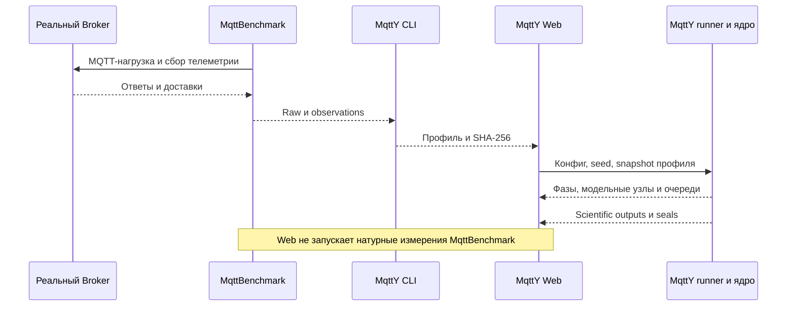
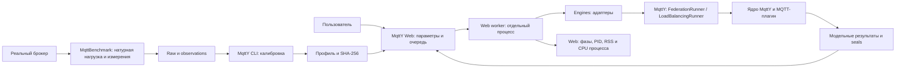
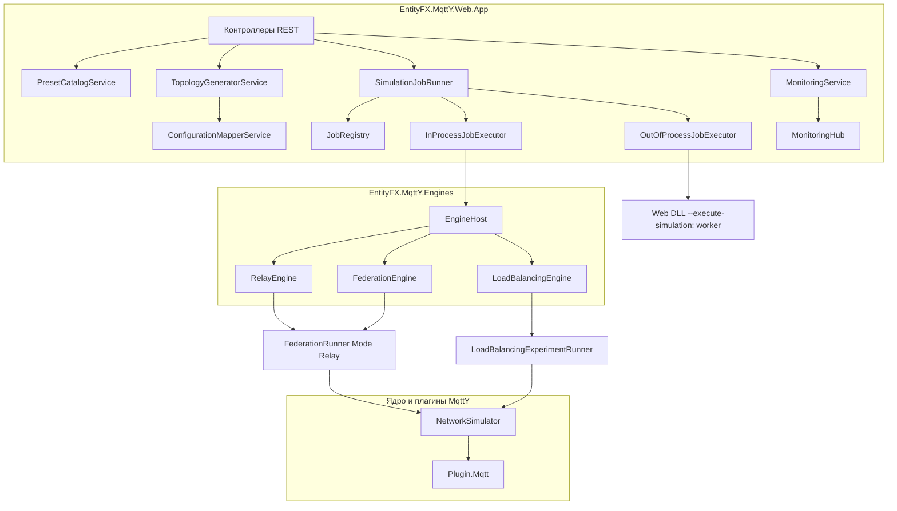

# MqttY.Web — Software Design Document (SDD)

| Поле | Значение |
| --- | --- |
| Версия | 1.1 — уточнение по проверенной реализации |
| Статус | Основные движки реализованы; Linux-приёмка и часть редактора остаются открытыми |
| Платформа | .NET 8 (ASP.NET Core Web API) + C#; клиент — vanilla JS + Bootstrap 5 |
| Базовое ядро | MqttY (подмодуль `mqtty`) |
| Место размещения | внутри `mqtty/src/EntityFX.MqttSimulator`, существующий solution `EntityFX.Mqtty.sln` |
| Результат работы | данная спецификация; реализация — отдельным режимом Code по этапам из раздела 13 |

---

## Проверенные возможности и открытые части реализации

Это SDD содержит и целевой дизайн, и контракт первой реализации. При запуске действуют следующие ограничения:

- Модели Federation, Relay и LoadBalancing исполняют настоящие runners; результаты содержат первичные журналы и seals. Произвольно отредактированный граф пока не преобразуется в научную модель: такой запуск отклоняется HTTP 400. Combined остаётся проектным режимом.
- Предпросмотр LoadBalancing иллюстрирует замысел. Фактический граф берётся из GraphML сохранённого результата. Предпросмотр нельзя выдавать за исполненную топологию.
- Профиль фиксируется snapshot и SHA; отсутствующие точки не подменяются. Демо использует явно названную идеальную модель.
- Очередь ограничена; отменённое queued-задание не запускается, тайм-аут отделён от отмены. После рестарта прежнее незавершённое задание помечается Interrupted. Автоматическое продолжение модельного состояния не реализовано.
- Linux использует loopback, SSH-туннель, OutOfProcess и один worker. Данные, временные файлы и логи — на проверенном mount с резервом места. Отсутствие аутентификации исключает открытый доступ из сети.
- Изменения настроек через API действуют в текущем процессе; постоянные административные настройки задаются environment/config. Удаление задания не удаляет научные доказательства.
- Статические библиотеки интерфейса включены локально с лицензиями и SHA. Swagger включается отдельно.
- CPU/RSS Web worker — наблюдение затрат исполнения. Эти числа не являются CPU/RSS моделируемого реального брокера и не входят в EST.



Оставшиеся требования исходного SDD не считаются выполненными только потому, что присутствуют в следующих проектных разделах. Linux-приёмка фиксируется отдельным receipt; тесты приложения не заменяют её.

## 1. Цель и контекст

Разработать **MqttY.Web** — веб-приложение поверх симулятора MqttY, которое позволяет:

1. строить топологии распределённых сетей с MQTT-брокерами **конфигурацией и графическим редактором**;
2. использовать **пресеты двойников реальных брокеров** (Mosquitto, Aedes, ActiveMQ, EMQX и др.) и **добавлять новые пресеты**;
3. использовать **пресеты топологий**: линейная, кольцо, звезда, комбинированная — с параметрами *длина цепочки*, *число лучей звезды*, *длина кольца*;
4. **генерировать топологии** по параметрам;
5. выполнять **движки** `MqttRelay`, `Federation`, `LoadBalancer` как **библиотеку**, доступную и из CLI (существующие приложения), и из веба;
6. запускать **долгие сложные симуляции** с **мониторингом процессов**;
7. по клику на узел-брокер показывать **статус брокера в диалоговом окне**;
8. в настройках задавать **лимит времени** и **режим параллельного исполнения** (галочка);
9. раскрашивать узлы: **брокер — зелёный, сеть — синяя, клиент — рыжий, relay-приложение — фиолетовое** и т.д.;
10. покрывать всё тестами, соблюдать SOLID, REST API (ASP.NET Core) со Swagger, UI на обычном JS + Bootstrap.

MqttY.Web повторяет функциональность десктопного [Designer](docs/mqtty/designer.md) (Avalonia) в браузере и добавляет серверное исполнение движков, общие пресеты и управление долгими заданиями.

## 2. Существующая кодовая база (что переиспользуем)

| Компонент | Путь | Роль для MqttY.Web |
| --- | --- | --- |
| Ядро симулятора | [`EntityFX.MqttSimulator`](../../mqtty/src/EntityFX.MqttSimulator/EntityFX.MqttSimulator) | `NetworkSimulator`, `Network`, `Client`, `Server`, `NodeBase`, `DijkstraPathFinder`, счётчики, логгер |
| Контракты | [`EntityFX.MqttSimulator.Contracts`](../../mqtty/src/EntityFX.MqttSimulator/EntityFX.MqttSimulator.Contracts) | `INetworkSimulator`, `INetwork`, `INode`, `IServer`, `IClient`, `IApplication`, Options (`NetworkGraphOption`, `NodeOption`, `NetworkOptions`, `TicksOptions`), `INodeQueueDiagnostics` |
| MQTT-плагин | [`EntityFX.MqttY.Plugin.Mqtt`](../../mqtty/src/EntityFX.MqttSimulator/EntityFX.MqttY.Plugin.Mqtt) | `MqttNetworkBuilder`, `MqttClient`, `MqttBroker` (internal), брокерские профили, `BrokerProfileSet`, эксперименты |
| Contracts.Mqtt | [`EntityFX.MqttY.Contracts.Mqtt`](../../mqtty/src/EntityFX.MqttSimulator/EntityFX.MqttY.Contracts.Mqtt) | MQTT-модель: пакеты, QoS, `IMqttBroker`, `IMqttClient` |
| CLI | [`EntityFX.MqttY.Cli`](../../mqtty/src/EntityFX.MqttSimulator/EntityFX.MqttY.Cli) | команды `calibrate` / `experiment` |
| Движок Relay (CLI) | [`EntityFX.MqttY.MqttRelay.App`](../../mqtty/src/EntityFX.MqttSimulator/EntityFX.MqttY.MqttRelay.App) | эксперимент Relay; сохранён; Web Relay использует существующий FederationRunner в режиме Relay |
| Движок Federation (CLI) | [`EntityFX.MqttY.Federation.App`](../../mqtty/src/EntityFX.MqttSimulator/EntityFX.MqttY.Federation.App) | `demo/validate/run/matrix`; сохранены, runner расширен необязательными lifecycle-параметрами |
| Движок LoadBalancer (CLI) | [`EntityFX.MqttY.LoadBalancing.App`](../../mqtty/src/EntityFX.MqttSimulator/EntityFX.MqttY.LoadBalancing.App) | `validate/run/matrix`; сохранены, runner расширен необязательными lifecycle-параметрами |
| Десктоп-дизайнер | [`EntityFX.MqttY.Designer`](../../mqtty/src/EntityFX.MqttSimulator/EntityFX.MqttY.Designer) | источник UI-моделей, конвертации `NetworkDesignModel → NetworkGraphOption`, алгоритмов расстановки |
| Тесты | [`EntityFX.Tests.Integration`](../../mqtty/src/EntityFX.MqttSimulator/EntityFX.Tests.Integration) | регрессионные тесты движков; продолжают работать |

**Ключевые ограничения ядра, которые обязаны учитываться в дизайне:**

- Параллельное обновление одной модели отклоняется ядром (`parallel` + `fidelityMode`). Параллельность в MqttY.Web — это **одновременный запуск нескольких независимых симуляций**, а не распараллеливание одной модели.
- `MqttBroker` является `internal`; брокеры создаются через публичный `MqttNetworkBuilder`.
- Профили брокеров (calibration v3/v4) — внешние JSON-артефакты; точки профиля выбираются по фактическому числу publishers бэкенда.
- Пути в конфигурациях разрешаются относительно файла конфигурации (правило приложений MqttY).
- Воспроизводимость: при одинаковых seed/версии/профилях научные результаты совпадают; реальное время исполнения может различаться.

## 3. Цели и не-цели

### 3.1 Цели

- Полный цикл в браузере: пресет → генерация/редактирование топологии → запуск симуляции движком → мониторинг → просмотр результатов.
- Движки доступны из прежних CLI и через Web-адаптеры `EntityFX.MqttY.Engines`, использующие те же runners.
- SOLID-архитектура: тонкие контроллеры, сервисы с единственной ответственностью, DI.
- REST API с OpenAPI/Swagger и полная тестовая матрица.
- Реальное время: мониторинг и статус узлов через SignalR-хаб; REST-снимки — для запросов по требованию.

### 3.2 Не-цели (v1)

- Не запуск реальных брокеров (Mosquitto/EMQX и т.п.) — MqttY.Web исполняет модельные двойники, как и ядро.
- Без UI-фреймворка: vanilla JS + Bootstrap; SignalR используется только как транспорт реального времени, а не как UI-абстракция.
- Без аутентификации и авторизации: MqttY.Web — локальный инструмент; механизмы учётных записей не проектируются.
- Не перенос всех алгоритмов расстановки из Avalonia Designer: в v1 реализуем Circular и Grid на JS; Force-Directed — опционально.

## 4. Зафиксированные архитектурные решения (ADR)

| # | Решение | Обоснование |
| --- | --- | --- |
| ADR-1 | Новые проекты (движки, Web, тесты Web) размещаются в `mqtty/src/EntityFX.MqttSimulator` и включаются в существующий `EntityFX.Mqtty.sln` | решение пользователя; согласовано с политикой проекта |
| ADR-2 | `EntityFX.MqttY.Engines` содержит тонкие адаптеры публичных runners Federation.App и LoadBalancing.App; Relay вызывает FederationRunner с Mode=Relay. Добавлены необязательные cancellation/progress-параметры, прежние CLI сохраняют поведение | Осознанная зависимость библиотеки от существующих исполняемых сборок избегает дублирования научных алгоритмов. Выделение нейтральной общей библиотеки возможно отдельно; риск регрессии проверяется тестами |
| ADR-3 | Поддержаны InProcess и OutOfProcess. На Linux по умолчанию отдельный worker того же Web DLL (`--execute-simulation`), максимум одно задание | Worker использует те же адаптеры, позволяет завершать зависшее задание и измерять его PID/RSS/CPU. InProcess сохраняется для коротких запусков |
| ADR-4 | Хранилище пресетов, топологий и результатов — **JSON-файлы в каталоге данных**; результаты — каталоги с `manifest/summary/counters` как в CLI | выбор пользователя; повторное использование существующих форматов и инструментов проверки |
| ADR-5 | Движки-библиотека — `net6.0` (совместимость с ядром и существующими CLI); Web-приложение — `net8.0` | ядро и тесты на net6; веб — современный LTS |
| ADR-6 | Мониторинг в реальном времени — SignalR-хаб `/hubs/monitoring` (группы по `simulationId`, события 9.3); REST-эндпоинты снимков сохранены для запросов по требованию и fallback | требование «SignalR используем»; единственный источник событий — `MonitoringService` |
| ADR-7 | Логика движков (политики, генераторы, writers) покрывается в существующем `EntityFX.Tests.Integration`; веб-слой — в новом `EntityFX.Tests.Web` (WebApplicationFactory) | правило проекта «тесты в существующем проекте» + изоляция веб-инфраструктуры |
| ADR-8 | Цветовая схема узлов фиксируется в спецификации (раздел 10.3) и реализуется единым модулем JS | требование пользователя по цветам |
| ADR-9 | Валидация входов на уровне DTO (FluentValidation либо ручная) + валидация в сервисах; относительные пути профилей резолвятся внутри DataDir | защита от path traversal и невалидных конфигураций |
| ADR-10 | Правило кодирования: **один публичный тип — один файл** (имя файла = имени типа), включая новые проекты | стандарт проекта MqttY; удобство навигации и ревью |

## 5. Обзор архитектуры

### 5.1 Контекстная диаграмма (C4, уровень 1)



### 5.2 Компонентная диаграмма уровня 2



## 6. Структура решения

Новые проекты расположены в существующем solution. К существующим runners добавлены необязательные параметры отмены и наблюдения; отдельно добавлены снимки диагностики очередей. Алгоритмы не копируются в Web. Каждый новый публичный тип — в отдельном файле. Ниже приведена исходная проектная структура; точные имена и состав сверяются с реализацией и её README:

```
EntityFX.MqttSimulator/
├── EntityFX.MqttSimulator/                        (существующий, не меняется)
├── EntityFX.MqttSimulator.Contracts/              (существующий, не меняется)
├── EntityFX.MqttY.Plugin.Mqtt/                    (существующий, не меняется)
├── EntityFX.MqttY.Cli/                            (существующий)
├── EntityFX.MqttY.Engines/                        [НОВЫЙ] библиотека движков
│   ├── EntityFX.MqttY.Engines.csproj              (TFM net6.0)
│   ├── Contracts/
│   │   ├── IExperimentEngine.cs
│   │   ├── EngineDefinition.cs
│   │   ├── EngineCommand.cs
│   │   ├── ExperimentRequest.cs
│   │   ├── ExperimentResult.cs
│   │   ├── EngineRunSettings.cs
│   │   └── EngineOutputLayout.cs                  (пути manifest/summary/counters)
│   ├── Hosting/EngineHost.cs                      (единый запуск из CLI и Web)
│   ├── Common/
│   │   ├── ExperimentInputValidator.cs
│   │   ├── ProfileResolver.cs
│   │   ├── PhaseCoordinator.cs
│   │   └── ExperimentResultWriter.cs
│   ├── Relay/
│   │   ├── MqttRelayEngine.cs
│   │   ├── MqttRelayOptions.cs
│   │   ├── RelayTopologyBuilder.cs
│   │   └── MqttRelayExperimentRunner.cs
│   ├── Federation/
│   │   ├── FederationEngine.cs
│   │   ├── FederationOptions.cs
│   │   ├── FederationTopologyBuilder.cs
│   │   ├── StaticFederator.cs
│   │   └── FederationExperimentRunner.cs
│   └── LoadBalancing/
│       ├── LoadBalancingEngine.cs
│       ├── LoadBalancingOptions.cs
│       ├── ConnectionPolicies.cs
│       ├── LoadBalancingTopologyBuilder.cs
│       ├── DeliveryLedger.cs
│       └── LoadBalancingExperimentRunner.cs
├── EntityFX.MqttY.MqttRelay.App/                  (существующий, НЕ изменяется)
├── EntityFX.MqttY.Federation.App/                 (существующий, НЕ изменяется)
├── EntityFX.MqttY.LoadBalancing.App/              (существующий, НЕ изменяется)
├── EntityFX.MqttY.Designer/                       (существующий, не меняется)
├── EntityFX.MqttY.Web.App/                        [НОВЫЙ] веб-приложение
│   ├── EntityFX.MqttY.Web.App.csproj              (TFM net8.0, SPA-статика)
│   ├── Program.cs                                 (DI, Swagger, BackgroundService, StaticFiles)
│   ├── appsettings.json / appsettings.Development.json
│   ├── Controllers/
│   │   ├── EnginesController.cs
│   │   ├── PresetsController.cs
│   │   ├── TopologiesController.cs
│   │   ├── SimulationsController.cs
│   │   └── SettingsController.cs
│   ├── Hubs/
│   │   └── MonitoringHub.cs                       (SignalR-хаб мониторинга)
│   ├── Services/
│   │   ├── DataDirectoryOptions.cs
│   │   ├── IPresetCatalogService.cs / PresetCatalogService.cs
│   │   ├── ITopologyGeneratorService.cs / TopologyGeneratorService.cs
│   │   ├── IConfigurationMapperService.cs / ConfigurationMapperService.cs
│   │   ├── ISimulationJobRunner.cs / SimulationJobRunner.cs
│   │   ├── IJobRegistry.cs / JobRegistry.cs
│   │   ├── IJobExecutor.cs
│   │   ├── InProcessJobExecutor.cs
│   │   ├── OutOfProcessJobExecutor.cs
│   │   ├── IMonitoringService.cs / MonitoringService.cs
│   │   └── JsonFileStore.cs                       (обёртка CRUD над каталогом данных)
│   ├── Models/                                    (DTO, раздел 8)
│   └── wwwroot/
│       ├── index.html
│       ├── css/app.css
│       ├── js/
│       │   ├── api.js
│       │   ├── realtime.js                        (клиент SignalR-хаба)
│       │   ├── router.js
│       │   ├── designer.js
│       │   ├── graph-renderer.js
│       │   ├── layout.js
│       │   ├── topology-generator.js
│       │   ├── presets.js
│       │   ├── monitoring.js
│       │   ├── broker-dialog.js
│       │   └── settings.js
│       └── vendor/bootstrap@5, vendor/signalr
└── EntityFX.Tests.Web/                            [НОВЫЙ] тесты веб-слоя
    ├── EntityFX.Tests.Web.csproj
    ├── TopologyGeneratorApiTests.cs
    ├── PresetsApiTests.cs
    ├── SimulationsApiTests.cs
    ├── JobRunnerTests.cs
    ├── ConfigurationMapperTests.cs
    └── MonitoringApiTests.cs
```

Существующий `EntityFX.Tests.Integration` дополняется тестами движков (параграф 11.1).

## 7. Движки как библиотека (новый код поверх публичного API)

### 7.1 Принцип

`EntityFX.MqttY.Engines` — библиотека адаптеров существующих научных runners. Она ссылается на сборки Federation.App и LoadBalancing.App и сохраняет их валидацию, профили, алгоритмы и writers. В runners добавлены необязательные CancellationToken и callback после Refresh; при прежних вызовах CLI поведение сохраняется и проверяется регрессионными тестами. Web worker запускается из того же Web DLL, затем вызывает EngineHost. Это уточнение заменяет исходное намерение заново реализовать движки только поверх ядра: такое дублирование могло дать несопоставимые результаты.

### 7.2 Контракт движка

```csharp
public interface IExperimentEngine
{
    string Name { get; }                       // "relay" | "federation" | "loadBalancing"
    EngineDefinition Definition { get; }       // описание, список команд, параметры
    Task<ExperimentResult> RunAsync(ExperimentRequest request, EngineRunSettings settings,
        CancellationToken ct);
}

public sealed record ExperimentRequest(
    EngineCommand Command,                     // Run | Validate | Demo | Matrix
    JsonElement Options,                       // конфиг эксперимента (JSON, без разбора в CLI-слое)
    string? OutputDirectory,
    IProgress<EngineProgress>? Progress);      // снимки прогресса для мониторинга

public sealed record EngineRunSettings(
    TimeSpan? TimeLimit,                       // лимит времени (из настроек Web)
    bool ParallelExecution,                    // параллельность нескольких опытов (матрица), не модель
    bool IsolatedProcess);                     // признак внешнего процесса для CLI-запуска

public sealed record EngineProgress(
    long TotalTicks, long Step, int Errors,
    IReadOnlyList<NodeStatusSnapshot>? Nodes); // используется MonitoringService
```

### 7.3 Команды движков

| Приложение | Команды (неизменны) |
| --- | --- |
| `EntityFX.MqttY.MqttRelay.App` | `experiment` (существующий формат конфига), `demo`, `validate` |
| `EntityFX.MqttY.Federation.App` | `demo --brokers --mode --topology`, `validate --config`, `run --config --output`, `matrix` |
| `EntityFX.MqttY.LoadBalancing.App` | `validate --config`, `run --config --output`, `matrix` |

Таблица описывает **существующие неизменные CLI-команды**; библиотека реализует ту же семантику команд (`Run | Validate | Demo | Matrix`) для программного вызова и одинаковый формат результатов (7.4).

### 7.4 Результаты движка

Исполнение в любом режиме формирует каталог результата (совместимо с CLI):

```
<output>/
├── experiment-manifest.json    (настройки, версии, seed, фазы)
├── summary.json                (итоговые показатели)
├── counters.json               (счётчики брокеров и получателей)
└── topology.graphml / topology.puml
```

Web-слой читает эти файлы напрямую и отдаёт их через REST (раздел 9).

## 8. Модель данных и формат конфигурации

### 8.1 Пресет брокера (двойник реального брокера)

Файл `data/presets/brokers/<id>.json`:

```json
{
  "id": "mosquitto-default",
  "name": "Mosquitto — калибровка v3",
  "brokerType": "Mosquitto",
  "profilePath": "profiles/Mosquitto/broker-calibration.v3.json",
  "description": "Двойник Mosquitto по натурным наблюдениям",
  "defaults": { "payloadBytes": 16, "qos": 1, "publishers": 64, "offeredRps": 1000 }
}
```

Поле `profilePath` разрешается относительно каталога данных. Каталог стартовых пресетов для четырёх брокеров (Mosquitto, Aedes, ActiveMQ, EMQX) поставляется как seed-данные; пользователь добавляет/редактирует/удаляет пресеты через UI.

### 8.2 Пресет топологии

Файл `data/presets/topologies/<id>.json`:

```json
{
  "id": "ring-4-mosquitto",
  "name": "Кольцо из 4 брокеров Mosquitto",
  "kind": "ring",
  "ringLength": 4,
  "chainLength": 1,
  "rays": 3,
  "brokerPresetId": "mosquitto-default",
  "clientsPerBroker": 2,
  "relayApps": true,
  "engine": "relay",
  "networkLength": 2,
  "qos": 1,
  "payloadBytes": 16,
  "offeredRps": 1000,
  "warmupTicks": 50000,
  "measurementTicks": 300000,
  "drainTimeoutTicks": 100000,
  "seed": 42,
  "networkType": {
    "name": "ethernet",
    "capacityBytesPerSecond": 100000000,
    "throughputWindowTicks": 100,
    "queueCapacity": 100000,
    "transferTicks": 1
  }
}
```

### 8.3 Виды топологий и параметры генерации

| Вид (`kind`) | Параметры | Правило генерации |
| --- | --- | --- |
| `line` | `chainLength` | `chainLength` брокеров в цепочке; связи соседей `i ↔ i+1` |
| `ring` | `ringLength` | `ringLength` брокеров по кругу; связи `i ↔ (i+1) mod N` |
| `star` | `rays`, `chainLength` | центральный узел-сеть + `rays` лучей; в каждом луче цепочка из `chainLength` сетевых сегментов до брокера |
| `combined` | `rays`, `chainLength`, `ringLength` | ядро: кольцо из `ringLength` узлов (если задано, иначе одиночный центр); от ядра — `rays` лучей-цепочек длины `chainLength` |

Дополнительно генератор распределяет: `clientsPerBroker` клиентов на каждого брокера; relay/federation/load-balancer приложения по `engine`. Число брокеров = `brokers` (переопределяет расчётный размер, если задано). Генератор возвращает:

1. **Design-представление** — [`NetworkGraphOption`](../../mqtty/src/EntityFX.MqttSimulator/EntityFX.MqttSimulator.Contracts/Options/NetworkGraphOption.cs:3) (формат дизайнера: `Networks`, `NetworkTypes`, `Nodes`, `Ticks`, `EnableCounters`, `RandomSeed`), доступное для редактирования в веб-редакторе;
2. **Execution-представление** — конфиг эксперимента движка (секции как у `mqtt-relay-experiment.example.json` + параметры движка), сериализуемое в JSON для out-of-process запуска.

### 8.4 DTO веб-слоя

| DTO | Назначение |
| --- | --- |
| `BrokerPresetDto` | пресет брокера (8.1) |
| `TopologyPresetDto` | пресет топологии (8.2) |
| `TopologySpecDto` | параметры генерации: `kind`, `chainLength`, `rays`, `ringLength`, `brokers`, `brokerPresetId`, `clientsPerBroker`, `relayApps`, `engine`, сеть и протокол |
| `GraphDto` | граф для редактора: `nodes[] { id, name, type, specification, network, position }`, `links[] { from, to, weight }`, `networks[]` |
| `SimulationCreateDto` | запуск: `topologyId | graph` + `engine` + `runSettings { timeLimit, parallel, executionMode }` |
| `SimulationStatusDto` | статус задания: `id, state, engine, progress, ticks, startedAt, finishedAt, outputDir, errors` |
| `NodeStatusDto` | статус узла: `id, name, type, specification, network, connected, queueLength, counters` |
| `MonitoringSnapshotDto` | снимок: `simulationId, state, totalTicks, step, errors, nodes[]` |
| `AppSettingsDto` | настройки: `timeLimit, parallel, executionMode, maxParallelJobs, dataDirectory` |

## 9. REST API и SignalR-хаб (ASP.NET Core + Swagger)

### 9.1 Общие правила

- Базовый путь — `/api`; JSON (System.Text.Json, camelCase), версия v1 в пути: `/api/v1/...` (опционально, по согласованию; в v1 допустимо без версии).
- Swagger: Swashbuckle.AspNetCore, XML-документация контроллеров, OpenAPI 3.0.
- Ошибки: `ProblemDetails` (RFC 7807); валидация DTO возвращает `400` со списком нарушений.
- Все операции над файлами ограничены `DataDirectory` (запрет выхода за его пределы по путям из запросов).
- SignalR: хаб `/hubs/monitoring`; WebSockets в приоритете, автоматический fallback на Server-Sent Events / LongPolling; аутентификация на хабе не требуется (12.2).

### 9.2 Таблица эндпоинтов

| Метод | Путь | Описание |
| --- | --- | --- |
| GET | `/api/engines` | список движков: relay, federation, loadBalancing (имена, команды, параметры) |
| GET | `/api/presets/brokers` | список пресетов брокеров |
| GET | `/api/presets/brokers/{id}` | пресет брокера по id |
| POST | `/api/presets/brokers` | создать/обновить пресет брокера (upsert) |
| PUT | `/api/presets/brokers/{id}` | обновить пресет брокера |
| DELETE | `/api/presets/brokers/{id}` | удалить пресет брокера |
| GET | `/api/presets/topologies` | список пресетов топологий |
| GET | `/api/presets/topologies/{id}` | пресет топологии по id |
| POST | `/api/presets/topologies` | создать/обновить пресет топологии |
| PUT | `/api/presets/topologies/{id}` | обновить пресет топологии |
| DELETE | `/api/presets/topologies/{id}` | удалить пресет топологии |
| POST | `/api/topologies/generate` | сгенерировать топологию по `TopologySpecDto` → `GraphDto` + execution-конфиг |
| GET | `/api/topologies` | сохранённые пользовательские конфигурации топологий |
| GET | `/api/topologies/{id}` | конфигурация топологии |
| POST | `/api/topologies` | сохранить топологию из редактора |
| PUT | `/api/topologies/{id}` | обновить топологию |
| DELETE | `/api/topologies/{id}` | удалить топологию |
| POST | `/api/simulations` | создать и запустить симуляцию (`SimulationCreateDto`) |
| GET | `/api/simulations` | список заданий со статусами |
| GET | `/api/simulations/{id}` | статус задания + сводка |
| POST | `/api/simulations/{id}/pause` | пауза in-process симуляции |
| POST | `/api/simulations/{id}/resume` | возобновление |
| POST | `/api/simulations/{id}/stop` | остановка (для in-process — отмена; для out-of-process — kill процесса) |
| DELETE | `/api/simulations/{id}` | удалить задание и каталог результатов |
| GET | `/api/simulations/{id}/monitor` | `MonitoringSnapshotDto` по запросу (основной реальный канал — SignalR, 9.3) |
| GET | `/api/simulations/{id}/nodes/{nodeId}` | **статус конкретного узла** (`NodeStatusDto`) — для диалога статуса брокера |
| GET | `/api/simulations/{id}/log?offset=` | лог симуляции (кольцевой буфер, максимум 1000 записей) |
| GET | `/api/simulations/{id}/results` | файлы результата: manifest, summary, counters, граф |
| GET | `/api/settings` | текущие настройки |
| PUT | `/api/settings` | обновить настройки (лимит времени, параллельность, режим исполнения, maxParallelJobs) |

### 9.3 SignalR-хаб мониторинга

Путь `/hubs/monitoring`; клиент — пакет `@microsoft/signalr` (транспорт, не UI-абстракция). Хаб тонкий: события собирает `MonitoringService`, хаб только рассылает их по группам заданий.

| Метод клиента → сервер | Аргументы | Описание |
| --- | --- | --- |
| `SubscribeMonitoring` | `simulationId` | подписка на события задания (группа по id) |
| `UnsubscribeMonitoring` | `simulationId` | отписка |

| Событие сервера → клиент | Нагрузка | Когда |
| --- | --- | --- |
| `MonitoringUpdate` | `MonitoringSnapshotDto` | каждые ~1 с при активном задании |
| `NodeStatusUpdate` | `NodeStatusDto` | по запросу диалога брокера и при изменении |
| `LogUpdate` | `LogItemDto` | новые записи лога |
| `SimulationStateChanged` | `SimulationStatusDto` | смена статуса задания |

Диалог статуса брокера (10.4) использует `NodeStatusUpdate` с fallback на REST `GET /api/simulations/{id}/nodes/{nodeId}`.

### 9.4 Примеры

Запуск симуляции:

```http
POST /api/simulations
Content-Type: application/json

{
  "topologyId": "ring-4-mosquitto",
  "engine": "relay",
  "runSettings": {
    "timeLimit": "00:10:00",
    "parallel": true,
    "executionMode": "InProcess"
  }
}
```

Ответ:

```json
{
  "id": "sim-01HZ7...",
  "state": "Queued",
  "engine": "relay",
  "outputDir": "data/simulations/sim-01HZ7..."
}
```

Статус узла (диалог брокера):

```http
GET /api/simulations/sim-01HZ7.../nodes/broker-0
```

```json
{
  "id": "broker-0",
  "name": "broker-0",
  "type": "Server",
  "specification": "mqtt-broker",
  "network": "net-0",
  "connected": true,
  "queueLength": 3,
  "counters": { "published": 1240, "delivered": 1231, "errors": 0 }
}
```

## 10. Frontend (vanilla JS + Bootstrap)

### 10.1 Обзор

Одностраничное приложение без UI-фреймворка: hash-роутер, модули через ES-модули (`<script type="module">`), Bootstrap 5 для UI-компонентов (топбар, вкладки, модальные окна, таблицы). Сетевой слой — [`api.js`](../../mqtty/src/EntityFX.MqttSimulator/EntityFX.MqttY.Web.App/wwwroot/js/api.js) поверх `fetch`; реальное время — [`realtime.js`](../../mqtty/src/EntityFX.MqttSimulator/EntityFX.MqttY.Web.App/wwwroot/js/realtime.js) поверх `@microsoft/signalr` (транспорт, без UI-абстракций).

### 10.2 Экраны

| Маршрут | Экран | Содержимое |
| --- | --- | --- |
| `#/` | Дашборд | список симуляций, краткая статистика |
| `#/topologies` | Каталог и генератор | пресеты топологий, параметры генерации (вид, длина цепочки, лучи, кольцо, пресет брокера, QoS, RPS, seed), кнопка «Сгенерировать» → предпросмотр графа |
| `#/designer` | Редактор графа | SVG-канвас: панель добавления узлов (сеть, брокер, клиент, relay), drag-and-drop, связи, зум, авто-расстановка (circular/grid), сохранение/загрузка, экспорт JSON |
| `#/simulations` | Мониторинг | таблица заданий (id, движок, статус, прогресс, время), кнопки start/pause/resume/stop, граф в реальном времени, лог |
| `#/presets` | Пресеты | две вкладки: брокеры и топологии; CRUD-формы |
| `#/settings` | Настройки | **лимит времени**, **режим параллельного исполнения (checkbox)**, режим исполнения по умолчанию (in-process/out-of-process), максимальное число параллельных заданий |

### 10.3 Цветовая схема узлов (спецификация)

Единая таблица в [`graph-renderer.js`](../../mqtty/src/EntityFX.MqttSimulator/EntityFX.MqttY.Web.App/wwwroot/js/graph-renderer.js): цвет определяется парой `(тип узла, specification)`.

| Тип узла | `specification` | Роль | Цвет | Hex |
| --- | --- | --- | --- | --- |
| Network | — | сеть | синий | `#1565C0` |
| Server | `mqtt-broker` | **брокер** | зелёный | `#2E7D32` |
| Client | `mqtt-client` / `mqtt-publisher` / `mqtt-subscriber` | **клиент** | рыжий (оранжевый) | `#E65100` |
| Application | `mqtt-relay` | **relay-приложение** | фиолетовый | `#7B1FA2` |
| Application | `mqtt-load-balancer` | load-balancer | малиновый | `#AD1457` |
| Application | `mqtt-federation` | federation-gateway | янтарный | `#F9A825` |
| Application | прочее | приложение/forwarder | серо-голубой | `#546E7A` |
| Link | — | связь между сетями | серый со стрелкой и весом | `#90A4AE` |
| Connection | — | подключение узла к сети | пунктир | `#B0BEC5` |

Легенда цветов отображается в редакторе и в мониторинге. Состояние узла дополнительно маркируется рамкой: зелёная — активен, серая — остановлен, красная — ошибка.

### 10.4 Диалог статуса брокера

Клик по узлу-брокеру открывает Bootstrap-модальное окно. Реализация — [`broker-dialog.js`](../../mqtty/src/EntityFX.MqttSimulator/EntityFX.MqttY.Web.App/wwwroot/js/broker-dialog.js):

1. подписка на событие `NodeStatusUpdate` хаба (9.3) для `simulationId` + `nodeId`;
2. вывод полей из `NodeStatusDto`: имя, сеть, состояние подключения, длина очереди, счётчики (published/delivered/errors и др.), ошибки;
3. при отсутствии соединения с хабом — fallback на `GET /api/simulations/{id}/nodes/{nodeId}` с интервалом 2 с; при закрытии окна — отписка.

### 10.5 Редактор графа

- Рендер: SVG (`<svg viewBox>`), панорамирование и зум; узлы — прямоугольники (сети) и фигуры по типу (брокер/клиент/relay), связи — стрелки, пунктир — подключения к сетям (как в Avalonia Designer).
- Панель инструментов: добавление сети, брокера, клиента, relay-приложения; удаление выбранного; авто-расстановка (Circular/Grid); зум.
- Инспектор выбранного узла: имя, тип, specification, пресет брокера, сетевая принадлежность.
- Сохранение: POST `/api/topologies` (GraphDto в JSON); загрузка: список сохранённых.
- Модель редактора поддерживает обратную конвертацию в `NetworkGraphOption` для серверного запуска.

## 11. Тестирование

### 11.1 Движки — `EntityFX.Tests.Integration` (расширение)

| Тест | Покрытие |
| --- | --- |
| `LoadBalancingEngineTests` | политики single/directBalanced/roundRobin/leastConnections, карта publisher→backend, отрицательный тест межброкерной доставки |
| `FederationEngineTests` | линия/кольцо/звезда, QoS 0/1/2, локальные и удалённые subscribers, циклы/переполнения/drain |
| `MqttRelayEngineTests` | эксперимент relay: фазы warmup/measurement/drain, манифест, счётчики |
| `EngineHostTests` | единый запуск CLI-команд и программного вызова: эквивалентные результаты |
| `EngineProgressTests` | публикация `IProgress<EngineProgress>` и корректность снимков |
| Регрессия | выбранные регрессионные тесты ядра и приложений должны пройти; точный набор, число, версия и исключения сохраняются в receipt |

### 11.2 Веб-слой — `EntityFX.Tests.Web` (новый, xUnit + WebApplicationFactory)

| Тест | Покрытие |
| --- | --- |
| `PresetsApiTests` | CRUD пресетов брокеров и топологий, валидация, дубликаты, удаление, path traversal |
| `TopologyGeneratorApiTests` | генерация 4 видов топологий, параметры длина/лучи/кольцо, валидация границ (chainLength<2 → 400 и т.п.) |
| `SimulationsApiTests` | создание, статусы Queued→Running→Completed/Failed, stop (in-process и out-of-process), удаление |
| `JobRunnerTests` | лимит времени (CancelAfter), параллельность (максимум параллельных заданий), очередь, отмена |
| `ConfigurationMapperTests` | round-trip GraphDto ↔ NetworkGraphOption ↔ execution-конфиг |
| `MonitoringApiTests` | снимок мониторинга, статус конкретного узла, лог с offset, формат `NodeStatusDto` |
| `MonitoringHubTests` | подключение к хабу, подписка/отписка групп, события `MonitoringUpdate` / `NodeStatusUpdate` / `LogUpdate` / `SimulationStateChanged` |

Интеграционные тесты используют временный `DataDirectory` (temp-каталог) и короткие идеальные симуляции (`ideal: true`, малые ticks) для скорости. Параллельное исполнение и лимиты — через тестовые настройки.

### 11.3 Фронтенд

Логика C# покрыта серверными тестами; JS-модули рефакторятся так, чтобы чистая логика (цветовая таблица, layout, сериализация узлов) была тестируемой. Полноценный JS-тест-раннер — вне v1 (отмечено как необязательное).

## 12. Конфигурация, безопасность, развёртывание

### 12.1 appsettings.json

```json
{
  "MqttYWeb": {
    "DataDirectory": "data",
    "DefaultTimeLimit": "00:10:00",
    "DefaultParallel": false,
    "DefaultExecutionMode": "InProcess",
    "MaxParallelJobs": 4,
    "PollIntervalSeconds": 1,
    "OutOfProcess": {
      "Dll": "mqtty/src/EntityFX.MqttSimulator/EntityFX.MqttY.MqttRelay.App/bin/Release/net6.0/EntityFX.MqttY.MqttRelay.App.dll",
      "ArgsTemplate": "{engine} run --config {config} --output {output}"
    }
  }
}
```

Шаблон аргументов внешнего процесса содержит плейсхолдеры `{config}` (временный JSON конфигурации) и `{output}` (каталог результата). Внешний CLI (существующее приложение, **без изменений**) формирует результаты в формате 7.4; in-process движок — через общий `EngineHost` библиотеки.

### 12.2 Безопасность

- Валидация всех путей запросов внутри `DataDirectory` (отклонение `..`, абсолютных путей).
- Ограничение размера загружаемых JSON (по умолчанию 2 МБ).
- Ошибки двигателя не раскрывают стек; `ProblemDetails` с кодами.
- Аутентификация и авторизация **не требуются** (раздел 3.2): MqttY.Web — локальный инструмент; при публикации в сеть доступ ограничивается на уровне reverse-proxy.

### 12.3 Развёртывание

- `dotnet publish -c Release` Web-приложения (net8.0), статические файлы в `wwwroot` копируются автоматически.
- Каталог данных монтируется отдельно (persistence); результаты симуляций и пресеты переживают рестарт.
- Движки поставляются в составе Web (in-process) и как CLI приложения (out-of-process).

## 13. Этапы реализации (для режима Code)

| Этап | Содержание | Приёмка |
| --- | --- | --- |
| **0. Библиотека движков** | Создать `EntityFX.MqttY.Engines` (новый код): `IExperimentEngine`, `EngineHost`, реализации relay/federation/loadBalancing поверх публичного API ядра; существующие проекты не трогаются | Сборка solution с новыми проектами; существующие тесты зелёные без изменений; новые юнит-тесты движков зелёные |
| **1. Веб-каркас** | Проект `EntityFX.MqttY.Web.App`, DI, Swagger, StaticFiles, `appsettings`; DTO; `JsonFileStore` и `DataDirectoryOptions` | Swagger открывается; пустые GET-эндпоинты отвечают 200 |
| **2. Пресеты и каталог** | `PresetCatalogService`, seed-пресеты 4 брокеров + 4 видов топологий; CRUD-контроллеры | `PresetsApiTests` |
| **3. Генератор топологий** | `TopologyGeneratorService`: line/ring/star/combined; design + execution представления; `ConfigurationMapperService` | `TopologyGeneratorApiTests` + unit-тесты в `Tests.Integration` |
| **4. JobRunner** | `JobRegistry`, `SimulationJobRunner`, in-process исполнитель (Channel + воркеры + SemaphoreSlim), лимит времени, параллельность; статусы | `JobRunnerTests`, `SimulationsApiTests` |
| **5. Out-of-process** | `OutOfProcessJobExecutor` (Process.Start CLI, мониторинг PID, kill), переключение по `executionMode`; прогресс по файлам | тест гибридного режима |
| **6. Мониторинг** | `MonitoringService`, подписка на `IProgress<EngineProgress>`, снимки, кольцевой буфер лога; **SignalR-хаб `MonitoringHub`**; эндпоинты monitor/nodes/log/results | `MonitoringApiTests`, `MonitoringHubTests` |
| **7. Frontend** | каркас SPA (router, api.js, realtime.js с `@microsoft/signalr`), дашборд, каталог+генератор, редактор графа (SVG, цвета, layout), мониторинг через хаб, диалог брокера, пресеты, настройки | ручная проверка сценариев 14.1–14.4 |
| **8. Тесты и документация** | дополнение тестов, README веба, сборка CI-прогона (sln build + test) | полный прогон `dotnet test` |

## 14. Сценарии использования

```mermaid
sequenceDiagram
    participant U as Пользователь
    participant UI as SPA JS
    participant API as ASP.NET Core API
    participant JR as SimulationJobRunner
    participant E as Engine библиотека
    U->>UI: Выбирает пресет топологии и параметры генерации
    UI->>API: POST /api/topologies/generate
    API-->>UI: Граф топологии с цветами узлов
    U->>UI: Редактирует граф и сохраняет
    UI->>API: POST /api/topologies
    U->>UI: Start симуляции
    UI->>API: POST /api/simulations
    API->>JR: Постановка задания в очередь
    JR->>E: RunAsync с лимитом времени и прогрессом
    E-->>JR: EngineProgress снимки
    U->>UI: Клик по узлу-брокеру
    UI->>API: GET /api/simulations/{id}/nodes/{nodeId}
    API-->>UI: NodeStatusDto в модальном окне
    U->>UI: Stop симуляции
    UI->>API: POST /api/simulations/{id}/stop
```



## 15. Соблюдение SOLID

| Принцип | Применение |
| --- | --- |
| S — единственная ответственность | контроллеры без логики; `PresetCatalogService`, `TopologyGeneratorService`, `ConfigurationMapperService`, `SimulationJobRunner`, `MonitoringService` — по одной задаче |
| O — открытость/закрытость | `IExperimentEngine` (новый движок без изменения runner); `ConnectionPolicies` (новые политики); `TopologyKind` (новые виды без изменения генератора); `IJobExecutor` (in/out-process) |
| L — подстановка | любой движок подставляется в `EngineHost`; in-process/out-of-process executor взаимозаменяемы через `IJobExecutor` |
| I — разделение интерфейсов | узкие контракты: `IExperimentEngine`, `IJobRegistry`, `IPresetCatalogService`, `ITopologyGeneratorService`, `IMonitoringService`; потребители видят минимум |
| D — инверсия зависимостей | DI-контейнер; зависимости через интерфейсы; ядро исполнения зависит от `Contracts` MqttY, а не от реализаций |

## 16. Риски и открытые вопросы

- **net6/net8 граница**: движки остаются net6.0; если позднее потребуется поднять TFM всего solution, это отдельное изменение (затрагивает CLI и тесты).
- **Прогресс out-of-process**: точность снимков ограничена частотой записи `progress.json` движком; уточняется в этапе 5.
- **Аутентификация не требуется** (разделы 3.2, 12.2): SignalR-хаб работает без авторизации, доступ локальный; при публикации в сеть — ограничение на reverse-proxy.
- **Событийная плотность хаба**: частота `MonitoringUpdate` (~1 с) ограничивает нагрузку на клиентов; при необходимости — троттлинг в `MonitoringService`.
- **Force-Directed расстановка на JS** — вне скоупа v1 (остаётся Circular/Grid).
- **Функциональная близость к существующим .App**: библиотека вызывает существующие runners; изменения lifecycle и диагностики проверяются регрессионными тестами. Зависимость от App-сборок является явным компромиссом, а не отсутствием риска.

## 17. Связанные документы

- [Архитектура MqttY](docs/mqtty/architecture.md)
- [MqttY Designer (десктоп)](docs/mqtty/designer.md)
- [MqttRelay](docs/mqtty/mqtt-relay.md)
- [Федерация: дизайн](docs/mqtty/federation/design.md)
- [Балансировка: дизайн](docs/mqtty/load-balancing/design.md)
- [Своя топология через public API](docs/mqtty/custom-topology.md)