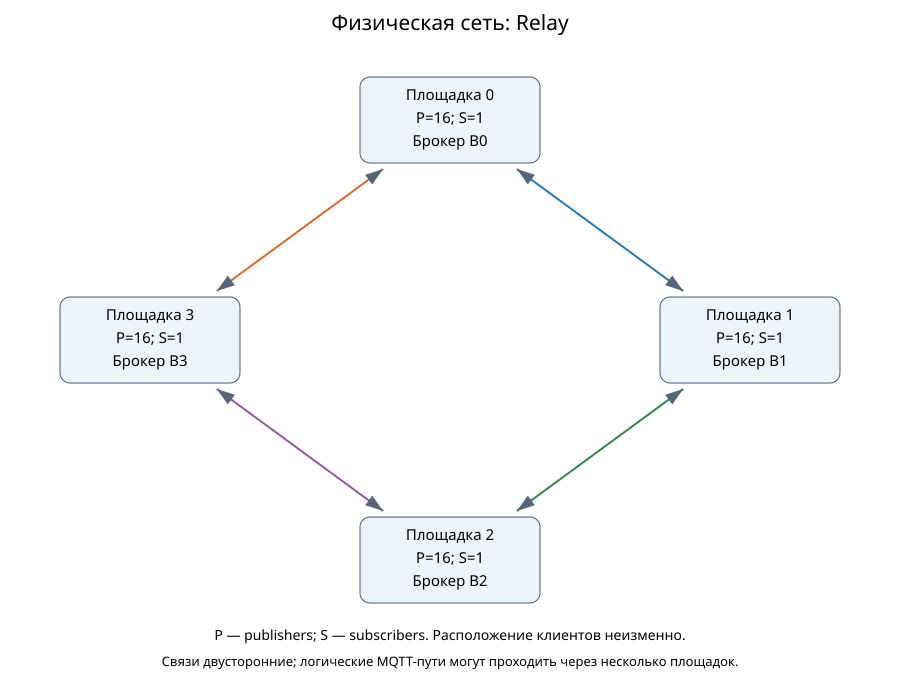

# Четыре площадки: физическое кольцо, Relay каждый каждому

Копия схем сохранённого опыта; брокеров 4, дополнительных сетевых узлов без брокера 0. Полезная нагрузка и MQTT-параметры приведены в [отчёте](../../../../reports/analysis/Network-main-recount.md). Это конкретная схема опыта, не готовый универсальный пресет Web.

## Физическая сеть

[Mermaid](topology-physical.mmd)

## Логические маршруты

[Mermaid](topology-logical.mmd)

Relay соединяет брокеры логически каждый с каждым; физический путь может содержать транзит. Узел транзита не является брокером. Схемы скопированы побайтно; источники и SHA указаны в общем catalog.json. [Каталог](../../README.md).
