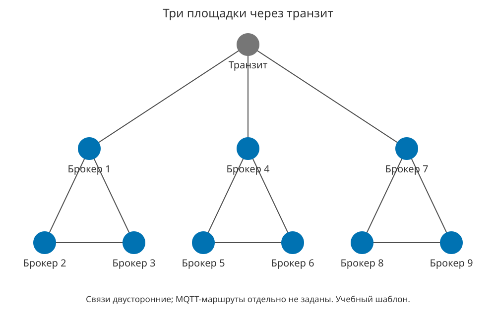

# Три площадки через транзит

Учебный шаблон, не результат выполненного опыта. Брокеров: 9; сетевых узлов без брокера: 1; двусторонних связей: 12.

[Mermaid](topology.mmd) · [Описание узлов и связей](topology.json) · [Каталог](../../README.md)

JSON описывает документированную схему и не является проверенным форматом импорта Web или конфигурацией эксперимента. Расписание, скорости каналов, подписки и логические маршруты нужно задавать отдельно.
