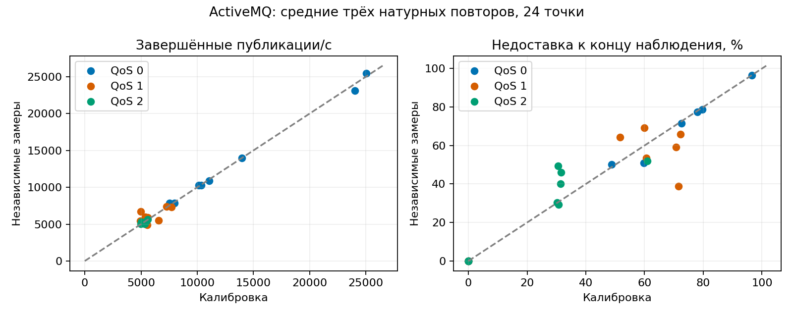

# ActiveMQ Classic: диагностика расхождений двойника

Диагностика набора `overnight-20261018-instrumentation-v2` от 19 октября 2026 года. На момент диагностики цикл ActiveMQ был завершён, другие брокеры продолжали основную серию. Итог всей серии теперь приведён в [сводке](README.md). Все проверки ниже исключены из её покрытия.

**Главный результат:** расхождения имеют несколько причин. В части опытов QoS 0 зафиксированы ошибки разбора MQTT и разрывы соединений. Генератор продолжает вызывать публикацию на отключённом клиенте; эти локальные ошибки входят в attempted RPS и долю ошибок. Отдельно наблюдается большой разброс доставки между натурными повторами. Текущая модель с фиксированными вероятностями не описывает оба эффекта.

## Что проверено

- 144 натурных результата: 72 калибровочных и 72 независимых. Сводки сверены с запечатанными результатами в архивах.
- Во всех 144 архивах проверены хэши прочитанных результатов, CPU/RSS, guard, отметок окончания и журналов брокера. Это не проверка каждого байта всех 144 архивов.
- Для 24 попыток проверены полный SHA-256 архива и все внутренние seals, затем независимо пересчитаны ID попыток, исходов и получений. Различий в проверенных счётчиках, неурегулированных публикаций и повторных ID попыток нет. p99 этим пересчётом не проверялся.
- Выборка raw: 16 байт/QoS 1/16 отправителей; 256 байт/QoS 0/64 и 128 отправителей; 256 байт/QoS 1/64 отправителя. Все три повтора обеих серий — 24 архива.
- Проверены итоги 72 Fidelity и 72 контрольных симуляций. Профиль не изменялся: `d66a0f64cb195e29565e03a5531bdde45ccd9aee7b5d39ca7b26102d45706b2a`.

[Исходные итоги диагностики](data/ActiveMQ-diagnosis-20261019/diagnosis.json) · [Калибровочные наблюдения](data/ActiveMQ-diagnosis-20261019/calibration-observations.json) · [Независимые наблюдения](data/ActiveMQ-diagnosis-20261019/validation-observations.json). Пути архивов, их хэши и результаты пересчёта перечислены в JSON.

## Где нарушена точность

В Fidelity нарушены критерии у 2/72 сценариев, в независимом контроле — у 43/72, относящихся к 15/24 точкам нагрузки. Все 72 контрольные симуляции имеют статус завершения; нарушение точности не является аварийным завершением программы.

| Критерий | Сценариев с нарушением |
| --- | ---: |
| Недоставка: разность больше 5 п.п. | 33 |
| RPS: отклонение больше 15% | 10 |
| Ошибки публикации: разность больше 5 п.п. | 6 |
| p99: отклонение больше 20% | 4 |

В одном сценарии могут нарушаться несколько критериев. Три seed одной точки не являются тремя независимыми натурными измерениями.

## Разрывы соединений и цикл генератора

| Серия | Ошибок вызова публикации | Из них «клиент не подключён» |
| --- | ---: | ---: |
| Калибровка | 99393 | 98373 |
| Независимые замеры | 498650 | 497472 |

Например, в калибровочном опыте 256 байт/QoS 0/128 отправителей, повтор 1: 74 794 ошибок, из них 74 773 — `The client is not connected`. Такие вызовы занимали в среднем около 0,121 мс. Это повторные локальные ошибки нескольких клиентов, а не 74 тысячи отдельных разрывов или отказов обработки на сервере.

Реализация подтверждает механизм: [CampaignWorkloadRunner](../MqttBenchmark/src/EntityFX.MqttBenchmark.Campaign/Workload/CampaignWorkloadRunner.cs) регистрирует попытку до вызова PublishAsync, ловит исключение и продолжает цикл; повторное подключение или остановка отключённого отправителя не предусмотрены. Следовательно, доля ошибок и attempted RPS зависят также от скорости локального цикла после разрыва.

Исходный [MqttClient MQTTnet 4.3.3.952](https://github.com/dotnet/MQTTnet/blob/v4.3.3.952/Source/MQTTnet/Client/MqttClient.cs) подтверждает, что проверка подключения выполняется до отправки пакета. Поэтому ошибки «клиент не подключён» нельзя считать отдельными сетевыми публикациями. Также при QoS 0 результат возвращается после отправки без ожидания MQTT-подтверждения.

В брокерных журналах обнаружены следующие сообщения. Считаются попытки с хотя бы одним совпадением; категории пересекаются:

| Сообщение | Натурных попыток |
| --- | ---: |
| `Remaining length exceeds` | 16 |
| `Invalid message encoding` | 17 |
| `Unknown MQTTFrame` | 19 |
| `ArrayIndexOutOfBoundsException` | 7 |
| `Channel was inactive` | 11 |

Ошибки разбора найдены при QoS 0 на высоких нагрузках. Они указывают на нарушение протокольного обмена, но не устанавливают виновный компонент. Без записи TCP-потока нельзя решить, неверные байты отправил клиент, нарушился поток после отмены записи или корректный пакет неверно разобрал брокер.

Исходный [MQTTWireFormat ActiveMQ 6.3.2](https://github.com/apache/activemq/blob/activemq-6.3.2/activemq-mqtt/src/main/java/org/apache/activemq/transport/mqtt/MQTTWireFormat.java) подтверждает, что ошибка remaining length возникает при декодировании входящего кадра. Само совпадение текста с известной ошибкой другой длины пакета не доказывает ту же причину здесь.

## Телеметрия и разброс результатов

Все 144 попытки имеют успешный guard и покрывающую конец нагрузки телеметрию с тем же unitId. Максимальный зарегистрированный CPU контроллера — 43,56%, ниже заданных 99%. Пиковый RSS брокера в этих записях — около 402 МиБ. Зарегистрированных сообщений OutOfMemoryError нет; параметр JVM `-XX:+ExitOnOutOfMemoryError` не считается событием OOM. CPU брокера достигал 100% одного логического CPU в интервалах захвата; это не доказывает, что он был постоянно насыщен во всём измерительном окне. Данные GC и запись TCP в этих архивах отсутствуют.



При 256 байтах/QoS 1/64 отправителях средняя недоставка изменилась с 71,51% до 38,90%. В трёх контрольных повторах — от 16,11% до 82,52%. Модель даёт около 71–72%, близко к данным настройки. Это подтверждает слабую переносимость фиксированной точки профиля между опытами, но не устанавливает, вызван разброс очередями, JVM, планировщиком или приёмником. При таком числе повторов нельзя оценить эти причины по одному среднему.

Дополнительная проверка без симулятора: если непосредственно сравнить средние калибровки и независимых измерений по тем же допускам, хотя бы одно превышение есть в 14/24 точках. По недоставке — в 11/24; это те же 11 точек, которые дали все 33 нарушения недоставки в контрольных симуляциях. Даже точное воспроизведение калибровочных средних здесь не прошло бы проверку новых средних. Это сравнение порогов, а не тест статистической значимости: широкие интервалы и всего три повтора не позволяют объявить доказанное изменение свойств брокера. [Поточечный расчёт](data/ActiveMQ-diagnosis-20261019/native-reference-drift.json).

Недоставка означает отсутствие получения к концу измерения и drain. Она не доказывает окончательное удаление сообщения брокером. Для QoS 0 завершение PublishAsync не является подтверждением приёма брокером.

## Проверка длительности модельного окна

Отдельная проверка на Windows: те же бинарные файлы симулятора, неизменённые профиль, seed, offered load и пороги. Изменяется только длительность модельной нагрузки: 2 или 10 секунд; прогрев и drain сохранены. Это диагностика на уже известных контрольных данных, а не новый независимый контроль. Выборка с одним seed не позволяет сделать вывод обо всей сетке.

| Сценарий | Окно, с | RPS модели | Недоставка, % | Нарушенных критериев |
| --- | ---: | ---: | ---: | ---: |
| m16.q1.p16.s42 | 2 | 5458.0 | 51.83 | 1 |
| m16.q1.p16.s42 | 10 | 5481.9 | 51.48 | 1 |

Совпадение научных итогов повторов 2 с с Linux: **да**. [Полные результаты](data/ActiveMQ-diagnosis-20261019/duration-results.json).

В проверенной точке 16 байт/QoS 1/16 отправителей модель дала 51,83% недоставки при 2 с и 51,48% при 10 с; эталон — 64,33%. Критерий не выполнен в обоих вариантах. Увеличение окна само по себе не устранило это расхождение; вывод ограничен этой точкой и seed 42.

Дополнительные тяжёлые диагностические точки остановлены административно до получения итога ради ограничения времени. Их незавершённые выходы и причина сохранены отдельно; они не считаются наблюдениями точности или сбоями основной кампании.

## Вариант устранения

1. **Сначала привести нагрузку к определённому поведению при разрыве.** Для следующей серии прекращать работу отключённого отправителя и учитывать длительность его доступности отдельно. Политику повторного подключения вводить только явно. Разделить ошибки локального вызова, таймауты и подтверждённые ответы брокера. Старые численные результаты сохранить без пересчёта в «исправленную» методику.
2. **Локализовать ошибки протокола.** После основной серии повторить несколько проблемных точек с ограниченным захватом TCP и журналом отключений. Проверить длины и порядок MQTT-кадров независимым декодером; сопоставить с отменами записи и сообщениями брокера. Сравнение другой версии клиента или другого транспорта брокера — отдельный опыт с одной изменяемой причиной.
3. **Уточнить модель по новым калибровочным данным.** Для режима с разрывами нужна модель состояния соединения и активного времени отправителя. Для перегрузки нужны проверенные зависимости скорости и доставки от нагрузки и состояния очереди; единственная фиксированная вероятность не воспроизводит наблюдаемый разброс. Проверить соответствие окон и числителей RPS: симулятор учитывает завершения в drain с делением на фиксированное измерительное окно, benchmark использует фактическое время завершения нагрузочной фазы.
4. **Проверять исправления новой серией.** Сначала небольшой пробный набор, затем новая калибровка и новый независимый контроль. Данные, по которым выбрано исправление, больше не являются независимым контролем для исправленной модели. Пороги 15% / 20% / 5 п.п. сохраняются.

Текущая основная серия и её профиль не изменены. Заключение «ActiveMQ аварийно завершился 43 раза» неверно. Также пока неверно утверждать, что все 43 расхождения объяснены одной ошибкой генератора: большинство критериев нарушены по доставке, а не по ошибкам вызова.

## Воспроизведение

```bash
python tools/campaign/diagnose-activemq.py --controller <controller> --evidence-root <доступный-корень-архивов> --archive-prefix <исходный-Linux-корень-архивов> --output <новый-каталог>
python -m unittest discover -s tools/campaign -p test_activemq_diagnosis.py -v
python tools/campaign/write-activemq-diagnosis.py --data reports/data/ActiveMQ-diagnosis-20261019 --report reports/ActiveMQ-diagnosis.md
```

При наличии результатов проверки длительности передайте генератору дополнительно `--duration <results.json>`. [Сценарий проверки длительности](../tools/campaign/probe-activemq-duration.py) запускается на отдельном компьютере с тем же runtime. Полные диагностические модельные выходы сохранены отдельно от основной серии; в публикации находятся их итоги.
