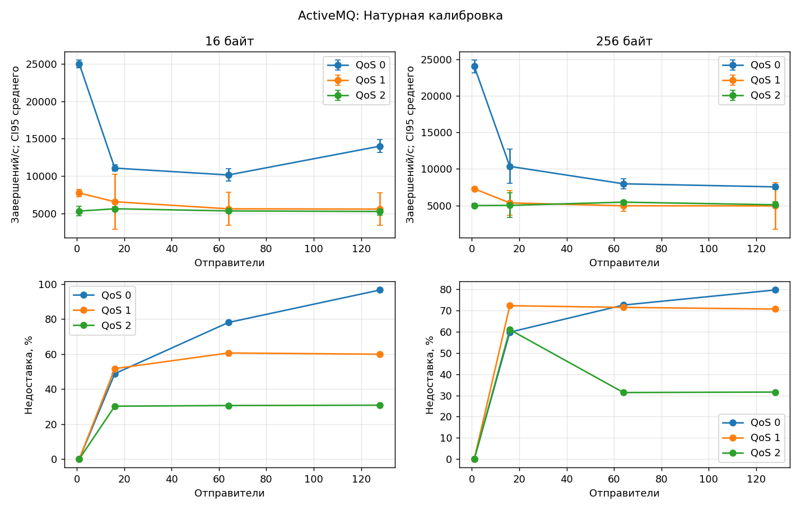
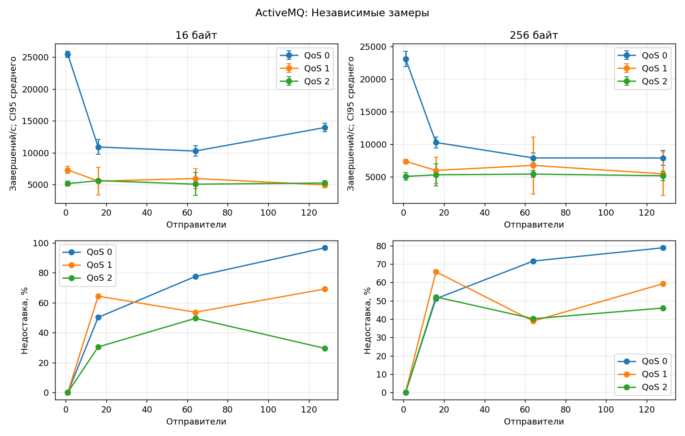
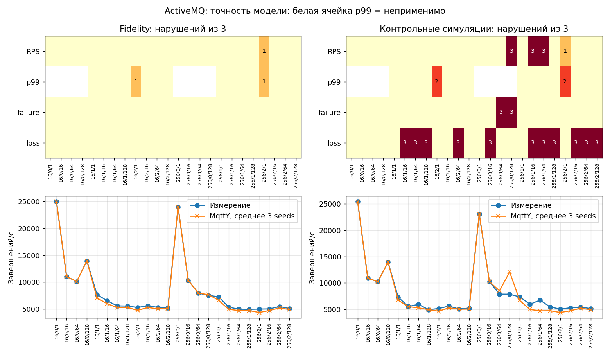
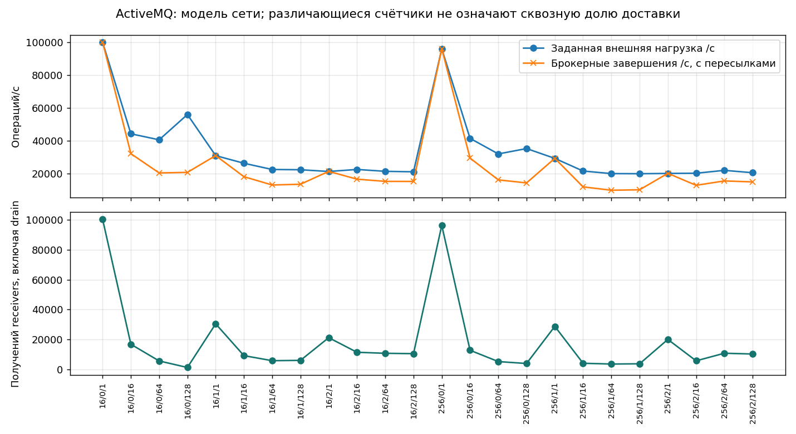

# ActiveMQ: итоговый отчёт

Полный цикл: **144 натурных измерения и 216 симуляций**. Финальная серия завершена 19 октября 2026 года в 16:44 МСК. Полное покрытие не означает прохождения всех проверок точности. [Сравнение и EST](Broker-comparison.md) · [Краткий выбор](Best-broker.md) · [HTML](ActiveMQ.html).

## Установка и воспроизведение

Брокер: **6.3.2**; исполняющая среда: `openjdk version "17.0.19" 2026-04-21 OpenJDK Runtime Environment (Red_Hat-17.0.19.0.10-alt1) (build 17.0.19+10) OpenJDK 64-Bit Server VM (Red_Hat-17.0.19.0.10-alt1) (build 17.0.19+10, mixed mode, sharing)`. Linux, Intel Xeon E5-2680 v3, 12 физических ядер / 24 логических CPU; контроллер и брокер на одной машине, loopback. Брокер закреплён за CPU 0, контроллер — за 1–11 и 13–23. Это не эксклюзивное физическое ядро; SMT, память и ОС общие. Натурные измерения и симуляции не пересекались. Guard контроллера — 99%, это не предел CPU брокера.

Сетка: 16/256 байт × QoS 0/1/2 × 1/16/64/128 отправителей × три повтора. Натурные warmup/measurement/cooldown/drain: 5/20/1/до 10 с. Модель: 1/2/до 5 с, seeds 42/43/44. BrokerFidelity: closedLoopPerPublisher, empiricalServiceBudget, tick=10 мкс. Relay: openLoopRate, fixed, tick=100 мкс. Запуски симуляций выполнялись до четырёх одновременно, обновление внутри каждой модели последовательное.

Измерительный CLI: `3a689466009a0d5410f5dc88dc1282d72c27f7dd`; MqttY: `115885e012053d0112413e07743b061369ebea93`; калибратор: `f61daa47ec581ff88f20ee70882722085d1a0a10`. Изменения скриптов телеметрии и происхождение заимствованных этапов записаны в [series](data/series.json), [native-origins](data/native-origins.json), [repair-transition](data/repair-transition.json). Идентификаторы исходных серий сохранены; они не заменены идентификатором итоговой сборки.

[Настройки стенда](data/inputs/ActiveMQ-stand.json) · [Калибровочная программа](data/inputs/ActiveMQ-calibration.json) · [Контрольная программа](data/inputs/ActiveMQ-validation.json) · [Окружение](data/environment.json).

Профиль: [broker-calibration.v3.json](data/ActiveMQ/profile/broker-calibration.v3.json), SHA-256 `d66a0f64cb195e29565e03a5531bdde45ccd9aee7b5d39ca7b26102d45706b2a`. Хэш проверен во всех manifests Fidelity, holdout и Relay; независимые измерения не изменяли профиль.

## Покрытие

| Этап | Готово | Технические попытки | Нарушения точности |
| --- | --- | --- | --- |
| Натурная калибровка | ✅ 72/72 | ❌ 0; прервано 0 | ⚠ неприменимо |
| Fidelity | ✅ 72/72 | ❌ 0 незавершённых в итоговом индексе | ⚠ 2 |
| Независимые замеры | ✅ 72/72 | ❌ 0; прервано 0 | ⚠ неприменимо |
| Контрольные симуляции | ✅ 72/72 | ❌ 0 незавершённых в итоговом индексе | ⚠ 43 |
| MqttRelay | ✅ 72/72 | ❌ 0 незавершённых в итоговом индексе | ⚠ натурного эталона нет |

Технические ошибки относятся к попыткам, а предупреждения — к завершённым сценариям. Итоговый индекс симуляций не является полным журналом прежних перезапусков. Pilots и диагностика исключены из покрытия.

## Натурная калибровка

Средние по трём повторам. ± — полуширина CI95 Стьюдента: 4,30265273 × s / √3. Полные интервалы RPS, failure/loss и задержек сохранены в JSON. p50/p95/p99 — среднее перцентилей повторов, а не перцентиль объединённых сообщений. Для QoS 0 ACK latency неприменима. RTT измерен отдельно.

| Байт | QoS | N | Попыток/с | Завершений/с ± CI95 | Failure, % | Loss, % | p50, мс | p95, мс | p99, мс | RTT, мс |
| --- | --- | --- | --- | --- | --- | --- | --- | --- | --- | --- |
| 16 | 0 | 1 | 2.502e+04 | 2.502e+04 ± 513.1 | 0 | 0 | н/п | н/п | н/п | 0.7384 |
| 16 | 0 | 16 | 1.105e+04 | 1.105e+04 ± 414.6 | 0 | 48.79 | н/п | н/п | н/п | 0.7234 |
| 16 | 0 | 64 | 1.013e+04 | 1.012e+04 ± 834.3 | 0.03366 | 78.02 | н/п | н/п | н/п | 0.6553 |
| 16 | 0 | 128 | 1.399e+04 | 1.398e+04 ± 858.2 | 0.05505 | 96.57 | н/п | н/п | н/п | 0.6309 |
| 16 | 1 | 1 | 7712 | 7712 ± 499.8 | 0 | 0 | 0.08967 | 0.1483 | 0.2135 | 0.6248 |
| 16 | 1 | 16 | 6545 | 6545 ± 3648 | 0 | 51.66 | 0.6782 | 13.12 | 22.81 | 0.5837 |
| 16 | 1 | 64 | 5592 | 5592 ± 2206 | 0 | 60.6 | 1.919 | 70.83 | 109.8 | 0.7313 |
| 16 | 1 | 128 | 5556 | 5556 ± 2156 | 0 | 59.89 | 2.16 | 152.7 | 230.6 | 0.7019 |
| 16 | 2 | 1 | 5289 | 5289 ± 650.2 | 0 | 0 | 0.1422 | 0.2162 | 0.3658 | 0.6751 |
| 16 | 2 | 16 | 5601 | 5601 ± 294.5 | 0 | 30.2 | 0.9514 | 12.03 | 21.08 | 0.7053 |
| 16 | 2 | 64 | 5313 | 5313 ± 106.5 | 0 | 30.59 | 3.553 | 63.18 | 96.34 | 0.7741 |
| 16 | 2 | 128 | 5237 | 5237 ± 511 | 0 | 30.77 | 4.44 | 137.7 | 211.1 | 0.6288 |
| 256 | 0 | 1 | 2.403e+04 | 2.403e+04 ± 890.2 | 0 | 0 | н/п | н/п | н/п | 0.697 |
| 256 | 0 | 16 | 1.035e+04 | 1.035e+04 ± 2341 | 0 | 59.82 | н/п | н/п | н/п | 0.5786 |
| 256 | 0 | 64 | 7970 | 7970 ± 687.2 | 0 | 72.61 | н/п | н/п | н/п | 0.734 |
| 256 | 0 | 128 | 8790 | 7550 ± 341.4 | 12.58 | 79.71 | н/п | н/п | н/п | 0.6314 |
| 256 | 1 | 1 | 7292 | 7292 ± 178.7 | 0 | 0 | 0.0935 | 0.1535 | 0.2239 | 0.6713 |
| 256 | 1 | 16 | 5358 | 5358 ± 1682 | 0 | 72.3 | 0.8002 | 14.41 | 23.05 | 0.6732 |
| 256 | 1 | 64 | 4967 | 4967 ± 727.8 | 0 | 71.51 | 2.343 | 75.12 | 108.3 | 0.7177 |
| 256 | 1 | 128 | 4949 | 4949 ± 3156 | 0 | 70.72 | 2.912 | 156.7 | 225.3 | 0.6687 |
| 256 | 2 | 1 | 4990 | 4990 ± 262.3 | 0 | 0 | 0.1479 | 0.2276 | 0.7544 | 0.6761 |
| 256 | 2 | 16 | 5021 | 5021 ± 1681 | 0 | 61.01 | 1.17 | 12.48 | 20.86 | 0.6126 |
| 256 | 2 | 64 | 5460 | 5460 ± 189.4 | 0 | 31.38 | 3.591 | 62.66 | 95.28 | 0.5997 |
| 256 | 2 | 128 | 5099 | 5099 ± 397.6 | 0 | 31.6 | 4.273 | 141.5 | 207.9 | 0.6927 |



CPU: взвешенное по длительности среднее внутренних интервалов нагрузки; интервалы у границ исключены из-за округления UTC до секунды. В таблице среднее CPU трёх повторов; RSS — максимум наблюдённых отсчётов в этих интервалах. CPU нормирован на одно закреплённое логическое CPU. Эти показатели относятся к настоящему процессу, модель их не воспроизводит. Receipts/s = uniqueDeliveries / actualMeasurementSeconds, включая получения при drain в числителе. Доставлено от попыток = uniqueDeliveries / attemptedPublishes; это другая доля, чем loss среди завершённых публикаций.

| Байт | QoS | N | CPU, % | RSS, МиБ | Receipts/s | Доставлено от попыток, % |
| --- | --- | --- | --- | --- | --- | --- |
| 16 | 0 | 1 | 99.7 | 137.8 | 2.502e+04 | 100 |
| 16 | 0 | 16 | 99.87 | 300.1 | 5657 | 51.21 |
| 16 | 0 | 64 | 99.88 | 298.1 | 2229 | 21.97 |
| 16 | 0 | 128 | 99.76 | 280.9 | 480.2 | 3.432 |
| 16 | 1 | 1 | 98.01 | 139.1 | 7712 | 100 |
| 16 | 1 | 16 | 99.74 | 332.1 | 3348 | 48.34 |
| 16 | 1 | 64 | 99.85 | 362.8 | 2298 | 39.4 |
| 16 | 1 | 128 | 99.76 | 395.1 | 2312 | 40.11 |
| 16 | 2 | 1 | 98.02 | 143.7 | 5289 | 100 |
| 16 | 2 | 16 | 99.94 | 346.1 | 3908 | 69.8 |
| 16 | 2 | 64 | 99.89 | 353.4 | 3687 | 69.41 |
| 16 | 2 | 128 | 99.76 | 362 | 3624 | 69.23 |
| 256 | 0 | 1 | 99.79 | 137 | 2.403e+04 | 100 |
| 256 | 0 | 16 | 99.81 | 295.2 | 4265 | 40.18 |
| 256 | 0 | 64 | 99.97 | 271 | 2186 | 27.39 |
| 256 | 0 | 128 | 99.88 | 280.4 | 1532 | 17.71 |
| 256 | 1 | 1 | 96.13 | 141.2 | 7292 | 100 |
| 256 | 1 | 16 | 99.91 | 357.5 | 1559 | 27.7 |
| 256 | 1 | 64 | 99.85 | 356.4 | 1438 | 28.49 |
| 256 | 1 | 128 | 99.81 | 386.3 | 1779 | 29.28 |
| 256 | 2 | 1 | 94.2 | 143.8 | 4990 | 100 |
| 256 | 2 | 16 | 99.94 | 344 | 2080 | 38.99 |
| 256 | 2 | 64 | 99.83 | 348.2 | 3747 | 68.62 |
| 256 | 2 | 128 | 99.79 | 364.1 | 3488 | 68.4 |

[CSV](ActiveMQ-calibration.csv) · [Агрегат](data/ActiveMQ/calibration/observations.json) · [Восстановление и повторная агрегация](data/ActiveMQ/calibration/archive-verification.json).

## Независимые замеры

Средние по трём повторам. ± — полуширина CI95 Стьюдента: 4,30265273 × s / √3. Полные интервалы RPS, failure/loss и задержек сохранены в JSON. p50/p95/p99 — среднее перцентилей повторов, а не перцентиль объединённых сообщений. Для QoS 0 ACK latency неприменима. RTT измерен отдельно.

| Байт | QoS | N | Попыток/с | Завершений/с ± CI95 | Failure, % | Loss, % | p50, мс | p95, мс | p99, мс | RTT, мс |
| --- | --- | --- | --- | --- | --- | --- | --- | --- | --- | --- |
| 16 | 0 | 1 | 2.546e+04 | 2.546e+04 ± 502.9 | 0 | 0 | н/п | н/п | н/п | 0.6092 |
| 16 | 0 | 16 | 1.089e+04 | 1.089e+04 ± 1174 | 0 | 50.14 | н/п | н/п | н/п | 0.6746 |
| 16 | 0 | 64 | 1.026e+04 | 1.025e+04 ± 824.1 | 0.03508 | 77.47 | н/п | н/п | н/п | 0.6331 |
| 16 | 0 | 128 | 1.396e+04 | 1.395e+04 ± 685 | 0.05705 | 96.61 | н/п | н/п | н/п | 0.6316 |
| 16 | 1 | 1 | 7300 | 7300 ± 531.3 | 0 | 0 | 0.0956 | 0.1544 | 0.2177 | 0.5666 |
| 16 | 1 | 16 | 5535 | 5535 ± 2180 | 0 | 64.33 | 0.7586 | 14.45 | 23.23 | 0.6686 |
| 16 | 1 | 64 | 5939 | 5939 ± 1587 | 0 | 53.59 | 1.608 | 70.77 | 112.1 | 0.6888 |
| 16 | 1 | 128 | 4931 | 4931 ± 420.4 | 0 | 69.12 | 2.301 | 155.1 | 229.5 | 0.5402 |
| 16 | 2 | 1 | 5137 | 5137 ± 363.4 | 0 | 0 | 0.1448 | 0.2199 | 0.5553 | 0.6792 |
| 16 | 2 | 16 | 5607 | 5607 ± 199.7 | 0 | 30.4 | 1.011 | 11.74 | 20.07 | 0.6131 |
| 16 | 2 | 64 | 5049 | 5049 ± 1808 | 0 | 49.5 | 3.509 | 63.2 | 93.57 | 0.6635 |
| 16 | 2 | 128 | 5232 | 5232 ± 347.7 | 0 | 29.44 | 4.625 | 139 | 206.6 | 0.6101 |
| 256 | 0 | 1 | 2.311e+04 | 2.311e+04 ± 1200 | 0 | 0 | н/п | н/п | н/п | 0.6483 |
| 256 | 0 | 16 | 1.026e+04 | 1.026e+04 ± 865.6 | 0 | 51.06 | н/п | н/п | н/п | 0.5837 |
| 256 | 0 | 64 | 8513 | 7883 ± 775.2 | 6.675 | 71.58 | н/п | н/п | н/п | 0.5858 |
| 256 | 0 | 128 | 1.383e+04 | 7871 ± 1133 | 42.12 | 78.79 | н/п | н/п | н/п | 0.6241 |
| 256 | 1 | 1 | 7354 | 7354 ± 291.3 | 0 | 0 | 0.09277 | 0.1513 | 0.2247 | 0.6509 |
| 256 | 1 | 16 | 5967 | 5967 ± 1999 | 0 | 65.76 | 0.7068 | 13.32 | 21.75 | 0.6584 |
| 256 | 1 | 64 | 6736 | 6736 ± 4369 | 0 | 38.9 | 1.526 | 64.83 | 108.6 | 0.6035 |
| 256 | 1 | 128 | 5438 | 5438 ± 3358 | 0 | 59.19 | 2.249 | 152.6 | 233.1 | 0.8215 |
| 256 | 2 | 1 | 5037 | 5037 ± 604.2 | 0 | 0 | 0.1462 | 0.224 | 0.7184 | 0.6658 |
| 256 | 2 | 16 | 5288 | 5288 ± 1674 | 0 | 52.04 | 1.082 | 12.09 | 19.62 | 0.5904 |
| 256 | 2 | 64 | 5397 | 5397 ± 519 | 0 | 40.17 | 3.504 | 62.31 | 94.78 | 0.6504 |
| 256 | 2 | 128 | 5141 | 5141 ± 723.5 | 0 | 45.98 | 4.316 | 138.3 | 205.2 | 0.5698 |



CPU: взвешенное по длительности среднее внутренних интервалов нагрузки; интервалы у границ исключены из-за округления UTC до секунды. В таблице среднее CPU трёх повторов; RSS — максимум наблюдённых отсчётов в этих интервалах. CPU нормирован на одно закреплённое логическое CPU. Эти показатели относятся к настоящему процессу, модель их не воспроизводит. Receipts/s = uniqueDeliveries / actualMeasurementSeconds, включая получения при drain в числителе. Доставлено от попыток = uniqueDeliveries / attemptedPublishes; это другая доля, чем loss среди завершённых публикаций.

| Байт | QoS | N | CPU, % | RSS, МиБ | Receipts/s | Доставлено от попыток, % |
| --- | --- | --- | --- | --- | --- | --- |
| 16 | 0 | 1 | 99.76 | 142.2 | 2.546e+04 | 100 |
| 16 | 0 | 16 | 99.86 | 300.2 | 5433 | 49.86 |
| 16 | 0 | 64 | 99.96 | 300.2 | 2306 | 22.52 |
| 16 | 0 | 128 | 99.77 | 276.6 | 474.3 | 3.388 |
| 16 | 1 | 1 | 96.13 | 139.2 | 7300 | 100 |
| 16 | 1 | 16 | 99.87 | 347.3 | 2050 | 35.67 |
| 16 | 1 | 64 | 99.91 | 350.3 | 2794 | 46.41 |
| 16 | 1 | 128 | 99.81 | 354.2 | 1525 | 30.88 |
| 16 | 2 | 1 | 96.04 | 146.3 | 5137 | 100 |
| 16 | 2 | 16 | 99.89 | 344.3 | 3902 | 69.6 |
| 16 | 2 | 64 | 99.87 | 366.6 | 2705 | 50.5 |
| 16 | 2 | 128 | 99.72 | 369.7 | 3691 | 70.56 |
| 256 | 0 | 1 | 99.66 | 140.3 | 2.311e+04 | 100 |
| 256 | 0 | 16 | 99.69 | 300 | 5025 | 48.94 |
| 256 | 0 | 64 | 99.92 | 269 | 2240 | 26.5 |
| 256 | 0 | 128 | 99.83 | 292 | 1670 | 12.29 |
| 256 | 1 | 1 | 92.43 | 141.3 | 7354 | 100 |
| 256 | 1 | 16 | 99.94 | 352.9 | 2134 | 34.24 |
| 256 | 1 | 64 | 99.91 | 379.6 | 4556 | 61.1 |
| 256 | 1 | 128 | 99.68 | 385 | 2509 | 40.81 |
| 256 | 2 | 1 | 96.14 | 147.9 | 5037 | 100 |
| 256 | 2 | 16 | 99.92 | 365.4 | 2650 | 47.96 |
| 256 | 2 | 64 | 99.93 | 356 | 3256 | 59.83 |
| 256 | 2 | 128 | 99.68 | 374.2 | 2814 | 54.02 |

[CSV](ActiveMQ-validation.csv) · [Агрегат](data/ActiveMQ/validation/observations.json) · [Восстановление и повторная агрегация](data/ActiveMQ/validation/archive-verification.json).

## Точность двойника MqttY

Пороги сохранены: RPS ≤15%, p99 ≤20%, абсолютная разница failure/loss ≤0,05 (5 процентных пунктов). Fidelity сравнивает модель с данными настройки; holdout — с новыми измерениями при неизменном профиле. Успешность процесса и выполнение критериев — разные результаты. Числа нарушений по критериям могут пересекаться.

| Этап | Критерий | passed | failed | notApplicable |
| --- | --- | --- | --- | --- |
| Fidelity | rps | 71 | 1 | 0 |
| Fidelity | latencyP99Ms | 46 | 2 | 24 |
| Fidelity | publishFailureRate | 72 | 0 | 0 |
| Fidelity | deliveryLossRate | 72 | 0 | 0 |
| Контрольные симуляции | rps | 62 | 10 | 0 |
| Контрольные симуляции | latencyP99Ms | 44 | 4 | 24 |
| Контрольные симуляции | publishFailureRate | 66 | 6 | 0 |
| Контрольные симуляции | deliveryLossRate | 39 | 33 | 0 |



### Область подтверждённого соответствия в этой сетке

Число seed, прошедших все применимые критерии. Только 3/3 в контроле означает прохождение всех трёх контрольных симуляций данной точки; это не доказывает точность на других нагрузках или оборудовании.

| Байт | QoS | N | Fidelity | Контроль |
| --- | --- | --- | --- | --- |
| 16 | 0 | 1 | 3/3 | 3/3 |
| 16 | 0 | 16 | 3/3 | 3/3 |
| 16 | 0 | 64 | 3/3 | 3/3 |
| 16 | 0 | 128 | 3/3 | 3/3 |
| 16 | 1 | 1 | 3/3 | 3/3 |
| 16 | 1 | 16 | 3/3 | 0/3 |
| 16 | 1 | 64 | 3/3 | 0/3 |
| 16 | 1 | 128 | 3/3 | 0/3 |
| 16 | 2 | 1 | 2/3 | 1/3 |
| 16 | 2 | 16 | 3/3 | 3/3 |
| 16 | 2 | 64 | 3/3 | 0/3 |
| 16 | 2 | 128 | 3/3 | 3/3 |
| 256 | 0 | 1 | 3/3 | 3/3 |
| 256 | 0 | 16 | 3/3 | 0/3 |
| 256 | 0 | 64 | 3/3 | 0/3 |
| 256 | 0 | 128 | 3/3 | 0/3 |
| 256 | 1 | 1 | 3/3 | 3/3 |
| 256 | 1 | 16 | 3/3 | 0/3 |
| 256 | 1 | 64 | 3/3 | 0/3 |
| 256 | 1 | 128 | 3/3 | 0/3 |
| 256 | 2 | 1 | 2/3 | 1/3 |
| 256 | 2 | 16 | 3/3 | 0/3 |
| 256 | 2 | 64 | 3/3 | 0/3 |
| 256 | 2 | 128 | 3/3 | 0/3 |

[Все нарушения, точные числа и пределы](ActiveMQ-fidelity-failures.csv) · [Настройки и исходные модельные файлы](data/external-archives.json).

## Модель сети MqttRelay

Завершены 72 запуска: четыре двойника, networkLength=2, 24 точки × три seed. Все показатели ниже — средние по трём seed. Общий брокерный RPS включает внутренние пересылки. Счётчик receivers означает фактические получения модельными удалёнными приложениями, а не настоящими сетевыми процессами. Он охватывает время после сброса измерений до конца drain; сообщения прогрева в пути могут пересечь границу. Без сквозных ID его нельзя делить на внешнюю нагрузку и называть уникальной сквозной доставкой.


Все четыре двойника — ActiveMQ. Суммарная внешняя нагрузка равна 4 × attemptedRps калибровочной точки; на каждый узел приходится четверть.

Модель транспорта: 125 000 000 байт/с (1 Гбит/с), transferTicks=2, очередь 100 000, tick=0,1 мс. Пропускная способность и очередь — допущения; loopback этой кампании не измеряет реальную Ethernet-сеть. Внутренние Relay-публикации добавляют нагрузку и могут получать rateRejected.

| Байт | QoS | N | Внешних/с | На узел/с | Брокерных завершений/с | Failure, % | Loss, % | p99, мс | RateRejected | Ожидалось доставок | Доставлено брокерами | Получений receivers |
| --- | --- | --- | --- | --- | --- | --- | --- | --- | --- | --- | --- | --- |
| 16 | 0 | 1 | 1.001e+05 | 2.502e+04 | 1.002e+05 | 66.64 | 0 | н/п | 4.003e+05 | 3.003e+05 | 3.003e+05 | 1.003e+05 |
| 16 | 0 | 16 | 4.418e+04 | 1.105e+04 | 3.202e+04 | 53.95 | 48.71 | н/п | 7.504e+04 | 8.662e+04 | 4.443e+04 | 1.679e+04 |
| 16 | 0 | 64 | 4.051e+04 | 1.013e+04 | 2.027e+04 | 59.32 | 78.05 | н/п | 5.91e+04 | 6.391e+04 | 1.403e+04 | 5647 |
| 16 | 0 | 128 | 5.596e+04 | 1.399e+04 | 2.062e+04 | 64.4 | 96.58 | н/п | 7.46e+04 | 7.861e+04 | 2687 | 1278 |
| 16 | 1 | 1 | 3.085e+04 | 7712 | 3.088e+04 | 66.48 | 0 | 3.4 | 1.225e+05 | 9.214e+04 | 9.214e+04 | 3.046e+04 |
| 16 | 1 | 16 | 2.618e+04 | 6545 | 1.798e+04 | 56.9 | 51.59 | 24.2 | 4.747e+04 | 5.167e+04 | 2.501e+04 | 9194 |
| 16 | 1 | 64 | 2.237e+04 | 5592 | 1.289e+04 | 59.51 | 60.43 | 111 | 3.789e+04 | 3.799e+04 | 1.503e+04 | 5821 |
| 16 | 1 | 128 | 2.222e+04 | 5556 | 1.336e+04 | 58.38 | 60.15 | 229.1 | 3.748e+04 | 3.915e+04 | 1.56e+04 | 6036 |
| 16 | 2 | 1 | 2.115e+04 | 5289 | 2.122e+04 | 66.56 | 0 | 6.8 | 8.449e+04 | 6.352e+04 | 6.352e+04 | 2.121e+04 |
| 16 | 2 | 16 | 2.24e+04 | 5601 | 1.646e+04 | 58.99 | 30.18 | 24 | 4.735e+04 | 4.427e+04 | 3.091e+04 | 1.144e+04 |
| 16 | 2 | 64 | 2.125e+04 | 5313 | 1.511e+04 | 59.44 | 30.47 | 97.97 | 4.431e+04 | 4.058e+04 | 2.822e+04 | 1.077e+04 |
| 16 | 2 | 128 | 2.095e+04 | 5237 | 1.506e+04 | 59.4 | 30.95 | 213.6 | 4.407e+04 | 4.047e+04 | 2.795e+04 | 1.052e+04 |
| 256 | 0 | 1 | 9.612e+04 | 2.403e+04 | 9.619e+04 | 66.65 | 0 | н/п | 3.845e+05 | 2.884e+05 | 2.884e+05 | 9.628e+04 |
| 256 | 0 | 16 | 4.141e+04 | 1.035e+04 | 2.935e+04 | 51.98 | 59.81 | н/п | 6.353e+04 | 8.248e+04 | 3.314e+04 | 1.28e+04 |
| 256 | 0 | 64 | 3.188e+04 | 7970 | 1.603e+04 | 60.68 | 72.56 | н/п | 4.947e+04 | 4.927e+04 | 1.352e+04 | 5224 |
| 256 | 0 | 128 | 3.516e+04 | 8790 | 1.417e+04 | 65.96 | 79.58 | н/п | 5.081e+04 | 4.653e+04 | 9501 | 3940 |
| 256 | 1 | 1 | 2.917e+04 | 7292 | 2.919e+04 | 66.47 | 0 | 3.4 | 1.158e+05 | 8.709e+04 | 8.709e+04 | 2.877e+04 |
| 256 | 1 | 16 | 2.143e+04 | 5358 | 1.175e+04 | 58.33 | 72.19 | 24.8 | 3.291e+04 | 3.679e+04 | 1.023e+04 | 4091 |
| 256 | 1 | 64 | 1.987e+04 | 4967 | 9691 | 62.44 | 71.34 | 108 | 3.222e+04 | 3.076e+04 | 8819 | 3581 |
| 256 | 1 | 128 | 1.98e+04 | 4949 | 9977 | 61.54 | 70.81 | 225.3 | 3.192e+04 | 3.143e+04 | 9174 | 3745 |
| 256 | 2 | 1 | 1.996e+04 | 4990 | 2.002e+04 | 66.59 | 0 | 6.8 | 7.981e+04 | 5.997e+04 | 5.997e+04 | 2.004e+04 |
| 256 | 2 | 16 | 2.008e+04 | 5021 | 1.271e+04 | 56.66 | 60.95 | 24.2 | 3.323e+04 | 3.757e+04 | 1.467e+04 | 5727 |
| 256 | 2 | 64 | 2.184e+04 | 5460 | 1.538e+04 | 59.66 | 31.29 | 99.17 | 4.551e+04 | 4.145e+04 | 2.848e+04 | 1.081e+04 |
| 256 | 2 | 128 | 2.04e+04 | 5099 | 1.478e+04 | 59.03 | 31.54 | 207.7 | 4.259e+04 | 3.97e+04 | 2.718e+04 | 1.028e+04 |



[CSV](ActiveMQ-relay.csv) · [Все настройки, counters, manifests и точные GraphML/PlantUML](data/external-archives.json). Все критерии натурной точности Relay имеют статус `notApplicable`. Они не считаются пройденными.

## Вывод и ограничения

Контрольные расхождения особенно велики. Состояние соединений и быстрая повторная ошибка локального клиента искажают смысл attemptedRps как сетевой нагрузки. Изменение натурной недоставки объясняет значительную часть расхождений фиксированного профиля. [Подробная диагностика и аудит ID](ActiveMQ-diagnosis.md).

Ни один двойник не прошёл все 72 независимых сценария. Короткое модельное окно, изменчивость натурного стенда, разные знаменатели времени и способ объединения распределений ограничивают интерпретацию. Benchmark делит на фактическое окно завершения нагрузки; модель — на заданные 2 с, включая завершения при drain. Недоставка означает отсутствие ID к концу наблюдения, а не доказанную безвозвратную потерю. Показатели CPU/RSS и точность настоящей Relay-сети этой моделью не подтверждены.

## Проверяемость и команды

[Индекс исходных файлов и их SHA-256](data/snapshot.json) · [Архивы raw](data/archive-registry.json) · [Результаты и ресурсы всех 576 натурных запусков](data/native-evidence.json) · [Извлечённые sealed members](data/external-archives.json) · [Повторение выбранных моделей](data/replay-results.json). При финальной публикации сверены seals прочитанных членов ZIP, исходные результаты и средние/CI95. Полные ZIP заново не хэшировались и журналы всех сообщений не пересчитывались: сохранены квитанции прежнего восстановления. Полные raw остаются на hd250; Git содержит компактные доказательства и пути к архивам.

```bash
python tools/campaign/render-final-reports.py --output reports
```

Для повтора модели распакуйте model-evidence.zip, возьмите config.json нужной точки, замените только пути к профилям/observations/репозиториям и вызовите `dotnet EntityFX.MqttY.MqttRelay.App.dll experiment --config <config.json> --output <новый-каталог>`. Нужна зафиксированная версия DLL, а не произвольная свежая сборка. Для новой полной натурной серии: [руководство](../docs/full-campaign-runbook.md).
