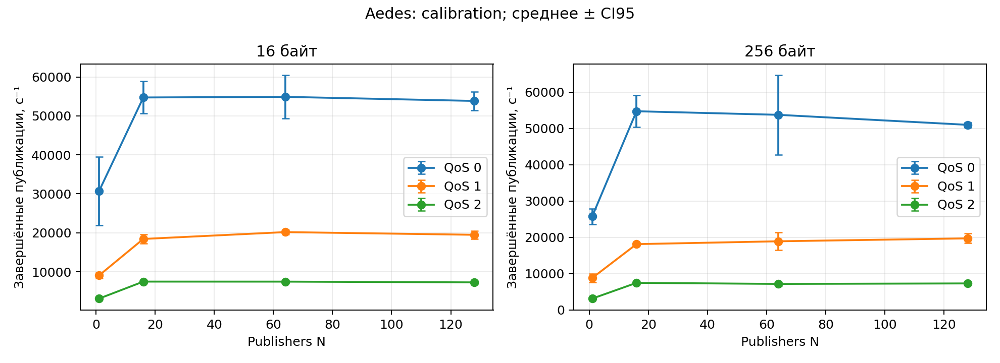
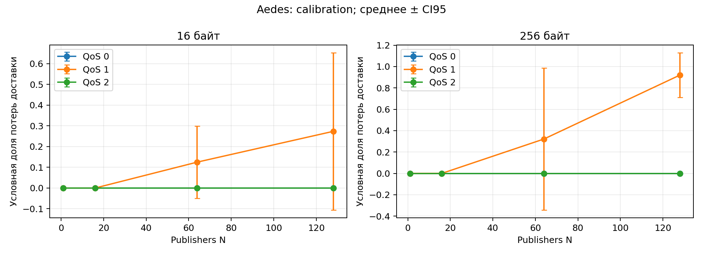
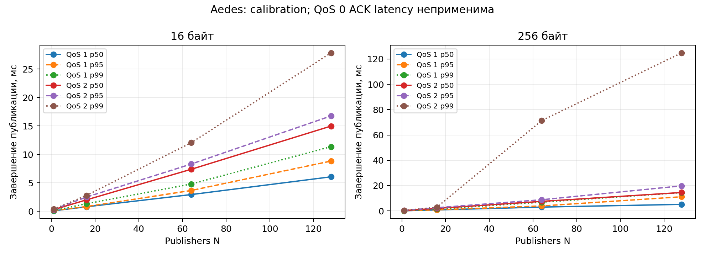
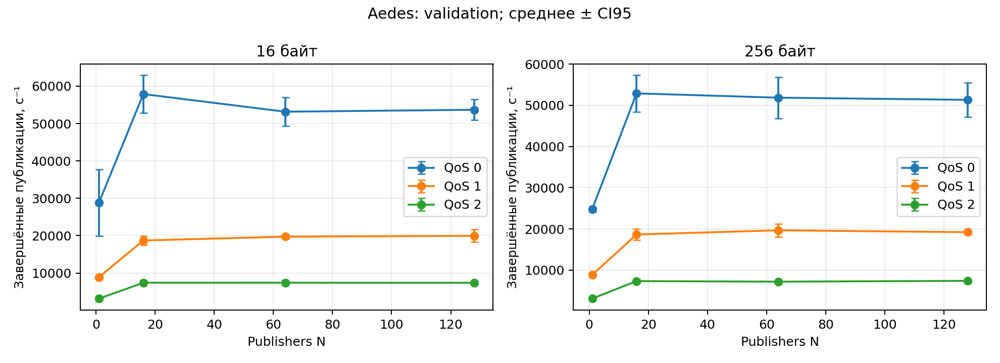
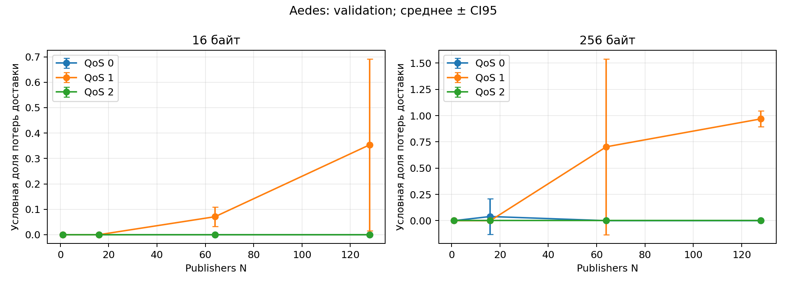
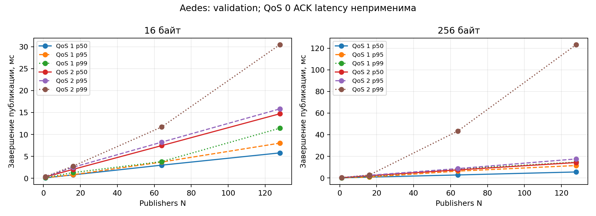
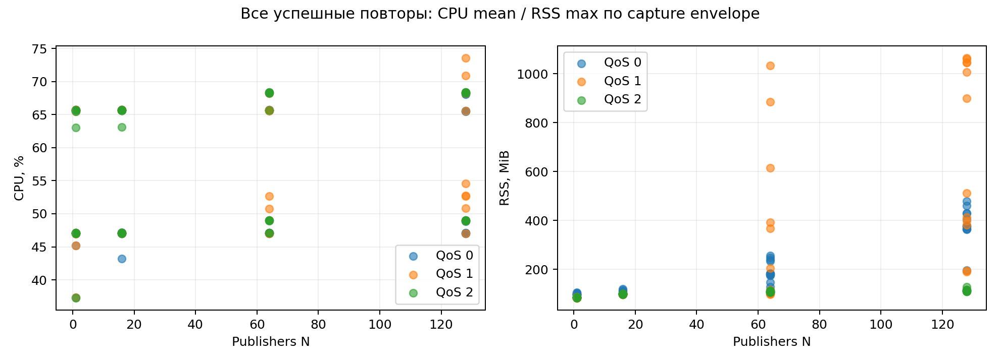
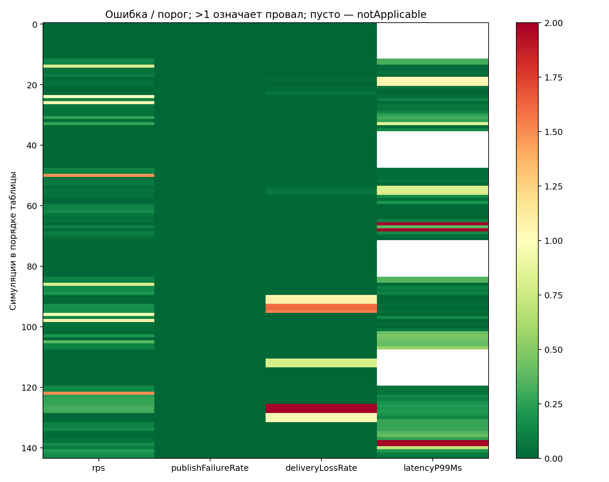
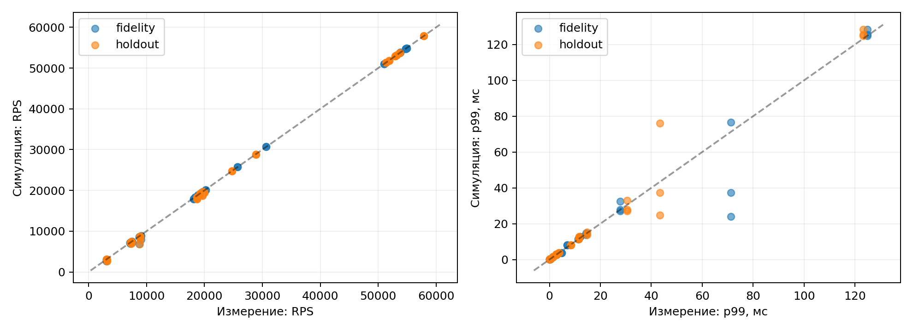
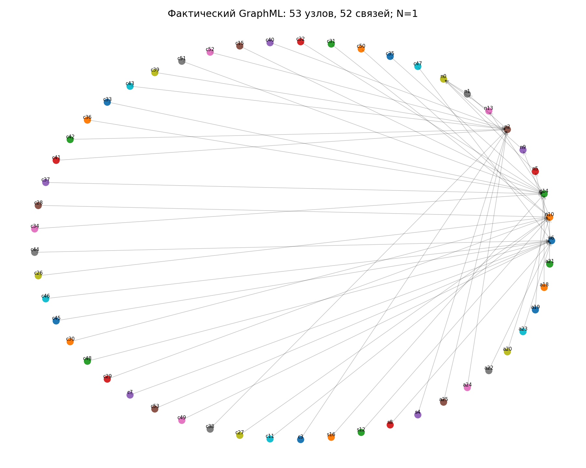

# Aedes — полный отчёт ночной серии 16–17 октября 2026 года

Серия `overnight-20261016-service-v1`. Полный цикл Aedes завершён: **144 успешных натурных измерения, 144 BrokerFidelity-симуляции и 72 Relay-симуляции**. Этот отчёт описывает завершённый цикл Aedes. Его результаты сохранены при переходе к исправленной серии; состояние остальных брокеров показано в [оглавлении отчётов](README.md).

## Результат проверки

Воспроизведение калибровки: **64/72** сценария проходят все применимые критерии. Независимый контроль: **58/72**. Точность двойника на всей матрице **не подтверждена**. Нарушения критериев сохранены, пороги не менялись. Технически успешное выполнение не означает прохождение научной проверки.

Натурная доля ошибок публикации (`publishFailureRate`) равен нулю во всех 48 агрегированных точках. Недоставка ID успешных публикаций достигает **92,02% в калибровке и 96,87% в независимом контроле** (256 байт, QoS 1, 128 отправителей). Эту недоставку нельзя приписать исключительно брокеру без разделения влияния очередей, получателя, TCP и окна наблюдения.

[Отдельный справочник метрик, единиц и формул](../docs/campaign-metrics.md).

## 1. Стенд и версии

| Параметр | Значение |
| --- | --- |
| Размещение | Контроллер и настоящий брокер на Linux 192.168.5.1; MQTT 127.0.0.1:1883; Windows — SSH и документы |
| Брокер | Aedes 1.1.2, Node.js; без Docker; команда запуска и контрольные суммы программ сохранены в описании стенда |
| ОС / CPU | Linux 6.12.85-6.12-alt1; Xeon E5-2680 v3, 12 физических / 24 логических CPU, SMT=2 |
| Закрепление CPU / ограничения | Брокер CPU 0, 4 GiB; контроллер CPU 1–11,13–23, 8 GiB; SMT sibling 12 исключён |
| Контроль загрузки | 99% общесистемного CPU; отдельный sampler, maximum interval 1,25 с |
| Версия MqttBenchmark (Git) | 3a689466009a0d5410f5dc88dc1282d72c27f7dd |
| Версия MqttY (Git) | 115885e012053d0112413e07743b061369ebea93 |
| Версия калибратора (Git) | f61daa47ec581ff88f20ee70882722085d1a0a10 |
| Профиль SHA-256 | e16c599ebf32dda761f84afa2e21c8d2fc29e95bbb31b987607d83906b347239 |
| Версия контроллера серии (Git) | 3d1986253c875a85b85c7a85aa8203cc4c3609cd |

CPU 0 не объявляется эксклюзивным физическим ядром. Контроллер, брокер и фоновые процессы делят оперативную память и доступ к диску. Эта серия не измеряет двухмашинную Ethernet-конфигурацию. [Окружение](data/aedes-final/environment.json), [Описание стенда и SHA-256 программ](data/aedes-final/inputs/Aedes-stand.json), [манифест](data/aedes-final/series.json), [происхождение заимствованных измерений](data/aedes-final/native-origins.json).

## 2. Программа и покрытие

| Этап | Успешных | Неуспешных технических попыток | Сценариев с нарушениями точности |
| --- | --- | --- | --- |
| Калибровка | 72/72 | 1 | неприменимо |
| Fidelity | 72/72 | 0 | 8 |
| Независимые замеры | 72/72 | 0 | неприменимо |
| Контрольные симуляции | 72/72 | 0 | 14 |
| Relay | 72/72 | 0 | натурные критерии неприменимы |

Сетка нагрузок: размер сообщения 16/256 байт × QoS 0/1/2 × 1/16/64/128 отправителей × 3 повтора или seed 42/43/44. Натурный опыт: прогрев / нагрузка / пауза / ожидание завершений: **5/20/1/10 с**; период ожидания без новых событий 10 с. Начальное число для порядка запусков 20260909 / 20260910. Окно телеметрии калибровки 39 с (запас 3 с), контроля 54 с (запас 18 с). Три успешных пробных запуска учитываются отдельно.

Калибровка заимствована из `overnight-20261016-v1` с сохранением описания исходной серии, показателей и профиля. Одна неуспешная калибровочная попытка: `Telemetry does not cover the remote workload completion fence`; повторная попытка обеспечила 72 успешных ключа. Прежний частичный контроль 24/72 и старые симуляции сюда не включены. Независимая серия новой кампании выполнена заново полностью.

Симуляции: **прогрев 1 с / нагрузка 2 с / ожидание до 5 с**. BrokerFidelity: шаг 10 мкс, `closedLoopPerPublisher`, `empiricalServiceBudget`. Relay: шаг 100 мкс, `openLoopRate`, транспорт `fixed`. Последовательное обновление состояния внутри модели; до четырёх отдельных процессов. Натурные тесты с симуляциями не пересекались.

## 3. Статистика и определение результата

В MqttBenchmark число попыток и завершений делится на фактическую длительность измерения (`actualMeasurementSeconds`). Доля ошибок рассчитывается от числа попыток, доля недоставки — от числа успешных завершений. Доли в таблицах записаны от 0 до 1: значение 0,2 означает 20%. p50/p95/p99 QoS 1/2 — время завершения публикации, не доставки подписчику. Задержка подтверждения QoS 0 неприменима. Натурные табличные квантили — средние квантилей трёх повторов; 95%-й доверительный интервал среднего: среднее ± 4,30265273 × SD / √3 (распределение Стьюдента, две степени свободы). В столбце «± CI95» указана полуширина интервала. Для его интерпретации нужны независимые повторы и подходящая форма распределения; три запуска сами по себе этих условий не обеспечивают. При трёх повторах оценка разброса и доверительного интервала ограничена. Поправка на множество сравнений не применена.

Симулятор делит завершения, в том числе учитываемые завершения во время ожидания, на фиксированные 2 с нагрузки. MqttBenchmark использует фактическую длительность измерения; знаменатели времени различаются. Короткое модельное окно делает границы и хвост распределения существенными; seeds не заменяют новые натурные повторы. Серию нельзя объявлять эквивалентной первоначальной программе 30-секундных симуляций.

## 4. Натурная калибровка

| Байт/QoS/N | Попыток/с | Завершений/с ± CI95 | Доля ошибок | Доля недоставки | p50 мс | p95 мс | p99 мс | RTT мс |
| --- | --- | --- | --- | --- | --- | --- | --- | --- |
| 16/0/1 | 30674 | 30674 ± 8809.93 | 0 | 0 | неприменимо | неприменимо | неприменимо | 0.302633 |
| 16/0/16 | 54717.4 | 54717.4 ± 4148.11 | 0 | 0 | неприменимо | неприменимо | неприменимо | 0.324233 |
| 16/0/64 | 54879.9 | 54879.9 ± 5598.41 | 0 | 0 | неприменимо | неприменимо | неприменимо | 0.3004 |
| 16/0/128 | 53828.6 | 53828.6 ± 2404.2 | 0 | 0 | неприменимо | неприменимо | неприменимо | 0.310467 |
| 16/1/1 | 9050.99 | 9050.99 ± 712.991 | 0 | 0 | 0.084 | 0.113267 | 0.139067 | 0.290433 |
| 16/1/16 | 18424.3 | 18424.3 ± 1111.55 | 0 | 0 | 0.789067 | 0.826733 | 1.3233 | 0.302833 |
| 16/1/64 | 20179.4 | 20179.4 ± 571.067 | 0 | 0.124963 | 2.93917 | 3.6585 | 4.79093 | 0.295267 |
| 16/1/128 | 19488.2 | 19488.2 ± 1040.88 | 0 | 0.273502 | 6.0614 | 8.8294 | 11.3582 | 0.305267 |
| 16/2/1 | 3117.06 | 3117.06 ± 78.2121 | 0 | 0 | 0.287133 | 0.332933 | 0.367733 | 0.2857 |
| 16/2/16 | 7480.85 | 7480.85 ± 283.29 | 0 | 0 | 2.00253 | 2.49263 | 2.77733 | 0.312167 |
| 16/2/64 | 7473.74 | 7473.74 ± 284.256 | 0 | 0 | 7.38523 | 8.30573 | 12.0559 | 0.275633 |
| 16/2/128 | 7280.47 | 7280.47 ± 452.027 | 0 | 0 | 14.9812 | 16.764 | 27.8471 | 0.295067 |
| 256/0/1 | 25731.2 | 25731.2 ± 2183.81 | 0 | 0 | неприменимо | неприменимо | неприменимо | 0.288667 |
| 256/0/16 | 54735.9 | 54735.9 ± 4342.68 | 0 | 0 | неприменимо | неприменимо | неприменимо | 0.2932 |
| 256/0/64 | 53749.4 | 53749.4 ± 10969.1 | 0 | 0 | неприменимо | неприменимо | неприменимо | 0.2921 |
| 256/0/128 | 50991.9 | 50991.9 ± 681.216 | 0 | 0 | неприменимо | неприменимо | неприменимо | 0.328833 |
| 256/1/1 | 8779.06 | 8779.06 ± 1189.62 | 0 | 0 | 0.0860333 | 0.115067 | 0.140667 | 0.3057 |
| 256/1/16 | 18114.9 | 18114.9 ± 433.056 | 0 | 0 | 0.802967 | 0.864167 | 1.38703 | 0.299367 |
| 256/1/64 | 18899.2 | 18899.2 ± 2416.95 | 0 | 0.321487 | 3.03033 | 3.93197 | 6.88607 | 0.290733 |
| 256/1/128 | 19702.4 | 19702.4 ± 1339.79 | 0 | 0.920223 | 5.1647 | 11.1745 | 14.4397 | 0.293467 |
| 256/2/1 | 3101.95 | 3101.95 ± 85.5936 | 0 | 0 | 0.289067 | 0.337867 | 0.379267 | 0.331233 |
| 256/2/16 | 7443.33 | 7443.33 ± 142.956 | 0 | 0 | 2.0171 | 2.53197 | 2.9196 | 0.3075 |
| 256/2/64 | 7151.58 | 7151.58 ± 469.998 | 0 | 0 | 7.5217 | 8.81983 | 71.3232 | 0.289467 |
| 256/2/128 | 7284.52 | 7284.52 ± 40.1994 | 0 | 0 | 14.5511 | 19.776 | 124.774 | 0.291067 |







## 5. Независимые натурные измерения

| Байт/QoS/N | Попыток/с | Завершений/с ± CI95 | Доля ошибок | Доля недоставки | p50 мс | p95 мс | p99 мс | RTT мс |
| --- | --- | --- | --- | --- | --- | --- | --- | --- |
| 16/0/1 | 28858.1 | 28858.1 ± 8936.44 | 0 | 0 | неприменимо | неприменимо | неприменимо | 0.296767 |
| 16/0/16 | 57891.9 | 57891.9 ± 5101.66 | 0 | 0 | неприменимо | неприменимо | неприменимо | 0.305833 |
| 16/0/64 | 53177.9 | 53177.9 ± 3894.7 | 0 | 0 | неприменимо | неприменимо | неприменимо | 0.295933 |
| 16/0/128 | 53696.7 | 53696.7 ± 2787.51 | 0 | 0 | неприменимо | неприменимо | неприменимо | 0.284367 |
| 16/1/1 | 8901 | 8901 ± 273.12 | 0 | 0 | 0.0844667 | 0.115167 | 0.140067 | 0.2971 |
| 16/1/16 | 18715.3 | 18715.3 ± 1235.65 | 0 | 0 | 0.770833 | 0.805633 | 1.29103 | 0.302533 |
| 16/1/64 | 19735.1 | 19735.1 ± 650.191 | 0 | 0.0707847 | 2.98467 | 3.69147 | 3.7945 | 0.312633 |
| 16/1/128 | 19971.4 | 19971.4 ± 1653.13 | 0 | 0.353687 | 5.7818 | 8.00887 | 11.4147 | 0.299833 |
| 16/2/1 | 3148.15 | 3148.15 ± 74.3884 | 0 | 0 | 0.2858 | 0.3312 | 0.370067 | 0.323833 |
| 16/2/16 | 7415.58 | 7415.58 ± 371.676 | 0 | 0 | 2.02133 | 2.5033 | 2.75577 | 0.305767 |
| 16/2/64 | 7414.1 | 7414.1 ± 433.118 | 0 | 0 | 7.442 | 8.2325 | 11.6917 | 0.287867 |
| 16/2/128 | 7397.94 | 7397.94 ± 261.725 | 0 | 0 | 14.707 | 15.8247 | 30.4755 | 0.313833 |
| 256/0/1 | 24769.8 | 24769.8 ± 566.039 | 0 | 0 | неприменимо | неприменимо | неприменимо | 0.296867 |
| 256/0/16 | 52891.4 | 52891.4 ± 4452.62 | 0 | 0.0395396 | неприменимо | неприменимо | неприменимо | 0.301867 |
| 256/0/64 | 51852.1 | 51852.1 ± 5029.28 | 0 | 0 | неприменимо | неприменимо | неприменимо | 0.294567 |
| 256/0/128 | 51324.5 | 51324.5 ± 4115.45 | 0 | 0 | неприменимо | неприменимо | неприменимо | 0.307033 |
| 256/1/1 | 8859.58 | 8859.58 ± 63.8268 | 0 | 0 | 0.0848333 | 0.1143 | 0.138667 | 0.298633 |
| 256/1/16 | 18667.8 | 18667.8 ± 1366.14 | 0 | 0 | 0.7808 | 0.816167 | 1.3425 | 0.292133 |
| 256/1/64 | 19676.7 | 19676.7 ± 1595.48 | 0 | 0.703002 | 2.7837 | 6.34687 | 8.3559 | 0.310067 |
| 256/1/128 | 19227.7 | 19227.7 ± 534.853 | 0 | 0.968692 | 5.54743 | 11.5002 | 14.6661 | 0.2898 |
| 256/2/1 | 3106.45 | 3106.45 ± 70.5089 | 0 | 0 | 0.286567 | 0.333633 | 0.3602 | 0.306567 |
| 256/2/16 | 7354.52 | 7354.52 ± 498.483 | 0 | 0 | 2.05157 | 2.46433 | 2.712 | 0.294233 |
| 256/2/64 | 7222.22 | 7222.22 ± 301.905 | 0 | 0 | 7.47203 | 8.68217 | 43.4473 | 0.303533 |
| 256/2/128 | 7419.2 | 7419.2 ± 35.874 | 0 | 0 | 14.2655 | 17.5834 | 123.248 | 0.291667 |







## 6. Воспроизводимость и ресурсы

Максимальное абсолютное изменение среднего натурного RPS между сериями: **5.92%**. Одновременно deliveryLossRate в точке 256/QoS1/N64 вырос с 32,15% до 70,30%: стабильная скорость публикаций у отправителей не гарантирует стабильную доставку.

| Серия | Запусков | Средний CPU за окно телеметрии, диапазон % | Максимальный RSS за окно телеметрии, MiB | Максимум общей загрузки CPU, % |
| --- | --- | --- | --- | --- |
| calibration | 72 | 63.0263–73.5789 | 81.9727–1065.69 | 54.5994 |
| validation | 72 | 43.2453–54.6038 | 82.0273–1060.9 | 49.9788 |

Все 144 успешных основных запуска прошли guard. CPU и RSS относятся ко всему окну телеметрии, включая прогрев и завершение работы. Длина этих окон различается между сериями, поэтому средние CPU нельзя напрямую трактовать как изменение нагрузки в измерительные 20 секунд. CPU процесса брокера и общесистемный CPU guard — разные метрики. CPU/RSS не моделируются двойником.



## 7. Проверка точности двойника

Пороги сохранены: относительная ошибка RPS ≤15%, p99 ≤20%; абсолютная разница failure/loss ≤0,05. Профиль построен только по калибровке и не менялся для независимого контроля.

| Критерий | Fidelity: выполнен / нарушен / неприменим | Контроль: выполнен / нарушен / неприменим |
| --- | --- | --- |
| rps | 69 / 3 / 0 | 69 / 3 / 0 |
| latencyP99Ms | 43 / 5 / 24 | 46 / 2 / 24 |
| publishFailureRate | 72 / 0 / 0 | 72 / 0 / 0 |
| deliveryLossRate | 72 / 0 / 0 | 63 / 9 / 0 |

### Все нарушения критериев

| Этап | Точка / seed | Критерий | Натурный эталон | Модель | Ошибка | Порог |
| --- | --- | --- | --- | --- | --- | --- |
| fidelity | m16.q1.p64.s42 | latencyP99Ms | 4.79093 | 3.79 | 0.208922 | 0.2 |
| fidelity | m16.q1.p64.s43 | latencyP99Ms | 4.79093 | 3.8 | 0.206835 | 0.2 |
| fidelity | m16.q1.p64.s44 | latencyP99Ms | 4.79093 | 3.78 | 0.21101 | 0.2 |
| fidelity | m16.q2.p1.s42 | rps | 3117.06 | 2648 | 0.150481 | 0.15 |
| fidelity | m16.q2.p1.s44 | rps | 3117.06 | 2624 | 0.158181 | 0.15 |
| fidelity | m256.q1.p1.s44 | rps | 8779.06 | 6826.5 | 0.222411 | 0.15 |
| fidelity | m256.q2.p64.s42 | latencyP99Ms | 71.3232 | 24.08 | 0.662382 | 0.2 |
| fidelity | m256.q2.p64.s44 | latencyP99Ms | 71.3232 | 37.4 | 0.475627 | 0.2 |
| holdout | m16.q1.p64.s42 | deliveryLossRate | 0.0707847 | 0.123689 | 0.0529042 | 0.05 |
| holdout | m16.q1.p64.s43 | deliveryLossRate | 0.0707847 | 0.126107 | 0.0553222 | 0.05 |
| holdout | m16.q1.p64.s44 | deliveryLossRate | 0.0707847 | 0.12461 | 0.0538252 | 0.05 |
| holdout | m16.q1.p128.s42 | deliveryLossRate | 0.353687 | 0.274185 | 0.0795019 | 0.05 |
| holdout | m16.q1.p128.s43 | deliveryLossRate | 0.353687 | 0.272986 | 0.080701 | 0.05 |
| holdout | m16.q1.p128.s44 | deliveryLossRate | 0.353687 | 0.27635 | 0.0773369 | 0.05 |
| holdout | m16.q2.p1.s42 | rps | 3148.15 | 2664 | 0.153789 | 0.15 |
| holdout | m16.q2.p1.s44 | rps | 3148.15 | 2641.5 | 0.160936 | 0.15 |
| holdout | m256.q1.p1.s44 | rps | 8859.58 | 6872.5 | 0.224286 | 0.15 |
| holdout | m256.q1.p64.s42 | deliveryLossRate | 0.703002 | 0.322553 | 0.380449 | 0.05 |
| holdout | m256.q1.p64.s43 | deliveryLossRate | 0.703002 | 0.324687 | 0.378315 | 0.05 |
| holdout | m256.q1.p64.s44 | deliveryLossRate | 0.703002 | 0.324484 | 0.378518 | 0.05 |
| holdout | m256.q2.p64.s42 | latencyP99Ms | 43.4473 | 24.82 | 0.428733 | 0.2 |
| holdout | m256.q2.p64.s43 | latencyP99Ms | 43.4473 | 75.99 | 0.749017 | 0.2 |

Ошибка RPS/p99 в таблице — относительная доля; ошибка failure/loss — абсолютная разность долей. Расхождения p99 16/QoS1/N64 частично связаны с разными статистиками: модель использует объединённую CDF, а эталон — среднее p99 повторов (около 3,799 против 4,791 мс). Это диагностическое объяснение, не основание считать критерий выполненным. Для 256/QoS2/N64 хвост существенно зависит от начального числа генератора. Остаточные RPS-расхождения и изменение недоставки между измерениями требуют дальнейшей проверки; причина не объявляется доказанной только по итоговым показателям.

Исправленная модель уменьшила число предупреждений, но не устранила их полностью. Контрольная недоставка не использовалась для подгонки профиля.





## 8. Однородная сеть MqttRelay

Четыре двойника Aedes, networkLength=2; выбор точки профиля по числу отправителей. Суммарная внешняя нагрузка — 4 × attemptedRps калибровочной точки; на каждый узел приходится четверть. [Точная конфигурация примера](data/aedes-final/inputs/Aedes-relay-example.json). Транспорт — модельная линия 1 Gbit/s, очередь 100000, transferTicks=2; это допущения, не измеренная loopback-линия.



| Байт/QoS/отправителей на узел | Задано всего / на узел, публикаций/с | Суммарное число завершений/с | Доля ошибок | Доля недоставки | Получения на узел: среднее [мин.; макс.] |
| --- | --- | --- | --- | --- | --- |
| 16/0/1 | 122696 / 30674 | 122791 | 0.666607 | 0 | 122868 [122868;122868] |
| 16/0/16 | 218869 / 54717.4 | 197288 | 0.618503 | 0 | 172594 [172594;172594] |
| 16/0/64 | 219519 / 54879.9 | 194112 | 0.570328 | 0 | 176766 [176766;176766] |
| 16/0/128 | 215315 / 53828.6 | 190601 | 0.565414 | 0 | 174972 [174972;174972] |
| 16/1/1 | 36204 / 9050.99 | 36225.8 | 0.665966 | 0 | 36124.3 [36079;36191] |
| 16/1/16 | 73697.4 / 18424.3 | 67097.2 | 0.578374 | 0 | 56311 [56171;56456] |
| 16/1/64 | 80717.5 / 20179.4 | 70200.2 | 0.550847 | 0.125628 | 55458 [55354;55646] |
| 16/1/128 | 77952.8 / 19488.2 | 64191.2 | 0.553229 | 0.274412 | 41948.3 [41850;42027] |
| 16/2/1 | 12468.2 / 3117.06 | 12505.3 | 0.708757 | 0 | 18008 [18005;18011] |
| 16/2/16 | 29923.4 / 7480.85 | 25101.3 | 0.609434 | 0 | 21663 [21620;21717] |
| 16/2/64 | 29895 / 7473.74 | 23639.3 | 0.618071 | 0 | 21159.3 [21130;21204] |
| 16/2/128 | 29121.9 / 7280.47 | 25821.5 | 0.606644 | 0 | 23308.7 [23226;23387] |
| 256/0/1 | 102925 / 25731.2 | 103006 | 0.666578 | 0 | 103084 [103084;103084] |
| 256/0/16 | 218943 / 54735.9 | 197366 | 0.618525 | 0 | 172616 [172616;172616] |
| 256/0/64 | 214998 / 53749.4 | 184988 | 0.581148 | 0 | 170574 [170574;170574] |
| 256/0/128 | 203968 / 50991.9 | 188852 | 0.551568 | 0 | 169392 [169392;169392] |
| 256/1/1 | 35116.2 / 8779.06 | 35135.2 | 0.666045 | 0 | 34979 [34890;35062] |
| 256/1/16 | 72459.5 / 18114.9 | 66158.5 | 0.577775 | 0 | 55240.7 [55128;55308] |
| 256/1/64 | 75596.7 / 18899.2 | 56757.3 | 0.564206 | 0.32237 | 35327.7 [35118;35500] |
| 256/1/128 | 78809.6 / 19702.4 | 33044.5 | 0.61395 | 0.920876 | 4255 [4198;4315] |
| 256/2/1 | 12407.8 / 3101.95 | 12440 | 0.67944 | 0 | 14032 [13872;14144] |
| 256/2/16 | 29773.3 / 7443.33 | 25079.5 | 0.609195 | 0 | 21612.3 [21568;21678] |
| 256/2/64 | 28606.3 / 7151.58 | 23381 | 0.614091 | 0 | 20694.3 [20559;20836] |
| 256/2/128 | 29138.1 / 7284.52 | 25843.5 | 0.6044 | 0 | 23451.3 [23419;23500] |

Сетевые счётчики попыток и завершений суммируют события брокеров, включая повторные публикации Relay. Они не равны числу уникальных внешних сообщений. Доля модельных ошибок включает отказы ограничителя скорости (`rateRejected`). Счётчики получателей относятся к модельным узлам и могут включать сообщения прогрева и периода ожидания. Без сопоставления ID и источника они не доказывают уникальную сквозную доставку.

**Все 72 сетевых запуска завершены; все четыре критерия в каждом имеют статус notApplicable. Натурная точность Relay-сети не подтверждена.**

## 9. Архивы и научная проверяемость

| Серия | Восстановление проверено | SHA-256 исходного агрегата | SHA-256 повторного агрегата |
| --- | --- | --- | --- |
| calibration | True | 1ff2c53c99b1f7e58738d9779ec228482787d62bad4c75478da84720a74b786d | 8cb7e66e00b66f82dfea478d5db90a9cf8f40cbb9e3e38ce38370e0819565567 |
| validation | True | 865f5552318afb49fd65b4be709b5dbf7a34d334e6c26ba15b24f7ad32608a68 | 425286528881db3345d8a24b9441a3f8a812fa383d48a534379315213532b14e |

Обе стадии ранее восстановлены из архивов и повторно агрегированы: численные результаты и описание исходной серии совпали. Различие SHA-256 полного файла агрегата связано с картой inputSha256 разных представлений файлов; оно явно сохранено в протоколах проверки. Эта подготовка отчёта проверяет сохранённые протоколы проверки и формулы, но не объявляется новым восстановлением исходных журналов.

[Архивы Aedes с точными путями и SHA-256](Aedes-archives.json). Заимствованная калибровка лежит в `overnight-20261016-v1/evidence/attempts/Aedes-calibration/`; новый контроль — в `overnight-20261016-service-v1/evidence/attempts/Aedes-validation/`. Корень Linux: `/run/media/entityfx/hd250/mqtty-evidence/`. Неуспешные попытки сохранены. SHA подтверждает целостность; проверяемость обеспечивают исходные журналы, версии, точные входы и повторный расчёт.

## 10. Воспроизведение и приложения

Пересчитать исходные таблицы и исходный отчёт в рабочем каталоге синхронизированной серии, без нагрузки на стенд:

```powershell
python tools/campaign/write-overnight-aedes-report.py --series MqttBenchmark/artifacts/overnight-20261016-service-v1
```

Для повторения опыта создайте новый каталог на выделенном диске результатов и используйте те же версии программ и исходные конфигурации. Значения путей ниже относятся к сохранённому стенду; при переносе их заменяют и фиксируют соответствие. Точные конфигурации симуляций находятся в Linux `controller/brokers/Aedes/simulations/{fidelity,holdout,relay}-2s-overnight-v1/`. Натурные входы: [Калибровка](data/aedes-final/inputs/Aedes-calibration.json), [Независимые замеры](data/aedes-final/inputs/Aedes-validation.json). Пошаговое развёртывание: [Руководство запуска](../docs/full-campaign-runbook.md).

[Натурные CSV](Aedes-native-results.csv) · [Relay CSV](Aedes-relay-results.csv) · [Итоги всех 216 симуляций](Aedes-simulations.json) · [Попытки и проверка загрузки](Aedes-attempts.json) · [Сводка JSON](Aedes-summary.json) · [Исходный манифест до переноса](Aedes-report-manifest.json).


Документ перенесён в корневую папку `reports` и отредактирован для чтения. Численные таблицы сохранены. Исходный манифест относится к прежнему оформлению; [манифест переноса](data/aedes-publication.json) содержит хэши перенесённых приложений, а `publication-sha256.json` — хэши опубликованных файлов.

Чтобы обновить HTML отредактированной публикации, выполните `python tools/campaign/publish-broker-reports.py --output reports`. [Профиль Aedes](data/Aedes/profile/broker-calibration.v3.json) сохранён с исходной контрольной суммой.
