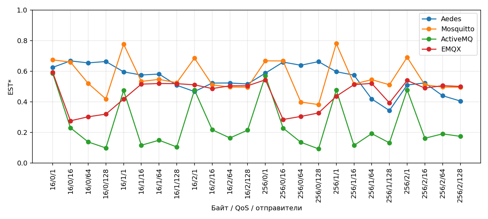

# Сравнение брокеров и интегральная оценка

**По заранее выбранным равным весам и равному весу 24 нагрузочных точек лидер этой кампании — Mosquitto: 0.5623 из 1.** Это условный выбор для исследованной конфигурации, а не универсальный победитель. Данные независимых замеров используются для рейтинга; точность модели оценивается отдельно и в EST не входит.

## Данные и сопоставимость

Все четыре брокера завершили по 144 натурных измерения и 216 симуляций; смешанная сеть — ещё 72. Всего 1512. Для рейтинга берутся 72 независимых измерения каждого брокера: 24 одинаковые комбинации нагрузки по три повтора. Брокер работает на одном закреплённом логическом CPU. Общий хост, разные даты/сеансы, перезапуски и короткие окна ограничивают обобщение. Нагрузки closed-loop не означают одинаковый offeredRps: он зависит от времени ответа и ошибок клиента. Известная проблема повторных локальных ошибок после отключения ActiveMQ влияет на attempted и долю доставок от попыток; это рейтинг системы «брокер + клиент + настройки стенда», а не изолированной реализации брокера.

## Формула EST и явно обозначенная адаптация

Источник — [глава 2, §2.4 диссертации](../diss/book/02-chapter2.md) и авторская статья «Выбор брокера сообщений для Интернета вещей на основе нагрузочного тестирования». Формула:

`EST = K_R × R/max(R_B) + K_C × (1−C) + K_L × (1−L/max(L_B)) + K_F × (1−F)`

K_R=K_C=K_L=K_F=0,25. Максимумы считаются по четырём брокерам **в одной и той же нагрузочной точке**, после усреднения трёх повторов. R — completedRps; C — доля CPU процесса на одном закреплённом CPU; L — среднее p99 завершения публикации (QoS 1/2); 1−F — среднее uniqueDeliveries/attemptedPublishes. Последний знаменатель соответствует сравнению отправленных и полученных в статье и включает влияние локальных неудачных попыток. Он отличается от deliveryLossRate программы, которая проверяет доставку среди завершённых публикаций.

Для QoS 0 нет MQTT ACK, поэтому L не подменяется нулём: остаются R, C и F с весами 1/3. Среднее по всем 24 точкам называем **EST\***. Для QoS 1/2 отдельно приводится исходная четырёхкомпонентная оценка. Все точки имеют одинаковый вес; в среднем по смешанной QoS-сетке эффективный вклад коэффициентов R/C/F равен 5/18, L — 1/6: равные веса четырёх членов действуют только там, где все четыре применимы. Повторное нормирование готового рейтинга по лучшему не выполняется. 0 и 1 — границы выбранного критерия, а не вероятность исправной работы. Если R всех брокеров равен нулю, вклад R равен нулю; если все применимые L равны нулю, вклад задержки равен единице. Пропуски обязательных значений запрещены. Изменение множества сравниваемых брокеров может изменить нормировку и рейтинг.

CPU вычислен по внутренним интервалам измерения, с исключением граничных секунд. В статье CPU относился к хосту; здесь процессу выделено одно логическое CPU, поэтому это методическая адаптация, а не буквальное повторение старого опыта. Низкая загрузка CPU при простое сама по себе не доказывает эффективность: остальные члены EST могут лишь частично компенсировать её вклад.

## Результаты независимой серии

В таблице описательные средние по фиксированным точкам. p99 усреднён по 16 точкам QoS 1/2, RSS — максимальный отсчёт. Средний receipts/s не является скоростью уникальных сообщений в одном общем опыте.

| Брокер | EST\* | Bootstrap 95% | Completed/s | Receipts/s | CPU, % | Доставлено от попыток, % | p99, мс | RSS max, МиБ |
| --- | --- | --- | --- | --- | --- | --- | --- | --- |
| Mosquitto | 0.5623 | 0.5571–0.5663 | 3.812e+04 | 1.262e+04 | 89.74 | 41.74 | 3.278 | 6.879 |
| Aedes | 0.5520 | 0.5461–0.5572 | 2.328e+04 | 2.148e+04 | 99.6 | 91.1 | 16.01 | 873.1 |
| EMQX | 0.4505 | 0.4457–0.4551 | 1.903e+04 | 6336 | 99.72 | 72.64 | 11.75 | 418.3 |
| ActiveMQ | 0.2459 | 0.2378–0.2537 | 8366 | 5214 | 99.05 | 56.88 | 85.62 | 385 |

Bootstrap: 2000 выборок с seed 20261019; внутри каждой пары «брокер/точка» с возвращением выбираются три целых повтора, все связанные метрики сохраняются вместе; нормировка между брокерами пересчитывается. Точки нагрузки не ресэмплируются. При n=3 интервалы условны и не описывают дрейф ОС/дней; это анализ устойчивости имеющихся повторов, не доказательство превосходства генеральной совокупности.

| Байт | QoS | N | Aedes | Mosquitto | ActiveMQ | EMQX | Лидер |
| --- | --- | --- | --- | --- | --- | --- | --- |
| 16 | 0 | 1 | 0.6249 | 0.6737 | 0.5854 | 0.5916 | Mosquitto |
| 16 | 0 | 16 | 0.6669 | 0.6592 | 0.2294 | 0.2753 | Aedes |
| 16 | 0 | 64 | 0.6540 | 0.5201 | 0.1370 | 0.3015 | Aedes |
| 16 | 0 | 128 | 0.6630 | 0.4182 | 0.0977 | 0.3189 | Aedes |
| 16 | 1 | 1 | 0.5953 | 0.7768 | 0.4736 | 0.4176 | Mosquitto |
| 16 | 1 | 16 | 0.5748 | 0.5329 | 0.1155 | 0.5151 | Aedes |
| 16 | 1 | 64 | 0.5811 | 0.5463 | 0.1484 | 0.5190 | Aedes |
| 16 | 1 | 128 | 0.5075 | 0.5244 | 0.1043 | 0.5182 | Mosquitto |
| 16 | 2 | 1 | 0.4666 | 0.6853 | 0.4767 | 0.5105 | Mosquitto |
| 16 | 2 | 16 | 0.5220 | 0.5106 | 0.2165 | 0.4862 | Aedes |
| 16 | 2 | 64 | 0.5226 | 0.4960 | 0.1630 | 0.5040 | Aedes |
| 16 | 2 | 128 | 0.5161 | 0.4953 | 0.2143 | 0.5044 | Aedes |
| 256 | 0 | 1 | 0.5869 | 0.6674 | 0.5705 | 0.5431 | Mosquitto |
| 256 | 0 | 16 | 0.6592 | 0.6668 | 0.2275 | 0.2839 | Mosquitto |
| 256 | 0 | 64 | 0.6387 | 0.3977 | 0.1350 | 0.3038 | Aedes |
| 256 | 0 | 128 | 0.6622 | 0.3815 | 0.0918 | 0.3266 | Aedes |
| 256 | 1 | 1 | 0.5962 | 0.7805 | 0.4764 | 0.4356 | Mosquitto |
| 256 | 1 | 16 | 0.5740 | 0.5156 | 0.1142 | 0.5118 | Aedes |
| 256 | 1 | 64 | 0.4183 | 0.5445 | 0.1915 | 0.5198 | Mosquitto |
| 256 | 1 | 128 | 0.3425 | 0.5109 | 0.1311 | 0.3926 | Mosquitto |
| 256 | 2 | 1 | 0.5094 | 0.6908 | 0.4771 | 0.5392 | Mosquitto |
| 256 | 2 | 16 | 0.5230 | 0.5103 | 0.1611 | 0.4894 | Aedes |
| 256 | 2 | 64 | 0.4395 | 0.4960 | 0.1900 | 0.5050 | EMQX |
| 256 | 2 | 128 | 0.4045 | 0.4947 | 0.1736 | 0.5000 | EMQX |

[Все компоненты и оценки CSV](Broker-EST.csv) · [Веса, bootstrap, чувствительность JSON](data/integral-assessment.json).

## Чувствительность выбора

| Вариант | Aedes | Mosquitto | ActiveMQ | EMQX | Лидер |
| --- | --- | --- | --- | --- | --- |
| Равные веса | 0.5520 | 0.5623 | 0.2459 | 0.4505 | Mosquitto |
| Приоритет RPS | 0.5752 | 0.7421 | 0.2760 | 0.4766 | Mosquitto |
| Приоритет CPU | 0.3179 | 0.3662 | 0.1453 | 0.2629 | Mosquitto |
| Приоритет задержки | 0.6113 | 0.6350 | 0.1827 | 0.5046 | Mosquitto |
| Приоритет доставки | 0.7039 | 0.5060 | 0.3796 | 0.5581 | Aedes |
| CPU за весь захват (диагностика) | 0.6961 | 0.6968 | 0.3770 | 0.5950 | Mosquitto |
| Доставка только от completed (диагностика) | 0.5520 | 0.5624 | 0.2474 | 0.4505 | Mosquitto |
| Калибровочная серия (диагностика) | 0.5501 | 0.5595 | 0.2446 | 0.4685 | Mosquitto |
| Только QoS 1/2, исходные четыре члена | 0.5058 | 0.5694 | 0.2392 | 0.4918 | Mosquitto |
| Только QoS 0, три члена | 0.6445 | 0.5481 | 0.2593 | 0.3681 | Aedes |
| Только N=1 | 0.5632 | 0.7124 | 0.5099 | 0.5063 | Mosquitto |
| Общие точки без ошибок публикации | 0.5316 | 0.5889 | 0.2720 | 0.4781 | Mosquitto |

Общих точек без ошибок публикации у всех четырёх брокеров: 20. Их поднабор выбран по результатам, поэтому является диагностикой. В вариантах «приоритет» выбранный вес 0,55, остальные по 0,15; для QoS 0 неприменимый член снова исключается и веса нормируются.

Перебраны 84 комбинации положительных весов с шагом 0,1 и суммой 1. Доля первого места в этой сетке предпочтений (не статистическая вероятность): Aedes 41.7%; Mosquitto 58.3%; ActiveMQ 0.0%; EMQX 0.0%. Веса после получения рейтинга не подбирались для сохранения победителя.

## Сопоставление с диссертацией и статьями

Прочитаны три предоставленных DOCX из авторского каталога. [Имена и SHA-256, численные таблицы первой статьи](data/article-sources.json). Полные рукописи не включены в Git. Библиография: [author.bib](../diss/biblio/author.bib).

| Работа | Что проверяла | Что даёт текущая серия | Что нельзя заключить |
| --- | --- | --- | --- |
| Выбор брокера… (2025), DOI 10.18127/j19997493-202503-04 | RPS, CPU, p99, доля недоставок; EST | Те же группы показателей, явные определения и EST\* по новым данным | Численные рейтинги старого и нового стенда не являются повторными измерениями одного режима |
| Симуляция распределённых сетей… (2025), DOI 10.1109/RusAutoCon65989.2025.11177411 | Архитектура MqttRelay, виртуальные узлы и передача телеметрии | 360 сетевых моделей с эмпирическими профилями и счётчиками receivers | Нет натурного эталона распределённой сети |
| Ускорение симуляции MqttY (2026), DOI 10.33693/2313-223X-2026-13-1-212-221 | Ticks, real/virtual time, steps, errors, память; сравнение режимов и реализаций | Проверка детерминизма фиксированного runtime и научных итогов | Ускорение 2,5–3 и 12,5 раз из статьи этой кампанией повторно не измерялось |

В первой статье для малого числа клиентов рекомендован Mosquitto, для остальных случаев особенно QoS 2 — ActiveMQ. В главе 2 есть более подробное разделение по QoS и размеру. Ниже заново прочитаны численные EST-таблицы статьи, а не перенесены её словесные рекомендации. Совпадающие входы ограничены N=1/16/64/128 и 16/256 байт. В старой работе были три Windows-узла, свободное использование CPU брокерами, NBomber и иной учёт. В новой — один Linux-хост, одно логическое CPU, ID-учёт, другой клиент и ограниченное время наблюдения. Отличие лидера не опровергает старую статью; знак изменения не показывает прогресс версии брокера.

| Байт | QoS | N | Лидер статьи | EST статьи | Лидер сейчас | EST\* сейчас |
| --- | --- | --- | --- | --- | --- | --- |
| 16 | 0 | 1 | ActiveMQ | 0.782 | Mosquitto | 0.674 |
| 16 | 1 | 1 | Mosquitto | 0.888 | Mosquitto | 0.777 |
| 16 | 2 | 1 | Mosquitto | 0.873 | Mosquitto | 0.685 |
| 16 | 0 | 16 | Aedes | 0.708 | Aedes | 0.667 |
| 16 | 1 | 16 | Aedes | 0.538 | Aedes | 0.575 |
| 16 | 2 | 16 | ActiveMQ | 0.802 | Aedes | 0.522 |
| 16 | 0 | 64 | Mosquitto | 0.609 | Aedes | 0.654 |
| 16 | 1 | 64 | ActiveMQ | 0.732 | Aedes | 0.581 |
| 16 | 2 | 64 | ActiveMQ | 0.684 | Aedes | 0.523 |
| 16 | 0 | 128 | Mosquitto | 0.564 | Aedes | 0.663 |
| 16 | 1 | 128 | ActiveMQ | 0.744 | Mosquitto | 0.524 |
| 16 | 2 | 128 | ActiveMQ | 0.679 | Aedes | 0.516 |
| 256 | 0 | 1 | Mosquitto | 0.785 | Mosquitto | 0.667 |
| 256 | 1 | 1 | Mosquitto | 0.869 | Mosquitto | 0.780 |
| 256 | 2 | 1 | Mosquitto | 0.832 | Mosquitto | 0.691 |
| 256 | 0 | 16 | Aedes | 0.807 | Mosquitto | 0.667 |
| 256 | 1 | 16 | Aedes | 0.534 | Aedes | 0.574 |
| 256 | 2 | 16 | ActiveMQ | 0.799 | Aedes | 0.523 |
| 256 | 0 | 64 | Aedes | 0.644 | Aedes | 0.639 |
| 256 | 1 | 64 | ActiveMQ | 0.717 | Mosquitto | 0.544 |
| 256 | 2 | 64 | ActiveMQ | 0.681 | EMQX | 0.505 |
| 256 | 0 | 128 | Aedes | 0.687 | Aedes | 0.662 |
| 256 | 1 | 128 | ActiveMQ | 0.736 | Mosquitto | 0.511 |
| 256 | 2 | 128 | ActiveMQ | 0.653 | EMQX | 0.500 |

Страница [статьи о выборе брокера](https://radiotec.ru/ru/journal/Dynamics_of_Difficult_Systems%E2%80%93XXI_century/number/2025-3/article/25179) подтверждает состав показателей; [статья об ускорении MqttY](https://journals.eco-vector.com/2313-223X/article/view/707588/ru_RU) описывает другую задачу — производительность самого симулятора. Здесь выводы основаны также на предоставленных полных рукописях.

## Практический выбор

Для воспроизведения именно этой программы выбираем **Mosquitto** по EST\*. Для новой системы сначала выбирают её нагрузочные точки и веса, проверяют приемлемую долю доставки и ограничения памяти, затем пересчитывают оценку. Даже высокий EST не разрешает игнорировать недоставку. Публикационная ошибка и недоставка не равны падению процесса брокера. Перед рекомендацией для эксплуатации нужно исправить отключения генератора и выполнить новую сопоставимую серию, особенно для ActiveMQ. [Доказательства и границы модели](Model-validation.md) · [Диагностика ActiveMQ](ActiveMQ-diagnosis.md).
