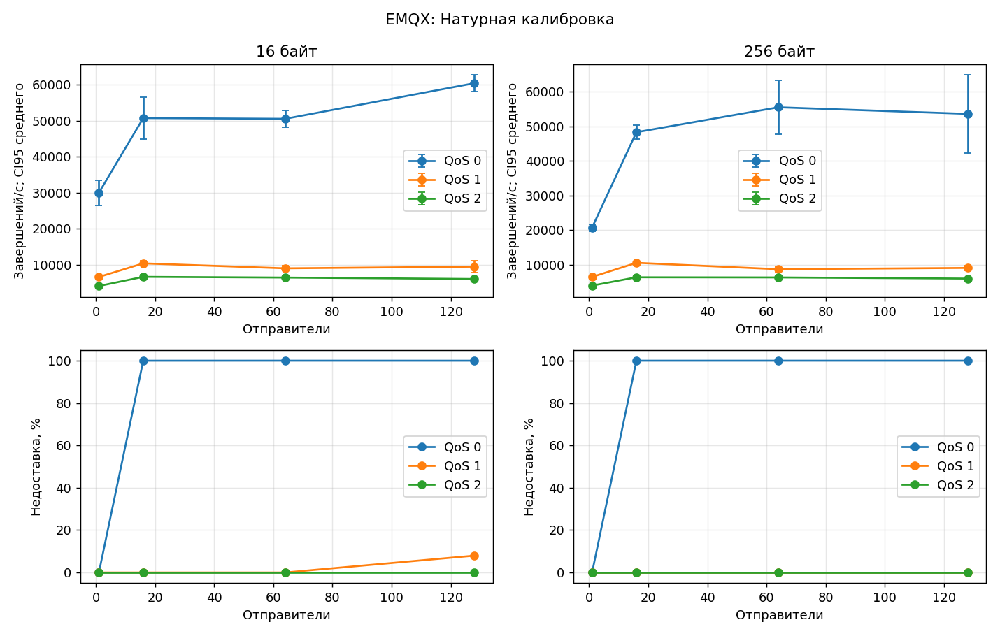
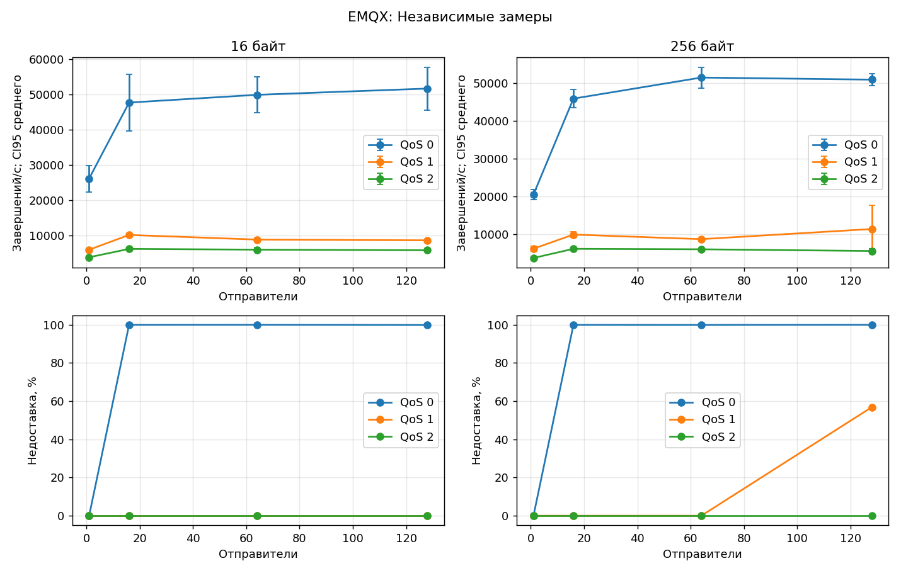
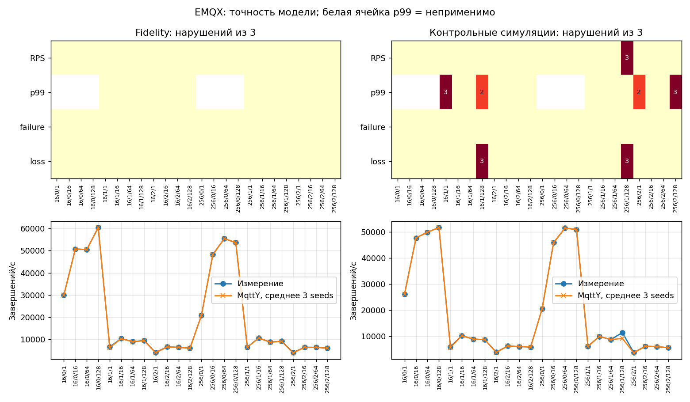
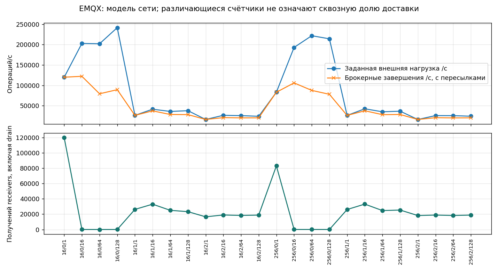

# EMQX: итоговый отчёт

Полный цикл: **144 натурных измерения и 216 симуляций**. Финальная серия завершена 19 октября 2026 года в 16:44 МСК. Полное покрытие не означает прохождения всех проверок точности. [Сравнение и EST](Broker-comparison.md) · [Краткий выбор](Best-broker.md) · [HTML](EMQX.html).

## Установка и воспроизведение

Брокер: **6.3.0**; исполняющая среда: `None`. Linux, Intel Xeon E5-2680 v3, 12 физических ядер / 24 логических CPU; контроллер и брокер на одной машине, loopback. Брокер закреплён за CPU 0, контроллер — за 1–11 и 13–23. Это не эксклюзивное физическое ядро; SMT, память и ОС общие. Натурные измерения и симуляции не пересекались. Guard контроллера — 99%, это не предел CPU брокера.

Сетка: 16/256 байт × QoS 0/1/2 × 1/16/64/128 отправителей × три повтора. Натурные warmup/measurement/cooldown/drain: 5/20/1/до 10 с. Модель: 1/2/до 5 с, seeds 42/43/44. BrokerFidelity: closedLoopPerPublisher, empiricalServiceBudget, tick=10 мкс. Relay: openLoopRate, fixed, tick=100 мкс. Запуски симуляций выполнялись до четырёх одновременно, обновление внутри каждой модели последовательное.

Измерительный CLI: `3a689466009a0d5410f5dc88dc1282d72c27f7dd`; MqttY: `115885e012053d0112413e07743b061369ebea93`; калибратор: `f61daa47ec581ff88f20ee70882722085d1a0a10`. Изменения скриптов телеметрии и происхождение заимствованных этапов записаны в [series](data/series.json), [native-origins](data/native-origins.json), [repair-transition](data/repair-transition.json). Идентификаторы исходных серий сохранены; они не заменены идентификатором итоговой сборки.

[Настройки стенда](data/inputs/EMQX-stand.json) · [Калибровочная программа](data/inputs/EMQX-calibration.json) · [Контрольная программа](data/inputs/EMQX-validation.json) · [Окружение](data/environment.json).

Профиль: [broker-calibration.v3.json](data/EMQX/profile/broker-calibration.v3.json), SHA-256 `effe28c0fabf2d835579de8e6c40aa7d03a2865b7a23336d6f57189e79340b6f`. Хэш проверен во всех manifests Fidelity, holdout и Relay; независимые измерения не изменяли профиль.

## Покрытие

| Этап | Готово | Технические попытки | Нарушения точности |
| --- | --- | --- | --- |
| Натурная калибровка | ✅ 72/72 | ❌ 0; прервано 0 | ⚠ неприменимо |
| Fidelity | ✅ 72/72 | ❌ 0 незавершённых в итоговом индексе | ⚠ 0 |
| Независимые замеры | ✅ 72/72 | ❌ 2; прервано 0 | ⚠ неприменимо |
| Контрольные симуляции | ✅ 72/72 | ❌ 0 незавершённых в итоговом индексе | ⚠ 14 |
| MqttRelay | ✅ 72/72 | ❌ 0 незавершённых в итоговом индексе | ⚠ натурного эталона нет |

Технические ошибки относятся к попыткам, а предупреждения — к завершённым сценариям. Итоговый индекс симуляций не является полным журналом прежних перезапусков. Pilots и диагностика исключены из покрытия.

## Натурная калибровка

Средние по трём повторам. ± — полуширина CI95 Стьюдента: 4,30265273 × s / √3. Полные интервалы RPS, failure/loss и задержек сохранены в JSON. p50/p95/p99 — среднее перцентилей повторов, а не перцентиль объединённых сообщений. Для QoS 0 ACK latency неприменима. RTT измерен отдельно.

| Байт | QoS | N | Попыток/с | Завершений/с ± CI95 | Failure, % | Loss, % | p50, мс | p95, мс | p99, мс | RTT, мс |
| --- | --- | --- | --- | --- | --- | --- | --- | --- | --- | --- |
| 16 | 0 | 1 | 2.999e+04 | 2.999e+04 ± 3544 | 0 | 0 | н/п | н/п | н/п | 0.1829 |
| 16 | 0 | 16 | 5.074e+04 | 5.074e+04 ± 5775 | 0 | 99.98 | н/п | н/п | н/п | 0.1722 |
| 16 | 0 | 64 | 5.054e+04 | 5.054e+04 ± 2315 | 0 | 99.99 | н/п | н/п | н/п | 0.1805 |
| 16 | 0 | 128 | 6.043e+04 | 6.043e+04 ± 2362 | 0 | 99.98 | н/п | н/п | н/п | 0.1803 |
| 16 | 1 | 1 | 6569 | 6569 ± 256.2 | 0 | 0 | 0.1243 | 0.1633 | 0.1869 | 0.1762 |
| 16 | 1 | 16 | 1.036e+04 | 1.036e+04 ± 695.5 | 0 | 0 | 1.419 | 1.815 | 2.971 | 0.1769 |
| 16 | 1 | 64 | 8976 | 8976 ± 665.2 | 0 | 0 | 6.832 | 9.133 | 11.75 | 0.1803 |
| 16 | 1 | 128 | 9443 | 9443 ± 1730 | 0 | 7.964 | 11.56 | 19.2 | 20.84 | 0.1757 |
| 16 | 2 | 1 | 4055 | 4055 ± 139.6 | 0 | 0 | 0.2178 | 0.2523 | 0.2743 | 0.1784 |
| 16 | 2 | 16 | 6603 | 6603 ± 544.8 | 0 | 0 | 2.272 | 2.847 | 4.59 | 0.1832 |
| 16 | 2 | 64 | 6403 | 6403 ± 309.1 | 0 | 0 | 9.736 | 11.3 | 12.64 | 0.1752 |
| 16 | 2 | 128 | 6005 | 6005 ± 267 | 0 | 0 | 21.04 | 24.02 | 26.74 | 0.2085 |
| 256 | 0 | 1 | 2.077e+04 | 2.077e+04 ± 1015 | 0 | 0 | н/п | н/п | н/п | 0.1794 |
| 256 | 0 | 16 | 4.828e+04 | 4.828e+04 ± 1960 | 0 | 99.97 | н/п | н/п | н/п | 0.1915 |
| 256 | 0 | 64 | 5.548e+04 | 5.548e+04 ± 7690 | 0 | 99.97 | н/п | н/п | н/п | 0.1717 |
| 256 | 0 | 128 | 5.357e+04 | 5.357e+04 ± 1.129e+04 | 0 | 99.97 | н/п | н/п | н/п | 0.1792 |
| 256 | 1 | 1 | 6528 | 6528 ± 213.3 | 0 | 0 | 0.1253 | 0.1644 | 0.1878 | 0.176 |
| 256 | 1 | 16 | 1.061e+04 | 1.061e+04 ± 277.9 | 0 | 0 | 1.39 | 1.845 | 2.921 | 0.1774 |
| 256 | 1 | 64 | 8759 | 8759 ± 912.4 | 0 | 0 | 7.036 | 9.463 | 11.22 | 0.1821 |
| 256 | 1 | 128 | 9135 | 9135 ± 638.2 | 0 | 0 | 13.11 | 19.11 | 21.7 | 0.1706 |
| 256 | 2 | 1 | 4039 | 4039 ± 270.4 | 0 | 0 | 0.2185 | 0.2542 | 0.2768 | 0.1724 |
| 256 | 2 | 16 | 6428 | 6428 ± 293.5 | 0 | 0 | 2.326 | 2.9 | 4.695 | 0.1697 |
| 256 | 2 | 64 | 6386 | 6386 ± 220.2 | 0 | 0 | 9.817 | 11.39 | 12.56 | 0.1716 |
| 256 | 2 | 128 | 6054 | 6054 ± 177.6 | 0 | 0 | 20.8 | 23.91 | 26.54 | 0.1708 |



CPU: взвешенное по длительности среднее внутренних интервалов нагрузки; интервалы у границ исключены из-за округления UTC до секунды. В таблице среднее CPU трёх повторов; RSS — максимум наблюдённых отсчётов в этих интервалах. CPU нормирован на одно закреплённое логическое CPU. Эти показатели относятся к настоящему процессу, модель их не воспроизводит. Receipts/s = uniqueDeliveries / actualMeasurementSeconds, включая получения при drain в числителе. Доставлено от попыток = uniqueDeliveries / attemptedPublishes; это другая доля, чем loss среди завершённых публикаций.

| Байт | QoS | N | CPU, % | RSS, МиБ | Receipts/s | Доставлено от попыток, % |
| --- | --- | --- | --- | --- | --- | --- |
| 16 | 0 | 1 | 99.91 | 409 | 2.999e+04 | 100 |
| 16 | 0 | 16 | 99.89 | 428.9 | 9.713 | 0.01919 |
| 16 | 0 | 64 | 99.91 | 412.1 | 2.562 | 0.005086 |
| 16 | 0 | 128 | 99.82 | 410.6 | 11.64 | 0.01901 |
| 16 | 1 | 1 | 99.68 | 423.1 | 6569 | 100 |
| 16 | 1 | 16 | 99.89 | 404.3 | 1.036e+04 | 100 |
| 16 | 1 | 64 | 99.87 | 420.4 | 8976 | 100 |
| 16 | 1 | 128 | 99.78 | 399.8 | 8627 | 92.04 |
| 16 | 2 | 1 | 99.77 | 399.5 | 4055 | 100 |
| 16 | 2 | 16 | 99.93 | 407.1 | 6603 | 100 |
| 16 | 2 | 64 | 99.85 | 398.3 | 6403 | 100 |
| 16 | 2 | 128 | 99.74 | 404.9 | 6005 | 100 |
| 256 | 0 | 1 | 99.87 | 411.4 | 2.077e+04 | 100 |
| 256 | 0 | 16 | 99.89 | 402.3 | 14.41 | 0.02992 |
| 256 | 0 | 64 | 99.89 | 418.7 | 15.02 | 0.02748 |
| 256 | 0 | 128 | 99.74 | 433.3 | 18.28 | 0.03407 |
| 256 | 1 | 1 | 99.79 | 417.8 | 6528 | 100 |
| 256 | 1 | 16 | 99.98 | 409.8 | 1.061e+04 | 100 |
| 256 | 1 | 64 | 99.77 | 411.7 | 8759 | 100 |
| 256 | 1 | 128 | 99.76 | 428.7 | 9135 | 100 |
| 256 | 2 | 1 | 99.85 | 400.1 | 4039 | 100 |
| 256 | 2 | 16 | 99.81 | 403.3 | 6428 | 100 |
| 256 | 2 | 64 | 99.83 | 397.2 | 6386 | 100 |
| 256 | 2 | 128 | 99.81 | 424.4 | 6054 | 100 |

[CSV](EMQX-calibration.csv) · [Агрегат](data/EMQX/calibration/observations.json) · [Восстановление и повторная агрегация](data/EMQX/calibration/archive-verification.json).

## Независимые замеры

Средние по трём повторам. ± — полуширина CI95 Стьюдента: 4,30265273 × s / √3. Полные интервалы RPS, failure/loss и задержек сохранены в JSON. p50/p95/p99 — среднее перцентилей повторов, а не перцентиль объединённых сообщений. Для QoS 0 ACK latency неприменима. RTT измерен отдельно.

| Байт | QoS | N | Попыток/с | Завершений/с ± CI95 | Failure, % | Loss, % | p50, мс | p95, мс | p99, мс | RTT, мс |
| --- | --- | --- | --- | --- | --- | --- | --- | --- | --- | --- |
| 16 | 0 | 1 | 2.615e+04 | 2.615e+04 ± 3760 | 0 | 0 | н/п | н/п | н/п | 0.1999 |
| 16 | 0 | 16 | 4.77e+04 | 4.77e+04 ± 8004 | 0 | 99.97 | н/п | н/п | н/п | 0.213 |
| 16 | 0 | 64 | 4.991e+04 | 4.991e+04 ± 5020 | 0 | 99.99 | н/п | н/п | н/п | 0.193 |
| 16 | 0 | 128 | 5.168e+04 | 5.168e+04 ± 6083 | 0 | 99.92 | н/п | н/п | н/п | 0.1948 |
| 16 | 1 | 1 | 5955 | 5955 ± 123.7 | 0 | 0 | 0.1348 | 0.1864 | 0.2257 | 0.2054 |
| 16 | 1 | 16 | 1.014e+04 | 1.014e+04 ± 455.5 | 0 | 0 | 1.446 | 1.977 | 3.044 | 0.2107 |
| 16 | 1 | 64 | 8826 | 8826 ± 424 | 0 | 0 | 6.908 | 9.481 | 13 | 0.2032 |
| 16 | 1 | 128 | 8624 | 8624 ± 258.3 | 0 | 0 | 13.72 | 20.68 | 26.67 | 0.2072 |
| 16 | 2 | 1 | 3808 | 3808 ± 216.1 | 0 | 0 | 0.2305 | 0.2838 | 0.3346 | 0.204 |
| 16 | 2 | 16 | 6183 | 6183 ± 380.4 | 0 | 0 | 2.399 | 3.435 | 4.892 | 0.2043 |
| 16 | 2 | 64 | 5966 | 5966 ± 672.7 | 0 | 0 | 10.42 | 12.32 | 14.85 | 0.2013 |
| 16 | 2 | 128 | 5802 | 5802 ± 268.3 | 0 | 0 | 21.52 | 25.97 | 31.08 | 0.2029 |
| 256 | 0 | 1 | 2.048e+04 | 2.048e+04 ± 1268 | 0 | 0 | н/п | н/п | н/п | 0.1901 |
| 256 | 0 | 16 | 4.589e+04 | 4.589e+04 ± 2430 | 0 | 99.95 | н/п | н/п | н/п | 0.2446 |
| 256 | 0 | 64 | 5.148e+04 | 5.148e+04 ± 2763 | 0 | 99.93 | н/п | н/п | н/п | 0.2014 |
| 256 | 0 | 128 | 5.092e+04 | 5.092e+04 ± 1580 | 0 | 99.99 | н/п | н/п | н/п | 0.2124 |
| 256 | 1 | 1 | 6129 | 6129 ± 712.8 | 0 | 0 | 0.1315 | 0.1784 | 0.2137 | 0.1963 |
| 256 | 1 | 16 | 9874 | 9874 ± 732.8 | 0 | 0 | 1.461 | 2.026 | 3.089 | 0.2033 |
| 256 | 1 | 64 | 8658 | 8658 ± 129.5 | 0 | 0 | 7.061 | 9.748 | 13.12 | 0.198 |
| 256 | 1 | 128 | 1.134e+04 | 1.134e+04 ± 6212 | 0 | 56.87 | 10.52 | 19.83 | 23.33 | 0.1975 |
| 256 | 2 | 1 | 3669 | 3669 ± 13.85 | 0 | 0 | 0.2363 | 0.292 | 0.3434 | 0.2121 |
| 256 | 2 | 16 | 6093 | 6093 ± 260.7 | 0 | 0 | 2.43 | 3.18 | 4.932 | 0.1986 |
| 256 | 2 | 64 | 5970 | 5970 ± 350.4 | 0 | 0 | 10.36 | 12.49 | 15.18 | 0.2074 |
| 256 | 2 | 128 | 5520 | 5520 ± 660.6 | 0 | 0 | 22.52 | 27.09 | 33.66 | 0.2047 |



CPU: взвешенное по длительности среднее внутренних интервалов нагрузки; интервалы у границ исключены из-за округления UTC до секунды. В таблице среднее CPU трёх повторов; RSS — максимум наблюдённых отсчётов в этих интервалах. CPU нормирован на одно закреплённое логическое CPU. Эти показатели относятся к настоящему процессу, модель их не воспроизводит. Receipts/s = uniqueDeliveries / actualMeasurementSeconds, включая получения при drain в числителе. Доставлено от попыток = uniqueDeliveries / attemptedPublishes; это другая доля, чем loss среди завершённых публикаций.

| Байт | QoS | N | CPU, % | RSS, МиБ | Receipts/s | Доставлено от попыток, % |
| --- | --- | --- | --- | --- | --- | --- |
| 16 | 0 | 1 | 99.93 | 393.3 | 2.615e+04 | 100 |
| 16 | 0 | 16 | 99.84 | 400.2 | 13.56 | 0.02854 |
| 16 | 0 | 64 | 99.79 | 414.2 | 3.846 | 0.007715 |
| 16 | 0 | 128 | 99.51 | 411.3 | 42.99 | 0.08436 |
| 16 | 1 | 1 | 99.87 | 396.5 | 5955 | 100 |
| 16 | 1 | 16 | 99.91 | 396 | 1.014e+04 | 100 |
| 16 | 1 | 64 | 99.87 | 399.3 | 8826 | 100 |
| 16 | 1 | 128 | 99.72 | 395.5 | 8624 | 100 |
| 16 | 2 | 1 | 99.83 | 409.7 | 3808 | 100 |
| 16 | 2 | 16 | 99.79 | 397.8 | 6183 | 100 |
| 16 | 2 | 64 | 99.76 | 395.5 | 5966 | 100 |
| 16 | 2 | 128 | 99.7 | 399.5 | 5802 | 100 |
| 256 | 0 | 1 | 99.81 | 399.1 | 2.048e+04 | 100 |
| 256 | 0 | 16 | 99.83 | 395.3 | 23.1 | 0.05063 |
| 256 | 0 | 64 | 99.74 | 411.7 | 34.19 | 0.06639 |
| 256 | 0 | 128 | 99.53 | 418.3 | 5.68 | 0.01113 |
| 256 | 1 | 1 | 99.85 | 402.1 | 6129 | 100 |
| 256 | 1 | 16 | 99.93 | 397.4 | 9874 | 100 |
| 256 | 1 | 64 | 99.81 | 397.1 | 8658 | 100 |
| 256 | 1 | 128 | 99.71 | 400.1 | 4089 | 43.13 |
| 256 | 2 | 1 | 99.89 | 391.6 | 3669 | 100 |
| 256 | 2 | 16 | 98.01 | 394.9 | 6093 | 100 |
| 256 | 2 | 64 | 99.78 | 411.4 | 5970 | 100 |
| 256 | 2 | 128 | 99.79 | 407.2 | 5520 | 100 |

[CSV](EMQX-validation.csv) · [Агрегат](data/EMQX/validation/observations.json) · [Восстановление и повторная агрегация](data/EMQX/validation/archive-verification.json).

## Точность двойника MqttY

Пороги сохранены: RPS ≤15%, p99 ≤20%, абсолютная разница failure/loss ≤0,05 (5 процентных пунктов). Fidelity сравнивает модель с данными настройки; holdout — с новыми измерениями при неизменном профиле. Успешность процесса и выполнение критериев — разные результаты. Числа нарушений по критериям могут пересекаться.

| Этап | Критерий | passed | failed | notApplicable |
| --- | --- | --- | --- | --- |
| Fidelity | rps | 72 | 0 | 0 |
| Fidelity | latencyP99Ms | 48 | 0 | 24 |
| Fidelity | publishFailureRate | 72 | 0 | 0 |
| Fidelity | deliveryLossRate | 72 | 0 | 0 |
| Контрольные симуляции | rps | 69 | 3 | 0 |
| Контрольные симуляции | latencyP99Ms | 38 | 10 | 24 |
| Контрольные симуляции | publishFailureRate | 72 | 0 | 0 |
| Контрольные симуляции | deliveryLossRate | 66 | 6 | 0 |



### Область подтверждённого соответствия в этой сетке

Число seed, прошедших все применимые критерии. Только 3/3 в контроле означает прохождение всех трёх контрольных симуляций данной точки; это не доказывает точность на других нагрузках или оборудовании.

| Байт | QoS | N | Fidelity | Контроль |
| --- | --- | --- | --- | --- |
| 16 | 0 | 1 | 3/3 | 3/3 |
| 16 | 0 | 16 | 3/3 | 3/3 |
| 16 | 0 | 64 | 3/3 | 3/3 |
| 16 | 0 | 128 | 3/3 | 3/3 |
| 16 | 1 | 1 | 3/3 | 0/3 |
| 16 | 1 | 16 | 3/3 | 3/3 |
| 16 | 1 | 64 | 3/3 | 3/3 |
| 16 | 1 | 128 | 3/3 | 0/3 |
| 16 | 2 | 1 | 3/3 | 3/3 |
| 16 | 2 | 16 | 3/3 | 3/3 |
| 16 | 2 | 64 | 3/3 | 3/3 |
| 16 | 2 | 128 | 3/3 | 3/3 |
| 256 | 0 | 1 | 3/3 | 3/3 |
| 256 | 0 | 16 | 3/3 | 3/3 |
| 256 | 0 | 64 | 3/3 | 3/3 |
| 256 | 0 | 128 | 3/3 | 3/3 |
| 256 | 1 | 1 | 3/3 | 3/3 |
| 256 | 1 | 16 | 3/3 | 3/3 |
| 256 | 1 | 64 | 3/3 | 3/3 |
| 256 | 1 | 128 | 3/3 | 0/3 |
| 256 | 2 | 1 | 3/3 | 1/3 |
| 256 | 2 | 16 | 3/3 | 3/3 |
| 256 | 2 | 64 | 3/3 | 3/3 |
| 256 | 2 | 128 | 3/3 | 0/3 |

[Все нарушения, точные числа и пределы](EMQX-fidelity-failures.csv) · [Настройки и исходные модельные файлы](data/external-archives.json).

## Модель сети MqttRelay

Завершены 72 запуска: четыре двойника, networkLength=2, 24 точки × три seed. Все показатели ниже — средние по трём seed. Общий брокерный RPS включает внутренние пересылки. Счётчик receivers означает фактические получения модельными удалёнными приложениями, а не настоящими сетевыми процессами. Он охватывает время после сброса измерений до конца drain; сообщения прогрева в пути могут пересечь границу. Без сквозных ID его нельзя делить на внешнюю нагрузку и называть уникальной сквозной доставкой.


Все четыре двойника — EMQX. Суммарная внешняя нагрузка равна 4 × attemptedRps калибровочной точки; на каждый узел приходится четверть.

Модель транспорта: 125 000 000 байт/с (1 Гбит/с), transferTicks=2, очередь 100 000, tick=0,1 мс. Пропускная способность и очередь — допущения; loopback этой кампании не измеряет реальную Ethernet-сеть. Внутренние Relay-публикации добавляют нагрузку и могут получать rateRejected.

| Байт | QoS | N | Внешних/с | На узел/с | Брокерных завершений/с | Failure, % | Loss, % | p99, мс | RateRejected | Ожидалось доставок | Доставлено брокерами | Получений receivers |
| --- | --- | --- | --- | --- | --- | --- | --- | --- | --- | --- | --- | --- |
| 16 | 0 | 1 | 1.199e+05 | 2.999e+04 | 1.2e+05 | 66.66 | 0 | н/п | 4.797e+05 | 3.599e+05 | 3.599e+05 | 1.2e+05 |
| 16 | 0 | 16 | 2.03e+05 | 5.074e+04 | 1.222e+05 | 39.8 | 99.98 | н/п | 1.616e+05 | 4.888e+05 | 89 | 45 |
| 16 | 0 | 64 | 2.022e+05 | 5.054e+04 | 7.93e+04 | 60.78 | 100 | н/п | 2.457e+05 | 3.172e+05 | 15.33 | 7.333 |
| 16 | 0 | 128 | 2.417e+05 | 6.043e+04 | 8.936e+04 | 63.04 | 99.98 | н/п | 3.049e+05 | 3.573e+05 | 67.67 | 33.67 |
| 16 | 1 | 1 | 2.628e+04 | 6569 | 2.629e+04 | 66.62 | 0 | 1.4 | 1.049e+05 | 7.877e+04 | 7.877e+04 | 2.627e+04 |
| 16 | 1 | 16 | 4.142e+04 | 1.036e+04 | 3.739e+04 | 57.58 | 0 | 4 | 1.015e+05 | 9.197e+04 | 9.197e+04 | 3.308e+04 |
| 16 | 1 | 64 | 3.591e+04 | 8976 | 2.842e+04 | 61.06 | 0 | 12.67 | 8.91e+04 | 7.082e+04 | 7.082e+04 | 2.505e+04 |
| 16 | 1 | 128 | 3.777e+04 | 9443 | 2.812e+04 | 61.1 | 8.035 | 21.53 | 8.834e+04 | 7.072e+04 | 6.504e+04 | 2.33e+04 |
| 16 | 2 | 1 | 1.622e+04 | 4055 | 1.625e+04 | 66.84 | 0 | 2.8 | 6.55e+04 | 4.902e+04 | 4.902e+04 | 1.657e+04 |
| 16 | 2 | 16 | 2.641e+04 | 6603 | 2.072e+04 | 62.18 | 0 | 6.9 | 6.812e+04 | 5.282e+04 | 5.282e+04 | 1.899e+04 |
| 16 | 2 | 64 | 2.561e+04 | 6403 | 2.015e+04 | 62.49 | 0 | 14.73 | 6.715e+04 | 5.16e+04 | 5.16e+04 | 1.84e+04 |
| 16 | 2 | 128 | 2.402e+04 | 6005 | 2.023e+04 | 61.51 | 0 | 28.83 | 6.466e+04 | 5.199e+04 | 5.199e+04 | 1.885e+04 |
| 256 | 0 | 1 | 8.31e+04 | 2.077e+04 | 8.312e+04 | 66.65 | 0 | н/п | 3.322e+05 | 2.493e+05 | 2.493e+05 | 8.313e+04 |
| 256 | 0 | 16 | 1.931e+05 | 4.828e+04 | 1.06e+05 | 45.12 | 99.97 | н/п | 1.744e+05 | 4.239e+05 | 119.3 | 61.67 |
| 256 | 0 | 64 | 2.219e+05 | 5.548e+04 | 8.763e+04 | 60.52 | 99.97 | н/п | 2.687e+05 | 3.504e+05 | 99.33 | 51.67 |
| 256 | 0 | 128 | 2.143e+05 | 5.357e+04 | 7.8e+04 | 63.62 | 99.97 | н/п | 2.728e+05 | 3.118e+05 | 103 | 43.67 |
| 256 | 1 | 1 | 2.611e+04 | 6528 | 2.612e+04 | 66.62 | 0 | 1.4 | 1.043e+05 | 7.83e+04 | 7.83e+04 | 2.611e+04 |
| 256 | 1 | 16 | 4.244e+04 | 1.061e+04 | 3.759e+04 | 58.08 | 0 | 4 | 1.042e+05 | 9.262e+04 | 9.262e+04 | 3.317e+04 |
| 256 | 1 | 64 | 3.504e+04 | 8759 | 2.803e+04 | 60.9 | 0 | 12.6 | 8.731e+04 | 6.992e+04 | 6.992e+04 | 2.473e+04 |
| 256 | 1 | 128 | 3.654e+04 | 9135 | 2.842e+04 | 61.24 | 0 | 22.1 | 8.981e+04 | 7.065e+04 | 7.065e+04 | 2.542e+04 |
| 256 | 2 | 1 | 1.615e+04 | 4039 | 1.618e+04 | 67.98 | 0 | 2.8 | 6.87e+04 | 5.055e+04 | 5.055e+04 | 1.823e+04 |
| 256 | 2 | 16 | 2.571e+04 | 6428 | 2.057e+04 | 61.76 | 0 | 7 | 6.645e+04 | 5.239e+04 | 5.239e+04 | 1.89e+04 |
| 256 | 2 | 64 | 2.554e+04 | 6386 | 2.006e+04 | 62.53 | 0 | 14.67 | 6.697e+04 | 5.139e+04 | 5.139e+04 | 1.832e+04 |
| 256 | 2 | 128 | 2.421e+04 | 6054 | 2.025e+04 | 61.62 | 0 | 28.57 | 6.504e+04 | 5.205e+04 | 5.205e+04 | 1.886e+04 |



[CSV](EMQX-relay.csv) · [Все настройки, counters, manifests и точные GraphML/PlantUML](data/external-archives.json). Все критерии натурной точности Relay имеют статус `notApplicable`. Они не считаются пройденными.

## Вывод и ограничения

Все калибровочные проверки прошли, но независимый контроль содержит нарушения. Воспроизведение данных настройки не заменяет независимую проверку. Две неуспешные попытки старта были повторены; они не означают два отказа обработки сообщений.

Ни один двойник не прошёл все 72 независимых сценария. Короткое модельное окно, изменчивость натурного стенда, разные знаменатели времени и способ объединения распределений ограничивают интерпретацию. Benchmark делит на фактическое окно завершения нагрузки; модель — на заданные 2 с, включая завершения при drain. Недоставка означает отсутствие ID к концу наблюдения, а не доказанную безвозвратную потерю. Показатели CPU/RSS и точность настоящей Relay-сети этой моделью не подтверждены.

## Проверяемость и команды

[Индекс исходных файлов и их SHA-256](data/snapshot.json) · [Архивы raw](data/archive-registry.json) · [Результаты и ресурсы всех 576 натурных запусков](data/native-evidence.json) · [Извлечённые sealed members](data/external-archives.json) · [Повторение выбранных моделей](data/replay-results.json). При финальной публикации сверены seals прочитанных членов ZIP, исходные результаты и средние/CI95. Полные ZIP заново не хэшировались и журналы всех сообщений не пересчитывались: сохранены квитанции прежнего восстановления. Полные raw остаются на hd250; Git содержит компактные доказательства и пути к архивам.

```bash
python tools/campaign/render-final-reports.py --output reports
```

Для повтора модели распакуйте model-evidence.zip, возьмите config.json нужной точки, замените только пути к профилям/observations/репозиториям и вызовите `dotnet EntityFX.MqttY.MqttRelay.App.dll experiment --config <config.json> --output <новый-каталог>`. Нужна зафиксированная версия DLL, а не произвольная свежая сборка. Для новой полной натурной серии: [руководство](../docs/full-campaign-runbook.md).
