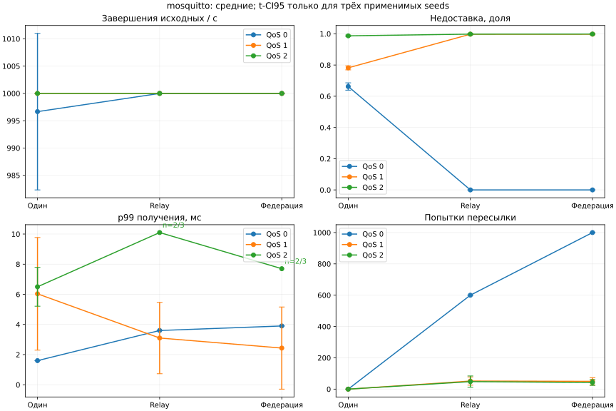
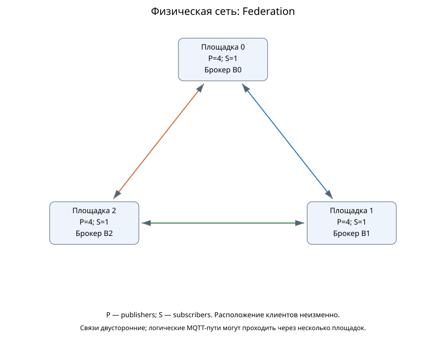
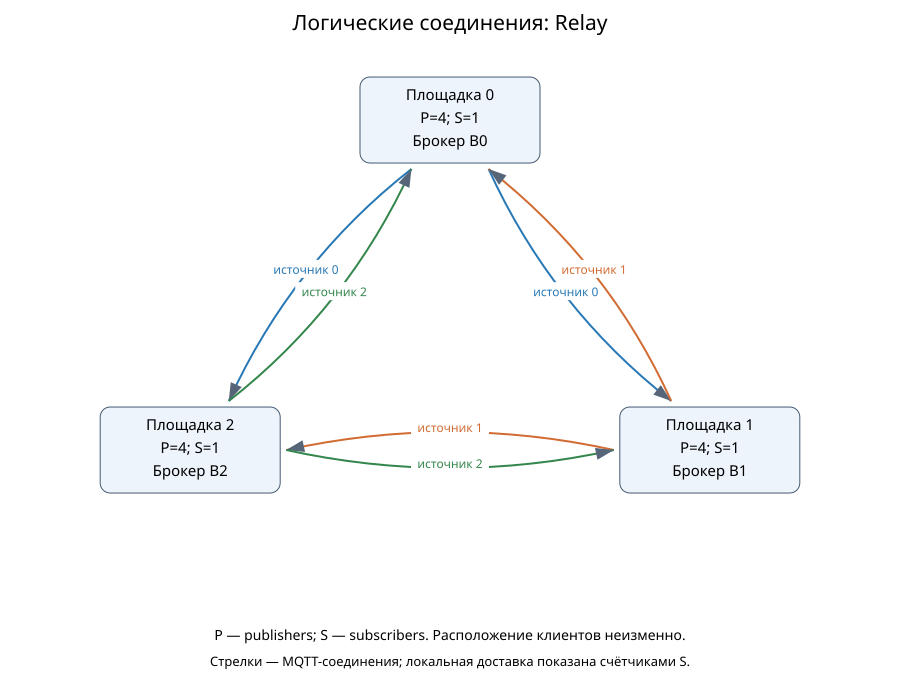
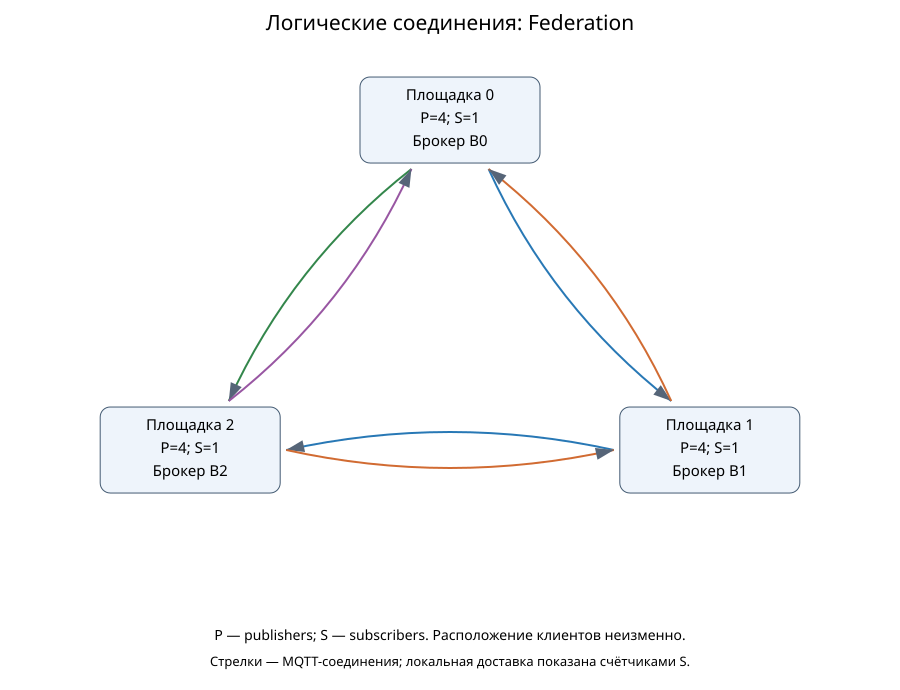
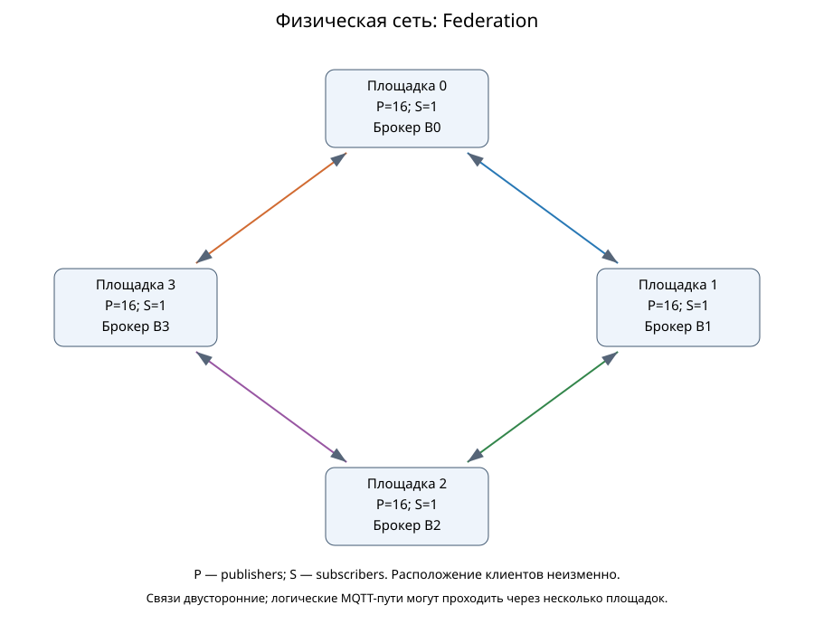
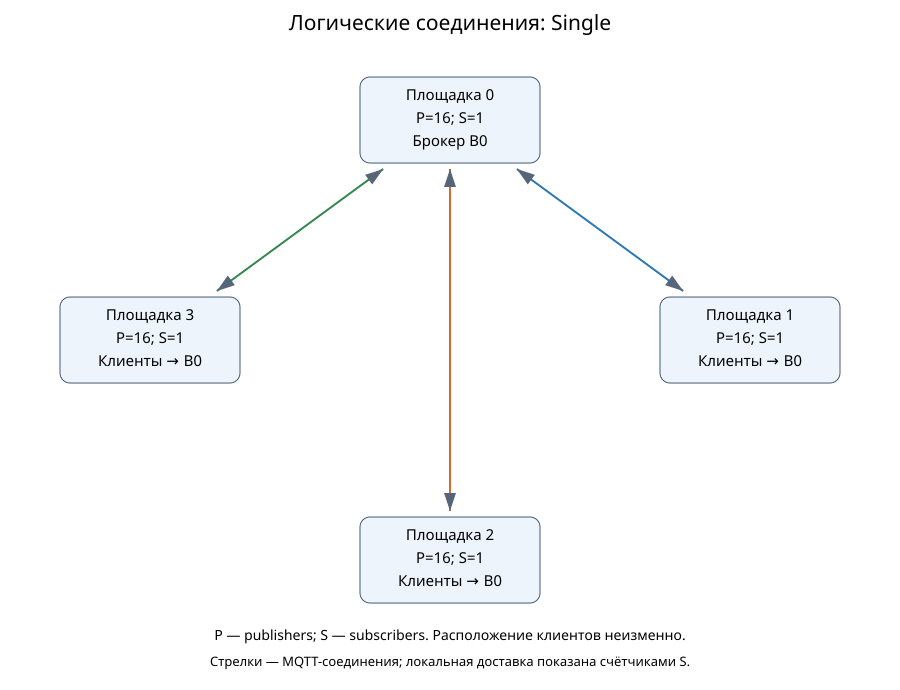
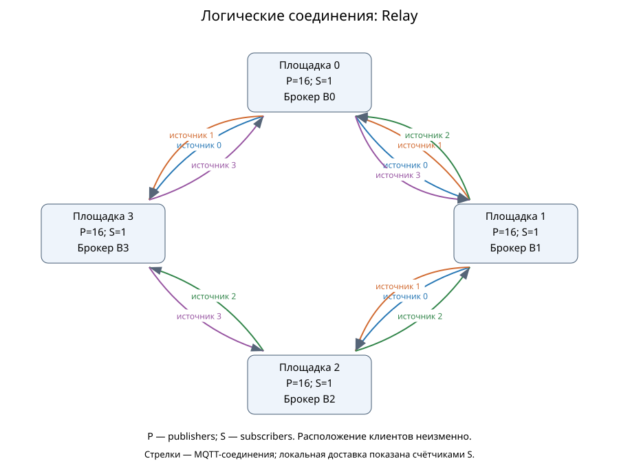
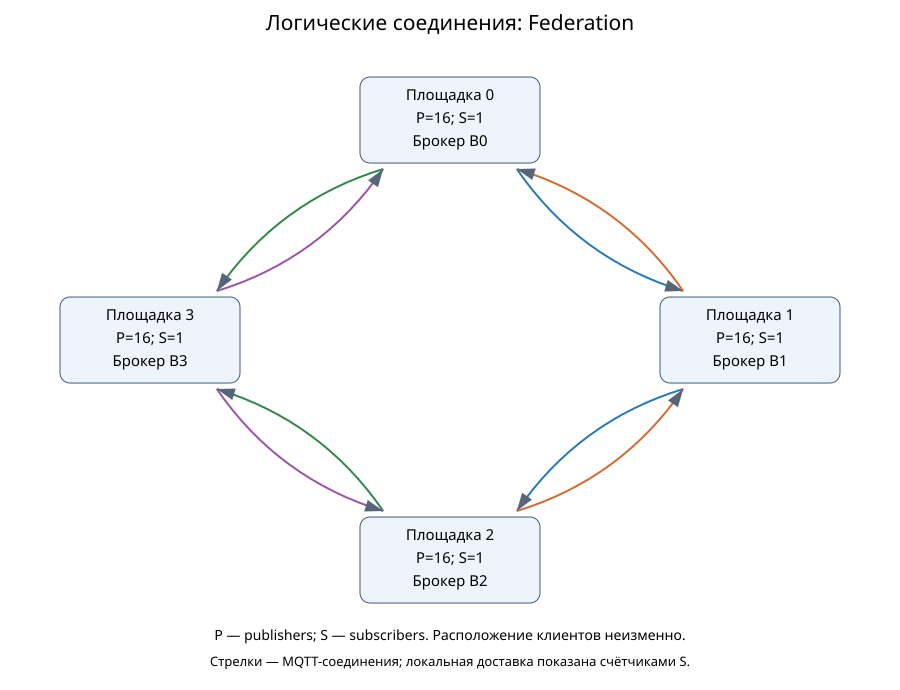

# Статическая федерация: сравнение с MqttRelay и одиночным брокером

Выполнено 54/54 основных симуляций; технических отказов 0. Повторены 6/6 точек; scientific summaries совпадают побайтно. Новых натурных измерений нет.

## Условия и исполнители

Federation.App строит сеть и запускает фазы; ядро MqttY исполняет MQTT и транспорт. StaticFederator выполняет пересылку по соседям с подавлением повторов. В режиме relay работает существующий MqttRelay с деревом от каждого источника. Python-сценарий проверяет журналы и строит этот отчёт. MqttBenchmark не запускается.

Идеальная модель: три площадки, 12 publishers, три subscribers. Mosquitto: четыре площадки, 64 publishers, четыре subscribers. Для каждого семейства расположение клиентов и физическое кольцо сохраняются в трёх режимах; центральный брокер single находится на площадке 0. Каждый subscriber получает все исходные сообщения. В двух семействах разный fanout, поэтому их goodput нельзя непосредственно ранжировать.

Общая нагрузка 1000 сообщений/с, payload 16 байт, QoS 0/1/2, seeds 42/43/44. Прогрев 0,01 с, нагрузка 0,2 с, drain до 1 модельной секунды, tick 0,1 мс. Прогрев полностью завершается до начала измерения. Фиксированная сеть: 125000000 байт/с, окно 100 ticks, очередь 100000, задержка 2 ticks на площадку. Очередь федератора 1024 на направление, кэш 100000 ID на узел без вытеснения, предел переходов равен числу площадок.

## Полученные результаты

Если в запуске нет измерительных получений, его p99 неприменим. В неполных группах указаны n и число неприменимых результатов; CI95 при n<3 не рассчитывается. Доверительные интервалы по трём seeds являются описательными и не учитывают ошибку профиля.

Среднее ± t-CI95 по трём seeds, t=4,302652729911275. Это условный разброс модели при фиксированных входах, не интервал натурной точности.

| Модель | Режим | QoS | Завершения исходных/с | Goodput доставок/с | Недоставка, доля | p99 получения, мс | Пересылки | Подавлено повторов | ✅/план/❌ |
| --- | --- | ---: | ---: | ---: | ---: | ---: | ---: | ---: | --- |
| ideal | single | 0 | 1000.0000 ± 0.0000 | 3000.0000 ± 0.0000 | 0.0000 ± 0.0000 | 1.2000 ± 0.0000 | 0.0000 ± 0.0000 | 0.0000 ± 0.0000 | ✅3/3/❌0 |
| ideal | single | 1 | 1000.0000 ± 0.0000 | 3000.0000 ± 0.0000 | 0.0000 ± 0.0000 | 1.2000 ± 0.0000 | 0.0000 ± 0.0000 | 0.0000 ± 0.0000 | ✅3/3/❌0 |
| ideal | single | 2 | 1000.0000 ± 0.0000 | 3000.0000 ± 0.0000 | 0.0000 ± 0.0000 | 3.6000 ± 0.0000 | 0.0000 ± 0.0000 | 0.0000 ± 0.0000 | ✅3/3/❌0 |
| ideal | relay | 0 | 1000.0000 ± 0.0000 | 3000.0000 ± 0.0000 | 0.0000 ± 0.0000 | 2.6000 ± 0.0000 | 400.0000 ± 0.0000 | 0.0000 ± 0.0000 | ✅3/3/❌0 |
| ideal | relay | 1 | 1000.0000 ± 0.0000 | 3000.0000 ± 0.0000 | 0.0000 ± 0.0000 | 2.6000 ± 0.0000 | 400.0000 ± 0.0000 | 0.0000 ± 0.0000 | ✅3/3/❌0 |
| ideal | relay | 2 | 1000.0000 ± 0.0000 | 3000.0000 ± 0.0000 | 0.0000 ± 0.0000 | 7.8000 ± 0.0000 | 400.0000 ± 0.0000 | 0.0000 ± 0.0000 | ✅3/3/❌0 |
| ideal | federation | 0 | 1000.0000 ± 0.0000 | 3000.0000 ± 0.0000 | 0.0000 ± 0.0000 | 2.8000 ± 0.0000 | 800.0000 ± 0.0000 | 400.0000 ± 0.0000 | ✅3/3/❌0 |
| ideal | federation | 1 | 1000.0000 ± 0.0000 | 3000.0000 ± 0.0000 | 0.0000 ± 0.0000 | 5.5000 ± 0.0000 | 800.0000 ± 0.0000 | 400.0000 ± 0.0000 | ✅3/3/❌0 |
| ideal | federation | 2 | 1000.0000 ± 0.0000 | 3000.0000 ± 0.0000 | 0.0000 ± 0.0000 | 145.8000 ± 0.0000 | 800.0000 ± 0.0000 | 400.0000 ± 0.0000 | ✅3/3/❌0 |
| mosquitto | single | 0 | 996.6667 ± 14.3422 | 1350.0000 ± 93.7741 | 0.6625 ± 0.0234 | 1.6000 ± 0.0000 | 0.0000 ± 0.0000 | 0.0000 ± 0.0000 | ✅3/3/❌0 |
| mosquitto | single | 1 | 1000.0000 ± 0.0000 | 871.6667 ± 51.7115 | 0.7821 ± 0.0129 | 6.0333 ± 3.7372 | 0.0000 ± 0.0000 | 0.0000 ± 0.0000 | ✅3/3/❌0 |
| mosquitto | single | 2 | 1000.0000 ± 0.0000 | 51.6667 ± 18.9729 | 0.9871 ± 0.0047 | 6.5000 ± 1.2908 | 0.0000 ± 0.0000 | 0.0000 ± 0.0000 | ✅3/3/❌0 |
| mosquitto | relay | 0 | 1000.0000 ± 0.0000 | 4000.0000 ± 0.0000 | 0.0000 ± 0.0000 | 3.6000 ± 0.0000 | 600.0000 ± 0.0000 | 0.0000 ± 0.0000 | ✅3/3/❌0 |
| mosquitto | relay | 1 | 1000.0000 ± 0.0000 | 10.0000 ± 12.4207 | 0.9975 ± 0.0031 | 3.1000 ± 2.3697 | 51.6667 ± 26.3287 | 0.0000 ± 0.0000 | ✅3/3/❌0 |
| mosquitto | relay | 2 | 1000.0000 ± 0.0000 | 8.3333 ± 18.9729 | 0.9979 ± 0.0047 | 10.1000 (n=2/3; н/п=1) | 48.0000 ± 36.0842 | 0.0000 ± 0.0000 | ✅3/3/❌0 |
| mosquitto | federation | 0 | 1000.0000 ± 0.0000 | 4000.0000 ± 0.0000 | 0.0000 ± 0.0000 | 3.9000 ± 0.0000 | 1000.0000 ± 0.0000 | 400.0000 ± 0.0000 | ✅3/3/❌0 |
| mosquitto | federation | 1 | 1000.0000 ± 0.0000 | 10.0000 ± 12.4207 | 0.9975 ± 0.0031 | 2.4333 ± 2.7250 | 49.6667 ± 23.4792 | 0.0000 ± 0.0000 | ✅3/3/❌0 |
| mosquitto | federation | 2 | 1000.0000 ± 0.0000 | 6.6667 ± 18.9729 | 0.9983 ± 0.0047 | 7.7000 (n=2/3; н/п=1) | 42.3333 ± 18.6448 | 0.0000 ± 0.0000 | ✅3/3/❌0 |

### Федерация относительно Relay

Отношения средних, без проверки статистической значимости; это диагностическое сравнение фиксированного опыта. Для потерь приведена абсолютная разность долей: положительное значение означает большую недоставку федерации.

| Модель | QoS | p99 федерации / p99 Relay | Пересылки федерации / Relay | Loss федерации − loss Relay |
| --- | ---: | ---: | ---: | ---: |
| ideal | 0 | 1.0769 | 2.0000 | 0.0000 |
| ideal | 1 | 2.1154 | 2.0000 | 0.0000 |
| ideal | 2 | 18.6923 | 2.0000 | 0.0000 |
| mosquitto | 0 | 1.0833 | 1.6667 | 0.0000 |
| mosquitto | 1 | 0.7849 | 0.9613 | 0.0000 |
| mosquitto | 2 | н/п: неполное покрытие p99 | 0.8819 | 0.0004 |

## Графики

## Топологии

Физическая сеть и расположение исходных клиентов сверены с GraphML приложением. Логические стрелки обозначают MQTT-соединения, а не обход физических сетевых участков. Разные источники Relay имеют разные деревья; в федерации связи допускают циклы, а идентификаторы препятствуют повторной обработке.

### ideal

### mosquitto

## Что означают числа

Source completed RPS учитывает только завершения исходных publishers; служебные публикации не добавляются к нему. Goodput — уникальные пары ID–subscriber за секунду нагрузки. Ожидаемая доставка = число API-попыток исходного Publish × число subscribers; потери включают немедленные исходные отказы. Поздние получения в drain включены в свою когорту и показаны отдельно в JSON. p99 получения строится по первым получениям каждой пары; исходные ACK приведены отдельно в данных, для QoS 0 неприменимы. Исходные завершения могут быть успешными при недоставке subscribers. Байты пересылки в JSON — UTF-8 темы плюс payload, без заголовков; симулятор передаёт полные MQTT-пакеты.

## Наблюдаемые ограничения реализации

В идеальной модели все три архитектуры доставили все 200 исходных сообщений каждому из трёх subscribers во всех повторах. Федерация в кольце выполнила 800 пересылок и подавила 400 повторов; Relay выполнил 400 пересылок без циклов. Дополнительная пересылка сама по себе не дала выигрыша по доставке при этой нагрузке.

При QoS 2 p99 получения составил 145,8 мс у федерации, 7,8 мс у Relay и 3,6 мс у одного брокера. Это реальное ограничение текущей модели: федератор использует один служебный publisher на направление и ждёт завершения его QoS-обмена. В режиме Relay отдельный экземпляр создаётся для каждого источника, поэтому служебных соединений больше. Сравнение включает это различие реализации; оно не изолирует стоимость алгоритма маршрутизации. Для следующего этапа нужен отдельный контролируемый опыт с одинаковым бюджетом служебных соединений и более длинным окном нагрузки; текущие числа не подгоняются.

В профилированных распределённых режимах при QoS 1/2 недоставка превышает 99% ожидаемых пар. Сохранённая условная потеря применяется при доставке федераторам и при следующих пересылках, поэтому потери накапливаются. Успешный ACK исходному publisher не гарантирует получение ни федератором, ни конечным subscriber. p99 рассчитан только по дошедшим сообщениям: меньший p99 при почти полной недоставке не означает лучшего обслуживания всего потока. Для QoS 2 есть seeds совсем без получений; они показаны как неприменимые, а не как нулевая задержка.

Предупреждения отделены от технических отказов: [причины по каждому запуску](data/federation-study-v1/warnings.json). Они описывают фактическую недоставку, отсутствие получений и ограничения очередей/переходов, не вводя новых порогов натурной точности.

В идеальной федерации с QoS 2 в среднем 43.0% получений произошли в drain. Поэтому одинаковый goodput когорты, делённый на время подачи нагрузки, не означает одинаковую устойчивую пропускную способность: часть работы завершена после остановки подачи. Для проверки устойчивого режима нужен более длинный опыт с наблюдением роста очередей.

## Вывод и ограничения

Статическая федерация обеспечивает модельную межброкерную пересылку с конечной обработкой циклов; действительное покрытие и потери приведены в таблице. Преимущество не предполагается заранее: сравниваются фактическая доставка, задержка и дополнительный трафик. В идеальной модели при малой нагрузке одинаковая доставка не означает равную стоимость архитектур. У федерации есть избыточные пути и накладные расходы повторных межброкерных получений; Relay использует настроенные деревья без циклов. Одиночный брокер исключает межброкерную пересылку, но меняет место обслуживания клиентов.

Профиль Mosquitto неизменён: N=64 для single, N=16 для распределённых брокеров. Он содержит исходную высокую условную недоставку для QoS 1/2. Дополнительные федераторы, fanout, новые темы и новая интенсивность не калибровались; результат не доказывает ту же недоставку у настоящего Mosquitto или точность настоящей федерации. Нет самоорганизации, выбора ядра, beacons, No Local и перестроения после отказа. CPU/RSS, EST и отказоустойчивость не подтверждаются. Короткое окно является приёмочной проверкой механизма, не стационарным исследованием производительности. Для натурной проверки нужны отдельные измерения всех трёх архитектур с тем же расположением клиентов и независимым контролем.

## Воспроизводимость

MqttY commit: `a8dc3230a67cce1fce6e91ecfba7e0dae767f227`. Профиль SHA-256: `d9cf125fb8cb6ec3677fc3c596bafcdfced8be0502362e2b4ff03da1421d46eb`. Сохранены snapshots профиля, runtime, конфиги, команды, первичные получения и пересылки. Проверка независимо пересчитывает пары получателей, целостность payload, гистограммы и квантили, знаменатели, drain и формулы RPS по исходным счётчикам. Счётчики исходных завершений отдельно проверены тестами инструментации; они не выводятся из одного исчезновения pending.

Повтор всей программы: собрать приложение в Release, выполнить `python tools/federation/study.py run --work-dir <новый-каталог>`, затем `python tools/federation/report.py --work-dir <тот-же-каталог>`. Отдельный опыт повторяется командой приложения `run --config <run>/run-config.json --output <новый-каталог>`.

[CSV](data/federation-study-v1/runs.csv), [scientific summaries](data/federation-study-v1/runs.json), [агрегаты](data/federation-study-v1/aggregates.json), [проверка](data/federation-study-v1/verification.json), [точная программа](data/federation-study-v1/study-plan.json). Полные архивы хранятся отдельно от Git; квитанция внешнего хранения публикуется после проверки архива.

[Квитанции внешнего хранения и дополнительные проверки](data/federation-study-v1/README.md).
