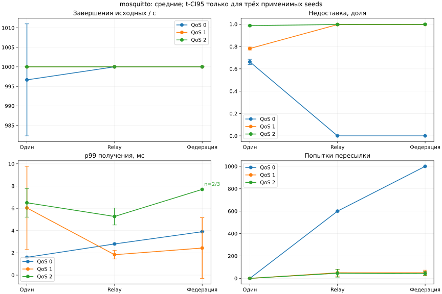
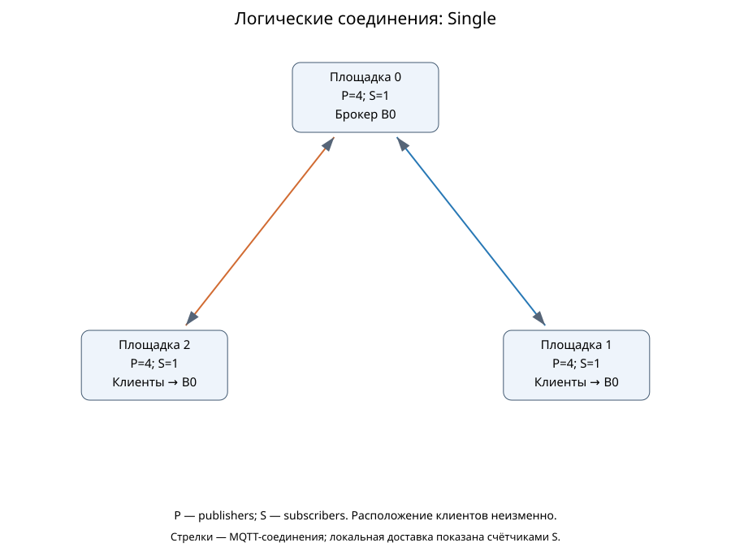
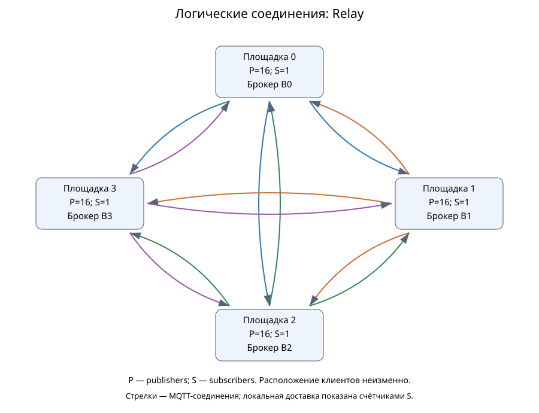

# Статическая федерация: сравнение с MqttRelay и одиночным брокером

Выполнено 54/54 основных симуляций; технических отказов 0. Повторены 6/6 точек; scientific summaries совпадают побайтно. Новых натурных измерений нет.

## Условия и исполнители

Federation.App строит сеть и запускает фазы; ядро MqttY исполняет MQTT и транспорт. StaticFederator выполняет пересылку по соседям с подавлением повторов. В режиме relay работает существующий MqttRelay: каждый брокер соединён со всеми остальными; импортированные сообщения доставляются только локально. Python-сценарий проверяет журналы и строит этот отчёт. MqttBenchmark не запускается.

Идеальная модель: три площадки, 12 publishers, три subscribers. Mosquitto: четыре площадки, 64 publishers, четыре subscribers. Для каждого семейства расположение клиентов и физическое кольцо сохраняются в трёх режимах; центральный брокер single находится на площадке 0. Для каждого subscriber ожидаются сообщения всех источников; фактические получения проверяются по ID. В двух семействах разный fanout, поэтому их goodput нельзя непосредственно ранжировать.

Общая нагрузка 1000 сообщений/с, payload 16 байт, QoS 0/1/2, seeds 42/43/44. Прогрев 0,01 с, нагрузка 0,2 с, drain до 1 модельной секунды, tick 0,1 мс. Прогрев полностью завершается до начала измерения. Фиксированная сеть: 125000000 байт/с, окно 100 ticks, очередь 100000, задержка 2 ticks на площадку. Очередь федератора 1024 на направление, кэш 100000 ID на узел без вытеснения, предел переходов равен числу площадок.

## Полученные результаты

Если в запуске нет измерительных получений, его p99 неприменим. В неполных группах указаны n и число неприменимых результатов; CI95 при n<3 не рассчитывается. Доверительные интервалы по трём seeds являются описательными и не учитывают ошибку профиля.

Среднее ± t-CI95 по трём seeds, t=4,302652729911275. Это условный разброс модели при фиксированных входах, не интервал натурной точности.

| Модель | Режим | QoS | Завершения исходных/с | Goodput доставок/с | Недоставка, доля | p99 получения, мс | Пересылки | Подавлено повторов | ✅/план/❌ |
| --- | --- | ---: | ---: | ---: | ---: | ---: | ---: | ---: | --- |
| ideal | single | 0 | 1000.0000 ± 0.0000 | 3000.0000 ± 0.0000 | 0.0000 ± 0.0000 | 1.2000 ± 0.0000 | 0.0000 ± 0.0000 | 0.0000 ± 0.0000 | ✅3/3/❌0 |
| ideal | single | 1 | 1000.0000 ± 0.0000 | 3000.0000 ± 0.0000 | 0.0000 ± 0.0000 | 1.2000 ± 0.0000 | 0.0000 ± 0.0000 | 0.0000 ± 0.0000 | ✅3/3/❌0 |
| ideal | single | 2 | 1000.0000 ± 0.0000 | 3000.0000 ± 0.0000 | 0.0000 ± 0.0000 | 3.6000 ± 0.0000 | 0.0000 ± 0.0000 | 0.0000 ± 0.0000 | ✅3/3/❌0 |
| ideal | relay | 0 | 1000.0000 ± 0.0000 | 3000.0000 ± 0.0000 | 0.0000 ± 0.0000 | 2.6000 ± 0.0000 | 400.0000 ± 0.0000 | 0.0000 ± 0.0000 | ✅3/3/❌0 |
| ideal | relay | 1 | 1000.0000 ± 0.0000 | 3000.0000 ± 0.0000 | 0.0000 ± 0.0000 | 2.6000 ± 0.0000 | 400.0000 ± 0.0000 | 0.0000 ± 0.0000 | ✅3/3/❌0 |
| ideal | relay | 2 | 1000.0000 ± 0.0000 | 3000.0000 ± 0.0000 | 0.0000 ± 0.0000 | 7.8000 ± 0.0000 | 400.0000 ± 0.0000 | 0.0000 ± 0.0000 | ✅3/3/❌0 |
| ideal | federation | 0 | 1000.0000 ± 0.0000 | 3000.0000 ± 0.0000 | 0.0000 ± 0.0000 | 2.8000 ± 0.0000 | 800.0000 ± 0.0000 | 400.0000 ± 0.0000 | ✅3/3/❌0 |
| ideal | federation | 1 | 1000.0000 ± 0.0000 | 3000.0000 ± 0.0000 | 0.0000 ± 0.0000 | 5.5000 ± 0.0000 | 800.0000 ± 0.0000 | 400.0000 ± 0.0000 | ✅3/3/❌0 |
| ideal | federation | 2 | 1000.0000 ± 0.0000 | 3000.0000 ± 0.0000 | 0.0000 ± 0.0000 | 145.8000 ± 0.0000 | 800.0000 ± 0.0000 | 400.0000 ± 0.0000 | ✅3/3/❌0 |
| mosquitto | single | 0 | 996.6667 ± 14.3422 | 1350.0000 ± 93.7741 | 0.6625 ± 0.0234 | 1.6000 ± 0.0000 | 0.0000 ± 0.0000 | 0.0000 ± 0.0000 | ✅3/3/❌0 |
| mosquitto | single | 1 | 1000.0000 ± 0.0000 | 871.6667 ± 51.7115 | 0.7821 ± 0.0129 | 6.0333 ± 3.7372 | 0.0000 ± 0.0000 | 0.0000 ± 0.0000 | ✅3/3/❌0 |
| mosquitto | single | 2 | 1000.0000 ± 0.0000 | 51.6667 ± 18.9729 | 0.9871 ± 0.0047 | 6.5000 ± 1.2908 | 0.0000 ± 0.0000 | 0.0000 ± 0.0000 | ✅3/3/❌0 |
| mosquitto | relay | 0 | 1000.0000 ± 0.0000 | 4000.0000 ± 0.0000 | 0.0000 ± 0.0000 | 2.8000 ± 0.0000 | 600.0000 ± 0.0000 | 0.0000 ± 0.0000 | ✅3/3/❌0 |
| mosquitto | relay | 1 | 1000.0000 ± 0.0000 | 13.3333 ± 18.9729 | 0.9967 ± 0.0047 | 1.8333 ± 0.3795 | 50.0000 ± 30.1186 | 0.0000 ± 0.0000 | ✅3/3/❌0 |
| mosquitto | relay | 2 | 1000.0000 ± 0.0000 | 11.6667 ± 14.3422 | 0.9971 ± 0.0036 | 5.2667 ± 0.7589 | 46.0000 ± 35.2187 | 0.0000 ± 0.0000 | ✅3/3/❌0 |
| mosquitto | federation | 0 | 1000.0000 ± 0.0000 | 4000.0000 ± 0.0000 | 0.0000 ± 0.0000 | 3.9000 ± 0.0000 | 1000.0000 ± 0.0000 | 400.0000 ± 0.0000 | ✅3/3/❌0 |
| mosquitto | federation | 1 | 1000.0000 ± 0.0000 | 10.0000 ± 12.4207 | 0.9975 ± 0.0031 | 2.4333 ± 2.7250 | 49.6667 ± 23.4792 | 0.0000 ± 0.0000 | ✅3/3/❌0 |
| mosquitto | federation | 2 | 1000.0000 ± 0.0000 | 6.6667 ± 18.9729 | 0.9983 ± 0.0047 | 7.7000 (n=2/3; н/п=1) | 42.3333 ± 18.6448 | 0.0000 ± 0.0000 | ✅3/3/❌0 |

### Федерация относительно Relay

Отношения средних, без проверки статистической значимости; это диагностическое сравнение фиксированного опыта. Для потерь приведена абсолютная разность долей: положительное значение означает большую недоставку федерации.

| Модель | QoS | p99 федерации / p99 Relay | Пересылки федерации / Relay | Loss федерации − loss Relay |
| --- | ---: | ---: | ---: | ---: |
| ideal | 0 | 1.0769 | 2.0000 | 0.0000 |
| ideal | 1 | 2.1154 | 2.0000 | 0.0000 |
| ideal | 2 | 18.6923 | 2.0000 | 0.0000 |
| mosquitto | 0 | 1.3929 | 1.6667 | 0.0000 |
| mosquitto | 1 | 1.3273 | 0.9933 | 0.0008 |
| mosquitto | 2 | н/п: неполное покрытие p99 | 0.9203 | 0.0012 |

## Графики

## Топологии

Физическая сеть и расположение исходных клиентов сверены с GraphML приложением. Логические стрелки обозначают MQTT-соединения, а не обход физических сетевых участков. Relay образует N × (N−1) направленных MQTT-соединений между брокерами: 6 для трёх брокеров, 12 для четырёх. Импорт не экспортируется повторно. Федераторы используют соседей физической сети и подавляют повторные ID.

### ideal

### mosquitto

## Что означают числа

Source completed RPS учитывает только завершения исходных publishers; служебные публикации не добавляются к нему. Goodput — уникальные пары ID–subscriber за секунду нагрузки. Ожидаемая доставка = число API-попыток исходного Publish × число subscribers; потери включают немедленные исходные отказы. Поздние получения в drain включены в свою когорту и показаны отдельно в JSON. p99 получения строится по первым получениям каждой пары; исходные ACK приведены отдельно в данных, для QoS 0 неприменимы. Исходные завершения могут быть успешными при недоставке subscribers. Байты пересылки в JSON — UTF-8 темы плюс payload, без заголовков; симулятор передаёт полные MQTT-пакеты.

## Наблюдаемые ограничения реализации

В идеальной модели все три архитектуры доставили все 200 исходных сообщений каждому из трёх subscribers во всех повторах. При QoS 2 Relay выполнил в среднем 400 межброкерных пересылок, федерация — 800. В Relay каждый брокер экспортирует свой поток всем остальным, а импорт направляет только локальным subscribers. Повторная рассылка импорта отсутствует; это проверено по источнику, месту отправки и адресату каждой пересылки.

При QoS 2 среднее p99 получения: single — 3.600 мс, Relay — 7.800 мс, федерация — 145.800 мс. На каждой площадке работает один MqttRelay, с раздельными MQTT-клиентами для маршрутов разных источников. Федератор использует один выходной MQTT-клиент на направление и ждёт завершения QoS-обмена. Число служебных соединений и способ обслуживания различаются, поэтому сравнение не изолирует стоимость алгоритма. Для этого нужен контролируемый опыт с одинаковым бюджетом соединений и более длинной нагрузкой.

В профилированных распределённых режимах при QoS 1/2 средняя недоставка находится в диапазоне 99.667–99.833%. Сохранённая условная потеря применяется при доставке служебным клиентам и на следующих этапах; потери накапливаются. ACK исходному publisher не гарантирует доставку конечному subscriber. p99 рассчитан только по дошедшим сообщениям: меньшая задержка при почти полной недоставке не означает лучшего обслуживания потока. Запуски без получений имеют неприменимый p99.

Предупреждения отделены от технических отказов: [причины по каждому запуску](data/federation-full-mesh-v1/warnings.json). Они показывают фактическую недоставку, отсутствие получений и ограничения очередей/переходов.

Это отдельная программа с полносвязным Relay. [Предыдущий отчёт с деревьями](Federation-study-bfs.md) и его данные сохранены; запуски разных программ не объединяются в статистические повторы.

В идеальной федерации с QoS 2 в среднем 43.0% получений произошли в drain. Поэтому одинаковый goodput когорты, делённый на время подачи нагрузки, не означает одинаковую устойчивую пропускную способность: часть работы завершена после остановки подачи. Для проверки устойчивого режима нужен более длинный опыт с наблюдением роста очередей.

## Вывод и ограничения

Статическая федерация обеспечивает модельную межброкерную пересылку с конечной обработкой циклов; действительное покрытие и потери приведены в таблице. Преимущество не предполагается заранее: сравниваются фактическая доставка, задержка и дополнительный трафик. В идеальной модели при малой нагрузке одинаковая доставка не означает равную стоимость архитектур. У федерации есть избыточные пути и накладные расходы повторных межброкерных получений; Relay использует полносвязную логическую сеть с экспортом только локального исходного потока. Одиночный брокер исключает межброкерную пересылку, но меняет место обслуживания клиентов.

Профиль Mosquitto неизменён: N=64 для single, N=16 для распределённых брокеров. Он содержит исходную высокую условную недоставку для QoS 1/2. Дополнительные федераторы, fanout, новые темы и новая интенсивность не калибровались; результат не доказывает ту же недоставку у настоящего Mosquitto или точность настоящей федерации. Нет самоорганизации, выбора ядра, beacons, No Local и перестроения после отказа. CPU/RSS, EST и отказоустойчивость не подтверждаются. Короткое окно является приёмочной проверкой механизма, не стационарным исследованием производительности. Для натурной проверки нужны отдельные измерения всех трёх архитектур с тем же расположением клиентов и независимым контролем.

## Воспроизводимость

MqttY commit: `36fbec481d9dc3e1744bf96da5a9ff298f74ed2e`. Профиль SHA-256: `d9cf125fb8cb6ec3677fc3c596bafcdfced8be0502362e2b4ff03da1421d46eb`. Сохранены snapshots профиля, runtime, конфиги, команды, первичные получения и пересылки. Проверка независимо пересчитывает пары получателей, целостность payload, гистограммы и квантили, знаменатели, drain и формулы RPS по исходным счётчикам. Счётчики исходных завершений отдельно проверены тестами инструментации; они не выводятся из одного исчезновения pending.

Повтор всей программы: собрать приложение в Release, выполнить `python tools/federation/study.py run --work-dir <новый-каталог>`, затем `python tools/federation/report.py --work-dir <тот-же-каталог>`. Отдельный опыт повторяется командой приложения `run --config <run>/run-config.json --output <новый-каталог>`.

[CSV](data/federation-full-mesh-v1/runs.csv), [scientific summaries](data/federation-full-mesh-v1/runs.json), [агрегаты](data/federation-full-mesh-v1/aggregates.json), [проверка](data/federation-full-mesh-v1/verification.json), [точная программа](data/federation-full-mesh-v1/study-plan.json). Полные архивы хранятся отдельно от Git; квитанция внешнего хранения публикуется после проверки архива.

[Квитанции внешнего хранения и дополнительные проверки](data/federation-full-mesh-v1/README.md).
