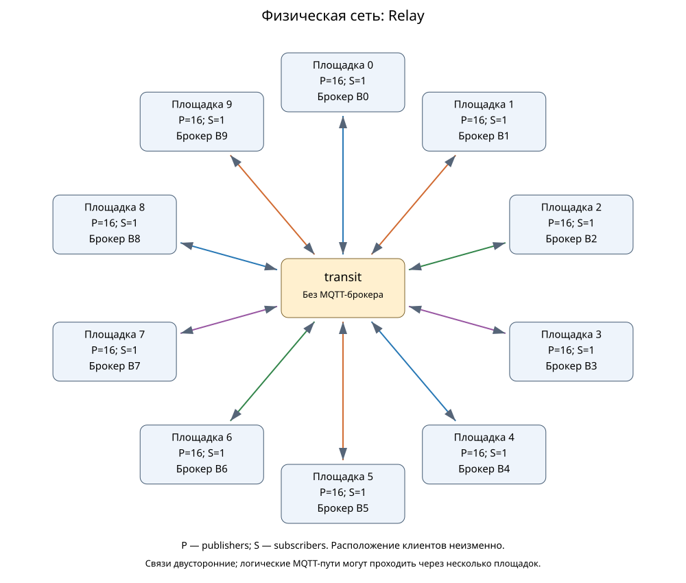
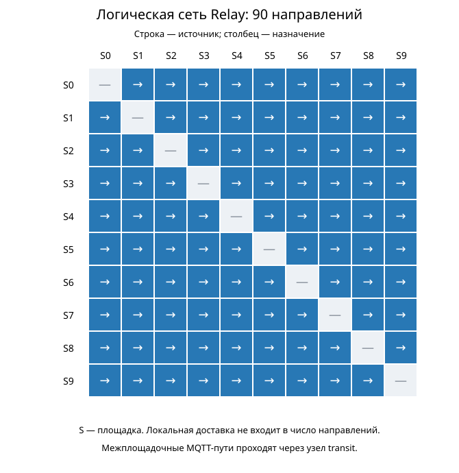
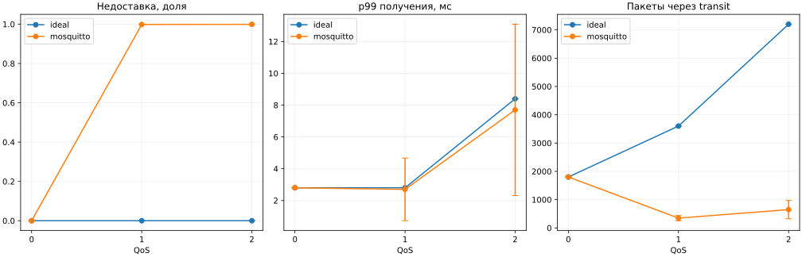

# Relay: десять брокеров через промежуточный сетевой узел

Выполнено 18/18 симуляций: идеальная модель и профиль Mosquitto × QoS 0/1/2 × seeds 42/43/44. Шесть выбранных точек повторены: summary.json и network-evidence.json совпадают побайтно. Это отдельная программа; прежние результаты не объединяются с ней.

Десять брокеров находятся на десяти площадках. Каждая площадка связана только с сетью transit; у transit нет брокера, клиента или MQTT-приложения. В Relay настроено 90 направлений: каждый брокер экспортирует исходные сообщения всем остальным, а импорт доставляет только локальным subscribers. Физический путь любой межброкерной связи — siteA → transit → siteB.

160 исходных publishers — по 16 на брокер; по одному subscriber на площадке. Общая нагрузка 1000 сообщений/с, payload 16 байт. Прогрев 0,01 с, измерение 0,2 с, drain до 1 с, tick 0,1 мс. Для каждого запуска запланировано 200 исходных сообщений и 2000 пар доставки. Все одиннадцать модельных сетей имеют ёмкость 125000000 байт/с, окно 100 ticks, очередь 100000 и задержку 2 ticks. Ёмкость transit общая для проходящих через него направлений, а не выделенная каждой MQTT-связи.

## Топология





Логическая схема показана матрицей: строка — источник, столбец — назначение. Mermaid сохраняет все 90 направлений. Матрица не означает, что у брокеров есть физические связи в обход transit.

## Результаты

Среднее ± t-CI95 по трём seeds; t=4,302652729911275. Интервал отражает условный разброс симулятора, а не натурную точность. При отсутствии получений p99 неприменим; для неполных групп показано n, CI95 не рассчитывается.

| Модель | QoS | Исходные завершения/с | Уникальные доставки/с | Недоставка | p99 получения, мс | Пересылки | Пакеты через transit |
| --- | ---: | ---: | ---: | ---: | ---: | ---: | ---: |
| ideal | 0 | 1000.0000 ± 0.0000 | 10000.0000 ± 0.0000 | 0.0000 ± 0.0000 | 2.8000 ± 0.0000 | 1800.0000 ± 0.0000 | 1800.0000 ± 0.0000 |
| ideal | 1 | 1000.0000 ± 0.0000 | 10000.0000 ± 0.0000 | 0.0000 ± 0.0000 | 2.8000 ± 0.0000 | 1800.0000 ± 0.0000 | 3600.0000 ± 0.0000 |
| ideal | 2 | 1000.0000 ± 0.0000 | 10000.0000 ± 0.0000 | 0.0000 ± 0.0000 | 8.4000 ± 0.0000 | 1800.0000 ± 0.0000 | 7200.0000 ± 0.0000 |
| mosquitto | 0 | 1000.0000 ± 0.0000 | 10000.0000 ± 0.0000 | 0.0000 ± 0.0000 | 2.8000 ± 0.0000 | 1800.0000 ± 0.0000 | 1800.0000 ± 0.0000 |
| mosquitto | 1 | 1000.0000 ± 0.0000 | 15.0000 ± 12.4207 | 0.9985 ± 0.0012 | 2.7000 ± 1.9717 | 174.0000 ± 46.5403 | 348.0000 ± 93.0806 |
| mosquitto | 2 | 1000.0000 ± 0.0000 | 8.3333 ± 7.1711 | 0.9992 ± 0.0007 | 7.7000 ± 5.3912 | 162.0000 ± 80.6102 | 648.0000 ± 322.4407 |



## Что проверено и что означают числа

В идеальной модели получены все 2000 ожидаемых пар в каждом запуске, дубликатов нет; 200 исходных сообщений дали 1800 межброкерных пересылок. Это 200 × 9 адресатов, без повторного экспорта импорта. Маршруты всех 90 направлений сверены с PathFinder; счётчики transit подтверждают фактическое прохождение модельных пакетов. Из конечного снимка вычтен снимок после прогрева: соединения, подписки и прогрев исключены. Пакеты и байты transit включают MQTT-обмен, в том числе подтверждения; они не равны числу исходных сообщений. Отказ приёма в очередь не равен потере публикации: передача может быть отложена.

Исходные RPS учитывают только publishers; служебные публикации сюда не добавляются. Уникальные доставки считаются по парам ID–subscriber. Ожидаемые пары = исходные API-попытки × 10; недоставка = 1 − полученные уникальные пары / ожидаемые. Завершения и получения в drain относятся к той же когорте и делятся на 0,2 с подачи нагрузки. Такой goodput не доказывает устойчивую предельную пропускную способность. p99 относится только к дошедшим сообщениям; ACK QoS 0 неприменим.

Federation.App задаёт конфигурацию, строит граф и запускает фазы. MqttRelay выполняет MQTT-пересылку; ядро MqttY исполняет пакеты, задержки и очереди. transit обслуживает сетевую очередь и не разбирает темы MQTT. Python проверяет первичные журналы, разности счётчиков и строит отчёт. MqttBenchmark здесь не запускается.

## Ограничения

Mosquitto использует неизменённую точку профиля N=16. Профиль содержит условные потери, которые повторно применяются на этапах доставки служебным клиентам и подписчикам. Поэтому большая недоставка здесь не доказывает такие же потери настоящего Mosquitto при новой нагрузке. Дополнительные клиенты, fanout и 90 направлений не калибровались натурно. Меньший p99 среди немногих получений не означает лучшую обработку всего потока. CPU/RSS, EST, отказоустойчивость и предельная производительность не исследованы. Сравнение с single по этому профилю не выполнено: для 160 publishers на центральном брокере нужна отсутствующая точка N=160. Подмена соседней точкой запрещена.

## Повторение и данные

Из корня мета-репозитория:

```text
dotnet run --project mqtty/src/EntityFX.MqttSimulator/EntityFX.MqttY.Federation.App -c Release -- demo --brokers 10 --publishers 160 --topology star --mode relay --qos 1 --seed 42
python tools/federation/transit_study.py run --work-dir <новый-каталог>
python tools/federation/transit_study.py report --work-dir <тот-же-каталог>
```

MqttY commit: `2eae11a197f49ad8d962f5a98aa6ecf2c496fa9e`. SHA-256 профиля: `d9cf125fb8cb6ec3677fc3c596bafcdfced8be0502362e2b4ff03da1421d46eb`.

[Программа](data/federation-transit-10-v1/study-plan.json), [CSV](data/federation-transit-10-v1/runs.csv), [сводки и сетевые доказательства](data/federation-transit-10-v1/runs.json), [агрегаты](data/federation-transit-10-v1/aggregates.json), [проверки и предупреждения](data/federation-transit-10-v1/verification.json). [Квитанция архива](data/federation-transit-10-v1/archive-receipt.json) подтверждает внешнее хранение полных первичных журналов. Архивы не добавляются в Git.
