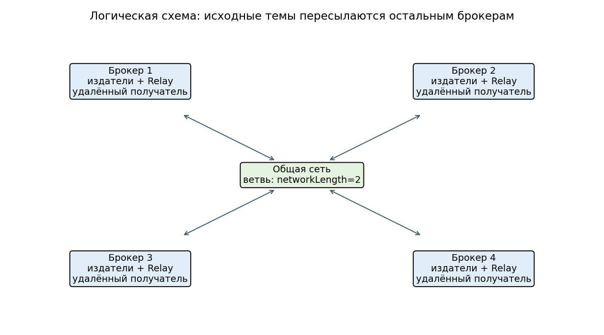

# Проверка MqttY и MqttRelay: доказательства и границы

**Доказана работоспособность модели и повторяемость выбранных запусков. Полное соответствие настоящим брокерам не подтверждено.** Ни один двойник не прошёл все независимые точки. Натурная точность Relay-сети не проверялась.

## 1. Привязка двойника к измерениям

У каждого брокера 72 измерения для калибровки и 24 профильные точки. Все 936 manifests моделей проверены против четырёх замороженных SHA-256 профилей из финального state. В mixed-сети сохранены четыре отдельные provenance; campaign identities не объединяются. Версия модели, длительности и режимы одинаковы в Fidelity и holdout; offeredRps берётся из соответствующей калибровочной или независимой точки. [Снимок](data/snapshot.json), [сводка моделей с хэшами](data/model-evidence.json), полные manifests — в пяти model-evidence.zip.

## 2. Количественная проверка точности

В таблице сначала число запусков, прошедших все применимые критерии, затем число точек, в которых прошли все три seed. QoS 0 p99 неприменим и не засчитывается отдельным успехом.

| Брокер | Fidelity: запусков | Fidelity: точек | Независимый контроль: запусков | Контроль: точек |
| --- | --- | --- | --- | --- |
| Aedes | 64/72 | 20/24 | 58/72 | 18/24 |
| Mosquitto | 70/72 | 22/24 | 58/72 | 18/24 |
| ActiveMQ | 70/72 | 22/24 | 29/72 | 9/24 |
| EMQX | 72/72 | 24/24 | 58/72 | 19/24 |

Критерии: относительное отклонение RPS ≤15%, p99 ≤20%, абсолютное отличие failure/loss ≤0,05. Fidelity — воспроизведение данных настройки, а не независимое доказательство. Контроль использует отдельные измерения. Каждый broker-report содержит карту всех 24 точек и CSV нарушений. Три seed одной модели не заменяют три независимых натурных стенда. Результаты seed коррелированы общим профилем.

## 3. Повторяемость при тех же входах

После окончания серии повторены четыре контрольные точки BrokerFidelity, однородная Aedes Relay и смешанная Relay. Выбор заранее фиксирован в скрипте: 16 байт, QoS 1, N=1, seed=42; это малая нагрузка, а не вся сетка. Использованы прежние config и DLL. Сравниваются полные summary, научные broker/receiver-счётчики, histogram и фазы. Профили проверены до и после. Реальное время вычислений и runId не являются научными итогами и могут различаться.

| Брокер/сеть | Этап | Точка | Summary совпал | Научные counters | Histogram | Фазы | Реальное время, с |
| --- | --- | --- | --- | --- | --- | --- | --- |
| Aedes | holdout | m16.q1.p1.s42 | True | True | True | True | 19.11 |
| Mosquitto | holdout | m16.q1.p1.s42 | True | True | True | True | 18.73 |
| ActiveMQ | holdout | m16.q1.p1.s42 | True | True | True | True | 20.21 |
| EMQX | holdout | m16.q1.p1.s42 | True | True | True | True | 18.32 |
| Aedes | relay | m16.q1.p1.s42 | True | True | True | True | 32.34 |
| MqttRelay-Mixed | relay | m16.q1.p1.s42 | True | True | True | True | 31.2 |

[Протокол повторений](data/replay-results.json) · [Пути архивов на диске результатов и SHA-256](data/external-archives.json). ZIP не включены в Git. Команда проверки: `python tools/campaign/replay-final-models.py --controller <controller> --output <новый-каталог> --dotnet <dotnet>`. Эти шесть повторений не включены в 1512 запусков и не являются новой слепой валидацией. Совпадение итогов подтверждает повторяемость данной реализации на выбранных входах; оно не доказывает правильность физической модели.

## 4. Сетевые модели

Завершены 360 запусков: по 72 однородных сети каждого брокера и 72 смешанных. В model-evidence.zip сохранены config, topology.graphml, topology.puml, manifest, summary, counters, histogram. Модельные receivers получают пересланные сообщения; число получений приведено для каждой точки в отчётах. Все 72 смешанных запуска используют по одному неизменному профилю Aedes, Mosquitto, ActiveMQ и EMQX.

Receiver-счётчики включают завершения при drain и возможные сообщения прогрева в пути. Они не заменяют уникальный учёт сквозных ID. Брокерные counters включают внутренние операции Relay, поэтому суммарный RPS не является внешним goodput. Модельные отказ/потеря и задержки сети зависят также от принятой пропускной способности, очереди и fixed transport. Допуски одиночного брокера в Relay имеют `notApplicable`. Сравнение сети с одиночным профилем диагностическое.

## 5. Что потребуется для более сильного доказательства

Для точности одиночного двойника: исправить генератор после отключения, раздельно учитывать локальные вызовы и сетевые публикации, моделировать соединения и очереди, затем собрать новую калибровку и новый, ранее не использованный контроль. Проверить чувствительность к длине окна и шагу модели без изменения порогов по результатам проверки. Для Relay: развернуть настоящие четыре брокера и ретрансляторы с той же топологией, измерить сквозную доставку по ID, задержки и нагрузку сети, провести независимое сопоставление. CPU/RSS брокеров текущая модель не предсказывает. Измерения одиночных брокеров и детерминированность вычисления не заменяют этот сетевой эксперимент.

[Сравнение брокеров](Broker-comparison.md) · [Смешанная сеть](MqttRelay-Mixed.md).
