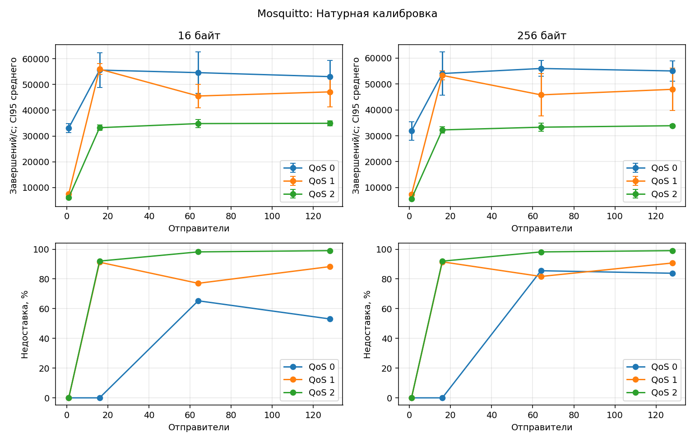
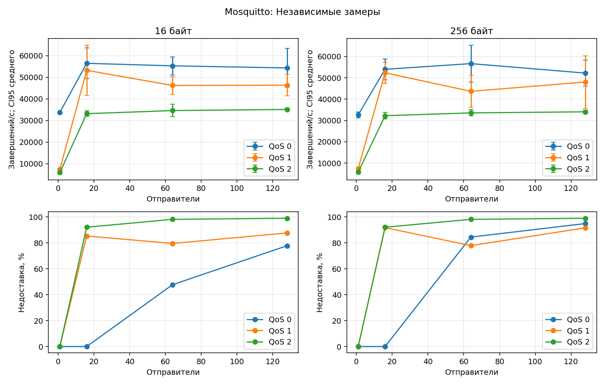

# Mosquitto — частичный отчёт

Срез данных: 2026-10-18T21:49:08.872257+00:00. Серия `overnight-20261018-instrumentation-v2`. Показаны только завершённые и сохранённые результаты. Активная серия продолжает работу; этот документ является снимком, а не онлайн-статусом.

## Что выполнено

| Этап | Завершено | Технические ошибки | Проверка точности |
| --- | --- | --- | --- |
| Натурная калибровка | ✅ 72/72 | ❌ 1 | ⚠ неприменимо |
| Проверка калибровки (Fidelity) | ✅ 72/72 | ❌ см. журнал | ⚠ 2 |
| Независимые замеры | ✅ 72/72 | ❌ 0 | ⚠ неприменимо |
| Контрольные симуляции | ✅ 9/72 | ❌ см. журнал | ⚠ 3 |
| Сеть MqttRelay | ✅ 0/72 | ❌ см. журнал | ⚠ ещё не проверено |

❌ у натурных этапов — число технически неуспешных попыток, а не ошибок отдельных сообщений. Индекс симуляций содержит только завершённые задания; отсутствие в нём ошибок не доказывает отсутствие прежних неудачных запусков процессов.

## Условия опыта

Контроллер и брокер работают на одном Linux-хосте через loopback. Брокер закреплён за одним логическим CPU; контроллер использует другие CPU. Общие память, диск и фоновые процессы могут влиять на результат. Сведения об оборудовании и версиях сохранены в [описании окружения](data/environment.json), параметры брокера — в [описании стенда](data/inputs/Mosquitto-stand.json).

Сетка: 16/256 байт × QoS 0/1/2 × 1/16/64/128 отправителей. В каждой точке три натурных повтора; модель выполняется с seed 42, 43 и 44. Реальная нагрузка длится 20 с, прогрев — 5 с, ожидание завершений — до 10 с. Модель: прогрев 1 с, нагрузка 2 с, ожидание до 5 с. Для одиночного двойника шаг 10 мкс, `closedLoopPerPublisher` и `empiricalServiceBudget`. Для Relay — 100 мкс, `openLoopRate` и `fixed`.

MqttBenchmark: `3a689466009a0d5410f5dc88dc1282d72c27f7dd`; MqttY: `115885e012053d0112413e07743b061369ebea93`; калибратор: `f61daa47ec581ff88f20ee70882722085d1a0a10`. Изменения управляющих скриптов записаны отдельно в [программе серии](data/series.json).

Независимые натурные замеры выполнялись в двух сеансах с паузой и перезагрузкой: сохранённые 50 успешных запусков были дополнены оставшимися 22. Это не непрерывное измерение. Повторное восстановление архивов завершено; прерванная попытка сохранена отдельно и не засчитана как успех.

[Профиль двойника](data/Mosquitto/profile/broker-calibration.v3.json). SHA-256: `d9cf125fb8cb6ec3677fc3c596bafcdfced8be0502362e2b4ff03da1421d46eb`. Профиль построен по калибровке; контрольные показатели его не изменяют.

## Натурная калибровка

Средние по трём повторам. После ± показана полуширина 95%-го доверительного интервала Стьюдента для среднего RPS. Доли ошибок и недоставки показаны в процентах; задержки — в миллисекундах. Для QoS 0 подтверждение публикации отсутствует, поэтому задержка неприменима.

| Байт | QoS | Отправители | Попыток/с | Завершений/с ± CI95 | Ошибки, % | Недоставка, % | p50, мс | p95, мс | p99, мс | RTT, мс |
| --- | --- | --- | --- | --- | --- | --- | --- | --- | --- | --- |
| 16 | 0 | 1 | 33128.8 | 33128.8 ± 1777.68 | 0 | 0 | — | — | — | 0.0861 |
| 16 | 0 | 16 | 55576.9 | 55576.9 ± 6679.11 | 0 | 0 | — | — | — | 0.0821333 |
| 16 | 0 | 64 | 55109.8 | 54585 ± 8038.79 | 0.937142 | 65.2981 | — | — | — | 0.0874667 |
| 16 | 0 | 128 | 53598.9 | 53035.5 ± 6283.77 | 1.05274 | 53.0902 | — | — | — | 0.0805333 |
| 16 | 1 | 1 | 7589.14 | 7589.14 ± 92.9237 | 0 | 0 | 0.0975333 | 0.140367 | 0.161767 | 0.0916333 |
| 16 | 1 | 16 | 55936.8 | 55936.8 ± 2079.71 | 0 | 91.2456 | 0.1914 | 0.397 | 0.419433 | 0.0876333 |
| 16 | 1 | 64 | 45521.6 | 45521.6 ± 4497.66 | 0 | 77.048 | 0.310233 | 2.73617 | 4.35363 | 0.0874667 |
| 16 | 1 | 128 | 47121.8 | 47121.8 ± 5741.43 | 0 | 88.2758 | 1.3349 | 6.5933 | 10.3092 | 0.0847667 |
| 16 | 2 | 1 | 6100.54 | 6100.54 ± 583.76 | 0 | 0 | 0.134733 | 0.177033 | 0.204067 | 0.0921 |
| 16 | 2 | 16 | 33235.3 | 33235.3 ± 1054.92 | 0 | 92.0115 | 0.3581 | 0.717033 | 0.751133 | 0.0815333 |
| 16 | 2 | 64 | 34822 | 34822 ± 1515.34 | 0 | 98.188 | 1.62173 | 2.4253 | 3.28703 | 0.0767667 |
| 16 | 2 | 128 | 34942.3 | 34942.3 ± 920.453 | 0 | 99.0295 | 3.311 | 3.88757 | 6.60267 | 0.0897667 |
| 256 | 0 | 1 | 31866.3 | 31866.3 ± 3618.05 | 0 | 0 | — | — | — | 0.0898 |
| 256 | 0 | 16 | 54047 | 54047 ± 8342.18 | 0 | 0 | — | — | — | 0.0875333 |
| 256 | 0 | 64 | 55993.6 | 55993.6 ± 3067.37 | 0 | 85.5152 | — | — | — | 0.0937667 |
| 256 | 0 | 128 | 55039.6 | 55039.6 ± 3879.3 | 0 | 83.8191 | — | — | — | 0.0834333 |
| 256 | 1 | 1 | 7279.74 | 7279.74 ± 343.667 | 0 | 0 | 0.1008 | 0.143167 | 0.1647 | 0.0776333 |
| 256 | 1 | 16 | 53327.2 | 53327.2 ± 1772.73 | 0 | 91.496 | 0.202633 | 0.4214 | 0.445933 | 0.0892667 |
| 256 | 1 | 64 | 45797.2 | 45797.2 ± 8208.9 | 0 | 81.6513 | 0.444267 | 2.6091 | 4.14233 | 0.085 |
| 256 | 1 | 128 | 47941.9 | 47941.9 ± 8185.8 | 0 | 90.7197 | 1.58433 | 6.26563 | 9.79783 | 0.0910333 |
| 256 | 2 | 1 | 5653.56 | 5653.56 ± 130.367 | 0 | 0 | 0.1428 | 0.1868 | 0.2169 | 0.0888 |
| 256 | 2 | 16 | 32253.9 | 32253.9 ± 1180.67 | 0 | 91.9605 | 0.368967 | 0.733467 | 0.771533 | 0.0840333 |
| 256 | 2 | 64 | 33310.8 | 33310.8 ± 1578.03 | 0 | 98.1714 | 1.67147 | 2.55247 | 3.3787 | 0.0798333 |
| 256 | 2 | 128 | 33880 | 33880 ± 489.973 | 0 | 99.028 | 3.41953 | 3.6833 | 6.82013 | 0.0949 |

[CSV](Mosquitto-calibration.csv) · [Исходный агрегат](data/Mosquitto/calibration/observations.json) · [Проверка восстановления архивов](data/Mosquitto/calibration/archive-verification.json)

## Независимые замеры

Средние по трём повторам. После ± показана полуширина 95%-го доверительного интервала Стьюдента для среднего RPS. Доли ошибок и недоставки показаны в процентах; задержки — в миллисекундах. Для QoS 0 подтверждение публикации отсутствует, поэтому задержка неприменима.

| Байт | QoS | Отправители | Попыток/с | Завершений/с ± CI95 | Ошибки, % | Недоставка, % | p50, мс | p95, мс | p99, мс | RTT, мс |
| --- | --- | --- | --- | --- | --- | --- | --- | --- | --- | --- |
| 16 | 0 | 1 | 33784.9 | 33784.9 ± 358.31 | 0 | 0 | — | — | — | 0.077 |
| 16 | 0 | 16 | 56481 | 56481 ± 7073.64 | 0 | 0 | — | — | — | 0.0839 |
| 16 | 0 | 64 | 55306.3 | 55306.3 ± 4165.94 | 0 | 47.725 | — | — | — | 0.0826333 |
| 16 | 0 | 128 | 55667.8 | 54339.6 ± 8995.6 | 2.44748 | 77.81 | — | — | — | 0.0921333 |
| 16 | 1 | 1 | 7423.43 | 7423.43 ± 363.577 | 0 | 0 | 0.1004 | 0.143067 | 0.164033 | 0.1083 |
| 16 | 1 | 16 | 53228.4 | 53228.4 ± 11668.7 | 0 | 85.3675 | 0.1748 | 0.358733 | 0.397033 | 0.0921 |
| 16 | 1 | 64 | 46241.5 | 46241.5 ± 4133.32 | 0 | 79.5636 | 0.301733 | 2.70637 | 4.374 | 0.0793333 |
| 16 | 1 | 128 | 46358.8 | 46358.8 ± 4994.66 | 0 | 87.6871 | 1.38313 | 6.70897 | 10.3938 | 0.0848333 |
| 16 | 2 | 1 | 5924.27 | 5924.27 ± 341.854 | 0 | 0 | 0.136767 | 0.179933 | 0.206367 | 0.0926333 |
| 16 | 2 | 16 | 33181 | 33181 ± 1264.06 | 0 | 92.1133 | 0.3648 | 0.7312 | 0.76 | 0.0972 |
| 16 | 2 | 64 | 34626 | 34626 ± 2916.2 | 0 | 98.1939 | 1.63827 | 2.43543 | 3.30987 | 0.0922333 |
| 16 | 2 | 128 | 35140.3 | 35140.3 ± 580.321 | 0 | 99.0308 | 3.31523 | 3.45227 | 6.617 | 0.0976333 |
| 256 | 0 | 1 | 32634.7 | 32634.7 ± 1332.47 | 0 | 0 | — | — | — | 0.0852667 |
| 256 | 0 | 16 | 54023.8 | 54023.8 ± 4868.81 | 0 | 0 | — | — | — | 0.104267 |
| 256 | 0 | 64 | 56688.1 | 56688.1 ± 8692.89 | 0 | 84.476 | — | — | — | 0.0904333 |
| 256 | 0 | 128 | 52275.7 | 52234.2 ± 6160.06 | 0.0827108 | 94.9371 | — | — | — | 0.0867667 |
| 256 | 1 | 1 | 7413.31 | 7413.31 ± 271.433 | 0 | 0 | 0.0985333 | 0.140767 | 0.160633 | 0.0778667 |
| 256 | 1 | 16 | 52379.9 | 52379.9 ± 4857.85 | 0 | 91.8008 | 0.2114 | 0.439933 | 0.460767 | 0.0817667 |
| 256 | 1 | 64 | 43680.3 | 43680.3 ± 7495.97 | 0 | 77.8673 | 0.374733 | 3.05207 | 4.77813 | 0.0877333 |
| 256 | 1 | 128 | 48047.5 | 48047.5 ± 12381.4 | 0 | 91.6583 | 1.601 | 6.10037 | 9.62693 | 0.0913 |
| 256 | 2 | 1 | 5790.33 | 5790.33 ± 617.835 | 0 | 0 | 0.140967 | 0.183833 | 0.210733 | 0.0894 |
| 256 | 2 | 16 | 32236.5 | 32236.5 ± 1495.98 | 0 | 92.0865 | 0.374667 | 0.748567 | 0.781967 | 0.0867333 |
| 256 | 2 | 64 | 33567.7 | 33567.7 ± 1456.24 | 0 | 98.1845 | 1.68407 | 2.49787 | 3.40337 | 0.0830333 |
| 256 | 2 | 128 | 34069.1 | 34069.1 ± 813.096 | 0 | 99.0238 | 3.41043 | 3.9507 | 6.80423 | 0.0834 |

[CSV](Mosquitto-validation.csv) · [Исходный агрегат](data/Mosquitto/validation/observations.json) · [Проверка восстановления архивов](data/Mosquitto/validation/archive-verification.json)

## Проверка двойника

Пороги: относительная ошибка RPS ≤15%, p99 ≤20%; абсолютная разность долей ошибок и недоставки ≤0,05 (5 процентных пунктов). Порог не меняется при неудачном результате. `notApplicable` не считается прохождением.

| Этап | Критерий | Выполнен | Нарушен | Неприменим |
| --- | --- | --- | --- | --- |
| Проверка калибровки (Fidelity) | rps | 70 | 2 | 0 |
| Проверка калибровки (Fidelity) | latencyP99Ms | 48 | 0 | 24 |
| Проверка калибровки (Fidelity) | publishFailureRate | 72 | 0 | 0 |
| Проверка калибровки (Fidelity) | deliveryLossRate | 72 | 0 | 0 |
| Контрольные симуляции | rps | 9 | 0 | 0 |
| Контрольные симуляции | latencyP99Ms | 0 | 0 | 9 |
| Контрольные симуляции | publishFailureRate | 9 | 0 | 0 |
| Контрольные симуляции | deliveryLossRate | 6 | 3 | 0 |

### Зарегистрированные нарушения

| Этап | Точка / seed | Критерий | Измерение | Модель | Отклонение | Допуск |
| --- | --- | --- | --- | --- | --- | --- |
| Проверка калибровки (Fidelity) | m16.q1.p1.s44 | rps | 7589.14 | 6192.5 | 0.184031 | 0.15 |
| Проверка калибровки (Fidelity) | m256.q1.p1.s44 | rps | 7279.74 | 6098.5 | 0.162264 | 0.15 |
| Контрольные симуляции | m16.q0.p64.s42 | deliveryLossRate | 0.47725 | 0.652776 | 0.175526 | 0.05 |
| Контрольные симуляции | m16.q0.p64.s43 | deliveryLossRate | 0.47725 | 0.653652 | 0.176402 | 0.05 |
| Контрольные симуляции | m16.q0.p64.s44 | deliveryLossRate | 0.47725 | 0.652349 | 0.175099 | 0.05 |

Отклонение RPS и p99 в таблице — относительная доля; отклонение ошибок и недоставки — разность долей. Частичное прохождение контрольных симуляций не даёт заключения о всей сетке.

## Что означают результаты

Производительность отправителей между натурными сериями сравнительно стабильна, но доставка при высокой нагрузке меняется заметно. В некоторых точках недоставка достигает примерно 99%. Это результат данной конфигурации с конечным временем наблюдения, а не универсальная характеристика Mosquitto. Отдельная диагностика выявила сбросы исходящей очереди; полная роль получателя и TCP не установлена. [Разбор причин](history/mosquitto-fidelity-diagnosis.md). На калибровочных данных нарушены два критерия RPS. Независимая проверка ещё идёт; точность на всей сетке пока не подтверждена.

## Ограничения и проверяемость

Подтверждение публикации не равно получению сообщения подписчиком. Недоставка означает отсутствие ID до окончания наблюдения. CPU и RSS относятся к настоящему процессу и не моделируются двойником. Табличный p99 — среднее p99 повторов, а модель использует объединённое распределение; эти оценки могут различаться. Три повтора и короткое модельное окно ограничивают устойчивость оценок хвоста. Benchmark использует фактическое время измерения, симулятор — фиксированное окно; завершения во время ожидания учитываются по правилам соответствующей программы.

[Определения показателей](../docs/campaign-metrics.md) · [Как повторить опыт](../docs/full-campaign-runbook.md) · [Происхождение и SHA-256 файлов](data/snapshot.json) · [Реестр исходных архивов](data/archive-registry.json). Контрольные суммы подтверждают целостность, а повторное вычисление требует доступа к исходным архивам. При подготовке этого документа сохранены ранее полученные результаты проверки архивов; новая полная распаковка не выполнялась.

Пересоздать таблицы, графики и HTML из опубликованного снимка: `python tools/campaign/publish-broker-reports.py --output reports`. Этот вызов не запускает брокеры и не изменяет серию.
