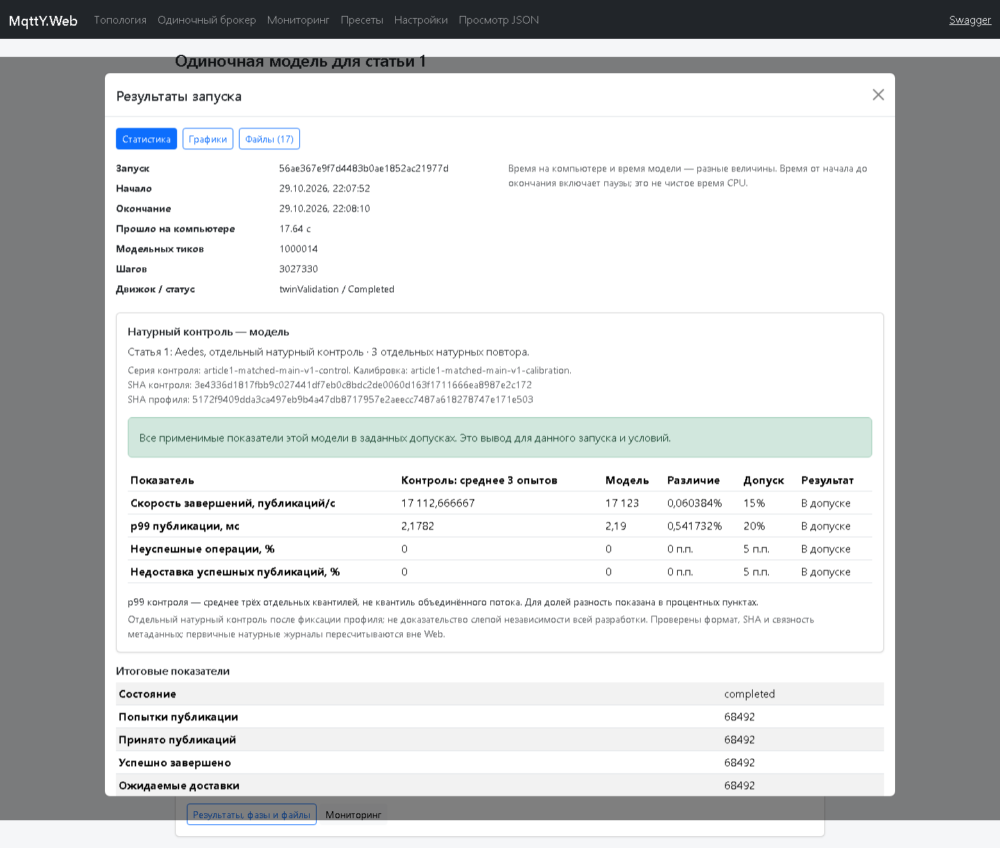

# Отдельный натурный контроль в MqttY Web

29 октября 2026 года. Код mqtty `f5c0a4715b555c4348d2a2843177251f62c640ff` опубликован и установлен на Linux. Проверен браузерный путь: **загрузить контроль → выбрать профиль → применить условия → проверить → запустить модель → сравнить → открыть JSON**.

## Что доступно пользователю

Во вкладке **«Одиночный брокер»** выберите окончательный профиль и соответствующий пункт **«С чем сравнивать модель»**. Четыре контроля уже загружены на Linux: Aedes, Mosquitto, ActiveMQ и EMQX. Кнопка **«Применить условия натурного контроля»** устанавливает 16 отправителей, QoS 1 и окна 1/4/5 с. Затем нажмите **«Проверить»**, после успешной проверки — **«Запустить модель»**. В результатах появится отдельная таблица **«Натурный контроль — модель»**.

Чтобы добавить проверенный пакет, раскройте **«Загрузить сохранённый натурный контроль»**. Готовые [четыре JSON](../audits/web/native-control-v1/references/) хранятся вместе с [пересчётом происхождения](../audits/web/native-control-v1/references/verification.json). Без выбранного контроля остаётся прежнее сравнение с калибровкой. Загрузка пакета сама не меняет параметры формы.

Linux слушает `127.0.0.1:5088`; доступ с другого компьютера — через прежний SSH-туннель. В приёмке браузер использовал временный локальный порт 5098; этот туннель после проверки закрыт. Он не является новым постоянным адресом сайта.

## Какие данные привязаны

Использованы 12 сохранённых контрольных измерений принятой серии 40/40: по три для каждого брокера. Они выполнены после фиксации профилей и относятся к отдельной контрольной серии. Перед упаковкой проверены SHA файлов и профилей, граница фиксации, подписка и соединение получателя. Числа повторно рассчитаны двумя реализациями. Новых настоящих брокеров не запускали; основную серию не повторяли.

Web принимает строгий формат `mqtt-native-control-v1`, хранит исходные байты под SHA и закрепляет отдельный снимок в задании. При другом профиле, брокере, режиме или окнах проверка отклоняет запуск. Worker повторно проверяет SHA снимка. Калибровочные журналы из профиля не могут выступать отдельным контролем. Исходные результаты модели сохранены; новое сравнение записывается отдельно в `native-control-comparison.json`.

Для недоставки используются **успешно завершённые публикации и полученные ID именно этих публикаций**. Сообщения прогрева исключаются, а завершения и получения во время ожидания учитываются. Нулевые или отсутствующие наблюдения не превращаются в подтверждение точности. Пороги остались прежними: 15% для RPS, 20% для p99, 0,05 для различий долей.

## Результат браузерной проверки

Импорт и проверка условий прошли для всех четырёх брокеров. Несовпадающее окно было намеренно задано и отклонено. Через форму выполнена **одна модель Aedes**, seed 42, сообщения 16 байт, QoS 1, 16 отправителей, один получатель. Полная браузерная проверка заняла 37,75 с; сам расчёт — 17,64 с по времени начала и окончания задания.

| Показатель | Натурный контроль: среднее трёх | Модель | Различие |
| --- | ---: | ---: | ---: |
| Успешные публикации/с | 17 112,666667 | 17 123 | 0,0604% |
| p99 публикации, мс | 2,1782 | 2,19 | 0,5417% |
| Доля неуспешных операций | 0 | 0 | 0 п.п. |
| Недоставка успешных публикаций | 0 | 0 | 0 п.п. |

Все четыре показателя этого запуска в допусках. У p99 контроля приведено среднее трёх отдельных квантилей. Это не квантиль объединённого потока.

| Этап | Модельное время | Тики при шаге 10 мкс |
| --- | ---: | ---: |
| Подключение и подписка | 0,00014 с | 14 |
| Прогрев | 1 с | 100 000 |
| Подача | 4 с | 400 000 |
| Ожидание | 5 с | 500 000 |
| Всего | 10,00014 с | 1 000 014 |

Задание `56ae367e9f7d4483b0ae1852ac21977d` завершено, **3 027 330 шагов**. Из 68 492 успешных публикаций 16 завершились во время ожидания. Все 68 492 ID получены, повторов нет. Дополнительный пересчёт Python подтвердил счётчики, скорость, p99 и недоставку. Проверены SHA 16 файлов результата. Через браузер открыты график фаз и JSON с подсветкой; ошибок JavaScript нет.



## Проверки и ограничения

**51/51 Web-тест прошёл.** До реализации новые API-тесты завершались ожидаемыми девятью ошибками 404. Проверены ошибки входа, подмена снимка, отделение калибровки, прежний режим без контроля, знаменатель недоставки, ожидание завершения и пустые наблюдения. [Квитанция](../audits/web/native-control-v1/verification.json), [браузерная приёмка](../audits/web/native-control-v1/browser-001/receipt.json), [развёртывание](../audits/web/native-control-v1/deployment.json), [состояние Linux](../audits/web/native-control-v1/linux-status.json).

При развёртывании не было живых заданий. Прежний релиз сохранён. По завершающему снимку Web active/running, host PID 4259, приложение 4261, очередь пуста. Все 54 файла замороженного научного runtime проверены по исходному manifest; шесть защищённых файлов LaTeX не изменены. Полный результат и архив находятся вне Git в `C:/temp/mqtty-evidence/web-native-control-v1/`.

Проверка подтверждает работу этой Web-цепочки и сравнение одного модельного запуска с тремя сохранёнными натурными повторами. Остальные три контроля прошли импорт и проверку входов без повторного модельного расчёта. Это не проверка всех функций Web, не новая натурная серия, не доказательство слепой независимости всей разработки или переноса точности на другое оборудование. Web проверяет структуру, SHA и происхождение метаданных; истинность произвольного загруженного JSON должна проверяться по первичным событиям отдельно.

Общий исходный план **53,2% = 25/47 дней**, локальная общая подготовка **80% = 4/5**. Новая техническая проверка не получает второй вес уже зачтённой работы. Основной текст диссертации редактирует автор.

## Повтор проверки

Пакеты создаются только в новый каталог, по доступным внешним исходным архивам:

```text
python tools/dissertation/prepare_web_native_controls.py --root <raw-001> --output <новый-каталог>
```

Для браузерного приёмочного скрипта нужен Playwright/Chromium и доступ к Linux Web через туннель. **Команда запускает одну модель**, создаёт отдельный каталог попытки и не повторяет её автоматически:

```text
python tools/web/check_native_control_browser.py --url http://127.0.0.1:<порт-туннеля> --references reports/audits/web/native-control-v1/references --presets reports/audits/web/article1-final-profile-v1/profiles.json --output <новый-каталог>
```

Предел внешнего вызова при приёмке — 600 с, предел одной модели — 180 с. Не требуется повторять эту проверку для чтения готовых результатов.
