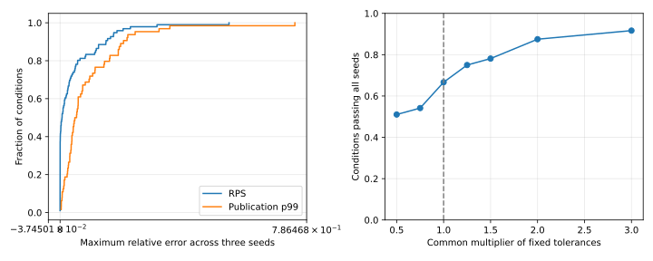

# Техническое приложение к статье о моделях брокеров

## Актуальная серия и исторические правила

Нынешняя статья описывает отдельную согласованную серию 40/40: 12 калибровочных измерений, 12 новых контрольных, 12 моделей и четыре повтора. Фазы 1/4/5 с, когорта попыток задаётся общим окном; поздние исходы и получения наблюдаются до конца ожидания. [Итоговые определения и данные](Article-1-matched-main-final.md), [пересчёт нижнего ограничения задержки](../audits/dissertation/manuscript-offline-review-v1/floor-analysis.json).

В актуальном исполняемом пути выбирается значение L из взвешенной наблюдаемой CDF, применяется `S=max(0,ceil(L/Δ)−P)`, затем `max(S,W)` для ожидания ёмкости W. Это модельное допущение, а не измеренное устройство настоящей очереди. В последней серии Δ=10 мкс; P=6 тиков для Aedes/Mosquitto/ActiveMQ и 8 для EMQX. Гистограммы содержат дискретные микросекундные бины. Их вес ниже PΔ не равен числу фактически выбранных моделью значений или потерянных публикаций.

Самодостаточное [описание актуального алгоритма](../../docs/dissertation/article-1-current-model-method.md) восстановлено по commit `4c658536586f88a89cd3ff5ab0915903640cf3c9` из манифеста основного runtime. В нём разобраны места вызова, резервирование, порядок ошибок и недоставки, роль RTT и короткий псевдокод; [квитанция проверки](../audits/dissertation/model-method-20261030/README.md) содержит снимки исходников и сверку сохранённых входов.

Текущая ёмкость задаётся как `μ=attemptedRps×(1−rateRejectionRate)`. В четырёх основных профилях обе доли ошибок равны нулю, поэтому μ равна средней скорости попыток и завершений. Резервирование возвращает `W=max(0,ceil(max(0,max(t,v)−t)−10⁻⁹))` и обновляет `v=max(t,v)+1/(μΔ)` до выборки ошибки; отказ не отменяет резерв. После обработки QoS 1 брокер отправляет подтверждение, затем отдельно проверяет недоставку для подписчика. Разные ключи хеширования обеспечивают воспроизводимые отдельные выборки, но не доказывают их статистической независимости. Зависимости исходов уже задаются порядком обработки и ожиданием подтверждения у отправителя.

RTT сначала используется для разрешения модельного транспорта с ограничением по минимуму наблюдаемой задержки; затем идеальная проба определяет P. При наличии исходной CDF и P нынешняя ветвь вычитает P в тиках, а не повторно QoS×RTT из выбранного L. Сохранённое распределение `max(0,L−QoS×RTT)` относится к другой ветви. Совместная зависимость задержки, ошибок и потерь по исходным данным не восстановлена, её влияние отдельным сравнением не проверялось.

**Всё ниже — архив пояснений прежней редакции.** Оно относится к историческим наборам 576 натурных/288 контрольных модельных запусков, другим временным окнам и правилам. Формулы потерь, правила неприменимости, идентичности сборок и номера литературы старой серии нельзя молча переносить на новую. Архив сохранён для проверки истории, а не выдан за новые результаты.

## Историческое приложение

### 3.1.1. Политика нагрузки и семантика завершения

Натурный генератор **closed-loop**: у каждого publisher следующая попытка начинается после исхода предыдущего `await PublishAsync`; фиксированного независимого target RPS нет. Attempted RPS — измеренный результат работы генератора и тракта. Для QoS 0 ожидание API не означает ожидания ACK.

В сохранённых модельных options указан `closedLoopPerPublisher`. Это не чистый open-loop: при QoS 1/2 publisher с pending-публикацией пропускается. Одновременно действует токеновый бюджет `offeredRps×tick`, причём offeredRps равен среднему натурному attempted RPS соответствующей серии. Для QoS 0 применяется ветвь без ожидания ACK. Следовательно, модельная нагрузка также не является точной копией неограниченного натурного цикла: она дополнительно обусловлена измеренной скоростью. Target rate как независимое экспериментальное воздействие в старой серии отсутствует. Модельные scheduled/attempted/completed необходимо различать.

Измеряется длительность API-вызова MQTTnet: для QoS 1 это операция публикации с протокольным PUBACK, для QoS 2 — завершение публикационной операции, чей завершающий ответ по MQTT 3.1.1 — PUBCOMP [4]. Отдельные времена PUBREC, PUBREL и PUBCOMP в исторических событиях не записаны. Они не восстановлены из API-p99 и не объявляются измеренными; независимой проверки реализации MQTTnet через packet capture нет.

Таксономия доступных событий: API-attempt → успешный API-исход либо клиентское исключение → получение уникального ID subscriber. Приём PUBLISH сервером и отказ самого сервера отдельно не наблюдаются. Поэтому F/A в этой статье — **доля неуспешных API-операций тракта**, а не частота отказов только брокера. Нельзя приписать все исключения серверу или считать все API-attempt принятым MQTT-трафиком.

### 3.2.1. Уравнения используемого приближения

Пусть h=H⁻¹(u) — выборка наблюдаемой публикационной задержки из эмпирической CDF; δ — длительность tick, P — вычисленный модельный минимум протокольного обмена в ticks. Остаточный бюджет обработки: `s=max(0, ceil(h/δ)−P)`. Калибратор дополнительно сохраняет распределение `max(0,h−q×RTT)`, где q=0/1/2 для QoS 0/1/2; в режиме empiricalServiceBudget используется наблюдаемая CDF и протокольный минимум, а не выдаётся измеренная декомпозиция настоящего сервера.

Для резервирования ёмкости с целевой скоростью μ и моментом входа tᵢ в ticks: `eᵢ=max(tᵢ,vᵢ₋₁)`, `wᵢ=ceil(max(0,eᵢ−tᵢ)−10⁻⁹)`, `vᵢ=eᵢ+1/(μδ)`. Задержка постановки обработки равна `max(s,wᵢ)`. Сетевые очереди и дальнейшие MQTT-обмены исполняются отдельно. Это правило вводит два нижних ограничения, но не является выведенной из измерений моделью реальной очереди. Альтернативы sum/min не проверены, поэтому преимущество max не утверждается.

Исходные бины задержек имеют разрешение 1 мкс; квантиль восстанавливается верхним рангом. Представление времени в симуляторе дополнительно округляется до tick. При фиксированной выборке одно округление имеет ошибку меньше δ, но это не граница ошибки итогового p99 после очередей и отсечения протокольным минимумом. Анализ альтернативного бининга отсутствует и остаётся ограничением.

### 3.4.1. Нулевые значения и неприменимость

| Случай | Сохранённое правило реализации | Интерпретация |
| --- | --- | --- |
| Относительный эталон=0, модель=0 | notApplicable | Не является подтверждённым passed |
| Относительный эталон=0, модель>0 | notApplicable | Недостаток критерия: положительное расхождение этим правилом не отвергается |
| Отсутствует эталон либо модельный показатель | notApplicable | Отсутствие результата не подменяется нулём |
| A=0 в натурной сводке | failure=0 по соглашению кода | Не доказывает успешное обслуживание нагрузки |
| C=0 в натурной сводке | loss=0 по соглашению кода | Недоставка не имеет физического знаменателя; отдельно требуется отсутствие завершений |
| C>0, Dс=0 | loss=1 | Ни одна завершённая публикация не получена |
| QoS 0, публикационный p99 | notApplicable | ACK не существует |

Исторические статусы не пересчитываются задним числом по более удобным правилам. Таблица фиксирует ограничение самой процедуры оценки. Натурный loss и модельный loss имеют разные знаменатели, описанные выше; их совпадение не доказывает эквивалентности исходных событий.

### 3.5. Повторы и неопределённость

Натурная точка содержит три самостоятельных повтора. Для среднего показателя применим Student-t CI95 с двумя степенями свободы: среднее ±4,30265×s/√3. Малое n и возможная нестабильность режима ограничивают интерпретацию интервала. Интервал среднего трёх p99 не является интервалом истинного квантиля объединённого потока.

Единица анализа — одно из 96 заданных условий. Три seed внутри него описывают вариацию фиксированной модели; они не увеличивают число независимых натурных повторов. Интервалы по seed нельзя выдавать за неопределённость физических характеристик брокера. Доля прошедших сценариев не является вероятностью точности в произвольной будущей точке.

### 4.2. Идентификация установки и конфигурации

| Брокер | Версия в сохранённых versions.json | Runtime из сохранённых сведений |
| --- | --- | --- |
| Aedes | 1.1.2 | Node.js 22.13.1 |
| Mosquitto | 2.0.15 | Native executable с SHA-256 |
| ActiveMQ Classic | 6.3.2 | OpenJDK 17.0.19+10 |
| EMQX | 6.3.0 | Путь содержит erts-16.3; отдельный executableVersion=null |

Это записанные исторические идентичности, а не утверждение о текущих последних версиях. Четыре реализации выбраны как имеющийся проектный набор разных технологических платформ; репрезентативность всего рынка MQTT и оптимальность выбранных версий не установлены.

ОС запусков — Simply Linux 11.1. Связанный снимок CPU: Xeon E5-2680 v3, 12 физических ядер/24 логических CPU, SMT=2. Брокер закреплён за логическим CPU 0 и ограничен 4 ГиБ; это не эксклюзивное физическое ядро. Генератор и брокер работают на одном Linux-хосте, соединение через loopback. Используется один subscriber, подписанный на измерительную тему, и N publishers; fanout не менялся и не входит как переменный фактор в профиль. MQTT 3.1.1, clean session, случайные client ID; QoS подписки равен QoS публикации, granted QoS проверяется. TLS и authentication в клиентских options не задаются; транспорт plain TCP. Измерительная тема имеет отдельную тему прогрева с суффиксом `/warmup`, а payload содержит идентификатор.

Сохранённые кампании задают прогрев 5 с, измерение 20 с, cooldown 1 с, drain до 10 с. Одиночные модели используют прогрев 1 с, нагрузку 2 с и drain до 5 с, последовательный refresh. Поэтому даже фазы натурного и модельного опытов не тождественны. Проект измерителя ориентирован на .NET 6 и MQTTnet.Extensions.ManagedClient 4.3.3.952; сохранённая metadata называет PowerShell 7.4.6. Версии runtime Python/.NET каждой исторической попытки, физический объём RAM, настройки governor/boost и полное lock-окружение не восстановлены в компактном наборе и не подставляются текущими значениями. Примеры commits в снимке environment: MqttY `115885e`, MqttBenchmark `3a689466`; фактические идентичности различающихся серий остаются в их manifests.

### 5.0. Основная единица анализа: условие, а не seed

| Брокер | Калибровка: все / часть / ни одного seed, из 24 условий | Историческое сравнение: все / часть / ни одного, из 24 |
| --- | --- | --- |
| Aedes | 20 / 3 / 1 | 18 / 3 / 3 |
| Mosquitto | 22 / 2 / 0 | 18 / 2 / 4 |
| ActiveMQ | 22 / 2 / 0 | 9 / 2 / 13 |
| EMQX | 24 / 0 / 0 | 19 / 1 / 4 |

На калибровочных данных все seed проходят в **88/96** условиях (276/288 seed-запусков). В историческом сравнении — **64/96** условий; в восьми проходит часть seed, в 24 — ни один. Число 203/288 ниже — вспомогательный счётчик модельных повторов, а не 288 независимых натурных испытаний. Условия заданы целевым факторным планом, а не случайно выбраны из генеральной совокупности, поэтому 64/96 не получает интерпретацию вероятности успеха вне этой сетки.

Полная [таблица всех 96 условий](../audits/dissertation/article-1-revision-v2/Conditions.md) и [CSV](../audits/dissertation/article-1-revision-v2/conditions.csv) содержат точные payload/QoS/publishers, число прошедших seed, диапазоны модельных значений и ошибок. Калибровочный fit существенно лучше для ActiveMQ и EMQX, но это не позволяет отделить переобучение от сдвига условий и клиентского поведения без нового независимого эксперимента.

### 5.2.1. Интервальные границы поздних получений

| Пример исторического запуска | Уникальных ID | Заведомо после окна | Неопределённых у границы | Доля поздних, нижняя–верхняя |
| --- | ---: | ---: | ---: | ---: |
| Aedes, 256 Б, QoS 1, N=128, повтор 1 | 5155 | 1509 | 0 | 29,273–29,273% |
| Mosquitto, 16 Б, QoS 0, N=128, повтор 2 | 68817 | 55779 | 72 | 81,054–81,159% |
| ActiveMQ, 256 Б, QoS 0, N=128, повтор 3 | 41705 | 34320 | 0 | 82,292–82,292% |
| EMQX, 16 Б, QoS 1, N=128, повтор 1 | 173480 | 318 | 0 | 0,183–0,183% |

Это целевой выбор крайних случаев, не средние брокеров. Во всех 72 контрольных запусках каждого брокера неопределёнными у границы являются соответственно 1462, 1825, 71 и 103 получения. Полные знаменатели и покадровые ограничения приведены в boundaries.csv. Малое число неопределённых событий не исправляет различия длительностей, политик нагрузки или пропущенных событий приёма сервером. Единой когортной проверки native/model после нового выравнивания здесь нет; исходные сравнения RPS/loss/p99 остаются диагностическими.

### 5.2.2. Ошибки, допуски и совместная интерпретация

В 46 исторических seed-запусках p99 проходит при нарушении loss. Этот факт не доказывает селективную потерю медленных сообщений, но исключает интерпретацию passed p99 как подтверждения всей доставки. Распределения ошибок строятся на уровне условий: берётся максимум по трём seed каждого условия; для p99 применимы 64 условия, для RPS — 96.

| Общий множитель исходных допусков | Условия, где проходят все seed, /96 |
| --- | ---: |
| 0,50 | 49 |
| 0,75 | 52 |
| 1,00 | 64 |
| 1,25 | 72 |
| 1,50 | 75 |
| 2,00 | 84 |
| 3,00 | 88 |

Здесь одновременно масштабируются пороги 0,15/0,20/0,05/0,05; это анализ зависимости описательного итога, не выбор новых допусков. Он показывает, что одно pass count без распределений недостаточно. Официальные критерии и исторические статусы не изменены. Условия не являются случайной выборкой, поэтому bootstrap по условиям не объявляется доверительным интервалом точности произвольного брокера.

Для натурного loss дополнительно перебраны все 27 эмпирических повторных выборок размера три из трёх запусков каждой точки. В native-loss-resampling.csv сохранены среднее, диапазон и квантили 0,025/0,975 таких средних. Это дискретная диагностика bootstrap [6], а не подтверждённый CI95 при n=3. Замена t-интервала bootstrap не создаёт недостающих независимых повторов. Биномиальный интервал по всем сообщениям также не применяется автоматически: сообщения одного запуска могут зависеть друг от друга.

Исторический контроль содержит 24 повторных получения у Mosquitto, у остальных брокеров — ноль зарегистрированных дубликатов. Потери считаются по уникальным ID; эти дубликаты не исчезают из отдельного счётчика. Упорядоченность по publisher и независимая проверка измерителя эталонным инструментом в этой работе не установлены.

### 5.4. Повторяемость

План чувствительности заранее задаёт по одному baseline-повтору на брокер и ещё две точки Aedes/halfTick и ActiveMQ/doubleWindow. Точные ключи: Aedes/m16.q0.p1.s42/baseline; Mosquitto/m16.q1.p1.s42/baseline; ActiveMQ/m16.q2.p1.s42/baseline; EMQX/m16.q1.p128.s42/baseline; Aedes/m16.q1.p128.s42/halfTick; ActiveMQ/m16.q0.p128.s42/doubleWindow. Это целевой, не случайный отбор и не повтор всех 288 исторических моделей. Шесть выбранных повторов совпали по байтам summary и histogram и по канонической части counters с полями `brokers`, `receivers`, `receiverScope`. Два повтора воспроизводят нарушения критериев. Таким образом, детерминированное воспроизведение возможно и для неточного относительно эталона результата.

Проверка не требует совпадения всего manifest с runId и техническим временем или полного counters с графом. Область побайтового сравнения объявлена явно. Эти шесть повторов также не заменяют независимую проверку другим сотрудником и не доказывают совпадение натурных чисел на другой аппаратуре.

## Литература

1. Sargent R. G. Verification and Validation of Simulation Models. Proceedings of the Winter Simulation Conference. P. 183–198. [DOI: 10.1109/WSC.2011.6147750](https://doi.org/10.1109/WSC.2011.6147750). [Текст](https://www.informs-sim.org/wsc11papers/016.pdf).
2. Mishra B., Mishra B., Kertesz A. Stress-Testing MQTT Brokers: A Comparative Analysis of Performance Measurements. Energies. Vol. 14, no. 18, article 5817. [DOI: 10.3390/en14185817](https://doi.org/10.3390/en14185817). [Авторская версия](https://publicatio.bibl.u-szeged.hu/22708/1/MQTT_Perf_Mishra_MDPI_202109_revised_v2.pdf).
3. Mohammad El-Basioni B. M. A conceptual modeling approach of MQTT for IoT-based systems. Journal of Electrical Systems and Information Technology. Vol. 11, article 62. [DOI: 10.1186/s43067-024-00181-x](https://doi.org/10.1186/s43067-024-00181-x).

4. OASIS. MQTT Version 3.1.1. Разделы QoS 1/2. [Стандарт](https://docs.oasis-open.org/mqtt/mqtt/v3.1.1/os/mqtt-v3.1.1-os.html).
5. NIST. Credibility Consideration for Digital Twins in Manufacturing. [Описание и публикация](https://www.nist.gov/publications/credibility-consideration-digital-twins-manufacturing). Связь V&V и неопределённости обсуждается применительно к собственной цели модели, не как сертификат настоящей реализации.
6. Efron B. Bootstrap Methods: Another Look at the Jackknife. Annals of Statistics. Vol. 7, p. 1–26. [DOI: 10.1214/aos/1176344552](https://doi.org/10.1214/aos/1176344552).
