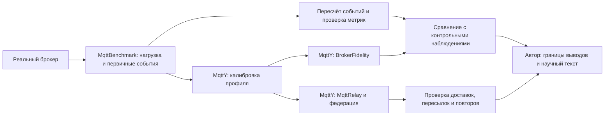

# Какие выводы подтверждены экспериментами

Это техническая таблица для подготовки двух статей и диссертации. Она отделяет проверку расчётов, точность модели и повторяемость. Автор утверждает научные положения и пишет текст. Завершённый процесс сам по себе не подтверждает точность модели.

| Вопрос | Полученный результат | Что можно утверждать | Ограничение |
| --- | --- | --- | --- |
| Правильно ли рассчитаны натурные метрики? | Проверены 592 архива; пересчитаны 576 выбранных измерений, расхождений 0. [Источник](../../reports/status/linux-native-audit-summary.json) | Сохранённые события согласуются с опубликованными счётчиками и проверенными метриками | Пересчёт не исключает систематическую ошибку исходного измерения; SHA подтверждает целостность, а не истинность |
| Насколько точны двойники? | Все применимые критерии прошли 203/288; не прошли 85. [Источник](../../reports/audits/dissertation/accuracy-analysis-v1/analysis.json) | Точность подтверждается только в прошедших точках и по заданным критериям | История использования контроля не позволяет объявить всю историческую серию слепой независимой проверкой |
| Устойчив ли результат к настройкам времени? | Завершены 216 основных опытов: 161 без нарушений критериев, 55 с нарушениями; технических ошибок 0. [Источник](../../reports/audits/dissertation/sensitivity-final-v1/analysis/analysis.json) | Есть измеренная чувствительность к tick и окну нагрузки | Нельзя распространять вывод на все нагрузки; удвоение окна не во всех случаях сохраняет p99 в пределах допуска |
| Воспроизводятся ли выбранные результаты? | 6 точных повторов; проверка совпадений описана в итоговом анализе чувствительности. [Источник](../../reports/audits/dissertation/sensitivity-final-v1/analysis/analysis.json) | Проверенные входы и runtime воспроизводят выбранные научные результаты | Шесть точек не доказывают переносимость натурных чисел на другой CPU и память; научные провалы также могут воспроизводиться |
| Готова ли программа сетевого сравнения? | Проверены 30 сохранённых пилотных точек и оформлено отдельное решение. [Источник](../../reports/audits/dissertation/network-pilot-reuse-v1/registry.json), [Источник](../../reports/audits/dissertation/network-full-3h-v1/pilot-technical-decision.json) | Новая программа технически допущена: 162 опыта и 6 повторов; четыре независимых процесса, общий предел 3 часа | Пилоты составные, с разными версиями runtime. Это не новая однородная серия. Основная матрица ещё не принята по результатам |
| Работает ли запуск через Web? | Завершены 30000/30000 исходных публикаций; получено 117531/120000 ожидаемых пар (97.9425%). [Источник](../../reports/audits/web-linux-v1/user-observed-10m-verification.json) | Проверены реальный runner, экспорт, HTTP-результат и пересчёт raw | Это проверка механизма. queueDrops=29613; число отброшенных пересылок не равно числу недоставленных пар |

## Точность по каждому брокеру

| Брокер | Все критерии пройдены | Есть нарушения |
| --- | ---: | ---: |
| Aedes | 58/72 | 14/72 |
| Mosquitto | 58/72 | 14/72 |
| ActiveMQ | 29/72 | 43/72 |
| EMQX | 58/72 | 14/72 |

Критерии Fidelity: относительная ошибка RPS ≤15%, p99 ≤20%, абсолютная разница failure/loss ≤0,05. Неприменимые критерии не считаются успешными измерениями: например, ACK latency для QoS 0 отсутствует. p99 полученных сообщений не описывает задержку потерянных сообщений.

## Что ещё нельзя считать доказанным

- Натурная точность сети MqttRelay и статической федерации: нет сопоставимого натурного сетевого эталона. Пока сравниваются модельные механизмы при заданных ресурсах.
- Превосходство одного сетевого режима: сначала нужно проверить полное фактическое покрытие основной матрицы, повторы и предупреждения. Исчерпание трёхчасового бюджета означает неполное покрытие.
- Универсальная точность двойника на другом оборудовании: модель повторяет зафиксированный профиль; для нового физического стенда нужна новая калибровка и контроль.
- Вероятность достоверности через EST: это взвешенный сравнительный балл, а не вероятность. Его значение зависит от весов, нагрузочной точки, нормировки и состава брокеров. CPU/RSS не моделируются двойником.
- Отказоустойчивость и самоорганизация федерации: первая версия статическая; такие свойства требуют отдельной реализации и программы отказов.

## Кто создаёт доказательства

Web управляет модельными заданиями и показывает их результаты. Он не заменяет MqttBenchmark и сам не проводит натурную калибровку. Терминальный монитор читает прогресс внешней кампании; Web-очередь и внешняя кампания имеют разные реестры заданий.

## Следующие независимые работы

1. Подготовить шаблон сравнения сетевых режимов и формулы до получения итогов, без объявления победителя.
2. Проверить согласованность терминов и знаменателей в материалах для автора; замечания к защищённым исходникам диссертации передать отдельно.
3. Подготовить пакет другому сотруднику для независимого пересчёта; агент не заменяет человеческую проверку.
4. После завершения Linux один раз забрать компактные результаты, проверить покрытие и повторы, затем заполнить сравнение фактическими числами.

Документ пересоздаётся командой `python tools/dissertation/prepare_claims_matrix.py`. Хэши использованных локальных источников и самого документа сохраняются в `reports/audits/dissertation/claims-and-evidence-v1/manifest.json`. Скрипт не обращается к Linux и не меняет экспериментальные входы.
