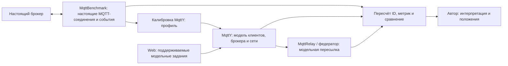

# Как включить результаты статей в диссертацию

Рабочие предложения к шагу 29. Основной LaTeX и файлы подрепозитория `diss` не изменялись. Основа — четыре действующих положения `common/characteristic.tex`. [Матрица доказательств](../../docs/dissertation/claim-evidence-map.md) связывает каждое с методом, кодом, опытом, выводом, ограничениями и проектом личного вклада.

## Адресные правки введения

| Место | Что уточнить | Предложение для редакции автором |
| --- | --- | --- |
| Новизна, п. 1; положения, п. 1 | «Объективно лучший» промышленный брокер и широкое противопоставление другим методам не следуют из рейтинга | Сценарное сравнение по объявленным показателям, весам и нормировке. EST — балл, не вероятность. Разделить задержку Publish и доставки, QoS 0 без ACK |
| Положения, п. 2, измеритель | Старые имена компонентов не описывают современную проверку событий | Путь: попытка Publish → успешный/ошибочный исход → получение ID → независимый пересчёт. Проверить актуальность Mqtt Bomber, Mqtt Counters, Stat Aggregator по соответствующей версии |
| Новизна, п. 2; положения, п. 3 | Прозрачность и отличие от всех федераций сформулированы слишком широко | Клиентская пересылка по заданным маршрутам без изменения модельного брокера; доставка проверяется при объявленных темах, графе и очередях. Не называть это натурным bridge |
| Положения, п. 4; значимость | Ускорение 12,5×, платформы, телеметрия и модельная точность смешаны | Разделить архитектуру, точность профиля, повторяемость и производительность движка. Численный коэффициент сузить до исторического наблюдения или убрать до проверки шага 33 |
| Достоверность и личный вклад | Нет конкретной области проверки и распределения труда | Отдельно указать арифметику, новую проверку четырёх условий, выбранные повторы и полную идеальную сетевую программу с её ограничениями. Автор подтверждает собственную работу, соавторство и помощь агента |

Проект связной формулировки результата:

> Разработана процедура построения и проверки измерительного профиля MQTT-брокера. Профиль получают по калибровочным измерениям, фиксируют до нового контроля и используют в исполняемой модели MqttY. В режиме с 16 отправителями, одним получателем, сообщениями 16 байт и QoS 1 все три запуска модели каждого из четырёх брокеров укладываются в заданные допуски. Проверка относится к измеренному стенду; результат не переносится автоматически на другое оборудование и нагрузку.

Это проект формулировки, не утверждение первенства. Максимальные ошибки отдельных моделей: скорость 2,833%, p99 17,272%, недоставка 1,162 процентного пункта. Простые калибровочные средние тоже проходят: их результат нужно сохранить рядом, преимущество прогноза модели не заявлять.

## План переноса в главы

| Глава / шаг | Что включить | Основание | Что остаётся недоказанным |
| --- | --- | --- | --- |
| 1 / 30 | Разделение натурного сравнения, профиля и модельной сети; ближайшие методы | [Вклад статьи 1](../../docs/dissertation/article-1-contribution-and-related-work.md) | Универсальная новизна |
| 2 / 31 | Роли MqttBenchmark и настоящего брокера; метрики; единая группа ID и четыре секунды подачи | [Новая серия](Article-1-matched-main-final.md), [таблица](../audits/dissertation/article-1-matched-main-final-v1/native-model.csv) | Скорость только внутри окна, если числитель включает поздние завершения; универсальный рейтинг |
| 3 / 32 | Физический и логический графы; импорт без переэкспорта; пары ID–получатель; условия конечности | [Контракт сети](../../docs/dissertation/network-model-contract.md), [статья 2](../../docs/dissertation/articles/article-2-relay-federation.md) | Гарантия доставки при переполнении, самоорганизация и натурная отказоустойчивость |
| 4 / 33–34 | Профиль → исполнение → события → проверка; фазы и тики; четыре повтора одиночного брокера; 162 основных сетевых запуска и 6 повторов | [Тики](../audits/dissertation/article-1-matched-main-final-v1/phase-ticks.csv), [сеть](Network-main-final.md), [ускорение](../audits/dissertation/acceleration-evidence-v1/Review.md) | Натурная точность сети, новое доказательство 12,5× и всех платформ |
| Введение и заключение / 35 | Отдельные выводы по измерителю, профилю, сети и повторяемости | [Матрица](../../docs/dissertation/claim-evidence-map.md) | Однородность всех исторических и новых запусков |

## Роли приложений

Новая серия статьи 1 выполнена изолированным Probe, не установленным Linux Web. Основная сетевая программа выполнена внешним контроллером; её журнал прогресса не является Web-очередью. Эти способы запуска нельзя объединять в доказательство пригодности сайта для всей программы.

Матрица подготовлена для редакции. Авторское утверждение положений, личного вклада и новизны, перенос в LaTeX, сборка и независимое чтение остаются отдельными шагами. Карта обновлена по принятым 162 основным результатам и шести повторам; прежний неполный срез сохранён в исторических отчётах. [Проекты глав 1–4](../../docs/dissertation/drafts/README.md) и [карта переноса](../../docs/dissertation/drafts/integration-map.md) содержат подготовленные тексты и точные адреса интеграции.
