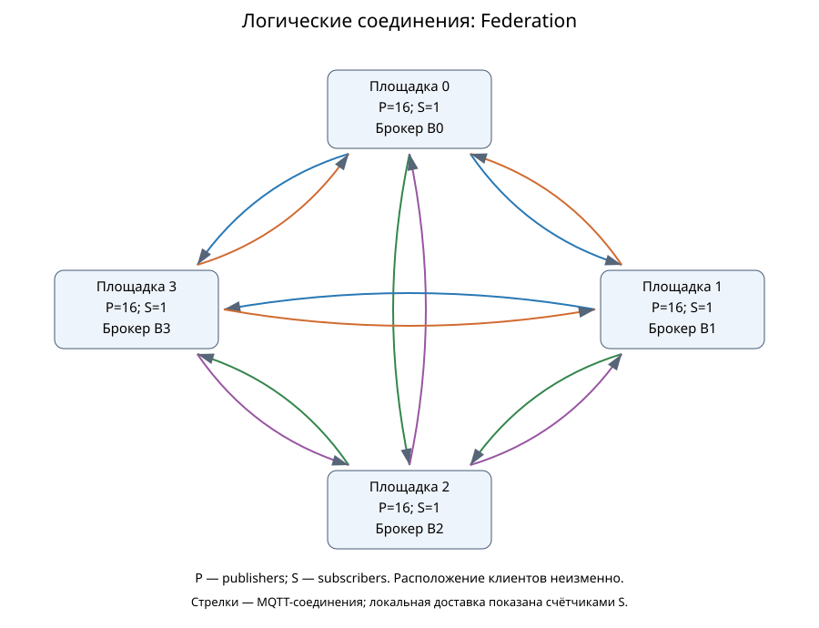

# Основная сеть: окончательная приёмка и сравнение

## Данные и проверка

С Linux получен новый полный снимок кампании `network-full-3h-v1`. Прежний частичный снимок не перезаписывался; его исходный архив сохранён. Программа завершена: **162 основные точки и шесть повторов**. Существующий проверяющий код независимо пересчитал первичные ID, payload, доставки, экспорты, гистограммы и фазы всех 162 точек; шесть повторов проверены отдельно тем же счётчиком и сравнением фактических байтов шести научных файлов. Новых симуляций не выполнялось. Это программная проверка арифметики, а не независимое человеческое рецензирование и не измерение настоящих брокеров.

Полный архив вне Git: `C:/temp/mqtty-evidence/network-final-20261028/network-full-final.tar.gz`. Первичная проверка выполнялась в `C:\temp\mqtty-evidence\network-final-20261028\raw-002`. Проверены **4412 файлов**, 15780876135 байт. SHA-256 архива: `e5d0ea8d89a5307c3317dd5148dac467efbb7e79ca289f736d07bb41ce35a3b5`. Его размер — 1688195284 байт. Замороженный manifest `24ae3654a610545f2a13ebc796eeddcaa898d9bde2103ee722592e211b8bffa7` и 281 его файлов совпали. [Приёмка](../audits/dissertation/network-main-final-v1/acceptance.json), [пересчёт](../audits/dissertation/network-main-final-v1/raw-recount/verification.json), [54 строки сравнения](../audits/dissertation/network-main-final-v1/raw-recount/comparison.csv). Исторические три технические неудачные попытки сохранены; все их точки впоследствии выполнены.

## Условия и определения

MqttY исполняет модельные брокеры, клиентов и сеть. CLI/контроллер задаёт программу, ограничения и сохранение; федератор пересылает сообщения и подавляет повторы, MqttRelay выполняет экспорт между брокерами. MqttBenchmark в этой серии не запускает настоящие брокеры и не производит эти модельные результаты. Натурная проверка точности — отдельная программа статьи 1.

Четыре площадки, 64 отправителя и четыре подписчика; полезная нагрузка 16 байт. Прогрев — одна модельная секунда, подача — десять, ожидание завершения — до 30; шаг — 0,1 мс. Измеряются модельные, а не аппаратные характеристики. Опыт идеальный (ideal=true), эмпирический профиль не подключён; ёмкость очереди 1024, кэш 100000 ID, лимит переходов 4. Название Mosquitto в конфигурации не превращает этот опыт в измерение или профилированный прогноз настоящего Mosquitto. Режим single использует один центральный брокер; Relay соединяет брокеры каждый с каждым и не экспортирует импорт повторно. Федерация пересылает первое получение соседям и подавляет повторные ID. У физической звезды федерация имеет полный логический граф через пустой транзитный узел. Поэтому звезда здесь не означает дерево логических маршрутов.

План содержит 18 условий: три физические сети × три QoS × две нагрузки. В каждом три режима и три общих seed: 54 строки средних и 54 сопоставимые тройки по seed. Полнота равна числу уникальных пар «ID — получатель», делённому на число исходных попыток × четыре получателя. Завершения исходных Publish и последующие доставки различаются. p99 относится к полученным парам; ниже — средние трёх отдельных p99, а не квантиль объединённого потока. QoS 0 не имеет публикационного ACK. Поздние завершения и доставки сохранены в отдельных полях CSV, а не отброшены.

## Фактические схемы

Сохранены исходные SVG и Mermaid из исполненных запусков, их SHA совпали с реестром Linux: [манифест схем](../audits/dissertation/network-main-final-v1/topologies/manifest.json). Схемы относятся к репрезентативным запускам федерации и Relay, QoS 0 / 1000 / seed 42; графы всех 162 точек отдельно проверены счётчиком.

[Линия: физическая схема](../audits/dissertation/network-main-final-v1/topologies/line-federation-physical.svg), [логическая](../audits/dissertation/network-main-final-v1/topologies/line-federation-logical.svg); [кольцо: физическая](../audits/dissertation/network-main-final-v1/topologies/ring-federation-physical.svg), [логическая](../audits/dissertation/network-main-final-v1/topologies/ring-federation-logical.svg). В звезде центральный сетевой объект не является брокером.

Логические схемы Relay «каждый каждому»: [линия](../audits/dissertation/network-main-final-v1/topologies/line-relay-logical.svg), [кольцо](../audits/dissertation/network-main-final-v1/topologies/ring-relay-logical.svg), [звезда с транзитом](../audits/dissertation/network-main-final-v1/topologies/star-relay-logical.svg). Полный логический граф Relay не превращает физическую сеть в полный граф.

## Доставка и задержка

| Сеть | QoS | Подача, сообщ./с | Полнота single, % | Полнота Relay, % | Полнота федерации, % | p99 федерации, мс |
| --- | ---: | ---: | ---: | ---: | ---: | ---: |
| Линия | 0 | 1000 | 100,000 | 100,000 | 100,000 | 5,0 |
| Линия | 0 | 5000 | 100,000 | 100,000 | 100,000 | 5,0 |
| Линия | 1 | 1000 | 100,000 | 100,000 | 100,000 | 7,4 |
| Линия | 1 | 5000 | 100,000 | 100,000 | 29,845 | 3996,7 |
| Линия | 2 | 1000 | 100,000 | 100,000 | 82,157 | 5056,0 |
| Линия | 2 | 5000 | 100,000 | 100,000 | 19,419 | 8993,4 |
| Кольцо | 0 | 1000 | 100,000 | 100,000 | 100,000 | 3,9 |
| Кольцо | 0 | 5000 | 100,000 | 100,000 | 100,000 | 3,9 |
| Кольцо | 1 | 1000 | 100,000 | 100,000 | 100,000 | 5,5 |
| Кольцо | 1 | 5000 | 100,000 | 100,000 | 30,144 | 4846,0 |
| Кольцо | 2 | 1000 | 100,000 | 100,000 | 86,933 | 7619,6 |
| Кольцо | 2 | 5000 | 100,000 | 100,000 | 19,505 | 8487,7 |
| Звезда с транзитом | 0 | 1000 | 100,000 | 100,000 | 100,000 | 3,0 |
| Звезда с транзитом | 0 | 5000 | 100,000 | 100,000 | 100,000 | 3,0 |
| Звезда с транзитом | 1 | 1000 | 100,000 | 100,000 | 100,000 | 1568,7 |
| Звезда с транзитом | 1 | 5000 | 100,000 | 100,000 | 29,290 | 4406,1 |
| Звезда с транзитом | 2 | 1000 | 100,000 | 100,000 | 89,850 | 8164,9 |
| Звезда с транзитом | 2 | 5000 | 100,000 | 100,000 | 19,305 | 8510,1 |

Single и Relay обеспечили полную доставку в данной идеальной модельной программе. Федерация также доставила всё при QoS 0 и QoS 1 / 1000 сообщ./с. При QoS 1 / 5000 и QoS 2 для обеих нагрузок появились переполнения очередей и недоставка: девять условий по три seed, всего 27 основных запусков. Ещё два повтора воспроизводят эти состояния. 29 запусков с предупреждениями не являются 29 падениями процесса.

У федерации звезды даже при полной доставке в QoS 1 / 1000 p99 около 1568,7 мс: нулевая потеря не гарантирует малой задержки. При потерях малый объём пересылок нельзя выдавать за эффективность: часть полезной работы не выполнена. Полные значения экспортов, topic+payload байтов, подавлений, очередей и drain находятся в CSV. Сумма завершений всех брокеров не используется как скорость исходной нагрузки.

Точки — средние трёх seed, отрезки — min–max (при совпадении значений они не видны); вертикальная ось задержки логарифмическая. [Данные и параметры построения](../audits/dissertation/network-main-final-v1/figures/manifest.json).

Во всех 54 агрегированных группах идеальной серии min и max совпадают для всех применимых сохранённых метрик. Для 18 групп QoS 0 публикационный p99 имеет n=0 и null и не трактуется как наблюдение нулевого разброса. Это наблюдаемое отсутствие разброса этой программы, а не три независимые статистические реплики настоящей сети. Смена seed и точный повтор одного запуска отвечают на разные вопросы.

## Нагрузка транзитного узла

Проверены 54 первичных набора счётчиков звезды: пять сетевых объектов, отдельный транзит без клиентов и брокера, реальные пути между площадками. Для каждого поля проверена разность конечного счётчика и снимка перед измерением. Это нагрузка за подачу и последующее ожидание; прогрев исключён. [CSV всех запусков](../audits/dissertation/network-main-final-v1/transit.csv).

| Режим, звезда/QoS 2/5000 | Вход в транзит, байт | Передано пакетов | Отказов транзита |
| --- | ---: | ---: | ---: |
| single | 10500000 | 750000 | 0 |
| relay | 8100000 | 600000 | 0 |
| federation | 4265132 | 269404 | 0 |

В таблице среднее трёх seed. Входящие и исходящие байты — два наблюдения передачи через узел; их сумма не вводится как объём уникальных данных. Эти счётчики описывают модельный транспорт и включают доступный служебный обмен. Их нельзя приравнивать к topic+payload, числу логических пересылок или физическому Ethernet-трафику настоящего сервера. Переполнение очередей федератора и отказ самого транзитного узла — разные события.

На графиках стоят средние и min–max трёх seed. Экспорты делятся на фактические исходные попытки; байты topic+payload не смешиваются с транспортными счётчиками. Итоговая редакция рукописи и авторская интерпретация остаются отдельной задачей.

## Повторяемость и ограничения

Все шесть повторов прошли отдельный пересчёт. Для каждого заново вычислены и сопоставлены SHA шести файлов: summary, histograms, publications, delivery-receipts, transmissions и network-evidence. Итого 36 сравнений научных файлов; область не включает все технические файлы с PID и временем. Полный список исходных точек и повторов сохранён в приёмке.

Переполнения и потери подтверждены. Определить отдельно влияние ёмкости очереди, скорости обработки и числа служебных MQTT-операций можно только дополнительным опытом с изменением одного фактора; такой опыт здесь не проведён. Идеальная модель не означает бесконечные очереди или неограниченную обработку. Эти результаты не доказывают дефект настоящего Mosquitto, натурную точность сети, отказоустойчивость или преимущества самоорганизации. CPU/RSS брокера и аппаратная энергия не оцениваются.

Технический результат шага 23 теперь подтверждён полным пересчётом 162+6. Для шага 24 подготовлены итоговые графики доставки, задержки, экспортов и транзита, а также исходные схемы; для шага 25 остаётся включить полный результат в рукопись и проверить её. Старые квитанции частичного среза не перезаписаны. Поле mainCampaignComplete=false старого узкого счётчика не изменялось: итоговый допуск оформлен отдельной acceptance.json.

Внешний обзор исходного среза и оставшиеся научные задачи разобраны в [плане по замечаниям](../../docs/dissertation/expert-review-follow-up.md). Полное покрытие теперь подтверждено; сравнение маршрутов при одинаковой организации выходов и публичная доступность первичных данных остаются отдельными задачами.

По просьбе пользователя после проверок удалены только распаковки с подтверждёнными архивными копиями: [квитанция очистки C:/temp](../audits/dissertation/temp-cleanup-20261029/receipt.json). Для повторного пересчёта требуется заново распаковать сохранённый архив; пути в ранних квитанциях описывают расположение при проверке.
