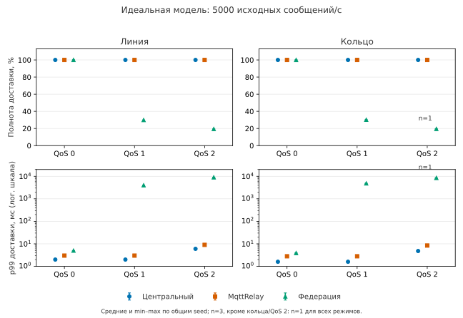

# Основная сеть: пересчёт и сравнение доступных результатов

## Что проверено

Локально пересчитаны первичные данные **106 из 106 доступных результатов**: ошибок проверяемой арифметики нет. Пересчёт занял **311,14 с**. Он проверяет сохранённые ID публикаций, payload, ожидаемые пары «сообщение — получатель», доставки, пересылки, гистограммы и фазы существующим независимым счётчиком. Это проверка результата модели; она не является натурным опытом, повтором симуляции или независимым человеческим рецензированием.

**Паспорт материалов (Material Passport):** кампания основной идеальной сети; программа 162 точки и шесть повторов. Источник — полный архив вне Git, `C:/temp/mqtty-evidence/network-full-3h-v1/raw-001`. SHA manifest исполнения `24ae3654a610545f2a13ebc796eeddcaa898d9bde2103ee722592e211b8bffa7`. Перенос и все 2 854 исходных файла проверены [отдельно](Network-main-transfer.md). Текущие материалы: [квитанция](../audits/dissertation/network-main-recount-v1/verification.json), [CSV](../audits/dissertation/network-main-recount-v1/comparison.csv), [средние и диапазоны](../audits/dissertation/network-main-recount-v1/condition-stats.json), 106 отдельных квитанций в `cases`. Хэши кода пересчёта сохранены в квитанции; входы и runtime не менялись.

Состояние арифметики — **VERIFIED для доступного поднабора**. Состояние всей программы — **не завершена**. Линия 54/54, кольцо 52/54, звезда 0/54. Точные повторы основной сети — **0/6**; шесть повторов короткой серии сюда не засчитываются.

## Какие условия сравниваются

Четыре площадки, 64 отправителя (по 16 на площадке), четыре получателя, payload 16 байт. Прогрев 1 с, подача 10 с, ожидание завершения до 30 с с ранним окончанием при отсутствии работы; tick 0,1 мс. Это соответственно 10 000, 100 000 и до 300 000 тиков отдельных фаз, а не фактическое общее время опыта. Рассматривается идеальная модель, без профилей реальных брокеров.

Сравнение строится по одинаковым topology/QoS/RPS/seed и совпадающим физическим условиям. Получены **34 полные тройки из 54 запланированных**. Это 11 условий с тремя общими seed и одно условие с единственным seed 42. Четыре успешных single/relay для кольца, QoS 2, 5000 сообщ./с, seed 43/44 не имеют результата федерации: они проверены, но исключены из парного сравнения. Пропуски не заменены нулями или короткими опытами.

Каждому сообщению ожидаются четыре получения. При 1000 сообщ./с ожидается 40 000 пар, при 5000 — 200 000. Полнота — уникальные полученные пары / ожидаемые пары. Средние и min–max имеют равные веса по общим seed. Это описательные показатели модели, не доверительные интервалы аппаратной точности. p99 рассчитывается по полученным парам; в таблице — среднее p99 отдельных запусков, не объединённый квантиль.

## Основной результат

Во всех сравнимых условиях **single и Relay имеют полноту 100%**. Федерация доставляет всё при QoS 0 и при QoS 1 / 1000 сообщ./с. При большей нагрузке QoS 1 и при QoS 2 наблюдаются потери. Полная таблица 12 условий непосредственно построена из проверенных данных:

[Таблица полноты и задержек](../audits/dissertation/network-main-recount-v1/figures/Comparison.md).

На графике показаны средние и min–max по общим seed. Для кольца/QoS 2 все три режима сопоставлены только по seed 42: n=1. Нижняя ось логарифмическая. Разброс в этих сохранённых группах нулевой; три одинаковых seed не заменяют точных повторов всей симуляции.

У федерации при QoS 1 и 5000 сообщ./с полнота составляет 29,845% в линии и 30,144% в кольце; p99 доставки — 3996,7 и 4846 мс. При QoS 2 и 1000 сообщ./с полнота составляет 82,1575% и 86,9325%, при 5000 — 19,419% и 19,505% (последняя точка n=1). Небольшая публикационная задержка сама по себе не подтверждает сквозную доставку.

Во всех 106 проверенных результатах дубликаты у подписчиков отсутствуют. В 16 точках федерации одновременно зарегистрированы недоставка и переполнения выходных очередей. Например, линия/QoS 1/5000 имеет 102 222 отказа очереди, линия/QoS 2/5000 — 108 308. Это число отказавших операций очереди, не число различных потерянных публикаций; отнимать его от ожидаемых доставок нельзя. В сравнимых группах исчерпаний переходов, отклонённых forward-публикаций и непосланной из-за backpressure нагрузки нет. Эти нули не гарантируют отсутствие таких событий в других условиях.

## Пересылка и завершение после подачи

При полной доставке Relay выполняет три экспорта на публикацию: 30 000 при 1000 сообщ./с и 150 000 при 5000. Размер тем и payload — соответственно 1 080 000 и 5 400 000 байт. Федерация в линии при QoS 0 выполняет столько же экспортов, но использует более длинные служебные темы: 1 341 012 и 6 795 012 байт. В кольце при QoS 0 она выполняет пять экспортов на публикацию: 50 000 и 250 000, 2 235 020 и 11 325 020 байт. Повторная обработка подавляется; отсутствие дубликатов не означает отсутствие повторного сетевого трафика.

При перегрузке федерации фактических пересылок может оказаться меньше, чем у Relay. Это сопровождается недоставкой и не доказывает более эффективную доставку. Нулевые межброкерные экспорты single не означают нулевой клиентский сетевой трафик. Размер topic+payload не включает все заголовки и подтверждения MQTT/TCP/IP.

Доставки после окончания подачи включены в итоговую полноту и выделены отдельно в CSV. Например, для линии/QoS 1/5000 федерация получает 59 690 пар всего, из них 15 253 после подачи; для линии/QoS 2/5000 — 38 838 всего, 15 318 после подачи. Итоговый goodput, делённый на десятисекундное окно подачи, не является скоростью событий только внутри этого окна.

Фактические схемы линии Relay скопированы из проверенного результата без перерисовки: [физическая SVG](../audits/dissertation/network-main-recount-v1/figures/topology-physical.svg), [логическая SVG](../audits/dissertation/network-main-recount-v1/figures/topology-logical.svg). Mermaid и SHA копий лежат рядом. Физически площадки соединены линией, логически каждый брокер экспортирует каждому из трёх остальных. Это разные графы.

## Отказы и ограничения

В истории 109 попыток, три технических отказа. Первый — `matrix.line.relay.q2.r5000.w10.s43/attempt-001`, `RuntimeError: jobRssLimit`, exit −9; последующая попытка 002 успешна, исходный отказ сохранён. Два нерешённых отказа: `matrix.ring.federation.q2.r5000.w10.s43/attempt-001` и seed 44, `RuntimeError: executionBudgetExhausted`, exit −9. Звезда не выполнялась. Анализ не сбрасывал deadline и не перезапускал опыты.

Очереди, последовательность обмена и число брокеров являются частью сравниваемых реализаций. Без отдельного опыта с изменением одного фактора нельзя приписать все различия только числу маршрутов или только механизму федерации. Натурная точность сети, отказоустойчивость, аппаратная эффективность, самоорганизация и результаты отсутствующей звезды здесь не установлены.

## Проверка 11 статистических ошибок ARS

| Риск | Как ограничена интерпретация |
| --- | --- |
| Парадокс Симпсона | Разные топологии, QoS и нагрузки не объединяются в общий рейтинг |
| Перенос группового свойства на сообщение | Среднее по seed не описывает судьбу каждого ID |
| Смещение отбора | Завершённый поднабор получен остановкой по бюджету, не случайной выборкой |
| Отбор по общему следствию | Полные тройки нужны для сравнения; исключённые четыре результата и зависимость отсутствия от режима указаны |
| Игнорирование исходной частоты | 106/162 — покрытие плана, не вероятность успешной работы |
| Возврат к среднему | Повторы или улучшение после повторного отбора не заявлены |
| Ошибка выживших | p99 показан рядом с полнотой; отказы и недоставленные пары не скрыты |
| Множественный поиск | Показаны все 12 доступных условий, значимость и p-values не рассчитываются |
| Выбор пути анализа по результату | Группировка задана условиями и общими seed; допуски и входы не менялись |
| Корреляция вместо причины | Совпадение потерь и переполнений не заменяет отдельной проверки причин |
| Обратная причинность | Меньшее число пересылок при потерях не объявлено причиной эффективности |

## Техническая проверка и следующий шаг

Семь тестов оболочки и 14 тестов существующего исполнителя прошли. При первом прямом запуске CLI обнаружена ошибка импорта `ModuleNotFoundError: network_review`: встроенный Python не добавлял каталог скрипта в путь модулей. Ошибка воспроизведена отдельным тестом запуска из другого каталога и исправлена до пересчёта. Это техническая попытка запуска счётчика, не неудачный научный опыт. Стартовый RED до создания модуля также сохранён в истории работы; исходные результаты не менялись.

Построены SVG/PDF/PNG, PNG просмотрен: подписи и легенда читаемы, n=1 явно указан. Копии схем совпадают с оригиналами по SHA. Результаты внесены во вторую статью; это готовый частичный разбор, а не завершение шагов 23–25. Следующий экспериментальный этап требует отдельного решения о недостающих 56 точках и шести повторах с заранее объявленным ресурсным бюджетом. Сейчас Linux для чтения и редактирования материалов не нужен.
