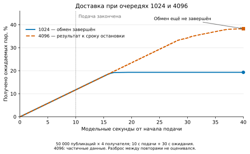

# Очереди1024 и4096: что получено к сроку наблюдения

Новый вариант4096 закончил работу по **модельному сроку ожидания**, а не по лимиту вычислений. Процесс работал1000,543с,пиковый RSS1113534464байт и вернул код2. Симулятор сохранил `drain timed out; partial evidence retained`: после10с подачи ещё30 модельных секунд обмена не хватило, чтобы система стала пустой. Предыдущая ошибка с240-секундным wall-limit здесь не повторилась. Новых запусков после этой остановки нет.

## Проверка данных

Забраны новый raw,исходная программа и ранее принятый эталон1024. Проверены **56 файлов**,253257867байт до сжатия. Архив25905836байт с SHA-256 `c91627aa689f5a4f184ff66fc545e9e209c262f2c96afd82baa69e9b5ea6175f` находится внеGit: `C:/temp/mqtty-evidence/queue-main-remaining-20261030/transfer-001/raw.tar.gz`.

Оба результата пересчитаны существующим verifier и отдельной арифметикой уникальных пар ID–receiver. У4096 проверены частичные журналы; статус failed не менялся на completed. [Приёмка](../audits/dissertation/linux-selected-20261030/remaining-result/acceptance.json),[индекс файлов](../audits/dissertation/linux-selected-20261030/remaining-result/source-file-index.json).

Настройки совпадают кроме queueCapacity:star,4брокера,64publishers,4получателя,QoS2,5000RPS,seed42,1/10/30с,tick0,1мс. Все50000 исходных публикаций успешно завершены у обоих вариантов,ожидаются200000 пар. ID,источник,порядковые номера и расписание подачи относительно начала измерения совпали. Прогрев завершается в разные моменты: measurementStart80547 и123816ticks. Полезная нагрузка отличается абсолютным временем создания в последних8байтах; первые8байт ID совпадают. Это эффект размера очереди на весь эпизод с прогревом,а не побайтно одинаковый внешний trace.

## Сравнение к общей границе40секунд

| Показатель | Очередь1024 | Очередь4096 |
| --- | ---: | ---: |
| Исходные завершения | 50000 | 50000 |
| Ожидаемые пары | 200000 | 200000 |
| Полученные уникальные пары | 38609 | 76513 |
| Получено ожидаемых пар | 19,3045% | 38,2565% |
| QueueDrops,событий отказа постановки | 203360 | 173286 |
| Публикации,полученные всеми4получателями | 1492 | 9065 |
| Новые уникальные доставки в последнюю секунду | 0 | 177 |
| Пересылки в последнюю секунду | 0 | 2431 |
| Статус | completed | failed:drain timeout |

К40-й секунде увеличение очереди дало **на37904 доставки больше**,или на18,952процентного пункта. Это наблюдение одной точки,не итог всех162условий. Эталон1024 стал пустым через19,5664с от начала измерения; дальше для него новых событий нет. Вариант4096 ещё работал перед правой границей: последнее новое получение произошло за85тиков,то есть8,5мс до остановки. Активность последней секунды не согласуется с полным отсутствием продвижения в этом интервале; конкретная незавершённая очередь по этому экспорту не установлена.

Доля0,617435 у4096 означает **неполученные к границе** пары. Часть могла остаться в очередях и прийти позже,если изменить программу ожидания. Её нельзя назвать окончательной потерей61,7435%. Значение p99=27221,8мс описывает лишь уже полученные сообщения; задержки недоставленных пока не наблюдаются. У1024 обмен завершён,p99=8510,1мс; эти распределения не объявляются сопоставимыми полными распределениями всех ожидаемых доставок.

QueueDrops — число отказов постановки сообщений в выходные очереди,не число потерянных исходных публикаций. Его нельзя подставить вместо200000−uniqueDeliveries. Увеличение очереди уменьшило эти события,но не устранило их. По данному опыту нельзя определить отдельно вклад обслуживания выхода,числа одновременно исполняемых отправок или каждого звена сети.

## Приёмка и следующий выбор

Приняты **частичные данные**,не завершённая пара. Старый строгий критерий завершения и основной runtime не менялись. Больше drain и новые матрицы автоматически не запускались. Основные162+6 и40/40 сохранены,защищённые6файлов LaTeX не менялись.

Для вывода о доставке к объявленному сроку новых запусков не требуется. Для окончательной доставки4096 нужна другая заранее объявленная программа с иным наблюдением и диагностикой незавершённого состояния; этот результат не даёт заранее её срока или гарантии завершения. Предпочтительна короткая проверка обслуживания выхода,а не подбор срока до желаемых100%.

Новые материалы статьи1 (другая натурная сессия,24/24 и10/12 в допусках) остаются отдельным результатом. [Общий перечень будущих Linux-программ](../status/Linux-work-queue.md) обновлён. Общая готовность исходного плана53,2%,общая подготовка80%: дополнительных человеческих этапов не засчитано.
