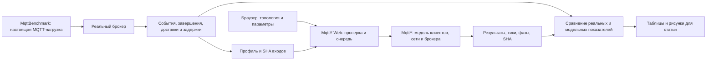

# Исследовательские запуски через MqttY Web

Веб-приложение обновлено на Linux до `mqtty` commit `de226d0bb81a803a9e85065918867f798cda09fc`. Интерфейс доступен через существующий SSH-туннель: http://127.0.0.1:5088. Предыдущие релизы сохранены для возврата.

## Что проверено

| Возможность | Подтверждение |
| --- | --- |
| Выбор и редактирование сохранённой топологии, запуск и просмотр результата | 14 браузерных сценариев на Linux Web, без ошибок JavaScript |
| Поиск заданий, страницы, имя, статус и начало запуска | API-тест и браузерная проверка |
| Тики, шаг времени, статистика узлов и результаты в модальном окне | Браузерная проверка |
| Создание пользовательского типа пресета, редактирование профиля | API-тесты; профиль сохраняется новой копией |
| Просмотр JSON с подсветкой | Браузерная проверка; содержимое не исполняется как HTML |
| Большой профиль ActiveMQ | На финальном Linux-релизе проверены 11,8 МБ: сначала 3 поля, после раскрытия первого раздела 7; все значения сохранены |
| Обновление сервера без потери данных | Сохранены 55 заданий и 8 топологий; SHA файлов топологий совпали |

Подсветка JSON ограничена 5 МБ. Большие профили редактируются через форму с раскрываемыми разделами и страницами по 100 элементов массива. API принимает профиль до 20 МБ; это не означает снятия общего ограничения хранения. Невалидный профиль размером 6 МБ отклонён по схеме ответом 400, а не прежним ограничением размера 413. Настоящие профили при проверке не изменялись.

## Проверочная серия

Через Web API, очередь и отдельные процессы выполнены **9 идеальных опытов**: MqttRelay, федерация и балансировщик, каждый при QoS 0/1/2. Затем выполнены **3 точных повтора** при QoS 1. Все 12 завершены, имеют разные каталоги; проверены 180 файлов по контрольным суммам. Итоговые summaries трёх повторов совпали с оригиналами побайтно. Серия заняла 12,83 секунды.

Эта серия и 14 Linux-браузерных сценариев выполнены на первом обновлённом релизе `922acf1`. Завершающий релиз `de226d0` меняет форму больших профилей и предел тела запроса; его отдельная проверка выполнена с настоящим профилем ActiveMQ и сохранением данных. На финальном исходном коде повторно прошли **36/36 Web-тестов**. Проверки Python: **12 успешных, 2 пропущены по платформе**. Первоначальный запуск Python через имена модулей не нашёл каталог tools в embedded Python; запуск через unittest discover прошёл.

Это техническое подтверждение работоспособности пути запуска. Оно не доказывает точность модели относительно настоящего брокера, не расширяет научное покрытие прежней сети и не заменяет натурные измерения статьи 1.

## Роли приложений

MqttBenchmark измеряет настоящий брокер. MqttY вычисляет модель. Web управляет модельными заданиями и показывает результаты; наличие кнопки запуска не превращает модельное задание в натурный эксперимент.

## Что остаётся для статьи 1

Текущий Web запускает три научных runner: relay, federation и loadBalancing. Согласованная одиночная проверка статьи 1 исполняется через `TwinValidationProbe` и пока не имеет собственного режима Web. Вариант федерации с одним брокером не является его проверенной заменой. Прежние консольные результаты также не появляются автоматически в списке Web-заданий.

Следующий этап — [отдельный план одиночной проверки](../../docs/plans/MqttY.Web.single-broker-validation.md). Сначала нужен тест равенства результата существующего исполнителя и Web-пути на одинаковых входах, затем короткий Linux-пилот. Новая калибровка и контроль идут по [принятой программе 40 запусков](../../docs/dissertation/article-1-matched-validation-plan.md), только после предусмотренных проверок остальных брокеров и измерителя. Завершённый пилот Mosquitto не даёт допуска всей программе.

Старая сетевая кампания остановлена по бюджету; это обновление её не возобновляет. Исторические входы, профили и допуски сохранены.

## Доказательства

Компактные квитанции: [каталог проверки](../audits/web/research-transition-v1/). Основные файлы: `series-result.json`, `linux-browser-receipt.json`, `large-profile-deployment.json`, `linux-large-profile-form.json`, `verification.json`. Полные результаты остаются на Linux-диске доказательств вне Git.
