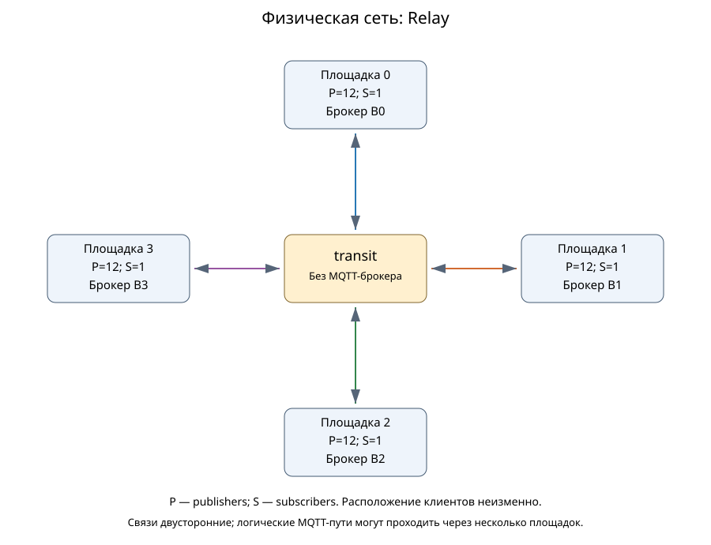
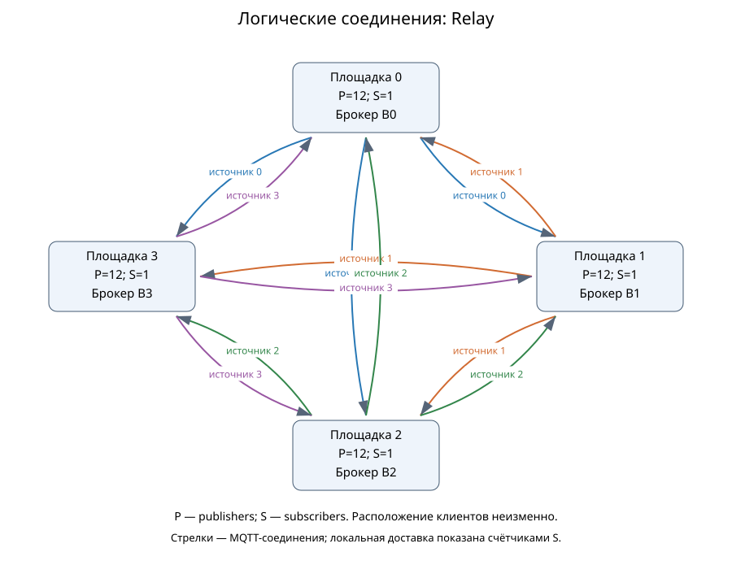

# Статическая федерация MQTT

Режим: **Relay**; модель: **идеальная**; QoS: **1**; seed: **42**. Статус: **completed**.

| Показатель | Значение |
| --- | ---: |
| Запланировано | 10000 |
| Попытки исходных Publish | 10000 |
| Исходные завершения/с | 1000 |
| Ожидаемые пары ID–получатель | 40000 |
| Уникальные доставки | 40000 |
| Goodput доставок/с | 4000 |
| Недоставка среди ожидаемых пар | 0 |
| Получили все subscribers | 10000 |
| p99 ACK, мс | 0.8 |
| p99 получения, мс | 2.8 |
| Подавлено повторов | 0 |
| Дубликаты у subscribers | 0 |
| Попытки пересылки | 30000 |
| Байты тем и payload пересылок | 1080000 |
| Переполнения очередей | 0 |
| Исчерпания числа переходов | 0 |
| Доставки в drain | 11 |

## Формулы и ограничения

RPS исходных завершений = завершения только publishers / длительность нагрузки. Goodput = число уникальных пар ID–получатель / ту же длительность. Ожидаемые пары = API-попытки × число subscribers; потери включают немедленные отказы исходного Publish. Backpressure = заданные слоты − API-попытки. Drain входит в измерительную когорту; прогрев исключён по ID. Квантили рассчитаны по объединённым гистограммам методом верхнего ранга. QoS 0 ACK latency и показатели доставки при отсутствии subscribers неприменимы.

Это статическая пересылка, не самоорганизующийся алгоритм статьи Ribas–Spohn. Федерация рассылает по соседям с подавлением повторов; Relay соединяет каждый брокер со всеми остальными; экспортирует только исходные локальные сообщения и не пересылает импорт повторно. Темы input/routing/delivered разделены. CPU/RSS, EST, выбор ядра и отказоустойчивость не моделируются. Профилированные результаты не подтверждают натурную точность при дополнительной пересылке и fanout. Короткое окно проверяет механизм, а не стационарный p99.

Повтор: `run --config run-config.json --output <новый-каталог>`. Входы сохранены в inputs; summary.json не содержит сведений о компьютере. Хэши подтверждают целостность, проверяемость требует пересчёта и повторного запуска. SVG/Mermaid построены после сверки площадок, связей и расположения клиентов с GraphML.
