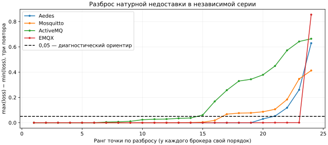

# Точность двойников: ошибки по точкам и влияние окна наблюдения

Независимый пересчёт подтвердил 576 натурных измерений. Здесь разобраны все 288 контрольных симуляций и контекст натурных повторов. Анализ не меняет пороги, профиль или прежние результаты. Причинные объяснения, которые нельзя установить по журналам, названы гипотезами.

## Покрытие и метод

- 4 брокера × 2 payload × 3 QoS × 4 publishers × 3 seed = 288 holdout-симуляций; 96 точек, по три seed.
- Для контекста используются 576 натурных запусков: калибровка и независимая серия, по 72 запуска на брокер/стадию.
- Для каждой точки сохранены отдельные значения критериев: RPS, p99 QoS 1/2, failure и loss. Пороговые значения — 15%, 20%, 0,05 и 0,05.
- Разброс потерь — max(loss)−min(loss) трёх натурных повторов одной точки. Значение 0,05 используется как диагностический ориентир, а не как новый критерий точности или тест значимости.
- Различие средних RPS калибровки/контроля нормировано на среднее калибровки. Это описание двух серий, а не доказательство причины.
- Поздние получения выделены по консервативным границам measurement/drain, восстановленным из первичных событий. Неопределённые у границы события не приписываются точной фазе.

## Все точки независимого контроля

Число в ячейке — сколько из трёх seed не прошло хотя бы один применимый критерий. Пустые и неприменимые ACK QoS 0 не заменены нулевой задержкой.


| Брокер | Прошли все критерии | Провал RPS | Провал p99 | Провал failure | Провал loss |
| --- | ---: | ---: | ---: | ---: | ---: |
| Aedes | 58/72 | 3/72 | 2/48 | 0/72 | 9/72 |
| Mosquitto | 58/72 | 2/72 | 0/48 | 0/72 | 12/72 |
| ActiveMQ | 29/72 | 10/72 | 4/48 | 6/72 | 33/72 |
| EMQX | 58/72 | 3/72 | 10/48 | 0/72 | 6/72 |

Критерии пересекаются: один запуск может нарушить несколько. Поэтому сумму провалов по столбцам нельзя считать числом неудачных симуляций. Всего 85 запусков не проходят хотя бы один критерий; 203 проходят все применимые.

Все 1152 строки решений критериев, включая 96 notApplicable для p99 QoS 0: [criteria.csv](criteria.csv). Все 85 проваленных запусков и сочетания критериев: [failures.csv](failures.csv).

## Разброс натурных повторов



| Брокер | Точки с разбросом loss >0,05 | Точки со сдвигом RPS >15% между сериями |
| --- | ---: | ---: |
| Aedes | 4/24 | 0/24 |
| Mosquitto | 8/24 | 0/24 |
| ActiveMQ | 10/24 | 2/24 |
| EMQX | 1/24 | 1/24 |

Это не доказательство, что пороги следует расширить. Большой разброс требует показать отдельные повторы и ограничить выводы о среднем. Число seed модели не увеличивает число натурных повторов. Сопоставление наблюдений с фиксированным профилем остаётся условной проверкой при интенсивности attempted RPS, взятой из контрольной точки.

## Получения после измерительного окна

Для каждого брокера показан один контрольный запуск с наибольшей верхней границей доли поздних получений. Знаменатель — все уникальные полученные ID этого запуска. Это целевой разбор крайних случаев, не средняя доля брокера и не процент потерь. Нижняя/верхняя граница относятся к одному и тому же запуску.

| Брокер и запуск | Получено ID | Заведомо поздние | Неопределённые у границы | Доля поздних: нижняя–верхняя | p99 от API-attempt до первого получения, мс |
| --- | ---: | ---: | ---: | ---: | ---: |
| Aedes.m256.q1.p128.r1 | 5155 | 1509 | 0 | 29.273–29.273% | 29305.356 |
| Mosquitto.m16.q0.p128.r2 | 68817 | 55779 | 72 | 81.054–81.159% | 19869.847 |
| ActiveMQ.m256.q0.p128.r3 | 41705 | 34320 | 0 | 82.292–82.292% | 26939.371 |
| EMQX.m16.q1.p128.r1 | 173480 | 318 | 0 | 0.183–0.183% | 56.741 |

Во всех 576 выбранных измерениях исходы исходных публикаций урегулированы до drain; это не означает, что до него завершились получения subscriber. ACK и получение — разные события. В таблице приведён p99 от зарегистрированной попытки API, а не ACK и не чистая задержка брокера. Малое число получений также может давать ненадёжную картину задержки; рядом сохраняется полнота.

Получения после измерения входят в итоговую натурную доставку, но completed RPS использует фактическую длительность измерения. В модели временное окно фиксировано и брокерные завершения при drain могут входить в числитель. Эти различия нельзя устранить простым переименованием поля RPS. Требуется проверка чувствительности к окну и сопоставление когорт; этот отчёт её ещё не выполняет.

## Что установлено по ActiveMQ

1. **Факт:** 43/72 holdout-запуска не проходят все применимые критерии; в 33 из них нарушен loss. Это расхождения модели, а не 43 падения процесса.
2. **Факт:** разброс натурного loss превышает 0,05 в 10 из 24 контрольных точек. Ошибки loss нельзя автоматически объяснить лишь изменением RPS.
3. **Факт:** в независимой натурной серии сохранены следующие исходы API:

| Причина | Число событий |
| --- | ---: |
| `MqttCommunicationException: The client is not connected.` | 497472 |
| `OperationCanceledException: The operation was canceled.` | 1093 |
| `MqttCommunicationException: Broken pipe` | 85 |

Цикл CampaignWorkloadRunner регистрирует attempt до вызова Publish и после перехваченного исключения продолжает работу. Он не реализует остановку или reconnect отключённого publisher. Поэтому эти API-попытки не равнозначны потоку PUBLISH, принятому брокером. Сумма ошибок проверена по первичным журналам; сами сообщения об ошибках не устанавливают причину первого разрыва.

4. **Факт:** в одном контрольном запуске до 82,292% полученных ID пришли заведомо после окна измерения. Это подтверждает существенное временное распределение доставки в данном запуске.
5. **Гипотезы:** состояние соединения, накопление очередей и различия окон могут вносить вклад в расхождения. Нынешние данные не идентифицируют вклад каждого механизма и не доказывают, что все 33 провала loss вызваны одним из них.
6. **Следующий проверяемый шаг:** без изменения профиля выполнить заранее фиксированную чувствительность к tick и длительности; отдельно подготовить натурный опыт состояния соединений, если потребуется исправление модели. Текущий holdout после подбора по нему не становится новым независимым контролем.

Прежняя диагностика с журналами брокера остаётся отдельным источником: [ActiveMQ-diagnosis](../../../mqtt-benchmark/ActiveMQ-diagnosis.md). Она выявила ошибки разбора/разрывы, но без записи TCP не установила виновный компонент. Настоящий анализ не превращает гипотезу о причине в доказанную ошибку конкретной реализации.

## Остальные брокеры

- **Aedes:** API-ошибок в независимых измерениях нет, но 14 контрольных симуляций нарушают критерии. Следовательно, отсутствие ошибок вызова недостаточно для точного воспроизведения доставки.
- **Mosquitto:** 12 из 14 не прошедших симуляций нарушают loss; p99 проходит во всех 48 применимых случаях. Восьми точкам свойственен натурный разброс loss >0,05. Это ограничивает вывод о стабильности средней недоставки.
- **EMQX:** в 10 случаях нарушен p99, в шести — loss; причины могут пересекаться. Один натурный сценарий 256 Б/QoS 1/128 publishers имеет разброс loss около 0,855; это отдельный нестабильный режим, а не типичная потеря всего брокера.

## Воспроизведение и ограничения

```text
python tools/dissertation/analyse_accuracy.py --native-audit /path/to/evidence/full/audit-results.json --output /path/to/new-analysis
```

Нужны Python, NumPy и Matplotlib. Скрипт сначала проверяет зафиксированную основу foundation-v2 и SHA-256 полного аудита. Выходной каталог должен быть новым. Построение отчётного текста выполнено отдельно; таблицы и графики сверены с CSV/JSON. Список всех входов и хэшей: [manifest.json](manifest.json).

[Все 96 точек](points.csv) · [576 временных окон](rawWindows.csv) · [Сводка JSON](analysis.json).

Данные относятся к измеренной установке и версиям. Поздняя доставка не является сама по себе дефектом протокола. Граница measurement/drain восстановлена по предпосылкам кода; точное общее начало часов не записано. Самоорганизация, натурная точность Relay/федерации, CPU/RSS модели и причинное объяснение всех провалов здесь не подтверждаются.
