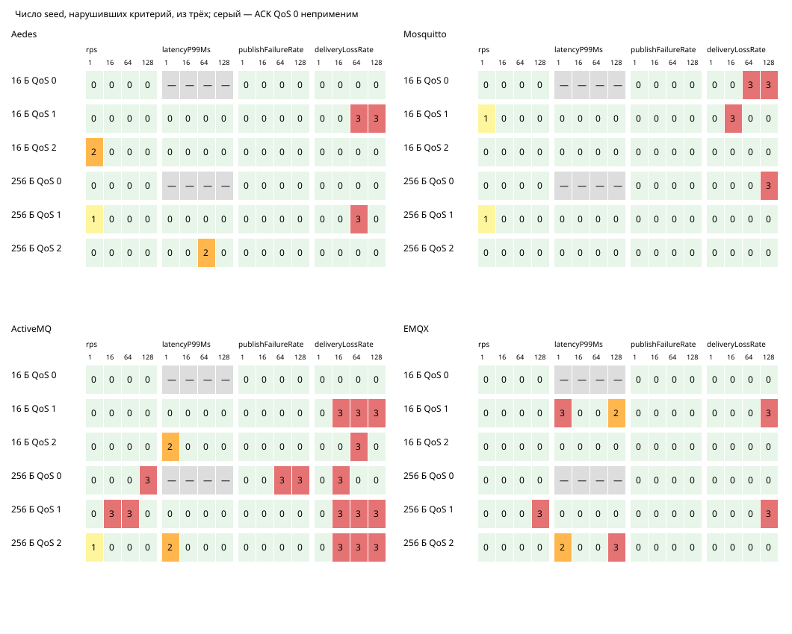
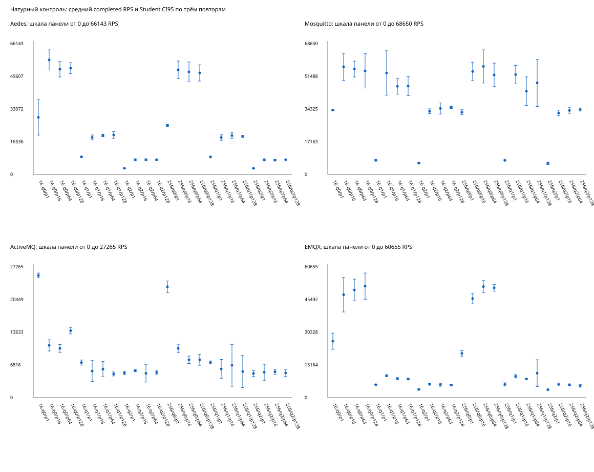
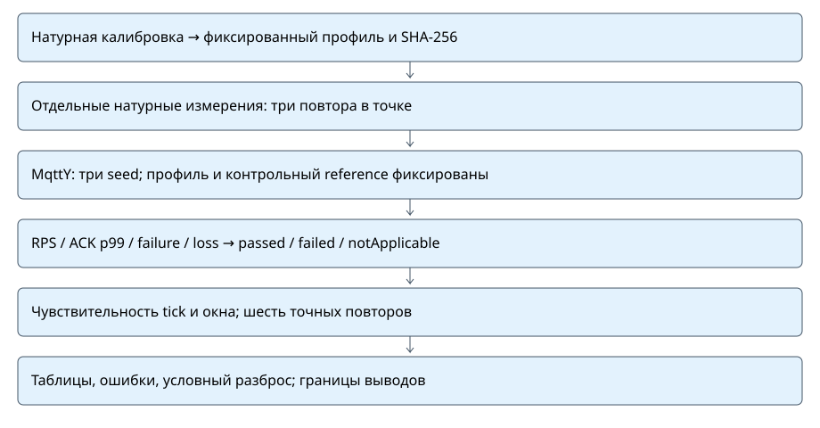
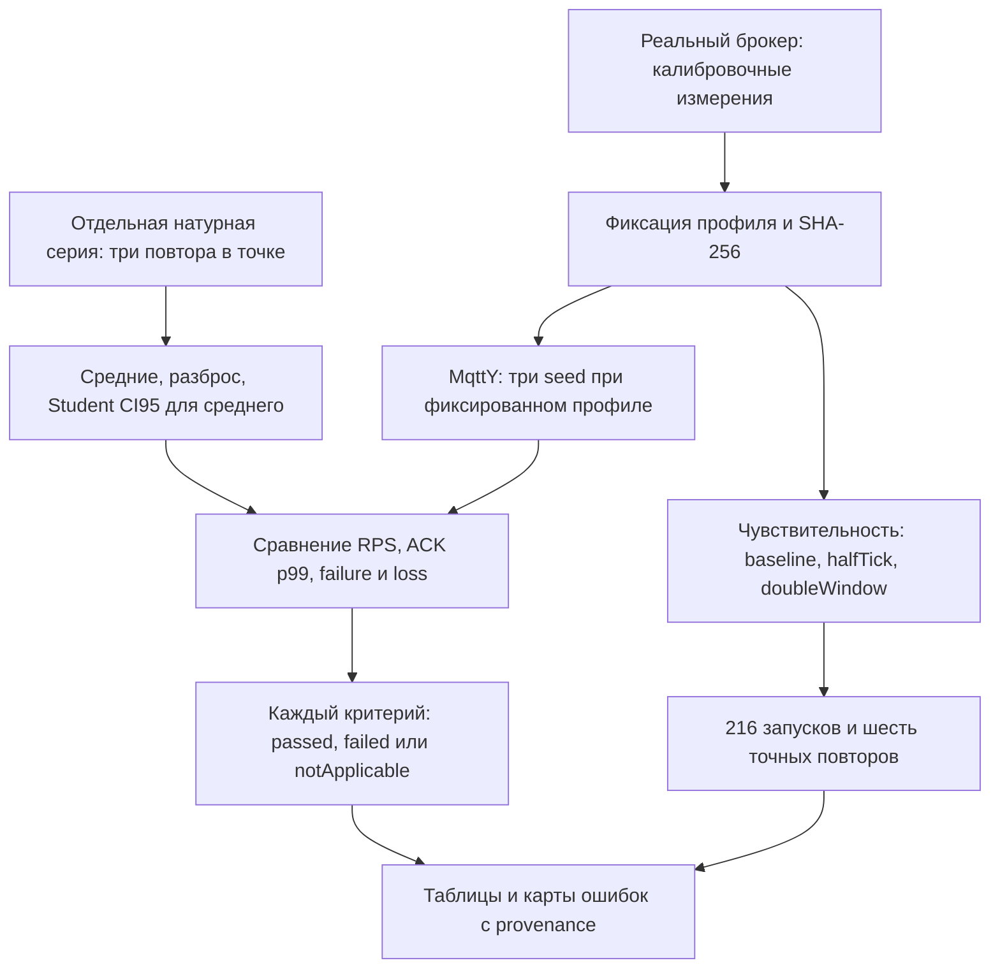

# Технический пакет таблиц и рисунков о точности двойников

Это подготовленные данные и схемы для автора, а не текст статьи. Новых замеров нет. Исторический контроль — отдельная серия; полная слепая независимость от доработок модели по истории не доказана.

| Брокер | Исторический контроль: прошли / не прошли | Чувствительность: прошли / не прошли |
| --- | ---: | ---: |
| Aedes | 58 / 14 из 72 | 41 / 13 из 54 |
| Mosquitto | 58 / 14 из 72 | 43 / 11 из 54 |
| ActiveMQ | 29 / 43 из 72 | 38 / 16 из 54 |
| EMQX | 58 / 14 из 72 | 39 / 15 из 54 |

Всего: 203/288 и 161/216 прошли все применимые критерии. Провалы критериев не являются падениями процесса. Критерии пересекаются, поэтому их провалы нельзя складывать как число запусков.

## Правила расчёта

Для каждой из 192 натурных точек (два этапа × 96) среднее и SD вычисляются по трём отдельным запускам, с равным весом запуска. CI95 среднего: mean ± 4,30265273 × SD/√3. Это Student-интервал с двумя степенями свободы, при допущении независимых повторов и приемлемости нормального приближения; n=3 не позволяет надёжно проверить эти допущения. Интервал не обрезается до допустимых физических границ. При малом n он может выходить за [0,1]; это ограничение метода. CI для среднего из трёх p99 — не доверительный интервал индивидуального p99 распределения событий.

Для трёх seed отдельно показаны среднее, SD, min/max и условный Student-интервал среднего модели. Профиль и контрольное среднее неизменны. Этот интервал описывает только вариацию модели по seed и не оценивает неопределённость натурных замеров, профиля, систематическую ошибку и переносимость на другое оборудование. Не следует считать его доказательством физической точности. Нулевой SD не означает точную физическую модель.

ACK p50/p95/p99 QoS 0 — notApplicable: пустое значение, n=0; нули в средние не добавляются. Failure = failedPublishes/attemptedPublishes; loss относится к доставке завершённых публикаций по определению исходной программы. RPS нормирован на длительность измерения, но завершения и доставки при drain могут входить в итоговые счётчики. Метрики ACK и доставки не взаимозаменяемы. Разные окна исторического контроля и чувствительности не объединяются в одну выборку.

Относительные ошибки RPS и p99: |model−reference|/|reference|; абсолютные ошибки failure/loss: |model−reference|. Пороги сохранены: 0,15 / 0,20 / 0,05 / 0,05. Проверяется каждый seed отдельно, а не только среднее.

## Рисунки









## Файлы и повторение

- `broker-summary.csv`: покрытие и пересекающиеся провалы по четырём критериям.
- `native-uncertainty.csv`: средние, SD, диапазон и Student CI95 по трём натурным повторам; два этапа разделены.
- `conditional-seed-spread.csv`: условный разброс исторических симуляций по seed; reference не меняется.
- `holdout-points.csv`: все 96 точек и число проваленных seed.
- `criterion-error-map.svg`: четыре критерия по всем нагрузочным точкам; 0–3 провала seed.
- `native-rps-ci95.svg`: все 96 контрольных точек, три натурных повтора, среднее и CI95; шкалы панелей различаются.
- `figure-inventory.csv`: назначение, знаменатели и источники каждого рисунка.
- `methodology.svg` и `methodology.mmd`: схема получения и проверки результатов; SVG — последовательная краткая схема, Mermaid — зависимости.
- `package.json`: машинные данные; `manifest.json`: SHA-256 источников, генератора и каждого результата.

Из корня мета репозитория:

```powershell
python tools/dissertation/prepare_article_figures.py --output reports/audits/dissertation/article-figures-replay
```

Генератор требует новый каталог, проверяет исходные SHA и формулы, не меняет исходники. Все выходные файлы воспроизводятся побайтно при тех же входах и генераторе; календарные даты и абсолютные пути в результаты не включены.

## Границы технической готовности

Пакет закрывает подготовку таблиц точности, карт ошибок, оценок разброса и схемы методики. Он не заменяет научное согласование критериев, независимую внешнюю проверку, новые натурные измерения, выбор научной новизны и написание статьи автором. Сетевые pilots, MqttRelay и федерация не входят в доказательство точности одиночного брокера этим пакетом.
