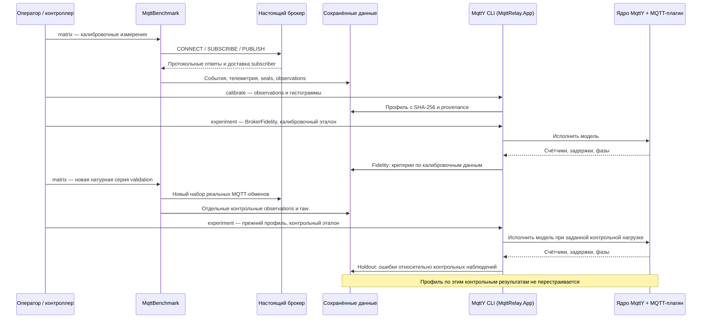

# Проверенный пакет по двойникам четырёх MQTT-брокеров

Пакет объединяет методику, проверку чисел и разбор ошибок. Он предназначен для подготовки статьи автором. Новых измерений и симуляций нет; профили, пороги и старые результаты не менялись. Исторический контроль не объявляется слепой независимой проверкой.

## Результат и покрытие

Натурная основа: 576 выбранных измерений, по 72 калибровочных и 72 контрольных на брокер. Их независимый пересчёт ранее завершён без расхождений; проверены 592 архива, включая дополнительные и отклонённые попытки. Здесь анализируются все 288 исторических контрольных симуляций: четыре брокера × два payload × три QoS × четыре числа publishers × три seed. Это 96 точек и 1152 решения критериев. Калибровочные Fidelity и сетевые опыты в знаменатель 288 не входят.

Критерии: относительная ошибка completed RPS ≤15%, p99 публикационного завершения ≤20%, абсолютная разница failure и loss ≤0,05. Для QoS 0 ACK отсутствует. `notApplicable` сохраняется отдельно. Критерии одного запуска могут пересекаться.

| Брокер | Все критерии пройдены | Не прошли | RPS / 72 | p99 / 48 | failure / 72 | loss / 72 |
| --- | ---: | ---: | ---: | ---: | ---: | ---: |
| Aedes | 58/72 | 14/72 | 3 | 2 | 0 | 9 |
| Mosquitto | 58/72 | 14/72 | 2 | 0 | 0 | 12 |
| ActiveMQ | 29/72 | 43/72 | 10 | 4 | 6 | 33 |
| EMQX | 58/72 | 14/72 | 3 | 10 | 0 | 6 |

Всего **203/288** прошли все применимые критерии, **85/288** не прошли хотя бы один. Это расхождения точности, а не число падений процессов. Доля прошедших сценариев не является вероятностью точности произвольного будущего опыта.

## Как проверены эти числа

1. Проверен SHA исходного analysis.json по его прежнему manifest.
2. Независимо от готовой таблицы восстановлена полная сетка из 288 ключей; для каждого проверены четыре различных критерия и сохранена неприменимость QoS 0.
3. Список провалов заново получен как объединение failed-критериев; он точно совпадает с исходными 85 строками, включая сочетания критериев.
4. Каждый провал сопоставлен со своей натурной точкой, не с соседним числом publishers или payload. Проверены 96 уникальных контекстов и сводки четырёх брокеров.
5. В failures-context.csv сохранены все 85 строк, в broker-summary.csv — пересчитанные итоги. Никакие провалы не исключены по величине ошибки или наличию объяснения.

## Разбор по брокерам

### Aedes

В натурной контрольной серии не зарегистрированы API-ошибки, но расхождения доставки есть. Значит, отсутствие исключений вызова Publish недостаточно для воспроизведения потерь. Конкретный источник каждого расхождения не установлен.

- Натурные контрольные точки с разбросом loss >0,05: **4/24**. Со сдвигом среднего RPS между калибровкой и контролем >15%: **0/24**.
- Среди 14 модельных провалов **6** относятся к точкам с таким разбросом loss. Это сопоставление контекстов, не число доказанно объяснённых провалов.

### Mosquitto

Основные расхождения относятся к loss; p99 проходит все применимые точки. Это не означает, что доставка точна: подтверждение ACK и получение subscriber различаются. Ошибки соединений зарегистрированы, но их причинная связь с каждым провалом не установлена.

- Натурные контрольные точки с разбросом loss >0,05: **8/24**. Со сдвигом среднего RPS между калибровкой и контролем >15%: **0/24**.
- Среди 14 модельных провалов **12** относятся к точкам с таким разбросом loss. Это сопоставление контекстов, не число доказанно объяснённых провалов.

Зарегистрированные API-ошибки натурного контроля (не новые ошибки модели):

| Сообщение | События |
| --- | ---: |
| `MqttCommunicationException: Broken pipe` | 81800 |
| `MqttCommunicationException: Connection reset by peer` | 32 |
| `MqttCommunicationException: The client is not connected.` | 3 |
| `OperationCanceledException: The operation was canceled.` | 371 |

### ActiveMQ

Это наиболее слабый двойник по доле прошедших сценариев данной серии. Это не рейтинг качества реального брокера. В журналах зарегистрированы многочисленные попытки API после отключения клиента; offered load по API не равен числу PUBLISH, принятых брокером. Первопричина разрыва соединения и вклад этого эффекта в каждый провал не идентифицированы.

- Натурные контрольные точки с разбросом loss >0,05: **10/24**. Со сдвигом среднего RPS между калибровкой и контролем >15%: **2/24**.
- Среди 43 модельных провалов **30** относятся к точкам с таким разбросом loss. Это сопоставление контекстов, не число доказанно объяснённых провалов.

Зарегистрированные API-ошибки натурного контроля (не новые ошибки модели):

| Сообщение | События |
| --- | ---: |
| `MqttCommunicationException: Broken pipe` | 85 |
| `MqttCommunicationException: The client is not connected.` | 497472 |
| `OperationCanceledException: The operation was canceled.` | 1093 |

### EMQX

Важная группа расхождений относится к p99; есть и нарушения loss. Низкая доля поздних получений в рассмотренном крайнем случае не доказывает отсутствие иных источников ошибки. Отдельные нестабильные натурные режимы нельзя обобщать на весь брокер.

- Натурные контрольные точки с разбросом loss >0,05: **1/24**. Со сдвигом среднего RPS между калибровкой и контролем >15%: **1/24**.
- Среди 14 модельных провалов **3** относятся к точкам с таким разбросом loss. Это сопоставление контекстов, не число доказанно объяснённых провалов.

## Установленные механизмы и предел причинного объяснения

| Наблюдение | Статус | Что следует | Что не следует |
| --- | --- | --- | --- |
| Счётчики 576 измерений воспроизводятся из сохранённых событий | Проверка внутренней согласованности | Ошибки опубликованной арифметики в проверенном объёме не обнаружены | Сам измеритель не может иметь систематической ошибки |
| Регистрация API-attempt предшествует Publish; после перехваченного исключения цикл продолжается | Механизм подтверждён кодом и ошибками журнала | Attempted RPS может включать вызовы отключённого клиента | Все расхождения ActiveMQ вызваны именно этим механизмом |
| Уникальные получения продолжаются после измерительного окна | Факт отдельных натурных запусков | Сравнивать ACK, получение и временные знаменатели нужно раздельно | Поздняя доставка означает потерю или дефект MQTT |
| Разброс loss повторов >0,05 | Диагностическое описание | Следует показывать повторы и ограничить вывод о среднем | Можно расширить порог проверки модели или объявить статистическую значимость |
| При уменьшении tick отклонения малы в выбранной матрице | Парная проверка чувствительности | Проверенное уменьшение шага не устранило основную проблему loss | Все ошибки модели происходят от tick либо tick вообще ни на что не влияет |
| Потери и очередь, состояние соединений, границы фаз | Причинные гипотезы | Есть конкретные механизмы для будущих изолированных проверок | Причина каждого из 85 провалов установлена |

Для каждого из 85 запусков causeStatus оставлен **notIdentifiedPerRun**. Это осознанная граница результата: ошибка критерия проверена, но причинный диагноз отдельной точки не выдуман. Шаг анализа закрывается технически картой фактов и гипотез, а не обещанием устранить все расхождения.

## Что добавила чувствительность

Завершены 216 основных симуляций: 161 прошли критерии, 55 не прошли; технических ошибок 0. Отдельно 8 pilots и 6 точных повторов. Все шесть повторов совпали в проверенной научной части; два воспроизводят нарушения критериев.

| Изменение | Максимальное изменение RPS | Максимальное изменение p99 |
| --- | ---: | ---: |
| halfTick | 0.088% | 3.846% |
| doubleWindow | 10.562% | 26.923% |

Это изменения между парными симуляциями, а не ошибка относительно натурного эталона. Число нарушений loss одинаково для трёх вариантов (12 на вариант); уменьшение tick не является подтверждённым исправлением loss. Изменение p99 до 26,923% при удвоении окна не позволяет считать короткое окно универсально достаточным.

## Что делать с моделью дальше

1. Сохранить действующие профили и пороги; этот пакет описывает область применимости текущей версии, а не её исправление.
2. В отдельном будущем эксперименте различать API-attempt, передачу в транспорт, приём брокером и получение subscriber. Для ActiveMQ фиксировать состояние соединения и момент первого разрыва. Не приписывать старым raw отсутствующие события.
3. Отдельно проверять когорты измерительных публикаций и завершения при drain; не заменять delivered/expected данными receiver иного охвата.
4. Если модель будет изменена по историческому контролю, проверять точность на новом заранее зафиксированном наборе. Старые 203/288 не переименовывать в независимую валидацию новой модели.
5. Начинать исправления с коротких механизмных тестов с известным ответом. Новая многочасовая серия не нужна для подготовки этого пакета.

## Приёмка и работа автора

- Техническая часть шага 10: полная карта ошибок, сверка каждого провала, подтверждённые механизмы и явно обозначенные гипотезы подготовлены.
- Шаг 09: описание метода приложено ниже; ожидается чтение автором. Подготовленный текст не равен принятой рукописи.
- Автору нужно подтвердить определения loss/ACK/drain, условный характер контрольной нагрузки, ограничения независимости и допустимую формулировку научного вклада. Решение не подставляется автоматически.
- Пакет не подтверждает точность реальной Relay/федеративной сети, CPU/RSS двойника, перенос натурных чисел на другую машину или достоверность через EST. EST — условный рейтинг с выбранными весами, не вероятность.

## Приложение: методика и ответственность приложений

### Построение и проверка двойника: техническая схема для автора

Материал для шага 09: обязанности приложений, происхождение параметров, формулы и границы проверки. Это схема метода и исходные сведения для статьи; окончательный текст пишет человек. Новых измерений или изменений профиля этот документ не вводит.

#### Кто выполняет работу

| Участник | Что делает | Как запускается | Что сохраняет |
| --- | --- | --- | --- |
| Оператор и контроллер кампании | Выбирают программу, подготавливают входы, последовательно вызывают приложения | Команды оркестратора из отдельного процесса | План, состояние, версии, причины отказов |
| Настоящий брокер | Обслуживает реальные MQTT-соединения | Native launcher стенда | Состояние процесса и журналы |
| MqttBenchmark | Создаёт настоящих клиентов, подаёт нагрузку, получает сообщения, собирает guard/телеметрию | CLI `matrix`, затем `aggregate` | NDJSON событий, seals, результат, observations |
| Экспортёр гистограмм | Пересчитывает задержки успешных Publish из raw и связывает их с архивами | `tools/campaign/export-latency-histograms.py` | Бины задержек и SHA источников |
| MqttY CLI в `MqttRelay.App` | Проверяет входы и строит профиль либо запускает опыт | `calibrate` или `experiment` | Неизменяемый профиль, manifest, summary, counters, histogram |
| Ядро MqttY и MQTT-плагин | Исполняют клиентов, брокер и сеть в модельном времени | Вызывает CLI, отдельно оператор их не запускает | Модельные события и счётчики |
| Python-проверки | Независимо пересчитывают доступные события и опубликованную арифметику | `native_audit.py`, `run_native_audit.py`, `foundation.py` | Покрытие, расхождения, реестры и контрольные суммы |
| Автор и независимый проверяющий | Принимают определения и научные выводы, выполняют содержательную сверку | Работа человека по инструкции | Решение, замечания и ограничения |

Название исполняемого проекта `MqttRelay.App` не означает, что каждый его опыт является relay-сетью. `BrokerFidelity` проверяет один модельный брокер. Сетевая ретрансляция MqttRelay — другой режим, с другими маршрутами и смыслом суммы брокерных счётчиков. Настоящий MQTT-трафик MqttBenchmark не проходит через MqttY.

#### Последовательность одного брокера

Полная программа одной стадии: 2 payload × 3 QoS × 4 publishers × 3 повтора = 72 запуска, 24 точки. На брокер приходятся 72 калибровочных натурных, 72 Fidelity, 72 контрольных натурных и 72 контрольных модельных запуска. На четыре брокера — 576 натурных и 576 одиночных модельных запусков. Pilots и неудачные попытки учитываются отдельно. Прежние 360 relay-симуляций в это число одиночных моделей не входят.

#### Откуда берутся параметры профиля

Точка задаётся тройкой payload/QoS/publishers. Внутри неё усредняются показатели трёх самостоятельных натурных повторов; соседняя точка не подставляется вместо отсутствующей.

| Параметр | Источник / правило | Ограничение |
| --- | --- | --- |
| Attempted RPS | Среднее `A/T` трёх повторов | A — вызовы API, не доказанное число PUBLISH на проводе |
| Target completed RPS | Среднее `C/T` | Включает клиентские и транспортные условия установки |
| Target failure | Среднее `F/A` | Может включать локальные ошибки отключённого клиента |
| Conditional delivery loss | Среднее `1−Dс/C` | Это эмпирическая доля, а не идентифицированная причина потери |
| Admission capacity | Attempted RPS × (1−rateRejectionRate) | Rate rejection — явное допущение; успешной скоростью его отдельно не идентифицировать |
| Conditional publish failure | `(targetFailure−rateRejectionRate)/(1−rateRejectionRate)` при допустимых параметрах | Калибровка отклоняется при rate rejection > target failure или rate rejection = 1 |
| ACK-квантили | Успешные Publish QoS 1/2; верхний ранг | QoS 0 ACK отсутствует; среднее квантилей повторов не является квантилем объединения |
| Эмпирическая CDF, schema 4 | Бины задержек объединяются по счётчикам событий трёх повторов | Это смесь с весом по числу завершений; не среднее трёх CDF с равными весами |
| RTT baseline | Отдельный калибровочный preflight | Приближение транспортного бюджета, а не измеренное чистое время сервиса брокера |

`BrokerCalibrationV3` задаёт целевые скорости/доли и проверяет полное покрытие. `BrokerCalibrationEmpirical` добавляет гистограммы с происхождением до исходных архивов, проверяет числа завершений и соответствие средних квантилей observations с точностью бинов. Профиль содержит наблюдаемую CDF и распределение после вычитания оценённого RTT-компонента.

В применённом `empiricalServiceBudget` runtime использует наблюдаемую CDF и отдельно вычисленный нижний протокольный предел идеального модельного обмена. Обработка учитывается сверх этого предела; samples ниже представимого протокольного пола не удаляются из профиля, их ограничение фиксируется. Это модельное допущение, а не измеренная декомпозиция «сеть + сервис настоящего брокера».

Ожидание доступной ёмкости и эмпирическая задержка обработки объединяются через максимум, а не суммируются дважды: наблюдаемая CDF уже содержит очереди натурного тракта. Средние attempted RPS, completed RPS и failure усредняются по повторам отдельно; произведение средних attempted RPS и успешности не обязано равняться среднему completed RPS. Сохранение этих целевых чисел не означает точную идентификацию всех внутренних механизмов брокера.

#### Что именно сравнивается

Для натурного запуска A — попытки API, C — успешные исходы, F — неуспешные исходы, D — уникальные полученные ID, Dс — полученные ID из успешных исходов. T — фактическая монотонная длительность. Проверяются `A=C+F` и разбиение D на полученные ID успешных/неуспешных исходов.

| Показатель | Натурная формула | Модельное соответствие |
| --- | --- | --- |
| Completed RPS | `C/T` | Завершения модели / фиксированное окно подачи; исходы при drain могут оставаться в числителе |
| Failure | `F/A` | Rate rejected + publish failed / attempted на модельном брокере |
| Delivery loss | `1−Dс/C` | `1−Delivered/ExpectedDeliveries` по подпискам модели |
| p99 публикации | Длительность успешного вызова Publish API | Модельная публикационная задержка с разрешением tick |
| Полнота для EST | `D/A` | Не подменяется модельным loss; полный EST требует натурного CPU |

Критерии: относительная ошибка RPS ≤0,15; относительная ошибка p99 QoS 1/2 ≤0,20; абсолютные разности failure/loss ≤0,05. При неприменимости или отсутствии эталона показывается `notApplicable`, а не passed. В текущем runtime относительный критерий с нулевым эталоном также неприменим.

Fidelity использует данные настройки: это воспроизведение калибровки. Holdout использует отдельные observations при прежнем профиле. Offered RPS контрольной модели берётся из attempted RPS контрольной точки — проверка условная, при известной интенсивности, а не слепой прогноз нагрузки на новой машине. Отдельные campaign identities и SHA профиля необходимы, но сами по себе не доказывают, что при выборе алгоритма ранее не использовались контрольные результаты. Историю такого подбора требуется оговорить; после подбора по контролю нужен новый независимый набор для нового утверждения точности.

Три натурных повтора дают среднее, SD и t-CI95 с двумя степенями свободы. Они не дают автоматического доверительного интервала p99 всего потока. Три seed модели не увеличивают число независимых натурных повторов. Прогрев отделяется по темам и ID; поздние получения остаются в итоговой доставке, а точная граница receiver measurement/drain не записана и восстанавливается только интервалом.

#### Где проверить реализацию

| Механизм | Исходник |
| --- | --- |
| API-события, ожидание исходов, drain | `MqttBenchmark/src/EntityFX.MqttBenchmark.Campaign/Workload/CampaignWorkloadRunner.cs` |
| Счётчики и натурные знаменатели | `MqttBenchmark/src/EntityFX.MqttBenchmark.Campaign/Workload/DeliveryLedger.cs`, `MeasurementSummary.cs` |
| Средние и CI | `MqttBenchmark/src/EntityFX.MqttBenchmark.Campaign/CampaignAggregator.cs`, `EntityFX.MqttBenchmark/Calibration/MetricStatistics.cs` |
| Базовый и эмпирический профиль | `mqtty/src/EntityFX.MqttSimulator/EntityFX.MqttY.Plugin.Mqtt/BrokerProfile/BrokerCalibrationV3.cs`, `BrokerCalibrationEmpirical.cs` |
| Входы, чистые commits, отдельный контрольный эталон | `mqtty/src/EntityFX.MqttSimulator/EntityFX.MqttY.MqttRelay.App/MqttRelayExperimentCommand.cs` |
| Транспортный бюджет, фазы, нормировка и критерии | `mqtty/src/EntityFX.MqttSimulator/EntityFX.MqttY.Plugin.Mqtt/Experiments/MqttRelayExperimentRunner.cs` |
| Исполнение эмпирической обработки и потерь | `mqtty/src/EntityFX.MqttSimulator/EntityFX.MqttY.Plugin.Mqtt/MqttBroker.cs` |

Текущий checkout не выдаётся за версию прежнего измерения. Точные исторические commits, SHA профилей, identity калибровки/контроля и хэши проверенных исходников содержатся в реестре основы.

#### Материалы для автора и открытые решения

- Контракт метрик и техническое заключение.
- Полная карта точности: 203/288 holdout проходят применимые критерии, 85 не проходят хотя бы один.
- Программа чувствительности: 216 основных опытов, 6 точных повторов и 8 pilots завершены. В основной матрице 161 опыт прошёл критерии, 55 не прошли; технических ошибок нет. Все 6 точных повторов совпали. Изменение окна влияет на p99 в отдельных режимах; универсальная устойчивость не подтверждена.
- Научно согласовать определения и историю использования контрольных данных; не объявлять seed или совпадение хэшей доказательством новизны.
- В анализе чувствительности показывать размер изменения ошибок, а не только passed/failed; профиль и пороги сохраняются. Итоговый технический разбор: `reports/analysis/Sensitivity-final.md`.
- Выбранные same-input повторы не подменяют независимую проверку другим сотрудником и точность на другой аппаратуре.

## Источники и повторение

- accuracy: `reports/audits/dissertation/accuracy-analysis-v1/analysis.json`, SHA-256 `46f1bb81917c54e6dbe04756b5536ed3206879f6510eda8d9de18c50d5eaa8da`.
- accuracyManifest: `reports/audits/dissertation/accuracy-analysis-v1/manifest.json`, SHA-256 `2d33d19e848ea8411ed9bb47b3916e980c19f9c6b0dae746e3d8f992fa0300e3`.
- sensitivity: `reports/audits/dissertation/sensitivity-final-v1/analysis/analysis.json`, SHA-256 `1498b3399219f9e18d1eff2a57d3ed30d8f41f549c3f1a3245da1776a5bb1de1`.
- history: `reports/audits/dissertation/control-history-v1/evidence.json`, SHA-256 `7b904847822340bc067bd992b3fb44879a61082b475db7259eabdaacaa49c194`.
- method: `docs/dissertation/broker-twin-method-map.md`, SHA-256 `e6427136504a59a6bd3e57509991455b9c6f64cfdd49fd9560be64e3f83ccc23`.

Повторение: `python tools/dissertation/prepare_twin_package.py --output <новый-каталог>`. Нужен только Python стандартной поставки и локальный checkout с источниками выше. Запуск не обращается к Linux. Все файлы пакета перечислены в manifest.json; старый каталог не перезаписывается. Исходные raw и архивы остаются вне Git.
