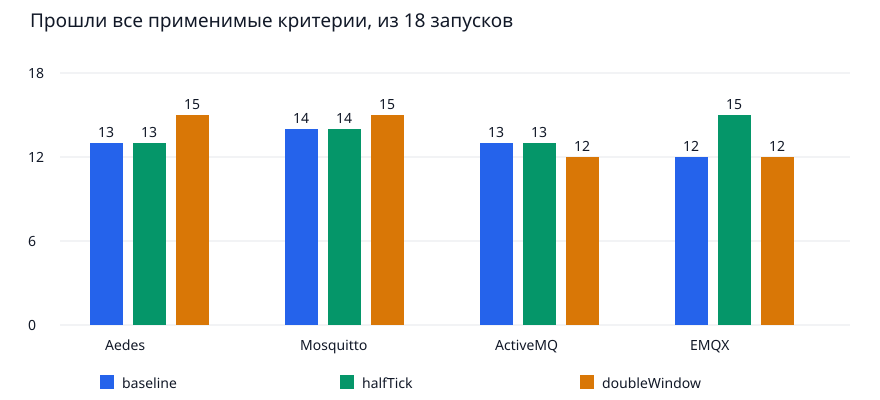

# Итог проверки чувствительности двойников MqttY

Серия полностью выполнена: **216 основных симуляций, 8 пилотов и 6 точных повторов; технических ошибок нет**. **161/216** основных запусков прошли все применимые критерии, **55/216** не прошли хотя бы один. Это исследование чувствительности уже зафиксированной модели, а не новая независимая натурная проверка и не текст статьи.

## Что сравнивалось

Четыре двойника: Aedes, Mosquitto, ActiveMQ Classic и EMQX. Для каждого: payload 16 байт, QoS 0/1/2, 1 или 128 publishers, seeds 42/43/44 и три варианта. Итого 4 × 1 × 3 × 2 × 3 × 3 = 216. Каждый вариант имеет 72 запуска, каждый брокер — 54. В каждой паре сохраняются профиль, натурное наблюдение, нагрузочная точка, offeredRps и seed.

| Вариант | Шаг | Окно нагрузки | Прогрев | Предельный drain |
| --- | ---: | ---: | ---: | ---: |
| baseline | 10 мкс | 2 с | 1 с | 5 с |
| halfTick | 5 мкс | 2 с | 1 с | 5 с |
| doubleWindow | 10 мкс | 4 с | 1 с | 5 с |

Время здесь модельное. Увеличение окна увеличивает количество публикаций; сравниваются скорости, доли и задержки, а не только абсолютные счётчики. Это сокращённая матрица по двум уровням publishers и одному payload, её нельзя распространить на все режимы брокера.

## Проверка доказательств

SHA-256 плана: `dfda8401e9e3f96aebece1b4baa116b58437c94752ecc0324b6e8c909243ae3c`.

SHA-256 перенесённого снимка: `e1f303d4da889d618456333614e607c0ae9a37276205846590047464c0809acd`.

Программа чтения на Linux независимо перечитала 230 файлов строк и исходные summary, histogram, counters и manifest; проверила SHA конфигураций, 27 замороженных файлов входов/runtime и профили каждого запуска. После переноса локальный анализ проверил полное декартово покрытие, параметры каждого опыта и неизменность эталона в парах; пересчитал RPS, failure/loss и p99 по гистограммам, а также 920 состояний критериев. Ошибок этих проверок нет.

У шести заранее выбранных повторов совпали байты summary и histogram и канонические байты научной части counters (поля brokers, receivers, receiverScope). Полный counters с графом и manifest с runId/временем таким требованием не охватываются. Это подтверждает детерминированность выбранных запусков на данном runtime, а не безусловную точность модели реального брокера.

## Соответствие натурному эталону

Пороги сохранены: относительная ошибка RPS ≤15%, p99 ≤20%, абсолютная разница publishFailureRate и deliveryLossRate ≤0,05. Для QoS 0 публикационного ACK нет; p99 ACK отмечен notApplicable. Код завершения 3 означает научное расхождение; он не является техническим падением.

| Брокер | baseline: прошли / 18 | halfTick: прошли / 18 | doubleWindow: прошли / 18 | Всего прошли / 54 |
| --- | ---: | ---: | ---: | ---: |
| Aedes | 13/18 | 13/18 | 15/18 | 41/54 |
| Mosquitto | 14/18 | 14/18 | 15/18 | 43/54 |
| ActiveMQ | 13/18 | 13/18 | 12/18 | 38/54 |
| EMQX | 12/18 | 15/18 | 12/18 | 39/54 |

| Критерий | baseline: не прошли | halfTick: не прошли | doubleWindow: не прошли |
| --- | ---: | ---: | ---: |
| rps | 3 | 3 | 1 |
| latencyP99Ms | 7 | 4 | 8 |
| publishFailureRate | 0 | 0 | 0 |
| deliveryLossRate | 12 | 12 | 12 |

Один опыт может нарушить несколько критериев. Поэтому сумма нарушений отдельных критериев не равна числу непройденных запусков. Пилоты и повторы не добавлены в знаменатель 216. Все провалы сохранены в criteria.csv; успешные точки не отобраны отдельно.



## Парное влияние шага и окна

Для каждого брокера и варианта есть 18 пар с baseline, из них 12 имеют p99 ACK (QoS 1/2). Ниже: среднее абсолютное относительное изменение / наибольшее изменение. Это изменение **между двумя симуляциями**, а не ошибка относительно натурного наблюдения. Среднее берётся по нагрузочным точкам и seeds с равными весами; точные пары сохранены в paired-metrics.csv.

| Брокер | Вариант | RPS: среднее / максимум | p99: среднее / максимум | Максимальная абсолютная разница loss |
| --- | --- | ---: | ---: | ---: |
| Aedes | halfTick | 0.016% / 0.058% | 0.767% / 3.846% | 0.000178 |
| Aedes | doubleWindow | 1.439% / 8.603% | 1.231% / 7.692% | 0.001412 |
| Mosquitto | halfTick | 0.014% / 0.075% | 0.450% / 2.500% | 0.000086 |
| Mosquitto | doubleWindow | 0.956% / 10.562% | 0.095% / 0.395% | 0.001062 |
| ActiveMQ | halfTick | 0.021% / 0.088% | 0.110% / 1.316% | 0.000406 |
| ActiveMQ | doubleWindow | 0.955% / 5.443% | 7.280% / 26.923% | 0.005649 |
| EMQX | halfTick | 0.002% / 0.018% | 0.858% / 2.778% | 0.000174 |
| EMQX | doubleWindow | 0.514% / 2.137% | 0.235% / 1.361% | 0.002524 |

Уменьшение шага до 5 мкс изменило RPS максимум на 0.088%; максимальное изменение p99 — 3.846%. Это свидетельство малой чувствительности к данному уменьшению шага в выбранной матрице. Переход с 2 до 4 с изменил RPS до 10.562%, а p99 ActiveMQ — до 26.923%. Поэтому считать двухсекундное окно универсально достаточным для хвостовой задержки нельзя. Число прошедших запусков (52/72, 55/72, 54/72, соответственно baseline, halfTick, doubleWindow) не доказывает устранение систематической ошибки модели.

Число нарушений loss для baseline, halfTick и doubleWindow: 12, 12, 12. Это основание отдельно разбирать модель доставки и соответствие определения loss; это не доказательство конкретной программной ошибки. Подбирать профиль или допуски по этим наблюдениям без новой независимой серии нельзя.

## Значение метрик и границы достоверности

completedRps = completed / длительность окна; completion может происходить во время drain. publishFailureRate = publishFailed / attempted; deliveryLossRate = 1 − delivered / expectedDeliveries. p99 восстановлен как ближайший ранг ceil(0,99 × число ACK) из гистограммы тиков с переводом в мс. QoS 0 исключён из анализа ACK. Фактические receiver receipts имеют иной охват: после сброса учитываются поступления до конца drain, включая сообщения прогрева, пересёкшие границу. Их нельзя подставлять вместо broker.delivered или выдавать за проверенную полноту пар «публикация, получатель».

Три seeds показывают вариацию этой модели, но не заменяют повторные натурные измерения. В point-metrics.csv даны среднее и диапазон трёх seeds; доверительные интервалы точности реального брокера по ним не заявляются. CPU/RSS относятся к стоимости вычисления, не к моделируемым свойствам двойника. EST здесь не вычисляется: интегральный рейтинг брокеров не является вероятностью достоверности модели.

Результаты используют ранее полученные профили и контрольные observations. Базовые summary совпали с зафиксированной прежней кампанией, однако аудит истории не подтвердил слепую независимость всех контрольных данных от предшествующей разработки. Называть эту серию независимой натурной валидацией нельзя. Также она не подтверждает натурную точность сети MqttRelay или федерации.

## Воспроизведение анализа

```powershell
python tools/dissertation/analyse_sensitivity.py --observation reports/audits/dissertation/sensitivity-final-v1/observation.json --output <новый-каталог> --final
```

analysis.json содержит 144 парных сравнения; paired-metrics.csv — каждую метрику каждой пары; point-metrics.csv — 72 группы нагрузочных точек с тремя seeds; criteria.csv — все 864 критерия основной матрицы. verification.json фиксирует проверки, transfer.json — совпадение SHA снимка на Linux и локально, collect_read_only.py позволяет повторить чтение сохранённого стенда без перезапуска опытов. Полные исходные файлы остаются на диске доказательств Linux; в Git архивы не добавляются.

## Что требуется дальше

1. Для режима с заметным изменением p99 проверить достаточность окна по заранее заданному плану; текущие результаты сохранить.
2. Отдельно проверить определения потерь и влияние границы прогрев/измерение/drain.
3. Если модель будет исправлена, зафиксировать новую версию и проверять на новом контрольном наборе, не меняя эту серию.
4. Перед основной сетевой матрицей отдельно разобрать результаты её pilots; данная серия не является допуском сетевого опыта.
